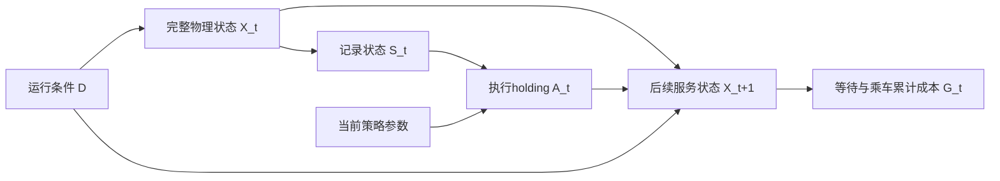

# 因果视角：对历史经验与新反馈不一致的可检验解释

**当前可成立的结论是：真实新反馈取得了平均控制收益，但其价值修正未在所有运行条件下保持正确的动作权衡。跨数据来源的机制、状态组成和动作支持不一致，是合理解释，尚未被识别为6208退化的确定原因。** 因此，因果视角适合用作问题形式化、结果讨论和补充检验依据；当前方法不应命名为已经解决混杂或实现因果对齐的算法。

## 文献身份与可引用内容

用户提供的《Towards Causal Reinforcement Learning》PDF是Elias Bareinboim在ICML 2020的教程幻灯片，147个PDF页面，文件元数据为`crl-icml20`、Keynote。它不是一篇2020年期刊原始研究论文。PDF第15–20页讨论观测与干预，第60页和第138页列出跨环境可迁移性与结构不变性问题；页码为PDF物理页，区别于幻灯片印刷编号。

[官方教程主页](https://crl.causalai.net/)明确将幻灯片与[配套技术报告](https://causalai.net/r65.pdf)分别提供。主文可引用教程支持“结合历史与在线数据时须明确干预目标与共享不变性”的概念；如采用配套报告，应单独列其作者、版本和实际年份，不能把当前报告内容倒记为附件的2020论文。官方网页中的更新年份也不能代替实际稿本的文献元数据。

## 把“因果关系错位”写成什么

令\(D\)表示数据来源或运行机制，\(S_t\)为记录的决策状态，\(A_t\)为经过F后的执行holding，\(G_t\)为以后累计乘客成本，\(\pi\)为后续策略。相关学习目标应写成：

\[
\tau_D(s;a_1,a_0,\pi)=
\mathbb E_D[G_t^{a_1,\pi}-G_t^{a_0,\pi}\mid S_t=s].
\]

这是在相同决策状态改变一次动作、随后执行指定续策的成本效应。它区别于历史样本中“执行某动作的状态后来成本较高”的相关性，也区别于改变整日学习方案的总效果。成本与续策都必须固定口径；300秒真值、长期soft Q和全天乘客成本不能直接当作同一个因果量。

最小交通关系可以表示为：

这是研究假说图，不是从数据发现的因果图。运行条件可能影响需求、运行时间、容量和换乘服务；状态压缩可能省略部分未来服务信息。若相同记录状态下这些因素的组成变化，历史条件均值就未必可迁移到当前运行。策略更新又改变状态访问和续策，因此全日后果不能仅由一条真实短转移决定。

需要区分三种情况。

1. **行为分布变化。** 不同策略产生不同\(P_D(S,A)\)。如果状态充分、奖励与转移机制相同且有动作支持，离策略学习可以合法混合这些数据。不同策略或不同日期本身，不等于因果混杂。
2. **机制或状态组成变化。** 即使乘客成本定义不变，路段冲击、未表示的服务机会或容量后果，也可能使记录状态下的动作响应改变。此时需要检验可迁移性；只增加近期样本或重加权，不能自动恢复正确动作排序。
3. **隐藏混杂与支持不足。** 一般而言\(P(G\mid S,A,D)\)不自动等于\(P(G\mid S,do(A),D)\)。但当前actor的动作由记录的229维状态和F产生，尚无证据证明隐藏因素另外直接影响动作选择；不能据两个负例宣布存在未观测混杂。确定性／狭窄动作选择导致的替代动作支持不足、状态非充分及函数逼近误差，是不同问题，不能混写成一个“因果错位”。

## 已有证据能解释到哪里

v75以同初始化、同更新预算、同F的fresh／no_fresh对照，受控改变是否让当天完整结果进入critic；这支持该反馈通道及其后续适应的**总控制效应**：6格平均成本降低5.946秒／乘客，4格改善、2格退化。两臂更新后各自形成不同的服务状态，这是总效应的传导过程，不应为求“同状态”而事后回归消除。三份初始化才是独立训练重复；6格不是6份独立训练样本。

该比较没有识别每次holding的因果收益，也没有检验跨来源结构不变性。v73的状态池／结果池解耦能减少选样同时扰动多个模块，但不是后门调整或因果识别器。方法仍是recent30真实结果TD、CQL和混合bootstrap，当前world／trust不更新。历史最终MC-WM与v75的训练方案不同，其性能比较更不能单独归因为因果对齐。

6208的实际证据是等待损失超过乘车收益：稳定\(2\Delta W=+7.992\)、\(\Delta R=-3.336\)，总差\(+4.656\)；冲击分别\(+1.905,-1.372,+0.533\)。两场景在16200秒的采样端点已经出现累计损失，稳定日最终少完成5人的旅程，冲击日却多完成1人。它们说明服务时序与成本权衡存在失败，不能仅归于尾窗、日末人数或“新反馈不真实”。这些现象与因果可迁移性不足相容，也与价值估计误差、有限反馈及策略变化相容，尚不能排除后几种解释。

## 供论文讨论直接使用的段落

> 从因果决策视角看，真实反馈修正了已执行动作的事实结果，却不直接给出其他动作在当前运行条件下的长期收益。历史经验与当天反馈可能来自不同的行为分布、服务状态组成或运行机制，使基于历史数据形成的条件价值未必完整迁移到当前控制任务。本研究通过分离状态输入与结果监督，在三份独立初始化上的平均全天乘客成本获得改善，但6208仍出现等待损失超过乘车收益的负例。这表明数据新鲜度与决策效用并不等价。现有对照支持新结果监督的平均增量价值；是否由机制漂移、状态信息不足或未支持动作的估值造成局部退化，仍需针对动作效应的独立检验。

English discussion wording:

> Fresh observations reveal the outcomes of executed actions, rather than the long-term advantages of every alternative action. Historical and current records can differ in behavior, service-state composition, and operating mechanisms, limiting the transportability of learned conditional values. Our matched comparison supports an average benefit of fresh outcome supervision, while the adverse cases show that this benefit is heterogeneous. The results are consistent with incomplete transportability of action-value information, but do not identify causal misalignment or unobserved confounding as the cause of degradation.

## 三项有边界的补充检验

**先做既有日志的分布与支持核查。** 在服务器就地按线路、issue时段、F执行支持、载客／排队等事前变量，统计history与fresh的状态动作覆盖、重复使用及反馈年龄；只回传小表。变量必须在动作前可见，不能按未来收益构造分层。若坏例并无更明显支持缺口，就降低“覆盖错位”的解释优先级；若存在，仍只算分布证据，不能称因果确认。日志没有的变量保留缺失，不从未来状态回填。

**再核查条件响应的可迁移性。** 对现有保存的同定义状态动作组，分来源报告相同物理端点上的响应或TD残差；必须保留不同运行条件与续策，不能把残差差异直接当机制变化。如果现有日志只有相邻全网事件，无法得到同车或长期动作响应，就明确该检验不可识别，不新造标签。跨源残差无差异会削弱机制漂移解释；有差异只能提出进一步的同状态干预需求。

**最后才设计小规模动作因果对照。** 仅在前两项给出明确问题后，预声明少量新前缀、事前状态和合法动作，固定同外生随机流与参考续策，比较等待／乘车和同一长期成本端点。正负标签全保留，不按已知坏例收益追采；训练、诊断与独立评价真值分开。该步骤需要新预算和授权，本轮未启动。成功标准应是解释或改善预声明的动作收益排序及平均控制成本，而非要求所有状态无损。

本文件仅新增理论讨论和补充方案；未训练、模拟、调用封存真值、修改旧代码或结果。所有因果图、识别条件与候选机制均按假说表述。

## Astra补充意见与已有v114／v118干预证据

附件PDF物理页66–70确有混杂观测与干预关系排序不同、朴素融合可能使决策变差的示例。它证明这种风险可以发生，不证明本项目已有同样的混杂路径。当前最具体的假说是：有限反馈集中于当前策略访问的服务条件，价值函数却通过共享参数与自举把修正推广到其他状态和动作；若条件效应表示或动作支持不足，原有排序可能被破坏。这里必须分别核查状态裁剪、行为策略混合、F后动作支持和长期服务后果，不能仅以“数据来源不同”代替机制证据。

已完成的[v114同完整状态动作对照](/home/erzhu419/mine_code/Thesis/experiments/mcwm_same_state_holding_v114_20261029/RESULTS_AND_NEXT.md)表明，在两个固定根把holding由44.358／41.556秒缩为5.896／4.385秒，全天成本分别增加0.915／0.230秒／乘客。省下部分车内时间，不等于全网获益；记录中确有接驳服务损失。其后反馈、学习与控制仍可响应，因此这是特定根的闭环总效应，不是固定后继状态下的静态动作效应，也不是只改变一个乘客接驳的独立中介干预。

[v118固定接驳动作对照](/home/erzhu419/mine_code/Thesis/experiments/mcwm_connection_full_day_v118_20261029/RESULTS_AND_NEXT.md)则在v114已缩短holding分支的另一已暴露状态将4.973秒增至7.5秒，全天成本减少8679加权人秒，即0.575569秒／乘客。目标乘客减少9668加权人秒，其余人群净代价抵消了部分收益；整日仍高于旧v111 no_fresh固定参照约2.800秒。其续策是共同记录proposal经各自状态的F执行，未评价恢复actor后的响应，不是v118自身配套运行的no_fresh对照。它不能与v114视为同一续策条件，也不能把两个查询收益相加。

这两批试验证明了特定服务状态中holding存在非直观、跨车辆与接驳的后果，支持“动作效应依赖服务条件”。它们来自完整MC-WM后续支线及已暴露根，不能直接证明v75的6208退化由同一机制造成，更不能作为新的独立训练集。已有材料可纳入论文机制讨论，但不需重跑这些根或扫描新剂量。

论文中可采用的收敛表述是：**平均反馈收益已经在v75成立；少数退化可能涉及服务条件依赖的动作价值迁移不足。现有动作干预支持条件效应和服务机会的重要性，尚未建立“具体错位→估计排序受损→只修正错位便改善控制”的完整因果链。** 新6日解耦消融仅补方法组件证据，不冒充这条因果链的最终检验。
