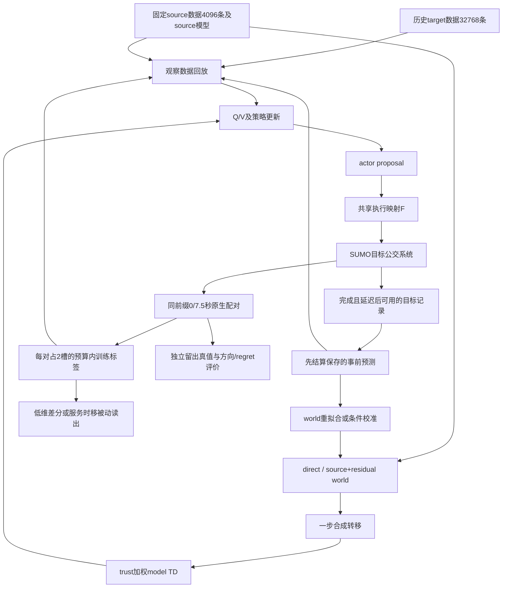

# 公交 MC-WM 持续目标反馈：完整问题、项目进展与下一步交接报告

**报告日期：2026-10-23。v23科学结果核查截至北京时间10:33:30；加速任务状态补充核查截至10:44:48。**

本文覆盖从论文冻结版本、在线闭环v1、A1/A2/A3正式对照，到v23采样诊断、v24/r1执行加速。历史结论来自已有小型结果、审阅文档和实现；当前状态来自服务器只读小汇总，留存在[状态快照](/home/erzhu419/mine_code/Thesis/experiments/mcwm_closed_loop_progress_review_20261023/status_snapshot.json)。没有重跑历史实验、修改旧代码或结果，也没有下载完整轨迹、CSV或checkpoint。

## 1. 当前结论与项目所处位置

最初的问题已经修复：**原论文冻结公交版没有把持续到达的target新数据用于训练；从v1开始，这条目标数据—模型—策略—后续执行的闭环已经接通。当前不能再用“只有target offline data”“fresh没有入训”或“actor一直冻结”解释负结果。**

真正尚未解决的是：**新目标数据能改善某些预测，甚至改善同流Bellman目标，但额外世界模型、局部校正和动作响应读出，尚未稳定地改善动作选择与乘客成本。** 当前证据支持保留持续策略学习，继续处理控制相关响应的识别问题。

当前状态分为两条线：

| 工作线 | 已完成 | 当前判断 |
|---|---|---|
| 持续策略学习 | A1相对同初始化、零更新行为的五种子成本比较 | stable/shock分别改善约62.68/73.85秒/乘客；尚未单独识别fresh标签相对继续优化的贡献 |
| 世界模型及动作响应 | v1–v22逐步完成实现修复、预测/TD/动作分叉、配对学习和服务诊断 | 有局部有效环节，但未建立稳定的额外控制收益；未晋级独立确认 |
| 最新科学实验v23 | 1个稳定主日、9训练对、18臂、285预算、24000秒；训练汇总已完成 | 实现完整性通过，**科学采样门失败：705X只有1个联合状态层**；服务留出与B阶段未启动 |
| 执行加速v24/r1 | 首对同值、fork/缓冲读取回归；修复路线文件位置共享；t211248长原生复测通过 | 原v24整日失败，r1首长预检t211244超时；现整日验证/汇总t211253/t211254已提交，尚未完成整日同值验收或切换默认执行器 |

v23原主日墙时为**10,433.188秒，即2小时53分53秒**。它已是一个可用的完整执行对照源。v24r1没有完整加速日，因此目前没有可靠的整日加速倍数。

## 2. 原始研究目标与当前真实数据流

### 2.1 原始缺口

论文原冻结版本使用固定target离线数据，以及简易source仿真先验/交互；其`target_online_training_events=0`。最初roadmap要求恢复：历史目标数据与source先验构建world，部署后持续接收稀疏、延迟的目标结果，滚动更新模型/上下文，再更新策略并返回目标环境。

这里的target是SUMO高保真代理环境，不是已经上线运行的真实公交系统。原论文`F-FINAL-225`保持冻结，不与本轮开发实验混合重写。

### 2.2 当前实现的闭环

正式在线批固定source回放池，没有持续增加新source交互。后期差分/服务候选主要作为共同`action_model`流上的**被动读出**，并没有各自接管全天控制。训练配对可按预算准入；留出和额外归因诊断真值不回灌。

自动发现因果结构、未知变化位置识别以及A4机制分解的额外优势，目前均未实现或验证。现阶段主要研究已指定线路/区间上的适应与动作后果。

原始实现与方法说明见[v1说明](/home/erzhu419/mine_code/Thesis/experiments/mcwm_closed_loop_v1/README.md)、[第六章方法方案](/home/erzhu419/mine_code/Thesis/experiments/mcwm_closed_loop_v1/第六章方法方案.md)。用户提供的两份GPT诊断是分析材料；本报告只将其中已经实施且有结果的部分写作项目进展。

## 3. 必须统一的实验定义

### 3.1 初始化、时长和反馈预算

| 项目 | 共同设置或阶段差异 |
|---|---|
| 初始化 | 对应种子的50000步IQL初始化器；历史target32768条，source4096条 |
| 正式初始种子 | 6201–6205；后续小开发通常6201/6202；v21与v23各一个稳定日，v22复用v21 |
| 目标运行 | 全日24000模拟秒 |
| 冲击 | 正式场景在9000秒将指定共享路段机动车道速度乘0.65，策略不接收冲击标志 |
| 反馈窗口 | 1200、1500、……、18000秒，共57包；结果完成后至少延迟30秒才可用 |
| 普通正式批 | 每包5条不同的已完成、正时长、非终止目标转移，共285条 |
| 配对学习阶段 | 267普通标签＋9对×2动作结果＝285槽；每对替换2条普通标签，不额外加到285之外 |
| 策略/trust更新 | 在线控制日策略每包8次，共456次；含模型控制臂trust同为456次，A1无trust学习，共同预测日无策略更新；两world家族每包各10步重拟合，后期汇总world更新1140次，初始拟合另计 |
| 物理基线 | 早期v2–v4的target同车物理标签单列；后期固定102条source物理区间，不新增未计账target物理监督 |
| 后缀约束 | 配对分支沿相同前缀和外生种子启动；干预后300秒所有学习计数增量为0 |
| 保存边界 | 原冻结实验、已有版本代码、正式结果、失败结果均保留；新增任务统一high |

配对分支若global下一事件时长为0，该动作结果仍消耗反馈槽，并可监督固定300秒/服务端点；按原规则不进入正时长world/TD拟合。**285个反馈名额不等于285个有效正时长TD样本。**

配对标签至少到`issue+300+30`秒后才可用，若所需global端点更晚完成，还要继续等待。子进程在墙时上先完成，不允许使原生主时钟提前获得标签。

### 3.2 四种“冻结”不可混称

1. **论文冻结实验**：原`F-FINAL-225`，保留原协议与结论。
2. **冻结初始化行为**：同IQL初始化actor不再更新，作为持续策略学习的行为参照。
3. **冻结world参数**：direct/residual等参数固定，但策略、trust等仍按同预算更新。
4. **冻结诊断后缀**：从训练中或停更后的固定状态分叉，300秒不训练；冻结参数的actor继续执行，执行映射仍可能随真实时钟变化。

### 3.3 global事件、同车区间与固定300秒

global转移在全网任意下一控制事件到来时关闭，可以从A车连接到B车；同车物理区间是同车辆、同班次从本站decision-ready到下一站decision-ready，包含holding、运行/信号及下一站服务。二者都可能合理，但不能把一个直接替换为另一个。

当前canonical state为229维，由5个全局字段及最多16×14个当前事件slot组成；未显式保存完整车队连续进度。基础world四个global目标为：

\[
[\log(1+\Delta t),\ \log(1+(-r)),\ \Delta N_{wait},\ \Delta N_{ride}].
\]

后期动作诊断另看同车端点和精确`issue+300`端点。global时长为0，并不代表300秒动作效应为0。

### 3.4 成本、方向与regret

全天成本使用：

\[
J=\frac{2\times\text{累计等待人秒}+\text{累计乘车人秒}}{\text{全日出发乘客数}}.
\]

尚未完成乘客已经积累的时间也计入。正式初批各控制日分母均为15079人。成本差为“新方案−参照”，负数表示改善。

固定300秒动作收益定义：

\[
C(h)=2W(h)+R(h),\qquad G=C(0)-C(7.5).
\]

这里W/R是该300秒内等待/乘车人秒；G正支持7.5秒，否则选0。若模型预测\(\hat G\)，该状态regret为：

\[
\max(0,G)-\mathbf1_{\hat G>0}G.
\]

表中通常报告多个状态regret之和，单位加权乘客人秒，不能与全天秒/乘客直接比较。固定0的预测恒为0，其严格三值“方向正确率”可能为0，但动作选择可以正确，必须分别统计。

早期闭环分析的停更后成本窗为18300–24000秒。v17以后两个留出issue窗通常为[18010,18700)、[18700,20000)，是另一类终点。原恢复判据还要求先出现可辨认的早期恶化；这个触发条件未形成可比较恢复起点，不能写成零秒恢复。

## 4. 早期主学习链：为什么fresh确实进入了控制

真实更新batch为256：source128、历史target64、fresh target64，actor也使用这些观察状态。因此，不能按原始数据量32768对285推断fresh被完全淹没。

world使用累计recent与等量历史target重拟合；两个direct/residual家族按最近128条保存的事前预测误差选择。早期recent容量285，而总反馈也只有285，所以冲击前记录并没有自然全部淘汰。每次模型重拟合重新建立Adam，source模型和source normalizer固定。

统一动作后，模型臂critic系数可写为：

\[
L_Q=0.1875L_{history}+0.1875L_{fresh}+0.375L_{source}
+0.25\,\mathbb E[w\ell_{model}].
\]

`real075`只删除最后一项；旧A1观察TD总系数为1。模型项乘绝对trust后求均值，不除以trust总和。现有H2O+控制target为：

\[
y=10^{-4}r+(1-d)[0.1V(s')+0.9\,SACsoft_{\pi,\bar Q}(s')].
\]

控制batch的discount为1，没有额外的`gamma^duration`。trust另有自己的累计目标：

\[
c=1/(1+error/\tau),\quad Q_\Delta\leftarrow\log c+0.9Q'_\Delta,\quad w=\exp Q_\Delta.
\]

这里0.9属于trust，不是控制折扣。平均w约0.17不能解释为“模型即时正确率17%”。

模型以`no_grad`生成一步合成转移，先影响critic，再经后续actor更新影响策略。actor-before-critic造成更新次序上的滞后，但一包8步仍允许critic变化传到后续actor；它不是链路断开。

以上细节及早期证据集中见[v4问题与进展汇总](/home/erzhu419/mine_code/Thesis/experiments/mcwm_closed_loop_v4_review_20261020/问题与进展汇总_供GPT6分析.md)。

## 5. 版本进展：v1到v9

### 5.1 v1和A1/A2/A3正式批

v1短运行验证了目标数据权限、先预测后评分再训练、实际策略更新和更新后执行。四臂各40事件批次，推进至1148秒；replay/online/context各用9条新标签、4次策略更新、33次更新后决策。它是实现验证。

随后正式批完成30个控制日、10个共同预测日，全部为24000秒、285标签；控制日各456次策略更新，共同预测日行为actor冻结、`policy_updates=0`，模型只旁路预测和更新。A1=replay，A2=online world，A3=旧全局context。五种子共同预测流9000–18000秒结果：

| 指标 | 冻结world参考 | A2 | A3 |
|---|---:|---:|---:|
| 六组综合预测损失 | 1.509581 | 1.529013 | 1.531546 |
| global成本MAE，人秒 | 2297.477 | 2307.618 | 2340.085 |

A2综合损失比冻结参考五种子全差；A3又比A2五种子全差。全天成本则为：

| 场景 | A1 | A2 | A3 | A2−A1 | A3−A1 |
|---|---:|---:|---:|---:|---:|
| 稳定 | 2207.862 | 2206.788 | 2211.514 | −1.074 | +3.652 |
| 冲击 | 2212.838 | 2211.784 | 2216.151 | −1.054 | +3.313 |

单位秒/乘客。冲击A2−A1描述性95%配对t区间为[−6.178,+4.071]，A3−A1为[+0.386,+6.241]。15个恢复配对均未触发可辨认的早期恶化，不能据此比较恢复速度。

关键参照是同初始化零更新行为：A1稳定/冲击成本降低**62.680/73.855秒/乘客，五种子全改善**。所以问题集中于额外模型/context的边际价值，而非整个持续策略学习流程变坏。该行为参照是事后分析，计算匹配的无fresh监督对照仍缺失。

证据：[正式结果分析](/home/erzhu419/mine_code/Thesis/experiments/mcwm_closed_loop_formal_20261020/结果分析.md)、[冻结行为派生对照](/home/erzhu419/mine_code/Thesis/experiments/mcwm_closed_loop_v4_review_20261020/frozen_behavior_comparison.json)。

### 5.2 v2–v4：动作契约修复，局部预测改善未传到控制

v2确认冲击使三线非holding复合区间约增加28秒；局部context将三线同车预测MAE降到约7.6–11.4秒。可选global反馈直接覆盖受影响上游的比例却很低：共同流冲击后750条中仅4条，7X为0。

同时发现真实实现问题：部署与回放使用执行动作\(a=F(s,u)\)，但actor objective、target Q、模型想象和trust后续动作仍用proposal u。v3将这些位置统一到F，164256次执行与原规则没有超过1e−4秒的分歧。

动作一致化后，局部物理MAE仍明显改善：7X21.96→7.52秒，102X22.35→8.38秒，705X20.18→9.83秒；但将局部偏移经9×4读出加入global头，原两种子冲击全日成本反而比`action_model`多**11.476秒/乘客**。

v4进一步拆出四头和TD：

| 证据 | 结果 |
|---|---|
| 冲击四头标准化MSE | 0.831645→0.847704，增加1.93% |
| waiting头 | 约占MSE净增量74%，并非控制损失归因比例 |
| 成本头 | MAE2286.66→2296.97，但RMSE3533.30→3503.31，偏差缩小 |
| 解码饱和 | 本批为0，不支持裁剪吞掉校正 |
| 移除全部校正的target差 | 平均绝对差0.017239，说明确实进入TD |
| trust×0.25后的model loss扰动 | 约0.00014536；固定策略后继holding差约0.000045秒 |

共享F的model相对real075，五种子冲击全日均值改善4.203秒/乘客，但停更后反差0.693；新增三种子冲击停更后全部变差。原两种子的收益没有稳定延续。

这个阶段确认的是：局部水平变化可学，动作契约已修复，模型TD并未断路；尚未证明物理区间校正能正确改变全网动作后果。

证据：[v2诊断](/home/erzhu419/mine_code/Thesis/experiments/mcwm_closed_loop_diagnostic_v2_20261020/诊断结论.md)、[v3结果](/home/erzhu419/mine_code/Thesis/experiments/mcwm_closed_loop_action_local_v3_20261020/结果与下一步.md)、[v4指标](/home/erzhu419/mine_code/Thesis/experiments/mcwm_closed_loop_v4_review_20261020/review_metrics.json)。

### 5.3 v5–v6：context配对、整包影子与冻结world

GPT第一次诊断提出context时间条件不一致：拟合使用issue时保存context，trust可能用当前context评价旧outcome。v5确认这种不一致会抬高历史误差，但下一包未拟合标签的saved/current MSE仅0.574281/0.577430，差异不大。

真正复制网络、target、V、Adam、温度和RNG的8步影子更新中，Local可精确复现实际更新；Base与Local执行holding差仅0.00002113秒，为正常8步变化约0.0233%。因此context配对不一致存在，却不是已证实的控制退化充分解释。

冻结world参数四日对照中，Frozen相对Online在冲击全日成本反差5.6714秒/乘客，停更后反差1.1612；全面冻结没有成为更好方案。

v6再做同一数据流的Online/Frozen孪生：冲击四头MSE仅改善约1.05%，但下一包Bellman MSE从0.265968降到0.222847，改善16.21%；bootstrap MSE改善23.50%。不过8步后的holding差仍约0.000094秒，74个可区分动作对没有排序翻转。

trust下降约99.5%的变化归于bootstrap目标漂移，而非即时置信度显著下降。当前证据支持保留refit和trust规则，先检验模型是否描述了正确动作差分。

证据：[v5诊断](/home/erzhu419/mine_code/Thesis/experiments/mcwm_closed_loop_context_shadow_v5_20261020/README.md)、[冻结world复核](/home/erzhu419/mine_code/Thesis/experiments/mcwm_closed_loop_frozen_review_v5_20261020/README.md)、[v6同流结果](/home/erzhu419/mine_code/Thesis/experiments/mcwm_closed_loop_v6_review_20261020/README.md)。

### 5.4 v7–v9：真实动作分叉暴露错误即时收益和支持不足

v7完成12固定状态、24个300秒原生分支。**12对真实下一事件均由别车触发，四个global即时输出差全部为0；Online/Frozen却均12/12预测高holding立即节省成本。** 平均虚假即时收益约11.80/25.95人秒。对真实300秒方向都只对7/12，冲击仅2/6，与固定选高等价。

v8引入跨事件记忆残差并解析零时长。零时长路径是真修复；但11个正时长状态的虚假即时MAE全部增大，11.2955→48.9169，达到4.33倍。它仍是事实历史的一步残差，并未建立完整反事实多事件调度。

v9三路重拟合与固定权重删组显示：删除记忆交互会缩小虚假即时收益；58列方向可达9/12，但正时长Bellman MSE仍较解析基线差17.2%。更基本的问题是，12选点中10个在线路×诊断站上没有事实标签，很多候选0/7.5秒均在已有动作范围外。

因此转向受控动作覆盖与明确响应端点，未对高维记忆残差独立确认，也未直接提高trust权重。

证据：[v7审阅](/home/erzhu419/mine_code/Thesis/experiments/mcwm_closed_loop_v7_review_20261021/review.md)、[v8审阅](/home/erzhu419/mine_code/Thesis/experiments/mcwm_closed_loop_v8_review_20261021/review.md)、[v9审阅](/home/erzhu419/mine_code/Thesis/experiments/mcwm_closed_loop_v9_review_20261021/review.md)。

## 6. 版本进展：v10到v18

### 6.1 从绝对端点回归到真正配对差分

| 版本 | 唯一或主要变化 | 核心结果与决定 |
|---|---|---|
| v10 | 诊断站受控0/7.5秒，新增同车/300秒端点，58列保留 | 四日预算通过，194训练校准issue入选；但fixed300时长还被自由拟合，停更MAE50.72秒；不晋级 |
| v11 | 固定300秒解析化，全局乘客成本率和同车物理区间作基线，学习响应残差 | 成本水平误差明显下降，但6状态残差方向3/6、regret1082，基线571；保留解析和基线 |
| v12 | 加holding×状态交互 | 12状态方向5→7，regret1277→1148，仍差于基线571；两状态变化方向仅2/6，真实翻号全漏 |
| v13 | 分离背景水平与动作差分；检查全局成本率交互 | 方向7→5，regret1148→1277；背景误差远大于真差分，平衡块第二动作并非条件独立随机 |
| v14 | 背景快照严格早于issue，只用随机首位学斜率 | 完整模型regret1263、线路斜率1656，均差于基线571；冷启动直接贡献删去也未改变动作 |
| v15 | 训练期同前缀成对真值，先不入训 | 12设计状态去重9前缀，真实差分非零；共同背景精确相消，支持预算内低维差分学习 |
| v16 | 新共同流，9对替换18普通槽，低维等待/乘车差分 | 实现成立，但24留出仅8有效；模型regret793，固定0仅50；暴露不可达窗口与约5000秒标签年龄 |
| v17 | 调整末期配对和可达留出窗 | 24/24有效，标签年龄下降；低维regret2660仍差于线路常数1961和固定0的2365 |
| v18 | 只给乘车头加当前载客/容量一列，等待头不变 | 方向15/24不变，regret1171→1379；乘车头MAE改善却损害合成动作方向，停止候选 |

阶段证据：[v10](/home/erzhu419/mine_code/Thesis/experiments/mcwm_closed_loop_v10_review_20261021/review.md)、[v11](/home/erzhu419/mine_code/Thesis/experiments/mcwm_closed_loop_v11_review_20261021/review.md)、[v12指标](/home/erzhu419/mine_code/Thesis/experiments/mcwm_closed_loop_v12_review_20261021/metrics.json)、[v13机制](/home/erzhu419/mine_code/Thesis/experiments/mcwm_closed_loop_v13_review_20261021/mechanism.json)、[v14决定](/home/erzhu419/mine_code/Thesis/experiments/mcwm_closed_loop_v14_review_20261021/decision.md)、[v15决定](/home/erzhu419/mine_code/Thesis/experiments/mcwm_closed_loop_v15_review_20261021/decision.md)、[v16决定](/home/erzhu419/mine_code/Thesis/experiments/mcwm_closed_loop_v16_review_20261021/decision.md)、[v17决定](/home/erzhu419/mine_code/Thesis/experiments/mcwm_closed_loop_v17_review_20261022/decision.md)、[v18完整交接](/home/erzhu419/mine_code/Thesis/experiments/mcwm_closed_loop_v18_review_20261022/GPT6_HANDOFF.md)。

### 6.2 为什么转向成对学习

v15去重后的9个真实300秒收益，按“共同冲击前/稳定后期/冲击后期”为：

| 线路 | 共同冲击前 | 稳定后期 | 冲击后期 |
|---|---:|---:|---:|
| 7X | −128 | −506 | −230 |
| 102X | +313 | +289 | −445 |
| 705X | −230 | −117 | −323 |

平均绝对差分286.778人秒，而单臂基线残差RMS约8921，减保存背景后约14034。低高两臂背景残差相关0.9997453；在同一前缀上，基线和保存背景精确相同，动作差分可将共同背景精确消去。

这证明真实差分信号存在，并给出了直接配对的理由；同时9×9设计条件数约1059331，不支持直接用9个样本拟合9个复杂斜率。后续选择低维模型，而非继续给单动作成本回归增加自由度。

### 6.3 v16–v17：覆盖、新鲜度改善仍不足

v16只有8/24可达状态，不是48个分支完成就等于24个有效状态。缺失源于选窗晚于线路最后可达事件。最近配对标签约在14400秒准入，有效留出约19400秒，差分模型监督已陈旧约5000秒，即使普通global标签仍持续到18000秒。

v17补齐三线两窗，最近本线标签年龄均值降至1172秒，两个窗约724/1620秒。但低维相对线路常数只改3个动作，就增加regret699：两个有害翻号损失814和40，一个正确翻号挽回155。训练MAE仅改善0.83，没有形成更可靠的决策。

更新鲜的第一窗仍有严重误判，说明标签年龄不是充分解释。增加一点头距响应，在近零预测处会改变动作，而真实收益可能有几百人秒。

### 6.4 v18：单头更准为何反而更坏

v18四日24个完整留出状态，同流比较为：

| 模型 | 动作正确 | 总收益MAE | 乘车收益MAE | regret |
|---|---:|---:|---:|---:|
| 固定0 | 16/24 | 198.542 | 181.708 | 1186 |
| 线路常数 | 16/24 | 272.813 | 207.583 | 1336 |
| shared低维 | 15/24 | 276.308 | 208.721 | 1171 |
| 新载客candidate | 15/24 | 279.136 | 205.438 | 1379 |

稳定12态所有方案都选0，shared/candidate均regret884，未增加稳定动作退化，但预测MAE248.571→265.362。冲击regret287→495。

关键705X冲击状态的真实等待、乘车、总收益是：

\[
(550,-808,292),\quad 2\times550-808=292.
\]

shared预测为(29.607,−50.110,+9.104)，candidate为(29.607,−70.885,−11.671)。乘车项向真值靠近20.775，等待项仍被严重低估，结果破坏原先两头误差抵消，总收益翻成错误负号，损失292；另一7X状态挽回84，净增加208。

这符合：

\[
\hat G-G=2(\widehat{\Delta W}-\Delta W)+(\widehat{\Delta R}-\Delta R).
\]

单头MAE下降不保证总收益误差下降，更不保证方向跨零正确。该坏例载客47人，在线内训练范围内，不能只归因外推。7X八个留出状态确实全处于本线载客范围外，应单列，但删除它们不能解决705X问题。

## 7. 版本进展：v19到v23

### 7.1 v19：训练与停更后执行条件有差异，但不能单独解释方向错误

第二份GPT诊断指出，执行F在18000秒附近的规则不同：冻结actor参数不等于固定未来动作映射。v19先在原主日trace影子计算native/tail差异，再做固定三起点、六个新增后缀。

54766个issue中有6881个映射输出不同；reserve/floor实际改变3213/4629次，二者可重叠。首动作仍是0/7.5秒，actor和环境保留真实时钟，仅后续F改为tail。

| 线路 | 等待收益native→tail | 乘车收益native→tail | 总收益native→tail |
|---|---:|---:|---:|
| 7X | 69→21 | −28→182 | 110→224 |
| 102X | 7→19 | −117→−47 | −103→−9 |
| 705X | −76→−297 | 84→441 | −68→−153 |

执行规则显著改变幅度，但三例没有翻号；三学习读出仍全选0。不能把训练/验证F断点当作方向错误的唯一解释，也不能说其影响很小。该阶段转向服务链路与成本抵消诊断。

证据：[v19干预复核](/home/erzhu419/mine_code/Thesis/experiments/mcwm_closed_loop_v19_review_20261022/README.md)。

### 7.2 v20：服务时移不是holding与load的简单加法

固定三线起点的服务诊断记录到离站、上下客、有效容量与滞留队列。完整前缀、旧预测和真值复现通过。

- 7X高臂在前站晚离5秒，却下一站早到4秒，区间运行72→63秒；后续holding仅3.932→3.545秒。本车load无法充分区分这种响应。
- 102X下一站holding7.768→3.634秒，使8秒到达差压缩为4秒离站差；共同下车乘客仍晚2–8秒。
- 705X余位仅0–2人，存在eligible队列超过余位；等待加权损失152被乘车收益84部分抵消。

逐上下客积分可精确重建乘车账本。全局乘车收益按本车、同线其他车、其他线路分解为：7X的14+3−45=−28；102X的−32−63−22=−117；705X的21−8+71=84。当前车load不能代表全局乘客收益。

三例没有观察到共享站服务顺序交换，不能把换序直接定为全部根因。下一项选择issue前已完成同区间的运行残差，先验证服务时移，再决定是否回到300秒响应B。

证据：[v20复测和服务诊断](/home/erzhu419/mine_code/Thesis/experiments/mcwm_closed_loop_v20_retest_20261022/README.md)。

### 7.3 v21：因果可用历史成立，但服务反转未学到

历史变量来自issue之前已经完成、已经可见的同物理link运行残差。shared4为三线路截距加头距差，history5再加未来三段的近期已完成运行残差均值；不是使用该车未来运行真值。

模型预测高7.5秒相对低0秒的未来三个站到/离站差，先减7.5秒基线、以60秒缩放拟合残差，再加回7.5秒；ridge固定1。其形式为：

\[
\widehat{\Delta t}_{k}=7.5+60x^\top\theta_k.
\]

因此反向到达需要学到足够负的响应残差。历史存在、满秩和MAE微降，均不等于已学到这种反转。

补交12个服务留出和2个并行执行等价复测后，六状态、36个相关服务端点完整。历史年龄4–403秒，2/6状态超本线训练均值范围。

| 线路 | shared4服务MAE，秒 | history5 | 变化 |
|---|---:|---:|---:|
| 7X | 2.454467 | 2.455453 | +0.000986 |
| 102X | 4.528630 | 4.524282 | −0.004347 |
| 705X | 1.654741 | 1.653549 | −0.001192 |
| 总体 | 2.879279 | 2.877762 | −0.001518 |

总体只改善1.52毫秒，7X没有通过预定不退化门。所有36端点仍预测高动作更晚，7X第三站四个真实到/离站反转全漏。原序重算144个有限预测最大误差8.88e−16，没有发现拟合实现错误。

9个训练状态唯一反转来自最早7X冷启动；后续6个可评分训练状态没有反转。B和独立确认未提交。同对并行在补交留出及复测中已有实际重叠；原主日训练采对仍串行。

证据：[v21复核结果](/home/erzhu419/mine_code/Thesis/experiments/mcwm_closed_loop_v21_review_20261023/RESULTS.md)、[服务读出实现](/home/erzhu419/mine_code/Thesis/experiments/mcwm_closed_loop_service_shift_v21_20261022/shift_model.py)。

### 7.4 v22：端点局部历史候选停止，新SUMO预算为0

仅用原9个训练对，将三段历史均值替换为第k个服务端点对应的入站残差，不使用旧留出选模型。6个可评分状态总体MAE1.840399→1.834627秒，但7X1.519926→1.532488，未过门；18个局部输入中16个超此前本线经验范围。

候选停止，没有为了它重跑新前缀。下一步改采样覆盖，而不是再提交一个增加特征的正式版本。

证据：[v22说明](/home/erzhu419/mine_code/Thesis/experiments/mcwm_closed_loop_local_history_v22_20261023/README.md)。

### 7.5 v23：完整运行已结束，训练科学门明确失败

v23只改issue可见状态分层采样，模型仍shared4/history5，拒绝的v22局部候选未采用。新外生种子96201，初始化6201；每线bootstrap/response/late三对。联合层是“头距差符号×第三段历史残差区间”，后者分小于−7.5秒、±7.5秒内、大于7.5秒。窗口前2/3优先未见层，后1/3允许首可行回退，不按未来真值追采。

截至10:33:30，主日及训练汇总均完成：

| 验收项 | 结果 |
|---|---|
| 初始化/运行时长 | 50000、24000秒，18000秒停训 |
| 预算 | 267普通+18配对=285；9对、每线3；57包 |
| 更新 | policy/trust各456，world1140，停更后零训练 |
| 训练臂 | 18/18完整，实际0/7.5秒、300秒后缀零训练 |
| 并行 | 9/9对实际native阶段重叠，父时钟等待期间不推进 |
| 预测复算 | 72个有限预测最大误差0；36个冷启动不支持保持一致 |
| 科学门 | `issue_state_diversity=false`，`service_validation_eligible=false` |

7X和102X各覆盖3个联合层；705X三对都在头距符号+1、第三段残差±7.5秒内，response/late两次触发回退。九状态头距符号全部为+1。**“9对选满”与“每线至少两层”是不同门槛。**

相较v21，v23已经出现1个可评分训练反转状态：7X/response第三站到、离差均为−6秒。shared预测约+3.785秒，history约+3.829秒，仍双双错号。6个可评分状态的36端点中，两模型都对34个方向，真实两个负端点命中为0。

训练时序MAE shared2.092501→history2.088582秒，改善约3.92毫秒；三线平均都有微小下降，但6个可评分历史均值都超此前本线经验范围。这个结果既说明“反转只存在于冷启动”已不适用于新数据，也说明当前历史表达没有利用该反转。

科学门还要求的本线支持、可评分反转等条件通过，唯一失败项是预定状态多样性。原协调器按规则停在训练门，未提交12个服务留出，B与独立确认均关闭。上述最新数值及原JSON字段留在[状态快照](/home/erzhu419/mine_code/Thesis/experiments/mcwm_closed_loop_progress_review_20261023/status_snapshot.json)。

## 8. 运行为什么很慢，以及v24/r1的实际进度

### 8.1 已经并行，但重复了大量前缀

v23同对两臂真实并行，不同训练对仍须按因果顺序进行：后一个状态的主策略和模型依赖前面已经准入的反馈，不能把9对随意同时启动。

慢的主要原因是每臂都从日初重放到issue，再运行300秒。v23整日训练分支累计：

- 前缀重放164254模拟秒，后缀5400秒，前缀约为后缀30.4倍。
- 重放历史目标标签2430次、策略更新3888次，是复现计算，不是新的独立训练信息。
- 主日24000秒也在运行，实际整日墙时10433.188秒。

因此加速重点是继承完整前缀状态，不是再次宣称两臂并行。v17/v18各批训练+留出36000后缀秒，却有约164.6万前缀秒重放，也是相同瓶颈。

### 8.2 v24：首对通过，整日失败

v24在动作issue半事件边界fork完整单线程CPU进程，继承Python/libsumo、学习器、pending、乘客账本、RNG等状态。父进程暂停，子各跑300秒，按固定low/high顺序接收标签，不提前改变原生可用时间。

首对12组科学字段与原结果精确一致，父低臂续跑也一致。旧分支墙时106.54/83.05秒，新子臂8.63/8.67秒，实际重叠8.61秒。这证明首对可行，不能代表整日提速。

整日t211237在4409秒读取社会车辆路线XML报`FatalTraCIError: equal sign expected`，当时3对/6后缀完成。失败开销为主日4409秒+后缀1800秒，旧结果保留。

### 8.3 r1：修复路线读取位置共享

原生SUMO还持有5个只读路线文件。fork复制了解析缓冲，但底层文件读取位置共享；孩子补读推进父位置，可能使父后续从错误位置解析XML。

r1仅在孩子任何native续跑前：独立重开同一文件，在新描述符上恢复保存的内核offset，再替换原FD数字，保留复制的解析缓冲；不移动父offset，不改路线分批加载时序。实际fork跨缓冲读取回归已通过。

长原生预检t211244采用1000秒前缀、两臂3000/6000秒，之后还应由父续跑6000秒比较。低臂完成，但长臂被300秒等待上限终止，所以没有形成完整父子一致结论，整日验证未被提交。

### 8.4 t211248长原生已通过，整日验证已启动续跑

t211248复用**同一份r1代码**，仅把等待上限改为1200秒，未缩短原生诊断，也未放松验收。写作期间结果生成，12项原生检查全部通过：父时钟1000→1000，两臂最终到4000/7000秒；65组native RNG、车辆/乘客快照及父续跑一致；5个路线流的父offset完全不变；孩子实际运行重叠139.30秒。等待孩子合计432.94秒，超过此前300秒上限，说明上次超时不能当作轨迹不一致证据。

协调器已于10:38:11提交整日验证**t211253**，10:38:27提交同值/性能汇总**t211254**，均为high。核查时整日完成门尚未生成。长原生通过是该服务器SUMO1.25.0单线程环境的继承可行性证据，完整公交Python/学习流仍由这次整日比较验收。

后续顺序已经配置：

1. 原生两臂及父续跑全部通过；父路线offset不变，轨迹和RNG一致。
2. 提交与v23同初始化、同种子、同协议的整日加速复现。
3. 服务器逐行比较完整主流，逐字段比较主日与18臂预测、真值、收据、更新和预算，核对9对/285、后缀零训练、实际并行与父状态保持。
4. 全部通过后，按用户授权写`adoption.json`并登记后续新增主日默认使用加速执行器；旧任务和结果不迁移。

当前范围仅主日训练配对；留出后缀仍按原重放流程。v23科学采样门失败，与执行器能否精确复现v23是两个独立问题；执行同值通过不使科学候选自动过门。

原生完整重试计算为1000+3000+6000+6000=16000模拟秒、训练标签/更新0。t211244超时长臂的实际停止模拟时刻没有保留，记为未知，不填0。

证据：[v24首对结果](/home/erzhu419/mine_code/Thesis/experiments/mcwm_closed_loop_fast_branch_v24_20261023/equivalence_gate.json)、[v24整日失败门](/home/erzhu419/mine_code/Thesis/experiments/mcwm_closed_loop_fast_branch_v24_20261023/day_equivalence_gate.json)、[r1说明](/home/erzhu419/mine_code/Thesis/experiments/mcwm_closed_loop_fast_branch_v24r1_20261023/README.md)、[重试说明与进度](/home/erzhu419/mine_code/Thesis/experiments/mcwm_closed_loop_fast_branch_v24r1_retry_20261023/README.md)。

## 9. 对“有fresh online data，为什么仍会变坏”的回答

**数据持续到达不构成预测或控制单调改善保证，本项目也没有观测到整个持续学习流程普遍变坏。** 应把问题拆成以下已经有证据的环节。

第一，收到285个反馈名额，不等于动作差分模型收到285个独立响应样本。后期读出每日只用9个配对状态，普通267条并不直接监督其反事实斜率；还存在冷启动、同前缀重复、某线状态层不可达和外推。

第二，预测水平准确不等于动作差分准确。v2–v4学到了区间整体变慢；v7却直接证明真实下一事件差为0时，模型仍预测holding即时获益。这个问题发生在模型动作后果层，不能靠调大trust自动纠正。

第三，单头、综合MSE与最终决策不是同一目标。v6同流Bellman误差改善而动作排序不变；v18乘车头变准，却因等待头偏差仍大而打破误差抵消，regret增加。

第四，训练和留出条件会变化。v16响应标签年龄约5000秒；v17缩短后仍有真实跨窗翻号；v19证明后续执行规则可明显改变收益幅度；v20展示运行、服务、容量及其他车辆共同影响成本。

第五，当前输入未必足以识别这种响应。一个当前load或三段历史均值，没有可靠解释7X后续到站提前、102X延迟压缩及705X容量约束；v23新增可评分反转后，预测仍维持正延迟。

第六，学习目标与使用方式仍可能存在限制。历史/当前context条件、跨工况累计replay、基于六组loss的选模与trust、7.5秒服务先验和ridge收缩，都有可检查的影响；但已有诊断不支持将其中任一项直接宣布为唯一根因。

目前最有依据的研究问题是：**在有限、因果可用的目标监督下，如何识别并表达对动作有用的后续服务响应，使其通过价值学习稳定改善控制。**

## 10. 已修复、未获支持与仍待验证的解释

| 判断 | 当前证据地位 |
|---|---|
| 当前仍只用target offline | 已被v1以后闭环和实际更新记录否定 |
| actor没有使用fresh状态或一直冻结 | 已被实际batch、更新和后续决策记录否定 |
| proposal与执行动作不一致 | 早期真实问题，v3已统一F；不能继续当当前未修复根因 |
| `no_grad`切断模型对策略作用 | 不成立；模型通过critic间接影响actor |
| trust低所以只要提高权重就好 | 没有依据；v7已有错方向模型作用，放大可能更坏 |
| 全面冻结world优于online | v5冲击成本不支持；v6同流refit有Bellman收益 |
| 校正被输出裁剪吞掉 | v4饱和率0，不支持本批解释 |
| 数值求解错误是共同根因 | 多次精确复算和满秩/有限条件数不支持；统计可识别性仍是问题 |
| 坏例全由外推或冷启动造成 | v18范围内705X坏例、v14冷启动删项和v23可评分反转不支持这种单一解释 |
| 一条历史特征足以预测服务反转 | v21–v23尚未得到支持 |
| 加速只需fork，不必处理文件状态 | v24整日失败已否定；r1原生长程和整日验收仍待完成 |

尚待验证的核心解释是：事前状态/服务阶段信息不足，9对下状态支持不足，背景/动作差分混淆，等待与乘车目标合成不相容，以及模型对未来执行条件的适用性。它们可能同时存在，下一次应限定一个可检验改动。

## 11. 下一步顺序与停止条件

### 11.1 完成执行器验收

继续现有t211248→整日同值链。只有全流、全部预测真值、预算与后缀零训练通过，才切换后续新主日。性能比较同时报告整日墙时比，以及每对两臂native耗时之和除以配对跨度的实际并行度；后者不是串行反事实提速。v23本来已并行，主要新增收益应来自消除前缀重放。

### 11.2 正视v23覆盖失败，不追加当前服务留出

当前科学门已经失败，不在原结果上补换705X起点，也不按未来真值追采。可先只读统计原trace中issue时可见的候选状态：按线/窗看各层是否自然可达，以及9对限制下能否满足事先覆盖要求。

若705X在该场景可行窗口内只有一个状态层，应明确是采样条件不具可达性，或预设分层与真实服务响应不匹配；修订下一独立前缀的设计，不能将回退记录改写成覆盖成功。v23已经有可评分7X反转而模型仍错号，这也应进入下一轮机制分析。

### 11.3 再限定一个服务响应改动

在新模型前先说明：新增状态在issue时是否可见、它将预测什么可检验的服务差异、如何在9对预算内获得支持。优先使用训练期时序预测检查，再做新前缀小验证；旧留出用于解释失败，不用于选尺度、ridge或符号。

服务阶段需要有实际量级的误差/反转改善，再进入B的300秒等待/乘车差分。不能以毫秒级宏平均改善替代负响应识别，也不能事后改当前门槛使旧候选过门。

### 11.4 最后验证真实控制与论文归因

通过服务和300秒方向、regret、稳定无明显退化的预定条件后，才将候选接入实际控制，做新种子独立确认。此前被动读出的regret不能充当全日闭环恢复收益。

若论文要把已有A1收益归因于fresh监督，应补相同456次更新、不给fresh outcome的计算匹配对照；若要声称机制分解优于普通在线MC-WM，则需要同数据权限下的额外比较。自动因果结构优势目前仍是目标，而非已有结果。

## 12. 证据范围与限制

- 多数后期结果来自两个初始化/外生种子、四条开发流；v21与v23各只有一个稳定日、使用不同新前缀，v22复用v21训练数据，尚无这些候选的新增冲击日验证。24状态、36服务端点或多个分支任务，均不是相同数量的独立训练重复。
- 稳定/冲击在冲击前可能共享相同物理前缀。v15的12设计状态去重为9；v18的36训练对有30个不同物理前缀。
- 只有明确同流复现/删组的比较可用于归因；跨版本新种子、新采样和新共同流的绝对regret不能直接相减当改动效应。
- 0/7.5秒分叉依赖可分叉SUMO；真实单条公交在线轨迹只能观察一个事实动作结果。285名额相同，也不意味着跨阶段增加端点或配对后的监督信息完全相同。
- 同前缀记录精确一致，不等于早期版本逐时刻序列化了SUMO所有隐藏状态。加速器的额外native/RNG、文件位置及完整未来流验收正用于约束这种状态继承风险。
- 额外诊断后缀、失败前缀、重放标签和模型计算均单列，不能因为没有入训就从总查询/计算开销中消失。
- 当前恢复判据未形成有效恢复起点；停更后窗是同日轨迹延续，不是重置后的独立部署日。
- v24首对节点与旧臂不同；首对墙时不构成整日加速结论。当前长原生重试已通过，但后续整日验收尚无完成结果。

## 13. 供GPT6继续分析的具体问题

1. **可识别性：** 现有issue状态、因果可用运行历史和每日9对，是否足以识别未来三站服务反转？v23真值−6秒而两模型约+3.8秒，主要缺状态信息、训练覆盖，还是7.5秒先验/尺度/ridge的收缩？需要哪一个最小新证据区分？
2. **采样：** 705X在三个窗口只有同一联合层时，应该更换事前分层变量、调整可达窗口，还是承认该预算下无法识别该方向？如何避免按已知反转追采？
3. **输出目标：** 应继续分别学等待/乘车并约束其联合误差，还是直接学总动作收益，同时保留服务端点作解释？哪种比较能在相同9对和285槽下排除“只是误差抵消”的假改善？
4. **时序状态：** v20的到达提前、holding补偿和容量滞留，哪些可以由issue可见信息得到一个低维、可检验表示？不引入未来真值时，下一项唯一改动应是什么？
5. **决策传导：** 若新模型确实改善真实300秒方向，却仍不改变8步后的动作，应如何隔离trust排序、model TD总质量、F自由度及状态分布，而不同时改变多个环节？
6. **贡献归因：** 计算匹配的无fresh监督对照、world refit的增量，以及局部机制适应的增量，应该如何分阶段进入第六章，避免把开发诊断写成正式确认？

期待的下一轮方案应给出一个主要假设、一个主要改动、同预算对照、明确可失败的门槛，以及新前缀验证设计。当前没有证据支持直接扩正式种子、放大模型权重或再叠加一组高维交互。

## 14. 代码、结果与运行入口索引

| 用途 | 入口 |
|---|---|
| 原始整体闭环实现/第六章方案 | [v1目录](/home/erzhu419/mine_code/Thesis/experiments/mcwm_closed_loop_v1) |
| A1/A2/A3正式协议及40项结果 | [formal目录](/home/erzhu419/mine_code/Thesis/experiments/mcwm_closed_loop_formal_20261020) |
| 初期问题、学习链与全日指标 | [v4交接报告](/home/erzhu419/mine_code/Thesis/experiments/mcwm_closed_loop_v4_review_20261020/问题与进展汇总_供GPT6分析.md) |
| 第一份外部诊断 | [GPT_diagnosis.md](/home/erzhu419/mine_code/Thesis/markdown/GPT_diagnosis.md) |
| 配对差分最新完整四日复核 | [v18交接报告](/home/erzhu419/mine_code/Thesis/experiments/mcwm_closed_loop_v18_review_20261022/GPT6_HANDOFF.md) |
| 第二份外部诊断 | [GPT_diagnosis_v2.md](/home/erzhu419/mine_code/Thesis/markdown/GPT_diagnosis_v2.md) |
| 配对名额与延迟准入 | [budget.py](/home/erzhu419/mine_code/Thesis/experiments/mcwm_closed_loop_state_response_v18_20261022/budget.py) |
| 完整issue前缀记录 | [prefix_trace.py](/home/erzhu419/mine_code/Thesis/experiments/mcwm_closed_loop_response_residual_v11_20261021/prefix_trace.py) |
| 服务时移读出 | [shift_model.py](/home/erzhu419/mine_code/Thesis/experiments/mcwm_closed_loop_service_shift_v21_20261022/shift_model.py) |
| v21服务验证与反转诊断 | [RESULTS.md](/home/erzhu419/mine_code/Thesis/experiments/mcwm_closed_loop_v21_review_20261023/RESULTS.md) |
| 当前采样协议与训练门 | [v23说明](/home/erzhu419/mine_code/Thesis/experiments/mcwm_closed_loop_stratified_pairs_v23_20261023/README.md)、[analyze.py](/home/erzhu419/mine_code/Thesis/experiments/mcwm_closed_loop_stratified_pairs_v23_20261023/analyze.py) |
| 加速主日、fork与路线FD隔离 | [fast_day.py](/home/erzhu419/mine_code/Thesis/experiments/mcwm_closed_loop_fast_branch_v24r1_20261023/fast_day.py)、[fork_state.py](/home/erzhu419/mine_code/Thesis/experiments/mcwm_closed_loop_fast_branch_v24r1_20261023/fork_state.py)、[route_streams.py](/home/erzhu419/mine_code/Thesis/experiments/mcwm_closed_loop_fast_branch_v24r1_20261023/route_streams.py) |
| 整日同值和性能验收 | [day_compare.py](/home/erzhu419/mine_code/Thesis/experiments/mcwm_closed_loop_fast_branch_v24r1_20261023/day_compare.py) |
| 当前长预检、条件整日、条件切换 | [continue_retry.py](/home/erzhu419/mine_code/Thesis/experiments/mcwm_closed_loop_fast_branch_v24r1_retry_20261023/continue_retry.py)、[运行日志](/home/erzhu419/mine_code/Thesis/experiments/mcwm_closed_loop_fast_branch_v24r1_retry_20261023/continue_retry.log) |
| 本次最新小汇总 | [status_snapshot.json](/home/erzhu419/mine_code/Thesis/experiments/mcwm_closed_loop_progress_review_20261023/status_snapshot.json) |

服务器完整结果保留在`/home/zhengliang01/scheduleurm_work/Thesis/experiments/`下相应版本目录。v23原主日结果为`mcwm_closed_loop_stratified_pairs_v23_20261023/stage_a/runs/stable/seed6201/summary.json`，训练门为该版本根目录`training_gate.json`。本报告只拉取了必要小汇总，完整trace与模型仍驻留服务器。
