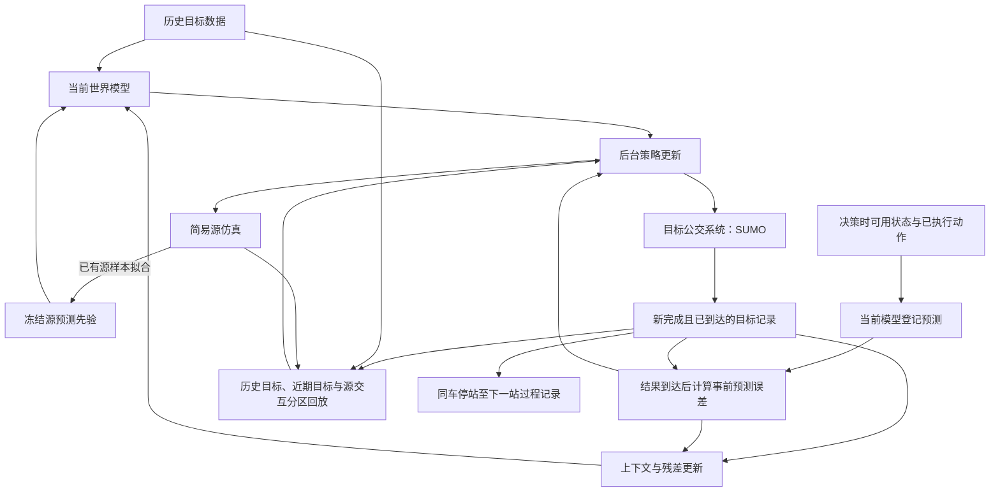

# 第六章补充方案：持续目标数据驱动的公交 MC-WM 闭环

本方案研究：在历史目标数据、有偏源仿真和少量持续到达的目标记录下，在线修正世界模型并更新控制策略，能否缩短运行条件变化后的控制恢复时间。新版本先实现普通在线更新及轻量上下文对照；自动机制分解作为后续待验证假设。现有正文、Word 和 `F-FINAL-225` 保留，本文件供第六章方法与实验部分增补使用。

## 1. 任务与数据权限

目标环境沿用 SUMO，源环境沿用简易公交仿真。策略输入为当前 v7 观测，输出为实际执行的 holding 动作。历史目标回放记作 \(D_H\)，冻结源预测模型记作 \(f_S\)，时刻 \(t\) 已经到达的新目标记录记作 \(D_R(t)\)。

| 协议 | 历史目标数据 | 新目标训练记录 | 策略更新 |
|---|---|---|---|
| 原冻结比较 `F-FINAL-225` | 固定 | 0 | 原协议的源交互训练，评估时冻结 |
| 本版闭环 | 相同初始历史集 | 按完成时间、延迟和稀疏率释放 | 到达记录校正模型，后台更新后用于下一批决策 |

每条记录保存车辆、线路、站点、已执行动作，以及动作时间、结果完成时间和可供学习时间。设完成时刻为 \(t_i^{end}\)，延迟为 \(d_i\)，则只有 \(t\geq t_i^{end}+d_i\) 才可加入 \(D_R(t)\)。抽稀后未获得的结果不进入训练；尚未完成的车辆过程保留为未完成状态。

## 2. 闭环总图与更新顺序

图中误差评估与学习有严格先后：决策时使用旧模型登记预测；结果按到达时间释放后，先结算该预测的误差，再更新近期窗口、模型及策略。拟合后对同一记录的误差不能替代事前误差。模型样本每次按需生成，不持久缓存旧模型轨迹；新 actor 在下一批目标决策中实际执行，闭合“数据—模型—策略—数据”反馈链。

## 3. 控制事件与车辆过程分开组织

v7 控制回放连接全系统相邻决策，前后记录可能属于不同车辆。本版保留这一控制语义，同时按车辆单独连接停站决策至下一站停站决策，保存起终站点与时间。该区间包含起点 holding、行驶与信号等待、下一站服务及事件离散化时间，不能命名为纯路段行程时间。

首版世界模型仍预测全局控制事件的下一观测与奖励；同车记录用于过程对齐和后续机制建模。只有在后续获得相应进入、离开或服务窗口时，才分别估计路段运行、上下车服务与乘客到达机制，不能直接把全局相邻事件解释为本车的物理因果链。

## 4. 在线模型、上下文与策略更新

令 \(x_i=(s_i,a_i)\)，世界模型同时输出全局连续量、下一事件批大小、各槽位的线路和站点、邻车标志及局部连续状态。其四维全局头为 \(y_i^g=(\log(1+\Delta t_i),\log(1+c_i),\Delta n_i^w,\Delta n_i^b)\)，其中 \(c_i=-r_i\)，\(n^w,n^b\) 分别为等待与车内人数。普通在线版比较直接目标模型与源加残差模型：

\[
\hat y_i^{dir}=f_T(x_i),\qquad
\hat y_i^{res}=f_S(x_i)+g_\theta(x_i).
\]

源模型在初始化后冻结；目标模型和残差模型用历史目标数据与已到达的近期数据重拟合。全部输出头通过原 BusModel 解码器还原控制转移，四维上下文只作用于全局头。候选家族依据滚动事前误差选择，近期目标状态附近仅生成一步模型样本。

上下文版在相同数据与预算下，从已到达记录构造四维标准化输出残差的指数滑动平均 \(z_t=q(\mathcal H_t^{available})\)，在重拟合间隔内校正预测，重拟合吸收残差后清零。它是轻量残差上下文对照；[CaDM](https://proceedings.mlr.press/v119/lee20g.html) 提供上下文条件动力学的设计依据，其原方法使用学习的上下文表征，本版不声称完整复现 CaDM。

策略保留现有 actor–critic 主干，复用原 QDeltaBellman 模块，折扣率设为 0.9；按当前可用目标数据上的模型损失确定归一化尺度 \(\tau\)，学习模型误差权重 \(w(s,a)=\exp(Q_\Delta(s,a))\)。critic 与 actor 分别使用：

\[
\mathcal L_Q=0.75\mathcal L_{TD}^{real}
+0.25\mathbb E[w(s,a)\ell_{TD}^{model}],\qquad
\mathcal L_\pi=\mathbb E[\alpha\log\pi(a\mid s)-Q(s,a)].
\]

真实回放包括源交互、历史目标及已到达目标记录。QDeltaBellman 的拟合损失用于训练误差权重，与用于家族选型、登记预测表现的事前误差分别记录。持续残差校正后继续更新策略的结构也可参考 [Learning on the Fly](https://arxiv.org/abs/2508.21065v2)，公交实现不采用其可微仿真与无人机实验设定。

## 5. 第六章实验安排与继续条件

| 对照 | 回答的问题 | 本版定位 |
|---|---|---|
| A0：冻结控制器 | 新增数据闭环相对固定策略的变化 | 同初始化 actor 的冻结对照；不等同于复现 `F-FINAL-225` |
| A1：目标数据直接进入策略回放 | 新数据本身贡献多少 | `replay` 对照 |
| A2：普通在线 MC-WM | 更新模型再更新策略是否有效 | `online` 主实现 |
| A3：上下文 MC-WM | 近期残差上下文的额外作用 | `context` 对照 |
| A4：自动机制分解 | 相同数据下局部更新是否更省样本 | 后续研究阶段 |

先在共同目标数据流上比较模型：固定动作与记录释放顺序，各方法均先预测、后结算、再学习。再做各自策略闭环比较：固定外部条件、初始历史集、目标运行时长、观测权限及更新预算，允许策略产生不同访问轨迹。共同流区分模型适应，闭环实验检验实际控制效果。

除现有乘客广义时间和串车指标外，报告变化后恢复时间、恢复期间累计损失及所需完整新记录数，同时列目标运行时长、控制次数、延迟与更新计算量。先验证稳定条件下的状态波动，再测试未通知的速度、服务及需求变化与稀疏延迟组合。A2 相对 A1 检验模型更新的增量，A3 相对 A2 检验上下文；A4 只有在同权限、同预算下优于 A2/A3，才能支持机制分解的额外价值。

下一步先实际运行 SUMO 的小规模 A0/A1/A2/A3，确认新记录进入训练、模型样本被更新、actor 更新后实际执行。若共同流预测未改善，先处理模型拟合；若预测改善而控制未改善，检查策略更新与模型样本作用，再决定是否推进 A4。

## 6. 局限与待补证据

SUMO 是目标代理环境，当前没有真实公交上线证据；本版在事件边界同步训练，图中的后台更新尚未实现墙钟异步运行。默认 pilot 历史样本不含终止尾段，完整实验需要包含尾段的历史集及共同初始化器。控制器继承 v7 的计划到达率观测，包含基于时刻表的需求信息，因此不能把当前需求实验解释为完全未知需求的识别。目标流只提供已执行动作的结果，不额外查询目标反事实动作组。单步生成与残差上下文均未识别真实因果图；[FANS-RL](https://papers.nips.cc/paper_files/paper/2022/hash/cf4356f994917177213c55ff438ddf71-Abstract-Conference.html) 的结构与变化因子分离仅作为 A4 设计依据。代码检查与小规模运行只证明接口及更新链成立；控制收益、样本效率和因果机制价值均待独立实验支持。
