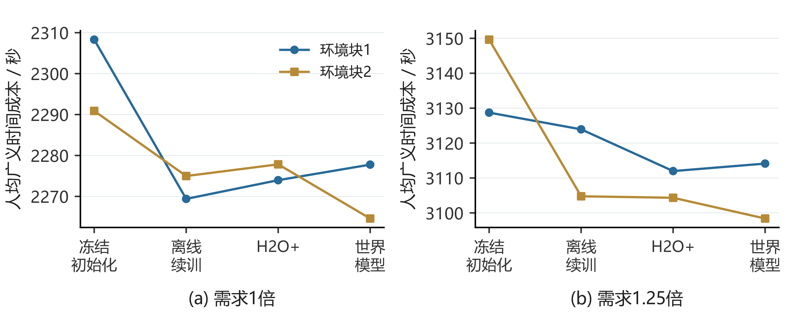
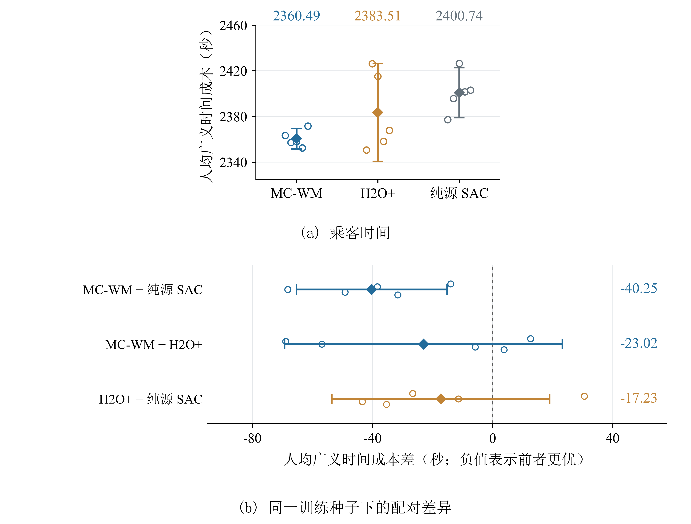
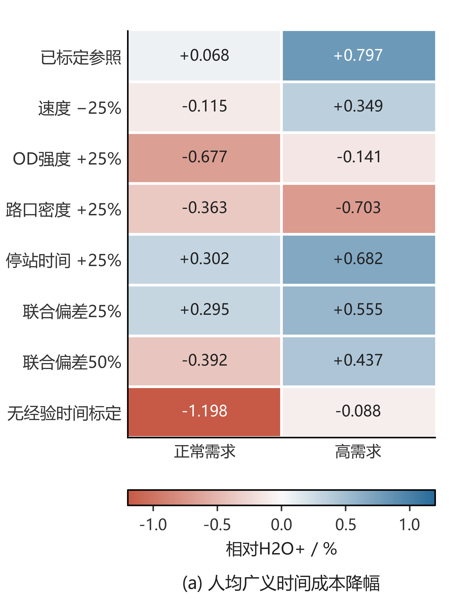

### 二、 Markdown 局部替换文本（按章节顺序排列，可直接搜索替换）

#### （一） 正文第1～7章 残余细节清理

**1. 第1.3节 (3) 与 第1.5节（删去冗余“统一执行设置”，统一第5章标题表述）**

**【原文】**

```markdown
完成同时到站车组的顺序条件状态表征，并在相同目标域离线数据、相同网络更新预算与统一执行设置下，严格检验跨保真混合训练相对于纯离线学习的乘客广义时间成本降幅及域分类器权重诊断结果。

```

**【替换为】**

```markdown
完成同时到站车组的顺序条件状态表征，并在相同目标域离线数据与相同网络更新预算下，严格检验跨保真混合训练相对于纯离线学习的乘客广义时间成本降幅及域分类器权重诊断结果。

```

**【原文】**

```markdown
* 第5章在第3、4章基础上引入“目标环境固定历史离线数据与经标定源仿真”两类信息条件，研究跨保真运行环境下基于迁移强化学习的公交车队驻站控制。

```

**【替换为】**

```markdown
* 第5章在第3、4章基础上引入“目标环境固定历史离线数据与经标定源仿真”两类信息条件，研究跨保真度仿真环境下基于迁移强化学习的公交车队驻站控制。

```

**2. 第2.7.5节、第3.1节、第3.5节、第4章导语及4.3.3节（清理残留的“参考状态归零”、“已出发乘客”、“两个正则化项”）**

**【原文】**（第2.7.5节第3点）

```markdown
第4章CS-BAPR因引入了目标最小值聚合、参考状态归零输出结构与SINDy软符号雅可比导数约束，结构先验分担了分布外正则职能，故采用紧凑的三网络集成（$K=3$）以平衡逐样本雅可比导数的计算开销；

```

**【替换为】**

```markdown
第4章CS-BAPR因引入了目标最小值聚合、均衡态归零差分输出结构与SINDy软符号雅可比导数约束，结构先验分担了分布外正则职能，故采用紧凑的三网络集成（$K=3$）以平衡逐样本雅可比导数的计算开销；

```

**【原文】**（第3.1节第1段末句）

```markdown
其二面向乘客出行服务，通过人均广义时间成本（两倍候车时间与一倍车内时间之和，按规定评价时域内全部已出发乘客人均计算）衡量全系统的乘客时间代价。

```

**【替换为】**

```markdown
其二面向乘客出行服务，通过人均广义时间成本（两倍候车时间与一倍车内时间之和，按规定评价时域内进入系统的全部出行乘客人均计算）衡量全系统的乘客时间代价。

```

**【原文】**（第3.5节第(2)条）

```markdown
（2）**RE-SAC在车头时距目标下显著优于标准SAC，且目标权重范数正则与集成分歧惩罚两个正则化项缺一不可**。理论证明了在单步更新内冻结目标网络惩罚的条件下，正则化贝尔曼算子保持严格的 $\gamma$-压缩映射性质（经Lean 4形式化验证）。在长沙多线路车头时距目标实验中，RE-SAC相较于SAC使平均单步奖励提高 $12.46$（由 $-113.88$ 升至 $-101.43$），全网平均计划间隔偏差与前后车头时距不均衡度分别减少 $5.00$ 秒（由 $106.47$ 秒降至 $101.47$ 秒）和 $7.35$ 秒（由 $126.79$ 秒降至 $119.44$ 秒），而仅保留单一正则化项的消融配置均发生明显性能退化。

```

**【替换为】**

```markdown
（2）**RE-SAC在车头时距目标下显著优于标准SAC，且目标权重范数正则与集成分歧惩罚相辅相成、缺一不可**。理论证明了在单步更新内冻结目标网络惩罚的条件下，正则化贝尔曼算子保持严格的 $\gamma$-压缩映射性质（经Lean 4形式化验证）。在长沙多线路车头时距目标实验中，RE-SAC相较于SAC使平均单步奖励提高 $12.46$（由 $-113.88$ 升至 $-101.43$），全网平均计划间隔偏差与前后车头时距不均衡度分别减少 $5.00\text{ s}$（由 $106.47\text{ s}$ 降至 $101.47\text{ s}$）和 $7.35\text{ s}$（由 $126.79\text{ s}$ 降至 $119.44\text{ s}$），而仅保留单一正则化项的消融配置均发生明显性能退化。

```

**【原文】**（第4章章首导语末句）

```markdown
同时采用“可学习基准动作＋参考状态归零神经修正”重构驻站策略输出，并基于SINDy构建短期符号代价参考模型，通过软符号雅可比导数正则项引导策略在分布外状态下的驻站响应梯度。

```

**【替换为】**

```markdown
同时采用“可学习基准动作＋均衡态归零差分修正”重构驻站策略输出，并基于SINDy构建短期符号代价参考模型，通过软符号雅可比导数正则项引导策略在分布外状态下的驻站响应梯度。

```

**【原文】**（第4.3.3节式(4-24)下方）

```markdown
右端第一项 $\delta$ 为基准状态 $x_0$ 附近的动作零点误差，由式(4-13)的可学习基准动作 $\beta_0$ 与参考归零差分结构 $f_{\theta}(x) - f_{\theta}(x_{\mathrm{ref}}(x))$ 直接锚定；

```

**【替换为】**

```markdown
右端第一项 $\delta$ 为基准状态 $x_0$ 附近的动作零点误差，由式(4-13)的可学习基准动作 $\beta_0$ 与均衡态归零差分结构 $f_{\theta}(x) - f_{\theta}(x_{\mathrm{ref}}(x))$ 直接锚定；

```

**3. 第5.4.3节、5.4.4节、6.4.3节、7.1节与删除多余的附录G（将指向 `附录G` 的引用统一归位至 `附录F.2`，消除重复附录）**

**【原文】**（第5.4.3节第3点）

```markdown
使人均广义时间成本平均减少 $17.23\text{ s}$（详细对比数据见附录G）。

```

**【替换为】**

```markdown
使人均广义时间成本平均减少 $17.23\text{ s}$（详细对比数据见附录F.2）。

```

**【原文】**（第5.4.4节第2点）

```markdown
（附录G在70,000步完整预算与新运行日下的补充对比中，混合训练相较于源域SAC的人均广义时间成本平均减少 $17.23$ 秒，但配对置信区间同样包含零）

```

**【替换为】**

```markdown
（附录F.2在70,000步完整预算与新运行日下的补充对比中，混合训练相较于源域SAC的人均广义时间成本平均减少 $17.23\text{ s}$，但配对置信区间同样包含零）

```

**【原文】**（第6.4.3节（一）第2点）

```markdown
2. **独立源经验序列下的补充对比**：除上述共用离线初始化、严格控制单变量的20种子主消融实验外，在另一批包含独立源经验生成序列的5种子完整控制器补充测试（3种方案 $\times$ 5个独立训练种子 $\times$ 3档需求 $\times$ 5个新测试日，共225个SUMO回合，详见附录G）中，MC-WM相较于无世界模型H2O+与源域SAC（无离线预训练）在相同源采样量（$25,000$ 次源事件）下同样保持了人均广义时间成本的改善趋势，平均成本分别减少 **$23.02$ 秒**（受5种子独立源采样方差影响，按MC-WM减H2O+计算的配对均值差异的95%置信区间为 $[-69.23,\ +23.19]$ 秒）和 **$40.25$ 秒**。

```

**【替换为】**

```markdown
2. **独立源经验序列下的补充对比**：除上述共用离线初始化、严格控制单变量的20种子主消融实验外，在另一批包含独立源经验生成序列的5种子完整控制器补充测试（3种方案 $\times$ 5个独立训练种子 $\times$ 3档需求 $\times$ 5个新测试日，共225个SUMO回合，详见附录F.2）中，MC-WM相较于无世界模型H2O+与源域SAC（无离线预训练）在相同源采样量（$25,000$ 次源事件）下同样保持了人均广义时间成本的改善趋势，平均成本分别减少 **$23.02\text{ s}$**（受5种子独立源采样方差影响，按MC-WM减H2O+计算的配对均值差异的95%置信区间为 $[-69.23,\ +23.19]\text{ s}$）和 **$40.25\text{ s}$**。

```

**【原文】**（第7.1节第(4)条）

```markdown
在第6.4.3节以乘客广义时间成本为目标、模型损失系数设为 $0.25$ 的20次独立初始化配对比较（共4,800个完整SUMO回合）中，MC-WM在正常标定、联合50%源偏差和联合75%源偏差三种条件下，相较于无世界模型的跨保真混合训练基线，使人均广义时间成本分别平均减少 $51.14$ 秒、$69.93$ 秒和 $87.05$ 秒（相对降幅分别为 $1.91\%$、$2.61\%$ 和 $3.23\%$，三个双侧95%配对置信区间均严格低于零），并在统一执行设置下显著优于Daganzo式车头时距规则（分别减少 $57.67$ 秒、$70.67$ 秒和 $76.26$ 秒）；在另一批5种子独立源经验序列的补充测试中，MC-WM相较于无模型H2O+与源域SAC同样保持了平均减少 $23.02$ 秒（95%配对置信区间为 $[-69.23,\ +23.19]$ 秒）和 $40.25$ 秒的成本改善趋势。

```

**【替换为】**

```markdown
在第6.4.3节以乘客广义时间成本为目标、模型损失系数设为 $0.25$ 的20次独立初始化配对比较（共4,800个完整SUMO回合）中，MC-WM在正常标定、联合50%源偏差和联合75%源偏差三种条件下，相较于无世界模型的跨保真混合训练基线，使人均广义时间成本分别平均减少 $51.14\text{ s}$、$69.93\text{ s}$ 和 $87.05\text{ s}$（相对降幅分别为 $1.91\%$、$2.61\%$ 和 $3.23\%$，三个双侧95%配对置信区间均严格低于零），并显著优于Daganzo式车头时距规则（分别减少 $57.67\text{ s}$、$70.67\text{ s}$ 和 $76.26\text{ s}$）；在另一批5种子独立源经验序列的补充测试中，MC-WM相较于无模型H2O+与源域SAC同样保持了平均减少 $23.02\text{ s}$（95%配对置信区间为 $[-69.23,\ +23.19]\text{ s}$）和 $40.25\text{ s}$ 的成本改善趋势。

```

---

#### （二） 附录A～附录F 全面去AI补丁味与LaTeX乱码修复（并移除重复的附录G）

##### 1. 附录A 局部替换（修复 `\mathcal` 与 `\mathbb` 乱码、标题星号粘连及“均不是新增的随机环境量”怪句）

**【原文】**（A.1至A.5）

```markdown
**A.1 基本条件。**本附录沿用第3.3节的$\alpha_{ent}$、$\lambda_{epi}$与$\lambda_{ale}$。$R_{pen}$为包含固定惩罚后的即时项，$c_{shift}$为常数平移，$\mathcal{V}$为一般动作聚合映射；它们均不是新增的随机环境量。

设状态集合 $\mathcal{S}$ 和动作集合 $\mathcal{A}$ 均有限非空，动作价值函数空间为 $\mathcal{Q =}\mathbb{R}^{\mathcal{S} \times \mathcal{A}}$，赋予最大范数

$$\parallel Q \parallel_{\infty} = \max_{s,a}|Q(s,a)|. \tag{A-1}$$

这是有限维完备赋范空间。记 $Q_{1} \leq Q_{2}$ 为逐点不等式，$Q + c_{shift}$ 表示在每个状态动作上加同一常数。

转移概率满足 $P(s' \mid s,a) \geq 0$、$\sum_{s'}^{}P(s' \mid s,a) = 1$，折扣因子满足 $0 \leq \gamma < 1$。给定奖励 $R(s,a)$、惩罚函数 $\Gamma_{epi}(s,a)$、非负系数 $\lambda_{epi}$ 及标量 $\kappa_{ale}$。

“固定”指比较同一算子作用于 $Q_{1}$ 和 $Q_{2}$ 时，这些量均不改变。RE-SAC将 $\kappa_{ale}$ 与网络权重正则量联系起来，例如

$$\kappa_{ale} = \lambda_{ale}\sum_{l}^{} \parallel W_{l} \parallel_{1}. \tag{A-2}$$

本附录把该值及集成网络给出的惩罚函数视为给定参数。

最大值聚合与固定温度 $\alpha_{ent} > 0$ 下的软聚合分别为

$$\begin{aligned}
V_{Q}(s) = \max_{a}Q(s,a),\quad\quad \\
V_{Q}^{\alpha_{ent}}(s) = \alpha_{ent}\log\sum_{a}^{}\exp\left( \frac{Q(s,a)}{\alpha_{ent}} \right).
\end{aligned} \tag{A-3}$$

令$c_{pen}(s,a)$为固定的有效惩罚，并将其吸收到即时项：

$$R_{pen}(s,a) = R(s,a) - \gamma c_{pen}(s,a). \tag{A-4}$$

若直接采用当前状态动作的理想惩罚，可取$c_{pen}(s,a) = \lambda_{epi}\Gamma_{epi}(s,a) + \kappa_{ale}$；与第3章实际后继惩罚对应时，则须取第3.3.3节在固定策略下定义的条件期望$c_{j}^{\pi}(s,a)$，其中$\kappa_{ale} = \lambda_{ale}\kappa_{j}$。不能把后继惩罚未经条件平均就替换为当前状态的集成分歧。

两类理想改进算子统一写为

$$\begin{aligned}
\mathcal{(T}Q)(s,a) & = R_{pen}(s,a) + \gamma\sum_{s'}^{}P(s' \mid s,a)V_{Q}(s'), \\
(\mathcal{T}_{\alpha_{ent}}Q)(s,a) & = R_{pen}(s,a) + \gamma\sum_{s'}^{}P(s' \mid s,a)V_{Q}^{\alpha_{ent}}(s').
\end{aligned} \tag{A-5}$$

式(A-5)以式(A-4)吸收固定惩罚，后续证明只需控制动作聚合对输入价值的响应。

固定策略的熵正则评价可另取$\mathcal{V}_{\pi}Q(s) = \mathbb{E}_{a \sim \pi}\lbrack Q(s,a) - \alpha_{ent}\log\pi(a \mid s)\rbrack$。在策略及熵项固定且期望有限时，该聚合同样满足A.2的单调性和平移相容性，因而适用A.3的共同收缩结论；它与上式的最大值或软聚合承担不同的评价或改进角色。

**A.2 动作评价。**考虑映射 $\mathcal{V:Q} \rightarrow \mathbb{R}^{\mathcal{S}}$。若它单调并与常数平移相容，即

$$Q_{1} \leq Q_{2}\  \Rightarrow \ \mathcal{V}Q_{1}\mathcal{\leq V}Q_{2},\quad\quad\mathcal{V(}Q + c_{shift}\mathcal{) = V}Q + c_{shift}, \tag{A-6}$$

则可控制其对输入扰动的响应。

**引理A.1。** 满足上述两项条件的聚合映射在最大范数下非扩张：

$$\mathcal{\parallel V}Q_{1}\mathcal{- V}Q_{2} \parallel_{\infty} \leq \parallel Q_{1} - Q_{2} \parallel_{\infty}. \tag{A-7}$$

**证明。** 令 $\varepsilon_{dist} = \parallel Q_{1} - Q_{2} \parallel_{\infty}$。由 $Q_{2} - \varepsilon_{dist} \leq Q_{1} \leq Q_{2} + \varepsilon_{dist}$，依次使用单调性和平移相容性，得到

$$\mathcal{V}Q_{2} - \varepsilon_{dist}\mathcal{\leq V}Q_{1}\mathcal{\leq V}Q_{2} + \varepsilon_{dist}. \tag{A-8}$$

逐点取绝对值再取最大值即得结论。证毕。

最大值聚合满足两项条件：逐动作不等式在取最大值后保持方向；每个动作同时增加 $c_{shift}$，最大值也增加 $c_{shift}$。因此 $V_{Q}$ 满足引理A.1。软聚合的对应性质见A.4。

**A.3 基本性质。**设 $R_{pen}(s,a)$ 为任意固定实函数，$P$ 为固定随机核，$\mathcal{V}$ 满足A.2的两项条件，定义

$$\mathcal{(B}Q)(s,a) = R_{pen}(s,a) + \gamma\sum_{s'}^{}P(s' \mid s,a\mathcal{)(V}Q)(s'). \tag{A-9}$$

**定理A.1。** 算子 $\mathcal{B}$ 单调，满足折扣平移性质，并为 $\gamma$ 收缩：

$$\begin{aligned}
Q_{1} \leq Q_{2} & \  \Rightarrow \ \mathcal{B}Q_{1}\mathcal{\leq B}Q_{2}, \\
\mathcal{B(}Q + c_{shift}) & \mathcal{= B}Q + \gamma c_{shift}, \\
\mathcal{\parallel B}Q_{1}\mathcal{- B}Q_{2} \parallel_{\infty} & \leq \gamma \parallel Q_{1} - Q_{2} \parallel_{\infty}.
\end{aligned} \tag{A-10}$$

**证明。** 单调性由 $\mathcal{V}$ 的单调性、$P \geq 0$ 和 $\gamma \geq 0$ 得到。对于常数平移，利用概率归一化有

$$\mathcal{B(}Q + c_{shift}\mathcal{) - B}Q = \gamma c_{shift}\sum_{s'}^{}P(s' \mid s,a) = \gamma c_{shift}. \tag{A-11}$$

固定项在两个输入相减时抵消。由引理A.1，

$$\begin{aligned}
\mathcal{|(B}Q_{1}\mathcal{- B}Q_{2})(s,a)| & \leq \gamma\sum_{s'}^{}P(s' \mid s,a\mathcal{)|(V}Q_{1}\mathcal{- V}Q_{2})(s')| \\
 & \leq \gamma \parallel Q_{1} - Q_{2} \parallel_{\infty}.
\end{aligned} \tag{A-12}$$

再对状态动作取最大值，得到式(A-10)的收缩结论。证毕。

将A.1中的 $R_{pen}$ 和最大值聚合代入，立即得到RE-SAC算子 $\mathcal{T}$ 的三项性质。固定惩罚改变固定点的位置，但在这次输入比较中不增加距离放大系数。附录C、D只需进一步说明其混合转移仍为随机核、合并项仍与输入价值函数无关，即可应用同一定理。

**A.4 熵正则化。****引理A.2。** 对固定 $\alpha_{ent} > 0$，软聚合 $V_{Q}^{\alpha_{ent}}$ 单调且与常数平移相容，因而非扩张。

**证明。** 有限非空动作集中的指数项均为正，对数有定义。指数、有限求和与对数均保持次序，故 $Q_{1} \leq Q_{2}$ 蕴含 $V_{Q_{1}}^{\alpha_{ent}} \leq V_{Q_{2}}^{\alpha_{ent}}$。直接计算有

$$\begin{aligned}
V_{Q + c_{shift}}^{\alpha_{ent}}(s) & = \alpha_{ent}\log\left\lbrack exp(c_{shift}/\alpha_{ent})\sum_{a}^{}\exp(Q(s,a)/\alpha_{ent}) \right\rbrack \\
 & = c_{shift} + V_{Q}^{\alpha_{ent}}(s).
\end{aligned} \tag{A-13}$$

应用引理A.1即得非扩张性。证毕。

**定理A.2。** 固定温度下的RE-SAC软算子 $\mathcal{T}_{\alpha_{ent}}$ 单调，满足

$$\mathcal{T}_{\alpha_{ent}}(Q + c_{shift}) = \mathcal{T}_{\alpha_{ent}}Q + \gamma c_{shift},\quad\quad \parallel \mathcal{T}_{\alpha_{ent}}Q_{1} - \mathcal{T}_{\alpha_{ent}}Q_{2} \parallel_{\infty} \leq \gamma \parallel Q_{1} - Q_{2} \parallel_{\infty}. \tag{A-14}$$

**证明。** 由引理A.2，取定理A.1中的 $\mathcal{V}Q = V_{Q}^{\alpha_{ent}}$，并使用A.1的固定项与随机核即可。证毕。

**A.5 收敛性。****推论A.1。** 对满足定理A.1条件的 $\mathcal{B}$，存在唯一固定点 $Q^{*}$。

```

**【替换为】**

```markdown
**A.1 基本条件。**本附录沿用第3.3节的熵温度系数 $\alpha_{\mathrm{ent}}$（即正文中的 $\alpha$）、惩罚系数 $\lambda_{\mathrm{epi}}$ 与 $\lambda_{\mathrm{ale}}$。记 $R_{\mathrm{pen}}$ 为吸收固定惩罚后的等效即时项，$c_{\mathrm{shift}}$ 为常数平移量，$\mathcal{V}$ 为一般动作价值聚合映射。

设状态集合 $\mathcal{S}$ 和动作集合 $\mathcal{A}$ 均有限非空，动作价值函数空间为 $\mathcal{Q} = \mathbb{R}^{\mathcal{S} \times \mathcal{A}}$，赋予无穷范数（上确界范数）

$$\| Q \|_{\infty} = \max_{s,a}|Q(s,a)|. \tag{A-1}$$

这是有限维完备赋范空间。记 $Q_{1} \leq Q_{2}$ 为逐点不等式，$Q + c_{\mathrm{shift}}$ 表示在每个状态动作对上加同一常数。

转移概率满足 $P(s' \mid s,a) \geq 0$、$\sum_{s'} P(s' \mid s,a) = 1$，折扣因子满足 $0 \leq \gamma < 1$。给定奖励 $R(s,a)$、惩罚函数 $\Gamma_{\mathrm{epi}}(s,a)$、非负系数 $\lambda_{\mathrm{epi}}$ 及标量 $\kappa_{\mathrm{ale}}$。

“固定”指比较同一算子作用于 $Q_{1}$ 和 $Q_{2}$ 时，上述各量均保持不变。RE-SAC将 $\kappa_{\mathrm{ale}}$ 与目标网络权重正则量相联系，即

$$\kappa_{\mathrm{ale}} = \lambda_{\mathrm{ale}}\sum_{l} \| W_{l} \|_{1}. \tag{A-2}$$

本附录将该标量及目标集成网络给出的惩罚函数视为单步更新内的给定参数。

最大值聚合与固定温度 $\alpha_{\mathrm{ent}} > 0$ 下的软聚合分别为

$$\begin{aligned}
V_{Q}(s) &= \max_{a}Q(s,a), \\
V_{Q}^{\alpha_{\mathrm{ent}}}(s) &= \alpha_{\mathrm{ent}}\log\sum_{a}\exp\left( \frac{Q(s,a)}{\alpha_{\mathrm{ent}}} \right).
\end{aligned} \tag{A-3}$$

令 $c_{\mathrm{pen}}(s,a)$ 为固定的有效惩罚，并将其吸收至即时项：

$$R_{\mathrm{pen}}(s,a) = R(s,a) - \gamma c_{\mathrm{pen}}(s,a). \tag{A-4}$$

若直接采用当前状态动作对上的惩罚，可取 $c_{\mathrm{pen}}(s,a) = \lambda_{\mathrm{epi}}\Gamma_{\mathrm{epi}}(s,a) + \kappa_{\mathrm{ale}}$；与第3.3.3节实际后继状态惩罚对应时，则取固定策略下的条件期望 $\Lambda(s,a)$（其中 $\kappa_{\mathrm{ale}} = \lambda_{\mathrm{ale}}\kappa_{k}$）。

两类理想改进算子统一写为

$$\begin{aligned}
(\mathcal{T}Q)(s,a) &= R_{\mathrm{pen}}(s,a) + \gamma\sum_{s'}P(s' \mid s,a)V_{Q}(s'), \\
(\mathcal{T}_{\alpha_{\mathrm{ent}}}Q)(s,a) &= R_{\mathrm{pen}}(s,a) + \gamma\sum_{s'}P(s' \mid s,a)V_{Q}^{\alpha_{\mathrm{ent}}}(s').
\end{aligned} \tag{A-5}$$

式(A-5)以式(A-4)吸收固定惩罚，后续证明只需考察动作聚合算子对输入价值函数扰动的响应。

固定策略的熵正则评价可另取 $\mathcal{V}_{\pi}Q(s) = \mathbb{E}_{a \sim \pi}[ Q(s,a) - \alpha_{\mathrm{ent}}\log\pi(a \mid s)]$。在策略及熵项固定且期望有限时，该聚合同样满足A.2节的单调性和平移相容性，因而适用A.3节的共同收缩结论。

**A.2 动作评价。**考虑映射 $\mathcal{V}:\mathcal{Q} \rightarrow \mathbb{R}^{\mathcal{S}}$。若它单调并与常数平移相容，即

$$Q_{1} \leq Q_{2}\  \Rightarrow \ \mathcal{V}Q_{1} \leq \mathcal{V}Q_{2},\qquad \mathcal{V}(Q + c_{\mathrm{shift}}) = \mathcal{V}Q + c_{\mathrm{shift}}, \tag{A-6}$$

则可控制其对输入扰动的响应。

**引理A.1。** 满足上述两项条件的聚合映射在无穷范数下非扩张：

$$\| \mathcal{V}Q_{1} - \mathcal{V}Q_{2} \|_{\infty} \leq \| Q_{1} - Q_{2} \|_{\infty}. \tag{A-7}$$

**证明。** 令 $\varepsilon_{\mathrm{dist}} = \| Q_{1} - Q_{2} \|_{\infty}$。由 $Q_{2} - \varepsilon_{\mathrm{dist}} \leq Q_{1} \leq Q_{2} + \varepsilon_{\mathrm{dist}}$，依次使用单调性和平移相容性，得到

$$\mathcal{V}Q_{2} - \varepsilon_{\mathrm{dist}} \leq \mathcal{V}Q_{1} \leq \mathcal{V}Q_{2} + \varepsilon_{\mathrm{dist}}. \tag{A-8}$$

逐点取绝对值再取上确界即得结论。证毕。

最大值聚合满足这两项条件：逐动作不等式在取最大值后保持方向；每个动作同时增加 $c_{\mathrm{shift}}$，最大值也增加 $c_{\mathrm{shift}}$。因此 $V_{Q}$ 满足引理A.1。软聚合的对应性质见A.4节。

**A.3 基本性质。**设 $R_{\mathrm{pen}}(s,a)$ 为任意固定实函数，$P$ 为固定随机转移核，$\mathcal{V}$ 满足A.2节的两项条件，定义通用算子

$$(\mathcal{B}Q)(s,a) = R_{\mathrm{pen}}(s,a) + \gamma\sum_{s'}P(s' \mid s,a)(\mathcal{V}Q)(s'). \tag{A-9}$$

**定理A.1。** 算子 $\mathcal{B}$ 单调，满足折扣平移性质，并为 $\gamma$-压缩映射：

$$\begin{aligned}
Q_{1} \leq Q_{2} &\  \Rightarrow \ \mathcal{B}Q_{1} \leq \mathcal{B}Q_{2}, \\
\mathcal{B}(Q + c_{\mathrm{shift}}) &= \mathcal{B}Q + \gamma c_{\mathrm{shift}}, \\
\| \mathcal{B}Q_{1} - \mathcal{B}Q_{2} \|_{\infty} &\leq \gamma \| Q_{1} - Q_{2} \|_{\infty}.
\end{aligned} \tag{A-10}$$

**证明。** 单调性由 $\mathcal{V}$ 的单调性、$P \geq 0$ 和 $\gamma \geq 0$ 得到。对于常数平移，利用概率归一化有

$$\mathcal{B}(Q + c_{\mathrm{shift}}) - \mathcal{B}Q = \gamma c_{\mathrm{shift}}\sum_{s'}P(s' \mid s,a) = \gamma c_{\mathrm{shift}}. \tag{A-11}$$

固定项在两个输入相减时精确抵消。由引理A.1，

$$\begin{aligned}
|(\mathcal{B}Q_{1} - \mathcal{B}Q_{2})(s,a)| &\leq \gamma\sum_{s'}P(s' \mid s,a)|(\mathcal{V}Q_{1} - \mathcal{V}Q_{2})(s')| \\
 &\leq \gamma \| Q_{1} - Q_{2} \|_{\infty}.
\end{aligned} \tag{A-12}$$

再对状态动作对取最大值，即得式(A-10)的收缩结论。证毕。

将A.1节中的 $R_{\mathrm{pen}}$ 和最大值聚合代入，立得RE-SAC算子 $\mathcal{T}$ 的三项性质。固定惩罚仅改变不动点的位置，而不增大算子在单步输入比较中的距离收缩系数。附录C、D只需进一步说明其混合转移仍为合法随机核、合并项仍与输入价值函数无关，即可直接应用同一定理。

**A.4 熵正则化。**

**引理A.2。** 对固定 $\alpha_{\mathrm{ent}} > 0$，软聚合 $V_{Q}^{\alpha_{\mathrm{ent}}}$ 单调且与常数平移相容，因而具有非扩张性。

**证明。** 有限非空动作集中的指数项均为正，对数良定义。指数、有限求和与对数函数均保持单调次序，故 $Q_{1} \leq Q_{2}$ 蕴含 $V_{Q_{1}}^{\alpha_{\mathrm{ent}}} \leq V_{Q_{2}}^{\alpha_{\mathrm{ent}}}$。直接计算有

$$\begin{aligned}
V_{Q + c_{\mathrm{shift}}}^{\alpha_{\mathrm{ent}}}(s) &= \alpha_{\mathrm{ent}}\log\left\lbrack \exp(c_{\mathrm{shift}}/\alpha_{\mathrm{ent}})\sum_{a}\exp(Q(s,a)/\alpha_{\mathrm{ent}}) \right\rbrack \\
 &= c_{\mathrm{shift}} + V_{Q}^{\alpha_{\mathrm{ent}}}(s).
\end{aligned} \tag{A-13}$$

应用引理A.1即得非扩张性。证毕。

**定理A.2。** 固定温度下的RE-SAC软算子 $\mathcal{T}_{\alpha_{\mathrm{ent}}}$ 单调，满足

$$\mathcal{T}_{\alpha_{\mathrm{ent}}}(Q + c_{\mathrm{shift}}) = \mathcal{T}_{\alpha_{\mathrm{ent}}}Q + \gamma c_{\mathrm{shift}},\qquad \| \mathcal{T}_{\alpha_{\mathrm{ent}}}Q_{1} - \mathcal{T}_{\alpha_{\mathrm{ent}}}Q_{2} \|_{\infty} \leq \gamma \| Q_{1} - Q_{2} \|_{\infty}. \tag{A-14}$$

**证明。** 由引理A.2，取定理A.1中的 $\mathcal{V}Q = V_{Q}^{\alpha_{\mathrm{ent}}}$，并结合A.1节的固定项与随机转移核性质即得。证毕。

**A.5 收敛性。**

**推论A.1。** 对满足定理A.1条件的 $\mathcal{B}$，存在唯一不动点 $Q^{*}$。

```

**【原文】**（A.7中的乱码公式）

```markdown
**证明。** 根据上确界与下确界的关系，

$$\begin{aligned}
\langle p^{\circ},V\rangle - \Omega_{\mathcal{U}}(V) & = - \sigma_{\mathcal{U}}( - V) = \inf_{p\mathcal{\in U}}\langle p,V\rangle, \\
\Omega_{\mathcal{U}}(V) & = \langle p^{\circ},V\rangle - \inf_{p\mathcal{\in U}}\langle p,V\rangle \geq 0.
\end{aligned} \tag{A-20}$$

最后一步使用$p^{\circ} \in \mathcal{U}$。证毕。

在状态动作矩形集合下，将各处的$\mathcal{U}$取为$\mathcal{U}_{s,a}$，上述恒等式逐点进入鲁棒贝尔曼更新。相应正则项依赖后继价值和允许的分布集合；只有当该支持函数能够有效计算时，改写才同时带来计算上的便利。Derman等在指定集合条件下进一步建立了奖励、转移鲁棒性与策略、价值正则化之间的对应。[derman2023twice]

设有限状态空间配备距离$d_{\mathcal{S}}$。一阶Wasserstein距离$W_{1}(p,q)$为所有边缘分别为$p,q$的耦合分布中，状态距离$d_{\mathcal{S}}(x,y)$的最小期望。设$V$满足$|V(x) - V(y)| \leq L_{V}d_{\mathcal{S}}(x,y)$，$L_{V}$为其Lipschitz常数上界，$\varepsilon_{ipm} \geq 0$为分布距离半径。

**命题A.3。** 对$\mathcal{U = \{}p:W_{1}(p,p^{\circ}) \leq \varepsilon_{ipm}\}$，有

$$\inf_{p\mathcal{\in U}}\mathbb{E}_{p}\lbrack V\rbrack \geq \mathbb{E}_{p^{\circ}}\lbrack V\rbrack - \varepsilon_{ipm}L_{V}. \tag{A-21}$$

```

**【替换为】**

```markdown
**证明。** 根据上确界与下确界的关系，

$$\begin{aligned}
\langle p^{\circ},V\rangle - \Omega_{\mathcal{U}}(V) &= - \sigma_{\mathcal{U}}( - V) = \inf_{p \in \mathcal{U}}\langle p,V\rangle, \\
\Omega_{\mathcal{U}}(V) &= \langle p^{\circ},V\rangle - \inf_{p \in \mathcal{U}}\langle p,V\rangle \geq 0.
\end{aligned} \tag{A-20}$$

最后一步使用了 $p^{\circ} \in \mathcal{U}$。证毕。

在状态动作矩形集合下，将各处的 $\mathcal{U}$ 取为 $\mathcal{U}_{s,a}$，上述恒等式逐点进入鲁棒贝尔曼更新。Derman等在指定集合条件下进一步建立了奖励、转移鲁棒性与策略、价值正则化之间的对偶对应关系[derman2023twice]。

设有限状态空间配备距离度量 $d_{\mathcal{S}}$。一阶Wasserstein距离 $W_{1}(p,q)$ 为所有边缘分布分别为 $p,q$ 的耦合分布中，状态距离 $d_{\mathcal{S}}(x,y)$ 的最小期望。设 $V$ 满足 $|V(x) - V(y)| \leq L_{V}d_{\mathcal{S}}(x,y)$，$L_{V}$ 为其Lipschitz常数上界，$\varepsilon_{\mathrm{ipm}} \geq 0$ 为分布距离半径。

**命题A.3。** 对 $\mathcal{U} = \{p: W_{1}(p,p^{\circ}) \leq \varepsilon_{\mathrm{ipm}}\}$，有

$$\inf_{p \in \mathcal{U}}\mathbb{E}_{p}[ V] \geq \mathbb{E}_{p^{\circ}}[ V] - \varepsilon_{\mathrm{ipm}}L_{V}. \tag{A-21}$$

```

**【原文】**（A.7式(A-23)上方）

```markdown
以$C_{traj}$表示一个运行轨迹的有界可测累计成本，$\mathbb{P}_{0}$为固定策略和名义环境诱导的轨迹概率分布。取$\beta_{tail} \in (0,1\rbrack$表示关注的最差尾部概率质量，$\eta_{risk}$为成本阈值，$(x)_{+} = max(x,0)$。按这一尾部概率约定，定义

$${CVaR}_{\beta_{tail}}(C_{traj}) = \inf_{\eta_{risk}\mathbb{\in R}}\left\{ \eta_{risk} + \frac{1}{\beta_{tail}}\mathbb{E}_{\mathbb{P}_{0}}\lbrack(C_{traj} - \eta_{risk})_{+}\rbrack \right\}. \tag{A-23}$$

```

**【替换为】**

```markdown
以 $C_{\mathrm{traj}}$ 表示一条运行轨迹的有界可测累计成本，$\mathbb{P}_{0}$ 为固定策略和名义环境诱导的轨迹概率分布。取 $\beta_{\mathrm{tail}} \in (0,1]$ 表示所关注的最差尾部概率质量，$\eta_{\mathrm{risk}}$ 为成本阈值，$(x)_{+} = \max(x,0)$。按这一尾部概率约定，定义

$$\mathrm{CVaR}_{\beta_{\mathrm{tail}}}(C_{\mathrm{traj}}) = \inf_{\eta_{\mathrm{risk}} \in \mathbb{R}}\left\{ \eta_{\mathrm{risk}} + \frac{1}{\beta_{\mathrm{tail}}}\mathbb{E}_{\mathbb{P}_{0}}[(C_{\mathrm{traj}} - \eta_{\mathrm{risk}})_{+}] \right\}. \tag{A-23}$$

```

---

##### 2. 附录B 局部替换（修复 `\mathcal` 乱码、星号粘连及“不表示公交驻站秒数”等怪句）

**【原文】**（B.1至B.3开头）

```markdown
**B.1 基本条件。**设动作维数为 $n_{a}$，命令空间为

$$\mathcal{A = \lbrack -}1,1\rbrack^{n_{a}}. \tag{B-1}$$

逐坐标截断映射记为 $clip$，其第 $j$ 个分量为

$$clip(a)_{j} = {clip}_{1}(a_{j}),\quad 其中\quad{clip}_{1}(x) = max\{ - 1,min\{ x,1\}\}. \tag{B-2}$$

模式$z$的对角执行器增益为$G_{z} = diag(g_{z,1},\ldots,g_{z,n_{a}})$，其对角元素按动作坐标编号。名义信号与加噪后的实际执行信号均为无量纲执行器量，不表示公交驻站秒数。命令$a$先形成名义信号$v_{nom} = G_{z}a$，再与执行噪声$\varepsilon$相加并截断，得到实际执行量

$$u_{exec} = clip(v_{nom} + \varepsilon). \tag{B-3}$$

环境状态转移和奖励分别由 $F_{phys}(x_{phys},u_{exec},e)$ 与 $r(x_{phys},u_{exec},e)$ 给出，其中 $e$ 为其他外生事件。不同模式共用 $F_{phys}$ 和 $r$，模式差异由 $G_{z}$ 表达。状态映射和奖励映射在给定外生事件后确定相应后果，观测映射只提供参考模式下的策略可获得的输入。这里$x_{phys}$表示物理状态，$F_{phys}$表示物理状态转移映射。

设观测映射为 $o(x_{phys})$，参考模式下的策略为 $\mu_{ref}$，参考模式记为$ref$。参考模式下的动作记为

$$a^{ref}(x_{phys}) = \mu_{ref}(o(x_{phys}\mathcal{)) \in A.} \tag{B-4}$$

在参考模式直接执行时，名义信号为 $G_{ref}a^{ref}(x_{phys})$。在另一模式 $z$ 下，希望通过选择命令 $a_{z}(x_{phys})$，使

$$G_{z}a_{z}(x_{phys}) = G_{ref}a^{ref}(x_{phys}). \tag{B-5}$$

这一等式只描述名义信号恢复。若补偿命令越出动作边界，环境实际接收的截断命令可能不再满足它，因此需要先讨论可行性。

**B.2 补偿条件。****引理B.1。** 对任意实数 $x$，有

$${clip}_{1}(x) = x\quad \Leftrightarrow \quad - 1 \leq x \leq 1. \tag{B-6}$$

**证明。**截断的值域为$\lbrack - 1,1\rbrack$，且在该区间内保持输入不变，两个方向均由定义直接得到。证毕。

逐坐标应用该引理，立即得到

$$clip(a) = a\quad \Leftrightarrow \quad a\mathcal{\in A.} \tag{B-7}$$

**定理B.1。** 设 $G_{act} = diag(g_{1},\ldots,g_{n_{a}})$，每个 $g_{j} \neq 0$，希望实现名义目标信号 ${v_{nom}}^{*}$。令逆命令为

$$a_{inv} = {G_{act}}^{- 1}{v_{nom}}^{*},\quad\quad a_{inv,j} = v_{nom,j}^{*}/g_{j}. \tag{B-8}$$

则

$$G_{act}clip(a_{inv}) = {v_{nom}}^{*}\quad \Leftrightarrow \quad a_{inv}\mathcal{\in A.} \tag{B-9}$$

```

**【替换为】**

```markdown
**B.1 基本条件。**设受控动力学系统的动作空间维数为 $n_{a}$，归一化控制指令空间为

$$\mathcal{A} = [-1,1]^{n_{a}}. \tag{B-1}$$

逐坐标截断映射记为 $\mathrm{clip}$，其第 $j$ 个分量为

$$\mathrm{clip}(a)_{j} = \mathrm{clip}_{1}(a_{j}),\quad \text{其中}\quad \mathrm{clip}_{1}(x) = \max\{ - 1, \min\{ x,1\}\}. \tag{B-2}$$

模式 $z$ 的对角执行器增益矩阵为 $G_{z} = \mathrm{diag}(g_{z,1},\ldots,g_{z,n_{a}})$，其对角元素按动作坐标编号。控制指令 $a \in \mathcal{A}$ 先经增益矩阵形成名义控制信号 $v_{\mathrm{nom}} = G_{z}a$，再与执行噪声 $\varepsilon$ 叠加并截断，得到实际执行信号

$$u_{\mathrm{exec}} = \mathrm{clip}(v_{\mathrm{nom}} + \varepsilon). \tag{B-3}$$

环境物理状态转移和即时奖励分别由 $F_{\mathrm{phys}}(x_{\mathrm{phys}},u_{\mathrm{exec}},e)$ 与 $r(x_{\mathrm{phys}},u_{\mathrm{exec}},e)$ 给出，其中 $x_{\mathrm{phys}}$ 表示物理状态，$e$ 为外生随机事件。不同模式共用同一物理演化机理 $F_{\mathrm{phys}}$ 和奖励函数 $r$，模式间的差异仅由执行器增益矩阵 $G_{z}$ 体现。

设观测映射为 $o(x_{\mathrm{phys}})$，参考模式（记为 $\mathrm{ref}$）下的基准策略为 $\mu_{\mathrm{ref}}$，其输出的参考动作为

$$a^{\mathrm{ref}}(x_{\mathrm{phys}}) = \mu_{\mathrm{ref}}\big(o(x_{\mathrm{phys}})\big) \in \mathcal{A}. \tag{B-4}$$

在参考模式下直接执行时，名义信号为 $G_{\mathrm{ref}}a^{\mathrm{ref}}(x_{\mathrm{phys}})$。在另一模式 $z$ 下，希望通过选择补偿指令 $a_{z}(x_{\mathrm{phys}})$，使得

$$G_{z}a_{z}(x_{\mathrm{phys}}) = G_{\mathrm{ref}}a^{\mathrm{ref}}(x_{\mathrm{phys}}). \tag{B-5}$$

式(B-5)描述了名义信号的代数恢复条件；考虑到控制指令受有界区间 $\mathcal{A}$ 截断约束，以下先讨论其可行性条件。

**B.2 补偿条件。**

**引理B.1。** 对任意实数 $x$，有

$$\mathrm{clip}_{1}(x) = x\quad \Leftrightarrow \quad - 1 \leq x \leq 1. \tag{B-6}$$

**证明。**截断映射的值域为 $[-1,1]$，且在该闭区间内为恒等映射，充分性与必要性均由定义直接得到。证毕。

逐坐标应用该引理，立得

$$\mathrm{clip}(a) = a\quad \Leftrightarrow \quad a \in \mathcal{A}. \tag{B-7}$$

**定理B.1。** 设 $G_{\mathrm{act}} = \mathrm{diag}(g_{1},\ldots,g_{n_{a}})$，每个 $g_{j} \neq 0$，期望实现的名义目标信号为 $v_{\mathrm{nom}}^{*}$。令逆指令为

$$a_{\mathrm{inv}} = G_{\mathrm{act}}^{- 1}v_{\mathrm{nom}}^{*},\qquad a_{\mathrm{inv},j} = v_{\mathrm{nom},j}^{*}/g_{j}. \tag{B-8}$$

则

$$G_{\mathrm{act}}\,\mathrm{clip}(a_{\mathrm{inv}}) = v_{\mathrm{nom}}^{*}\quad \Leftrightarrow \quad a_{\mathrm{inv}} \in \mathcal{A}. \tag{B-9}$$

```

**【原文】**（B.3开头与B.4中间）

```markdown
**B.3 补偿效果。****引理B.2。** 若两个名义信号 $v_{nom,1} = v_{nom,2}$，且使用同一执行噪声 $\varepsilon$，则

```

**【替换为】**

```markdown
**B.3 补偿效果。**

**引理B.2。** 若两个名义信号 $v_{nom,1} = v_{nom,2}$，且使用同一执行噪声 $\varepsilon$，则

```

**【原文】**（B.4式(B-24)上方）

```markdown
设历史变量为 $H_{obs}$，下一观察为 $Y$，二者取值集合有限。两种模式假设下，历史分布分别为 $p(h_{obs})$、$q(h_{obs})$，下一观察条件核为 $P_{obs,1}(y \mid h_{obs})$、$P_{obs,2}(y \mid h_{obs})$。本节假设这些概率严格为正，并按各自分布归一化。历史的实现值和下一观察的实现值分别是本节有限求和的局部自变量；两个条件核分别对应两种模式假设。

定义有限分布的Kullback-Leibler散度（Kullback-Leibler Divergence，KL散度），亦称相对熵

$$D_{KL}(p \parallel q) = \sum_{h_{obs}}^{}p(h_{obs})log\frac{p(h_{obs})}{q(h_{obs})}. \tag{B-24}$$

```

**【替换为】**

```markdown
设历史观测轨迹变量为 $H_{\mathrm{obs}}$，下一步观测变量为 $Y$，二者取值集合均有限。在两种候选模式假设下，历史边缘分布分别为 $p(h_{\mathrm{obs}})$ 与 $q(h_{\mathrm{obs}})$，下一步观测的条件转移核分别为 $P_{\mathrm{obs},1}(y \mid h_{\mathrm{obs}})$ 与 $P_{\mathrm{obs},2}(y \mid h_{\mathrm{obs}})$（假设各概率质量严格为正且满足归一化条件）。

定义有限离散分布的Kullback-Leibler散度（KL散度，亦称相对熵）为

$$D_{\mathrm{KL}}(p \parallel q) = \sum_{h_{\mathrm{obs}}}p(h_{\mathrm{obs}})\log\frac{p(h_{\mathrm{obs}})}{q(h_{\mathrm{obs}})}. \tag{B-24}$$

```

---

##### 3. 附录C 局部替换（修复定理C.3加粗标题中的提示词补丁、乱码与星号粘连）

**【原文】**（C.1至C.4局部及C.8）

```markdown
令 $0 \leq \gamma < 1$，$\lambda_{epi} \geq 0$，$\kappa_{fix}\mathbb{\in R}$ 为固定标量，动作最大值为

$$V_{Q}(s) = \max_{a}Q(s,a). \tag{C-2}$$

模式条件算子定义为

$$(\mathcal{T}_{z}Q)(s,a) = R_{z}(s,a) + \gamma\left\lbrack \sum_{s'}^{}P_{z}(s' \mid s,a)V_{Q}(s') - \lambda_{epi}\Gamma_{z}(s,a) - \kappa_{fix} \right\rbrack. \tag{C-3}$$

各模式共享输入价值函数 $Q$，但具有各自转移、奖励及惩罚。在比较同一算子的两个输入时，上述参数不改变。

设置信权重 $\rho(z)$ 满足

$$\rho(z) \geq 0,\quad\quad\sum_{z}^{}\rho(z) = 1. \tag{C-4}$$

定义置信加权算子

$$(\mathcal{T}_{\rho}Q)(s,a) = \sum_{z\mathcal{\in Z}}^{}\rho(z)(\mathcal{T}_{z}Q)(s,a). \tag{C-5}$$

```

**【替换为】**

```markdown
令 $0 \leq \gamma < 1$，$\lambda_{\mathrm{epi}} \geq 0$，$\kappa_{\mathrm{fix}} \in \mathbb{R}$ 为固定标量，动作最大值聚合为

$$V_{Q}(s) = \max_{a}Q(s,a). \tag{C-2}$$

模式条件算子定义为

$$(\mathcal{T}_{z}Q)(s,a) = R_{z}(s,a) + \gamma\left\lbrack \sum_{s'}P_{z}(s' \mid s,a)V_{Q}(s') - \lambda_{\mathrm{epi}}\Gamma_{z}(s,a) - \kappa_{\mathrm{fix}} \right\rbrack. \tag{C-3}$$

各模式共享输入价值函数 $Q$，但具有各自的转移核、奖励及惩罚项。在比较同一算子的两个输入时，上述参数均保持不变。

设置信权重 $\rho(z)$ 满足

$$\rho(z) \geq 0,\qquad \sum_{z \in \mathcal{Z}}\rho(z) = 1. \tag{C-4}$$

定义置信加权算子

$$(\mathcal{T}_{\rho}Q)(s,a) = \sum_{z \in \mathcal{Z}}\rho(z)(\mathcal{T}_{z}Q)(s,a). \tag{C-5}$$

```

**【原文】**（C.3开头与C.8定理C.3）

```markdown
**C.3 基本性质。****定理C.1。** 在C.1的固定置信与固定惩罚条件下，$\mathcal{T}_{\rho}$ 单调，并满足

```

**【替换为】**

```markdown
**C.3 基本性质。**

**定理C.1。** 在C.1节的固定置信与固定惩罚条件下，$\mathcal{T}_{\rho}$ 单调，并满足

```

**【原文】**（C.8定理C.3至C.8末尾）

```markdown
**定理C.3。本节容差用于规定新模式后验概率的目标下界，并非控制映射的函数误差。** 若 $\delta_{post} > 0$ 且

$${L_{evid}}^{2n} \geq \frac{\Omega_{prior}}{\delta_{post}}, \tag{C-28}$$

则 $O_{belief,n} \geq 1/\delta_{post}$。

**证明。** 将式(C-28)乘以正数 $1/\Omega_{prior}$，便有

$$\frac{1}{\Omega_{prior}}{L_{evid}}^{2n} \geq \frac{1}{\Omega_{prior}}\frac{\Omega_{prior}}{\delta_{post}} = \frac{1}{\delta_{post}}. \tag{C-29}$$

证毕。该结论的输入已经包含累计证据大小条件。

若确有两模式归一化概率，$0 < \delta_{post} < 1$，则 $O_{belief,n} \geq 1/\delta_{post}$ 还给出

$$\rho_{n}(new) = \frac{O_{belief,n}}{1 + O_{belief,n}} \geq \frac{1}{1 + \delta_{post}} \geq 1 - \delta_{post}. \tag{C-30}$$

后一不等式来自 $1/(1 + \delta_{post}) - (1 - \delta_{post}) = {\delta_{post}}^{2}/(1 + \delta_{post}) \geq 0$。这是本附录对概率比的进一步数学解释。

**命题C.5。** 若 $\Omega_{prior} > 0$、$L_{evid} \geq 1$，则 $O_{belief,n + 1} \geq O_{belief,n}$。

**证明。** ${L_{evid}}^{2(n + 1)} = {L_{evid}}^{2n}{L_{evid}}^{2} \geq {L_{evid}}^{2n}$，再乘以正数 $1/\Omega_{prior}$ 即得结论。证毕。

当 $L_{evid} > 1$ 时，对定理C.3的充分条件取对数，可得到一个整数步数选择：

$$n \geq max\left\{ 0,\left\lceil \frac{log(\Omega_{prior}/\delta_{post})}{2\log L_{evid}} \right\rceil \right\}. \tag{C-31}$$

在初始概率比$\Omega_{prior}$与单步证据强度$L_{evid} > 1$固定、$\delta_{post}$趋于0时，上述充分步数的阶为$O(log(1/\delta_{post}))$。这是给定持续同向证据条件下的后验阈值分析，不是带噪声、重置和模式切换的检测器时延定理；实际时间还取决于观测间隔。

```

**【替换为】**

```markdown
**定理C.3（持续同向证据下的后验比率阈值条件）。** 给定后验容差参数 $\delta_{\mathrm{post}} > 0$，若观测更新步数 $n$ 满足

$$L_{\mathrm{evid}}^{2n} \geq \frac{\Omega_{\mathrm{prior}}}{\delta_{\mathrm{post}}}, \tag{C-28}$$

则累计新旧后验概率比满足 $O_{\mathrm{belief},n} \geq 1/\delta_{\mathrm{post}}$。

**证明。** 将式(C-28)两端同乘正数 $1/\Omega_{\mathrm{prior}}$，即得

$$\frac{1}{\Omega_{\mathrm{prior}}}L_{\mathrm{evid}}^{2n} \geq \frac{1}{\Omega_{\mathrm{prior}}}\frac{\Omega_{\mathrm{prior}}}{\delta_{\mathrm{post}}} = \frac{1}{\delta_{\mathrm{post}}}. \tag{C-29}$$

证毕。

在二元候选模式归一化概率下，当 $0 < \delta_{\mathrm{post}} < 1$ 且 $O_{\mathrm{belief},n} \geq 1/\delta_{\mathrm{post}}$ 时，新模式的后验概率 $\rho_{n}(\mathrm{new})$ 满足

$$\rho_{n}(\mathrm{new}) = \frac{O_{\mathrm{belief},n}}{1 + O_{\mathrm{belief},n}} \geq \frac{1}{1 + \delta_{\mathrm{post}}} \geq 1 - \delta_{\mathrm{post}}, \tag{C-30}$$

其中第二个不等式源于 $1/(1 + \delta_{\mathrm{post}}) - (1 - \delta_{\mathrm{post}}) = \delta_{\mathrm{post}}^{2}/(1 + \delta_{\mathrm{post}}) \geq 0$。

**命题C.5。** 若 $\Omega_{\mathrm{prior}} > 0$ 且 $L_{\mathrm{evid}} \geq 1$，则 $O_{\mathrm{belief},n + 1} \geq O_{\mathrm{belief},n}$。

**证明。** 由 $L_{\mathrm{evid}}^{2(n + 1)} = L_{\mathrm{evid}}^{2n}L_{\mathrm{evid}}^{2} \geq L_{\mathrm{evid}}^{2n}$，两端同乘正数 $1/\Omega_{\mathrm{prior}}$ 即得结论。证毕。

当 $L_{\mathrm{evid}} > 1$ 时，对定理C.3的充分条件取对数，可得越过判定阈值所需的最小整数更新步数下界：

$$n \geq \max\left\{ 0,\ \left\lceil \frac{\log(\Omega_{\mathrm{prior}}/\delta_{\mathrm{post}})}{2\log L_{\mathrm{evid}}} \right\rceil \right\}. \tag{C-31}$$

在初始先验比 $\Omega_{\mathrm{prior}}$ 与单步证据强度 $L_{\mathrm{evid}} > 1$ 固定、$\delta_{\mathrm{post}} \to 0$ 时，上述步数下界的渐近阶为 $\mathcal{O}(\log(1/\delta_{\mathrm{post}}))$。

```

---

##### 4. 附录D 局部替换（对齐第4.2.3节公式符号、修复 `\mathcal{l}` 编译错误、清除命题D.1/D.5/D.8中的AI提示词补丁）

**【原文】**（D.1至D.5局部及D.9、D.10）

```markdown
**D.1 基本条件。**设策略映射与参考映射为 $\mu_{\det},f_{ref}:\mathbb{R \rightarrow R}$，考察集合为 $X_{eval}$。这里策略符号表示确定性完整动作映射，参考符号表示同坐标下的比较映射；考察域是两映射共同定义的输入区域。给定非负常数 $\varepsilon_{der}$，导数一致性条件为

$$|{\mu_{\det}}'(x) - {f_{ref}}'(x)| \leq \varepsilon_{der},\quad 其中\quad x \in X_{eval}. \tag{D-1}$$

给定非负常数 $L_{D\mu}$，策略导数的Lipschitz条件为

$$|{\mu_{\det}}'(x) - {\mu_{\det}}'(y)| \leq L_{D\mu}|x - y|. \tag{D-2}$$

这两个条件分别刻画雅可比一致性与导数变化的正则性。前者比较两个函数在同一点的响应，后者比较同一函数在不同点的响应。可微性在后续定理中单独列为假设。

设 $X_{in},X_{out}$ 为实赋范空间，$D\mu_{\det}(x):X_{in} \rightarrow X_{out}$ 表示Fréchet导数，导数范数均为算子范数。相应条件为

$$\parallel D\mu_{\det}(x) - Df_{ref}(x) \parallel \leq \varepsilon_{der} \tag{D-3}$$

以及

$$\parallel D\mu_{\det}(x) - D\mu_{\det}(y) \parallel \leq L_{D\mu} \parallel x - y \parallel . \tag{D-4}$$

当 $X_{in} = \mathbb{R}^{n}$、$X_{out} = \mathbb{R}^{m}$ 时，导数可以表示为雅可比矩阵，矩阵范数应与所采用的输入、输出范数相容。输入特征的归一化会影响这些常数，因此所有距离和导数界都相对于同一坐标表示。

**最终公交软符号配置及其分析坐标。** 第4.4.5节采用15维归一化状态$s$和一个附加驻站动作。坐标从1编号，其中$s_{6}$、$s_{7}$、$s_{9}$分别表示采用同一尺度归一化的前向时距、后向时距和计划时距。对当前输入，仅将$s_{6}$、$s_{7}$替换为$s_{9}$，其余坐标不变，得到参考输入$\Pi(s)$。这一操作用于比较网络输出，不要求所得输入对应能够实际出现的物理平衡状态。

以下完整策略与符号目标对应正文第4.2.3节的模型定义，用于本附录的导数误差与外推条件分析。

设$m_{\theta}$为第4.2.3节定义的策略网络，其输出尚未经过最后的动作压缩；$b_{\theta}$为初值为0的可学习标量。完整确定性动作及秒数换算为

$$\begin{aligned}
q_{\theta}(s) & = b_{\theta} + m_{\theta}(s) - m_{\theta}(\Pi(s)), \\
\mu_{det,\theta}(s) & = tanhq_{\theta}(s), \\
u_{\theta}(s) & = 30\lbrack 1 + \mu_{det,\theta}(s)\rbrack.
\end{aligned} \tag{D-4a}$$

训练时，在$q_{\theta}(s)$上加入由策略标准差缩放的高斯噪声，再进行$\tanh$变换；固定策略评价采用式(D-4a)。由于$\Pi(\Pi(s)) = \Pi(s)$，参考输入处的神经修正为0，完整归一化动作却等于$\tanh b_{\theta}$。因此，$b_{\theta} = 0$时参考输入处的基准驻站为30秒，而不是0秒。该结构也不保证完整动作等于符号参考，下文的基准动作误差$\varepsilon_{val}$仍须保留。

符号代价模型的输入、函数库、辨识数据及拟合过程见第4.2.3节。以下只保留构造动作参考和分析导数误差所需的定义。

以${\widehat{c}}_{l}(s,a)$表示线路—方向组合$l$的标准化一步代价预测。候选动作集$\mathcal{A}_{g} = \{ - 1, - 5/6,\ldots,1\}$为第4.2.3节使用的驻站候选网格。令$\tau_{g} = 0.25$，以较低预测代价赋予较大权重，构造动作参考

$$f_{ref}(s) = {clip}_{\lbrack - 0.999,0.999\rbrack}\left\lbrack \frac{\sum_{a \in \mathcal{A}_{g}}^{}aexp\lbrack - {\widehat{c}}_{l}(s,a)/\tau_{g}\rbrack}{\sum_{a \in \mathcal{A}_{g}}^{}\exp\lbrack - {\widehat{c}}_{l}(s,a)/\tau_{g}\rbrack} \right\rbrack. \tag{D-4b}$$

该参考是候选动作的代价加权平均，不是直接将最小代价动作作为策略输出。各初始化对应的符号模型在辨识完成后固定，不在后续策略训练或评价中重新拟合。

策略与参考的导数均针对同一归一化输入计算，输出采用$\lbrack - 1,1\rbrack$中的完整确定性动作，不采用秒数。记$J_{\mu}(s) = D_{s}\mu_{det,\theta}(s)$、$J_{f}(s) = D_{s}f_{ref}(s)$，导数误差及策略损失为

$$\begin{aligned}
\mathcal{l}_{sym}(s) & = \frac{\parallel J_{\mu}(s) - J_{f}(s) \parallel_{F}^{2}}{1 + \parallel J_{f}(s) \parallel_{F}^{2}}, \\
\mathcal{L}_{\pi} & = \mathcal{L}_{\pi,base} + \frac{0.01}{B_{batch}}\sum_{i = 1}^{B_{batch}}\mathcal{l}_{sym}(s_{i}).
\end{aligned} \tag{D-4c}$$

其中$\parallel \cdot \parallel_{F}$为Frobenius范数，$B_{batch} = 256$，$\mathcal{L}_{\pi,base}$为第4.2.3节式(4-12)的策略基础目标。最终配置不另加策略动作与参考动作之间的平方误差损失，行为克隆系数也为0。符号项比较的是完整归一化策略与参考映射对输入状态的导数。

价值目标采用当前小批量中全部后继状态的平均导数误差：

$${\bar{\mathcal{l}}}_{sym}^{+} = \frac{1}{B_{batch}}\sum_{i = 1}^{B_{batch}}\mathcal{l}_{sym}(s_{i}'),\quad 其中\quad\lambda_{sym} = 0.01. \tag{D-4d}$$

$$\begin{aligned}
y_{i} & = \frac{r_{i}}{\sigma_{r}} + (1 - d_{i}^{term})\gamma\lbrack B_{SAC,i}^{-} - \lambda_{sym}sg({\bar{\mathcal{l}}}_{sym}^{+})\rbrack, \\
B_{SAC,i}^{-} & = \min_{1 \leq j \leq 3}Q_{\phi_{j}^{-}}(s_{i}',a_{i}') - \alpha_{ent}\log\pi_{\theta}(a_{i}' \mid s_{i}').
\end{aligned} \tag{D-4e}$$

其中$B_{SAC,i}^{-}$仅用于简写同一目标中的后继软价值。$\sigma_{r} > 0$为奖励标准差缩放量，$d_{i}^{term}$为终止标记，$a_{i}'$由当前策略在后继状态采样，$\gamma = 0.99$；$sg$表示计算梯度时把该量视为常数。目标中的符号项是整批共享的标量，不是针对每条转移单独计算的惩罚，也不通过价值目标更新策略。策略正则则按式(D-4c)，使用当前状态上的导数误差。最终配置关闭价值目标中的权重范数项。

实现对15维数值编码计算雅可比，其中包括类别编号的数值延拓偏导。这些项只能解释为对所用数值表示的正则化，不能解释成线路或站点类别连续变化的物理效应。将下文导数界用于公交连续运行量时，应固定离散类别，在同一归一化坐标下考察连续截面，并避开参考截断的不可微边界。样本上的平均导数损失较小，不自动给出整条外推路径上的统一误差上界。采用ReLU的对照配置，其激活边界仍需分别处理，不能直接使用tanh软符号配置的正则性结论。

**D.2 标量误差。****命题D.1。区间两端点是本命题的局部实数变量；误差函数定义为策略动作与参考动作之差。** 设 $a \leq b$，$\mu_{\det},f_{ref}$ 可微，且对 $x \in \lbrack a,b)$ 有

```

**【替换为】**

```markdown
**D.1 基本条件。**设确定性策略映射与参考动作映射为 $\mu_{\mathrm{det}},f_{\mathrm{ref}}:\mathbb{R} \rightarrow \mathbb{R}$，考察输入集合为 $X_{\mathrm{eval}}$。给定非负常数 $\varepsilon_{\mathrm{der}}$，一阶导数一致性条件为

$$|{\mu_{\mathrm{det}}}'(x) - {f_{\mathrm{ref}}}'(x)| \leq \varepsilon_{\mathrm{der}},\qquad x \in X_{\mathrm{eval}}. \tag{D-1}$$

给定非负常数 $L_{D\mu}$，策略导数的Lipschitz连续条件为

$$|{\mu_{\mathrm{det}}}'(x) - {\mu_{\mathrm{det}}}'(y)| \leq L_{D\mu}|x - y|. \tag{D-2}$$

上述两个条件分别刻画同一点处的雅可比导数一致性与不同点间的导数变化平滑性。

一般地，设 $X_{\mathrm{in}},X_{\mathrm{out}}$ 为实赋范空间，$D\mu_{\mathrm{det}}(x):X_{\mathrm{in}} \rightarrow X_{\mathrm{out}}$ 表示Fréchet导数，导数范数均取算子范数，则相应条件写为

$$\| D\mu_{\mathrm{det}}(x) - Df_{\mathrm{ref}}(x) \| \leq \varepsilon_{\mathrm{der}} \tag{D-3}$$

以及

$$\| D\mu_{\mathrm{det}}(x) - D\mu_{\mathrm{det}}(y) \| \leq L_{D\mu} \| x - y \| . \tag{D-4}$$

当 $X_{\mathrm{in}} = \mathbb{R}^{n}$、$X_{\mathrm{out}} = \mathbb{R}^{m}$ 时，Fréchet导数即为雅可比矩阵，所有距离与导数上界均相对于同一无量纲归一化坐标系定义。

**公交软符号配置与正文第4.2.3节的符号对应关系。** 正文第4.2.3节采用15维归一化状态 $x$（或记为 $s$）与归一化驻站动作 $\tilde{a} \in [-1,1]$。状态坐标从1编号，其中第6、7、9维分别表示采用同一尺度归一化的前向车头时距、后向车头时距和线路计划间隔。将当前状态 $x$ 的第6、7维同时替换为第9维计划间隔、其余13维保持不变，即得到正文式(4-13)中的计划均衡参考输入 $x_{\mathrm{ref}}(x)$（本附录简记为映射 $\Pi_{\mathrm{ref}}(x) = x_{\mathrm{ref}}(x)$）。

设 $f_{\theta}$ 为正文第4.2.3节式(4-13)定义的策略神经网络分支，$\beta_{0}$ 为初值为0的可学习标量参数（在本附录中分别对应记为 $m_{\theta} \equiv f_{\theta}$ 与 $b_{\theta} \equiv \beta_{0}$）。完整确定性归一化动作 $\mu_{\mathrm{det},\theta}(x)$（即正文中的 $\tilde{a}(x)$）及物理驻站秒数 $a_{\mathrm{hold}}(x)$ 为：

$$\begin{aligned}
q_{\theta}(x) &= \beta_{0} + f_{\theta}(x) - f_{\theta}\big(x_{\mathrm{ref}}(x)\big), \\
\mu_{\mathrm{det},\theta}(x) &= \tanh\big(q_{\theta}(x)\big), \\
a_{\mathrm{hold}}(x) &= 30\,\big[ 1 + \mu_{\mathrm{det},\theta}(x)\big].
\end{aligned} \tag{D-4a}$$

由于 $x_{\mathrm{ref}}(x_{\mathrm{ref}}(x)) = x_{\mathrm{ref}}(x)$，在计划均衡参考点处神经差分修正项精确为0，归一化基准输出为 $\tanh(\beta_{0})$。

对于线路—方向组合 $l$ 经SINDy辨识得到的一步短期代价多项式 $\hat{c}(x,\tilde{a})$，在候选网格 $\mathcal{A}_{g} = \{ -1, -5/6, \ldots, 1\}$ 上取玻尔兹曼温度 $\tau_{\mathrm{boltz}} = 0.25$，构造正文式(4-14)的平滑符号参考动作映射 $f_{\mathrm{ref}}(x) \equiv \tilde{a}_{\mathrm{sym}}(x)$：

$$f_{\mathrm{ref}}(x) = \mathrm{clip}_{[-0.999,0.999]}\left\lbrack \frac{\sum_{\tilde{a}_k \in \mathcal{A}_{g}} \tilde{a}_k \exp\big( - \hat{c}(x,\tilde{a}_k)/\tau_{\mathrm{boltz}}\big)}{\sum_{\tilde{a}_{k'} \in \mathcal{A}_{g}}\exp\big( - \hat{c}(x,\tilde{a}_{k'})/\tau_{\mathrm{boltz}}\big)} \right\rbrack. \tag{D-4b}$$

记 $J_{\mu}(x) = D\mu_{\mathrm{det},\theta}(x) \equiv D\pi(x)$、$J_{f}(x) = Df_{\mathrm{ref}}(x) \equiv D\pi_{\mathrm{sym}}(x)$，正文式(4-15)的逐状态归一化雅可比导数误差 $\ell_{\mathrm{sym}}(x)$ 及策略损失函数 $\mathcal{L}_{\pi}$ 为：

$$\begin{aligned}
\ell_{\mathrm{sym}}(x) &= \frac{\| J_{\mu}(x) - J_{f}(x) \|_{F}^{2}}{1 + \| J_{f}(x) \|_{F}^{2}}, \\
\mathcal{L}_{\pi} &= \mathcal{L}_{\pi,\mathrm{base}} + \frac{0.01}{B}\sum_{i = 1}^{B}\ell_{\mathrm{sym}}(x_{i}),
\end{aligned} \tag{D-4c}$$

式中，$\|\cdot\|_{F}$ 为Frobenius范数，小批量大小 $B = 256$。相应地，正文式(4-16)在构造动作价值自举回归目标 $y_i$ 时，计算小批量后继状态上的批平均导数误差 $\bar{\mathcal{L}}_{\mathrm{JC}}' = \frac{1}{B}\sum_{i = 1}^{B}\ell_{\mathrm{sym}}(x_{i}')$（取 $\lambda_{\mathrm{sym}} = 0.01$）：

$$y_{i} = \frac{r_{i}}{\sigma_{r}} + (1 - d_{i})\gamma\Big\lbrack \min_{1 \leq k \leq 3}\hat{Q}_{\phi'_{k}}(s_{i}',a_{i}') - \alpha\log\pi_{\theta}(a_{i}' \mid s_{i}') - \lambda_{\mathrm{sym}}\,\mathrm{sg}\big(\bar{\mathcal{L}}_{\mathrm{JC}}'\big)\Big\rbrack. \tag{D-4d}$$

将下文导数界应用于公交连续运行状态时，系在给定离散类别编码的条件下考察连续运行状态截面（且位于参考映射非饱和可微开集内）。

**D.2 标量误差。**

**命题D.1。** 设区间端点满足 $a \leq b$，标量函数 $\mu_{\mathrm{det}},f_{\mathrm{ref}}$ 在 $[a,b]$ 上连续、在 $(a,b)$ 上可微，且对任意 $x \in [a,b)$ 满足

$$|{\mu_{\mathrm{det}}}'(x) - {f_{\mathrm{ref}}}'(x)| \leq \varepsilon_{\mathrm{der}},\qquad \varepsilon_{\mathrm{der}} \geq 0, \tag{D-5}$$

则误差函数 $e_{\mathrm{map}}(x) = \mu_{\mathrm{det}}(x) - f_{\mathrm{ref}}(x)$ 满足

```

**【原文】**（D.3开头至命题D.5、D.4命题D.8、D.5开头、D.9开头、D.10开头）

```markdown
**D.3 向量误差。****命题D.4。** 设 $\mu_{\det},f_{ref}:X_{in} \rightarrow X_{out}$ 可微，$\varepsilon_{der} \geq 0$，并在连接 $x_{0}$ 与 $x$ 的线段上满足

$$\parallel D\mu_{\det}(z) - Df_{ref}(z) \parallel \leq \varepsilon_{der}. \tag{D-16}$$

若 $\parallel \mu_{\det}(x_{0}) - f_{ref}(x_{0}) \parallel \leq \varepsilon_{val}$，则

$$\parallel \mu_{\det}(x) - f_{ref}(x) \parallel \leq \varepsilon_{val} + \varepsilon_{der} \parallel x - x_{0} \parallel . \tag{D-17}$$

**证明。** 记 $e_{map} = \mu_{\det} - f_{ref}$，$\Delta x = x - x_{0}$，路径 $z(t) = x_{0} + t\Delta x$。由赋范空间上的均值不等式，

$$\parallel e_{map}(x) - e_{map}(x_{0}) \parallel \leq \sup_{0 \leq t \leq 1} \parallel De_{map}(z(t)) \parallel \, \parallel \Delta x \parallel \leq \varepsilon_{der} \parallel \Delta x \parallel . \tag{D-18}$$

再用三角不等式得到结论。也可以对每个范数不超过1的连续线性泛函 $\mathcal{l}_{fun}:X_{out}\mathbb{\rightarrow R}$，将标量中值定理应用于 $\mathcal{l}_{fun} \circ e_{map} \circ z$，最后利用范数的对偶表示获得相同结果。证毕。

上述结论只需在线段上控制导数误差；若全空间均满足同一条件，该结论自然成立。

**命题D.5。** 设 $X_{out}$ 为实Banach空间，$e_{path}:\lbrack 0,1\rbrack \rightarrow X_{out}$ 连续，且在 $\lbrack 0,1)$ 的每一点存在右导数。路径导数界的常数分别表示起点函数误差、路径上的初始导数幅度及其随路径参数线性增长的斜率。给定 $\varepsilon_{val},\varepsilon_{path},L_{path} \geq 0$，若

$$\parallel e_{path}(0) \parallel \leq \varepsilon_{val},\quad\quad \parallel e_{path, +}'(t) \parallel \leq \varepsilon_{path} + L_{path}t, \tag{D-19}$$

则

$$\parallel e_{path}(1) \parallel \leq \varepsilon_{val} + \varepsilon_{path} + \frac{L_{path}}{2}. \tag{D-20}$$

**证明。** 令 $B_{err}(t) = \varepsilon_{val} + \varepsilon_{path}t + L_{path}t^{2}/2$。对任意连续线性泛函 $\mathcal{l}_{fun}$，$\parallel \mathcal{l}_{fun} \parallel \leq 1$，有

$$(\mathcal{l}_{fun} \circ e_{path})_{+}'(t) = \mathcal{l}_{fun}(e_{path, +}'(t)) \leq {B_{err}}'(t). \tag{D-21}$$

给定 $\eta > 0$，令 $v_{cmp}(t) = \mathcal{l}_{fun}(e_{path}(t)) - B_{err}(t) - \eta t$，则 $v_{cmp, +}'(t) \leq - \eta$，且 $v_{cmp}(0) \leq 0$。假设 $v_{cmp}(1) > 0$，连续性保证 $v_{cmp}$ 在 $\lbrack 0,1\rbrack$ 上取得最小值；由于 $v_{cmp}(1) > v_{cmp}(0)$，最小点 $t_{*}$ 严格小于1。在该点，右侧差商非负，故右导数非负，与 $v_{cmp, +}'(t_{*}) \leq - \eta$ 矛盾。因此 $v_{cmp}(1) \leq 0$。

令 $\eta \downarrow 0$，得 $\mathcal{l}_{fun}(e_{path}(1)) \leq B_{err}(1)$。利用范数的对偶表示，对全部 $\parallel \mathcal{l}_{fun} \parallel \leq 1$ 取上确界，即得所需结论。证毕。

```

**【替换为】**

```markdown
**D.3 向量误差。**

**命题D.4。** 设 $\mu_{\mathrm{det}},f_{\mathrm{ref}}:X_{\mathrm{in}} \rightarrow X_{\mathrm{out}}$ 可微，$\varepsilon_{\mathrm{der}} \geq 0$，并在连接 $x_{0}$ 与 $x$ 的线段上满足

$$\| D\mu_{\mathrm{det}}(z) - Df_{\mathrm{ref}}(z) \| \leq \varepsilon_{\mathrm{der}}. \tag{D-16}$$

若 $\| \mu_{\mathrm{det}}(x_{0}) - f_{\mathrm{ref}}(x_{0}) \| \leq \varepsilon_{\mathrm{val}}$，则

$$\| \mu_{\mathrm{det}}(x) - f_{\mathrm{ref}}(x) \| \leq \varepsilon_{\mathrm{val}} + \varepsilon_{\mathrm{der}} \| x - x_{0} \| . \tag{D-17}$$

**证明。** 记 $e_{\mathrm{map}} = \mu_{\mathrm{det}} - f_{\mathrm{ref}}$，$\Delta x = x - x_{0}$，线段路径 $z(t) = x_{0} + t\Delta x$（$t \in [0,1]$）。由赋范空间上的微分中值不等式，

$$\| e_{\mathrm{map}}(x) - e_{\mathrm{map}}(x_{0}) \| \leq \sup_{0 \leq t \leq 1} \| De_{\mathrm{map}}(z(t)) \| \, \| \Delta x \| \leq \varepsilon_{\mathrm{der}} \| \Delta x \| . \tag{D-18}$$

再应用三角不等式即得结论（亦可对任意满足 $\| \ell_{\mathrm{fun}} \| \leq 1$ 的连续线性泛函 $\ell_{\mathrm{fun}}:X_{\mathrm{out}} \rightarrow \mathbb{R}$ 应用标量中值定理并取对偶上确界证得）。证毕。

**命题D.5。** 设 $X_{\mathrm{out}}$ 为实Banach空间，$e_{\mathrm{path}}:[0,1] \rightarrow X_{\mathrm{out}}$ 连续，且在 $[0,1)$ 的每一点存在右导数 $e_{\mathrm{path},+}'(t)$。给定非负常数 $\varepsilon_{\mathrm{val}},\varepsilon_{\mathrm{path}},L_{\mathrm{path}} \geq 0$，若

$$\| e_{\mathrm{path}}(0) \| \leq \varepsilon_{\mathrm{val}},\qquad \| e_{\mathrm{path}, +}'(t) \| \leq \varepsilon_{\mathrm{path}} + L_{\mathrm{path}}t, \tag{D-19}$$

则

$$\| e_{\mathrm{path}}(1) \| \leq \varepsilon_{\mathrm{val}} + \varepsilon_{\mathrm{path}} + \frac{L_{\mathrm{path}}}{2}. \tag{D-20}$$

**证明。** 令 $B_{\mathrm{err}}(t) = \varepsilon_{\mathrm{val}} + \varepsilon_{\mathrm{path}}t + L_{\mathrm{path}}t^{2}/2$。对任意满足 $\| \ell_{\mathrm{fun}} \| \leq 1$ 的连续线性泛函 $\ell_{\mathrm{fun}}$，有

$$(\ell_{\mathrm{fun}} \circ e_{\mathrm{path}})_{+}'(t) = \ell_{\mathrm{fun}}\big(e_{\mathrm{path}, +}'(t)\big) \leq {B_{\mathrm{err}}}'(t). \tag{D-21}$$

给定 $\eta > 0$，令 $v_{\mathrm{cmp}}(t) = \ell_{\mathrm{fun}}(e_{\mathrm{path}}(t)) - B_{\mathrm{err}}(t) - \eta t$，则 $v_{\mathrm{cmp}, +}'(t) \leq - \eta$，且 $v_{\mathrm{cmp}}(0) \leq 0$。假设 $v_{\mathrm{cmp}}(1) > 0$，连续性保证 $v_{\mathrm{cmp}}$ 在紧区间 $[0,1]$ 上取得最小值；由于 $v_{\mathrm{cmp}}(1) > v_{\mathrm{cmp}}(0)$，极小值点 $t_{*}$ 必严格小于1。在该点处右侧差商非负，故右导数非负，这与 $v_{\mathrm{cmp}, +}'(t_{*}) \leq - \eta$ 矛盾。因此 $v_{\mathrm{cmp}}(1) \leq 0$。

令 $\eta \downarrow 0$，得 $\ell_{\mathrm{fun}}(e_{\mathrm{path}}(1)) \leq B_{\mathrm{err}}(1)$。利用Hahn-Banach范数对偶表示，对全部 $\| \ell_{\mathrm{fun}} \| \leq 1$ 取上确界，即得式(D-20)。证毕。

```

**【原文】**（D.4命题D.8至D.5开头、D.9开头、D.10开头）

```markdown
**命题D.8。** 若 ${f_{ref}}'$ 在原点左、右邻域分别恒等于 $d_{left}$ 和 $d_{right}$，且 $d_{left} \neq d_{right}$，则不存在覆盖该邻域的有限导数Lipschitz常数。两个常数分别是原点左侧与右侧邻域中的导数值；证明中的正数是到原点的局部距离。

**证明。** 假设存在常数 $L \geq 0$。取足够小的 $t > 0$，使 $- t$ 和 $t$ 位于给定左右邻域，并满足 $2Lt < |d_{left} - d_{right}|$；当 $L = 0$ 时任取这样的 $t$。则

$$|d_{left} - d_{right}| = |{f_{ref}}'( - t) - {f_{ref}}'(t)| \leq 2Lt < |d_{left} - d_{right}|, \tag{D-35}$$

矛盾。证毕。

导数跳跃与函数本身是否Lipschitz是两个问题。ReLU本身是1-Lipschitz函数，有限权重的有限层ReLU网络仍有有限函数Lipschitz常数；其输出幅度因而至多随输入范数线性增长。导数正则性定理不适用，并不等价于函数值必然出现超多项式增长。

**D.5 复合结构。****命题D.9。** 若标量函数 $g$ 可微，且 $|g'(x)| \leq B_{g}$ 对所有 $x$ 成立，则

```

**【替换为】**

```markdown
**命题D.8。** 若 ${f_{\mathrm{ref}}}'$ 在原点左、右邻域内分别恒等于常数 $d_{\mathrm{left}}$ 和 $d_{\mathrm{right}}$，且 $d_{\mathrm{left}} \neq d_{\mathrm{right}}$，则不存在覆盖该邻域的有限导数Lipschitz常数。

**证明。** 假设存在常数 $L \geq 0$。取足够小的距离 $t > 0$，使 $- t$ 和 $t$ 位于给定左右邻域内，并满足 $2Lt < |d_{\mathrm{left}} - d_{\mathrm{right}}|$（当 $L = 0$ 时任取位于邻域内的 $t > 0$）。则

$$|d_{\mathrm{left}} - d_{\mathrm{right}}| = |{f_{\mathrm{ref}}}'( - t) - {f_{\mathrm{ref}}}'(t)| \leq 2Lt < |d_{\mathrm{left}} - d_{\mathrm{right}}|, \tag{D-35}$$

矛盾。证毕。

导数跳跃与函数本身是否满足Lipschitz条件属于不同性质：ReLU本身是1-Lipschitz函数，有限权重的有限层ReLU网络仍具有有限的函数Lipschitz常数，其输出幅度至多随输入范数线性增长。

**D.5 复合结构。**

**命题D.9。** 若标量函数 $g$ 可微，且 $|g'(x)| \leq B_{g}$ 对所有 $x$ 成立，则

```

**【原文】**（D.9开头与D.10开头）

```markdown
**D.9 环境一致性。**以 $\mathcal{E}$，列出所考察的环境。每个环境 $e$ 对应参考映射 $f_{e}$ 和区域 $D_{e}$。对这些环境使用同一系数向量，其导数 $c_{coef}$ 的一致性条件定义为

$$\parallel Df_{e}(x) - Df_{c_{coef}}(x) \parallel \leq \varepsilon_{IRM},\quad 其中\quad e\mathcal{\in E,}\ x \in D_{e}. \tag{D-55}$$

这里，$\varepsilon_{IRM}$表示该共同符号模型在所列各环境中的统一导数误差上界。若策略也满足

$$\parallel D\mu_{\det}(x) - Df_{c_{coef}}(x) \parallel \leq \varepsilon_{pol},\quad 其中\quad e\mathcal{\in E,}\ x \in D_{e}, \tag{D-56}$$

```

```markdown
**D.10 误差传播。****命题D.13。** 设已知某个基准点 $a$ 的导数误差满足

```

**【替换为】**

```markdown
**D.9 环境一致性。**记所考察的环境集合为 $\mathcal{E}$，每个环境 $e \in \mathcal{E}$ 对应参考映射 $f_{e}$ 和状态区域 $D_{e}$。对各环境使用同一系数向量 $c_{\mathrm{coef}}$ 时，其导数一致性条件定义为

$$\| Df_{e}(x) - Df_{c_{\mathrm{coef}}}(x) \| \leq \varepsilon_{\mathrm{IRM}},\qquad e \in \mathcal{E},\ x \in D_{e}, \tag{D-55}$$

式中，$\varepsilon_{\mathrm{IRM}}$ 表示该共同符号模型在所列各环境中的统一导数误差上界。若策略映射同时满足

$$\| D\mu_{\mathrm{det}}(x) - Df_{c_{\mathrm{coef}}}(x) \| \leq \varepsilon_{\mathrm{pol}},\qquad e \in \mathcal{E},\ x \in D_{e}, \tag{D-56}$$

```

```markdown
**D.10 误差传播。**

**命题D.13。** 设已知某个基准点 $a$ 的导数误差满足

```

---

##### 5. 附录E 局部替换（修复 `\mathcal{l}` 乱码、星号粘连、“不表示本节新增了真实公交运行数据”怪句及双句号 `。。`）

**【原文】**（E.1局部、E.2开头与E.6）

```markdown
$$P(s' \mid s,a) \geq 0,\quad\quad\sum_{s'\mathcal{\in S}}^{}P(s' \mid s,a) = 1, \tag{E-1}$$

```

```markdown
价值函数空间为有限维实向量空间$\mathbb{R}^{\mathcal{|S|}}$，范数为$\parallel V \parallel_{\infty} = \max_{s}|V(s)|$。

```

```markdown
**E.2 收敛性。****引理E.1。** 若$p_{j} \geq 0$且$\sum_{j}^{}p_{j} = 1$，则任意有限实数序列$u_{j}$满足

```

**【替换为】**

```markdown
$$P(s' \mid s,a) \geq 0,\qquad \sum_{s' \in \mathcal{S}}P(s' \mid s,a) = 1, \tag{E-1}$$

```

```markdown
价值函数空间为有限维实向量空间 $\mathbb{R}^{|\mathcal{S}|}$，范数为 $\| V \|_{\infty} = \max_{s}|V(s)|$。

```

```markdown
**E.2 收敛性。**

**引理E.1。** 若 $p_{j} \geq 0$ 且 $\sum_{j}p_{j} = 1$，则任意有限实数序列 $u_{j}$ 满足

```

**【原文】**（E.6全部）

```markdown
**E.6 置信排序。**本节研究一个独立的静态问题：一个按预测误差构造的正值分数，与一个二分类后验分数，何时会对同一批输入给出相同排序。以下两类分数由式(E-32)、式(E-33)指定，不分别指代实际MC-WM权重和H2O+条件转移比。

在比较域$\mathcal{X}$上，给定误差函数$e_{real}(x)$、$e_{resid}(x)$，正值分数$w_{rank}(x) > 0$及分类分数$0 < \varphi_{cls}(x) < 1$。下标real与resid在本节区分两个比较模型，不表示本节新增了真实公交运行数据。$\tau_{rank} > 0$为分数尺度，$c_{rank}$为加性常数，$\varepsilon_{rank}$为后续采用的误差波动界。

与此不同，第6章的MC-WM先计算$1/(1 + e/\tau)$，再递推后继置信形成样本权重；H2O+则由两个分类器估计条件转移比。静态排序结论不能直接替代这两种实际机制的分析。以下假设存在$\tau_{rank} > 0$和常数$c_{rank}$，使

$$\mathcal{l}_{w_{rank}}(x): = \log w_{rank}(x) = - \frac{e_{real}(x)}{\tau_{rank}} + c_{rank}, \tag{E-32}$$

$$\mathcal{l}_{\varphi_{cls}}(x): = \log\frac{\varphi_{cls}(x)}{1 - \varphi_{cls}(x)} = \frac{e_{resid}(x) - e_{real}(x)}{\tau_{rank}}. \tag{E-33}$$

因此

$$\mathcal{l}_{\varphi_{cls}}(x) - \mathcal{l}_{w_{rank}}(x) = \frac{e_{resid}(x)}{\tau_{rank}} - c_{rank}. \tag{E-34}$$

式(E-32)、式(E-33)是以下结论的指定前提。其一种概率解释为：对同一个$d$维观测$y$，两类条件密度分别是均值为$\mu_{real}$、$\mu_{resid}$且协方差均为$\sigma^{2}I_{d}$的高斯密度，类别先验相等，$\varphi_{cls}$表示“real”类的后验概率；取$e_{real} = \parallel y - \mu_{real} \parallel_{2}^{2}$、$e_{resid} = \parallel y - \mu_{resid} \parallel_{2}^{2}$及$\tau_{rank} = 2\sigma^{2}$，对数密度比即为式(E-33)。若误差定义为逐维均方值，尺度应改为$2\sigma^{2}/d$；协方差不同时还需保留行列式及相应二次型项。式(E-32)来自另行指定的指数信号，不由上述分类解释自动推出。这里$I_{d}$为$d$阶单位矩阵。

**引理E.3。** 对任意$x_{1},x_{2}$，

$$w_{rank}(x_{1}) < w_{rank}(x_{2})\quad \Leftrightarrow \quad e_{real}(x_{2}) < e_{real}(x_{1}). \tag{E-35}$$

**证明。** 本段简写下标1、2分别表示在两个比较点上的取值。正数上的对数严格递增，故${w_{rank}}_{1} < {w_{rank}}_{2}$等价于$\log{w_{rank}}_{1} < log{w_{rank}}_{2}$。代入第一条等式，消去$c_{rank}$，并乘以$\tau_{rank} > 0$，得到$- e_{real,1} < - e_{real,2}$，即所需结论。各步均可逆，得到等价关系。证毕。

**定理E.4。** 若存在常数$e_{const}$，使$e_{resid}(x) = e_{const}$对所有$x$成立，则

$$w_{rank}(x_{1}) < w_{rank}(x_{2})\quad \Leftrightarrow \quad\varphi_{cls}(x_{1}) < \varphi_{cls}(x_{2}). \tag{E-36}$$

**证明。** 由前提，$\mathcal{l}_{\varphi_{cls}}(x) = \mathcal{l}_{w_{rank}}(x) + e_{const}/\tau_{rank} - c_{rank}$，两种对数分数只相差常数。于是它们对任意点对的严格排序相同。

还需说明$\mathcal{l}_{\varphi_{cls}}$与$\varphi_{cls}$本身排序相同。对$0 < u,v < 1$，由于分母为正，

$$\frac{u}{1 - u} < \frac{v}{1 - v}\quad \Leftrightarrow \quad u(1 - v) < v(1 - u)\quad \Leftrightarrow \quad u < v. \tag{E-37}$$

再使用对数严格递增即可。因此$w_{rank}$与$\varphi_{cls}$排序一致。证毕。

该结论是排序等价，不是数值相等或概率校准等价。两个信号可以有不同尺度，同时保持相同排序。

**定理E.5。** 若存在$\overline{e}$和$\varepsilon_{rank} \geq 0$，使

$$|e_{resid}(x) - \overline{e}| \leq \varepsilon_{rank}\quad\text{对所有 }x\text{ 成立}, \tag{E-38}$$

则对满足

$$|logw_{rank}(x_{1}) - logw_{rank}(x_{2})| > \frac{2\varepsilon_{rank}}{\tau_{rank}} \tag{E-39}$$

的点对，$w_{rank}$与$\varphi_{cls}$的严格排序一致。

**证明。** 定义

$$\Delta e = e_{real}(x_{1}) - e_{real}(x_{2}),\quad\quad\Delta e_{resid} = e_{resid}(x_{1}) - e_{resid}(x_{2}). \tag{E-40}$$

由三角不等式有$|\Delta e_{resid}| \leq 2\varepsilon_{rank}$。由两种信号的定义，

$$\mathcal{l}_{w_{rank}}(x_{1}) - \mathcal{l}_{w_{rank}}(x_{2}) = - \Delta e/\tau_{rank}, \tag{E-41}$$

$$\mathcal{l}_{\varphi_{cls}}(x_{1}) - \mathcal{l}_{\varphi_{cls}}(x_{2}) = (\Delta e_{resid} - \Delta e)/\tau_{rank}. \tag{E-42}$$

间隔条件等价于$|\Delta e| > 2\varepsilon_{rank}$。若$\Delta e > 2\varepsilon_{rank}$，则$- \Delta e < 0$，且$\Delta e_{resid} - \Delta e \leq 2\varepsilon_{rank} - \Delta e < 0$，两种对数分数的差都为负。若$\Delta e < - 2\varepsilon_{rank}$，则$- \Delta e > 0$，且$\Delta e_{resid} - \Delta e \geq - 2\varepsilon_{rank} - \Delta e > 0$，两个差都为正。零情形被严格间隔条件排除。

因此两种对数分数的差具有同一符号。分别使用对数和对数几率的严格单调性，得到$w_{rank}$与$\varphi_{cls}$排序一致。证毕。

该定理没有对间隔不超过$2\varepsilon_{rank}/\tau_{rank}$的点对作出保证。误差变化较大时，两种分数可能给出不同排序。因此，部分输入上的排序一致，并不意味着两种分数在全部输入上都能相互替代。。

```

**【替换为】**

```markdown
**E.6 置信排序。**本节分析一个静态排序问题：按预测误差构造的正值置信评分与二元判别后验评分在何种条件下对同一批输入给出相同的严格排序。

在比较域 $\mathcal{X}$ 上，给定两个候选模型的平方误差函数 $e_{\mathrm{real}}(x)$、$e_{\mathrm{resid}}(x)$，正值评分函数 $w_{\mathrm{rank}}(x) > 0$ 及判别概率评分 $0 < \varphi_{\mathrm{cls}}(x) < 1$。记 $\tau_{\mathrm{rank}} > 0$ 为温度尺度参数，$c_{\mathrm{rank}}$ 为加性常数，$\varepsilon_{\mathrm{rank}} \geq 0$ 为误差波动上界。假设存在 $\tau_{\mathrm{rank}} > 0$ 和常数 $c_{\mathrm{rank}}$，使得对数评分满足：

$$\ell_{w_{\mathrm{rank}}}(x) := \log w_{\mathrm{rank}}(x) = - \frac{e_{\mathrm{real}}(x)}{\tau_{\mathrm{rank}}} + c_{\mathrm{rank}}, \tag{E-32}$$

$$\ell_{\varphi_{\mathrm{cls}}}(x) := \log\frac{\varphi_{\mathrm{cls}}(x)}{1 - \varphi_{\mathrm{cls}}(x)} = \frac{e_{\mathrm{resid}}(x) - e_{\mathrm{real}}(x)}{\tau_{\mathrm{rank}}}. \tag{E-33}$$

由此可得两对数评分之差为：

$$\ell_{\varphi_{\mathrm{cls}}}(x) - \ell_{w_{\mathrm{rank}}}(x) = \frac{e_{\mathrm{resid}}(x)}{\tau_{\mathrm{rank}}} - c_{\mathrm{rank}}. \tag{E-34}$$

式(E-33)对应于等先验、同方差高斯条件密度假设（协方差为 $\sigma^{2}I_{d}$，尺度取 $\tau_{\mathrm{rank}} = 2\sigma^{2}$）下的对数后验几率比。

**引理E.3。** 对任意 $x_{1},x_{2} \in \mathcal{X}$，

$$w_{\mathrm{rank}}(x_{1}) < w_{\mathrm{rank}}(x_{2})\quad \Leftrightarrow \quad e_{\mathrm{real}}(x_{2}) < e_{\mathrm{real}}(x_{1}). \tag{E-35}$$

**证明。** 正实数上的对数函数严格递增，故 $w_{\mathrm{rank}}(x_{1}) < w_{\mathrm{rank}}(x_{2})$ 等价于 $\log w_{\mathrm{rank}}(x_{1}) < \log w_{\mathrm{rank}}(x_{2})$。代入式(E-32)，消去常数 $c_{\mathrm{rank}}$ 并同乘 $\tau_{\mathrm{rank}} > 0$，即得 $- e_{\mathrm{real}}(x_{1}) < - e_{\mathrm{real}}(x_{2})$。各步均可逆。证毕。

**定理E.4。** 若存在常数 $e_{\mathrm{const}}$，使 $e_{\mathrm{resid}}(x) = e_{\mathrm{const}}$ 对所有 $x \in \mathcal{X}$ 成立，则

$$w_{\mathrm{rank}}(x_{1}) < w_{\mathrm{rank}}(x_{2})\quad \Leftrightarrow \quad\varphi_{\mathrm{cls}}(x_{1}) < \varphi_{\mathrm{cls}}(x_{2}). \tag{E-36}$$

**证明。** 由前提条件及式(E-34)可知，$\ell_{\varphi_{\mathrm{cls}}}(x) = \ell_{w_{\mathrm{rank}}}(x) + e_{\mathrm{const}}/\tau_{\mathrm{rank}} - c_{\mathrm{rank}}$，两种对数评分仅相差一个常数平移项，故对任意点对的严格大小次序完全一致。同时，对 $0 < u,v < 1$，由于对数几率变换 $u \mapsto \log[u/(1-u)]$ 在 $(0,1)$ 上严格递增：

$$\frac{u}{1 - u} < \frac{v}{1 - v}\quad \Leftrightarrow \quad u(1 - v) < v(1 - u)\quad \Leftrightarrow \quad u < v, \tag{E-37}$$

故 $w_{\mathrm{rank}}$ 与 $\varphi_{\mathrm{cls}}$ 的严格排序完全一致。证毕。

**定理E.5。** 若存在常数 $\overline{e}$ 和 $\varepsilon_{\mathrm{rank}} \geq 0$，使得

$$|e_{\mathrm{resid}}(x) - \overline{e}| \leq \varepsilon_{\mathrm{rank}}\quad (\forall x \in \mathcal{X}), \tag{E-38}$$

则对任意满足

$$|\log w_{\mathrm{rank}}(x_{1}) - \log w_{\mathrm{rank}}(x_{2})| > \frac{2\varepsilon_{\mathrm{rank}}}{\tau_{\mathrm{rank}}} \tag{E-39}$$

的输入点对 $(x_1, x_2)$，$w_{\mathrm{rank}}$ 与 $\varphi_{\mathrm{cls}}$ 的严格排序保持一致。

**证明。** 定义误差差分为

$$\Delta e = e_{\mathrm{real}}(x_{1}) - e_{\mathrm{real}}(x_{2}),\qquad \Delta e_{\mathrm{resid}} = e_{\mathrm{resid}}(x_{1}) - e_{\mathrm{resid}}(x_{2}). \tag{E-40}$$

由式(E-38)及三角不等式有 $|\Delta e_{\mathrm{resid}}| \leq 2\varepsilon_{\mathrm{rank}}$。由式(E-32)与式(E-33)可得：

$$\ell_{w_{\mathrm{rank}}}(x_{1}) - \ell_{w_{\mathrm{rank}}}(x_{2}) = - \Delta e/\tau_{\mathrm{rank}}, \tag{E-41}$$

$$\ell_{\varphi_{\mathrm{cls}}}(x_{1}) - \ell_{\varphi_{\mathrm{cls}}}(x_{2}) = (\Delta e_{\mathrm{resid}} - \Delta e)/\tau_{\mathrm{rank}}. \tag{E-42}$$

式(E-39)的间隔条件等价于 $|\Delta e| > 2\varepsilon_{\mathrm{rank}}$。若 $\Delta e > 2\varepsilon_{\mathrm{rank}}$，则 $- \Delta e < 0$，且 $\Delta e_{\mathrm{resid}} - \Delta e \leq 2\varepsilon_{\mathrm{rank}} - \Delta e < 0$，两对数评分之差同为负；若 $\Delta e < - 2\varepsilon_{\mathrm{rank}}$，则 $- \Delta e > 0$，且 $\Delta e_{\mathrm{resid}} - \Delta e \geq - 2\varepsilon_{\mathrm{rank}} - \Delta e > 0$，两对数评分之差同为正。结合对数与对数几率的严格单调性，即知 $w_{\mathrm{rank}}$ 与 $\varphi_{\mathrm{cls}}$ 严格排序一致。证毕。

对于差值不超过阈值 $2\varepsilon_{\mathrm{rank}}/\tau_{\mathrm{rank}}$ 的点对，当 $e_{\mathrm{resid}}(x)$ 随状态显著波动时，两类评分可能给出不同的局部排序。

```

---

##### 6. 附录F 局部替换（修复F.1浮动假图题、删去F.2“0.25动作缩放”莫名话术、改写F.4流水账日志，并删去文末重复的附录G）

**【原文】**（附录F全部及附录G）

```markdown
表F-1 共同离线初始化下的公交闭环结果

|         控制方法         | 人均广义时间成本（秒） |
|:------------------------:|:----------------------:|
| 仅离线预训练，不继续更新 |        2719.39         |
|        纯离线续训        |        2693.27         |
|       H2O+混合续训       |        2692.03         |
|       世界模型辅助       |        2688.72         |

图F-1 比较共同离线初始化之后的续训方式，展示乘客时间的变化。

同色点线连接同一场景组中四种控制器的结果，表示配对比较关系，不表示一条连续训练轨迹。人均广义时间成本越低越好。该组采用一个训练种子、两个共同场景组、SUMO 1.25.0与各组共用且保持不变的源经验数据。

该组试验首先检查世界模型能否与现有公交训练及控制流程共同运行。从仅离线预训练到世界模型辅助方案的总改善，也包含继续训练带来的影响；模型辅助的增量应相对于更新安排匹配的无世界模型方案评价。多次独立训练的比较见第6.4.1节。



图F-1 共同离线初始化下不同续训方式的乘客服务结果

**F.2 最终控制器比较。**本节比较MC-WM、H2O+和纯源SAC的最终控制效果。三组使用相同的源仿真生成规则与需求轮换计划，均计划采集约25,000个源事件，并保留五次训练结束时的策略。MC-WM与H2O+在每个对应种子下共用完成50,000次IQL更新的离线初始化，随后继续训练20,000次；纯源SAC从随机网络参数开始，仅使用源仿真经验。MC-WM采用归一化置信度递推更新，模型损失系数为0.25。三种方法各自的完整更新安排保持不变，因此相同源交互量不代表总训练计算量相同。源仿真依次按0.75、1.0和1.25倍需求轮换；受采样量限制，本次三组均只运行到前两个源运行日，实际源事件数与计划值相差不超过1次。

所有策略均在目标SUMO环境中评价，纯源仅指训练数据来源。评价采用五个新运行日与0.75、1.0和1.25倍需求，三种方法各含五个训练种子，共225回合。每回合在SUMO 1.25.0中运行24,000秒，同一运行日和需求下共用乘客输入；训练期间不追加目标SUMO交互。三组均采用第5.3.4节的共同附加驻站执行规则，且不叠加额外的0.25动作缩放。

图F-2同时展示人均广义时间成本及方法间的配对差异。统计先在每个训练种子内等权平均十五个测试情形，再汇总五个种子。人均广义时间成本由评价时域内全部已出发乘客的两倍累计候车时间与累计车内时间之和除以其人数得到；未完成行程者已经发生的时间仍计入成本。



图F-2 共同源采样与执行条件下最终控制器的公交服务表现

空心圆为各训练种子的均值，菱形为五个种子的总体均值，误差线为基于五个训练种子的95% t置信区间。图（b）先在同一种子内计算前一种方法减后一种方法的时间差，再汇总五个配对差；负值表示前者更优，区间跨零表示尚不能确定稳定优势。225回合不作为225个独立训练重复。

MC-WM、H2O+和纯源SAC的人均广义时间成本分别为2,360.49、2,383.51和2,400.74秒。MC-WM相对纯源SAC平均减少40.25秒（1.68%），五个训练种子均改善，配对95%区间为−65.35至−15.16秒。相对H2O+，MC-WM平均减少23.02秒（0.97%），三个种子改善、两个种子变差，区间为−69.23至23.19秒。H2O+相对纯源SAC平均减少17.23秒，四个种子改善，区间为−53.51至19.04秒。

MC-WM相对H2O+的候车时间减少13.04秒，乘车时间增加3.05秒，因而人均广义时间成本净减少23.02秒。在1.25倍需求下，MC-WM相对H2O+和纯源SAC的平均时间分别减少42.55秒和78.44秒，表明本组收益主要体现在候车负担较重的情形。局限在于训练重复仅有五个种子，区间未作多重比较调整；纯源SAC不含离线预训练开销，各方法的训练日程也不完全相同。因此，该比较支持MC-WM相对纯源的控制收益及相对H2O+的平均改善，尚不足以认定其稳定优于H2O+，也不能把全部差异归因于世界模型单一部件。

**F.3 单次训练下的标定偏差试验。**仿真标定误差涉及状态转移规律。本节使用6个完整目标场景组的离线数据，并固定16,384次计划源交互，分别改变道路平均速度、OD强度、新增信号路口数量及必要上下客服务时间，再设置联合偏差。速度偏差25%表示速度乘以0.75，OD和服务时间偏差25%表示相应量乘以1.25。经核对，新增路口沿用第6.4.1节的泊松计数规则：均值为新增路口数量的比例参数乘以线路既有信号路口数，再除以仿真路段数，沿用既有绿灯比例和信号周期产生延误。联合偏差50%同时使用0.5倍速度、1.5倍OD和必要服务时间，以及0.5的新增路口数量比例参数。必要服务时间不同于策略选择的附加驻站动作。目标SUMO保持原设置。本节保留归一化置信度改进前的单训练结果，训练预算、源采样和目标测试日均与第F.2节不同。

另设去除经验运行时间标定的条件，以原有速度、加速度和信号动力学替代经验路段运行时间采样。它考察经验运行时间分布的作用，仍保留原有路网、OD和上下客输入。OD偏差采用矩阵强度统一缩放；联合偏差50%的物理客流为1.5倍，其预计到达时间（Estimated Time of Arrival，ETA）观测采用已有1.25倍客流的速度模板。

每种偏差分别给出正常和1.25倍目标需求的结果。图正值表示世界模型降低人均广义时间成本；蓝色为改善，红色为退化。每格均为同一目标场景组内的配对比较。

表F-2 给出图F-3 的数值。包含已标定参照的16组需求与偏差组合中，世界模型在8组降低人均广义时间成本，降幅为0.068%至0.797%；其余8组增加0.088%至1.198%。必要服务时间增加25%和联合偏差25%在两档需求下均有时间改善；OD偏差、额外路口偏差及去除经验运行时间标定三类条件下，两档需求均未改善。

联合偏差由25%增至50%时，正常需求的时间收益由0.295%转为-0.392%；去除经验运行时间标定时，世界模型增加27.11秒。因而，收益并未随名义偏差单调扩大。必要服务时间误差主要改变上下客时长，OD和信号误差还影响队列及事件顺序，这为差异提供了可能解释，但该单种子比较未分离各转移分量的控制作用。



图F-3 不同源转移偏差下世界模型辅助相对H2O+的服务变化（单次训练）

表F-2 世界模型辅助相对H2O+的时间变化（单次训练）

| 源转移条件 | 正常需求下人均广义时间成本降幅（%） | 1.25倍需求下人均广义时间成本降幅（%） |
|:--------------------------------:|:-----------------:|:-----------------:|
| 已标定 | 0.068 | 0.797 |
| 速度偏差25% | -0.115 | 0.349 |
| OD偏差25% | -0.677 | -0.141 |
| 新增路口数量比例参数为0.25 | -0.363 | -0.703 |
| 必要服务时间增加25% | 0.302 | 0.682 |
| 联合偏差25% | 0.295 | 0.555 |
| 联合偏差50% | -0.392 | 0.437 |
| 去除经验标定 | -1.198 | -0.088 |

**F.4 实验记录。**完整混合训练过程中的模型辅助比较分两批开展，均见第6.4.1节。第一批比较两种方法、三档源标定条件与三个训练种子，共18组训练、180个SUMO评价回合；第二批增加混合损失系数为0.75的无模型参照，重新执行全部三种方法，共27组训练、270个新评价回合。两批复用相同的三个离线初始化种子，评价运行日分开，不能合并成六个独立训练种子。新增无模型参照仅缩放混合经验损失，模型组仍使用0.75倍混合损失与0.25倍含置信权重的模型损失；九组模型训练的180个时序诊断点用于第6.4.1节的机制分析，不计作控制评价回合。

第6.3.3节及第6.4.2节针对累积置信尺度另行比较归一化置信度递推更新、固定权重及源目标修正。该批复用前两批中的两个离线初始化，保留原方法与无模型参照，共38次训练、380个新SUMO评价回合；随后在相同十个评价条件上补充两种既有规则，共20回合。规则补充不重新训练，也不增加训练种子数。归一化比较包含正常、联合50%及75%源失配，与此前正常、25%及50%的条件区分报告。

第6.4.3节另以20个新种子从头完成各50000次离线初始化，在正常标定、联合50%和75%源失配下比较无世界模型混合基线、两个固定模型损失系数的配置及按源仿真偏差调节模型损失系数。每个种子内四种方法共用该种子的初始化；各配置继续采集25,000个源事件，并完成20,000次训练更新，共240项策略续训。每个固定策略在两档需求、五个开发运行日和五个独立测试运行日上评价，共4800回合；两种规则另各评价20回合。统计先在每个训练种子内等权平均10个测试情形，再汇总20个种子。五个运行日分别在两档需求下使用，既不算十个独立运行日，也不作为额外训练重复。开发集只用于预先规定的最终策略选择，全部20个种子的测试结果均保留。

第6.4.3节的按源仿真偏差调节模型损失系数扩展比较复用上述前四个初始化及36项已训练对照，在三种源条件下新增两种配置、24项续训。五种配置共60个固定策略，在该分支另设的开发日和测试日上完成1200回合评价。该分支与20种子主比较使用不同的评价日，分别统计；复用四个初始化不增加独立初始化总数，分支也不复用主比较的规则测试成本。

策略网络和价值网络更新次数相同的适配比较按完整源运行日预先划分分类器拟合与留出集合：五日中的第二日留出，其余四日用于拟合。四个启用比率的混合配置均按这一划分重新训练，替换先前未正确形成源留出集的批次；纯源与纯离线组不受该划分影响，保留原结果。第5.4.5节使用其中同一批五个无模型混合策略，每个策略另生成三个独立源运行日，共15个诊断日。诊断期间冻结策略和分类器，不追加梯度更新；这些源轨迹用于检验分类与权重分布，不计入表6-2的SUMO服务评价数量，也不增加独立训练种子数。

第F.2节的最终控制器比较复用五个正式H2O+策略和五个纯源SAC策略，新增五次MC-WM继续训练。MC-WM复用H2O+对应种子的离线初始化；十五个固定策略在五个新运行日和三档需求下完成225个目标SUMO评价回合。该组使用独立生成的测试运行日，与前述20种子比较分别统计，复用策略不增加独立训练种子数。

第6.4.3节的车头时距奖励补充试验采用66001、66002两个初始化，在正常标定与联合75%源偏差下新增4次MC-WM训练，并复用对应4个H2O+策略。MC-WM的模型损失系数为0.125，混合经验损失系数为0.75。各策略在两档需求、每档五个既有评价日中，直接执行，新增MC-WM评价40回合，另复用H2O+评价40回合。该组与乘客时间目标下20次独立初始化的主要比较分别统计。

---

# 附录G 公交跨保真补充实验设置

**独立源经验序列下的长周期完整控制器补充对比说明（对应第5.4.3节与第6.4.3节）**。在5个独立训练随机种子下，MC-WM与H2O+在每个对应种子下共用完成 $50,000$ 次IQL离线更新的初始化参数，随后在快速源仿真中继续训练 $20,000$ 次；源域SAC（Source-Only SAC）则从随机初始化的网络参数开始，仅使用源仿真在线交互经验训练 $20,000$ 次。在各方案均采集约 $25,000$ 次源仿真决策事件（MC-WM与H2O+各累计 $70,000$ 次梯度更新，源域SAC累计 $20,000$ 次更新，源样本权重统一置 $w_{\mathrm{sim}} \equiv 1$，且各方案在在线训练期间各自独立采样源仿真交互轨迹）的完整控制器横向对比中，各固定策略在未参与训练的5个新SUMO测试运行日及 $0.75\text{、}1.00\text{、}1.25$ 三档客流需求（合计225个 $24,000\text{ s}$ 完整SUMO回合）下开展评价：无世界模型的跨保真混合训练控制器（公交H2O+）相较于不使用目标域离线数据的源域SAC控制器，人均广义时间成本平均减少 $17.23\text{ s}$；在此基础上引入MC-WM世界模型辅助训练后，人均广义时间成本相较于无世界模型H2O+进一步平均减少 $23.02\text{ s}$（5种子配对均值差异的95%置信区间为 $[-69.23,\ +23.19]\text{ s}$），相较于源域SAC控制器平均减少 $40.25\text{ s}$。

---

```

**【替换为】**

```markdown
表F-1 共同离线初始化下的公交闭环结果

|         控制方法         | 人均广义时间成本 / 秒 |
|:------------------------:|:----------------------:|
| 仅离线预训练，不继续更新 |        $2719.39$       |
|        纯离线续训        |        $2693.27$       |
|       H2O+混合续训       |        $2692.03$       |
|       世界模型辅助       |        $2688.72$       |

如图F-1所示，同色点线连接同一场景组中四种控制器的结果，表示配对比较关系（人均广义时间成本越低越优）。该组探索实验采用1个训练种子、2个共同场景组、SUMO 1.25.0环境以及各组共用的固定源经验数据，旨在初步核验世界模型模块能否与公交跨保真训练流程正常协同运行；多次独立训练的严格对比见正文第6.4.1至6.4.3节。


图F-1 共同离线初始化下不同续训方式的乘客服务结果

**F.2 独立源经验序列下的最终控制器比较（对应正文第5.4.3节与第6.4.3节）。**本节比较MC-WM、H2O+（无世界模型跨保真混合训练）和源域SAC（Source-Only SAC）在各自独立生成源仿真交互轨迹下的最终控制效果。在5个独立训练随机种子下，MC-WM与H2O+在每个对应种子下共用完成 $50,000$ 次IQL更新的离线初始化参数，随后在快速源仿真中继续训练 $20,000$ 次（累计 $70,000$ 次梯度更新）；源域SAC则从随机初始化的网络参数开始，仅使用源仿真在线交互经验训练 $20,000$ 次。三组均采用相同的源仿真生成规则与需求轮换计划（依次按 $0.75\text{、}1.0\text{、}1.25$ 倍需求轮换），各自采集约 $25,000$ 个源仿真决策事件（源样本权重统一置 $w_{\mathrm{sim}} \equiv 1$），MC-WM采用归一化对数置信度递推更新（模型损失系数为 $0.25$）。

所有训练完成的固定策略均在目标SUMO 1.25.0环境中采用第5.3.4节的确定性控制接口开展评价。评价涵盖未参与训练的5个新运行日与 $0.75\text{、}1.0\text{、}1.25$ 三档客流需求，三种方法各含5个训练种子，总计完成 $225$ 个 $24,000\text{ s}$ 完整SUMO回合（同一运行日和需求下共用客流输入，训练期间不追加任何目标SUMO交互）。

图F-2展示了三类控制器的人均广义时间成本及配对差异（先在每个训练种子内等权平均15个测试情形，再跨5个训练种子汇总；图中空心圆为单种子均值，菱形为5种子总体均值，误差线为基于5个训练种子的95% Student-$t$ 置信区间）。人均广义时间成本按评价时域内进入系统的全部出行乘客统计。


图F-2 共同源采样预算下最终控制器的公交服务表现

实验结果显示，MC-WM、H2O+和源域SAC的人均广义时间成本分别为 $2,360.49\text{ s}$、$2,383.51\text{ s}$ 和 $2,400.74\text{ s}$。其中，MC-WM相对于源域SAC平均减少 $40.25\text{ s}$（降幅 $1.68\%$），5个训练种子全部改善，配对均值差异的95%置信区间为 $[-65.35,\ -15.16]\text{ s}$；H2O+相对于源域SAC平均减少 $17.23\text{ s}$（4个种子改善，95%置信区间为 $[-53.51,\ +19.04]\text{ s}$）；MC-WM相对于H2O+进一步平均减少 $23.02\text{ s}$（降幅 $0.97\%$，其中候车时间减少 $13.04\text{ s}$、车内时间微增 $3.05\text{ s}$，95%置信区间为 $[-69.23,\ +23.19]\text{ s}$）。在 $1.25$ 倍高需求下，MC-WM相对于H2O+和源域SAC的平均成本分别减少 $42.55\text{ s}$ 和 $78.44\text{ s}$，表明收益主要体现在候车负担较重的高需求场景。

**F.3 单次训练下的单项与联合标定偏差探索试验。**本节在引入归一化置信度递推改进前，利用单训练种子（6个目标场景组离线数据、固定 $16,384$ 次源交互事件）初步探索了源仿真单项参数偏差与联合偏差的影响。实验中分别单独改变源仿真的道路平均速度（偏差25%表示速度乘以 $0.75$）、客流OD强度（乘以 $1.25$）、必要上下客服务时间（乘以 $1.25$）、新增信号路口数量（比例参数取 $0.25$，按第6.4.1节泊松计数规则生成），并设置联合偏差25%、联合偏差50%以及“去除经验运行时间标定（改用默认加减速与信号动力学替代经验路段行程时间分布采样）”共8种源转移条件。

图F-3与表F-2给出了正常需求（1.0倍）和1.25倍高需求下的配对变化（正值/蓝色表示世界模型降低人均广义时间成本，负值/红色表示成本增加）。在采用原始无归一化置信度递推的16组单种子探索组合中，世界模型在8组中降低了人均广义时间成本（降幅 $0.068\%\sim 0.797\%$），在其余8组中成本有所增加（增幅 $0.088\%\sim 1.198\%$），且当联合偏差由25%增至50%时正常需求下的收益出现了回落。这一单种子初步探索现象直接促使正文第6.4.1与6.4.2节开展跨种子梯度诊断，并最终查明原始对数置信度递推在 $\gamma_{\Delta}=0.9$ 下的幂次权重衰减症结。


图F-3 不同源转移偏差下原递推世界模型辅助相对H2O+的服务变化（单次探索训练）

表F-2 原递推世界模型辅助相对H2O+的人均广义时间成本降幅（单次探索训练，单位：%）

| 源转移条件 | 正常需求（1.0倍）成本降幅 / % | 1.25倍高需求成本降幅 / % |
|:--------------------------------:|:-----------------:|:-----------------:|
| 已标定基准 | $0.068$ | $0.797$ |
| 道路速度偏差 25% | $-0.115$ | $0.349$ |
| 客流OD需求偏差 25% | $-0.677$ | $-0.141$ |
| 新增信号路口比例参数 0.25 | $-0.363$ | $-0.703$ |
| 必要上下客服务时间增加 25% | $0.302$ | $0.682$ |
| 四类参数联合偏差 25% | $0.295$ | $0.555$ |
| 四类参数联合偏差 50% | $-0.392$ | $0.437$ |
| 去除经验运行时间分布标定 | $-1.198$ | $-0.088$ |

**F.4 跨保真实验批次与评价回合汇总说明。**为确保正文第5章与第6章各批次实验的统计独立性，各实验批次的初始化种子复用关系与SUMO高保真评价回合数划分如下：
1. **第6.4.1节原递推分阶段对比实验**：第一轮对比2种方法、3档源标定条件与3个独立训练种子（共18组训练、180个SUMO评价回合）；第二轮增设混合损失系数为 $0.75$ 的无模型对照，在相同3个离线初始化种子下重新训练全部3种方法并在新评价日上完成27组训练、270个SUMO评价回合（两轮共用3个离线初始化种子，故在正文中分开独立报告，不合并计作6个种子）。
2. **第6.4.2节归一化置信度递推与变体对比实验**：复用上述3个离线初始化中的2个种子，在正常标定、联合50%和联合75%源偏差下对比6种配置及纯离线基线（共38次训练、380个SUMO评价回合），并在相同10个评价场景上测定2种确定性车头时距规则（20个SUMO回合）。
3. **第6.4.3节20种子大规模主对比与扩展实验**：主实验使用20个全新独立随机种子从头完成各 $50,000$ 次IQL离线初始化，在3种源标定条件下对比4种继续训练方案（每个种子内4种方案共用该种子的离线初始化，各采集 $25,000$ 个源事件并完成 $20,000$ 次续训更新，共240项策略续训），在两档需求、5个开发日与5个独立测试日上完成 $4,800$ 个SUMO评价回合（另附2种规则各20回合）。在线系数调节扩展实验复用前4个初始化种子，在独立评价日上完成 $1,200$ 个SUMO回合；车头时距奖励目标补充实验使用2个初始化种子，在正常与75%源偏差下完成80个SUMO评价回合。上述各批次实验均按各自的独立训练种子数计算配对统计量与置信区间。

---

```