# 语言修订v2修改对照表

修改前：[修改前_重构论文.md](/home/erzhu419/mine_code/Thesis/output/Gemini/word_assets_20261015/language_review_v2/修改前_重构论文.md)  
修订后：[重构论文_语言修订_v2_20261015.md](/home/erzhu419/mine_code/Thesis/output/Gemini/重构论文_语言修订_v2_20261015.md)

正文一行对应一个修改前段落，可对应拆分后的多段；表格逐单元格，新增行逐列。格式与内容为不同维度，不相加。修改日志不直接累加计数。

MD附录F→G及附G公式号同步已校核Word既有附录G，未新增加附录。

加粗与图片链接按原稿/最终稿列出；TeX定界符逐处列出。格式与正文内容变更分开计数。

| 类别 | 对照行数 |
| --- | ---: |
| 正文段落 | 243 |
| 表格单元格 | 106 |
| 格式位置 | 425 |
| 图标签 | 4 |
| Word独有 | 5 |
| 文件路径 | 22 |

修改前配对加粗961处，最终稿保留25处，净减少936处；其中全局清理规则执行869处，其余净变化发生在显式编辑等阶段。

格式实际差异：TeX定界符格式22处；图片链接57处；加粗净减少936处；WordCI单元格换行39处。

## 正文段落

| 编号 | 位置 | 原文 | 修改后 | 原因 | 证据或适用文件 | 编辑记录索引 |
| --- | --- | --- | --- | --- | --- | --- |
| P0001 | 摘要；修改前MD行5 → 新MD行5 | 随机客流波动与道路通行条件变化极易打破公交车辆计划车头时距的均衡状态，诱发沿线串车并显著增加乘客候车时间。驻站控制通过动态调节车辆离站时刻以恢复车头时距均衡，但既有研究多局限于单条环线或单向走廊的首末站及少数关键控制点：对环线而言，首末站驻站实质上等价于调整班次发车时刻表，车辆每圈仅决策一至两次，相邻决策之间相隔整圈行程，各次控制动作近似相互独立。 | 随机客流波动与道路通行条件变化极易打破公交车辆计划车头时距的均衡状态，诱发沿线串车并显著增加乘客候车时间。驻站控制通过动态调节车辆离站时刻恢复车头时距均衡。既有研究多局限于单条环线或单向走廊的首末站及少数关键控制点。对环线而言，首末站驻站实质上等价于调整班次发车时刻表，车辆每圈仅决策一至两次，相邻决策之间相隔整圈行程，各次控制动作近似相互独立。 | 拆开背景、控制措施与既有研究范围，减少长句。 | /home/erzhu419/mine_code/Thesis/output/Gemini/word_assets_20261015/language_review_v2/applied_language_edits.json | ch1_3_001 |
| P0002 | 摘要；修改前MD行7 → 新MD行7 | 本文研究双向发车、按时刻表运行的城市公交线路上，沿线每个站点均可实施附加驻站的车队协同控制问题。与传统单点控制相比，该问题在决策结构上发生三方面质变：其一，决策频率由每圈一两次跃升至每车每站一次，全天控制序列扩展至数万步；其二，上游站点的驻站动作直接改变下游站点的候车人数累积与后车到达间隔，控制动作沿线路呈强时空耦合；其三，双向时刻表排班与车辆跨班次周转复用不仅使单车决策轨迹跨越单程班次边界，更导致全天主力车与高峰支援车所积累的交互经验规模悬殊。高维运行状态、强动作耦合与车队经验失衡使传统解析优化模型与固定增益反馈控制难以适用。深度强化学习虽可依据实时运行状态自适应生成驻站决策，但实际运营车队无法承受未成熟策略的反复在线试错，策略训练只能依托仿真环境完成；而仿真模型与目标运营环境之间不可避免地存在分布偏移，致使所学策略在由仿真向现实迁移时面临严峻的可靠性挑战。 | 本文研究双向发车、按时刻表运行的城市公交线路上，沿线每个站点均可实施附加驻站的车队协同控制问题。与传统单点控制相比，逐站控制的决策频率由每圈一两次跃升至每车每站一次，全天控制序列扩展至数万步。上游站点的驻站动作直接改变下游站点的候车人数累积与后车到达间隔，控制动作沿线路呈强时空耦合。双向时刻表排班与车辆跨班次周转复用使单车决策轨迹跨越单程班次边界，也导致全天主力车与高峰支援车所积累的交互经验规模悬殊。高维运行状态、强动作耦合与车队经验失衡使传统解析优化模型与固定增益反馈控制难以适用。深度强化学习虽可依据实时运行状态自适应生成驻站决策，但实际运营车队无法承受未成熟策略的反复在线试错，策略训练只能依托仿真环境完成；而仿真模型与目标运营环境之间不可避免地存在分布偏移，影响所学策略由仿真向现实迁移时的可靠性。 | 将并列问题写成连续叙述，删去评价性套话。 | /home/erzhu419/mine_code/Thesis/output/Gemini/word_assets_20261015/language_review_v2/applied_language_edits.json | ch1_3_002 |
| P0003 | 摘要；修改前MD行9 → 新MD行9 | 围绕上述挑战，本文按照目标环境运行数据的可得性及源仿真模型的可信度组织研究脉络：先探讨未预先获得目标环境运行数据条件下的平稳随机鲁棒学习与非平稳环境适应学习，再研究获得目标域固定离线数据后的跨保真混合训练与世界模型预测修正。在决策建模上，本文以公交车辆到站并完成必要上下客服务的时刻作为事件触发点，综合车辆、站点、时段、运行方向等类别属性以及前后车头时距、站内候车与车内载客等连续运行观测，在允许范围内决策附加驻站时长，并分别围绕计划间隔偏差与乘客广义时间成本构建训练奖励与服务评价体系。在实验验证上，搭建低计算开销的快速公交仿真与微观交通仿真SUMO（Simulation of Urban MObility），以前者支撑大规模策略交互训练与机理剖析，以后者作为现实运营环境的高保真代理开展跨环境迁移检验。本文的主要研究内容与结论如下： | 本文按照目标环境运行数据的可得性及源仿真模型的可信度划分研究条件：先探讨未预先获得目标环境运行数据条件下的平稳随机鲁棒学习与非平稳环境适应学习，再研究获得目标域固定离线数据后的跨保真度混合训练与世界模型预测修正。决策模型以公交车辆到站并完成必要上下客服务的时刻作为事件触发点，综合车辆、站点、时段、运行方向等类别属性以及前后车头时距、站内候车与车内载客等连续运行观测，在允许范围内决策附加驻站时长，并分别围绕计划间隔偏差与乘客广义时间成本构建训练奖励与服务评价体系。实验采用低计算开销的快速公交仿真与微观交通仿真SUMO（Simulation of Urban MObility），以前者支撑大规模策略交互训练与机理剖析，以后者作为现实运营环境的高保真代理开展跨环境迁移检验。主要研究内容与结果如下： | 直接交代数据条件、决策建模与验证分工。；统一术语 | /home/erzhu419/mine_code/Thesis/output/Gemini/word_assets_20261015/language_review_v2/applied_language_edits.json；/home/erzhu419/mine_code/Thesis/output/Gemini/word_assets_20261015/language_review_v2/language_rules.json | ch1_3_003；rule-3 |
| P0004 | 摘要；修改前MD行13 → 新MD行13 | （2）针对客流与路况的统计规律随时间发生非平稳变化、历史经验代表性衰减的情形，在贝叶斯遗忘分段鲁棒方法（Bayesian Amnesic Piecewise-Robust SAC，BAPR）的基础上，提出因果符号增强的非平稳适应方法（Causal-Symbolic BAPR，CS-BAPR）。RE-SAC的平稳假设将一切运行波动均视为同分布噪声，而在实际运营中，工作日与节假日切换或大型活动散场等运行模式变化具有可识别的统计特征；一旦从近期运行反馈中识别出当前所处的运行条件，原本混杂的总体分布即可分解为不确定性显著降低的条件分布。据此，BAPR利用近期奖励偏差与价值集成分歧动态调节训练中的保守评价强度；CS-BAPR进一步针对极端需求突变将运行状态推离训练分布范围的问题，构建由可学习基准动作与参考状态归零神经修正组成的策略输出结构，并利用稀疏符号辨识提取短期代价参考模型，通过软符号雅可比导数正则项约束策略对状态变化的响应梯度。在以乘客广义时间成本为训练目标的六类客流变化场景实验中，CS-BAPR相较于RE-SAC使人均广义时间成本平均减少14.18至67.36秒（相对降低0.083%至0.549%），同一批策略的平均计划间隔偏差与前后车头时距不均衡度分别同步减少7.35至12.09秒和11.88至20.08秒。 | （2）针对客流与路况的统计规律随时间发生非平稳变化、历史经验代表性衰减的情形，在贝叶斯遗忘分段鲁棒方法（Bayesian Amnesic Piecewise-Robust SAC，BAPR）的基础上，提出因果符号增强的非平稳适应方法（Causal-Symbolic BAPR，CS-BAPR）。RE-SAC的平稳假设将一切运行波动均视为同分布噪声，而在实际运营中，工作日与节假日切换或大型活动散场等运行模式变化具有可识别的统计特征；一旦从近期运行反馈中识别出当前所处的运行条件，原本混杂的总体分布即可分解为不确定性显著降低的条件分布。据此，BAPR利用近期奖励偏差与价值集成分歧动态调节训练中的保守评价强度；CS-BAPR进一步针对极端需求突变将运行状态推离训练分布范围的问题，构建由可学习基准动作与在参考状态处归零的神经修正组成的策略输出结构，并利用稀疏符号辨识提取短期代价参考模型，通过软符号雅可比导数正则项约束策略对状态变化的响应梯度。在以乘客广义时间成本为训练目标的六类客流变化场景实验中，CS-BAPR相较于RE-SAC使人均广义时间成本平均减少14.18至67.36秒（相对降低0.083%至0.549%），同一批策略的平均计划间隔偏差与前后车头时距不均衡度分别同步减少7.35至12.09秒和11.88至20.08秒。 | 明确归零的是修正项输出 | /home/erzhu419/mine_code/Thesis/output/Gemini/word_assets_20261015/language_review_v2/language_rules.json | rule-4 |
| P0005 | 摘要；修改前MD行15 → 新MD行15 | （3）针对已获得目标环境固定的历史离线数据、且源仿真经参数标定与目标环境足够接近的情形，在混合离线与在线强化学习（Hybrid Offline-and-Online Reinforcement Learning，H2O）及其扩展框架H2O+的基础上，建立面向公交驻站控制的跨保真混合训练方法。该方法旨在解决公交智能调度领域的典型困境：运营主体仅掌握有限时期的历史运行数据与一套简化仿真工具，既无法在实车运营中在线试错，也无法仅凭固定历史数据获知未尝试动作在目标环境中的真实后果。所建流程先利用SUMO目标域固定离线数据通过隐式Q学习完成策略与价值网络的离线初始化，再转入标定后的快速公交仿真中持续采集在线交互经验并实施目标域与源域数据的混合回放更新，同时构建同时到站车组的顺序条件状态表征以适配多线路异步到站事件。在目标域离线数据与网络更新次数完全相同的五次独立训练对比中，跨保真混合训练相较于纯离线训练在基准需求（1.0倍需求）和1.25倍高需求场景下的人均广义时间成本分别平均减少16.66秒和19.75秒。 | （3）针对已获得目标环境固定的历史离线数据、且源仿真经参数标定与目标环境足够接近的情形，在混合离线与在线强化学习（Hybrid Offline-and-Online Reinforcement Learning，H2O）及其扩展框架H2O+的基础上，建立面向公交驻站控制的跨保真度混合训练方法。该方法旨在解决公交智能调度领域的典型困境：运营主体仅掌握有限时期的历史运行数据与一套简化仿真工具，既无法在实车运营中在线试错，也无法仅凭固定历史数据获知未尝试动作在目标环境中的真实后果。所建流程先利用SUMO目标域固定离线数据通过隐式Q学习完成策略与价值网络的离线初始化，再转入标定后的快速公交仿真中持续采集在线交互经验并实施目标域与源域数据的混合回放更新，同时构建同时到站车组的顺序条件状态表征以适配多线路异步到站事件。在目标域离线数据与网络更新次数完全相同的五次独立训练对比中，跨保真度混合训练相较于纯离线训练在基准需求（1.0倍需求）和1.25倍高需求场景下的人均广义时间成本分别平均减少16.66秒和19.75秒。 | 统一术语 | /home/erzhu419/mine_code/Thesis/output/Gemini/word_assets_20261015/language_review_v2/language_rules.json | rule-3 |
| P0006 | 摘要；修改前MD行17 → 新MD行17 | （4）针对源仿真参数标定不足、与目标环境存在持续动力学偏差的情形，提出基于模型修正的世界模型辅助训练方法（Model-Corrected World Model，MC-WM）。当源仿真存在显著失配时，单纯在经验池中混合源域与目标域数据无法修正源仿真已经生成的失准后继状态，而重新开展全网微观仿真标定又面临高昂代价。MC-WM利用目标域固定离线数据分别训练基于源预测的残差修正模型与直接目标预测模型，依据未参与拟合的验证集预测误差自动择优构建公交事件世界模型，联合预测下一事件批次规模、车辆运行状态、事件时间间隔及乘客时间成本；进而生成一步预测转移数据以辅助价值更新，并通过归一化对数置信度递推机制防止模型样本训练权重的过度衰减。在源仿真正常标定、四类运行参数联合偏差50%和联合偏差75%三种条件下，MC-WM相较于无世界模型的跨保真混合训练基线，人均广义时间成本分别平均减少51.14秒、69.93秒和87.05秒，且模型修正带来的服务改善收益随源仿真标定偏差的增大而显著提升。 | （4）针对源仿真参数标定不足、与目标环境存在持续动力学偏差的情形，提出基于模型修正的世界模型辅助训练方法（Model-Corrected World Model，MC-WM）。当源仿真存在显著失配时，单纯在经验池中混合源域与目标域数据无法修正源仿真已经生成的失准后继状态，而重新开展全网微观仿真标定又面临高昂代价。MC-WM利用目标域固定离线数据分别训练基于源预测的残差修正模型与直接目标预测模型，依据未参与拟合的验证集预测误差自动择优构建公交事件世界模型，联合预测下一事件批次规模、车辆运行状态、事件时间间隔及乘客时间成本；进而生成一步预测转移数据以辅助价值更新，并通过归一化对数置信度递推机制防止模型样本训练权重的过度衰减。在源仿真正常标定、四类运行参数联合偏差50%和联合偏差75%三种条件下，MC-WM相较于无世界模型的跨保真度混合训练基线，人均广义时间成本分别平均减少51.14秒、69.93秒和87.05秒，且模型修正带来的服务改善收益随源仿真标定偏差的增大而显著提升。 | 统一术语 | /home/erzhu419/mine_code/Thesis/output/Gemini/word_assets_20261015/language_review_v2/language_rules.json | rule-3 |
| P0007 | 摘要；修改前MD行19 → 新MD行19 | 上述四部分研究内容构成了由浅入深的方法体系：无目标域数据时以引入两个正则化项的鲁棒价值学习抵御随机运行扰动，运行统计规律时变时以近期统计反馈与软符号导数约束实现策略适应，具备目标域离线数据且源仿真标定可信时以跨保真混合训练实现离线数据与在线仿真的优势互补，源仿真标定不足时以模型修正的世界模型弥补动力学预测偏差，从而为不同数据与仿真条件下的城市公交驻站控制提供了从仿真训练走向现实应用的技术路径。 | 本文针对不同的目标域数据与源仿真条件形成了相应的驻站控制方法。无目标域数据时，通过权重范数正则与集成分歧惩罚改善随机环境下的价值学习；运行统计规律发生变化时，利用近期统计反馈和软符号导数约束增强策略适应能力。获得固定目标域离线数据后，跨保真度混合训练联合利用历史运行经验与源仿真交互；当源仿真标定不足时，再通过世界模型修正预测偏差。这些方法为城市公交驻站策略的仿真训练与迁移应用提供了技术参考。 | 明确两类正则机制，用实际数据条件概括方法关系。；统一术语 | /home/erzhu419/mine_code/Thesis/output/Gemini/word_assets_20261015/language_review_v2/applied_language_edits.json；/home/erzhu419/mine_code/Thesis/output/Gemini/word_assets_20261015/language_review_v2/language_rules.json | ch1_3_004；rule-3 |
| P0008 | 第1章 绪论 &gt; 1.1 研究背景与意义；修改前MD行29 → 新MD行29 | 城市常规公交系统的服务可靠性不仅取决于线网布局、发车频率与运力配置等静态规划要素，很大程度上还取决于运营车辆在途行驶过程中能否维持均衡的车头时距。在实际道路交通环境中，受路段随机拥堵、交叉口信号延误以及站点乘客到达波动等多重不确定因素的共同干扰，即便公交车辆严格按照等间隔时刻表从始发站发车，沿途各站的车头时距仍不可避免地发生偏移与失衡。一旦某辆公交车在途受阻产生延误，其与前车之间的车头时距随之拉大，下游沿线站点在该时间窗口内积聚的候车乘客数量相应增多，进而导致该车到站后的必要上下客服务时间延长、离站时刻进一步推迟；与此同时，紧随其后的同线路车辆因沿途候车需求被前车提前吸纳，上下客耗时缩短而行驶加快，逐步逼近前车。这种“行车延误—客流积聚—停站时间延长”的正反馈循环，极易使局部的随机运行扰动沿线路逐站放大并演变为严重的公交串车（Bus Bunching）现象，造成部分车辆过度拥挤而紧随车辆运力闲置，显著增加乘客的平均候车时间与出行不确定性。围绕车头时距恢复与动态驻站控制（Holding Control）的研究，正是为了阻断上述偏差的正反馈传播链条，通过在途实时反馈调节维持线路运行稳定性并提升公交服务水平[daganzo2009headway, xuan2011dynamic]。 | 城市常规公交系统的服务可靠性不仅取决于线网布局、发车频率与运力配置等静态规划要素，很大程度上还取决于运营车辆在途行驶过程中能否维持均衡的车头时距。在实际道路环境中，受路段随机拥堵、交叉口信号延误以及站点乘客到达波动等多重不确定因素的共同干扰，即便公交车辆严格按照等间隔时刻表从始发站发车，沿途各站的车头时距仍不可避免地发生偏移与失衡。一旦某辆公交车在途受阻产生延误，其与前车之间的车头时距随之拉大，下游沿线站点在该时间窗口内积聚的候车乘客数量相应增多，进而导致该车到站后的必要上下客服务时间延长、离站时刻进一步推迟。紧随其后的同线路车辆因沿途候车需求被前车提前吸纳，上下客耗时缩短而行驶加快，逐步逼近前车。行车延误引起客流积聚，延长停站时间后又加重延误。这一正反馈循环，极易使局部的随机运行扰动沿线路逐站放大并演变为严重的公交串车（Bus Bunching）现象，造成部分车辆过度拥挤而紧随车辆运力闲置，显著增加乘客的平均候车时间与出行不确定性。围绕车头时距恢复与动态驻站控制（Holding Control）的研究，旨在阻断上述偏差传播过程，通过在途实时反馈调节维持线路运行稳定性并提升公交服务水平[daganzo2009headway, xuan2011dynamic]。 | 拆分正反馈机理长句，减少强化语气。 | /home/erzhu419/mine_code/Thesis/output/Gemini/word_assets_20261015/language_review_v2/applied_language_edits.json | ch1_3_005 |
| P0009 | 第1章 绪论 &gt; 1.1 研究背景与意义；修改前MD行35 → 新MD行35 | 然而，静态发车时刻表在运营日前预先编制，无法实时响应运营日当天的随机客流冲击与路况波动；而仅依赖首末站集中调整发车时刻，又难以修复车辆在长距离行驶途中逐步累积的车头时距失衡，实质上牺牲了沿途中间站点的服务均衡性。针对这一现实矛盾，本文研究**双向发车、按时刻表排班运行的城市公交线路上，沿线每一个站点均可实施附加驻站的车队协同控制问题**。如表1-1所示，与传统的首末站单点驻站控制相比，本文所研究的双向逐站驻站控制问题在决策结构上发生了三个维度的质变：第一，**决策频率发生量级跃升**，控制触发由每圈一至两次加密至每车每站一次，车队全天运营的序贯决策步数由数百次激增至数万次，构成超长时域的连续序贯决策过程；第二，**控制动作沿线路呈强时空耦合**，上游站点的驻站决策不仅推迟本车到达下游各站的时刻，还会直接改变下游站点的候车客流累积量与后车的前向车头时距，当前动作的后效经由客流与间隔的交互作用沿线路持续传递，无法再按孤立控制点进行解耦求解；第三，**跨班次周转复用与车队经验结构性失衡**，不同于车辆到达终点即退出运营（不考虑跨班次衔接）的理想化单向仿真，实际公交车队普遍采用车辆跨班次周转复用的双向时刻表排班模式，同一物理车辆完成当前单程班次后需在终点站周转并继续执行后续班次，不仅使单车状态转移链条跨越单程班次边界，而且沿途累加的驻站还会直接延长单程运行时间并占用终点周转时间；同时，全天主力车与高峰支援车出车频次悬殊，导致各车辆个体积累的交互样本规模极不均衡。 | 静态发车时刻表在运营日前预先编制，无法实时响应运营日当天的随机客流冲击与路况波动；而仅依赖首末站集中调整发车时刻，又难以修复车辆在长距离行驶途中逐步累积的车头时距失衡，实质上牺牲了沿途中间站点的服务均衡性。本文据此研究双向发车、按时刻表排班运行的城市公交线路上，沿线每一个站点均可实施附加驻站的车队协同控制问题。如表1-1所示，与传统的首末站单点驻站控制相比，本文所研究的双向逐站驻站控制问题具有三方面决策结构差异：第一，决策频率提高，控制触发由每圈一至两次加密至每车每站一次，车队全天运营的序贯决策步数由数百次激增至数万次，构成超长时域的连续序贯决策过程；第二，控制动作沿线路呈强时空耦合，上游站点的驻站决策不仅推迟本车到达下游各站的时刻，还会直接改变下游站点的候车客流累积量与后车的前向车头时距，当前动作的后效经由客流与间隔的交互作用沿线路持续传递，无法再按孤立控制点进行解耦求解；第三，跨班次周转复用与车队经验结构性失衡，不同于车辆到达终点即退出运营（不考虑跨班次衔接）的理想化单向仿真，实际公交车队普遍采用车辆跨班次周转复用的双向时刻表排班模式，同一物理车辆完成当前单程班次后需在终点站周转并继续执行后续班次，使单车状态转移链条跨越单程班次边界。沿途累加的驻站还会直接延长单程运行时间并占用终点周转时间。全天主力车与高峰支援车出车频次悬殊，导致各车辆个体积累的交互样本规模极不均衡。 | 减少三重排比与长定语，保留问题范围和数量信息。；清理正文及数据的过度强调 | /home/erzhu419/mine_code/Thesis/output/Gemini/word_assets_20261015/language_review_v2/applied_language_edits.json；/home/erzhu419/mine_code/Thesis/output/Gemini/word_assets_20261015/language_review_v2/language_rules.json | ch1_3_006；bold-cleanup |
| P0010 | 第1章 绪论 &gt; 1.1 研究背景与意义；修改前MD行51 → 新MD行51 | 深度强化学习（Deep Reinforcement Learning，DRL）为求解此类复杂高维序贯决策问题提供了有效途径：控制器直接根据当前可观测的运行状态输出驻站动作，并利用交互产生的长期累积回报评估当前决策对后续全线运行与乘客服务的深远影响。已有学者尝试将多智能体强化学习引入公交驻站控制，针对车辆异步到站特性设计图注意力网络或协同价值分解机制，并拓展至多线路共线协调与多目标权衡[wang2020dynamic, wang2021reducing, wang2023multiobjective]。然而，在双向按时刻表排班的实际车队中，不同车辆在全天承担的班次任务量存在显著差异——部分高峰加班车一天仅执行寥寥数个班次，而全天运营的主力车则往返十余次，导致各车辆个体能够收集到的交互样本规模悬殊。若为每辆公交车单独训练独立的智能体策略，经验匮乏的车辆将长期处于欠拟合状态；因此，学习框架必须以整个车队为单位组织参数共享与经验复用，同时借助类别表征区分不同车辆、站点与时段的异质服务背景。 | 深度强化学习（Deep Reinforcement Learning，DRL）为求解此类复杂高维序贯决策问题提供了有效途径：控制器直接根据当前可观测的运行状态输出驻站动作，并利用交互产生的长期累积回报评估当前决策对后续全线运行与乘客服务的长期影响。已有学者尝试将多智能体强化学习引入公交驻站控制，针对车辆异步到站特性设计图注意力网络或协同价值分解机制，并拓展至多线路共线协调与多目标权衡[wang2020dynamic, wang2021reducing, wang2023multiobjective]。然而，在双向按时刻表排班的实际车队中，不同车辆在全天承担的班次任务量存在显著差异。部分高峰加班车一天仅执行寥寥数个班次，而全天运营的主力车则往返十余次，导致各车辆个体能够收集到的交互样本规模悬殊。为每辆公交车单独训练策略时，经验匮乏的车辆将长期处于欠拟合状态。因此，学习框架必须以整个车队为单位组织参数共享与经验复用，同时借助类别表征区分不同车辆、站点与时段的异质服务背景。 | 去除句内破折号与对称条件句。 | /home/erzhu419/mine_code/Thesis/output/Gemini/word_assets_20261015/language_review_v2/applied_language_edits.json | ch1_3_007 |
| P0011 | 第1章 绪论 &gt; 1.1 研究背景与意义；修改前MD行57 → 新MD行57 | （1）**无目标域训练数据、运行统计规律平稳但单次实现随机条件下的鲁棒驻站学习（第3章）**。在尚未采集到目标环境历史交互数据的阶段，策略仅能通过在源仿真中引入动力学随机化（Domain Randomization）接触多样化的运行条件[peng2017simtoreal]。然而，即便客流与路况的底层统计分布保持平稳，逐站决策中连续运行状态的方差仍会随日常运营进程累积放大，使SAC类算法的自举（Bootstrapping）价值目标受到环境偶然随机噪声的严重污染，并在训练样本稀疏的状态—动作区域产生显著的认知高估偏差。第3章据此研究融合类别嵌入车队经验共享与两个正则化项的鲁棒集成强化学习方法（RE-SAC），从源头上提升随机运行环境下动作价值估计与驻站策略学习的可靠性。 | （1）无目标域训练数据、运行统计规律平稳但单次实现随机条件下的鲁棒驻站学习（第3章）。在尚未采集到目标环境历史交互数据的阶段，策略仅能通过在源仿真中引入动力学随机化（Domain Randomization）接触多样化的运行条件[peng2017simtoreal]。然而，即便客流与路况的底层统计分布保持平稳，逐站决策中连续运行状态的方差仍会随日常运营进程累积放大，使SAC类算法的自举（Bootstrapping）价值目标受到环境偶然随机噪声的严重污染，并在训练样本稀疏的状态—动作区域产生显著的认知高估偏差。第3章据此研究融合类别嵌入车队经验共享、目标网络权重范数正则与集成分歧惩罚的鲁棒强化学习方法（RE-SAC），提升随机运行环境下动作价值估计与驻站策略学习的可靠性。 | 用机制名称替代空泛的“两个正则化项”。；清理正文及数据的过度强调 | /home/erzhu419/mine_code/Thesis/output/Gemini/word_assets_20261015/language_review_v2/applied_language_edits.json；/home/erzhu419/mine_code/Thesis/output/Gemini/word_assets_20261015/language_review_v2/language_rules.json | ch1_3_008；bold-cleanup |
| P0012 | 第1章 绪论 &gt; 1.1 研究背景与意义；修改前MD行61 → 新MD行61 | （3）**已获得目标域固定离线数据、且源仿真经标定与目标环境足够接近条件下的跨保真混合训练（第5章）**。当运营部门积累了数十天的目标环境固定离线数据后，若仅采用纯离线强化学习（Offline RL），策略将受制于历史采集策略的动作覆盖范围，无法评估数据集中未曾执行过的驻站动作后果；若仅采用源仿真在线训练，又会浪费目标域真实数据所蕴含的动力学信息。第5章在混合离线与在线强化学习框架H2O与H2O+[niu2022h2o, niu2025h2oplus]的基础上，构建“目标域离线数据初始化＋快速源仿真在线续训＋两域样本混合回放”的公交跨保真训练流程，在不增加任何目标环境在线试错的前提下，实现目标域真实经验与源仿真探索能力的优势互补。 | （3）已获得目标域固定离线数据、且源仿真经标定与目标环境足够接近条件下的跨保真度混合训练（第5章）。当运营部门积累了数十天的目标环境固定离线数据后，若仅采用纯离线强化学习（Offline RL），策略将受制于历史采集策略的动作覆盖范围，无法评估数据集中未曾执行过的驻站动作后果；若仅采用源仿真在线训练，又会浪费目标域真实数据所蕴含的动力学信息。第5章在混合离线与在线强化学习框架H2O与H2O+[niu2022h2o, niu2025h2oplus]的基础上，构建“目标域离线数据初始化＋快速源仿真在线续训＋两域样本混合回放”的公交跨保真度训练流程，在不增加任何目标环境在线试错的前提下，实现目标域真实经验与源仿真探索能力的优势互补。 | 统一术语；清理正文及数据的过度强调 | /home/erzhu419/mine_code/Thesis/output/Gemini/word_assets_20261015/language_review_v2/language_rules.json | rule-3；bold-cleanup |
| P0013 | 第1章 绪论 &gt; 1.1 研究背景与意义；修改前MD行63 → 新MD行63 | （4）**已获得目标域固定离线数据、但源仿真标定不足且存在持续动力学偏差条件下的世界模型修正（第6章）**。当源仿真因参数标定粗糙或交通流机理简化而与目标环境存在较大系统性偏差时，单纯在经验回放池中混合两域样本或施加重要性采样权重，已无法修正源仿真生成的错误后继状态，而重新开展全路网微观标定又耗费高昂的人力与计算成本。第6章据此提出基于模型修正的世界模型方法（MC-WM），利用目标域固定离线数据自适应选择源预测残差修正或直接目标建模方案，并生成经归一化置信度加权的一步预测样本以辅助价值更新，从而在源仿真严重失配条件下保障跨保真策略迁移的服务效能。 | （4）已获得目标域固定离线数据、但源仿真标定不足且存在持续动力学偏差条件下的世界模型修正（第6章）。当源仿真因参数标定粗糙或交通流机理简化而与目标环境存在较大系统性偏差时，单纯在经验回放池中混合两域样本或施加重要性采样权重，已无法修正源仿真生成的错误后继状态，而重新开展全路网微观标定又耗费高昂的人力与计算成本。第6章据此提出基于模型修正的世界模型方法（MC-WM），利用目标域固定离线数据自适应选择源预测残差修正或直接目标建模方案，并生成经归一化置信度加权的一步预测样本以辅助价值更新，从而在源仿真严重失配条件下保障跨保真度策略迁移的服务效能。 | 统一术语；清理正文及数据的过度强调 | /home/erzhu419/mine_code/Thesis/output/Gemini/word_assets_20261015/language_review_v2/language_rules.json | rule-3；bold-cleanup |
| P0014 | 第1章 绪论 &gt; 1.1 研究背景与意义；修改前MD行65 → 新MD行65 | 本文从双向按时刻表逐站驻站控制的物理与信息结构出发，沿着“平稳随机鲁棒控制 $\rightarrow$ 非平稳条件识别与符号适应 $\rightarrow$ 标定可信下的跨保真混合训练 $\rightarrow$ 标定不足下的世界模型修正”这一递进脉络展开系统研究，不仅能够丰富不确定与分布偏移条件下的强化学习理论体系，亦为城市公共交通智能化在途调度从仿真走向现实应用提供了坚实的方法论支撑与工程参考。 | 本文从双向按时刻表逐站驻站控制的物理与信息结构出发，先研究平稳随机环境下的鲁棒控制，再扩展至非平稳条件识别与符号适应。在获得目标域固定离线数据后，研究标定可信条件下的跨保真度混合训练，以及标定不足条件下的世界模型修正，为不确定环境下的公交驻站学习与仿真迁移提供方法参考。 | 将叙述性箭头改为文字，删去总结性夸饰。；统一术语 | /home/erzhu419/mine_code/Thesis/output/Gemini/word_assets_20261015/language_review_v2/applied_language_edits.json；/home/erzhu419/mine_code/Thesis/output/Gemini/word_assets_20261015/language_review_v2/language_rules.json | ch1_3_009；rule-3 |
| P0015 | 第1章 绪论 &gt; 1.2 国内外研究综述 &gt; 1.2.1 公交驻站控制；修改前MD行73 → 新MD行73、75、77、79 | 城市公共交通运营管理涵盖线网规划、发车频率配置、时刻表编制、车辆排班调度与在途运行控制等多个决策层级，各层级之间既相互独立又存在紧密的上下游约束关系[ibarra2015planning]。在静态与战术规划层面，发车间隔优化与车型配置研究致力于面向时变客流需求平衡运力供给与乘客候车成本[zhang2023headway, yaoej2020interval]；时刻表编制与灵活公交调度则围绕双向排班协同、多模式组合服务、对外交通枢纽接驳以及需求响应公交的发车、票价与动态路径协同展开深入建模[li2023timetable, ji2022multimode, cheng2024hsr, he2022drt, sunjy2021flexbus]。随着公交车队电动化与模块化转型，充电时机与行程时间可靠性[yaoej2024opportunity]、多场景混合车型配置[wengjc2024mixed]、模块化车辆动态重组[gaoh2024modular]及车队排班整体协同[gaowc2025segmented]进一步丰富了战术调度约束；同时，面向地铁接驳[zheng2024feeder]、低碳排班[fan2024carbon]、场站泊位分配[yu2024berth]、给定时刻表下的车辆周转[he2023scheduling]与共线走廊发车协调[long2022timetable]的研究也已形成系统方法。上述战术规划与排班研究确立了公交系统的运力供给与计划运行边界，而在途运行控制则是在既定线路走向、车辆配置和时刻表排班的基础上，针对日常运营中的随机客流与路况扰动实施实时纠偏。 | 城市公共交通运营管理涵盖线网规划、发车频率配置、时刻表编制、车辆排班调度与在途运行控制等多个决策层级，各层级之间既相互独立又存在紧密的上下游约束关系[ibarra2015planning]。  在静态与战术规划层面，发车间隔优化与车型配置研究致力于面向时变客流需求平衡运力供给与乘客候车成本[zhang2023headway, yaoej2020interval]；时刻表编制与灵活公交调度则围绕双向排班协同、多模式组合服务、对外交通枢纽接驳以及需求响应公交的发车、票价与动态路径协同展开建模[li2023timetable, ji2022multimode, cheng2024hsr, he2022drt, sunjy2021flexbus]。  公交车队电动化与模块化转型后，充电时机与行程时间可靠性[yaoej2024opportunity]、多场景混合车型配置[wengjc2024mixed]、模块化车辆动态重组[gaoh2024modular]及车队排班整体协同[gaowc2025segmented]增加了战术调度约束。面向地铁接驳[zheng2024feeder]、低碳排班[fan2024carbon]、场站泊位分配[yu2024berth]、给定时刻表下的车辆周转[he2023scheduling]与共线走廊发车协调[long2022timetable]的研究也已形成系统方法。  上述战术规划与排班研究确立了公交系统的运力供给与计划运行边界，而在途运行控制则是在既定线路走向、车辆配置和时刻表排班的基础上，针对日常运营中的随机客流与路况扰动实施实时纠偏。 | 按规划、车队技术与排班约束分段，缓解引文堆叠。 | /home/erzhu419/mine_code/Thesis/output/Gemini/word_assets_20261015/language_review_v2/applied_language_edits.json | ch1_3_010 |
| P0016 | 第1章 绪论 &gt; 1.2 国内外研究综述 &gt; 1.2.1 公交驻站控制；修改前MD行75 → 新MD行81、83、85、87、89、91 | 在各类在途运行控制手段中，除驻站控制外，国内外学者围绕跳站、车速调控、信号优先及多措施联合调控展开了广泛探索。在站点服务与换乘衔接方面，已有研究通过调整接驳公交共线段停靠站点[li2024stop]或协同优化多线路发车频率与换乘站停靠时间[zhao2023transfer]来提升运行效率；在路段车速与准点控制方面，网联公交编队引导[yin2025platoon]、共线走廊车速次序诱导[zhao2021speed]、区间期望车速求解[yanhai2018speed]、交叉口相位裕量准点调控[luk2019punctuality]以及驻站与车速联合调度[li2023dispatch, zhao2023reliability]有效改善了在途运行平滑性；在交叉口信号控制方面，经济车速与信号优先协同[wang2024eco]、兼顾延误与排放的优先配时[zhao2024priority]及干线多路径协调[xu2023arterial]也取得了丰富成果。其中，刘鹏杰[liu2025signal]围绕不确定环境下多线路公交信号协同优先问题，系统构建了单交叉口、干线、路网及区域边界四个层级的信号优先控制体系；本文的多线路实验场景即沿用其构建并校验的长沙市中心城区道路网络、公交线路、客流OD需求及发车时刻表资料。由于信号优先需调用路侧信号机配时权限，而附加驻站控制仅利用车辆既有的进站停靠过程调节离站时刻，无需路侧控制权限且不损害因跳站或限流而被拒载乘客的权益[gkiotsalitis2021atstop, delgado2012holding]，本文在既定信号配时与车速条件下专门聚焦于附加驻站控制与跨环境学习方法研究。围绕公交驻站控制本身，以下从**控制目标与服务评价**、**控制位置与控制点设置**、**驻站时长求解方法**三个核心维度梳理国内外研究进展： | 在各类在途运行控制手段中，除驻站控制外，国内外学者围绕跳站、车速调控、信号优先及多措施联合调控展开了研究。  在站点服务与换乘衔接方面，已有研究通过调整接驳公交共线段停靠站点[li2024stop]或协同优化多线路发车频率与换乘站停靠时间[zhao2023transfer]来提升运行效率。  在路段车速与准点控制方面，网联公交编队引导[yin2025platoon]、共线走廊车速次序诱导[zhao2021speed]、区间期望车速求解[yanhai2018speed]、交叉口相位裕量准点调控[luk2019punctuality]以及驻站与车速联合调度[li2023dispatch, zhao2023reliability]改善了在途运行平滑性。  在交叉口信号控制方面，经济车速与信号优先协同[wang2024eco]、兼顾延误与排放的优先配时[zhao2024priority]及干线多路径协调[xu2023arterial]也已有相关研究。  刘鹏杰[liu2025signal]围绕不确定环境下多线路公交信号协同优先问题，系统构建了单交叉口、干线、路网及区域边界四个层级的信号优先控制体系；本文的多线路实验场景即沿用其构建并校验的长沙市中心城区道路网络、公交线路、客流OD需求及发车时刻表资料。  信号优先需调用路侧信号机配时权限，而附加驻站控制仅利用车辆既有的进站停靠过程调节离站时刻，无需路侧控制权限，也不以跳站或限流减少既定停靠服务[gkiotsalitis2021atstop, delgado2012holding]，本文在既定信号配时与车速条件下专门聚焦于附加驻站控制与跨环境学习方法研究。围绕公交驻站控制本身，以下从控制目标与服务评价、控制位置与控制点设置、驻站时长求解方法三个核心维度梳理国内外研究进展： | 分开服务、车速和信号控制文献，单列本文控制权限。；清理正文及数据的过度强调 | /home/erzhu419/mine_code/Thesis/output/Gemini/word_assets_20261015/language_review_v2/applied_language_edits.json；/home/erzhu419/mine_code/Thesis/output/Gemini/word_assets_20261015/language_review_v2/language_rules.json | ch1_3_011；bold-cleanup |
| P0017 | 第1章 绪论 &gt; 1.2 国内外研究综述 &gt; 1.2.1 公交驻站控制；修改前MD行77 → 新MD行93、95、97、99 | （1）**控制目标与服务评价**。早期驻站控制研究主要以维持相邻车辆车头时距均衡为单一目标[daganzo2009headway]。Xuan等通过引入虚拟时刻表偏差分析线性动态驻站策略，指出即便相邻车辆之间维持了近似相等的车头时距，整个车队仍可能整体落后于原定运行计划；因此，对于具有明确班次排班与终点站周转衔接要求的公交线路，驻站控制目标必须同时兼顾车头时距均衡与时刻表计划执行[xuan2011dynamic]。从乘客服务视角出发，驻站评价的核心在于权衡下游候车时间节省与车内乘车时间增加：Delgado等对驻站控制与上客限流的联合建模表明，客流需求强度、车辆额定容量与相邻车辆相对位置均会显著改变控制收益[delgado2012holding]；黄青霞等基于车头时距阈值设计了驻站与限流组合控制策略，并借助实际线路数据校验的元胞自动机仿真剖析了控制参数对服务可靠性的影响规律[huangqx2018holding]；陈维亚等则以乘客感知等待时间最小化为目标优化驻站时长与限流人数[chenwy2019perception]。同时，驻站动作的实际物理后果还受制于微观客流行为与停站过程结构：车速调控与乘车引导需同步考虑车辆运行状态与乘客择车行为[weng2023control]，车辆超车、容量满载拒载以及串车发生时乘客重新选择上车队列的行为已被纳入公交驻站过程机理模型[wu2017modelling]，而基于人工随车调查的驻站时间构成研究则进一步将停站时间拆解为上下客服务时间、停靠位置偏离与出站汇入延误并建立了量化预测模型[yangsj2021dwell]。相关综述一致强调，评价公交在途控制不能仅依赖单一的车头时距指标，而应从候车时间、车内时间及运营效率等多个维度综合衡量[gkiotsalitis2021atstop, rezazada2024bus, zhou2024evaluation]。然而，既有评价体系大多建立在单向单线、首末站或少数控制点以及简化上下客假设的实验条件下；在双向发车、逐站驻站且车辆跨班次周转复用的复杂场景中，车头时距指标的改善能否真正转化为全系统的乘客净时间收益，仍需通过计划间隔偏差、前后车头时距不均衡度与乘客广义时间成本的联合检验加以甄别。 | （1）控制目标与服务评价。早期驻站控制研究主要以维持相邻车辆车头时距均衡为单一目标[daganzo2009headway]。Xuan等通过引入虚拟时刻表偏差分析线性动态驻站策略，指出即便相邻车辆之间维持了近似相等的车头时距，整个车队仍可能整体落后于原定运行计划；因此，对于具有明确班次排班与终点站周转衔接要求的公交线路，驻站控制目标必须同时兼顾车头时距均衡与时刻表计划执行[xuan2011dynamic]。  从乘客服务视角出发，驻站评价的核心在于权衡下游候车时间节省与车内乘车时间增加：Delgado等对驻站控制与上客限流的联合建模表明，客流需求强度、车辆额定容量与相邻车辆相对位置均会显著改变控制收益[delgado2012holding]；黄青霞等基于车头时距阈值设计了驻站与限流组合控制策略，并借助实际线路数据校验的元胞自动机仿真剖析了控制参数对服务可靠性的影响规律[huangqx2018holding]；陈维亚等则以乘客感知等待时间最小化为目标优化驻站时长与限流人数[chenwy2019perception]。  驻站动作的实际物理后果还受制于微观客流行为与停站过程结构：车速调控与乘车引导需同步考虑车辆运行状态与乘客择车行为[weng2023control]，车辆超车、容量满载拒载以及串车发生时乘客重新选择上车队列的行为已被纳入公交驻站过程机理模型[wu2017modelling]，而基于人工随车调查的驻站时间构成研究则进一步将停站时间拆解为上下客服务时间、停靠位置偏离与出站汇入延误并建立了量化预测模型[yangsj2021dwell]。  相关综述强调，评价公交在途控制不能仅依赖单一的车头时距指标，而应从候车时间、车内时间及运营效率等多个维度综合衡量[gkiotsalitis2021atstop, rezazada2024bus, zhou2024evaluation]。然而，既有评价体系大多建立在单向单线、首末站或少数控制点以及简化上下客假设的实验条件下；在双向发车、逐站驻站且车辆跨班次周转复用的复杂场景中，车头时距指标的改善能否真正转化为全系统的乘客净时间收益，仍需通过计划间隔偏差、前后车头时距不均衡度与乘客广义时间成本的联合检验。 | 按目标、乘客权衡、停站机理和研究不足分段。；清理正文及数据的过度强调 | /home/erzhu419/mine_code/Thesis/output/Gemini/word_assets_20261015/language_review_v2/applied_language_edits.json；/home/erzhu419/mine_code/Thesis/output/Gemini/word_assets_20261015/language_review_v2/language_rules.json | ch1_3_012；bold-cleanup |
| P0018 | 第1章 绪论 &gt; 1.2 国内外研究综述 &gt; 1.2.1 公交驻站控制；修改前MD行79 → 新MD行101、103、105、107 | （2）**控制位置与控制点设置**。驻站控制在线路上的实施位置直接决定了问题的数学结构与耦合复杂度。第一类研究仅在首末站或单个控制点实施驻站调节，如Hickman的单车单控制点解析模型[hickman2001analytic]及Xuan等的单点发车时刻微调策略[xuan2011dynamic]。第二类研究在沿线筛选少数关键站点设置控制点：Daganzo探讨了基于实时车头时距的多控制点反馈机制[daganzo2009headway]；Dai等引入合作博弈论刻画多个控制点之间的协同效应，根据预测车头时距动态评估各控制点的重要性排序[dai2019predictive]；Sánchez-Martínez等将时变客流需求与时变站间行程时间纳入多控制点驻站优化模型，通过滚动更新动态调整控制计划[sanchez2016realtime]；何胜学则针对双线单换乘区场景，探讨了换乘停站时间不确定性下的驻站学习控制与线路稳定性关系[he2019bunching]。第三类研究开始尝试全线逐站控制或车际协同控制：Bartholdi和Eisenstein提出了无需预设目标车头时距、能够实现车头时距自均衡（Self-Equalizing）的线路组织方法[bartholdi2012self]；Daganzo和Pilachowski研究了依据前后车双向间距进行车际协同的速度与驻站调节策略[daganzo2011reducing]；Cats等利用自动车辆定位（AVL）数据分析了时刻表驻站规则，并在仿真中对比了同时考虑前后车头时距的逐站控制效果[cats2012bus]；姜瑞森等亦利用实时车际位置信息共享设计了动态驻站控制策略[jiangrs2023dynamic]。总体来看，既有研究仍以单条环线或单向线路的首末站及少数控制点为主；少数涉及逐站控制的研究也仅在单向发车、车辆到达终点即退出运营而不跨班次复用的理想化仿真中开展验证。面向双向发车、按时刻表排班、沿线每站均可附加驻站且车辆跨班次周转共享的实际车队控制问题，现有文献尚未给出系统的建模与求解方案，这构成了本文研究问题的直接切入点。 | （2）控制位置与控制点设置。驻站控制在线路上的实施位置直接决定了问题的数学结构与耦合复杂度。第一类研究仅在首末站或单个控制点实施驻站调节，如Hickman的单车单控制点解析模型[hickman2001analytic]及Xuan等的单点发车时刻微调策略[xuan2011dynamic]。  第二类研究在沿线筛选少数关键站点设置控制点：Daganzo探讨了基于实时车头时距的多控制点反馈机制[daganzo2009headway]；Dai等引入合作博弈论刻画多个控制点之间的协同效应，根据预测车头时距动态评估各控制点的重要性排序[dai2019predictive]；Sánchez-Martínez等将时变客流需求与时变站间行程时间纳入多控制点驻站优化模型，通过滚动更新动态调整控制计划[sanchez2016realtime]；何胜学则针对双线单换乘区场景，探讨了换乘停站时间不确定性下的驻站学习控制与线路稳定性关系[he2019bunching]。  第三类研究开始尝试全线逐站控制或车际协同控制：Bartholdi和Eisenstein提出了无需预设目标车头时距、能够实现车头时距自均衡（Self-Equalizing）的线路组织方法[bartholdi2012self]；Daganzo和Pilachowski研究了依据前后车双向间距进行车际协同的速度与驻站调节策略[daganzo2011reducing]；Cats等利用自动车辆定位（AVL）数据分析了时刻表驻站规则，并在仿真中对比了同时考虑前后车头时距的逐站控制效果[cats2012bus]；姜瑞森等亦利用实时车际位置信息共享设计了动态驻站控制策略[jiangrs2023dynamic]。  既有研究仍以单条环线或单向线路的首末站及少数控制点为主；少数涉及逐站控制的研究也仅在单向发车、车辆到达终点即退出运营而不跨班次复用的理想化仿真中开展验证。面向双向发车、按时刻表排班、沿线每站均可附加驻站且车辆跨班次周转共享的实际车队控制问题，现有文献尚未给出系统的建模与求解方案，本文据此开展研究。 | 将控制点类别分别成段，减少单段作者串列。；清理正文及数据的过度强调 | /home/erzhu419/mine_code/Thesis/output/Gemini/word_assets_20261015/language_review_v2/applied_language_edits.json；/home/erzhu419/mine_code/Thesis/output/Gemini/word_assets_20261015/language_review_v2/language_rules.json | ch1_3_013；bold-cleanup |
| P0019 | 第1章 绪论 &gt; 1.2 国内外研究综述 &gt; 1.2.1 公交驻站控制；修改前MD行81 → 新MD行109、111、113 | （3）**驻站时长求解方法**。公交驻站时长的求解方法经历了由解析优化、比例反馈、滚动时域预测控制向数据驱动强化学习演进的过程。解析方法在简化的随机分布假设下推导驻站时长与时间成本的闭式关系[hickman2001analytic]；比例反馈方法则直接利用本车与前车（或前后车）的车头时距偏差构造线性控制律，将反馈增益参数与线路渐近稳定性相联系[daganzo2009headway]。滚动时域优化（或模型预测控制）通过在线预测未来一段时域内的车辆到站时刻与候车需求来优化当前驻站决策：Andres和Nair结合实际线路历史数据预测车头时距演化，评估了短期预测信息对动态驻站的增益作用[andres2017predictive]；赖心荷等以车头时距偏差与车内等待时间为联合目标，构建了滚动时域下的车队协同驻站优化模型[lai2025rolling]，陈维亚等的预测控制方案亦属此类[chenwy2019perception]。从方法论角度审视，传统比例反馈控制预先给定了状态到动作的线性解析形式；滚动时域优化虽放松了固定规则限制，但在每次车辆到站事件触发时均需在线执行多步状态推演与数学规划求解，计算开销较大且易受预测模型失配影响；相比之下，深度强化学习利用时序差分自举机制复用历史状态转移数据，通过神经网络构建高维运行状态到驻站动作的映射，使在线部署时仅需一次前向推理即可完成毫秒级决策。相应地，如何克服车队经验分布不均、随机环境下的动作价值高估以及仿真与现实之间的动力学偏移，便成为强化学习驻站控制亟待攻克的核心科学问题。 | （3）驻站时长求解方法。公交驻站时长的求解方法经历了由解析优化、比例反馈、滚动时域预测控制向数据驱动强化学习演进的过程。解析方法在简化的随机分布假设下推导驻站时长与时间成本的闭式关系[hickman2001analytic]；比例反馈方法则直接利用本车与前车（或前后车）的车头时距偏差构造线性控制律，将反馈增益参数与线路渐近稳定性相联系[daganzo2009headway]。  滚动时域优化（或模型预测控制）通过在线预测未来一段时域内的车辆到站时刻与候车需求来优化当前驻站决策：Andres和Nair结合实际线路历史数据预测车头时距演化，评估了短期预测信息对动态驻站的增益作用[andres2017predictive]；赖心荷等以车头时距偏差与车内等待时间为联合目标，构建了滚动时域下的车队协同驻站优化模型[lai2025rolling]，陈维亚等的预测控制方案亦属此类[chenwy2019perception]。  传统比例反馈控制预先给定了状态到动作的线性解析形式；滚动时域优化虽放松了固定规则限制，但在每次车辆到站事件触发时均需在线执行多步状态推演与数学规划求解，计算开销较大且易受预测模型失配影响；相比之下，深度强化学习利用时序差分自举机制复用历史状态转移数据，通过神经网络构建高维运行状态到驻站动作的映射，使在线部署时仅需一次前向推理即可完成毫秒级决策。采用强化学习后，仍需解决车队经验分布不均、随机环境下的动作价值高估以及仿真与现实之间的动力学偏移等问题。 | 分开方法综述与计算要求，去掉评议套话。；清理正文及数据的过度强调 | /home/erzhu419/mine_code/Thesis/output/Gemini/word_assets_20261015/language_review_v2/applied_language_edits.json；/home/erzhu419/mine_code/Thesis/output/Gemini/word_assets_20261015/language_review_v2/language_rules.json | ch1_3_014；bold-cleanup |
| P0020 | 第1章 绪论 &gt; 1.2 国内外研究综述 &gt; 1.2.2 强化学习控制；修改前MD行85 → 新MD行117 | 将深度强化学习应用于复杂公交车队的逐站驻站控制，需要沿着“**经验共享与状态表示 $\rightarrow$ 价值估计可靠性修正 $\rightarrow$ 鲁棒与风险敏感评价 $\rightarrow$ 非平稳环境识别与符号约束适应**”的问题链条逐层突破；这一方法链条直接支撑本文第3章平稳随机环境下的鲁棒驻站学习与第4章非平稳环境下的策略适应研究。 | 将深度强化学习用于公交车队逐站驻站控制，首先需要组织异步运行经验并构建状态表示，再处理随机运行下的价值估计可靠性与风险评价。当外部运行规律发生变化时，还需研究条件识别和符号约束下的策略适应。这些问题分别对应本文第3章的平稳随机鲁棒学习与第4章的非平稳环境适应。 | 将叙述性箭头改为问题之间的文字关系。 | /home/erzhu419/mine_code/Thesis/output/Gemini/word_assets_20261015/language_review_v2/applied_language_edits.json | ch1_3_015 |
| P0021 | 第1章 绪论 &gt; 1.2 国内外研究综述 &gt; 1.2.2 强化学习控制；修改前MD行87 → 新MD行119、121、123 | 在基础算法框架与公交驻站建模方面，强化学习控制方法主要涵盖基于价值函数的方法（如深度Q网络DQN[mnih2013playing]）、基于策略梯度的方法（如信赖域策略优化TRPO[schulman2015trust]与近端策略优化PPO[schulman2017proximal]）以及结合二者的演员评论家（Actor-Critic）框架（如深度确定性策略梯度DDPG[lillicrap2015continuous]、双延迟深度确定性策略梯度TD3[fujimoto2018addressing]与软演员评论家（Soft Actor-Critic，SAC）[haarnoja2018sac]）[zhang2022sample, cao2023drl]。针对连续动作空间的探索与稳定性难题，最大熵进化强化学习通过引入自适应噪声提升策略探索能力与鲁棒性[wangjy2023aerlme]，融合种群搜索与梯度更新的改进TD3算法则进一步增强了连续控制的学习稳定性[xupa2023gsatd3]。根据学习过程是否显式构建环境预测模型、以及是否针对模型不确定性优化最坏情形表现，又衍生出基于模型的强化学习[moerland2020model]与鲁棒马尔可夫决策过程[iyengar2005robust]等不同技术路线。在公共交通控制领域，强化学习驻站方法通过与仿真环境反复交互直接学习状态到驻站时长的映射，摆脱了对先验解析控制律的依赖[liu2024holding]。Alesiani和Gkiotsalitis率先探讨了高频公交线路上的单智能体强化学习驻站控制[alesiani2018reinforcement]；Wang和Sun将多车动态驻站建模为多智能体强化学习（Multi-Agent Reinforcement Learning，MARL）问题，使各运营车辆根据全局或局部运行反馈协同调整驻站时长[wang2020dynamic]；He等则将多阶段前瞻预测与近似动态规划及Q学习相结合，利用神经网络拟合长期价值函数，从而在无需每次重新求解完整预测规划的前提下保留长期后效评价能力[he2020dynamic]。 | 在基础算法框架与公交驻站建模方面，强化学习控制方法主要涵盖基于价值函数的方法（如深度Q网络DQN[mnih2013playing]）、基于策略梯度的方法（如信赖域策略优化TRPO[schulman2015trust]与近端策略优化PPO[schulman2017proximal]）以及结合二者的演员评论家（Actor-Critic）框架（如深度确定性策略梯度DDPG[lillicrap2015continuous]、双延迟深度确定性策略梯度TD3[fujimoto2018addressing]与软演员评论家（Soft Actor-Critic，SAC）[haarnoja2018sac]）[zhang2022sample, cao2023drl]。  针对连续动作空间的探索与稳定性难题，最大熵进化强化学习通过引入自适应噪声提升策略探索能力与鲁棒性[wangjy2023aerlme]，融合种群搜索与梯度更新的改进TD3算法则进一步增强了连续控制的学习稳定性[xupa2023gsatd3]。根据学习过程是否显式构建环境预测模型、以及是否针对模型不确定性优化最坏情形表现，又衍生出基于模型的强化学习[moerland2020model]与鲁棒马尔可夫决策过程[iyengar2005robust]等不同技术路线。  在公共交通控制领域，强化学习驻站方法通过与仿真环境反复交互直接学习状态到驻站时长的映射，摆脱了对先验解析控制律的依赖[liu2024holding]。Alesiani和Gkiotsalitis探讨了高频公交线路上的单智能体强化学习驻站控制[alesiani2018reinforcement]；Wang和Sun将多车动态驻站建模为多智能体强化学习（Multi-Agent Reinforcement Learning，MARL）问题，使各运营车辆根据全局或局部运行反馈协同调整驻站时长[wang2020dynamic]；He等则将多阶段前瞻预测与近似动态规划及Q学习相结合，利用神经网络拟合长期价值函数，从而在无需每次重新求解完整预测规划的前提下保留长期后效评价能力[he2020dynamic]。 | 按通用算法、探索稳定性和公交应用分段，保留全部文献。 | /home/erzhu419/mine_code/Thesis/output/Gemini/word_assets_20261015/language_review_v2/applied_language_edits.json | ch1_3_016 |
| P0022 | 第1章 绪论 &gt; 1.2 国内外研究综述 &gt; 1.2.2 强化学习控制；修改前MD行89 → 新MD行125、127、129 | 公交车队强化学习面临的首要结构性难题，是**车辆到站事件的异步性（Asynchronicity）与车队经验的高效组织**。由于不同公交车辆在不同物理时刻各自到达不同站点并触发决策，而各车的驻站动作又经由改变沿线候车客流与前后车头时距而相互耦合影响，学习算法必须准确判定历史异步动作对后续系统整体回报的实际贡献，即解决异步环境下的信用分配问题（Credit Assignment）。对此，Wang和Sun设计了基于异步多智能体框架的图注意力价值网络，显式刻画周边其他车辆运行事件对当前决策车辆价值评估的影响[wang2021reducing]；Rodriguez等在驻站与跳站联合控制中扩展了邻近车辆状态表征与合作奖励，利用事件驱动仿真剖析了协同学习与执行不确定性的交互作用[rodriguez2023cooperative]。在通用多智能体强化学习领域，中心化训练与去中心化执行（CTDE）是处理联合动作评价与个体贡献识别的主流范式[luo2025marl, yan2022madrl, qin2025game]：多智能体深度确定性策略梯度（MADDPG）在集中式评论家网络中聚合全局智能体状态与动作信息[lowe2017multi]，并已成功应用于高速公路多路段可变限速协同控制[yurj2024maddpg]；反事实多智能体策略梯度（COMA）利用反事实基线分离个体动作对团队回报的边际贡献[foerster2017counterfactual]；价值分解网络（VDN）与单调价值混合网络（QMIX）分别通过线性加和与单调非线性网络将团队总价值分解为个体局部价值[sunehag2017value, rashid2018qmix]；结构交互驱动的深度强化学习则进一步利用注意力协同图推理实现多控制器间的信用分配[yuc2023smile]。当控制场景由单一公交线路扩展至多条共线走廊时，分层强化学习[huang2023hierarchical]与图神经网络得到了深入应用：Wang和Sun将共线走廊多线路状态纳入输入并通过偏好权重生成网络处理多目标权衡[wang2023multiobjective]；Yu等构建上下层分层控制器，上层选择驻站或专用道加速模式、下层决策具体控制强度[yu2024mitigating]；Li等则采用动态图结构表征多条共线公交车辆间的时空关系与站点排队过程[li2026dynamic]。 | 公交车队强化学习面临的首要结构性难题，是车辆到站事件的异步性（Asynchronicity）与车队经验的高效组织。由于不同公交车辆在不同物理时刻各自到达不同站点并触发决策，而各车的驻站动作又经由改变沿线候车客流与前后车头时距而相互耦合影响，学习算法必须准确判定历史异步动作对后续系统整体回报的实际贡献，即解决异步环境下的信用分配问题（Credit Assignment）。对此，Wang和Sun设计了基于异步多智能体框架的图注意力价值网络，显式刻画周边其他车辆运行事件对当前决策车辆价值评估的影响[wang2021reducing]；Rodriguez等在驻站与跳站联合控制中扩展了邻近车辆状态表征与合作奖励，利用事件驱动仿真剖析了协同学习与执行不确定性的交互作用[rodriguez2023cooperative]。  在通用多智能体强化学习领域，中心化训练与去中心化执行（CTDE）是处理联合动作评价与个体贡献识别的主流范式[luo2025marl, yan2022madrl, qin2025game]：多智能体深度确定性策略梯度（MADDPG）在集中式评论家网络中聚合全局智能体状态与动作信息[lowe2017multi]，并已应用于高速公路多路段可变限速协同控制[yurj2024maddpg]；反事实多智能体策略梯度（COMA）利用反事实基线分离个体动作对团队回报的边际贡献[foerster2017counterfactual]；价值分解网络（VDN）与单调价值混合网络（QMIX）分别通过线性加和与单调非线性网络将团队总价值分解为个体局部价值[sunehag2017value, rashid2018qmix]；结构交互驱动的深度强化学习则进一步利用注意力协同图推理实现多控制器间的信用分配[yuc2023smile]。  当控制场景由单一公交线路扩展至多条共线走廊时，分层强化学习[huang2023hierarchical]与图神经网络得到应用：Wang和Sun将共线走廊多线路状态纳入输入并通过偏好权重生成网络处理多目标权衡[wang2023multiobjective]；Yu等构建上下层分层控制器，上层选择驻站或专用道加速模式、下层决策具体控制强度[yu2024mitigating]；Li等则采用动态图结构表征多条共线公交车辆间的时空关系与站点排队过程[li2026dynamic]。 | 分开异步信用分配、通用多智能体方法与多线路应用。；清理正文及数据的过度强调 | /home/erzhu419/mine_code/Thesis/output/Gemini/word_assets_20261015/language_review_v2/applied_language_edits.json；/home/erzhu419/mine_code/Thesis/output/Gemini/word_assets_20261015/language_review_v2/language_rules.json | ch1_3_017；bold-cleanup |
| P0023 | 第1章 绪论 &gt; 1.2 国内外研究综述 &gt; 1.2.2 强化学习控制；修改前MD行91 → 新MD行131、133、135 | 在公交车队控制中，“多个车辆独立策略同时更新所引发的内部非平稳性”[papoudakis2019dealing]与“外部客流和路况统计规律随时间改变所引发的环境非平稳性”属于不同性质的两类问题。若为车队中每一辆公交车分别维护一套独立的网络参数，不仅会因多策略同步演变破坏经验回放池的平稳性，更会因双向时刻表排班下高峰车与平峰车出车频次悬殊而导致部分车辆样本极度匮乏。因此，本文前期工作提出了基于类别特征嵌入的单智能体车队共享驻站控制方法[zhang2026single]：由单一共享策略网络统一处理全车队所有车辆的异步到站决策，同时借鉴实体嵌入（Entity Embedding）[guo2016entity]与多任务共享表征学习[ruder2017overview]思想，将车辆编号、站点位置、运行方向和运营时段等离散类别变量映射为低维稠密的可学习嵌入向量，并与车头时距、候车人数等连续观测拼接输入网络。这种设计之所以必要，是因为车辆编号与站点序号本质上代表离散的服务身份与空间拓扑位置，其与客流强度或通行阻抗之间不存在单调线性的数值大小关系；类别嵌入使全车队得以共享底层特征提取与价值评估参数，同时精准保留不同车辆、站点与时段的异质运行背景。此外，强化学习的控制效能还高度依赖状态物理机理的融入与奖励函数的合理塑形[xu2025reinforcement, yu2024large, wangyp2019tram, hanl2023vsl]——正如交通信号控制研究将交叉口最大压力（Max-Pressure）机理[wei2019presslight]、相邻路口图注意力聚合[wei2019colight]、公交不停车通过概率[shangcl2021arterial]、空间占有率[xujm2022d3qn]及合作博弈机制[qin2024signal]深度融入状态与奖励设计一样，公交驻站控制的奖励函数同样必须明确区分“计划间隔偏差最小化”、“前后车头时距均衡”与“乘客广义时间成本最小化”之间的内在取舍，并将训练累计回报还原为真实的物理运营指标加以检验。 | 在公交车队控制中，“多个车辆独立策略同时更新所引发的内部非平稳性”[papoudakis2019dealing]与“外部客流和路况统计规律随时间改变所引发的环境非平稳性”属于不同性质的两类问题。若为车队中每一辆公交车分别维护一套独立的网络参数，不仅会因多策略同步演变破坏经验回放池的平稳性，更会因双向时刻表排班下高峰车与平峰车出车频次悬殊而导致部分车辆样本极度匮乏。  本文前期工作据此提出了基于类别特征嵌入的单智能体车队共享驻站控制方法[zhang2026single]：由单一共享策略网络统一处理全车队所有车辆的异步到站决策，同时借鉴实体嵌入（Entity Embedding）[guo2016entity]与多任务共享表征学习[ruder2017overview]思想，将车辆编号、站点位置、运行方向和运营时段等离散类别变量映射为低维稠密的可学习嵌入向量，并与车头时距、候车人数等连续观测拼接输入网络。采用类别嵌入的原因是车辆编号与站点序号本质上代表离散的服务身份与空间拓扑位置，其与客流强度或通行阻抗之间不存在单调线性的数值大小关系；类别嵌入使全车队得以共享底层特征提取与价值评估参数，同时保留不同车辆、站点与时段的异质运行背景。  强化学习的控制效能还高度依赖状态物理机理的融入与奖励函数的合理塑形[xu2025reinforcement, yu2024large, wangyp2019tram, hanl2023vsl]。交通信号控制研究已将交叉口最大压力（Max-Pressure）机理[wei2019presslight]、相邻路口图注意力聚合[wei2019colight]、公交不停车通过概率[shangcl2021arterial]、空间占有率[xujm2022d3qn]及合作博弈机制[qin2024signal]融入状态与奖励设计。公交驻站控制的奖励函数也需要明确区分“计划间隔偏差最小化”、“前后车头时距均衡”与“乘客广义时间成本最小化”之间的内在取舍，并将训练累计回报还原为真实的物理运营指标加以检验。 | 拆分共享架构与奖励综述，消除五篇交通信号文献挤在一个类比句中的写法。 | /home/erzhu419/mine_code/Thesis/output/Gemini/word_assets_20261015/language_review_v2/applied_language_edits.json | ch1_3_018 |
| P0024 | 第1章 绪论 &gt; 1.2 国内外研究综述 &gt; 1.2.2 强化学习控制；修改前MD行93 → 新MD行137、139、141、143、145 | 在实现车队经验共享之后，随机运行环境下**动作价值估计的可靠性与鲁棒风险评价**便成为决定策略成败的关键。在机器学习理论中，不确定性被严格区分为两类[depeweg2017decomposition, kendall2017uncertainties, hullermeier2019aleatoric]：其一为**偶然不确定性（Aleatoric Uncertainty）**，源于环境状态转移或观测过程固有的随机波动（如泊松客流到达起伏与随机信号延误），无法随训练样本量的增加而消除；其二为**认知不确定性（Epistemic Uncertainty）**，源于训练数据覆盖不足导致的模型参数知识匮乏，可通过补充交互样本逐步减小。Dropout近似贝叶斯推断[gal2015dropout]与深度神经网络集成（Deep Ensembles）[lakshminarayanan2016simple]为量化预测不确定性提供了实用工具；在序贯决策中，Clements等进一步剖析了Q值估计中环境固有风险与认知不确定性的分解方法[clements2019estimating]。围绕随机回报分布的刻画与价值高估的抑制，现有强化学习研究形成了两条互补路线：一条路线是**分布强化学习（Distributional RL）与风险敏感控制**，通过分位数回归（QR-DQN）[dabney2017distributional]或隐式分位数网络（IQN）[dabney2018implicit]直接拟合累积回报的完整概率分布[bellemare2017distributional]，或以条件风险价值（Conditional Value-at-Risk，CVaR）刻画给定不利尾部比例下的平均成本，利用CVaR与受限概率重加权分布鲁棒优化（DRO）的对偶等价性实现风险规避[chow2014algorithms, chow2015risk]，Wang和Sun亦曾结合回报分布表征与元学习探讨交通扰动下的鲁棒公交控制[wang2021robust]；另一条路线是**价值网络集成（Value Ensemble）与保守评价**，如Bootstrapped DQN利用多输出头引导深度探索[osband2016deep]，TD3取双目标价值网络的较小值抑制过高估计[fujimoto2018addressing]，随机集成双Q学习（REDQ）在较大规模价值集成的随机子集上取最小值以支持高更新数据比[chen2021randomized]，权重平均值深度双Q网络（AWDDQN）与TD误差自适应校正采样分别从双端偏差平衡与优先级滞后修正角度改善估计精度[wujj2020awddqn, baicj2019tderror]，而截断分位数评论家（TQC）[kuznetsov2020controlling]与多样化集成评论家（EDAC）[an2021uncertainty]则进一步结合集成差异抑制分布外动作的高估。在此基础上，鲁棒强化学习（Robust RL）从允许的环境转移模型不确定集合出发，优化最不利模型下的策略期望回报[iyengar2005robust]；Geist等构建了正则化马尔可夫决策过程（Regularized MDP）的理论框架[geist2019theory]，Derman等则严格证明了奖励与状态转移不确定集合上的鲁棒贝尔曼更新等价于在名义价值更新中引入策略与价值函数的范数正则化项[derman2023twice]。受上述鲁棒—正则对偶理论与集成不确定性量化的启发，本文提出鲁棒集成软演员评论家方法（RE-SAC）[zhang2026resac]，不追求拟合高维回报的全部分布，而是针对公交随机运行中偶然噪声污染自举目标与认知不足诱发动作高估的双重失效机制，在SAC框架中同步引入目标网络权重范数正则与集成分歧保守评价。 | 在实现车队经验共享之后，随机运行环境下动作价值估计的可靠性与鲁棒风险评价成为需要进一步解决的问题。在机器学习理论中，不确定性被严格区分为两类[depeweg2017decomposition, kendall2017uncertainties, hullermeier2019aleatoric]：其一为偶然不确定性（Aleatoric Uncertainty），源于环境状态转移或观测过程固有的随机波动（如泊松客流到达起伏与随机信号延误），无法随训练样本量的增加而消除；其二为认知不确定性（Epistemic Uncertainty），源于训练数据覆盖不足导致的模型参数知识匮乏，可通过补充交互样本逐步减小。Dropout近似贝叶斯推断[gal2015dropout]与深度神经网络集成（Deep Ensembles）[lakshminarayanan2016simple]为量化预测不确定性提供了实用工具。在序贯决策中，Clements等进一步剖析了Q值估计中环境固有风险与认知不确定性的分解方法[clements2019estimating]。  围绕随机回报分布的刻画与价值高估的抑制，现有强化学习研究形成了两条互补路线：一条路线是分布强化学习（Distributional RL）与风险敏感控制，通过分位数回归（QR-DQN）[dabney2017distributional]或隐式分位数网络（IQN）[dabney2018implicit]直接拟合累积回报的完整概率分布[bellemare2017distributional]，或以条件风险价值（Conditional Value-at-Risk，CVaR）刻画给定不利尾部比例下的平均成本，利用CVaR与受限概率重加权分布鲁棒优化（DRO）的对偶等价性实现风险规避[chow2014algorithms, chow2015risk]。Wang和Sun亦曾结合回报分布表征与元学习探讨交通扰动下的鲁棒公交控制[wang2021robust]。  另一条路线是价值网络集成（Value Ensemble）与保守评价，如Bootstrapped DQN利用多输出头引导深度探索[osband2016deep]。TD3取双目标价值网络的较小值抑制过高估计[fujimoto2018addressing]。随机集成双Q学习（REDQ）在较大规模价值集成的随机子集上取最小值以支持高更新数据比[chen2021randomized]。权重平均值深度双Q网络（AWDDQN）与TD误差自适应校正采样分别从双端偏差平衡与优先级滞后修正角度改善估计精度[wujj2020awddqn, baicj2019tderror]。截断分位数评论家（TQC）[kuznetsov2020controlling]与多样化集成评论家（EDAC）[an2021uncertainty]则进一步结合集成差异抑制分布外动作的高估。  鲁棒强化学习（Robust RL）从允许的环境转移模型不确定集合出发，优化最不利模型下的策略期望回报[iyengar2005robust]；Geist等构建了正则化马尔可夫决策过程（Regularized MDP）的理论框架[geist2019theory]，Derman等则严格证明了奖励与状态转移不确定集合上的鲁棒贝尔曼更新等价于在名义价值更新中引入策略与价值函数的范数正则化项[derman2023twice]。  依据上述鲁棒与正则化的对偶关系及集成不确定性量化方法，本文提出鲁棒集成软演员评论家方法（RE-SAC）[zhang2026resac]，不追求拟合高维回报的全部分布，而是针对公交随机运行中偶然噪声污染自举目标与认知不足诱发动作高估的双重失效机制，在SAC框架中同步引入目标网络权重范数正则与集成分歧保守评价。 | 按不确定性定义、分布评价、集成评价和鲁棒正则分段。；清理正文及数据的过度强调 | /home/erzhu419/mine_code/Thesis/output/Gemini/word_assets_20261015/language_review_v2/applied_language_edits.json；/home/erzhu419/mine_code/Thesis/output/Gemini/word_assets_20261015/language_review_v2/language_rules.json | ch1_3_019；bold-cleanup |
| P0025 | 第1章 绪论 &gt; 1.2 国内外研究综述 &gt; 1.2.2 强化学习控制；修改前MD行95 → 新MD行147、149、151、153 | 当公交外部运行环境的统计规律随时间发生非平稳改变（如节假日客流结构切换、大型散场突发大客流或道路临时管制）时，仅凭固定保守强度的鲁棒策略已难以兼顾常规效率与突变适应，研究重心必须转向**非平稳强化学习（Non-Stationary RL）与在线条件识别**[padakandla2020survey, khetarpal2020continual, yuan2025open]。Lecarpentier和Rachelson研究了状态转移与奖励函数随时间有界漂移条件下的最坏情形规划[lecarpentier2019non]；而更具适应性的主流范式则是从近期已发生的状态转移轨迹中在线推断隐含的环境条件（Context/Mode）。例如，隐参数马尔可夫决策过程（HiP-MDP）用低维潜在参数向量表征跨任务间的动力学差异[doshivelez2013hidden]；通用策略与在线系统辨识（UP-OSI）利用近期状态—动作历史窗口在线回归环境物理参数并输入策略网络[yu2017preparing]；在元强化学习（Meta-RL）领域[chen2024meta]，概率上下文嵌入方法（PEARL）[rakelly2019efficient]、变分贝叶斯自适应强化学习（VariBAD）[zintgraf2019varibad]与快速运动适应（RMA）[kumar2021rma]均通过编码近期交互历史生成潜在任务表征或任务后验信念，从而在隐式部分可观测马尔可夫决策过程（Partially Observable Markov Decision Process，POMDP）[ghosh2021generalization]框架下实现快速环境适应。与此同时，贝叶斯在线变化点检测（BOCD）通过维护“距最近一次环境突变所经历步数（Run-Length）”的后验概率分布，为动态截取有效历史经验窗口提供了坚实的概率统计工具[adams2007bayesian]。结合BOCD思想与集成保守评价，本文作者前期提出了贝叶斯遗忘分段鲁棒方法（BAPR）[zhang2026bapr]，利用近期运行统计偏离动态调节保守学习强度。然而，识别出环境突变仅解决了“历史经验是否仍然可信”的问题；当极端客流冲击将车头时距与候车人数推入训练数据从未覆盖的分布外区域时，普通多层感知机策略极易产生失控的数值外推。针对神经网络的分布外数值外推难题，神经加法单元（NAU）与神经乘法单元（NMU）通过限制算术结构提升线性与乘性外推能力[madsen2020neural]；而在物理与控制科学中，非线性动力系统稀疏辨识（Sparse Identification of Nonlinear Dynamics，SINDy）通过稀疏回归从候选基函数库中提取紧凑的代数或微分方程[brunton2015sindy]，不变风险最小化（IRM）与因果强化学习则致力于挖掘跨环境保持不变的因果响应结构[arjovsky2019invariant, sun2023causal]。此外，安全强化学习研究通过受限马尔可夫决策过程（CMDP）[achiam2017constrained, zhu2022cmdp]、双经验池安全惩罚[zhuf2019ddnsdrl]等机制确保策略探索与执行不逾越运营安全边界[wang2023safe, zhao2022safe]。本文在第4章提出的因果符号增强方法（CS-BAPR）[zhang2026csbapr]，正是将BAPR的近期统计反馈调节、可学习基准动作输出结构与基于SINDy辨识的软符号雅可比导数约束有机结合，在不依赖跨任务元训练的前提下，引导驻站策略在极端需求外推区域保持合理的梯度响应。 | 当公交外部运行环境的统计规律随时间发生非平稳改变（如节假日客流结构切换、大型散场突发大客流或道路临时管制）时，仅凭固定保守强度的鲁棒策略已难以兼顾常规效率与突变适应，相关研究转向非平稳强化学习（Non-Stationary RL）与在线条件识别[padakandla2020survey, khetarpal2020continual, yuan2025open]。Lecarpentier和Rachelson研究了状态转移与奖励函数随时间有界漂移条件下的最坏情形规划[lecarpentier2019non]。另一类方法从近期已发生的状态转移轨迹中在线推断隐含的环境条件（Context/Mode）。例如，隐参数马尔可夫决策过程（HiP-MDP）用低维潜在参数向量表征跨任务间的动力学差异[doshivelez2013hidden]；通用策略与在线系统辨识（UP-OSI）利用近期状态—动作历史窗口在线回归环境物理参数并输入策略网络[yu2017preparing]；在元强化学习（Meta-RL）领域[chen2024meta]，概率上下文嵌入方法（PEARL）[rakelly2019efficient]、变分贝叶斯自适应强化学习（VariBAD）[zintgraf2019varibad]与快速运动适应（RMA）[kumar2021rma]均通过编码近期交互历史生成潜在任务表征或任务后验信念，从而在隐式部分可观测马尔可夫决策过程（Partially Observable Markov Decision Process，POMDP）[ghosh2021generalization]框架下实现快速环境适应。  贝叶斯在线变化点检测（BOCD）通过维护“距最近一次环境突变所经历步数（Run-Length）”的后验概率分布，为动态截取有效历史经验窗口提供了概率统计工具[adams2007bayesian]。结合BOCD思想与集成保守评价，本文作者前期提出了贝叶斯遗忘分段鲁棒方法（BAPR）[zhang2026bapr]，利用近期运行统计偏离动态调节保守学习强度。  环境突变识别主要解决了“历史经验是否仍然可信”的问题；当极端客流冲击将车头时距与候车人数推入训练数据从未覆盖的分布外区域时，普通多层感知机策略极易产生失控的数值外推。针对神经网络的分布外数值外推难题，神经加法单元（NAU）与神经乘法单元（NMU）通过限制算术结构提升线性与乘性外推能力[madsen2020neural]；而在物理与控制科学中，非线性动力系统稀疏辨识（Sparse Identification of Nonlinear Dynamics，SINDy）通过稀疏回归从候选基函数库中提取紧凑的代数或微分方程[brunton2015sindy]，不变风险最小化（IRM）与因果强化学习则致力于挖掘跨环境保持不变的因果响应结构[arjovsky2019invariant, sun2023causal]。  安全强化学习研究通过受限马尔可夫决策过程（CMDP）[achiam2017constrained, zhu2022cmdp]、双经验池安全惩罚[zhuf2019ddnsdrl]等机制确保策略探索与执行不逾越运营安全边界[wang2023safe, zhao2022safe]。本文在第4章提出的因果符号增强方法（CS-BAPR）[zhang2026csbapr]，将BAPR的近期统计反馈调节、可学习基准动作输出结构与基于SINDy辨识的软符号雅可比导数约束相结合，在不依赖跨任务元训练的前提下，引导驻站策略在极端需求外推区域保持合理的梯度响应。 | 分开非平稳识别、变化点检测和分布外策略结构。；清理正文及数据的过度强调 | /home/erzhu419/mine_code/Thesis/output/Gemini/word_assets_20261015/language_review_v2/applied_language_edits.json；/home/erzhu419/mine_code/Thesis/output/Gemini/word_assets_20261015/language_review_v2/language_rules.json | ch1_3_020；bold-cleanup |
| P0026 | 第1章 绪论 &gt; 1.2 国内外研究综述 &gt; 1.2.3 仿真迁移；修改前MD行99 → 新MD行157 | 当研究视角进一步拓展至“如何利用目标环境已有的固定离线数据与低成本源仿真共同支撑策略学习并实现从仿真到现实（Sim-to-Real）的可靠迁移”时，相关文献主要涉及**纯离线强化学习**、**离线到在线微调与跨保真混合训练**以及**世界模型辅助学习与模型修正**三条技术脉络，分别对应本文第5章与第6章的研究内容[levine2020offline, prudencio2022survey, zhao2020sim]。 | 利用目标环境固定离线数据与低成本源仿真支撑从仿真到现实（Sim-to-Real）的迁移，涉及纯离线强化学习、离线到在线微调与跨保真度混合训练，以及世界模型辅助学习与模型修正。这些研究为本文第5章与第6章提供方法基础[levine2020offline, prudencio2022survey, zhao2020sim]。 | 直接界定综述范围，去掉长问句引入。；统一术语 | /home/erzhu419/mine_code/Thesis/output/Gemini/word_assets_20261015/language_review_v2/applied_language_edits.json；/home/erzhu419/mine_code/Thesis/output/Gemini/word_assets_20261015/language_review_v2/language_rules.json | ch1_3_021；rule-3 |
| P0027 | 第1章 绪论 &gt; 1.2 国内外研究综述 &gt; 1.2.3 仿真迁移；修改前MD行101 → 新MD行159、161、163、165、167 | 在纯离线强化学习（Offline RL）方面，学习器仅能访问预先采集并固定的历史转移数据集，训练期间不再与环境发生任何新的在线交互[wu2025offline, chen2024offline]。除通过TD误差自适应校正或优先采样模型提高样本利用效率[baicj2019tderror, gu2024prioritized]以及引入扩散模型表达复杂多模态策略[liu2025diffusion]外，纯离线学习最核心的理论挑战在于分布偏移诱发的分布外（Out-of-Distribution，OOD）动作价值高估与自举误差累积[levine2020offline]：一旦待优化策略选择了历史采集策略极少执行的动作，价值网络在该动作上的过高估计误差就会经由贝尔曼自举更新沿时序链条反复传递放大，导致策略训练彻底崩溃。现有解决方案主要分为三类：第一类是**策略约束与行为克隆方法**，如批量约束Q学习（BCQ）[fujimoto2018off]、自举误差累积削减（BEAR）[kumar2019stabilizing]与行为正则化演员评论家（BRAC）[wu2019behavior]显式限制学习策略偏离数据集行为策略的程度；优势加权回归（AWR）[peng2019advantage]与评论家正则化回归（CRR）[wang2020critic]利用优势或价值评估对历史动作进行加权监督拟合；TD3+BC则直接在确定性策略梯度目标中附加行为克隆平方误差项，构建了简洁高效的离线基线[fujimoto2021minimalist]。第二类是**保守价值正则方法**，以保守Q学习（Conservative Q-Learning，CQL）为代表，通过在价值损失中显式压低当前策略生成动作的Q值、抬高数据集中真实动作的Q值，确保所得价值估计构成真实价值的保守下界[kumar2020cql]。第三类是**样本内价值回归方法**，以隐式Q学习（Implicit Q-Learning，IQL）为代表，通过非对称期望分位回归（Expectile Regression）完全利用数据集内部已有的状态—动作对拟合高分位状态价值函数，再结合优势加权回归提取策略，从而在价值更新全过程中彻底规避了对未覆盖动作的价值查询[kostrikov2021iql]。此外，离线数据集的采集策略多样性直接决定了状态—动作空间的覆盖广度[fu2020d4rl, gulcehre2020unplugged, agarwal2019optimistic, wang2024representation]：在公交历史运营数据中，既有采集策略所覆盖的驻站动作范围有限，单纯依靠固定离线数据回放无法获知未覆盖驻站动作在目标环境中的真实服务后果。 | 在纯离线强化学习（Offline RL）方面，学习器仅能访问预先采集并固定的历史转移数据集，训练期间不再与环境发生任何新的在线交互[wu2025offline, chen2024offline]。除通过TD误差自适应校正或优先采样模型提高样本利用效率[baicj2019tderror, gu2024prioritized]以及引入扩散模型表达复杂多模态策略[liu2025diffusion]外，纯离线学习主要理论挑战在于分布偏移诱发的分布外（Out-of-Distribution，OOD）动作价值高估与自举误差累积[levine2020offline]：一旦待优化策略选择了历史采集策略极少执行的动作，价值网络在该动作上的过高估计误差就会经由贝尔曼自举更新沿时序链条反复传递放大，导致策略训练失稳。  现有解决方案主要分为三类。第一类是策略约束与行为克隆方法，如批量约束Q学习（BCQ）[fujimoto2018off]、自举误差累积削减（BEAR）[kumar2019stabilizing]与行为正则化演员评论家（BRAC）[wu2019behavior]显式限制学习策略偏离数据集行为策略的程度；优势加权回归（AWR）[peng2019advantage]与评论家正则化回归（CRR）[wang2020critic]利用优势或价值评估对历史动作进行加权监督拟合；TD3+BC则直接在确定性策略梯度目标中附加行为克隆平方误差项，构建了简洁高效的离线基线[fujimoto2021minimalist]。  第二类是保守价值正则方法，以保守Q学习（Conservative Q-Learning，CQL）为代表，通过在价值损失中显式压低当前策略生成动作的Q值、抬高数据集中真实动作的Q值，确保所得价值估计构成真实价值的保守下界[kumar2020cql]。  第三类是样本内价值回归方法，以隐式Q学习（Implicit Q-Learning，IQL）为代表，通过非对称期望分位回归（Expectile Regression）完全利用数据集内部已有的状态—动作对拟合高分位状态价值函数，再结合优势加权回归提取策略，从而在价值更新全过程中彻底规避了对未覆盖动作的价值查询[kostrikov2021iql]。  离线数据集的采集策略多样性直接决定了状态—动作空间的覆盖广度[fu2020d4rl, gulcehre2020unplugged, agarwal2019optimistic, wang2024representation]：在公交历史运营数据中，既有采集策略所覆盖的驻站动作范围有限，单纯依靠固定离线数据回放无法获知未覆盖驻站动作在目标环境中的真实服务后果。 | 按问题、三类方法与数据覆盖分段，降低综述压缩感。；清理正文及数据的过度强调 | /home/erzhu419/mine_code/Thesis/output/Gemini/word_assets_20261015/language_review_v2/applied_language_edits.json；/home/erzhu419/mine_code/Thesis/output/Gemini/word_assets_20261015/language_review_v2/language_rules.json | ch1_3_022；bold-cleanup |
| P0028 | 第1章 绪论 &gt; 1.2 国内外研究综述 &gt; 1.2.3 仿真迁移；修改前MD行103 → 新MD行169、171、173、175、177 | 当拥有先验离线数据且允许在训练阶段追加环境交互时，研究进入了离线到在线微调（Offline-to-Online Fine-Tuning）与跨保真混合训练（Cross-Fidelity Hybrid Training）领域。若允许直接在目标环境中追加交互，优势加权演员评论家（AWAC）[nair2020awac]、平衡经验回放[lee2021offline]、校准Q学习（Cal-QL）[nakamoto2023cal]、策略扩展（PEX）[zhang2023policy]、利用先验数据的强化学习（RLPD）[ball2023efficient]以及预热强化学习（WSRL）[zhou2024efficient]分别从策略更新形式统一、回放样本配比、离线价值尺度校准与在线预热过渡等角度，缓解由离线保守训练切换至在线探索初期的“策略性能骤降”问题。然而，对于城市公交系统而言，在真实运营车队或大规模微观交通仿真SUMO中持续开展数万次在线试错交互，在安全约束或计算时间成本上均难以承受；相反，事件驱动的快速公交仿真可以极低成本提供海量在线交互，由此构成了“**目标域固定离线数据＋低成本源仿真在线交互**”的跨保真迁移学习场景。与改变合成图像纹理和光照的视觉域随机化[tobin2017domain, tremblay2018training, sadeghi2016cad2rl]不同，公交控制与机器人控制[tan2018sim, openai2019solving, chebotar2018closing, lin2024sim2real, zhang2023knowledge, qu2023robot]面对的是状态转移层面的动力学偏移。尽管微观交通仿真参数标定方法（如基于误差变异性的多指标耦合标定[gaop2023coupling]与融合驾驶模拟特征的跟驰标定[liusk2024drivesim]）能够缩小源仿真与目标环境的尺度差距，但简化模型与高保真环境之间的残余动力学偏差依然无法完全消除。针对此类跨域动力学差异，基于分类器奖励的域适应方法（DARC）通过训练联合转移分类器与边缘状态动作分类器，将两者的对数几率差转化为源域样本的奖励修正项[eysenbach2020darc]；Niu等提出的混合离线与在线强化学习框架H2O[niu2022h2o]及其扩展框架H2O+[niu2025h2oplus]，则将目标域固定离线数据与源仿真在线交互共同纳入价值更新，结合动力学重要性采样比率修正与保守价值学习，实现了有限目标域数据与持续源仿真交互的优势互补。本文第5章据此将H2O+引入多线路公交驻站控制[zhang2026completion]，重点建立同时到站车组的顺序条件状态表征以及跨保真训练与评价体系。 | 当拥有先验离线数据且允许在训练阶段追加环境交互时，研究进入了离线到在线微调（Offline-to-Online Fine-Tuning）与跨保真度混合训练（Cross-Fidelity Hybrid Training）领域。  若允许直接在目标环境中追加交互，优势加权演员评论家（AWAC）[nair2020awac]、平衡经验回放[lee2021offline]、校准Q学习（Cal-QL）[nakamoto2023cal]、策略扩展（PEX）[zhang2023policy]、利用先验数据的强化学习（RLPD）[ball2023efficient]以及预热强化学习（WSRL）[zhou2024efficient]分别从策略更新形式统一、回放样本配比、离线价值尺度校准与在线预热过渡等角度，缓解由离线保守训练切换至在线探索初期的“策略性能骤降”问题。  对于城市公交系统而言，在真实运营车队或大规模微观交通仿真SUMO中持续开展数万次在线试错交互，在安全约束或计算时间成本上均难以承受；相反，事件驱动的快速公交仿真可以极低成本提供海量在线交互，由此构成了“目标域固定离线数据＋低成本源仿真在线交互”的跨保真度迁移学习场景。  与改变合成图像纹理和光照的视觉域随机化[tobin2017domain, tremblay2018training, sadeghi2016cad2rl]不同，公交控制与机器人控制[tan2018sim, openai2019solving, chebotar2018closing, lin2024sim2real, zhang2023knowledge, qu2023robot]面对的是状态转移层面的动力学偏移。尽管微观交通仿真参数标定方法（如基于误差变异性的多指标耦合标定[gaop2023coupling]与融合驾驶模拟特征的跟驰标定[liusk2024drivesim]）能够缩小源仿真与目标环境的尺度差距，但简化模型与高保真环境之间的残余动力学偏差依然无法完全消除。  针对此类跨域动力学差异，基于分类器奖励的域适应方法（DARC）通过训练联合转移分类器与边缘状态动作分类器，将两者的对数几率差转化为源域样本的奖励修正项[eysenbach2020darc]；Niu等提出的混合离线与在线强化学习框架H2O[niu2022h2o]及其扩展框架H2O+[niu2025h2oplus]，则将目标域固定离线数据与源仿真在线交互共同纳入价值更新，结合动力学重要性采样比率修正与保守价值学习，联合利用有限目标域数据与持续的源仿真交互。本文第5章据此将H2O+引入多线路公交驻站控制[zhang2026completion]，重点建立同时到站车组的顺序条件状态表征以及跨保真度训练与评价体系。 | 区分目标在线微调、动力学偏移及跨保真方法。；统一术语；清理正文及数据的过度强调 | /home/erzhu419/mine_code/Thesis/output/Gemini/word_assets_20261015/language_review_v2/applied_language_edits.json；/home/erzhu419/mine_code/Thesis/output/Gemini/word_assets_20261015/language_review_v2/language_rules.json | ch1_3_023；rule-3；bold-cleanup |
| P0029 | 第1章 绪论 &gt; 1.2 国内外研究综述 &gt; 1.2.3 仿真迁移；修改前MD行105 → 新MD行179、181、183、185、187、189 | 当源仿真参数标定严重不足、与目标环境存在持续且显著的动力学失配时，仅靠H2O+框架下的样本混合或重要性加权已无法纠正源仿真生成的错误后继状态，研究需进一步深入至**世界模型（World Models）辅助学习与源预测模型修正**。世界模型通过从转移数据中学习状态转移分布与奖励预测函数，既可用于在线轨迹采样规划（如概率集成轨迹采样PETS[chua2018deep]、潜在空间规划PlaNet[hafner2018learning]以及结合短时域规划与终端价值的TD-MPC系列[hansen2022temporal, hansen2023mpc2]），也可用于生成虚拟转移数据以辅助无模型策略训练（如压缩潜在空间想象Dreamer系列[ha2018world, hafner2019dream, hafner2020mastering, hafner2023mastering]及从真实状态分支短步展开的基于模型策略优化MBPO[janner2019trust]）[moerland2020model, zhao2023latent, liang2022predictive]。由于多步展开会导致模型预测误差沿轨迹呈指数级累积[ross2012agnostic, asadi2018lipschitz]，模型价值扩展（MVE）[feinberg2018model]与随机集成价值扩展（STEVE）[buckman2018sample]通过限制展开步数或按不确定性动态加权不同步长的预测值来控制累积偏差；而在固定离线数据条件下，为防止策略过度利用世界模型在数据未覆盖区域的乐观外推误差，MOPO[yu2020mopo]、MOReL[kidambi2020morel]与COMBO[yu2021combo]分别通过动力学不确定性奖励惩罚、悲观吸收态截断与模型生成样本上的保守价值正则来约束模型误差的负面影响，近期机器人学研究亦通过离线预训练加在线微调或自回归认知不确定性惩罚提升世界模型的可靠性[feng2023finetuning, li2026uncertainty]。特别地，当源域已具备由大量低成本交互训练出的源环境预测模型时，如何利用有限的目标域数据高效构建目标世界模型成为关键：Lanier等在潜在动力学空间中学习目标观测相对于源模型预测的残差修正项[lanier2025adapting]。然而，残差复用仅在源预测模型保留了与目标环境方向一致的主体物理关系时方才有效；若源仿真标定偏差过大导致源预测严重失真，强行拟合残差反而需要先抵消错误的源基线，此时直接利用目标域离线数据从头训练预测模型可能更为准确。据此，本文第6章提出基于模型修正的世界模型方法（MC-WM）[zhang2026mcwm]，利用验证集误差在“源预测残差修正”与“直接目标建模”之间自适应择优，并通过归一化置信度递推加权的一步模型样本以辅助价值更新，在受控动力学仿真平台与多线路公交跨保真实验中系统检验其抗标定失配能力。 | 当源仿真参数标定严重不足、与目标环境存在持续且显著的动力学失配时，仅靠H2O+框架下的样本混合或重要性加权已无法纠正源仿真生成的错误后继状态，需要进一步研究世界模型（World Models）辅助学习与源预测模型修正。  世界模型通过从转移数据中学习状态转移分布与奖励预测函数，既可用于在线轨迹采样规划（如概率集成轨迹采样PETS[chua2018deep]、潜在空间规划PlaNet[hafner2018learning]以及结合短时域规划与终端价值的TD-MPC系列[hansen2022temporal, hansen2023mpc2]），也可用于生成虚拟转移数据以辅助无模型策略训练（如压缩潜在空间想象Dreamer系列[ha2018world, hafner2019dream, hafner2020mastering, hafner2023mastering]及从真实状态分支短步展开的基于模型策略优化MBPO[janner2019trust]）[moerland2020model, zhao2023latent, liang2022predictive]。  由于多步展开会导致模型预测误差沿轨迹呈指数级累积[ross2012agnostic, asadi2018lipschitz]，模型价值扩展（MVE）[feinberg2018model]与随机集成价值扩展（STEVE）[buckman2018sample]通过限制展开步数或按不确定性动态加权不同步长的预测值来控制累积偏差。  在固定离线数据条件下，为防止策略过度利用世界模型在数据未覆盖区域的乐观外推误差，MOPO[yu2020mopo]、MOReL[kidambi2020morel]与COMBO[yu2021combo]分别通过动力学不确定性奖励惩罚、悲观吸收态截断与模型生成样本上的保守价值正则来约束模型误差的负面影响，近期机器人学研究亦通过离线预训练加在线微调或自回归认知不确定性惩罚提升世界模型的可靠性[feng2023finetuning, li2026uncertainty]。  当源域已具备由大量低成本交互训练出的源环境预测模型时，如何利用有限的目标域数据高效构建目标世界模型成为关键：Lanier等在潜在动力学空间中学习目标观测相对于源模型预测的残差修正项[lanier2025adapting]。然而，残差复用仅在源预测模型保留了与目标环境方向一致的主体物理关系时方才有效；若源仿真标定偏差过大导致源预测严重失真，强行拟合残差反而需要先抵消错误的源基线，此时直接利用目标域离线数据从头训练预测模型可能更为准确。  本文第6章据此提出基于模型修正的世界模型方法（MC-WM）[zhang2026mcwm]，利用验证集误差在“源预测残差修正”与“直接目标建模”之间自适应择优，并通过归一化置信度递推加权的一步模型样本以辅助价值更新，在受控动力学仿真平台与多线路公交跨保真度实验中系统检验其抗标定失配能力。 | 分开世界模型用途、预测误差及源模型适应综述。；统一术语；清理正文及数据的过度强调 | /home/erzhu419/mine_code/Thesis/output/Gemini/word_assets_20261015/language_review_v2/applied_language_edits.json；/home/erzhu419/mine_code/Thesis/output/Gemini/word_assets_20261015/language_review_v2/language_rules.json | ch1_3_024；rule-3；bold-cleanup |
| P0030 | 第1章 绪论 &gt; 1.2 国内外研究综述 &gt; 1.2.4 现有研究总结；修改前MD行113 → 新MD行197 | 第二，**在强化学习与仿真迁移方法层面，通用算法尚未与公交事件驱动机制及不同目标数据可得性条件形成闭环适配**。车头时距反馈与预测控制明确了间隔均衡与乘客成本之间的物理权衡，类别嵌入、价值集成与环境识别扩展了策略可利用的信息维度，离线强化学习、跨保真混合训练与世界模型则提供了多样化的目标域数据利用途径；然而，将这些方法落地于双向逐站公交驻站控制，必须针对“运行统计规律是否时变”、“目标域离线数据是否可用”以及“源仿真标定是否充分”等现实工程条件，逐一攻克对应的价值估计与分布偏移难题。表1-2对比了目标域数据可用条件下的代表性学习方法及其与本文公交驻站研究的内在联系。 | 第二，在强化学习与仿真迁移方法层面，通用算法尚未与公交事件驱动机制及不同目标数据可得性条件形成闭环适配。车头时距反馈与预测控制明确了间隔均衡与乘客成本之间的物理权衡，类别嵌入、价值集成与环境识别扩展了策略可利用的信息维度，离线强化学习、跨保真度混合训练与世界模型则提供了多样化的目标域数据利用途径；然而，将这些方法落地于双向逐站公交驻站控制，必须针对“运行统计规律是否时变”、“目标域离线数据是否可用”以及“源仿真标定是否充分”等现实工程条件，逐一攻克对应的价值估计与分布偏移难题。表1-2对比了目标域数据可用条件下的代表性学习方法及其与本文公交驻站研究的内在联系。 | 统一术语；清理正文及数据的过度强调 | /home/erzhu419/mine_code/Thesis/output/Gemini/word_assets_20261015/language_review_v2/language_rules.json | rule-3；bold-cleanup |
| P0031 | 第1章 绪论 &gt; 1.2 国内外研究综述 &gt; 1.2.4 现有研究总结；修改前MD行134 → 新MD行218 | 3. **获得固定的目标环境离线运行数据后，如何在不增加目标环境在线试错的前提下，联合利用低成本源仿真持续改进逐站驻站策略？** 固定离线数据仅记录了历史采集策略执行过的有限动作，无法覆盖新策略的全部潜在选择；源仿真虽可提供低成本在线交互，但其微观动力学与目标环境存在差异；需建立与公交异步到站事件相契合的跨保真混合训练流程，并在公平一致的执行条件下量化混合训练相对于纯离线学习的真实服务增益。 | 3. 获得固定的目标环境离线运行数据后，如何在不增加目标环境在线试错的前提下，联合利用低成本源仿真持续改进逐站驻站策略？ 固定离线数据仅记录了历史采集策略执行过的有限动作，无法覆盖新策略的全部潜在选择；源仿真虽可提供低成本在线交互，但其微观动力学与目标环境存在差异；需建立与公交异步到站事件相契合的跨保真度混合训练流程，并在公平一致的执行条件下量化混合训练相对于纯离线学习的真实服务增益。 | 统一术语；清理正文及数据的过度强调 | /home/erzhu419/mine_code/Thesis/output/Gemini/word_assets_20261015/language_review_v2/language_rules.json | rule-3；bold-cleanup |
| P0032 | 第1章 绪论 &gt; 1.3 研究目标与内容；修改前MD行145 → 新MD行229 | 本文以双向发车、按时刻表排班运行的城市公交车队为研究对象，聚焦沿线每个站点均可实施附加驻站的在途协同控制问题：在保持既定线路走向、班次时刻表与车辆跨班次周转安排不变的前提下，以车辆到站完成必要上下客服务后的附加驻站时长（$0\sim 60$ 秒）为唯一控制决策变量，分别以改善车头时距规律性和降低乘客广义时间成本（定义为两倍候车时间与一倍车内时间之和，按规定评价时域内全部已出发乘客人均统计）为优化目标，综合采用计划间隔偏差、前后车头时距不均衡度与人均广义时间成本等指标全面评价控制效能。全文沿“目标环境运行数据可得性与源仿真标定可信度”这一核心轴线递进展开，各研究章节保持统一的驻站控制物理内核，依次放宽环境假设并拓展可用数据条件，具体开展以下四个方面的研究工作： | 本文以双向发车、按时刻表排班运行的城市公交车队为研究对象，聚焦沿线每个站点均可实施附加驻站的在途协同控制问题：在保持既定线路走向、班次时刻表与车辆跨班次周转安排不变的前提下，以车辆到站完成必要上下客服务后的附加驻站时长（$0\sim 60$ 秒）为唯一控制决策变量。分别以改善车头时距规律性和降低乘客广义时间成本（定义为两倍候车时间与一倍车内时间之和，按规定评价时域内全部已进入系统的乘客人均统计）为优化目标，综合采用计划间隔偏差、前后车头时距不均衡度与人均广义时间成本等指标评价控制效能。各章采用统一的驻站控制定义，按目标环境运行数据的可得性和源仿真标定可信度划分研究条件，开展以下四方面研究： | 分开控制范围、评价口径和研究组织。 | /home/erzhu419/mine_code/Thesis/output/Gemini/word_assets_20261015/language_review_v2/applied_language_edits.json | ch1_3_025 |
| P0033 | 第1章 绪论 &gt; 1.3 研究目标与内容；修改前MD行147 → 新MD行231、233 | （1）**平稳随机环境下的车队经验共享与鲁棒驻站控制研究（第3章）**。针对未获得目标环境运行数据、客流与路况统计规律平稳但单次运行结果随机的条件，解决双向逐站驻站中单车训练经验悬殊以及有限样本下动作价值估计失真的问题。构建融合车辆、站点、运行方向和运营时段可学习类别嵌入与连续运行观测的全车队参数共享策略[zhang2026single]；在此基础上提出鲁棒集成软演员评论家方法（RE-SAC）[zhang2026resac]，通过在价值回归目标中引入目标网络权重范数正则化项抑制环境随机扰动引起的价值偏移，并在价值目标、价值损失与策略损失中引入集成分歧惩罚项抑制样本稀疏区域的动作价值高估。推导固定惩罚下鲁棒软贝尔曼算子的压缩映射性质以及动作价值估计误差的共同偏移与动作相关误差分解定理；依托快速公交仿真的双向单线路与长沙多线路场景，开展与SAC基线的完整对比以及类别编码方式、奖励函数结构、集成网络规模、分歧正则项位置与熵温度干预的系统消融实验，量化共享表征与两个正则化项对改善车头时距及降低乘客时间成本的独立贡献与适用边界。 | （1）平稳随机环境下的车队经验共享与鲁棒驻站控制研究（第3章）。针对未获得目标环境运行数据、客流与路况统计规律平稳但单次运行结果随机的条件，解决双向逐站驻站中单车训练经验悬殊以及有限样本下动作价值估计失真的问题。构建融合车辆、站点、运行方向和运营时段可学习类别嵌入与连续运行观测的全车队参数共享策略[zhang2026single]；在此基础上提出鲁棒集成软演员评论家方法（RE-SAC）[zhang2026resac]，通过在价值回归目标中引入目标网络权重范数正则化项抑制环境随机扰动引起的价值偏移，并在价值目标、价值损失与策略损失中引入集成分歧惩罚项抑制样本稀疏区域的动作价值高估。  推导固定惩罚下鲁棒软贝尔曼算子的压缩映射性质以及动作价值估计误差的共同偏移与动作相关误差分解定理；依托快速公交仿真的双向单线路与长沙多线路场景，开展与SAC基线的完整对比以及类别编码方式、奖励函数结构、集成网络规模、分歧正则项位置与熵温度干预的系统消融实验，量化共享表征、权重范数正则与集成分歧惩罚对改善车头时距及降低乘客时间成本的独立贡献与适用边界。 | 用具体正则机制替换笼统计数，拆开理论与实验内容。；清理正文及数据的过度强调 | /home/erzhu419/mine_code/Thesis/output/Gemini/word_assets_20261015/language_review_v2/applied_language_edits.json；/home/erzhu419/mine_code/Thesis/output/Gemini/word_assets_20261015/language_review_v2/language_rules.json | ch1_3_026；bold-cleanup |
| P0034 | 第1章 绪论 &gt; 1.3 研究目标与内容；修改前MD行149 → 新MD行235 | （2）**非平稳环境下的运行条件识别与因果符号驻站策略适应研究（第4章）**。针对未获得目标环境运行数据、且客流与路况统计规律随时间发生非平稳变化（如日常模式切换或突发大客流冲击）的条件，解决过时历史经验误导价值更新以及极端分布外状态下策略输出失真的问题。在部分可观测马尔可夫决策过程框架下阐明隐含运行模式信念的两步更新机理，提出结合近期奖励偏差、价值集成分歧单向增量与权重范数差的贝叶斯遗忘分段鲁棒方法（BAPR）[zhang2026bapr]，动态调节策略更新中的保守评价系数；进一步提出因果符号增强方法（CS-BAPR）[zhang2026csbapr]，融合六项训练稳定化设计，构建“可学习基准动作＋参考状态归零神经修正”的驻站策略输出结构，并利用SINDy按线路方向提取短期代价多项式参考模型，通过软符号雅可比导数正则项引导策略对状态变化的响应梯度。推导复合策略映射的导数Lipschitz界、分布外动作外推误差的二阶泰勒上界以及冻结置信加权算子的收缩性；在全程需求放大、回合内突变、反复方波冲击及有限需求脉冲等多线路非平稳场景下，结合受控动力学执行器模式补偿实验，全面检验BAPR与CS-BAPR相对于RE-SAC的适应收益与运力供给边界。 | （2）非平稳环境下的运行条件识别与因果符号驻站策略适应研究（第4章）。针对未获得目标环境运行数据、且客流与路况统计规律随时间发生非平稳变化（如日常模式切换或突发大客流冲击）的条件，解决过时历史经验误导价值更新以及极端分布外状态下策略输出失真的问题。在部分可观测马尔可夫决策过程框架下阐明隐含运行模式信念的两步更新机理，提出结合近期奖励偏差、价值集成分歧单向增量与权重范数差的贝叶斯遗忘分段鲁棒方法（BAPR）[zhang2026bapr]，动态调节策略更新中的保守评价系数；进一步提出因果符号增强方法（CS-BAPR）[zhang2026csbapr]，融合六项训练稳定化设计，构建“可学习基准动作＋在参考状态处归零的神经修正”的驻站策略输出结构，并利用SINDy按线路方向提取短期代价多项式参考模型，通过软符号雅可比导数正则项引导策略对状态变化的响应梯度。推导复合策略映射的导数Lipschitz界、分布外动作外推误差的二阶泰勒上界以及冻结置信加权算子的收缩性；在全程需求放大、回合内突变、反复方波冲击及有限需求脉冲等多线路非平稳场景下，结合受控动力学执行器模式补偿实验，全面检验BAPR与CS-BAPR相对于RE-SAC的适应收益与运力供给边界。 | 明确归零的是修正项输出；清理正文及数据的过度强调 | /home/erzhu419/mine_code/Thesis/output/Gemini/word_assets_20261015/language_review_v2/language_rules.json | rule-4；bold-cleanup |
| P0035 | 第1章 绪论 &gt; 1.3 研究目标与内容；修改前MD行151 → 新MD行237 | （3）**目标域固定离线数据辅助的跨保真公交驻站混合训练研究（第5章）**。针对已获得目标环境（SUMO高保真代理）固定历史离线数据、且快速公交源仿真经参数标定与目标环境足够接近的条件，解决纯离线强化学习受制于未覆盖动作高估、而高保真目标环境又难以支撑大规模在线试错的两难问题。首先开展源仿真与SUMO在自然运行与多策略驻站响应下的双层标定检验；进而设置两项递进任务：任务一在18,000秒多线路SUMO环境中对比纯离线学习（BC、CQL、离线RE-SAC）与允许追加30,000次目标环境在线交互的微调方法（WSRL、RLPD），探明固定目标数据的支撑能力与在线交互的计算代价；任务二在24,000秒跨保真场景中，基于H2O/H2O+框架[niu2022h2o, niu2025h2oplus]构建“固定目标域数据IQL离线初始化＋快速源仿真预热与在线采样＋源与目标数据等量混合回放更新”的跨保真训练流程[zhang2026completion]。完成同时到站车组的顺序条件状态表征，并在相同目标域离线数据、相同网络更新预算与统一执行设置下，严格检验跨保真混合训练相对于纯离线学习的乘客广义时间成本降幅及域分类器权重诊断结果。 | （3）目标域固定离线数据辅助的跨保真度公交驻站混合训练研究（第5章）。针对已获得目标环境（SUMO高保真代理）固定历史离线数据、且快速公交源仿真经参数标定与目标环境足够接近的条件，解决纯离线强化学习受制于未覆盖动作高估、而高保真目标环境又难以支撑大规模在线试错的两难问题。首先开展源仿真与SUMO在自然运行与多策略驻站响应下的双层标定检验；进而设置两项递进任务：任务一在18,000秒多线路SUMO环境中对比纯离线学习（BC、CQL、离线RE-SAC）与允许追加30,000次目标环境在线交互的微调方法（WSRL、RLPD），探明固定目标数据的支撑能力与在线交互的计算代价；任务二在24,000秒跨保真度场景中，基于H2O/H2O+框架[niu2022h2o, niu2025h2oplus]构建“固定目标域数据IQL离线初始化＋快速源仿真预热与在线采样＋源与目标数据等量混合回放更新”的跨保真度训练流程[zhang2026completion]。完成同时到站车组的顺序条件状态表征，并在相同目标域离线数据、相同网络更新预算与统一执行设置下，严格检验跨保真度混合训练相对于纯离线学习的乘客广义时间成本降幅及域分类器权重诊断结果。 | 统一术语；清理正文及数据的过度强调 | /home/erzhu419/mine_code/Thesis/output/Gemini/word_assets_20261015/language_review_v2/language_rules.json | rule-3；bold-cleanup |
| P0036 | 第1章 绪论 &gt; 1.3 研究目标与内容；修改前MD行153 → 新MD行239 | （4）**源仿真标定不足条件下的世界模型修正与辅助驻站训练研究（第6章）**。针对已获得目标域固定离线数据、但快速源仿真参数标定不足且与目标环境存在持续动力学偏差的条件，解决单纯数据混合无法修正源仿真失准后继状态、而重新标定微观仿真代价高昂的问题。提出基于模型修正的世界模型方法（MC-WM）[zhang2026mcwm]：利用源域交互数据拟合源世界模型，再基于目标域固定离线数据分别构建“源模型预测＋稀疏与神经残差修正”的残差世界模型以及“直接目标世界模型”，依据未参与拟合的独立验证集误差自动选择最优预测方案。针对公交事件决策特性，设计多头公交世界模型，联合预测下一到达车组车辆数、线路与站点类别、连续运行状态、事件间隔时间及区间乘客时间成本；从混合回放状态出发生成一步模型预测转移数据以辅助动作价值网络更新，并提出基于局部预测误差的归一化对数置信度递推更新机制，防止长链条传递下模型样本权重的过度衰减。在受控动力学平台与设置联合50%、75%源参数标定偏差的多线路公交跨保真实验中，系统验证MC-WM相对于无世界模型混合训练基线的抗失配增益与计算开销。 | （4）源仿真标定不足条件下的世界模型修正与辅助驻站训练研究（第6章）。针对已获得目标域固定离线数据、但快速源仿真参数标定不足且与目标环境存在持续动力学偏差的条件，解决单纯数据混合无法修正源仿真失准后继状态、而重新标定微观仿真代价高昂的问题。提出基于模型修正的世界模型方法（MC-WM）[zhang2026mcwm]：利用源域交互数据拟合源世界模型，再基于目标域固定离线数据分别构建“源模型预测＋稀疏与神经残差修正”的残差世界模型以及“直接目标世界模型”，依据未参与拟合的独立验证集误差自动选择最优预测方案。针对公交事件决策特性，设计多头公交世界模型，联合预测下一到达车组车辆数、线路与站点类别、连续运行状态、事件间隔时间及区间乘客时间成本；从混合回放状态出发生成一步模型预测转移数据以辅助动作价值网络更新，并提出基于局部预测误差的归一化对数置信度递推更新机制，防止长链条传递下模型样本权重的过度衰减。在受控动力学平台与设置联合50%、75%源参数标定偏差的多线路公交跨保真度实验中，系统验证MC-WM相对于无世界模型混合训练基线的抗失配增益与计算开销。 | 统一术语；清理正文及数据的过度强调 | /home/erzhu419/mine_code/Thesis/output/Gemini/word_assets_20261015/language_review_v2/language_rules.json | rule-3；bold-cleanup |
| P0037 | 第1章 绪论 &gt; 1.4 技术路线；修改前MD行159 → 新MD行245 | 本文的技术路线从双向按时刻表逐站驻站控制的问题定义出发，沿目标环境运行数据可得性与源仿真可信度递进展开为四个核心子问题，分别构建相应的强化学习与世界模型方法，并在快速公交仿真、SUMO高保真代理及受控动力学环境中开展多维度实验验证，整体研究框架如图1-1所示。 | 本文的技术路线围绕双向按时刻表逐站驻站控制，按目标环境运行数据可得性与源仿真可信度组织四个子问题，建立相应的强化学习与世界模型方法，并在快速公交仿真、SUMO高保真代理及受控动力学环境中验证，整体研究框架如图1-1所示。 | 缩短技术路线导语，去掉递进与多维度等套话。 | /home/erzhu419/mine_code/Thesis/output/Gemini/word_assets_20261015/language_review_v2/applied_language_edits.json | ch1_3_027 |
| P0038 | 第1章 绪论 &gt; 1.4 技术路线；修改前MD行161 → 新MD行247 | 首先，在**基础建模与平台构建层**，建立事件驱动的公交车队逐站驻站决策统一模型，明确车辆行驶、到站、必要上下客服务、附加驻站与离站之间的递推时间关系，规范每次驻站决策对应的状态表征、动作空间与后继反馈连接方式；围绕车头时距规律性与乘客服务水平，分别构造计划间隔奖励与乘客广义时间成本奖励，严格统一训练回报与全系统时钟评价指标的统计方式；同时剖析偶然不确定性、认知不确定性与跨域动力学偏移的作用位置[hullermeier2019aleatoric, levine2020offline]，并依托长沙市中心城区六条双向公交线路的真实路网、客流OD与时刻表资料，搭建快速公交仿真与SUMO微观交通仿真平台，为后续四章提供统一的建模内核与实验基础平台。 | 首先建立事件驱动的公交车队逐站驻站决策统一模型，明确车辆行驶、到站、必要上下客服务、附加驻站与离站之间的递推时间关系，规范每次驻站决策对应的状态表征、动作空间与后继反馈连接方式；围绕车头时距规律性与乘客服务水平，分别构造计划间隔奖励与乘客广义时间成本奖励，统一训练回报与全系统时钟评价指标的统计方式；同时剖析偶然不确定性、认知不确定性与跨域动力学偏移的作用位置[hullermeier2019aleatoric, levine2020offline]，并依托长沙市中心城区六条双向公交线路的真实路网、客流OD与时刻表资料，搭建快速公交仿真与SUMO微观交通仿真平台，作为后续四章的共同模型与实验平台。 | 去掉层级包装，直接说明统一模型与平台的用途。 | /home/erzhu419/mine_code/Thesis/output/Gemini/word_assets_20261015/language_review_v2/applied_language_edits.json | ch1_3_028 |
| P0039 | 第1章 绪论 &gt; 1.4 技术路线；修改前MD行163 → 新MD行249 | 其次，在**方法构建与递进突破层**，紧扣四个子问题的数据与环境假设依次建立求解方法： | 各方法对应的目标域数据条件与环境假设如下： | 直接说明方法安排。 | /home/erzhu419/mine_code/Thesis/output/Gemini/word_assets_20261015/language_review_v2/applied_language_edits.json | ch1_3_029 |
| P0040 | 第1章 绪论 &gt; 1.4 技术路线；修改前MD行165 → 新MD行251 | 1. 在**无目标域数据、运行统计规律平稳**阶段（子问题一），由快速公交仿真提供在线训练交互，通过可学习类别嵌入构建全车队参数共享策略，并提出RE-SAC算法，融合目标网络权重L1范数正则与目标/在线集成分歧惩罚两个正则化项改进动作价值评估，依托鲁棒—正则对偶关系与尾部风险理论筑牢平稳随机环境下的价值学习基础[peng2017simtoreal, derman2023twice, chow2015risk]； | 1. 在无目标域数据、运行统计规律平稳阶段（子问题一），由快速公交仿真提供在线训练交互，通过可学习类别嵌入构建全车队参数共享策略，并提出RE-SAC算法，通过目标网络权重L1范数正则与目标/在线集成分歧惩罚改进动作价值评估，依托鲁棒—正则对偶关系与尾部风险理论分析平稳随机环境下的价值学习性质[peng2017simtoreal, derman2023twice, chow2015risk]； | 明确权重范数和集成分歧的作用，去掉宣传性措辞。；清理正文及数据的过度强调 | /home/erzhu419/mine_code/Thesis/output/Gemini/word_assets_20261015/language_review_v2/applied_language_edits.json；/home/erzhu419/mine_code/Thesis/output/Gemini/word_assets_20261015/language_review_v2/language_rules.json | ch1_3_030；bold-cleanup |
| P0041 | 第1章 绪论 &gt; 1.4 技术路线；修改前MD行168 → 新MD行254 | 2. 在**无目标域数据、运行统计规律发生非平稳变化**阶段（子问题二），引入BAPR的近期运行统计反馈机制动态调整训练保守系数，并进一步提出CS-BAPR算法，将训练稳定化机制、“可学习基准动作＋参考状态归零神经修正”输出结构以及基于SINDy短期代价辨识的软符号雅可比导数约束相结合，增强训练后固定策略对客流突变与分布外状态的适应能力； | 2. 在无目标域数据、运行统计规律发生非平稳变化阶段（子问题二），引入BAPR的近期运行统计反馈机制动态调整训练保守系数，并进一步提出CS-BAPR算法，将训练稳定化机制、“可学习基准动作＋在参考状态处归零的神经修正”输出结构以及基于SINDy短期代价辨识的软符号雅可比导数约束相结合，增强训练后固定策略对客流突变与分布外状态的适应能力； | 明确归零的是修正项输出；清理正文及数据的过度强调 | /home/erzhu419/mine_code/Thesis/output/Gemini/word_assets_20261015/language_review_v2/language_rules.json | rule-4；bold-cleanup |
| P0042 | 第1章 绪论 &gt; 1.4 技术路线；修改前MD行171 → 新MD行257 | 3. 在**具备目标域固定离线数据、且源仿真经标定与目标环境足够接近**阶段（子问题三），将SUMO采集的固定离线转移数据与快速源仿真中新采集的在线交互经验相结合，在H2O+框架下建立“IQL离线初始化＋源仿真预热采样＋双域样本混合回放更新”的公交跨保真训练流程，完成多线路同时到站车组的顺序条件状态表征； | 3. 在具备目标域固定离线数据、且源仿真经标定与目标环境足够接近阶段（子问题三），将SUMO采集的固定离线转移数据与快速源仿真中新采集的在线交互经验相结合，在H2O+框架下建立“IQL离线初始化＋源仿真预热采样＋双域样本混合回放更新”的公交跨保真度训练流程，完成多线路同时到站车组的顺序条件状态表征； | 统一术语；清理正文及数据的过度强调 | /home/erzhu419/mine_code/Thesis/output/Gemini/word_assets_20261015/language_review_v2/language_rules.json | rule-3；bold-cleanup |
| P0043 | 第1章 绪论 &gt; 1.4 技术路线；修改前MD行178 → 新MD行264 | 最后，在**实验验证与机理剖析层**，围绕车头时距与乘客广义时间成本两类优化目标，在快速公交仿真单线路/多线路场景与SUMO高保真目标环境中，系统评估随机运行波动、多形态客流冲击以及源仿真联合标定偏差对各控制方法的影响；辅以受控动力学仿真实验，深入检验在线模式识别补偿与世界模型自适应选择的底层机理。各研究章节的运行条件假设、数据来源、方法重点与验证环境汇总如表1-3所示。 | 实验围绕车头时距与乘客广义时间成本两类优化目标，在快速公交仿真单线路/多线路场景与SUMO高保真目标环境中，系统评估随机运行波动、多形态客流冲击以及源仿真联合标定偏差对各控制方法的影响；辅以受控动力学仿真实验，检验在线模式识别补偿与世界模型自适应选择的作用机理。各研究章节的运行条件假设、数据来源、方法重点与验证环境汇总如表1-3所示。 | 避免与前文反复使用同构的层级导语。 | /home/erzhu419/mine_code/Thesis/output/Gemini/word_assets_20261015/language_review_v2/applied_language_edits.json | ch1_3_031 |
| P0044 | 第1章 绪论 &gt; 1.5 论文结构；修改前MD行205 → 新MD行291 | * 第3章研究平稳随机环境下基于单智能体鲁棒强化学习的公交车队驻站控制。针对无目标域数据、运行规律平稳但单次实现随机的情形，构建基于类别嵌入的车队共享策略与RE-SAC算法，给出鲁棒软贝尔曼算子收缩性与动作价值误差分解的理论分析，并通过双向单线路与多线路仿真实验检验类别表征、奖励函数、集成规模及两个正则化项的作用机制。 | * 第3章研究平稳随机环境下基于单智能体鲁棒强化学习的公交车队驻站控制。针对无目标域数据、运行规律平稳但单次实现随机的情形，构建基于类别嵌入的车队共享策略与RE-SAC算法，给出鲁棒软贝尔曼算子收缩性与动作价值误差分解的理论分析，并通过双向单线路与多线路仿真实验检验类别表征、奖励函数、集成规模、权重范数正则与集成分歧惩罚的作用机制。 | 统一乘客统计对象与正则机制名称。 | /home/erzhu419/mine_code/Thesis/output/Gemini/word_assets_20261015/language_review_v2/applied_language_edits.json | ch1_3_033 |
| P0045 | 第1章 绪论 &gt; 1.5 论文结构；修改前MD行211 → 新MD行297 | * 第5章在第3、4章基础上引入“目标环境固定历史离线数据与经标定源仿真”两类信息条件，研究跨保真运行环境下基于迁移强化学习的公交车队驻站控制。在完成源仿真自然运行与驻站响应标定检验的基础上，先对比纯离线学习与追加目标环境在线交互的微调方法，再基于H2O+构建融合IQL离线初始化与快速源仿真混合续训的公交跨保真训练流程，在SUMO目标环境中验证混合训练相对于纯离线学习的乘客时间成本优势。 | * 第5章在第3、4章基础上引入“目标环境固定历史离线数据与经标定源仿真”两类信息条件，研究基于跨保真度迁移强化学习的公交车队驻站控制。在完成源仿真自然运行与驻站响应标定检验的基础上，先对比纯离线学习与追加目标环境在线交互的微调方法，再基于H2O+构建融合IQL离线初始化与快速源仿真混合续训的公交跨保真度训练流程，在SUMO目标环境中验证混合训练相对于纯离线学习的乘客时间成本优势。 | 使跨保真度修饰迁移学习方法；统一术语 | /home/erzhu419/mine_code/Thesis/output/Gemini/word_assets_20261015/language_review_v2/language_rules.json | rule-1；rule-3 |
| P0046 | 第1章 绪论 &gt; 1.5 论文结构；修改前MD行218 → 新MD行304 | 第7章为总结与展望。系统凝练全文的主要研究结论与核心学术创新点，客观剖析本研究在仿真代理验证、运力供给刚性约束等方面的局限性，并展望面向真实城市道路闭环测试与多措施协同调度的后续研究方向。文末数学附录与实验附录分别给出各章理论命题的严格数学证明（含Lean 4形式化机器验证说明）及跨保真世界模型补充实验记录。 | 第7章为总结与展望。系统凝练全文的主要研究结论与核心学术创新点，客观剖析本研究在仿真代理验证、运力供给刚性约束等方面的局限性，并展望面向真实城市道路闭环测试与多措施协同调度的后续研究方向。文末数学附录与实验附录分别给出各章理论命题的严格数学证明（含Lean 4形式化机器验证说明）及跨保真度世界模型补充实验记录。 | 统一术语 | /home/erzhu419/mine_code/Thesis/output/Gemini/word_assets_20261015/language_review_v2/language_rules.json | rule-3 |
| P0047 | 第2章 公交控制与强化学习基础 &gt; 2.4 迁移强化学习；修改前MD行372 → 新MD行458 | 当目标运营环境已积累了一定规模的历史运行数据，或同时拥有低成本源仿真平台可供在线交互时，研究进入了迁移强化学习（Transfer RL）与离线强化学习（Offline RL）范畴[levine2020offline, zhao2020sim, prudencio2022survey]。本节在源环境 $\mathcal{M}_{\mathrm{sim}}$ 与目标环境 $\mathcal{M}_{\mathrm{tgt}}$ 的状态空间 $\mathcal{S}$ 和动作空间 $\mathcal{A}$ 物理含义已经对齐的前提下，首先剖析两域转移数据分布差异的数学分解，进而给出重要性采样与域分类器概率比率估计方法，最后阐述纯离线学习、追加目标交互的在线微调以及“目标域固定离线数据＋源仿真在线交互”的跨保真混合训练三类学习范式。 | 当目标运营环境已积累了一定规模的历史运行数据，或同时拥有低成本源仿真平台可供在线交互时，研究进入了迁移强化学习（Transfer RL）与离线强化学习（Offline RL）范畴[levine2020offline, zhao2020sim, prudencio2022survey]。本节在源环境 $\mathcal{M}_{\mathrm{sim}}$ 与目标环境 $\mathcal{M}_{\mathrm{tgt}}$ 的状态空间 $\mathcal{S}$ 和动作空间 $\mathcal{A}$ 物理含义已经对齐的前提下，首先剖析两域转移数据分布差异的数学分解，进而给出重要性采样与域分类器概率比率估计方法，最后阐述纯离线学习、追加目标交互的在线微调以及“目标域固定离线数据＋源仿真在线交互”的跨保真度混合训练三类学习范式。 | 统一术语 | /home/erzhu419/mine_code/Thesis/output/Gemini/word_assets_20261015/language_review_v2/language_rules.json | rule-3 |
| P0048 | 第2章 公交控制与强化学习基础 &gt; 2.4 迁移强化学习；修改前MD行404 → 新MD行490 | （3）**跨保真混合训练（目标域固定离线数据 $\mathcal{D}_{\mathrm{off}}$ ＋ 源仿真在线交互 $\mathcal{D}_{\mathrm{sim}}$）**。当高保真目标环境不允许或难以承受大规模在线试错、而低成本源仿真可随时提供在线交互时，H2O与H2O+[niu2022h2o, niu2025h2oplus]将目标域固定离线数据与源仿真在线交互相结合：先利用固定目标域数据完成策略与价值的离线初始化，再由当前策略在源仿真中在线探索新动作，并在每次更新时等量抽取目标域离线样本与源仿真在线样本共同训练价值网络。本文第5章即围绕上述三种数据条件，系统对比纯离线学习、目标环境在线微调与基于H2O+的跨保真混合训练在多线路公交驻站控制中的表现[zhang2026completion]。 | （3）跨保真度混合训练（目标域固定离线数据 $\mathcal{D}_{\mathrm{off}}$ ＋ 源仿真在线交互 $\mathcal{D}_{\mathrm{sim}}$）。当高保真目标环境不允许或难以承受大规模在线试错、而低成本源仿真可随时提供在线交互时，H2O与H2O+[niu2022h2o, niu2025h2oplus]将目标域固定离线数据与源仿真在线交互相结合：先利用固定目标域数据完成策略与价值的离线初始化，再由当前策略在源仿真中在线探索新动作，并在每次更新时等量抽取目标域离线样本与源仿真在线样本共同训练价值网络。本文第5章即围绕上述三种数据条件，系统对比纯离线学习、目标环境在线微调与基于H2O+的跨保真度混合训练在多线路公交驻站控制中的表现[zhang2026completion]。 | 统一术语；清理正文及数据的过度强调 | /home/erzhu419/mine_code/Thesis/output/Gemini/word_assets_20261015/language_review_v2/language_rules.json | rule-3；bold-cleanup |
| P0049 | 第2章 公交控制与强化学习基础 &gt; 2.5 世界模型与模型辅助学习；修改前MD行430 → 新MD行516 | 在跨保真迁移场景中，当源域已由海量低成本源仿真交互训练出一个源环境世界模型 $\hat{y}_{\mathrm{sim}}(x)$（其中 $x = (s,a)$ 为状态动作输入，$y$ 为待预测的后继状态增量或奖励）时，如何利用有限的目标域离线数据构建高精度的目标域世界模型成为核心问题。一条重要途径是**残差世界模型学习（Residual World Model Learning）**[lanier2025adapting]：冻结已学得的源世界模型预测 $\hat{y}_{\mathrm{sim}}(x)$，仅利用目标域离线样本拟合目标真实观测与源模型预测之间的残差修正项 $\hat{\Delta}(x)$，从而将目标域预测表示为： | 在跨保真度迁移场景中，当源域已由海量低成本源仿真交互训练出一个源环境世界模型 $\hat{y}_{\mathrm{sim}}(x)$（其中 $x = (s,a)$ 为状态动作输入，$y$ 为待预测的后继状态增量或奖励）时，如何利用有限的目标域离线数据构建高精度的目标域世界模型成为核心问题。一条重要途径是残差世界模型学习（Residual World Model Learning）[lanier2025adapting]：冻结已学得的源世界模型预测 $\hat{y}_{\mathrm{sim}}(x)$，仅利用目标域离线样本拟合目标真实观测与源模型预测之间的残差修正项 $\hat{\Delta}(x)$，从而将目标域预测表示为： | 统一术语；清理正文及数据的过度强调 | /home/erzhu419/mine_code/Thesis/output/Gemini/word_assets_20261015/language_review_v2/language_rules.json | rule-3；bold-cleanup |
| P0050 | 第2章 公交控制与强化学习基础 &gt; 2.6 公交仿真平台与场景资料；修改前MD行448 → 新MD行534 | 本文的多线路公交实验场景直接采用刘鹏杰[liu2025signal]收集、清洗并校验的湖南省长沙市中心城区真实公交线网资料，涵盖7路、102路、122路、311路、406路和705路共6条双向运营的骨干公交线路（合计12个线路运行方向）[liu2025signal]。如表2-2所示，该场景的基础运营资料包含城市道路网络拓扑、公交线路与站点序列、双向发车时刻表、246个信号交叉口的实测配时方案、公交车辆技术参数、217个交通小区之间的社会车流OD需求以及353个物理站点（对应459组线路与站点停靠关系）之间的乘客直达OD与换乘OTD（Origin-Transfer-Destination）需求。原始资料中，路网拓扑抓取自OpenStreetMap并经人工逐路段校正车道数、转向连接与港湾/直线式站台属性；线路与站点位置提取自高德地图；双向发车时刻表采自“车来了”实时公交查询平台；信号配时源于现场人工踏勘；公交车辆GPS轨迹数据（覆盖252辆运营公交车、更新间隔6秒、共1,162万余条记录）与自动收费系统（AFC）刷卡数据（共29.17万余条记录）采集自2020年9月21日至9月25日连续五个工作日，经轨迹—刷卡匹配与乘客出行链分析识别出上下车站点与换乘需求；背景社会车流OD矩阵则基于沿公交走廊500条核心路段在早高峰时段的实测断面流量，利用TransCAD多路径随机用户均衡反推获得（分配流量与实测流量的平均相对误差仅为7.38%，核心拥堵路段的仿真行程速度与高德地图实测速度相对误差不超过14.74%）[liu2025signal]。本文直接沿用上述已完成校验的基础运营资料构建驻站控制仿真环境，将研究重心聚焦于在途驻站强化学习与跨保真迁移方法本身。 | 本文的多线路公交实验场景直接采用刘鹏杰[liu2025signal]收集、清洗并校验的湖南省长沙市中心城区真实公交线网资料，涵盖7路、102路、122路、311路、406路和705路共6条双向运营的骨干公交线路（合计12个线路运行方向）[liu2025signal]。如表2-2所示，该场景的基础运营资料包含城市道路网络拓扑、公交线路与站点序列、双向发车时刻表、246个信号交叉口的实测配时方案、公交车辆技术参数、217个交通小区之间的社会车流OD需求以及353个物理站点（对应459组线路与站点停靠关系）之间的乘客直达OD与换乘OTD（Origin-Transfer-Destination）需求。原始资料中，路网拓扑抓取自OpenStreetMap并经人工逐路段校正车道数、转向连接与港湾/直线式站台属性；线路与站点位置提取自高德地图；双向发车时刻表采自“车来了”实时公交查询平台；信号配时源于现场人工踏勘；公交车辆GPS轨迹数据（覆盖252辆运营公交车、更新间隔6秒、共1,162万余条记录）与自动收费系统（AFC）刷卡数据（共29.17万余条记录）采集自2020年9月21日至9月25日连续五个工作日，经轨迹—刷卡匹配与乘客出行链分析识别出上下车站点与换乘需求；背景社会车流OD矩阵则基于沿公交走廊500条核心路段在早高峰时段的实测断面流量，利用TransCAD多路径随机用户均衡反推获得（分配流量与实测流量的平均相对误差仅为7.38%，核心拥堵路段的仿真行程速度与高德地图实测速度相对误差不超过14.74%）[liu2025signal]。本文直接沿用上述已完成校验的基础运营资料构建驻站控制仿真环境，将研究重心聚焦于在途驻站强化学习与跨保真度迁移方法本身。 | 统一术语 | /home/erzhu419/mine_code/Thesis/output/Gemini/word_assets_20261015/language_review_v2/language_rules.json | rule-3 |
| P0051 | 第2章 公交控制与强化学习基础 &gt; 2.6 公交仿真平台与场景资料；修改前MD行462 → 新MD行548 | 在实验场景规模与任务划分方面，本文共设置三类递进的仿真实验场景：第一类为**双向单线路机理验证场景**（用于第3章），在快速公交仿真中设置包含22个站点（两端为首末站、共42条有向路段）的双向线路，双向均按360秒计划间隔发车且始发时刻错开180秒，分时OD客流覆盖06:00至19:00共14个时段，单回合仿真评价时域为24,000秒，专门用于深入剖析车队经验共享表征与随机扰动下的价值估计机理；第二类为**长沙多线路快速仿真与SUMO离线对比场景**（用于第3.4.6节、第4章及第5章任务一），覆盖长沙6条双向公交线路合计12个运行方向、389个计划班次、353个物理站点及459组线路与站点对应关系，单回合规定运行时域为18,000秒（5小时）；第三类为**长沙多线路跨保真混合训练与世界模型修正场景**（用于第5章任务二及第6章），同样覆盖上述6条双向线路与389个计划班次，为完整追踪早高峰后客流疏散与晚时段班次周转完成情况，将单回合规定运行时域扩展为24,000秒。图2-1展示了基于SUMO路网坐标绘制的长沙市6条双向公交线路空间覆盖拓扑（图中浅灰线表示背景城市道路网，各色实线与虚线分别代表6条线路上、下行首班车的行驶轨迹，平面坐标单位为千米）。由于18,000秒场景与24,000秒跨保真场景对应不同的运行时域与客流统计协议，各实验任务均在自身统一的场景配置下开展算法横向对比。 | 在实验场景规模与任务划分方面，本文共设置三类递进的仿真实验场景：第一类为双向单线路机理验证场景（用于第3章），在快速公交仿真中设置包含22个站点（两端为首末站、共42条有向路段）的双向线路，双向均按360秒计划间隔发车且始发时刻错开180秒，分时OD客流覆盖06:00至19:00共14个时段，单回合仿真评价时域为24,000秒，专门用于深入剖析车队经验共享表征与随机扰动下的价值估计机理；第二类为长沙多线路快速仿真与SUMO离线对比场景（用于第3.4.6节、第4章及第5章任务一），覆盖长沙6条双向公交线路合计12个运行方向、389个计划班次、353个物理站点及459组线路与站点对应关系，单回合规定运行时域为18,000秒（5小时）；第三类为长沙多线路跨保真度混合训练与世界模型修正场景（用于第5章任务二及第6章），同样覆盖上述6条双向线路与389个计划班次，为完整追踪早高峰后客流疏散与晚时段班次周转完成情况，将单回合规定运行时域扩展为24,000秒。图2-1展示了基于SUMO路网坐标绘制的长沙市6条双向公交线路空间覆盖拓扑（图中浅灰线表示背景城市道路网，各色实线与虚线分别代表6条线路上、下行首班车的行驶轨迹，平面坐标单位为千米）。由于18,000秒场景与24,000秒跨保真度场景对应不同的运行时域与客流统计协议，各实验任务均在自身统一的场景配置下开展算法横向对比。 | 统一术语；清理正文及数据的过度强调 | /home/erzhu419/mine_code/Thesis/output/Gemini/word_assets_20261015/language_review_v2/language_rules.json | rule-3；bold-cleanup |
| P0052 | 第2章 公交控制与强化学习基础 &gt; 2.6 公交仿真平台与场景资料；修改前MD行483 → 新MD行569 | 如表2-3所示，两平台在时间划分与统计方式上遵循统一的物理对齐原则：车辆进站后的停站过程划分为“必要上下客服务阶段”、“附加驻站执行阶段”与“出站汇入等待阶段”，附加驻站时长仅计入完成必要上下客之后由控制器额外施加的停留秒数，不与基准上下客耗时、出站等待或站间道路行驶时间重叠计入。对快速公交源仿真开展参数标定的目的，是使其在简化微观车流交互的同时，尽可能保留目标环境（SUMO）的主要站间时间尺度与驻站控制响应趋势；然而，由于表2-3所列的微观跟驰、交叉口信号周期相位约束以及附加驻站期间上客机制差异客观存在，自然运行下相近的平均行程时间仍可能掩盖局部状态动作上的条件转移分布偏移（甚或由候车时间偏长与车内时间偏短相互抵消所致）。因此，第5章与第6章在开展跨保真迁移时，不仅分别检验自然运行与驻站响应的一致性，还将目标域固定离线数据深度融入策略训练与世界模型修正之中，并在未参与训练和标定的独立SUMO测试场景中完成最终评价。 | 如表2-3所示，两平台在时间划分与统计方式上遵循统一的物理对齐原则：车辆进站后的停站过程划分为“必要上下客服务阶段”、“附加驻站执行阶段”与“出站汇入等待阶段”，附加驻站时长仅计入完成必要上下客之后由控制器额外施加的停留秒数，不与基准上下客耗时、出站等待或站间道路行驶时间重叠计入。对快速公交源仿真开展参数标定的目的，是使其在简化微观车流交互的同时，尽可能保留目标环境（SUMO）的主要站间时间尺度与驻站控制响应趋势；然而，由于表2-3所列的微观跟驰、交叉口信号周期相位约束以及附加驻站期间上客机制差异客观存在，自然运行下相近的平均行程时间仍可能掩盖局部状态动作上的条件转移分布偏移（甚或由候车时间偏长与车内时间偏短相互抵消所致）。因此，第5章与第6章在开展跨保真度迁移时，不仅分别检验自然运行与驻站响应的一致性，还将目标域固定离线数据深度融入策略训练与世界模型修正之中，并在未参与训练和标定的独立SUMO测试场景中完成最终评价。 | 统一术语 | /home/erzhu419/mine_code/Thesis/output/Gemini/word_assets_20261015/language_review_v2/language_rules.json | rule-3 |
| P0053 | 第2章 公交控制与强化学习基础 &gt; 2.7 公交驻站的事件决策统一模型 &gt; 2.7.1 决策触发与状态转移方式；修改前MD行499 → 新MD行585 | 2. **全系统车组事件转移（用于第5章与第6章跨保真任务）**。在以全系统乘客广义时间总成本为直接优化目标的跨保真混合训练与世界模型研究中，状态转移沿**全系统全局决策时钟**顺序连接。考虑到多线路路网中常有多辆公交车在同一物理时刻 $t_k$ 同时完成必要上下客服务，这些车辆构成一个**同时到站车组（Simultaneous Decision Group）**，组内按既定线路与车辆编号次序逐车顺序决策，直至收齐本组全部车辆的驻站动作后再推进仿真物理时钟至下一事件时刻 $t_{k+1}$。在此机制下，同一车组内部相邻两辆车决策之间的中间转移步不经过物理时间（$\Delta t = 0$）、区间成本奖励为 $0$，仅在状态中更新已决策车辆选定的驻站动作；而车组内最后一辆车决策对应的转移步则连接至下一时刻 $t_{k+1}$ 的到达车组状态，并携带两次物理事件之间真实经过的时间间隔 $\Delta t_k = t_{k+1} - t_k$ 及期间全系统发生的乘客时间总成本。这种顺序条件状态编码既使后决策车辆能够实时感知同刻先决策车辆的驻站选择，又确保全系统乘客时间成本沿物理时钟严密累加、不发生遗漏或重复计算。 | 2. 全系统车组事件转移（用于第5章与第6章跨保真度任务）。在以全系统乘客广义时间总成本为直接优化目标的跨保真度混合训练与世界模型研究中，状态转移沿全系统全局决策时钟顺序连接。考虑到多线路路网中常有多辆公交车在同一物理时刻 $t_k$ 同时完成必要上下客服务，这些车辆构成一个同时到站车组（Simultaneous Decision Group），组内按既定线路与车辆编号次序逐车顺序决策，直至收齐本组全部车辆的驻站动作后再推进仿真物理时钟至下一事件时刻 $t_{k+1}$。在此机制下，同一车组内部相邻两辆车决策之间的中间转移步不经过物理时间（$\Delta t = 0$）、区间成本奖励为 $0$，仅在状态中更新已决策车辆选定的驻站动作；而车组内最后一辆车决策对应的转移步则连接至下一时刻 $t_{k+1}$ 的到达车组状态，并携带两次物理事件之间真实经过的时间间隔 $\Delta t_k = t_{k+1} - t_k$ 及期间全系统发生的乘客时间总成本。这种顺序条件状态编码既使后决策车辆能够实时感知同刻先决策车辆的驻站选择，又确保全系统乘客时间成本沿物理时钟严密累加、不发生遗漏或重复计算。 | 统一术语；清理正文及数据的过度强调 | /home/erzhu419/mine_code/Thesis/output/Gemini/word_assets_20261015/language_review_v2/language_rules.json | rule-3；bold-cleanup |
| P0054 | 第2章 公交控制与强化学习基础 &gt; 2.7 公交驻站的事件决策统一模型 &gt; 2.7.2 状态表征与多线路观测定义；修改前MD行525 → 新MD行611 | 针对表2-4中的状态表征与不同实验任务的衔接，明确以下两项规范： 第一，**单车事件状态与同时到站车组状态的对应关系**：各连续运行观测量在输入神经网络前均按各自物理量纲上界做无量纲归一化处理。在第3.4.6节与第4章中，直接采用表2-4的15维归一化单车状态；在第5章任务一（18,000秒SUMO纯离线与在线微调对比）中，采用表2-4的15项观测量加上一附加驻站动作构成16维单车事件状态；而在第5章任务二与第6章的24,000秒跨保真任务中，为同时表征同一物理时刻到站的多辆待决策车辆，将车组内各待决策车辆的局部运行特征、同车组内先决策车辆已选动作与系统全局特征组合为同时到站车组条件状态向量（详见第5.2.2节表5-2）。 第二，**后向车头时距实时估计值 $\hat{h}_b$ 的因果获取规则**：当本车在本站完成上下客触发决策时，紧随其后的同线路后车仍在途行驶、尚未抵达本站，故后车实际到达本站的事后车头时距不可用于实时控制输入。本文严格采用决策时刻已经发生的观测构造因果估计 $\hat{h}_b$：在第3章与第4章的快速仿真实验中，直接取紧随本车的同线路后车在其最近一次停靠上游站点时所记录的前向车头时距（即后车与本车在该上游站点的实际到站时间差）作为当前后向车头时距观测值；在第5章与第6章的跨保真任务中，则利用决策时刻本车与在途后车在同一线路一维坐标下的空间间距除以当前有效速度估计值进行在线推算（具体公式见第5.2.2节式(5-4)）。 | 针对表2-4中的状态表征与不同实验任务的衔接，明确以下两项规范： 第一，单车事件状态与同时到站车组状态的对应关系：各连续运行观测量在输入神经网络前均按各自物理量纲上界做无量纲归一化处理。在第3.4.6节与第4章中，直接采用表2-4的15维归一化单车状态；在第5章任务一（18,000秒SUMO纯离线与在线微调对比）中，采用表2-4的15项观测量加上一附加驻站动作构成16维单车事件状态；而在第5章任务二与第6章的24,000秒跨保真度任务中，为同时表征同一物理时刻到站的多辆待决策车辆，将车组内各待决策车辆的局部运行特征、同车组内先决策车辆已选动作与系统全局特征组合为同时到站车组条件状态向量（详见第5.2.2节表5-2）。 第二，后向车头时距实时估计值 $\hat{h}_b$ 的因果获取规则：当本车在本站完成上下客触发决策时，紧随其后的同线路后车仍在途行驶、尚未抵达本站，故后车实际到达本站的事后车头时距不可用于实时控制输入。本文严格采用决策时刻已经发生的观测构造因果估计 $\hat{h}_b$：在第3章与第4章的快速仿真实验中，直接取紧随本车的同线路后车在其最近一次停靠上游站点时所记录的前向车头时距（即后车与本车在该上游站点的实际到站时间差）作为当前后向车头时距观测值；在第5章与第6章的跨保真度任务中，则利用决策时刻本车与在途后车在同一线路一维坐标下的空间间距除以当前有效速度估计值进行在线推算（具体公式见第5.2.2节式(5-4)）。 | 统一术语；清理正文及数据的过度强调 | /home/erzhu419/mine_code/Thesis/output/Gemini/word_assets_20261015/language_review_v2/language_rules.json | rule-3；bold-cleanup |
| P0055 | 第2章 公交控制与强化学习基础 &gt; 2.7 公交驻站的事件决策统一模型 &gt; 2.7.4 优化目标奖励与服务评价指标体系；修改前MD行549 → 新MD行635 | **（3）全系统服务评价指标体系**。为确保不同章节、不同奖励目标训练所得策略在客观一致的物理尺度下接受检验，所有评价指标均按全系统物理时钟自仿真运行起点 $t = 0$ 至规定评价时域终点 $T_{\mathrm{hor}}$（如18,000秒或24,000秒）独立统计。记截至评价终点 $T_{\mathrm{hor}}$ 首次进入公交服务系统的已出发乘客集合为 $\mathcal{P}_{\mathrm{dep}}$、总人数为 $N_{\mathrm{dep}} = \vert{}\mathcal{P}_{\mathrm{dep}}\vert{}$；乘客 $p \in \mathcal{P}_{\mathrm{dep}}$ 在评价时域 $[0, T_{\mathrm{hor}}]$ 内实际已经发生的累计候车时间与累计车内乘车时间分别为 $T_p^{w}$ 与 $T_p^{b}$，则核心乘客服务评价指标**人均广义时间成本 $G$**（单位：秒）定义为： | **（3）全系统服务评价指标体系**。为比较不同章节和奖励目标下的策略，所有评价指标均按全系统物理时钟自仿真运行起点 $t = 0$ 至规定评价时域终点 $T_{\mathrm{hor}}$（如18,000秒或24,000秒）独立统计。记截至评价终点 $T_{\mathrm{hor}}$ 首次进入公交服务系统的乘客集合为 $\mathcal{P}_{\mathrm{dep}}$、总人数为 $N_{\mathrm{dep}} = \vert \mathcal{P}_{\mathrm{dep}}\vert $；乘客 $p \in \mathcal{P}_{\mathrm{dep}}$ 在评价时域 $[0, T_{\mathrm{hor}}]$ 内实际发生的累计候车时间与累计车内乘车时间分别为 $T_p^{w}$ 与 $T_p^{b}$，人均广义时间成本 $G$（单位：秒）定义为： | 明确乘客集合为进入系统者，保留符号、时间窗口与未完成行程统计。；规范TeX定界符写法，不改变公式含义 | /home/erzhu419/mine_code/Thesis/output/Gemini/word_assets_20261015/language_review_v2/applied_language_edits.json；/home/erzhu419/mine_code/Thesis/output/Gemini/word_assets_20261015/language_review_v2/language_rules.json | ch1_3_034；rule-12 |
| P0056 | 第2章 公交控制与强化学习基础 &gt; 2.7 公交驻站的事件决策统一模型 &gt; 2.7.4 优化目标奖励与服务评价指标体系；修改前MD行553 → 新MD行639、641 | 式(2-35)的全系统乘客成本统计遵循三项约定：其一，截至评价终点 $T_{\mathrm{hor}}$ 仍在站台候车或仍在车厢内尚未完成行程的乘客，其在 $T_{\mathrm{hor}}$ 之前已经实际发生的候车与车内时间悉数计入分子积分，从而完整反映高拥堵场景下的站台滞留代价，同时也不主观外推 $T_{\mathrm{hor}}$ 之后的剩余行程时间；其二，换乘乘客在各乘车段实际发生的候车与乘车时间累加计入分子，但在分母 $N_{\mathrm{dep}}$ 中仍按首次进入系统的独立自然人计为1人，不按乘车段重复放大分母；其三，由于候车时间乘以权重2，在严重供不应求的高倍率需求冲击场景下，人均广义时间成本 $G$ 在数值上可以超过物理评价窗口长度 $T_{\mathrm{hor}}$（仅第5章任务一的18,000秒基线对比实验沿用传统已完成乘车段样本统计候车与旅行时间，以单独考察车头时距塑形奖励与乘车时间的关系，其余全部章节的乘客广义时间成本均严格按式(2-35)覆盖全部已出发乘客）。此外，车头时距类评价指标统一包括：**计划间隔偏差**（全部受控到站事件中前、后向实际车头时距与各自时刻表计划间隔绝对偏差 $\vert{}h - h^{*}\vert{}$ 的平均值，单位：秒）、**前后车头时距不均衡度**（全部受控事件中前向与后向车头时距绝对差 $\vert{}h_f - h_b\vert{}$ 的平均值，单位：秒）以及**串车比例**（相邻车头时距明显小于计划间隔阈值的事件占全部受控事件的比例）。 | 式(2-35)的全系统乘客成本统计遵循三项约定：其一，截至评价终点 $T_{\mathrm{hor}}$ 仍在站台候车或仍在车厢内尚未完成行程的乘客，其在 $T_{\mathrm{hor}}$ 之前已经实际发生的候车与车内时间均计入分子，反映评价时域内的站台滞留代价，不外推 $T_{\mathrm{hor}}$ 之后的剩余行程时间；其二，换乘乘客在各乘车段实际发生的候车与乘车时间累加计入分子，但在分母 $N_{\mathrm{dep}}$ 中仍按首次进入系统的独立自然人计为1人，不按乘车段重复放大分母；其三，由于候车时间乘以权重2，在严重供不应求的高倍率需求冲击场景下，人均广义时间成本 $G$ 在数值上可以超过物理评价窗口长度 $T_{\mathrm{hor}}$（仅第5章任务一的18,000秒基线对比实验沿用传统已完成乘车段样本统计候车与旅行时间，以单独考察车头时距塑形奖励与乘车时间的关系，其余章节的乘客广义时间成本均按式(2-35)覆盖全部已进入系统的乘客）。  车头时距类评价指标包括：计划间隔偏差（全部受控到站事件中前、后向实际车头时距与各自时刻表计划间隔绝对偏差 $\vert h - h^{*}\vert $ 的平均值，单位：秒）、前后车头时距不均衡度（全部受控事件中前向与后向车头时距绝对差 $\vert h_f - h_b\vert $ 的平均值，单位：秒）以及串车比例（相邻车头时距明显小于计划间隔阈值的事件占全部受控事件的比例）。 | 拆开统计口径与间隔指标，减少防御性语气。；规范TeX定界符写法，不改变公式含义；清理正文及数据的过度强调 | /home/erzhu419/mine_code/Thesis/output/Gemini/word_assets_20261015/language_review_v2/applied_language_edits.json；/home/erzhu419/mine_code/Thesis/output/Gemini/word_assets_20261015/language_review_v2/language_rules.json | ch1_3_035；rule-12；bold-cleanup |
| P0057 | 第2章 公交控制与强化学习基础 &gt; 2.7 公交驻站的事件决策统一模型 &gt; 2.7.5 策略与价值模型的通用网络结构；修改前MD行563 → 新MD行651 | 3. **集成动作价值评估层（Ensemble Critic）**。同步维护 $K$ 个独立初始化的动作价值网络 $\{Q_{\phi_k}\}_{k=1}^{K}$ 及其对应的目标网络，利用集成均值与成员间估计分歧（标准差或方差）支撑保守动作选择与自举目标修正。随着各章可用先验约束与目标域数据条件的不断充实，所需的动作价值集成规模 $K$ 得以逐章精简：第3章在无目标域数据、无结构先验且各成员采用独立目标自举的条件下，采用较大规模集成（$K=5\sim 10$，多线路取 $K=10$）以保证分歧方差与标准差估计的统计稳定性；第4章CS-BAPR因引入了目标最小值聚合、参考状态归零输出结构与SINDy软符号雅可比导数约束，结构先验分担了分布外正则职能，故采用紧凑的三网络集成（$K=3$）以平衡逐样本雅可比导数的计算开销；第5章任务二与第6章的24,000秒跨保真任务因状态表征扩展为同时到站车组联合状态，且额外引入了由目标域固定离线数据训练的IQL状态价值网络 $V_{\nu}(s)$ 直接锚定后继价值下界，故采用标准双Q集成（$K=2$）与 $V_{\nu}(s)$ 协同构成价值评估层。 | 3. 集成动作价值评估层（Ensemble Critic）。同步维护 $K$ 个独立初始化的动作价值网络 $\{Q_{\phi_k}\}_{k=1}^{K}$ 及其对应的目标网络，利用集成均值与成员间估计分歧（标准差或方差）支撑保守动作选择与自举目标修正。随着各章可用先验约束与目标域数据条件的不断充实，所需的动作价值集成规模 $K$ 得以逐章精简：第3章在无目标域数据、无结构先验且各成员采用独立目标自举的条件下，采用较大规模集成（$K=5\sim 10$，多线路取 $K=10$）以保证分歧方差与标准差估计的统计稳定性；第4章CS-BAPR因引入了目标最小值聚合、神经修正项在参考状态处归零的输出结构与SINDy软符号雅可比导数约束，结构先验分担了分布外正则职能，故采用紧凑的三网络集成（$K=3$）以平衡逐样本雅可比导数的计算开销；第5章任务二与第6章的24,000秒跨保真度任务因状态表征扩展为同时到站车组联合状态，且额外引入了由目标域固定离线数据训练的IQL状态价值网络 $V_{\nu}(s)$ 直接锚定后继价值下界，故采用标准双Q集成（$K=2$）与 $V_{\nu}(s)$ 协同构成价值评估层。 | 统一术语；明确归零的是修正项输出；清理正文及数据的过度强调 | /home/erzhu419/mine_code/Thesis/output/Gemini/word_assets_20261015/language_review_v2/language_rules.json | rule-3；rule-6；bold-cleanup |
| P0058 | 第2章 公交控制与强化学习基础 &gt; 2.7 公交驻站的事件决策统一模型 &gt; 2.7.5 策略与价值模型的通用网络结构；修改前MD行565 → 新MD行653 | 在此通用模板之上，后续四章分别针对各自的核心科学问题引入专门的方法模块：第3章引入目标网络权重范数正则与集成分歧惩罚两个正则化项（RE-SAC）；第4章引入近期运行统计反馈权重调节（BAPR）以及可学习基准动作修正与SINDy软符号导数约束（CS-BAPR）；第5章引入IQL离线价值初始化、同时到站车组顺序条件状态表征与源—目标双域混合回放更新（公交H2O+）；第6章进一步引入残差/直接自适应择优的多头公交世界模型与归一化对数置信度递推加权机制（MC-WM）。 | 在此通用模板之上，后续四章分别针对各自的核心科学问题引入方法模块：第3章引入目标网络权重范数正则与集成分歧惩罚（RE-SAC）；第4章引入近期运行统计反馈权重调节（BAPR）以及可学习基准动作修正与SINDy软符号导数约束（CS-BAPR）；第5章引入IQL离线价值初始化、同时到站车组顺序条件状态表征与源—目标双域混合回放更新（公交H2O+）；第6章进一步引入残差/直接自适应择优的多头公交世界模型与归一化对数置信度递推加权机制（MC-WM）。 | 各章模块用具体名称指称，不再重复计数性定语。 | /home/erzhu419/mine_code/Thesis/output/Gemini/word_assets_20261015/language_review_v2/applied_language_edits.json | ch1_3_036 |
| P0059 | 第2章 公交控制与强化学习基础 &gt; 2.8 本章小结；修改前MD行572 → 新MD行660 | 本章系统梳理了公交在途运行控制与深度强化学习的基础理论，并建立了统领全文的仿真实验基础平台与事件决策统一模型。首先，对比分析了五类公交在途控制措施的权限要求与服务代价，阐明了双向按时刻表逐站附加驻站控制相对于传统首末站单点控制的不可替代性，并评述了时刻表反馈、车头时距反馈与滚动优化方法的数学形式及局限。其次，从MDP与SAC出发，依次推导了鲁棒—正则对偶关系、CVaR尾部风险评价、POMDP隐含模式信念更新、域分类器条件转移比率估计、IQL以及世界模型误差上界与SINDy稀疏辨识等核心理论工具，明确了各理论模块在后续章节中的具体落脚点。最后，详细说明了长沙市中心城区6条双向公交线路的基础运营资料来源，对比了快速公交源仿真与SUMO高保真目标环境在八个建模环节上的对应关系，并构建了涵盖决策触发、状态转移、类别与连续观测、驻站动作及两类优化目标与评价指标的“公交驻站控制事件决策统一模型”，为后续各章在一致的问题框架下开展算法创新与对比实验提供了严密规范。 | 本章介绍了公交在途运行控制与深度强化学习的基础理论，并建立了全书共用的仿真实验基础平台与事件决策统一模型。首先，对比分析了五类公交在途控制措施的权限要求与服务代价，说明了双向按时刻表逐站附加驻站控制与传统首末站单点控制的差异，并评述了时刻表反馈、车头时距反馈与滚动优化方法的数学形式及局限。其次，从MDP与SAC出发，依次推导了鲁棒—正则对偶关系、CVaR尾部风险评价、POMDP隐含模式信念更新、域分类器条件转移比率估计、IQL以及世界模型误差上界与SINDy稀疏辨识等核心理论工具，明确了各理论模块在后续章节中的具体落脚点。最后，说明了长沙市中心城区6条双向公交线路的基础运营资料来源，对比了快速公交源仿真与SUMO高保真目标环境在八个建模环节上的对应关系，并构建了涵盖决策触发、状态转移、类别与连续观测、驻站动作及两类优化目标与评价指标的“公交驻站控制事件决策统一模型”，作为后续各章模型扩展与对比实验的共同基础。 | 按模型和平台概括基础章，减少总结套话，保留全部理论工具。 | /home/erzhu419/mine_code/Thesis/output/Gemini/word_assets_20261015/language_review_v2/applied_language_edits.json | ch1_3_037 |
| P0060 | 第3章 平稳随机环境下基于单智能体鲁棒强化学习的公交车队驻站控制 &gt; 3.1 问题描述；修改前MD行584 → 新MD行672 | 公交车队的沿线串车形成是一个典型的正反馈放大过程：当某辆运营车辆受路段拥堵或信号阻滞发生延误时，其与前车之间的前向车头时距随之拉大，下游沿线各站在这一拉长的间隔期内积聚了更多候车乘客，导致该车进站后的必要上下客服务时间延长；与此同时，紧随其后的同线路车辆因沿途候车需求减少而停站耗时缩短、行驶加快，逐步逼近前车，使局部的随机运行扰动沿线路逐站自我放大。本章研究双向发车、按时刻表排班运行线路上的车队逐站附加驻站控制问题，基本运营设定如下：上、下行两个方向均按计划间隔发车（双向单线路场景取360秒计划间隔，双向发车时刻错开180秒），车辆完成单程班次到达终点站后，按既定时刻表跨班次周转复用以执行后续班次；车辆在沿线任意站点完成必要的乘客上下车服务后，控制器可在 $[0, 60]$ 秒范围内决策附加驻站时长；控制过程保持既定线路走向、班次发车时刻表与交叉口信号配时不变。控制优化目标分为两类：其一面向车头时距规律性，通过计划间隔偏差（实际车头时距与时刻表规定计划间隔之差的绝对值）与前后车头时距不均衡度（前向与后向车头时距之差的绝对值均值）评价运行间隔对计划的跟踪精度与对称均衡程度；其二面向乘客出行服务，通过人均广义时间成本（两倍候车时间与一倍车内时间之和，按规定评价时域内全部已出发乘客人均计算）衡量全系统的乘客时间代价。 | 公交车队的沿线串车形成是一个典型的正反馈放大过程：当某辆运营车辆受路段拥堵或信号阻滞发生延误时，其与前车之间的前向车头时距随之拉大，下游沿线各站在这一拉长的间隔期内积聚了更多候车乘客，导致该车进站后的必要上下客服务时间延长；与此同时，紧随其后的同线路车辆因沿途候车需求减少而停站耗时缩短、行驶加快，逐步逼近前车，使局部的随机运行扰动沿线路逐站自我放大。本章研究双向发车、按时刻表排班运行线路上的车队逐站附加驻站控制问题，基本运营设定如下：上、下行两个方向均按计划间隔发车（双向单线路场景取360秒计划间隔，双向发车时刻错开180秒），车辆完成单程班次到达终点站后，按既定时刻表跨班次周转复用以执行后续班次；车辆在沿线任意站点完成必要的乘客上下车服务后，控制器可在 $[0, 60]$ 秒范围内决策附加驻站时长；控制过程保持既定线路走向、班次发车时刻表与交叉口信号配时不变。控制优化目标分为两类：其一面向车头时距规律性，通过计划间隔偏差（实际车头时距与时刻表规定计划间隔之差的绝对值）与前后车头时距不均衡度（前向与后向车头时距之差的绝对值均值）评价运行间隔对计划的跟踪精度与对称均衡程度；其二面向乘客出行服务，通过人均广义时间成本（两倍候车时间与一倍车内时间之和，按规定评价时域内全部已进入系统的乘客人均计算）衡量全系统的乘客时间代价。 | 统一乘客统计对象与正则机制名称。 | /home/erzhu419/mine_code/Thesis/output/Gemini/word_assets_20261015/language_review_v2/applied_language_edits.json | ch1_3_038 |
| P0061 | 第3章 平稳随机环境下基于单智能体鲁棒强化学习的公交车队驻站控制 &gt; 3.1 问题描述；修改前MD行588 → 新MD行676 | 即便在底层统计规律保持平稳的随机环境中，双向逐站驻站强化学习仍面临**车队个体经验失衡**与**动作价值估计失真**两重严峻挑战。首先，在经验组织层面，双向按时刻表跨班次复用发车时，车队中不同物理车辆在全天承担的班次任务量并不均等：全天连续周转的主力车辆可积累大量到站决策样本，而仅在早晚高峰上线支援的机动调配车辆一天仅执行少量班次，各车能够获取的交互经验规模悬殊。若按传统多智能体方式为每辆车独立训练一套策略网络，经验匮乏的车辆训练周期过长且极易陷入局部退化，而个别车辆的异常驻站动作又会通过车头时距耦合波及全线后续车辆；反之，若简单令全车队共用一个不含身份与时空背景的普通网络，又会将不同站点客流密度、不同运营时段及不同周转阶段下的相近车头时距误判为完全相同的控制状态。因此，必须以车队共享方式组织单智能体学习，由同一套策略与价值网络依次处理全车队异步到站事件，同时引入车辆、站点、方向与时段的可学习类别特征嵌入以保留控制对象的异质性[zhang2026single]。 | 即便在底层统计规律保持平稳的随机环境中，双向逐站驻站强化学习仍面临车队个体经验失衡与动作价值估计失真两方面问题。在经验组织上，双向按时刻表跨班次复用发车时，车队中不同物理车辆在全天承担的班次任务量并不均等：全天连续周转的主力车辆可积累大量到站决策样本，而仅在早晚高峰上线支援的机动调配车辆一天仅执行少量班次，各车能够获取的交互经验规模悬殊。为每辆车独立训练策略网络时，经验匮乏的车辆训练周期过长且极易陷入局部退化，而个别车辆的异常驻站动作又会通过车头时距耦合波及全线后续车辆。全车队共用一个不含身份与时空背景的网络时，又会将不同站点客流密度、不同运营时段及不同周转阶段下的相近车头时距误判为完全相同的控制状态。本章采用车队共享的单智能体学习方式，由同一套策略与价值网络依次处理全车队异步到站事件，同时引入车辆、站点、方向与时段的可学习类别特征嵌入以保留控制对象的异质性[zhang2026single]。 | 拆解对称条件长句，直接交代共享表征的需求。；清理正文及数据的过度强调 | /home/erzhu419/mine_code/Thesis/output/Gemini/word_assets_20261015/language_review_v2/applied_language_edits.json；/home/erzhu419/mine_code/Thesis/output/Gemini/word_assets_20261015/language_review_v2/language_rules.json | ch1_3_039；bold-cleanup |
| P0062 | 第3章 平稳随机环境下基于单智能体鲁棒强化学习的公交车队驻站控制 &gt; 3.1 问题描述；修改前MD行596 → 新MD行684、686 | 上述两类价值估计失真源于不同的统计机制——前者源于后继状态随机转移扰动在陡峭价值曲面上的传播放大（偶然不确定性），后者源于有限样本覆盖不足导致的局部参数认知匮乏（认知不确定性），无法依靠单一的正则化手段同时化解。若仅采用价值网络集成并惩罚成员间分歧（即仅抑制认知不确定性），在各价值网络成员共享同一高方差回放池的条件下，环境随机扰动引起的大幅目标震荡仍会导致全集成同步发散；反之，若仅采用网络权重范数正则限制价值函数的全局光滑度（即仅抑制偶然扰动敏感度），由于权重范数只约束网络全局参数而不感知具体输入状态—动作对的样本密度，学习器将无法识别并规避训练分布之外的高风险未知动作。因此，对动作价值估计的修正必须做到“双源解耦、协同施策”：一方面依据Wasserstein距离分布鲁棒对偶理论，引入**目标网络权重范数正则化项**约束后继状态价值函数对随机状态扰动的Lipschitz敏感度以稳定自举目标；另一方面引入**目标与在线价值集成分歧惩罚项**精准识别并压低经验稀疏区域的高分歧动作评价。这一问题诊断构成了本章提出结合两个正则化项的RE-SAC鲁棒强化学习方法的逻辑起点[zhang2026resac]，本章整体研究框架如图3-1所示。 | 上述两类价值估计失真源于不同的统计机制。前者源于后继状态随机转移扰动在陡峭价值曲面上的传播放大（偶然不确定性），后者源于有限样本覆盖不足导致的局部参数认知匮乏（认知不确定性）。单一正则化手段难以同时处理这两类问题。仅采用价值网络集成并惩罚成员间分歧（即仅抑制认知不确定性），在各价值网络成员共享同一高方差回放池的条件下，环境随机扰动引起的大幅目标震荡仍会导致全集成同步发散。仅采用网络权重范数正则限制价值函数的全局光滑度（即仅抑制偶然扰动敏感度），由于权重范数只约束网络全局参数而不感知具体输入状态—动作对的样本密度，学习器将无法识别并规避训练分布之外的高风险未知动作。  本章依据Wasserstein距离分布鲁棒对偶理论，引入目标网络权重范数正则化项约束后继状态价值函数对随机状态扰动的Lipschitz敏感度以稳定自举目标，同时引入目标与在线价值集成分歧惩罚项压低经验稀疏区域的高分歧动作评价。RE-SAC将权重范数正则与集成分歧惩罚相结合[zhang2026resac]，本章整体研究框架如图3-1所示。 | 去掉对称排比与口号，分别说明正则项针对的问题。；清理正文及数据的过度强调 | /home/erzhu419/mine_code/Thesis/output/Gemini/word_assets_20261015/language_review_v2/applied_language_edits.json；/home/erzhu419/mine_code/Thesis/output/Gemini/word_assets_20261015/language_review_v2/language_rules.json | ch1_3_040；bold-cleanup |
| P0063 | 第3章 平稳随机环境下基于单智能体鲁棒强化学习的公交车队驻站控制 &gt; 3.2 模型构建 &gt; 3.2.5 共享策略与鲁棒价值模型（RE-SAC）；修改前MD行706 → 新MD行796 | 式中，$\alpha &gt; 0$ 为熵温度系数，状态价值直接由策略网络对动作价值网络的期望给出，不另行训练独立的状态价值网络。针对包含 $K &gt; 1$ 个价值网络的集成评价器，定义当前在线价值网络集成在状态—动作对 $(s,a)$ 上的预测均值 $\bar{Q}(s,a)$ 与无偏样本标准差 $\sigma_Q(s,a)$ 分别为： | 式中，$\alpha &gt; 0$ 为熵温度系数，状态价值直接由策略网络对动作价值网络的期望给出，不另行训练独立的状态价值网络。针对包含 $K &gt; 1$ 个价值网络的集成评价器，定义当前在线价值网络集成在状态—动作对 $(s,a)$ 上的预测均值 $\bar{Q}(s,a)$ 与样本标准差 $\sigma_Q(s,a)$ 分别为： | K−1分母保证样本方差无偏，开方后的标准差一般不无偏 | /home/erzhu419/mine_code/Thesis/output/Gemini/word_assets_20261015/language_review_v2/final_review_edits.json | final-review-01 |
| P0064 | 第3章 平稳随机环境下基于单智能体鲁棒强化学习的公交车队驻站控制 &gt; 3.3 求解方法 &gt; 3.3.1 鲁棒集成价值评价；修改前MD行796 → 新MD行886 | 式(3-26)揭示了动作价值估计对策略更新的两条核心作用规律：其一，奖励数值尺度与熵温度 $\alpha$ 共同决定动作选择的尖锐程度——当 $\alpha$ 极小（趋近于0）时，策略分布退化为集中于最大Q值动作的近似狄拉克脉冲分布，极易在训练后期引发边界动作饱和；其二，若在同一状态 $s$ 下对所有候选动作的价值估计同时加上任意仅依赖状态的常数偏移 $c(s)$，分子与分母中的指数因子 $\exp(c(s)/\alpha)$ 恰好相互约去，最优动作概率密度 $\pi^{*}(a\mid s)$ 保持完全不变——这一**状态共同偏移不变性**是第3.3.3节与第3.4.4节剖析价值误差机理的基石。 | 式(3-26)揭示了动作价值估计对策略更新的两条核心作用规律：其一，奖励数值尺度与熵温度 $\alpha$ 共同决定动作选择的尖锐程度。当 $\alpha$ 极小（趋近于0）时，策略分布退化为集中于最大Q值动作的近似狄拉克脉冲分布，极易在训练后期引发边界动作饱和；其二，若在同一状态 $s$ 下对所有候选动作的价值估计同时加上任意仅依赖状态的常数偏移 $c(s)$，分子与分母中的指数因子 $\exp(c(s)/\alpha)$ 恰好相互约去，最优动作概率密度 $\pi^{*}(a\mid s)$ 保持不变。这一状态共同偏移不变性用于第3.3.3节与第3.4.4节分析价值误差机理。 | 用句号区分两条性质，删去“基石”等评议。 | /home/erzhu419/mine_code/Thesis/output/Gemini/word_assets_20261015/language_review_v2/applied_language_edits.json | ch1_3_041 |
| P0065 | 第3章 平稳随机环境下基于单智能体鲁棒强化学习的公交车队驻站控制 &gt; 3.3 求解方法 &gt; 3.3.1 鲁棒集成价值评价；修改前MD行806 → 新MD行896 | 从共享经验回放池 $\mathcal{D}$ 中采样转移数据 $(s, a, r, s', d)$，并利用当前策略网络在后继状态采样动作 $a' \sim \pi_{\theta}(\cdot\mid s')$，RE-SAC为第 $k$ 个价值网络 $Q_{\phi_k}$ 独立构造包含两个正则化项的软贝尔曼回归目标 $y_k$： | 从共享经验回放池 $\mathcal{D}$ 中采样转移数据 $(s, a, r, s', d)$，并利用当前策略网络在后继状态采样动作 $a' \sim \pi_{\theta}(\cdot\mid s')$，RE-SAC为第 $k$ 个价值网络 $Q_{\phi_k}$ 独立构造含目标集成方差惩罚与目标网络权重范数正则的软贝尔曼回归目标 $y_k$： | 明确软贝尔曼回归目标中两项惩罚的具体含义。 | /home/erzhu419/mine_code/Thesis/output/Gemini/word_assets_20261015/language_review_v2/applied_language_edits.json | ch1_3_042 |
| P0066 | 第3章 平稳随机环境下基于单智能体鲁棒强化学习的公交车队驻站控制 &gt; 3.3 求解方法 &gt; 3.3.1 鲁棒集成价值评价；修改前MD行810 → 新MD行900、902 | 式中，$\lambda_{\mathrm{epi}} \ge 0$ 与 $\lambda_{\mathrm{ale}} \ge 0$ 分别为目标集成方差惩罚系数与目标网络权重范数正则系数；当后继状态为回合终止状态（$d = 1$）时，回归目标退化为即时奖励 $y_k = r$。在单次梯度更新步内，目标网络参数 $\phi'_k$ 处于冻结状态（不参与反向传播梯度计算），因此 $\kappa_k$ 对第 $k$ 个成员而言是一个固定的标量平移项，而 $\Gamma_{\mathrm{epi}}(s',a')$ 则随具体的后继状态动作对动态变化，仅在目标网络按平滑系数 $\tau$ 执行软更新时，$\kappa_k$ 才随之缓慢演进。深度网络的权重范数依赖于具体的参数化尺度——例如对于无偏置的两层ReLU网络，由于正齐次性 $\mathrm{ReLU}(c W_1 \boldsymbol{x}) = c\,\mathrm{ReLU}(W_1 \boldsymbol{x})$（$\forall c &gt; 0$），两组重缩放权重 $(c W_1, W_2 / c)$ 与 $(W_1, W_2)$ 表征完全相同的输入输出函数，但其 $\ell_1$ 范数之和一般不等： | 式中，$\lambda_{\mathrm{epi}} \ge 0$ 与 $\lambda_{\mathrm{ale}} \ge 0$ 分别为目标集成方差惩罚系数与目标网络权重范数正则系数；当后继状态为回合终止状态（$d = 1$）时，回归目标退化为即时奖励 $y_k = r$。在单次梯度更新步内，目标网络参数 $\phi'_k$ 处于冻结状态（不参与反向传播梯度计算），因此 $\kappa_k$ 对第 $k$ 个成员而言是一个固定的标量平移项，而 $\Gamma_{\mathrm{epi}}(s',a')$ 则随具体的后继状态动作对动态变化，仅在目标网络按平滑系数 $\tau$ 执行软更新时，$\kappa_k$ 才随之缓慢演进。  深度网络的权重范数依赖于具体的参数化尺度。例如对于无偏置的两层ReLU网络，由于正齐次性 $\mathrm{ReLU}(c W_1 \boldsymbol{x}) = c\,\mathrm{ReLU}(W_1 \boldsymbol{x})$（$\forall c &gt; 0$），两组重缩放权重 $(c W_1, W_2 / c)$ 与 $(W_1, W_2)$ 表征完全相同的输入输出函数，但其 $\ell_1$ 范数之和一般不等： | 将参数化尺度的说明单列，去掉破折号。 | /home/erzhu419/mine_code/Thesis/output/Gemini/word_assets_20261015/language_review_v2/applied_language_edits.json | ch1_3_043 |
| P0067 | 第3章 平稳随机环境下基于单智能体鲁棒强化学习的公交车队驻站控制 &gt; 3.3 求解方法 &gt; 3.3.3 算子收缩性与动作价值误差分解理论分析；修改前MD行836 → 新MD行928 | 本节从理论上严格证明两项核心结论：第一，在单步更新内目标网络与惩罚项保持冻结的条件下，RE-SAC的正则化贝尔曼更新算子保持严格的 $\gamma$-压缩映射性质与唯一不动点；第二，动作价值网络的数值拟合误差可正交分解为“状态共同偏移”与“动作相关相对误差”，且驻站动作选择的次优性上界仅取决于后者。 | 本节分析两项理论性质：第一，在单步更新内目标网络与惩罚项保持冻结的条件下，RE-SAC的正则化贝尔曼更新算子保持严格的 $\gamma$-压缩映射性质与唯一不动点；第二，动作价值网络的数值拟合误差可正交分解为“状态共同偏移”与“动作相关相对误差”，且驻站动作选择的次优性上界仅取决于后者。 | 去掉预先宣布严格和核心的修辞，保留冻结条件。 | /home/erzhu419/mine_code/Thesis/output/Gemini/word_assets_20261015/language_review_v2/applied_language_edits.json | ch1_3_044 |
| P0068 | 第3章 平稳随机环境下基于单智能体鲁棒强化学习的公交车队驻站控制 &gt; 3.4 仿真实验与结果分析；修改前MD行884 → 新MD行976 | 为全面检验车队经验共享表征与RE-SAC算法在平稳随机公交环境中的控制效能与作用机理，本节依次从实验设计（3.4.1节）、单线路服务水平对比（3.4.2节）、长期训练稳定性与熵温度干预（3.4.3节）、价值估计误差分解与控制机理诊断（3.4.4节）、组成因素与超参数消融分析（3.4.5节）以及长沙多线路场景验证（3.4.6节）六个层面展开实验研究，并在3.4.7节综合讨论实验结论的成立范围与工程边界。 | 为检验车队经验共享表征与RE-SAC算法在平稳随机公交环境中的控制效能与作用机理，本节依次从实验设计（3.4.1节）、单线路服务水平对比（3.4.2节）、长期训练稳定性与熵温度干预（3.4.3节）、价值估计误差分解与控制机理诊断（3.4.4节）、组成因素与超参数消融分析（3.4.5节）以及长沙多线路场景验证（3.4.6节）六方面开展实验，并在3.4.7节综合讨论适用范围。 | 压缩实验导语，保留全部小节定位。 | /home/erzhu419/mine_code/Thesis/output/Gemini/word_assets_20261015/language_review_v2/applied_language_edits.json | ch1_3_045 |
| P0069 | 第3章 平稳随机环境下基于单智能体鲁棒强化学习的公交车队驻站控制 &gt; 3.4 仿真实验与结果分析 &gt; 3.4.1 实验设计与场景输入特征；修改前MD行888 → 新MD行980 | 本章实验旨在通过系统对照验证以下四个核心问题：（1）基于类别特征嵌入的车队共享策略与RE-SAC算法能否显著改善双向逐站驻站控制的服务水平？（2）长期交互训练中的熵温度衰减与动作价值估计误差结构如何影响驻站动作选择与策略退化？（3）算法的控制收益是否随训练奖励函数设计、价值网络集成规模及测试运行场景的变化而发生改变？（4）在真实资料校准的多线路场景中，RE-SAC相对于标准SAC基线的改进幅度如何，是否如预期抑制了第3.1节提出的两类价值估计失效？ | 本章实验包括以下对比与诊断：（1）评价类别特征嵌入的车队共享策略与RE-SAC在双向逐站驻站控制中的服务表现；（2）诊断长期训练中熵温度衰减、动作价值估计误差结构与驻站动作选择及策略退化的关系；（3）比较训练奖励函数、价值网络集成规模及测试运行场景变化对控制收益的影响；（4）在真实资料校准的多线路场景中，对比RE-SAC与标准SAC，检验第3.1节所述两类价值估计失效及相应修正机制。 | 将四问改为实验目标陈述，保留比较项目和定位数字。 | /home/erzhu419/mine_code/Thesis/output/Gemini/word_assets_20261015/language_review_v2/applied_language_edits.json | ch1_3_046 |
| P0070 | 第3章 平稳随机环境下基于单智能体鲁棒强化学习的公交车队驻站控制 &gt; 3.4 仿真实验与结果分析 &gt; 3.4.2 双向单线路服务水平对比分析；修改前MD行927 → 新MD行1019 | 综合表3-1、图3-6与图3-7的实验结果，可以清晰地观察到两类核心规律： 首先，**RE-SAC的两个正则化项（目标网络权重范数惩罚与集成分歧惩罚）相辅相成、缺一不可，直接验证了第3.1节关于两类价值估计失效的理论诊断**。如图3-7(b)所示，若移除目标网络权重范数正则、**仅保留集成分歧惩罚**，策略在训练至约250回合后发生严重性能退化，统一网络结构下的后期训练回报与确定性评价回报分别跌至 $-898 \pm 287\times 10^3$ 与 $-863 \pm 184\times 10^3$（原始结构下亦低至 $-981\times 10^3$ 与 $-820\times 10^3$），远差于标准SAC基线；这是因为缺少权重范数对价值函数Lipschitz敏感度的约束时，环境固有的随机波动导致各价值网络成员的自举目标剧烈震荡，集成分歧被随机噪声无限放大并反过来扼杀了正常驻站探索。反之，若移除集成分歧惩罚、**仅保留权重范数惩罚**，算法虽未发生剧烈崩溃，但因丧失了对样本稀疏区域未知动作高估的识别能力，统一结构下的评价回报（$-554 \pm 49\times 10^3$）依然明显劣于标准SAC（$-482 \pm 40\times 10^3$）。唯有同时启用两个正则化项的完整RE-SAC（如 $K=10$ 与 $K=20$），方能在500回合全程保持稳定学习并取得显著优于SAC的控制回报。 | 表3-1、图3-6与图3-7给出了正则化配置和集成规模的影响。 目标网络权重范数正则与集成分歧惩罚联合使用时，控制效果优于仅保留其中一类机制的配置，与第3.1节的分析一致。如图3-7(b)所示，移除目标网络权重范数正则、仅保留集成分歧惩罚后，策略在训练至约250回合后发生严重性能退化，统一网络结构下的后期训练回报与确定性评价回报分别跌至 $-898 \pm 287\times 10^3$ 与 $-863 \pm 184\times 10^3$（原始结构下亦低至 $-981\times 10^3$ 与 $-820\times 10^3$），低于标准SAC基线；这是因为缺少权重范数对价值函数Lipschitz敏感度的约束时，环境固有的随机波动导致各价值网络成员的自举目标剧烈震荡，随机噪声放大集成分歧，并进一步压制驻站探索。移除集成分歧惩罚、仅保留权重范数惩罚后，算法虽未发生剧烈崩溃，但因丧失了对样本稀疏区域未知动作高估的识别能力，统一结构下的评价回报（$-554 \pm 49\times 10^3$）依然明显劣于标准SAC（$-482 \pm 40\times 10^3$）。联合使用权重范数正则与集成分歧惩罚的完整RE-SAC（如 $K=10$ 与 $K=20$），在500回合全程保持稳定学习并取得显著优于SAC的控制回报。 | 直接报告权重范数与集成分歧消融结果，去除缺一不可式总结。 | /home/erzhu419/mine_code/Thesis/output/Gemini/word_assets_20261015/language_review_v2/applied_language_edits.json | ch1_3_047 |
| P0071 | 第3章 平稳随机环境下基于单智能体鲁棒强化学习的公交车队驻站控制 &gt; 3.4 仿真实验与结果分析 &gt; 3.4.2 双向单线路服务水平对比分析；修改前MD行944 → 新MD行1036 | 表3-2的数据直观印证了第3.2.6节式(3-23)～(3-24)的理论推论：车头时距均衡规则虽然将前后车头时距不均衡度由 $127.1$ 秒压缩至 $59.2$ 秒，并将串车事件比例从 $13.4\%$ 几乎消除至 $0.7\%$，但由此带来的乘客平均候车时间节省仅为 $8.4$ 秒（由 $3.76$ 分钟降至 $3.62$ 分钟），而沿途频繁施加的附加驻站却使车内乘客的平均乘车时间增加了 $75.6$ 秒（由 $10.93$ 分钟增至 $12.19$ 分钟），导致乘客等权总旅行时间反而净增加 $1.12$ 分钟。若对这组运行结果事后按候车时间权重 $w_{\mathrm{wait}}$、车内时间权重 $1$ 计算加权时间差 $\Delta T(w_{\mathrm{wait}}) = -0.14\,w_{\mathrm{wait}} + 1.26$（分钟），则唯有当候车权重 $w_{\mathrm{wait}} &gt; 9$ 时该规则才能实现净时间成本下降；在通用的 $w_{\mathrm{wait}} = 2$ 标准下，人均广义时间成本仍净增加 $0.98$ 分钟（$58.8$ 秒）。这是因为式(3-20)的均衡规则仅根据前后车头时距之差机械计算驻站时长，完全忽视了当前车厢内已载乘客人数 $n$ 所带来的高昂车内等待代价，从而落入了式(3-24)所揭示的“时距更均衡、但总成本反增”的目标背离区间。这一结果充分说明，评价公交驻站控制绝不能将车头时距均衡度的改善直接等同于乘客受益，必须结合具体的奖励设计与乘客时间指标综合评判。 | 表3-2的结果与第3.2.6节式(3-23)～(3-24)的推论一致：车头时距均衡规则虽然将前后车头时距不均衡度由 $127.1$ 秒降至 $59.2$ 秒，并将串车事件比例从 $13.4\%$ 降至 $0.7\%$，但由此带来的乘客平均候车时间节省仅为 $8.4$ 秒（由 $3.76$ 分钟降至 $3.62$ 分钟），而沿途频繁施加的附加驻站却使车内乘客的平均乘车时间增加了 $75.6$ 秒（由 $10.93$ 分钟增至 $12.19$ 分钟），导致乘客等权总旅行时间反而净增加 $1.12$ 分钟。若对这组运行结果事后按候车时间权重 $w_{\mathrm{wait}}$、车内时间权重 $1$ 计算加权时间差 $\Delta T(w_{\mathrm{wait}}) = -0.14\,w_{\mathrm{wait}} + 1.26$（分钟），则只有当候车权重 $w_{\mathrm{wait}} &gt; 9$ 时该规则才能实现净时间成本下降；在通用的 $w_{\mathrm{wait}} = 2$ 标准下，人均广义时间成本仍净增加 $0.98$ 分钟（$58.8$ 秒）。这是因为式(3-20)的均衡规则仅根据前后车头时距之差计算驻站时长，未纳入当前车厢内已载乘客人数 $n$ 所带来的车内等待代价，从而落入了式(3-24)所揭示的“时距更均衡、但总成本反增”的目标背离区间。评价公交驻站控制时，车头时距均衡度的改善不能直接等同于乘客受益，还需结合具体的奖励设计与乘客时间指标综合评判。 | 保留全部数据和权重条件，改为客观结果解释。 | /home/erzhu419/mine_code/Thesis/output/Gemini/word_assets_20261015/language_review_v2/applied_language_edits.json | ch1_3_048 |
| P0072 | 第3章 平稳随机环境下基于单智能体鲁棒强化学习的公交车队驻站控制 &gt; 3.4 仿真实验与结果分析 &gt; 3.4.5 组成因素与超参数影响分析；修改前MD行1057 → 新MD行1149、1154、1156 | 表3-6、表3-7与图3-12清晰地展现了奖励函数形状对策略行为的塑造作用： 第一，**本文提出的计划间隔奖励在两种运行条件下均取得了最高的统一计划回报、最小的前向与后向计划间隔偏差以及最优的车头时距均衡性**：相较于无动作项的60秒指数奖励，基准需求与运行模式快速切换场景下的统一回报分别提高 $17.11\times 10^3$ 与 $28.86\times 10^3$，前后车头时距不均衡度分别减少 $4.45$ 秒与 $7.65$ 秒；相较于60秒指数加动作项组合，前、后向计划间隔偏差在基准需求场景下进一步减少 $1.89$ 秒和 $2.68$ 秒，在模式切换下减少 $2.80$ 秒和 $3.94$ 秒。 第二，**指数衰减尺度 $\tau$ 的不当选取会导致策略彻底丧失调节功能**：当 $&#124;h_f - h_b&#124; = 60$ 秒时，$\tau = 1$ 秒尺度的时距项 $\exp(-60) \approx 8.76\times 10^{-27}$ 已完全梯度消失，策略受动作抑制项 $0.5\exp(-a/60)$ 支配而退化为“几乎不驻站”（平均附加驻站仅 $1.41\sim 1.64$ 秒），导致前后车头时距不均衡度飙升至 $123.83$ 秒与 $149.58$ 秒（约为计划间隔奖励组的 $2.0$ 倍）。 第三，**计划间隔跟踪与单程运行时长、乘客时间成本之间存在客观权衡**：计划间隔奖励组为严格维持 $360$ 秒计划间隔而施加了较长的平均附加驻站（$42.55\sim 46.60$ 秒），致使已完成单程的车辆平均运行时长比60秒指数加动作抑制项组分别增加了 $384.14$ 秒（基准需求：$2,983.69$ 秒对 $2,599.55$ 秒）和 $326.28$ 秒（运行模式快速切换：$3,078.34$ 秒对 $2,752.06$ 秒）；同步记录的场站调度日志显示，两组在终点站的车辆平均周转休息时间在基准需求下分别为 $355.77$ 秒与 $335.11$ 秒、在运行模式快速切换下分别为 $358.07$ 秒与 $370.43$ 秒（各组每回合均按既定时刻表准时始发 $134$ 个班次，始发晚点均为零）；与此同时，60秒指数加动作抑制项通过惩罚驻站时长将平均驻站缩短了 $16.94\sim 19.93$ 秒，虽略微增大了计划间隔偏差，但有效压缩了单程运行耗时与车内乘客等待时间，使人均广义时间成本减少了 $168.39\sim 180.46$ 秒。这表明，若运营目标优先追求时刻表间隔对齐，应采用计划间隔奖励；若优先追求降低乘客广义时间成本，则必须在奖励中引入动作代价或直接采用乘客时间成本奖励。 | 表3-6、表3-7与图3-12显示，奖励函数的形状影响驻站强度、运行间隔与乘客时间。 第一，本文提出的计划间隔奖励在两种运行条件下均取得了最高的统一计划回报与最小的前向、后向计划间隔偏差：相较于无动作项的60秒指数奖励，基准需求与运行模式快速切换场景下的统一回报分别提高 $17.11\times 10^3$ 与 $28.86\times 10^3$，前后车头时距不均衡度分别减少 $4.45$ 秒与 $7.65$ 秒；相较于60秒指数加动作项组合，前、后向计划间隔偏差在基准需求场景下进一步减少 $1.89$ 秒和 $2.68$ 秒，在模式切换下减少 $2.80$ 秒和 $3.94$ 秒。 第二，指数衰减尺度 $\tau$ 过小会削弱策略的调节作用：当 $&#124;h_f - h_b&#124; = 60$ 秒时，$\tau = 1$ 秒尺度的时距项 $\exp(-60) \approx 8.76\times 10^{-27}$ 已接近零，策略受动作抑制项 $0.5\exp(-a/60)$ 支配而退化为“几乎不驻站”（平均附加驻站仅 $1.41\sim 1.64$ 秒），导致前后车头时距不均衡度飙升至 $123.83$ 秒与 $149.58$ 秒（约为计划间隔奖励组的 $2.0$ 倍）。 第三，计划间隔跟踪与单程运行时长、乘客时间成本之间存在客观权衡：计划间隔奖励组为严格维持 $360$ 秒计划间隔而施加了较长的平均附加驻站（$42.55\sim 46.60$ 秒），已完成单程的车辆平均运行时长比60秒指数加动作抑制项组分别增加了 $384.14$ 秒（基准需求：$2,983.69$ 秒对 $2,599.55$ 秒）和 $326.28$ 秒（运行模式快速切换：$3,078.34$ 秒对 $2,752.06$ 秒）。  同步记录的场站调度日志显示，两组在终点站的车辆平均周转休息时间在基准需求下分别为 $355.77$ 秒与 $335.11$ 秒、在运行模式快速切换下分别为 $358.07$ 秒与 $370.43$ 秒（各组每回合均按既定时刻表准时始发 $134$ 个班次，始发晚点均为零）。两种运行条件下，单程运行时长和平均周转休息时间的变化方向并不一致，不能由单程均值直接推断终点周转裕量的变化。  60秒指数加动作抑制项通过惩罚驻站时长将平均驻站缩短了 $16.94\sim 19.93$ 秒，虽略微增大了计划间隔偏差，但有效压缩了单程运行耗时与车内乘客等待时间，使人均广义时间成本减少了 $168.39\sim 180.46$ 秒。在本组对比中，优先追求时刻表间隔对齐时，计划间隔奖励更有利；优先追求降低乘客广义时间成本时，需要在奖励中引入动作代价或直接采用乘客时间成本奖励。 | 拆开运行与周转统计，保留反常数值，不补写备用车等原因。；清理正文及数据的过度强调；表3-6快速切换条件下78.21大于78.15，删除不成立的均衡性最高级；按实际均值描述，删除绝对化措辞；极小正数不等于严格为零 | /home/erzhu419/mine_code/Thesis/output/Gemini/word_assets_20261015/language_review_v2/applied_language_edits.json；/home/erzhu419/mine_code/Thesis/output/Gemini/word_assets_20261015/language_review_v2/language_rules.json；/home/erzhu419/mine_code/Thesis/output/Gemini/word_assets_20261015/language_review_v2/final_review_edits.json | ch1_3_049；bold-cleanup；final-review-02；final-review-03；final-review-04 |
| P0073 | 第3章 平稳随机环境下基于单智能体鲁棒强化学习的公交车队驻站控制 &gt; 3.4 仿真实验与结果分析 &gt; 3.4.6 长沙多线路场景验证；修改前MD行1129 → 新MD行1225 | 实验结果清晰地展现了多线路场景下算法性能与优化目标的对应关系： | 多线路场景下，两类训练目标的对比结果如下： | 删去评价性过渡。 | /home/erzhu419/mine_code/Thesis/output/Gemini/word_assets_20261015/language_review_v2/applied_language_edits.json | ch1_3_050 |
| P0074 | 第3章 平稳随机环境下基于单智能体鲁棒强化学习的公交车队驻站控制 &gt; 3.4 仿真实验与结果分析 &gt; 3.4.6 长沙多线路场景验证；修改前MD行1131 → 新MD行1227 | 1. **在车头时距训练目标下，完整RE-SAC显著优于标准SAC基线及两个单正则消融配置**：RE-SAC每次决策事件的平均奖励达到 $-101.43$，较标准SAC（$-113.88$）提高 **$12.46$**；全网平均计划间隔偏差由SAC的 $106.47$ 秒降至 **$101.47$ 秒**（净减少 **$5.00$ 秒**），前后车头时距不均衡度由SAC的 $126.79$ 秒降至 **$119.44$ 秒**（净减少 **$7.35$ 秒**）。与此同时，在相同 $K=10$ 集成下，仅保留权重范数项与仅保留集成分歧项的消融配置平均单步奖励分别为 $-103.55$ 和 $-134.51$，均不及完整RE-SAC（$-101.43$），再次印证了多线路复杂场景中两个正则化项缺一不可的结论。 | 1. 在车头时距训练目标下，完整RE-SAC显著优于标准SAC基线及两个单正则消融配置：RE-SAC每次决策事件的平均奖励达到 $-101.428$，较标准SAC（$-113.884$）提高 $12.46$；全网平均计划间隔偏差由SAC的 $106.47$ 秒降至 $101.47$ 秒（净减少 $5.00$ 秒），前后车头时距不均衡度由SAC的 $126.79$ 秒降至 $119.44$ 秒（净减少 $7.35$ 秒）。与此同时，在相同 $K=10$ 集成下，仅保留权重范数项与仅保留集成分歧项的消融配置平均单步奖励分别为 $-103.55$ 和 $-134.51$，均不及完整RE-SAC（$-101.43$），表明在本组多线路实验中，联合使用权重范数正则与集成分歧惩罚优于仅保留一类机制。 | 明确比较的正则机制；12.46保持不变，两个端点按已核实原值展示三位小数。；清理正文及数据的过度强调 | /home/erzhu419/mine_code/Thesis/output/Gemini/word_assets_20261015/language_review_v2/applied_language_edits.json；/home/erzhu419/mine_code/Thesis/output/Gemini/word_assets_20261015/language_review_v2/language_rules.json | ch1_3_051；bold-cleanup |
| P0075 | 第3章 平稳随机环境下基于单智能体鲁棒强化学习的公交车队驻站控制 &gt; 3.4 仿真实验与结果分析 &gt; 3.4.6 长沙多线路场景验证；修改前MD行1133 → 新MD行1229 | 2. **在乘客时间成本训练目标下，采用固定保守系数的RE-SAC在复杂多线路及多档非平稳冲击汇总下尚未取得相对于SAC的平均成本优势**：跨六类客流条件等权汇总后，RE-SAC与SAC的人均广义时间成本分别为 $15,710.36$ 秒与 $15,680.72$ 秒（其中在1.0倍基准需求下分别为 $11,443.91$ 秒与 $11,383.84$ 秒，在短时50倍极端需求下分别为 $21,025.42$ 秒与 $20,999.59$ 秒）。这一结果可能与以下两方面有关：一方面，多线路共线与换乘场景下同车相邻决策区间奖励具有较高的跨线干扰方差，RE-SAC全程施加固定强度的集成分歧惩罚与无缩放目标更新，在1.0倍基准需求下易使策略偏向保守而限制了换乘大站的驻站协调幅度；另一方面，测试集包含了高达5倍、10倍乃至50倍的非平稳突发客流冲击（10倍持续需求下全网生成乘客达 $969,621$ 人，远超既有389个班次的物理运力极限），固定保守策略缺乏奖励尺度自适应缩放、在线条件识别以及分布外动作响应约束机制。这一局限直接构成了第4章引入训练稳定化、近期统计反馈识别与因果符号约束（BAPR与CS-BAPR）以攻克多线路乘客时间成本优化的现实动因。 | 2. 在乘客时间成本训练目标下，采用固定保守系数的RE-SAC在复杂多线路及多档非平稳冲击汇总下尚未取得相对于SAC的平均成本优势：跨六类客流条件等权汇总后，RE-SAC与SAC的人均广义时间成本分别为 $15,710.36$ 秒与 $15,680.72$ 秒（其中在1.0倍基准需求下分别为 $11,443.91$ 秒与 $11,383.84$ 秒，在短时50倍极端需求下分别为 $21,025.42$ 秒与 $20,999.59$ 秒）。这一结果可能与以下两方面有关：一方面，多线路共线与换乘场景下同车相邻决策区间奖励具有较高的跨线干扰方差，RE-SAC全程施加固定强度的集成分歧惩罚与无缩放目标更新，在1.0倍基准需求下易使策略偏向保守而限制了换乘大站的驻站协调幅度；另一方面，测试集包含了高达5倍、10倍乃至50倍的非平稳突发客流冲击（10倍持续需求下全网生成乘客达 $969,621$ 人，远超既有389个班次的物理运力极限），固定保守策略缺乏奖励尺度自适应缩放、在线条件识别以及分布外动作响应约束机制。第4章进一步研究训练稳定化、近期统计反馈识别与因果符号约束（BAPR与CS-BAPR），考察其对多线路乘客时间成本的影响。 | 保留可能机制和负面结果，去掉攻克问题等过渡套话。；清理正文及数据的过度强调 | /home/erzhu419/mine_code/Thesis/output/Gemini/word_assets_20261015/language_review_v2/applied_language_edits.json；/home/erzhu419/mine_code/Thesis/output/Gemini/word_assets_20261015/language_review_v2/language_rules.json | ch1_3_052；bold-cleanup |
| P0076 | 第3章 平稳随机环境下基于单智能体鲁棒强化学习的公交车队驻站控制 &gt; 3.4 仿真实验与结果分析 &gt; 3.4.7 实验结果综合讨论与适用边界；修改前MD行1139 → 新MD行1235 | 综合本章单线路与多线路的全部实验证据，可围绕第3.4.1节提出的四个核心问题及方法的适用边界得出如下认识： | 按第3.4.1节的实验安排，单线路与多线路实验分别检验了共享表征、价值学习与控制收益，并显示了RE-SAC在不同训练目标和运行条件下的适用范围。 | 以实验内容引入讨论，去掉围绕四问回应的总结模板。 | /home/erzhu419/mine_code/Thesis/output/Gemini/word_assets_20261015/language_review_v2/applied_language_edits.json | ch1_3_053 |
| P0077 | 第3章 平稳随机环境下基于单智能体鲁棒强化学习的公交车队驻站控制 &gt; 3.4 仿真实验与结果分析 &gt; 3.4.7 实验结果综合讨论与适用边界；修改前MD行1141 → 新MD行1237 | 第一，**关于车队共享表征与RE-SAC的有效性及改进幅度（回应问题1与问题4）**。在平稳随机运行及车头时距控制目标下，类别嵌入共享策略与RE-SAC取得了显著的控制改进：多线路场景中RE-SAC相较于SAC使平均计划间隔偏差减少 $5.00$ 秒、前后车头时距不均衡度减少 $7.35$ 秒；单线路场景同一RE-SAC学习器下，可学习类别嵌入相较于独热编码使三类条件的人均广义时间成本降低 $1.41\%\sim 5.51\%$、时距不均衡度降低 $32.79\%\sim 37.74\%$，相较于同参数量的屏蔽类别组在基准需求（1.0倍需求）下亦显著降低成本 $2.32\%$。同时，仅保留集成分歧项在单线路500回合与多线路实验中均发生严重退化（单线路评价回报 $-863\times 10^3$、多线路单步奖励 $-134.51$），而完整RE-SAC全程稳定，证明两个正则化项有效抑制了第3.1节指出的两类价值估计失效。 | 共享表征与鲁棒价值学习的控制效果。在平稳随机运行及车头时距控制目标下，类别嵌入共享策略与RE-SAC取得了显著的控制改进：多线路场景中RE-SAC相较于SAC使平均计划间隔偏差减少 $5.00$ 秒、前后车头时距不均衡度减少 $7.35$ 秒；单线路场景同一RE-SAC学习器下，可学习类别嵌入相较于独热编码使三类条件的人均广义时间成本降低 $1.41\%\sim 5.51\%$、时距不均衡度降低 $32.79\%\sim 37.74\%$，相较于同参数量的屏蔽类别组在基准需求（1.0倍需求）下亦显著降低成本 $2.32\%$。同时，仅保留集成分歧项在单线路500回合与多线路实验中均发生严重退化（单线路评价回报 $-863\times 10^3$、多线路单步奖励 $-134.51$），而完整RE-SAC全程稳定，支持联合使用权重范数正则与集成分歧惩罚抑制第3.1节指出的两类价值估计失效。 | 将回应问题编号改为内容提示，明确两类正则机制。；清理正文及数据的过度强调 | /home/erzhu419/mine_code/Thesis/output/Gemini/word_assets_20261015/language_review_v2/applied_language_edits.json；/home/erzhu419/mine_code/Thesis/output/Gemini/word_assets_20261015/language_review_v2/language_rules.json | ch1_3_054；bold-cleanup |
| P0078 | 第3章 平稳随机环境下基于单智能体鲁棒强化学习的公交车队驻站控制 &gt; 3.4 仿真实验与结果分析 &gt; 3.4.7 实验结果综合讨论与适用边界；修改前MD行1143 → 新MD行1239 | 第二，**关于长期训练退化与价值估计误差的作用机理（回应问题2）**。长期训练诊断表明，自动熵温度由 $0.441$ 衰减至 $0.095$ 并诱发边界动作比例升至 $0.40$，是造成500回合后期性能回落的重要原因，第100日冻结温度的配对干预可使后期回报显著提升 $8,939$（95%置信区间 $[1915, 15963]$）。价值误差分解诊断则证实，唯有扣除状态共同偏移后的动作相关误差才影响驻站动作选择——滚动均值目标虽减小绝对MSE，但其中 $99.889\%$ 以上源于不改变动作排序的共同基线平移，因而无法提升控制回报；评价价值学习改进必须以执行后的真实交通服务指标为准绳。 | 长期训练退化与价值估计误差。长期训练诊断表明，自动熵温度由 $0.441$ 衰减至 $0.095$ 并诱发边界动作比例升至 $0.40$，是造成500回合后期性能回落的重要原因，第100日冻结温度的配对干预可使后期回报显著提升 $8,939$（95%置信区间 $[1915, 15963]$）。价值误差分解诊断则证实，唯有扣除状态共同偏移后的动作相关误差才影响驻站动作选择。滚动均值目标虽减小绝对MSE，但其中 $99.889\%$ 以上源于不改变动作排序的共同基线平移，因而无法提升控制回报；价值学习的改进还需通过策略执行后的交通服务指标检验。 | 去掉回应标签与破折号，保留温度干预和误差解释。；清理正文及数据的过度强调 | /home/erzhu419/mine_code/Thesis/output/Gemini/word_assets_20261015/language_review_v2/applied_language_edits.json；/home/erzhu419/mine_code/Thesis/output/Gemini/word_assets_20261015/language_review_v2/language_rules.json | ch1_3_055；bold-cleanup |
| P0079 | 第3章 平稳随机环境下基于单智能体鲁棒强化学习的公交车队驻站控制 &gt; 3.4 仿真实验与结果分析 &gt; 3.4.7 实验结果综合讨论与适用边界；修改前MD行1145 → 新MD行1241、1243、1245 | 第三，**关于奖励目标、集成规模与运力供给的工程边界（回应问题3）**。首先，控制收益严格依赖于训练目标与测试环境的匹配：单线路相同集成结构下采用乘客时间成本目标时，在线分歧正则可显著降低人均广义时间成本（降幅 $4.02\%\sim 14.20\%$）；但在包含极端非平稳需求冲击的多线路测试中，固定保守强度的RE-SAC在乘客时间成本目标下未能超越SAC，说明车头时距目标下的优势不可直接外推为非平稳场景下的乘客时间优势。其次，价值网络集成规模并非越大越好，$K=5\sim 20$ 已足以提供稳健的分歧估计，继续增至 $K=40$ 无益于控制表现但增加训练显存开销；而得益于演员评论家解耦架构，在线部署仅调用单一策略网络，CPU单次推理耗时恒定在 $0.41\sim 0.44$ 毫秒。最后，驻站控制本质上是在既有班次之间重新分配时间间隔，无法创造额外运力供给——当客流需求远超车队运力或车内载客已十分拥挤时，强行追求车头时距对称均衡反而会推高车内乘车时间（如表3-2均衡规则使总时间反增 $1.12$ 分钟），在途驻站必须与合理的发车频率配置相配合。 | 训练目标与运行条件。控制收益严格依赖于训练目标与测试环境的匹配：单线路相同集成结构下采用乘客时间成本目标时，在线分歧正则可显著降低人均广义时间成本（降幅 $4.02\%\sim 14.20\%$）；但在包含极端非平稳需求冲击的多线路测试中，固定保守强度的RE-SAC在乘客时间成本目标下未能超越SAC，说明车头时距目标下的优势不可直接外推为非平稳场景下的乘客时间优势。  集成规模与计算开销。价值网络集成规模并非越大越好，$K=5\sim 20$ 已足以提供稳健的分歧估计，继续增至 $K=40$ 无益于控制表现但增加训练显存开销；而得益于演员评论家解耦架构，在线部署仅调用单一策略网络，CPU单次推理耗时恒定在 $0.41\sim 0.44$ 毫秒。  运力限制。驻站控制是在既有班次之间重新分配时间间隔，无法增加运力供给。当客流需求远超车队运力或车内载客已十分拥挤时，强行追求车头时距对称均衡反而会推高车内乘车时间（如表3-2均衡规则使总时间反增 $1.12$ 分钟），在途驻站必须与合理的发车频率配置相配合。 | 拆分适用条件、计算开销与运力限制，去掉回应标签。；清理正文及数据的过度强调 | /home/erzhu419/mine_code/Thesis/output/Gemini/word_assets_20261015/language_review_v2/applied_language_edits.json；/home/erzhu419/mine_code/Thesis/output/Gemini/word_assets_20261015/language_review_v2/language_rules.json | ch1_3_056；bold-cleanup |
| P0080 | 第3章 平稳随机环境下基于单智能体鲁棒强化学习的公交车队驻站控制 &gt; 3.5 本章小结；修改前MD行1151 → 新MD行1251 | 本章针对未预先获得目标环境运行数据、客流与路况统计规律平稳但单次运行结果随机的条件，研究了双向按时刻表排班公交车队的逐站鲁棒驻站控制方法。通过引入车辆、站点、方向与时段的可学习类别特征嵌入构建全车队参数共享策略，并在SAC框架基础上提出结合目标网络权重范数正则与集成分歧保守评价的RE-SAC算法，从理论与实验两个层面揭示了共享表征与鲁棒价值评价的作用机理，主要结论如下： | 本章针对未预先获得目标环境运行数据、客流与路况统计规律平稳但单次运行结果随机的条件，研究了双向按时刻表排班公交车队的逐站鲁棒驻站控制方法。通过引入车辆、站点、方向与时段的可学习类别特征嵌入构建全车队参数共享策略，并在SAC框架基础上提出结合目标网络权重范数正则与集成分歧保守评价的RE-SAC算法，分析了共享表征与鲁棒价值评价的作用，结果如下： | 缩短小结导语，去掉从两层面揭示机理的套话。 | /home/erzhu419/mine_code/Thesis/output/Gemini/word_assets_20261015/language_review_v2/applied_language_edits.json | ch1_3_057 |
| P0081 | 第3章 平稳随机环境下基于单智能体鲁棒强化学习的公交车队驻站控制 &gt; 3.5 本章小结；修改前MD行1155 → 新MD行1255 | （2）**RE-SAC在车头时距目标下显著优于标准SAC，且目标权重范数正则与集成分歧惩罚两个正则化项缺一不可**。理论证明了在单步更新内冻结目标网络惩罚的条件下，正则化贝尔曼算子保持严格的 $\gamma$-压缩映射性质（经Lean 4形式化验证）。在长沙多线路车头时距目标实验中，RE-SAC相较于SAC使平均单步奖励提高 $12.46$（由 $-113.88$ 升至 $-101.43$），全网平均计划间隔偏差与前后车头时距不均衡度分别减少 $5.00$ 秒（由 $106.47$ 秒降至 $101.47$ 秒）和 $7.35$ 秒（由 $126.79$ 秒降至 $119.44$ 秒），而仅保留单一正则化项的消融配置均发生明显性能退化。 | （2）RE-SAC在车头时距目标下显著优于标准SAC，联合使用目标权重范数正则与集成分歧惩罚的效果优于仅保留一类机制。理论证明了在单步更新内冻结目标网络惩罚的条件下，正则化贝尔曼算子保持严格的 $\gamma$-压缩映射性质（经Lean 4形式化验证）。在长沙多线路车头时距目标实验中，RE-SAC相较于SAC使平均单步奖励提高 $12.46$（由 $-113.884$ 升至 $-101.428$），全网平均计划间隔偏差与前后车头时距不均衡度分别减少 $5.00$ 秒（由 $106.47$ 秒降至 $101.47$ 秒）和 $7.35$ 秒（由 $126.79$ 秒降至 $119.44$ 秒），而仅保留单一正则化项的消融配置均发生明显性能退化。 | 把“缺一不可”改为本章消融比较，保留12.46与冻结条件。；清理正文及数据的过度强调 | /home/erzhu419/mine_code/Thesis/output/Gemini/word_assets_20261015/language_review_v2/applied_language_edits.json；/home/erzhu419/mine_code/Thesis/output/Gemini/word_assets_20261015/language_review_v2/language_rules.json | ch1_3_058；bold-cleanup |
| P0082 | 第4章 非平稳环境下基于条件识别与因果符号约束的公交车队驻站控制；修改前MD行1164 → 新MD行1264 | 第3章研究的平稳随机驻站控制以客流与路况的底层统计分布保持恒定为前提，此时动作价值估计的不确定性仅源于单次运营实现的随机波动与有限样本覆盖不足。然而在实际城市公交运营中，大型文体活动散场引发的短时客流激增、周期性的反复需求冲击以及临时交通管制导致的路况恶化，往往直接改变客流到达与道路行驶时间的生成分布本身，使历史交互经验对当前运行条件的代表性显著衰减，驻站策略亦极易在超出常规训练范围的极端状态区域产生失控响应。针对这一非平稳适应难题，本章在贝叶斯遗忘分段鲁棒方法（Bayesian Amnesic Piecewise-Robust SAC，BAPR）[zhang2026bapr]的基础上，进一步提出因果符号增强的非平稳鲁棒强化学习方法（Causal-Symbolic BAPR，CS-BAPR）[zhang2026csbapr]。该方法利用近期奖励偏差与价值集成分歧动态调节训练中的保守评价强度，融合奖励标准差缩放、目标价值最小聚合与熵温度下界约束稳定学习过程；同时采用“可学习基准动作＋参考状态归零神经修正”重构驻站策略输出，并基于SINDy构建短期符号代价参考模型，通过软符号雅可比导数正则项引导策略在分布外状态下的驻站响应梯度。 | 第3章研究的平稳随机驻站控制以客流与路况的底层统计分布保持恒定为前提，此时动作价值估计的不确定性仅源于单次运营实现的随机波动与有限样本覆盖不足。然而在实际城市公交运营中，大型文体活动散场引发的短时客流激增、周期性的反复需求冲击以及临时交通管制导致的路况恶化，往往直接改变客流到达与道路行驶时间的生成分布本身，使历史交互经验对当前运行条件的代表性显著衰减，驻站策略亦极易在超出常规训练范围的极端状态区域产生失控响应。针对这一非平稳适应难题，本章在贝叶斯遗忘分段鲁棒方法（Bayesian Amnesic Piecewise-Robust SAC，BAPR）[zhang2026bapr]的基础上，进一步提出因果符号增强的非平稳鲁棒强化学习方法（Causal-Symbolic BAPR，CS-BAPR）[zhang2026csbapr]。其中“因果”按非超前的信息使用定义：驻站决策仅依赖当前与已经发生的运行反馈。该方法利用近期奖励偏差与价值集成分歧动态调节训练中的保守评价强度，融合奖励标准差缩放、目标价值最小聚合与熵温度下界约束稳定学习过程；同时采用“可学习基准动作＋在参考状态处归零的神经修正”重构驻站策略输出，并基于SINDy构建短期符号代价参考模型，通过软符号雅可比导数正则项引导策略在分布外状态下的驻站响应梯度。 | 保留正式算法名称，并限定为历史信息使用，不增加统计因果识别主张。；明确归零的是修正项输出 | /home/erzhu419/mine_code/Thesis/output/Gemini/word_assets_20261015/language_review_v2/applied_language_edits.json；/home/erzhu419/mine_code/Thesis/output/Gemini/word_assets_20261015/language_review_v2/language_rules.json | language-ch4-7-L1164；rule-4 |
| P0083 | 第4章 非平稳环境下基于条件识别与因果符号约束的公交车队驻站控制 &gt; 4.1 问题描述；修改前MD行1170 → 新MD行1270 | 在城市公交日常运营中，单次实现的随机起伏与底层统计规律的非平稳改变会给驻站控制带来截然不同的挑战。当站点客流到达率与路段行程时间分布保持恒定时，某一分钟内到达乘客数的偶然偏多或某一次路口红灯等待的偶然偏长，均属于同一概率分布下的随机抽样实现；然而，当遭遇大型集会散场、恶劣天气、突发道路施工或工作日与节假日出行模式切换时，乘客到达强度、OD空间分布以及路段通行速度分布的统计参数本身发生了跳变或漂移。一旦底层生成规律改变，历史经验回放池中大量采集自旧环境的转移数据便不再代表当前运行条件——相同的观测车头时距与站台候车人数，在需求倍增后对应着远高于常规时段的下游客流积聚速率与满载滞留风险。此时，若继续沿用第3章RE-SAC全程固定强度的保守评价机制将陷入两难境地：若保守惩罚系数设得偏小，失效的旧环境经验将继续主导价值更新，误导策略依据过时的反馈做出错误驻站决策；若保守惩罚系数设得偏大，策略虽能规避部分极端风险，却会在漫长的常规运营时段内不必要地压制有效驻站动作，牺牲本可获得的日常服务品质。 | 在城市公交日常运营中，单次实现的随机起伏与底层统计规律的非平稳改变会给驻站控制带来截然不同的挑战。当站点客流到达率与路段行程时间分布保持恒定时，某一分钟内到达乘客数的偶然偏多或某一次路口红灯等待的偶然偏长，均属于同一概率分布下的随机抽样实现；然而，当遭遇大型集会散场、恶劣天气、突发道路施工或工作日与节假日出行模式切换时，乘客到达强度、OD空间分布以及路段通行速度分布的统计参数本身发生了跳变或漂移。一旦底层生成规律改变，历史经验回放池中大量采集自旧环境的转移数据便不再代表当前运行条件——相同的观测车头时距与站台候车人数，在需求倍增后对应着远高于常规时段的下游客流积聚速率与满载滞留风险。第3章RE-SAC采用全程固定强度的保守评价。环境改变后，较小的惩罚系数可能不足以抑制过时经验对价值更新的影响；过大的系数则可能在常规时段压制有效驻站动作，降低服务效率。 | 打散对称排比，降低无条件失效断言。 | /home/erzhu419/mine_code/Thesis/output/Gemini/word_assets_20261015/language_review_v2/applied_language_edits.json | language-ch4-7-L1170 |
| P0084 | 第4章 非平稳环境下基于条件识别与因果符号约束的公交车队驻站控制 &gt; 4.1 问题描述；修改前MD行1172 → 新MD行1272 | 深入审视公交系统的非平稳变化可以发现，并非所有运行波动都是不可归因的纯随机噪声。以工作日与周末的客流切换或平峰与散场高峰的切换为例：若控制器完全不观测也不推断当前所处的外部运行模式，则所有运行日的客流与站间行程时间只能笼统地用单一的高方差混合分布（Mixture Distribution）来描述，不同模式之间的系统性分布差异与单日内的随机波动混杂在一起，迫使鲁棒学习器将跨模式差异一并视为未知风险而采取过度保守策略；反之，一旦能够识别出当前所处的运行模式，原本混杂的总体分布即可分解为若干个方差显著降低的条件分布（Conditional Distributions），原先表现为不可解释噪声的分布间差异随即转化为可解释的条件偏移，价值学习面临的系统性失配程度大幅减小。除日期类型等可直接观测的显式条件外，突发客流冲击或临时通行受限等隐含运行模式只能依据近期已发生的运行反馈在线推断。由于在线推断必须依赖新采集的转移观测，外部环境发生突变的物理时刻与控制器积累足够证据形成明确判断的时刻之间，客观上存在一段**检测识别窗口（Detection Delay）**；在识别窗口期内，旧经验仍在影响决策，且若某次短时冲击的持续时长接近甚至短于识别窗口，客流需求可能在识别完成前便已回落。因此，非平稳驻站控制的实际适应效能紧密依赖于环境变化的幅度、持续时间与切换次序。 | 公交运行的总体波动同时包含模式间差异与模式内随机变化。以工作日与周末的客流切换或平峰与散场高峰的切换为例：若控制器完全不观测也不推断当前所处的外部运行模式，则所有运行日的客流与站间行程时间只能笼统地用单一的高方差混合分布（Mixture Distribution）来描述，不同模式之间的系统性分布差异与单日内的随机波动混杂在一起，迫使鲁棒学习器将跨模式差异一并视为未知风险而采取过度保守策略；反之，一旦能够识别出当前所处的运行模式，原本混杂的总体分布即可分解为若干个方差显著降低的条件分布（Conditional Distributions），原先表现为不可解释噪声的分布间差异随即转化为可解释的条件偏移，价值学习面临的系统性失配程度大幅减小。除日期类型等可直接观测的显式条件外，突发客流冲击或临时通行受限等隐含运行模式只能依据近期已发生的运行反馈在线推断。由于在线推断必须依赖新采集的转移观测，外部环境发生突变的物理时刻与控制器积累足够证据形成明确判断的时刻之间，客观上存在一段检测识别窗口（Detection Delay）；在识别窗口期内，旧经验仍在影响决策，且若某次短时冲击的持续时长接近甚至短于识别窗口，客流需求可能在识别完成前便已回落。因此，非平稳驻站控制的实际适应效能紧密依赖于环境变化的幅度、持续时间与切换次序。 | 删除审视式套话，直接说明分解对象。；清理正文及数据的过度强调 | /home/erzhu419/mine_code/Thesis/output/Gemini/word_assets_20261015/language_review_v2/applied_language_edits.json；/home/erzhu419/mine_code/Thesis/output/Gemini/word_assets_20261015/language_review_v2/language_rules.json | language-ch4-7-L1172；bold-cleanup |
| P0085 | 第4章 非平稳环境下基于条件识别与因果符号约束的公交车队驻站控制 &gt; 4.1 问题描述；修改前MD行1183 → 新MD行1283 | 简言之，上述两个子问题分别回答“**历史经验在当前运行条件下是否仍然可信**”与“**当状态被推入未知区域时驻站动作应当如何平滑响应**”：前者作用于价值评价与保守强度调节，后者作用于策略网络输出结构与梯度外推约束，二者协同配合方能支撑非平稳环境下的可靠驻站控制。本章整体研究框架如图4-1所示。 | 近期统计反馈用于调节价值评价中的保守强度，输出结构与导数约束用于调整策略在训练范围外的响应。本章整体研究框架如图4-1所示。 | 删除问答与“方能”必要性套话，保留两类方法的作用位置。 | /home/erzhu419/mine_code/Thesis/output/Gemini/word_assets_20261015/language_review_v2/applied_language_edits.json | language-ch4-7-L1183 |
| P0086 | 第4章 非平稳环境下基于条件识别与因果符号约束的公交车队驻站控制 &gt; 4.2 模型构建；修改前MD行1193 → 新MD行1293 | 本节在第2.7节建立的事件决策统一模型与第3章车队共享架构的基础上，构建面向非平稳环境的公交驻站控制模型：首先在4.2.1节形式化定义统计规律时变的非平稳运行条件，并推导客流需求倍率通过上下客服务时间放大车头时距偏差的物理机理；其次在4.2.2节建立隐含运行模式识别的POMDP模型与贝叶斯信念两步更新方程；最后在4.2.3节构建融合BAPR近期统计反馈、CS-BAPR可学习基准动作修正以及SINDy软符号导数约束的策略价值模型。 | 非平稳运行条件通过客流需求与停站服务时间的耦合影响车头时距。4.2.1节描述这一关系，4.2.2节建立隐含运行模式的POMDP与贝叶斯信念更新模型，4.2.3节给出近期统计反馈、可学习基准动作修正与软符号导数约束的策略价值模型。模型沿用第2.7节的事件决策定义与第3章的车队共享架构。 | 以本节建模对象起句，减少“本节—首先—其次—最后”机械导语。 | /home/erzhu419/mine_code/Thesis/output/Gemini/word_assets_20261015/language_review_v2/applied_language_edits.json | language-ch4-7-L1193 |
| P0087 | 第4章 非平稳环境下基于条件识别与因果符号约束的公交车队驻站控制 &gt; 4.2 模型构建 &gt; 4.2.3 近期统计反馈与软符号约束的策略价值模型；修改前MD行1239 → 新MD行1339 | 本章构建的非平稳公交车队驻站控制模型由四个核心功能模块组成：**车队共享驻站策略网络**、**动作价值网络集成**、**BAPR近期统计反馈置信调节器**以及**CS-BAPR可学习基准动作修正与SINDy软符号导数约束模块**；四者分别承担驻站动作生成、长期回报评估、新旧经验混杂下的动态保守强度调节以及极端分布外状态下的响应梯度规范，作用位置互不重叠。给定策略 $\pi$ 下同车相邻决策的动作价值 $Q^{\pi}(s,a)$、状态价值 $V^{\pi}(s)$ 以及 $K$ 个动作价值网络 $\{Q_{\phi_k}\}_{k=1}^{K}$ 的在线集成均值 $\bar{Q}(s,a)$ 与样本标准差 $\sigma_Q(s,a)$ 沿用第3章式(3-13)至式(3-15)的定义。与第3章RE-SAC完全依赖大集成规模（$K=10$）度量未知区域分歧不同，本章CS-BAPR完整配置在后继自举目标中引入了目标网络最小值聚合，并在策略端引入了参考状态归零输出结构与需要逐样本求解自动微分的软符号雅可比导数约束；得益于双重结构约束对分布外高估与动作突变的直接抑制，CS-BAPR仅需采用 $K = 3$ 个动作价值网络成员与 $B = 256$ 的紧凑小批量规模，即可在提供有效集成分歧信号的同时降低雅可比导数正则的训练计算开销。以下依次建立本章新增的三项核心模型机制： | 本章构建的非平稳公交车队驻站控制模型由四个核心功能模块组成：车队共享驻站策略网络、动作价值网络集成、BAPR近期统计反馈置信调节器以及CS-BAPR可学习基准动作修正与SINDy软符号导数约束模块；四者分别承担驻站动作生成、长期回报评估、动态保守强度调节及分布外状态下的响应梯度约束。给定策略 $\pi$ 下同车相邻决策的动作价值 $Q^{\pi}(s,a)$、状态价值 $V^{\pi}(s)$ 以及 $K$ 个动作价值网络 $\{Q_{\phi_k}\}_{k=1}^{K}$ 的在线集成均值 $\bar{Q}(s,a)$ 与样本标准差 $\sigma_Q(s,a)$ 沿用第3章式(3-13)至式(3-15)的定义。与第3章RE-SAC采用较大集成规模（$K=10$）度量未知区域分歧不同，本章CS-BAPR完整配置在后继自举目标中引入了目标网络最小值聚合，并在策略端引入了神经修正项在参考状态处归零的输出结构与通过逐样本自动微分计算的软符号雅可比导数约束；本章CS-BAPR采用 $K = 3$ 个动作价值网络成员与 $B = 256$ 的紧凑小批量规模，以控制雅可比导数正则的训练计算开销，同时保留集成分歧信号。以下依次建立本章新增的三项核心模型机制： | 避免把相互耦合模块表述为完全不重叠。；RE-SAC另有正则项，不宜表述为完全依赖规模。；配置取值属于实验设置，不将未单独验证的结构机制写为充分原因。；避免“仅需—即可”充分性语气。；明确归零的是修正项输出；清理正文及数据的过度强调；删除同一句中对模块作用的重复归纳。；自动微分用于计算导数，不能搭配“求解自动微分”。 | /home/erzhu419/mine_code/Thesis/output/Gemini/word_assets_20261015/language_review_v2/applied_language_edits.json；/home/erzhu419/mine_code/Thesis/output/Gemini/word_assets_20261015/language_review_v2/language_rules.json；/home/erzhu419/mine_code/Thesis/output/Gemini/word_assets_20261015/language_review_v2/final_language_suggestions.json | language-ch4-7-L1239；rule-6；bold-cleanup；final-language-01；final-language-02 |
| P0088 | 第4章 非平稳环境下基于条件识别与因果符号约束的公交车队驻站控制 &gt; 4.2 模型构建 &gt; 4.2.3 近期统计反馈与软符号约束的策略价值模型 &gt; 1. BAPR近期统计反馈与动态保守权重模型；修改前MD行1243 → 新MD行1343 | 为在训练过程中实时监测“新采集的运行经验是否显著偏离既有训练统计规律”（对应第4.1节子问题一），BAPR从当前策略最新采集的 $W_{\mathrm{rec}} = 256$ 条同策略（On-Policy）近期交互转移数据窗口中提取三项互补的无量纲诊断统计量（长期经验回放池 $\mathcal{D}$ 仍用于小批量训练采样，而这256条最新样本专门用于在线环境诊断）[zhang2026bapr]： | 为在训练过程中实时监测“新采集的运行经验是否显著偏离既有训练统计规律”（对应第4.1节子问题一），BAPR从策略近期采集的 $W_{\mathrm{rec}} = 256$ 条交互转移数据构成的窗口中提取三项互补的无量纲诊断统计量（长期经验回放池 $\mathcal{D}$ 仍用于小批量训练采样，而这256条最新样本专门用于在线环境诊断）[zhang2026bapr]： | 训练期间策略参数持续更新，避免将窗口误称为固定同一策略。；该方法仍用经验回放作异策略训练，近期诊断样本不宜称On-Policy算法数据。 | /home/erzhu419/mine_code/Thesis/output/Gemini/word_assets_20261015/language_review_v2/applied_language_edits.json | language-ch4-7-L1243 |
| P0089 | 第4章 非平稳环境下基于条件识别与因果符号约束的公交车队驻站控制 &gt; 4.2 模型构建 &gt; 4.2.3 近期统计反馈与软符号约束的策略价值模型 &gt; 2. CS-BAPR可学习基准动作与参考归零神经修正结构；修改前MD行1273 → 新MD行1373 | #### 2. CS-BAPR可学习基准动作与参考归零神经修正结构 | #### 2. CS-BAPR可学习基准动作与在参考状态处归零的神经修正结构 | 明确归零的是修正项输出 | /home/erzhu419/mine_code/Thesis/output/Gemini/word_assets_20261015/language_review_v2/language_rules.json | rule-5 |
| P0090 | 第4章 非平稳环境下基于条件识别与因果符号约束的公交车队驻站控制 &gt; 4.2 模型构建 &gt; 4.2.3 近期统计反馈与软符号约束的策略价值模型 &gt; 2. CS-BAPR可学习基准动作与参考归零神经修正结构；修改前MD行1275 → 新MD行1375 | 为提升策略映射在极端需求冲击导致状态偏离常规范围时的数值稳定性（对应第4.1节子问题二），CS-BAPR摒弃了将归一化状态 $x$ 直接送入黑箱多层感知机输出动作的传统做法，转而构建“**可学习全局基准动作＋参考状态归零神经修正**”的解耦输出结构[zhang2026csbapr]。具体而言，对于任意15维归一化状态输入 $x$，将其第6维（本线前向车头时距 $h_f$）与第7维（本线后向车头时距 $\hat{h}_b$）同时替换为同一状态中第9维的本线路计划间隔 $h_{\mathrm{line}}^{*}$，其余13个维度的坐标保持完全不变，由此构造出与当前服务背景完全对齐的**计划均衡参考输入 $x_{\mathrm{ref}}(x)$**。设 $f_{\theta}(\cdot)$ 为由两个宽度为64、采用 $\tanh$ 激活函数的隐藏层构成的神经网络分支，$\beta_0 \in \mathbb{R}$ 为初值设为 $0$ 的可学习标量参数，则CS-BAPR的确定性归一化驻站动作 $\tilde{a}(x) \in [-1, 1]$ 及对应的物理附加驻站时长 $a_{\mathrm{hold}}(x) \in [0, 60]$（单位：秒）定义为： | 为提升策略映射在极端需求冲击导致状态偏离常规范围时的数值稳定性（对应第4.1节子问题二），CS-BAPR在将归一化状态 $x$ 直接送入多层感知机的基础上，构建“可学习全局基准动作＋在参考状态处归零的神经修正”的解耦输出结构[zhang2026csbapr]。具体而言，对于任意15维归一化状态输入 $x$，将其第6维（本线前向车头时距 $h_f$）与第7维（本线后向车头时距 $\hat{h}_b$）同时替换为同一状态中第9维的本线路计划间隔 $h_{\mathrm{line}}^{*}$，其余13个维度的坐标保持完全不变，由此构造出保留其余运行特征的计划均衡参考输入 $x_{\mathrm{ref}}(x)$。设 $f_{\theta}(\cdot)$ 为由两个宽度为64、采用 $\tanh$ 激活函数的隐藏层构成的神经网络分支，$\beta_0 \in \mathbb{R}$ 为初值设为 $0$ 的可学习标量参数，则CS-BAPR的确定性归一化驻站动作 $\tilde{a}(x) \in [-1, 1]$ 及对应的物理附加驻站时长 $a_{\mathrm{hold}}(x) \in [0, 60]$（单位：秒）定义为： | 避免摒弃、黑箱式评价；仍使用神经网络。；准确说明差分输出结构与原网络的关系。；参考输入只替换两个坐标，不作全面对齐断言。；明确归零的是修正项输出；清理正文及数据的过度强调 | /home/erzhu419/mine_code/Thesis/output/Gemini/word_assets_20261015/language_review_v2/applied_language_edits.json；/home/erzhu419/mine_code/Thesis/output/Gemini/word_assets_20261015/language_review_v2/language_rules.json | language-ch4-7-L1275；rule-4；bold-cleanup |
| P0091 | 第4章 非平稳环境下基于条件识别与因果符号约束的公交车队驻站控制 &gt; 4.2 模型构建 &gt; 4.2.3 近期统计反馈与软符号约束的策略价值模型 &gt; 2. CS-BAPR可学习基准动作与参考归零神经修正结构；修改前MD行1279 → 新MD行1379 | 在随机探索训练阶段，在双曲正切变换 $\tanh(\cdot)$ 之前的潜变量 $\beta_0 + f_{\theta}(x) - f_{\theta}(x_{\mathrm{ref}}(x))$ 上叠加由策略标准差网络分支缩放的高斯探索噪声，再经 $\tanh$ 映射至 $[-1, 1]$；在确定性评价阶段则直接采用式(4-13)。式(4-13)的差分锚定结构具有明确的物理分工：当车辆前后车头时距恰好等于计划间隔（即 $x = x_{\mathrm{ref}}(x)$）时，神经网络修正项精确归零（$f_{\theta}(x) - f_{\theta}(x_{\mathrm{ref}}(x)) \equiv 0$），此时策略输出完全由可学习标量参数 $\beta_0$ 决定（训练初始化时设 $\beta_0 = 0$ 使初始输出位于有界动作区间 $[0, 60]$ 秒的中心点30秒以避免梯度饱和，在训练过程中 $\beta_0$ 随奖励反馈自适应更新，取负值时对应低于30秒的基准驻站）；而当实际车头时距偏离计划间隔时，差分项 $f_{\theta}(x) - f_{\theta}(x_{\mathrm{ref}}(x))$ 则专门负责刻画状态偏离计划参照所引起的驻站调整量。 | 在随机探索训练阶段，在双曲正切变换 $\tanh(\cdot)$ 之前的潜变量 $\beta_0 + f_{\theta}(x) - f_{\theta}(x_{\mathrm{ref}}(x))$ 上叠加由策略标准差网络分支缩放的高斯探索噪声，再经 $\tanh$ 映射至 $[-1, 1]$；在确定性评价阶段则直接采用式(4-13)。式(4-13)中的神经修正项与基准动作分别起作用。当车辆前后车头时距恰好等于计划间隔（即 $x = x_{\mathrm{ref}}(x)$）时，神经网络修正项精确归零（$f_{\theta}(x) - f_{\theta}(x_{\mathrm{ref}}(x)) \equiv 0$），此时策略输出完全由可学习标量参数 $\beta_0$ 决定。训练初始化时设 $\beta_0 = 0$ 使初始输出位于有界动作区间 $[0, 60]$ 秒的中心点30秒以避免梯度饱和，在训练过程中 $\beta_0$ 随奖励反馈自适应更新，取负值时对应低于30秒的基准驻站。当实际车头时距偏离计划间隔时，差分项 $f_{\theta}(x) - f_{\theta}(x_{\mathrm{ref}}(x))$ 则专门负责刻画状态偏离计划参照所引起的驻站调整量。 | 明确归零对象是修正项而非策略动作。；拆分长括号解释。；拆分长条件句，保留基准动作非零的解释。 | /home/erzhu419/mine_code/Thesis/output/Gemini/word_assets_20261015/language_review_v2/applied_language_edits.json | language-ch4-7-L1279 |
| P0092 | 第4章 非平稳环境下基于条件识别与因果符号约束的公交车队驻站控制 &gt; 4.3 求解方法；修改前MD行1303 → 新MD行1403 | 本节阐述CS-BAPR的完整训练求解机制与理论性质分析：首先在4.3.1节给出六项训练稳定化设计及BOCD运行长度权重的在线更新流程；其次在4.3.2节对比四类策略输出函数结构并推导复合神经网络映射的导数Lipschitz有界性质；最后在4.3.3节严格证明策略分布外动作外推误差的二阶泰勒上界以及冻结信念加权贝尔曼算子的压缩映射定理。 | CS-BAPR的训练流程包括稳定化设计与BOCD运行长度权重更新（4.3.1节）。策略输出结构的导数Lipschitz界见4.3.2节，动作外推误差的二阶泰勒上界与冻结信念加权贝尔曼算子的收缩性证明见4.3.3节。 | 简化求解节导语，保留内容与小节对应关系。 | /home/erzhu419/mine_code/Thesis/output/Gemini/word_assets_20261015/language_review_v2/applied_language_edits.json | language-ch4-7-L1303 |
| P0093 | 第4章 非平稳环境下基于条件识别与因果符号约束的公交车队驻站控制 &gt; 4.3 求解方法 &gt; 4.3.1 训练稳定化设计与求解流程；修改前MD行1312 → 新MD行1412 | 2. **运行奖励的无偏零点标准差缩放**：非平稳客流冲击会使区间奖励的幅值跨越数个数量级。为此，以衰减系数 $0.99$ 的指数移动平均在线追踪训练小批量奖励 $r_{\mathrm{batch}}$ 的方差统计量 $\sigma_{r,j+1}^2$，并在构造价值目标时仅将原始奖励 $r$ 除以标准差（分母设下限 $10^{-6}$）、**绝不减去奖励均值**： | 2. 保持零点不变的运行奖励标准差缩放：非平稳客流冲击会使区间奖励的幅值跨越数个数量级。为此，以衰减系数 $0.99$ 的指数移动平均在线追踪训练小批量奖励 $r_{\mathrm{batch}}$ 的方差统计量 $\sigma_{r,j+1}^2$，并在构造价值目标时仅将原始奖励 $r$ 除以标准差（分母设下限 $10^{-6}$），不作均值中心化处理： | 无偏是统计估计概念，此处实际为不作均值中心化。；改为客观运算说明。；清理正文及数据的过度强调 | /home/erzhu419/mine_code/Thesis/output/Gemini/word_assets_20261015/language_review_v2/applied_language_edits.json；/home/erzhu419/mine_code/Thesis/output/Gemini/word_assets_20261015/language_review_v2/language_rules.json | language-ch4-7-L1312；bold-cleanup |
| P0094 | 第4章 非平稳环境下基于条件识别与因果符号约束的公交车队驻站控制 &gt; 4.3 求解方法 &gt; 4.3.1 训练稳定化设计与求解流程；修改前MD行1318 → 新MD行1418 | 式(4-17)不减均值的处理保持了奖励零点的物理符号意义不变，同时有效稳定了价值目标相对于策略熵项 $\alpha\log\pi_{\theta}$ 的相对数值尺度。 3. **自动熵温度下界锁定**：针对第3.4.3节揭示的“长周期训练后期熵温度过度趋零诱发边界动作饱和与性能退化”现象，在自动熵温度更新中强制施加硬性下限约束 $\alpha \ge \alpha_{\min} = 0.01$，确保策略在训练中后期始终保有基础的局部平滑探索能力。 4. **按配置启停的行为克隆辅助正则**：在策略损失式(4-12)中保留未加权的经验动作平方误差辅助项 $\mathcal{L}_{\mathrm{bc}}$： | 式(4-17)不减均值的处理保持了奖励零点的物理符号意义不变，同时有效稳定了价值目标相对于策略熵项 $\alpha\log\pi_{\theta}$ 的相对数值尺度。 3. 自动熵温度下界锁定：针对第3.4.3节揭示的“长周期训练后期熵温度过度趋零诱发边界动作饱和与性能退化”现象，在自动熵温度更新中设置下限约束 $\alpha \ge \alpha_{\min} = 0.01$，保留训练中后期的探索噪声。 4. 按配置启停的行为克隆辅助正则：在策略损失式(4-12)中保留未加权的经验动作平方误差辅助项 $\mathcal{L}_{\mathrm{bc}}$： | 去除重复和命令式语气。；下界约束保留噪声，不无条件保证探索质量。；清理正文及数据的过度强调 | /home/erzhu419/mine_code/Thesis/output/Gemini/word_assets_20261015/language_review_v2/applied_language_edits.json；/home/erzhu419/mine_code/Thesis/output/Gemini/word_assets_20261015/language_review_v2/language_rules.json | language-ch4-7-L1319；bold-cleanup |
| P0095 | 第4章 非平稳环境下基于条件识别与因果符号约束的公交车队驻站控制 &gt; 4.3 求解方法 &gt; 4.3.1 训练稳定化设计与求解流程；修改前MD行1324 → 新MD行1424 | 在500回合输出结构对比实验中，普通MLP配置保留微弱行为克隆约束，而算术输出、KAN输出及100回合完整稳定化对比、CS-BAPR完整配置均关闭行为克隆（$\beta_{\mathrm{bc}} = 0$），并在第4.4.5节专门通过 $2\times 2$ 正交实验检验 $\beta_{\mathrm{bc}} \in \{0, 0.001\}$ 的独立影响。 5. **近期反馈的100步预热期与温和惩罚放大系数**：在训练启动的前100次梯度更新内强制关闭BAPR近期统计反馈（令 $\lambda_w = 0$，即固定 $\beta_{\mathrm{eff}} = -2$），避免网络随机初始化初期的剧烈预测误差误触发高强度保守惩罚；100步预热结束后正式启用反馈，并将式(4-11)中的惩罚放大系数由原始BAPR的 $5$ 下调为 $c_{\mathrm{pen}} = 2$。 6. **256步同策略近期诊断窗口与单向分歧增量**：如4.2.3节式(4-7)～(4-9)所述，专门维护最近256条同策略近期交互转移数据计算诊断量，且仅将价值集成标准差的单向上升计入不稳定性增量。 | 在500回合输出结构对比实验中，普通MLP配置保留微弱行为克隆约束，而算术输出、KAN输出及100回合完整稳定化对比、CS-BAPR完整配置均关闭行为克隆（$\beta_{\mathrm{bc}} = 0$），并在第4.4.5节专门通过 $2\times 2$ 正交实验检验 $\beta_{\mathrm{bc}} \in \{0, 0.001\}$ 的独立影响。 5. 近期反馈的100步预热期与温和惩罚放大系数：在训练启动的前100次梯度更新内强制关闭BAPR近期统计反馈（令 $\lambda_w = 0$，即固定 $\beta_{\mathrm{eff}} = -2$），避免网络随机初始化初期的剧烈预测误差误触发高强度保守惩罚；100步预热结束后正式启用反馈，并将式(4-11)中的惩罚放大系数由原始BAPR的 $5$ 下调为 $c_{\mathrm{pen}} = 2$。 6. 256条近期交互样本诊断窗口与单向分歧增量：如4.2.3节式(4-7)～(4-9)所述，专门维护最近256条策略交互转移数据计算诊断量，且仅将价值集成标准差的单向上升计入不稳定性增量。 | 窗口以转移条数计，避免同策略术语混用。；同上，保持窗口大小与诊断用途。；清理正文及数据的过度强调 | /home/erzhu419/mine_code/Thesis/output/Gemini/word_assets_20261015/language_review_v2/applied_language_edits.json；/home/erzhu419/mine_code/Thesis/output/Gemini/word_assets_20261015/language_review_v2/language_rules.json | language-ch4-7-L1326；bold-cleanup |
| P0096 | 第4章 非平稳环境下基于条件识别与因果符号约束的公交车队驻站控制 &gt; 4.3 求解方法 &gt; 4.3.3 动作外推误差界与冻结置信加权算子理论分析；修改前MD行1371 → 新MD行1471 | 式(4-24)清晰地阐明了CS-BAPR三项结构设计的理论协同机制：右端第一项 $\delta$ 为基准状态 $x_0$ 附近的动作零点误差，由式(4-13)的可学习基准动作 $\beta_0$ 与参考归零差分结构 $f_{\theta}(x) - f_{\theta}(x_{\mathrm{ref}}(x))$ 直接锚定；第二项 $\varepsilon\,\&#124;d\&#124;$ 为基准点处一阶导数失配随外推距离 $\&#124;d\&#124;$ 线性放大的误差项，由式(4-15)的SINDy软符号雅可比导数正则损失 $\mathcal{L}_{\mathrm{JC}}$ 直接压缩 $\varepsilon$；第三项 $\frac{1}{2}L_{\mathrm{err}}\&#124;d\&#124;^2$ 为高阶曲率累积项，通过采用平滑激活函数（$\tanh$）与权重衰减将复合映射的导数Lipschitz常数 $L_{\pi}$（式(4-21)）限制在有界范围内。 | 式(4-24)将动作外推误差界分为三项：右端第一项 $\delta$ 为基准状态 $x_0$ 附近的动作误差，由式(4-13)的可学习基准动作 $\beta_0$ 与在参考状态处归零的差分修正结构 $f_{\theta}(x) - f_{\theta}(x_{\mathrm{ref}}(x))$ 直接锚定；第二项 $\varepsilon\,\&#124;d\&#124;$ 为基准点处一阶导数失配随外推距离 $\&#124;d\&#124;$ 线性放大的误差项，式(4-15)的SINDy软符号雅可比导数正则损失 $\mathcal{L}_{\mathrm{JC}}$ 用于减小 $\varepsilon$；第三项 $\frac{1}{2}L_{\mathrm{err}}\&#124;d\&#124;^2$ 为高阶曲率累积项，通过采用平滑激活函数（$\tanh$）与权重衰减将复合映射的导数Lipschitz常数 $L_{\pi}$（式(4-21)）限制在有界范围内。 | 误差界说明各项作用位置，不替代组件收益实证。；软约束的训练目的不等于无条件实现误差上界下降。；明确归零的是修正项输出；零点一词仍可能误解为动作归零，按基准状态动作误差直接表述。；删去残留“由”，修复“由……用于”的语法。 | /home/erzhu419/mine_code/Thesis/output/Gemini/word_assets_20261015/language_review_v2/applied_language_edits.json；/home/erzhu419/mine_code/Thesis/output/Gemini/word_assets_20261015/language_review_v2/language_rules.json；/home/erzhu419/mine_code/Thesis/output/Gemini/word_assets_20261015/language_review_v2/final_language_suggestions.json | language-ch4-7-L1371；rule-9；final-language-03；final-language-04 |
| P0097 | 第4章 非平稳环境下基于条件识别与因果符号约束的公交车队驻站控制 &gt; 4.4 仿真实验与结果分析；修改前MD行1395 → 新MD行1495 | 为系统验证BAPR与CS-BAPR在非平稳公交运行环境中的适应能力与各组件作用机理，本节依次从实验设计与对比配置（4.4.1节）、固定需求放大强度影响（4.4.2节）、回合内需求突变与反复变化影响（4.4.3节）、适应效果与队列恢复及受控动力学补偿机理（4.4.4节）、CS-BAPR完整配置与RE-SAC直接对比及消融分析（4.4.5节）五个方面展开实验，并在4.4.6节综合讨论实验结论与能力边界。 | 公交实验先比较固定需求放大与回合内需求切换下的控制表现（4.4.1～4.4.3节），再检验乘客时间成本与冲击后的候车队列恢复，并以受控动力学任务分析动作补偿机制（4.4.4节）。CS-BAPR完整配置与RE-SAC的直接比较及组件消融见4.4.5节，结果讨论见4.4.6节。 | 避免逐小节重复列举式元话语；说明实验推进关系。 | /home/erzhu419/mine_code/Thesis/output/Gemini/word_assets_20261015/language_review_v2/applied_language_edits.json | language-ch4-7-L1395 |
| P0098 | 第4章 非平稳环境下基于条件识别与因果符号约束的公交车队驻站控制 &gt; 4.4 仿真实验与结果分析 &gt; 4.4.1 实验设计与对比配置；修改前MD行1399 → 新MD行1499 | 本章实验围绕以下四个核心问题展开验证：（1）BAPR近期统计反馈调节与CS-BAPR六项训练稳定化设计能否显著改善非平稳需求变化下的驻站控制学习效果？（2）不同的策略输出函数结构（ReLU、tanh、NAU/NMU算术输出、KAN及可学习基准动作修正）与SINDy软符号导数约束是否带来额外控制增益？（3）车头时距控制回报的提升是否能够同步降低乘客广义时间成本，并在短时需求脉冲结束后加速滞留候车队列的消散恢复？（4）在六类非平稳客流场景下，CS-BAPR相对于第3章RE-SAC的真实改进幅度多大，是否有效解决了第4.1节提出的两个子问题，其运力与归因边界何在？ | 实验先检验近期统计反馈与训练稳定化对非平稳需求下学习表现的影响，再比较ReLU、tanh、NAU/NMU、KAN及可学习基准动作修正等输出结构，并考察SINDy软符号导数约束的作用。乘客服务评价同时报告车头时距、广义时间成本及需求脉冲后的队列恢复，最后在六类客流场景中直接比较CS-BAPR与第3章RE-SAC，以评估第4.1节两类问题的改善程度及其运力、组件归因边界。 | 将四问四答模板改为实验安排；保留比较对象、指标和边界。 | /home/erzhu419/mine_code/Thesis/output/Gemini/word_assets_20261015/language_review_v2/applied_language_edits.json | language-ch4-7-L1399 |
| P0099 | 第4章 非平稳环境下基于条件识别与因果符号约束的公交车队驻站控制 &gt; 4.4 仿真实验与结果分析 &gt; 4.4.1 实验设计与对比配置；修改前MD行1407 → 新MD行1507 | 该批实验共对比表4-1所列的六种模型配置：每种配置均使用10个独立训练随机种子各训练500回合，并按各次训练中的最佳验证检查点策略开展测试；训练分布内（1.0倍基准需求）报告10次独立训练的回报均值与样本标准差，分布外高倍率需求冲击下则报告对极端离群值更稳健的10次训练回报中位数（单位均为 $10^3$，即千）。 | 该批实验共对比表4-1所列的六种模型配置：每种配置均使用10个独立训练随机种子各训练500回合，并按各次训练中的最佳验证检查点策略开展测试；训练分布内（1.0倍基准需求）报告10次独立训练的回报均值与样本标准差，分布外高倍率需求冲击下则报告对极端离群值更稳健的10次训练回报中位数（回报以 $10^3$ 为单位）。 | 统一回报尺度表达。 | /home/erzhu419/mine_code/Thesis/output/Gemini/word_assets_20261015/language_review_v2/applied_language_edits.json | language-ch4-7-L1407 |
| P0100 | 第4章 非平稳环境下基于条件识别与因果符号约束的公交车队驻站控制 &gt; 4.4 仿真实验与结果分析 &gt; 4.4.1 实验设计与对比配置；修改前MD行1420 → 新MD行1520 | 表4-1中的六种配置旨在纯粹剥离“六项训练稳定化设计”与“四种神经网络输出函数结构”的组合效应，因此均关闭了SINDy软符号导数约束；而启用式(4-13)可学习基准动作修正与式(4-15)～(4-16) SINDy软符号导数约束的 **CS-BAPR（完整配置）**，则在第4.4.5节的100回合双目标对比实验中与第3章的RE-SAC开展直接对比，并通过移除SINDy约束的同结构消融对照严格检验各组件的归因边界[zhang2026csbapr]。 | 表4-1中的六种配置在关闭SINDy软符号导数约束后，考察“六项训练稳定化设计”与“四种神经网络输出函数结构”的组合效应；而启用式(4-13)可学习基准动作修正与式(4-15)～(4-16) SINDy软符号导数约束的 CS-BAPR（完整配置），则在第4.4.5节的100回合双目标对比实验中与第3章的RE-SAC开展直接对比，并通过移除SINDy约束的同结构消融对照比较符号约束的增量作用[zhang2026csbapr]。 | 纠正剥离组合效应的动宾搭配。；避免重复说明关闭符号约束。；用可操作比较说明消融目的。；清理正文及数据的过度强调 | /home/erzhu419/mine_code/Thesis/output/Gemini/word_assets_20261015/language_review_v2/applied_language_edits.json；/home/erzhu419/mine_code/Thesis/output/Gemini/word_assets_20261015/language_review_v2/language_rules.json | language-ch4-7-L1420；bold-cleanup |
| P0101 | 第4章 非平稳环境下基于条件识别与因果符号约束的公交车队驻站控制 &gt; 4.4 仿真实验与结果分析 &gt; 4.4.2 固定需求放大强度下的控制表现分析；修改前MD行1426 → 新MD行1526 | 表4-2 训练分布内（1倍基准需求）各配置的累计控制回报（10次独立训练统计，单位：千） | 表4-2 训练分布内（1倍基准需求）各配置的累计控制回报（10次独立训练统计，单位：$10^3$） | 回报尺度统一为数学记法10^3，数值尾数不变。 | /home/erzhu419/mine_code/Thesis/output/Gemini/word_assets_20261015/language_review_v2/applied_language_edits.json | language-ch4-7-L1426 |
| P0102 | 第4章 非平稳环境下基于条件识别与因果符号约束的公交车队驻站控制 &gt; 4.4 仿真实验与结果分析 &gt; 4.4.2 固定需求放大强度下的控制表现分析；修改前MD行1437 → 新MD行1537 | 表4-3 全程固定需求放大倍率下各配置的累计控制回报中位数（10次独立训练统计，单位：千） | 表4-3 全程固定需求放大倍率下各配置的累计控制回报中位数（10次独立训练统计，单位：$10^3$） | 回报尺度统一为数学记法10^3，数值尾数不变。 | /home/erzhu419/mine_code/Thesis/output/Gemini/word_assets_20261015/language_review_v2/applied_language_edits.json | language-ch4-7-L1437 |
| P0103 | 第4章 非平稳环境下基于条件识别与因果符号约束的公交车队驻站控制 &gt; 4.4 仿真实验与结果分析 &gt; 4.4.2 固定需求放大强度下的控制表现分析；修改前MD行1448 → 新MD行1548 | 结合表4-2、图4-3与表4-3的实验数据，可以得出两方面重要认识： 第一，**第4.3.1节构建的六项训练稳定化设计是提升非平稳外推性能的首要决定性因素**。在保持标准ReLU网络结构完全不变的前提下，引入完整稳定化设置后，训练分布内的平均回报由原始BAPR的 $-850$ 千提升至 $-780$ 千（净增 $+70$ 千），算术输出组与KAN组更进一步提升至 $-772$ 千与 $-759$ 千（净增 $+78$ 千与 $+91$ 千）；当进入10倍与20倍高强度全程需求放大场景时，完整稳定化ReLU组的回报中位数（$-919$ 千与 $-1076$ 千）较原始BAPR（$-1134$ 千与 $-1267$ 千）分别提高 **$+215$ 千** 和 **$+191$ 千**，算术输出组在全部六档需求下亦稳定高出原始BAPR达 **$84$ 千至 $184$ 千**。这证实了奖励标准差缩放、目标最小聚合、熵温度下限锁定与近期反馈预热能够有效抑制训练崩溃并增强策略的抗过载能力。 第二，**不同策略输出函数结构的优势区间随外推需求强度的变化而呈现明显的阶段性分化**。如表4-3所示，可学习样条网络KAN在训练分布附近的1倍和2倍温和需求下中位数最高（$-756$ 千与 $-762$ 千），但在10倍以上剧烈外推时性能迅速衰减；NAU/NMU算术输出在5倍中等需求放大下取得全场最高中位数（$-807$ 千，较原始BAPR提升 $+132$ 千）；标准稳定化ReLU在10倍与20倍高需求下占优；而在50倍极端过载需求下，训练分布内回报居中的平滑 $\tanh$ 输出凭借处处光滑的饱和有界导数取得了最高回报中位数（$-1239$ 千）。这说明不能仅凭训练分布内的均值排序（图4-3各组误差棒仍有重叠）推断分布外表现，输出结构的选择必须与预期的外推负荷强度相匹配。 | 结合表4-2、图4-3与表4-3的实验数据，可以得出两方面重要认识： 第一，第4.3.1节构建的六项训练稳定化设计在本组对照中带来较大的回报改善。在保持标准ReLU网络结构完全不变的前提下，引入完整稳定化设置后，训练分布内的平均回报由原始BAPR的 $-850 \times 10^3$提升至 $-780 \times 10^3$（净增 $+70 \times 10^3$），算术输出组与KAN组更进一步提升至 $-772 \times 10^3$与 $-759 \times 10^3$（净增 $+78 \times 10^3$与 $+91 \times 10^3$）；当进入10倍与20倍高强度全程需求放大场景时，完整稳定化ReLU组的回报中位数（$-919 \times 10^3$与 $-1076 \times 10^3$）较原始BAPR（$-1134 \times 10^3$与 $-1267 \times 10^3$）分别提高 $+215 \times 10^3$ 和 $+191 \times 10^3$，算术输出组在全部六档需求下亦稳定高出原始BAPR达 $84 \times 10^3$至 $184 \times 10^3$。该组结果支持采用包含奖励标准差缩放、目标最小聚合、熵温度下限与近期反馈预热的稳定化配置。 第二，不同策略输出函数结构的优势区间随外推需求强度的变化而呈现明显的阶段性分化。如表4-3所示，可学习样条网络KAN在训练分布附近的1倍和2倍温和需求下中位数最高（$-756 \times 10^3$与 $-762 \times 10^3$），但在10倍以上剧烈外推时性能迅速衰减；NAU/NMU算术输出在5倍中等需求放大下取得全场最高中位数（$-807 \times 10^3$，较原始BAPR提升 $+132 \times 10^3$）；标准稳定化ReLU在10倍与20倍高需求下占优；而在50倍极端过载需求下，训练分布内回报居中的平滑 $\tanh$ 输出取得了最高回报中位数（$-1239 \times 10^3$）。这说明不能仅凭训练分布内的均值排序（图4-3各组误差棒仍有重叠）推断分布外表现，输出结构的选择必须与预期的外推负荷强度相匹配。 | 保留回报排序，不补未经隔离验证的机制归因。；回报尺度统一为数学记法10^3，数值尾数不变。；将绝对组件排序限定为本组比较。；组合对照不推出各稳定化措施的独立效应。；回报尺度统一为数学记法10^3，数值尾数不变。；清理正文及数据的过度强调 | /home/erzhu419/mine_code/Thesis/output/Gemini/word_assets_20261015/language_review_v2/applied_language_edits.json；/home/erzhu419/mine_code/Thesis/output/Gemini/word_assets_20261015/language_review_v2/language_rules.json | language-ch4-7-L1450；language-ch4-7-L1449；bold-cleanup |
| P0104 | 第4章 非平稳环境下基于条件识别与因果符号约束的公交车队驻站控制 &gt; 4.4 仿真实验与结果分析 &gt; 4.4.3 回合内需求突变与反复变化下的控制表现分析；修改前MD行1463 → 新MD行1563 | 表4-4 回合内需求阶跃突变（第3600秒起突变）下各配置的累计回报中位数（单位：千） | 表4-4 回合内需求阶跃突变（第3600秒起突变）下各配置的累计回报中位数（单位：$10^3$） | 回报尺度统一为数学记法10^3，数值尾数不变。 | /home/erzhu419/mine_code/Thesis/output/Gemini/word_assets_20261015/language_review_v2/applied_language_edits.json | language-ch4-7-L1463 |
| P0105 | 第4章 非平稳环境下基于条件识别与因果符号约束的公交车队驻站控制 &gt; 4.4 仿真实验与结果分析 &gt; 4.4.3 回合内需求突变与反复变化下的控制表现分析；修改前MD行1478 → 新MD行1578 | 表4-5 三种反复变化需求序列下各配置的累计控制回报中位数（10次独立训练统计，单位：千） | 表4-5 三种反复变化需求序列下各配置的累计控制回报中位数（10次独立训练统计，单位：$10^3$） | 回报尺度统一为数学记法10^3，数值尾数不变。 | /home/erzhu419/mine_code/Thesis/output/Gemini/word_assets_20261015/language_review_v2/applied_language_edits.json | language-ch4-7-L1478 |
| P0106 | 第4章 非平稳环境下基于条件识别与因果符号约束的公交车队驻站控制 &gt; 4.4 仿真实验与结果分析 &gt; 4.4.3 回合内需求突变与反复变化下的控制表现分析；修改前MD行1501 → 新MD行1601 | 综合分析表4-4、表4-5及图4-5至图4-7的实验结果，可揭示非平稳动态需求下驻站控制的四项深层规律： 第一，**收益分解证实高强度反复冲击下的核心增益源于训练稳定化机制**。如图4-6所示，在通勤型、方波型和递增型三种反复变化序列下，完整稳定化ReLU组相较于原始BAPR的回报中位数分别提高 **$+139$ 千**、**$+190$ 千** 和 **$+111$ 千**；NAU/NMU算术输出组相较于原始BAPR分别提高 **$+133$ 千**（改善 $13.3\%$）、**$+184$ 千**（改善 $16.6\%$）和 **$+103$ 千**（改善 $10.8\%$）；而在完整稳定化基础上将ReLU替换为算术输出，三种序列下的中位数反而微弱回落 $6$ 千、$6$ 千和 $8$ 千。这表明在剧烈震荡的高负荷场景中，稳定价值自举目标与奖励尺度的机制比单纯引入二次算术输出层更为关键。 第二，**客流冲击的时序结构（发生次序与持续时长）对系统破坏程度的影响甚至超过平均需求倍率**。对比表4-5可以发现，方波型序列的时间平均需求倍率（$10.5$ 倍）在三种序列中最低、峰值（$20$ 倍）亦低于通勤型和递增型的峰值（$50$ 倍），但所有六种配置在方波型序列下的控制回报中位数（如原始BAPR为 $-1111$ 千、稳定化ReLU为 $-921$ 千）却显著差于平均倍率更高的通勤型（$-998$ 千与 $-859$ 千）和递增型（$-956$ 千与 $-845$ 千）。其物理原因由第4.2.1节式(4-3)的停站服务时间耦合机理给出：当前一波20倍脉冲通过式(4-3)引发严重车头时距失衡与站台客流积压后，即便下一半小时需求倍率回落至1倍，已形成的滞留队列与串车格局并不会瞬间消失，而是带着既有运行失衡进入下一波20倍冲击，9次高频方波切换由此产生持续的叠加恶化；相反，通勤型与递增型将50倍最高峰置于回合末段（最后0.5或1小时），前半程运行相对平稳，故累计失衡损失较小。 第三，**评价非平稳控制策略必须兼顾中位数表现与最差训练种子的尾部风险**。如图4-7所示，在20倍需求条件下，10次独立训练中回报低于 $-1200$ 千的不利结果比例，由原始BAPR的 $70\%$ 降至稳定化ReLU的 $40\%$、tanh与KAN的 $30\%$ 以及算术输出的 $20\%$；然而，算术输出虽然落入一般低回报区间的概率最低（$20\%$），却有一个发生训练退化的随机种子回报跌破 $-1800$ 千（最低达 $-1851$ 千），而平滑 $\tanh$ 与稳定化ReLU的最差训练种子回报则分别控制在 $-1257$ 千与 $-1309$ 千以内，展现出更强的有界尾部安全性（这也解释了为何表4-4中50倍突变下 $\tanh$ 能取得最高回报 $-1152$ 千）。 | 综合分析表4-4、表4-5及图4-5至图4-7的实验结果，可揭示非平稳动态需求下驻站控制的四项深层规律： 第一，高强度反复冲击下，稳定化对照的回报增量大于输出结构变化的增量。如图4-6所示，在通勤型、方波型和递增型三种反复变化序列下，完整稳定化ReLU组相较于原始BAPR的回报中位数分别提高 $+139 \times 10^3$、$+190 \times 10^3$ 和 $+111 \times 10^3$；NAU/NMU算术输出组相较于原始BAPR分别提高 $+133 \times 10^3$（改善 $13.3\%$）、$+184 \times 10^3$（改善 $16.6\%$）和 $+103 \times 10^3$（改善 $10.8\%$）；而在完整稳定化基础上将ReLU替换为算术输出，三种序列下的中位数反而微弱回落 $6 \times 10^3$、$6 \times 10^3$和 $8 \times 10^3$。这表明在剧烈震荡的高负荷场景中，稳定价值自举目标与奖励尺度的机制比单纯引入二次算术输出层更为关键。 第二，客流冲击的时序结构（发生次序与持续时长）对系统破坏程度的影响甚至超过平均需求倍率。对比表4-5可以发现，方波型序列的时间平均需求倍率（$10.5$ 倍）在三种序列中最低、峰值（$20$ 倍）亦低于通勤型和递增型的峰值（$50$ 倍），但所有六种配置在方波型序列下的控制回报中位数（如原始BAPR为 $-1111 \times 10^3$、稳定化ReLU为 $-921 \times 10^3$）却显著差于平均倍率更高的通勤型（$-998 \times 10^3$与 $-859 \times 10^3$）和递增型（$-956 \times 10^3$与 $-845 \times 10^3$）。这一差异与第4.2.1节式(4-3)描述的停站服务时间耦合及冲击时序有关：当前一波20倍脉冲通过式(4-3)引发严重车头时距失衡与站台客流积压后，即便下一半小时需求倍率回落至1倍，已形成的滞留队列与串车格局并不会瞬间消失，而是带着既有运行失衡进入下一波20倍冲击，9次高频方波切换由此产生持续的叠加恶化；相反，通勤型与递增型将50倍最高峰置于回合末段（最后0.5或1小时），前半程运行相对平稳，故累计失衡损失较小。 第三，评价非平稳控制策略必须兼顾中位数表现与最差训练种子的尾部风险。如图4-7所示，在20倍需求条件下，10次独立训练中回报低于 $-1200 \times 10^3$的不利结果比例，由原始BAPR的 $70\%$ 降至稳定化ReLU的 $40\%$、tanh与KAN的 $30\%$ 以及算术输出的 $20\%$；然而，算术输出虽然落入一般低回报区间的概率最低（$20\%$），却有一个发生训练退化的随机种子回报跌破 $-1800 \times 10^3$（最低达 $-1851 \times 10^3$），而平滑 $\tanh$ 与稳定化ReLU的最差训练种子回报则分别控制在 $-1257 \times 10^3$与 $-1309 \times 10^3$以内，在这10次训练中具有较高的最差回报（这也解释了为何表4-4中50倍突变下 $\tanh$ 能取得最高回报 $-1152 \times 10^3$）。 | 有限样本最差回报不等于有保证的尾部安全性。；回报尺度统一为数学记法10^3，数值尾数不变。；相关机理解释不写为已排除其他原因的唯一结论。；回报尺度统一为数学记法10^3，数值尾数不变。；把“核心增益源于”改为数据直接支持的比较。；回报尺度统一为数学记法10^3，数值尾数不变。；清理正文及数据的过度强调 | /home/erzhu419/mine_code/Thesis/output/Gemini/word_assets_20261015/language_review_v2/applied_language_edits.json；/home/erzhu419/mine_code/Thesis/output/Gemini/word_assets_20261015/language_review_v2/language_rules.json | language-ch4-7-L1504；language-ch4-7-L1503；language-ch4-7-L1502；bold-cleanup |
| P0107 | 第4章 非平稳环境下基于条件识别与因果符号约束的公交车队驻站控制 &gt; 4.4 仿真实验与结果分析 &gt; 4.4.4 非平稳乘客服务复评、脉冲响应与受控动力学补偿分析；修改前MD行1512 → 新MD行1612 | 表4-6 双向单线路五种共同运行条件下四类方法的人均广义时间成本对比（单位：秒，按已出发乘客平均） | 表4-6 双向单线路五种共同运行条件下四类方法的人均广义时间成本对比（单位：秒，按已进入系统的乘客平均） | 避免误解为乘客已经上车离站 | /home/erzhu419/mine_code/Thesis/output/Gemini/word_assets_20261015/language_review_v2/language_rules.json | rule-10 |
| P0108 | 第4章 非平稳环境下基于条件识别与因果符号约束的公交车队驻站控制 &gt; 4.4 仿真实验与结果分析 &gt; 4.4.4 非平稳乘客服务复评、脉冲响应与受控动力学补偿分析；修改前MD行1526 → 新MD行1626 | 表4-6与图4-8揭示了单纯以车头时距为训练目标时的明显局限：一方面，BAPR相对于RE-SAC在基准需求（1.0倍需求）、持续拥堵与持续客流增加下虽使人均广义时间成本小幅减少 $16.56$ 秒、$3.97$ 秒和 $2.43$ 秒，但在慢速与快速模式切换下反而分别增加 $27.22$ 秒与 $31.50$ 秒，且控制奖励差与乘客成本差常呈背离方向（如持续拥堵下奖励降低 $5.31$ 千而成本减少 $3.97$ 秒）；另一方面，在该组以车头时距为目标的训练设置下，无附加驻站基线在五类条件下的人均广义时间成本反而最低（基准需求（1.0倍需求）下为 $1,192.67$ 秒，但其间隔控制回报低至 $-424.80$ 千）。这再次印证了第3.2.6节的结论：在未将乘客时间直接纳入训练目标且未加符号响应约束时，原始BAPR为追求车头时距对齐而施加的驻站增加了车内乘客时间，尚无法在各类非平稳条件下实现一致的乘客净收益。 | 表4-6与图4-8揭示了单纯以车头时距为训练目标时的明显局限：一方面，BAPR相对于RE-SAC在基准需求（1.0倍需求）、持续拥堵与持续客流增加下虽使人均广义时间成本小幅减少 $16.56$ 秒、$3.97$ 秒和 $2.43$ 秒，但在慢速与快速模式切换下反而分别增加 $27.22$ 秒与 $31.50$ 秒，且控制奖励差与乘客成本差常呈背离方向（如持续拥堵下奖励降低 $5.31 \times 10^3$而成本减少 $3.97$ 秒）；另一方面，在该组以车头时距为目标的训练设置下，无附加驻站基线在五类条件下的人均广义时间成本反而最低（基准需求（1.0倍需求）下为 $1,192.67$ 秒，但其间隔控制回报低至 $-424.80 \times 10^3$）。这再次印证了第3.2.6节的结论：在未将乘客时间直接纳入训练目标且未加符号响应约束时，原始BAPR为追求车头时距对齐而施加的驻站增加了车内乘客时间，尚无法在各类非平稳条件下实现一致的乘客净收益。 | 回报尺度统一为数学记法10^3，数值尾数不变。 | /home/erzhu419/mine_code/Thesis/output/Gemini/word_assets_20261015/language_review_v2/applied_language_edits.json | language-ch4-7-L1526 |
| P0109 | 第4章 非平稳环境下基于条件识别与因果符号约束的公交车队驻站控制 &gt; 4.4 仿真实验与结果分析 &gt; 4.4.4 非平稳乘客服务复评、脉冲响应与受控动力学补偿分析；修改前MD行1546 → 新MD行1646 | 由图4-9与表4-7可见，在5倍需求脉冲下，稳定化ReLU与稳定化算术输出的控制回报均值（$-758.60$ 千与 $-753.62$ 千；其中稳定化算术输出在脉冲下较无冲击均值 $-759.60$ 千高出 $5.98$ 千，可能受到两次训练小样本下随机波动的影响）较原始BAPR（$-817.51$ 千）分别提高 $58.91$ 千与 $63.89$ 千（相对改善 $7.21\%$ 与 $7.82\%$），但三种配置在脉冲结束210分钟后（第300分钟末窗口）仍全线滞留约 $3.51$ 万名额外候车乘客，累计额外候车时间均在 $13.52\sim 13.53$ 万人·小时之间，六次脉冲运行无一达到恢复判据。这一现象表明了**在途驻站控制的物理运力边界**：附加驻站只能调节既有389个班次的到站时间分布以改善间隔均匀性，但要彻底疏散5倍客流脉冲遗留的数万名滞留乘客（消散站台滞留队列），必须依靠后续时段的剩余可用运力持续大于新增到达需求；当既有发车时刻表接近满负荷而缺乏富余运力时，任何有界驻站策略均无法凭空消化客流积压。 | 由图4-9与表4-7可见，在5倍需求脉冲下，稳定化ReLU与稳定化算术输出的控制回报均值（$-758.60 \times 10^3$与 $-753.62 \times 10^3$；其中稳定化算术输出在脉冲下较无冲击均值 $-759.60 \times 10^3$高出 $5.98 \times 10^3$，该差异基于两次训练的配对评价，其形成原因尚未单独验证）较原始BAPR（$-817.51 \times 10^3$）分别提高 $58.91 \times 10^3$与 $63.89 \times 10^3$（相对改善 $7.21\%$ 与 $7.82\%$），但三种配置在脉冲结束210分钟后（第300分钟末窗口）仍全线滞留约 $3.51$ 万名额外候车乘客，累计额外候车时间均在 $13.52\sim 13.53$ 万人·小时之间，六次脉冲运行无一达到恢复判据。这一现象表明了在途驻站控制的物理运力边界：附加驻站只能调节既有389个班次的到站时间分布以改善间隔均匀性，但要彻底疏散5倍客流脉冲遗留的数万名滞留乘客（消散站台滞留队列），必须依靠后续时段的剩余可用运力持续大于新增到达需求；当既有发车时刻表接近满负荷而缺乏富余运力时，任何有界驻站策略均无法凭空消化客流积压。 | 不以小样本随机波动或满载机制冒充已验证原因。；回报尺度统一为数学记法10^3，数值尾数不变。；清理正文及数据的过度强调 | /home/erzhu419/mine_code/Thesis/output/Gemini/word_assets_20261015/language_review_v2/applied_language_edits.json；/home/erzhu419/mine_code/Thesis/output/Gemini/word_assets_20261015/language_review_v2/language_rules.json | language-ch4-7-L1546；bold-cleanup |
| P0110 | 第4章 非平稳环境下基于条件识别与因果符号约束的公交车队驻站控制 &gt; 4.4 仿真实验与结果分析 &gt; 4.4.4 非平稳乘客服务复评、脉冲响应与受控动力学补偿分析；修改前MD行1548 → 新MD行1648 | **（3）等累计超额倍率的单次集中冲击与三次分散冲击对比（子实验三）**。为进一步检验相同超额客流总量下“单次长脉冲（第60～90分钟持续30分钟）”与“三次短脉冲（第60～70、120～130、180～190分钟各10分钟，累计仍为30分钟）”的响应差异，在峰值 $m_{\mathrm{dem}} \in \{2, 5\}$ 倍（超额倍率积分 $30(m_{\mathrm{dem}}-1)$ 分别为 $30$ 与 $120$ 倍率·分钟）下对比原始BAPR、稳定化ReLU与稳定化算术输出（每组3个训练种子、3个评价日，共135回合，见图4-10与表4-8）。结果显示，在全部五类场景下，稳定化ReLU与算术输出的控制回报均显著优于原始BAPR（三次5倍冲击下分别提高 $+41.54$ 千与 $+46.16$ 千，算术输出增益达 $5.75\%$），且算术输出在较温和的单次与三次冲击下均比稳定化ReLU额外高出 $+4.62$ 千至 $+13.06$ 千；但两者的累计候车时间相对原始BAPR的变化幅度均小于 $0.09\%$（稳定化ReLU微降 $0.02\%\sim 0.04\%$，算术输出微增 $0.06\%\sim 0.08\%$）。这说明要实质性降低乘客广义时间成本，必须直接以乘客时间成本为训练目标并引入CS-BAPR完整配置。 | **（3）等累计超额倍率的单次集中冲击与三次分散冲击对比（子实验三）**。为进一步检验相同超额客流总量下“单次长脉冲（第60～90分钟持续30分钟）”与“三次短脉冲（第60～70、120～130、180～190分钟各10分钟，累计仍为30分钟）”的响应差异，在峰值 $m_{\mathrm{dem}} \in \{2, 5\}$ 倍（超额倍率积分 $30(m_{\mathrm{dem}}-1)$ 分别为 $30$ 与 $120$ 倍率·分钟）下对比原始BAPR、稳定化ReLU与稳定化算术输出（每组3个训练种子、3个评价日，共135回合，见图4-10与表4-8）。结果显示，在全部五类场景下，稳定化ReLU与算术输出的控制回报均显著优于原始BAPR（三次5倍冲击下分别提高 $+41.54 \times 10^3$与 $+46.16 \times 10^3$，算术输出增益达 $5.75\%$），且算术输出在较温和的单次与三次冲击下均比稳定化ReLU额外高出 $+4.62 \times 10^3$至 $+13.06 \times 10^3$；但两者的累计候车时间相对原始BAPR的变化幅度均小于 $0.09\%$（稳定化ReLU微降 $0.02\%\sim 0.04\%$，算术输出微增 $0.06\%\sim 0.08\%$）。该组结果未显示明显的乘客候车时间改善。以乘客时间成本为目标的CS-BAPR完整配置另在4.4.5节进行比较。 | 回报与候车结果不证明某完整配置为必要条件。；回报尺度统一为数学记法10^3，数值尾数不变。 | /home/erzhu419/mine_code/Thesis/output/Gemini/word_assets_20261015/language_review_v2/applied_language_edits.json | language-ch4-7-L1548 |
| P0111 | 第4章 非平稳环境下基于条件识别与因果符号约束的公交车队驻站控制 &gt; 4.4 仿真实验与结果分析 &gt; 4.4.4 非平稳乘客服务复评、脉冲响应与受控动力学补偿分析；修改前MD行1564 → 新MD行1664 | **（4）受控动力学环境中的执行器模式识别与动作补偿实验（子实验四）**。为独立验证第4.2.2节建立的在线模式信念识别机制在“环境变化具有已知可逆动作对称性”时的理论补偿上限，引入多刚体连续运动控制基准环境（6维关节力矩连续控制动作，单回合1,000步，每250步切换一次执行器极性模式 $z$，部分执行器通道的力矩作用方向发生正负翻转）开展10个独立训练随机种子（每个种子训练840万交互步、$525,000$ 次梯度更新）的配对验证。记模式 $z$ 下的对角极性执行矩阵为 $G_z \in \{-1, +1\}^{6\times 6}$（满足自逆性 $G_z^{-1} = G_z$ 且保持动作边界不变），参考模式矩阵为 $G_{\mathrm{ref}}$，基准策略为 $\mu_{\mathrm{ref}}(s_k)$；在线识别器依据已完成的状态转移识别出当前模式估计 $\hat{z}_k$ 后，输出如下逆变换补偿指令： | **（4）受控动力学环境中的执行器模式识别与动作补偿实验（子实验四）**。为独立验证第4.2.2节建立的在线模式信念识别机制在“环境变化具有已知可逆动作对称性”时的理论补偿上限，引入Brax平台spring后端的HalfCheetah连续运动控制环境（6维关节力矩连续控制动作，单回合1,000步，每250步切换一次执行器极性模式 $z$，部分执行器通道的力矩作用方向发生正负翻转）开展10个独立训练随机种子（每个种子训练840万交互步、$525,000$ 次梯度更新）的配对验证。记模式 $z$ 下的对角极性执行矩阵为 $G_z \in \{-1, +1\}^{6\times 6}$（满足自逆性 $G_z^{-1} = G_z$ 且保持动作边界不变），参考模式矩阵为 $G_{\mathrm{ref}}$，基准策略为 $\mu_{\mathrm{ref}}(s_k)$；在线识别器依据已完成的状态转移识别出当前模式估计 $\hat{z}_k$ 后，输出如下逆变换补偿指令： | training_metadata.json已证实Brax spring后端，避免依据6维动作误写为Gym MuJoCo。 | /home/erzhu419/mine_code/Thesis/output/Gemini/word_assets_20261015/language_review_v2/applied_language_edits.json | language-ch4-7-L1564 |
| P0112 | 第4章 非平稳环境下基于条件识别与因果符号约束的公交车队驻站控制 &gt; 4.4 仿真实验与结果分析 &gt; 4.4.4 非平稳乘客服务复评、脉冲响应与受控动力学补偿分析；修改前MD行1568 → 新MD行1668 | 当模式识别准确（$\hat{z}_k = z_k$）时，环境实际接收的物理执行信号 $G_{z_k}a_k = G_{\mathrm{ref}}\mu_{\mathrm{ref}}(s_k)$ 精确恢复参考模式下的基准控制律（轨迹等价性与误判误差界证明见附录B定理B.1至B.10）。实验结果如图4-11所示：在10个独立训练种子（每个种子平均3条全新模式切换序列，共30组配对）中，BAPR在线模式识别补偿取得平均回报 **$3,297.1$**，较RE-SAC（**$2,360.2$**）提高 **$+936.9$**（配对均值差异的95%置信区间为 $[337.1,\ 1536.7]$，10个训练种子中9个改善、30组测试序列中27组改善）。如图4-11(b)所示，对同一基准策略分别采取“不补偿”、“按在线估计模式 $\hat{z}_k$ 补偿（识别准确率达 $98.55\%$，切换后首次正确识别延迟中位数仅 $3$ 步）”与“按已知真实模式 $z_k$ 理想补偿（Oracle）”，三者平均回报依次为 $340.3$、$3,297.1$ 与 $3,422.0$，在线识别补偿已恢复理想上限收益的 $95.9\%$。该受控实验作为**机制类比证据**，证明了当非平稳变化满足可逆动作变换假设时在线模式识别可完美恢复性能；而公交系统的客流倍增与道路拥堵并不具备此类可逆动作对称性，故公交任务中不能套用式(4-31)的指令翻转，必须依托4.4.5节的软符号策略约束加以应对。 | 当模式识别准确（$\hat{z}_k = z_k$）时，环境实际接收的物理执行信号 $G_{z_k}a_k = G_{\mathrm{ref}}\mu_{\mathrm{ref}}(s_k)$ 精确恢复参考模式下的基准控制律（轨迹等价性与误判误差界证明见附录B定理B.1至B.10）。实验结果如图4-11所示：在10个独立训练种子（每个种子平均3条全新模式切换序列，共30组配对）中，BAPR在线模式识别补偿取得平均回报 $3,297.1$，较RE-SAC（$2,360.2$）提高 $+936.9$（配对均值差异的95%置信区间为 $[337.1,\ 1536.7]$，10个训练种子中9个改善、30组测试序列中27组改善）。如图4-11(b)所示，对同一基准策略分别采取“不补偿”、“按在线估计模式 $\hat{z}_k$ 补偿（识别准确率达 $98.55\%$，切换后首次正确识别延迟中位数仅 $3$ 步）”与“按已知真实模式 $z_k$ 理想补偿（Oracle）”，三者平均回报依次为 $340.3$、$3,297.1$ 与 $3,422.0$，在线识别补偿已恢复理想上限收益的 $95.9\%$。该受控实验提供了在线模式识别与动作逆补偿的机制类比证据；在识别准确且满足可逆动作变换假设时，理论上可恢复参考模式的执行信号。而公交系统的客流倍增与道路拥堵并不具备此类可逆动作对称性，式(4-31)的指令翻转不用于公交驻站，公交任务采用不同的策略结构，其服务表现见4.4.5节。 | 区别理论信号等价与实际95.9%收益恢复，删除完美恢复性能断言。；保留不可逆公交条件，不把尚无独立优势的SINDy约束写为必要应对。；清理正文及数据的过度强调 | /home/erzhu419/mine_code/Thesis/output/Gemini/word_assets_20261015/language_review_v2/applied_language_edits.json；/home/erzhu419/mine_code/Thesis/output/Gemini/word_assets_20261015/language_review_v2/language_rules.json | language-ch4-7-L1568；bold-cleanup |
| P0113 | 第4章 非平稳环境下基于条件识别与因果符号约束的公交车队驻站控制 &gt; 4.4 仿真实验与结果分析 &gt; 4.4.5 CS-BAPR与RE-SAC直接对比及关键组件消融分析；修改前MD行1576 → 新MD行1676 | 为直接检验本章核心方法 **CS-BAPR（完整配置）** 相较于第3章 **RE-SAC** 在非平稳多线路场景中的改进幅度（无缝衔接第3.4.6节的多线路验证），并剖析输出结构、行为克隆、训练稳定化与SINDy软符号约束各自的贡献，本节开展三组关键对比实验。 | 为直接检验本章核心方法 CS-BAPR（完整配置） 相较于第3章 RE-SAC 在非平稳多线路场景中的改进幅度（沿用第3.4.6节的多线路验证设置），并剖析输出结构、行为克隆、训练稳定化与SINDy软符号约束各自的贡献，本节开展三组关键对比实验。 | 删除宣传性衔接语。；清理正文及数据的过度强调 | /home/erzhu419/mine_code/Thesis/output/Gemini/word_assets_20261015/language_review_v2/applied_language_edits.json；/home/erzhu419/mine_code/Thesis/output/Gemini/word_assets_20261015/language_review_v2/language_rules.json | language-ch4-7-L1576；bold-cleanup |
| P0114 | 第4章 非平稳环境下基于条件识别与因果符号约束的公交车队驻站控制 &gt; 4.4 仿真实验与结果分析 &gt; 4.4.5 CS-BAPR与RE-SAC直接对比及关键组件消融分析；修改前MD行1591 → 新MD行1691 | 如表4-9所示，当以乘客广义时间成本为训练目标时，CS-BAPR（完整配置）在全部六类非平稳客流场景下均实现了相对于RE-SAC的成本下降与车头时距改善。具体而言，在基准需求（1.0倍）、单次5倍冲击、重复5倍冲击、持续5倍需求、持续10倍需求以及短时50倍极端需求六类场景下，CS-BAPR相较于RE-SAC的人均广义时间成本依次平均减少 $62.80\text{ s}$（降幅 $0.549\%$）、$67.36\text{ s}$（$0.440\%$）、$44.63\text{ s}$（$0.333\%$）、$27.78\text{ s}$（$0.172\%$）、$14.18\text{ s}$（$0.083\%$）和 $51.58\text{ s}$（$0.245\%$）。与此同时，在取得上述乘客时间成本下降的同一批策略中，CS-BAPR在六类场景下的全网平均计划间隔偏差同步减少了 $7.35 \sim 12.09\text{ s}$，前后车头时距不均衡度同步减少了 $11.88 \sim 20.08\text{ s}$。对比第3.4.6节中RE-SAC在乘客时间成本目标下未能超越SAC的局限，这表明结合近期统计反馈、基准动作修正与软符号导数约束后，控制器能够有效兼顾乘客出行成本降低与沿线车头时距规律性改善（在每类场景的6个配对评价即2个训练种子 $\times$ 3个评价日中，3次评价成本下降、3次轻微上升，总体样本均值下降）。而当改用计划间隔奖励训练时，CS-BAPR完整配置虽在五类场景中将平均时距惩罚值（负奖励绝对值）降低了 $10.41\%\sim 17.43\%$（仅持续10倍需求下微增 $0.27\%$），但物理上的计划间隔偏差反增 $0.33\sim 1.41\text{ s}$，再次说明复合奖励塑形改善不等于全部单项物理指标同步改善，直接采用乘客广义时间成本目标训练CS-BAPR是更优的工程选择。 | 如表4-9所示，当以乘客广义时间成本为训练目标时，CS-BAPR（完整配置）在全部六类非平稳客流场景下均实现了相对于RE-SAC的成本下降与车头时距改善。具体而言，在基准需求（1.0倍）、单次5倍冲击、重复5倍冲击、持续5倍需求、持续10倍需求以及短时50倍极端需求六类场景下，CS-BAPR相较于RE-SAC的人均广义时间成本依次平均减少 $62.80\text{ s}$（降幅 $0.549\%$）、$67.36\text{ s}$（$0.440\%$）、$44.63\text{ s}$（$0.333\%$）、$27.78\text{ s}$（$0.172\%$）、$14.18\text{ s}$（$0.083\%$）和 $51.58\text{ s}$（$0.245\%$）。与此同时，在取得上述乘客时间成本下降的同一批策略中，CS-BAPR在六类场景下的全网平均计划间隔偏差同步减少了 $7.35 \sim 12.09\text{ s}$，前后车头时距不均衡度同步减少了 $11.88 \sim 20.08\text{ s}$。对比第3.4.6节中RE-SAC在乘客时间成本目标下未能超越SAC的局限，该完整配置在本组评价中的平均乘客时间成本与车头时距指标均有所改善（在每类场景的6个配对评价即2个训练种子 $\times$ 3个评价日中，3次评价成本下降、3次轻微上升，总体样本均值下降）。而当改用计划间隔奖励训练时，CS-BAPR完整配置虽在五类场景中将平均时距惩罚值（负奖励绝对值）降低了 $10.41\%\sim 17.43\%$（仅持续10倍需求下微增 $0.27\%$），但物理上的计划间隔偏差反增 $0.33\sim 1.41\text{ s}$，再次说明复合奖励塑形改善不等于全部单项物理指标同步改善，本组结果支持以乘客广义时间成本为目标训练CS-BAPR。 | 说明完整配置平均结果，不归因到每个组件。；限定工程选择依据于本组结果。 | /home/erzhu419/mine_code/Thesis/output/Gemini/word_assets_20261015/language_review_v2/applied_language_edits.json | language-ch4-7-L1591 |
| P0115 | 第4章 非平稳环境下基于条件识别与因果符号约束的公交车队驻站控制 &gt; 4.4 仿真实验与结果分析 &gt; 4.4.5 CS-BAPR与RE-SAC直接对比及关键组件消融分析；修改前MD行1594 → 新MD行1694 | **（2）输出结构与行为克隆的 $2\times 2$ 正交消融实验（子实验二）**。为检验100回合预算下算术输出结构与行为克隆（$\beta_{\mathrm{bc}} \in \{0, 0.001\}$）的独立效应，在5个独立训练种子下开展四种组合对比（表4-10）。结果显示，关闭行为克隆（无BC）时，算术输出相较于普通MLP在基准需求（1.0倍需求）、单次5倍脉冲和三次5倍脉冲下的平均回报分别提高 $+24.47$ 千、$+29.55$ 千和 $+36.00$ 千（跨BC设置等权平均的主效应增量分别为 $+16.06$ 千、$+14.03$ 千和 $+13.71$ 千），而启用行为克隆虽略微缩小了车头时距不均衡度，却普遍拉低了累计控制回报；由于5次训练的95%配对置信区间均包含零，算术输出与行为克隆仅体现为均值趋势差异，这也是最终CS-BAPR完整配置关闭NAU与行为克隆的实验依据。 | **（2）输出结构与行为克隆的 $2\times 2$ 正交消融实验（子实验二）**。为检验100回合预算下算术输出结构与行为克隆（$\beta_{\mathrm{bc}} \in \{0, 0.001\}$）的独立效应，在5个独立训练种子下开展四种组合对比（表4-10）。结果显示，关闭行为克隆（无BC）时，算术输出相较于普通MLP在基准需求（1.0倍需求）、单次5倍脉冲和三次5倍脉冲下的平均回报分别提高 $+24.47 \times 10^3$、$+29.55 \times 10^3$和 $+36.00 \times 10^3$（跨BC设置等权平均的主效应增量分别为 $+16.06 \times 10^3$、$+14.03 \times 10^3$和 $+13.71 \times 10^3$），而启用行为克隆虽略微缩小了车头时距不均衡度，却普遍拉低了累计控制回报；由于5次训练的95%配对置信区间均包含零，算术输出与行为克隆仅体现为均值趋势差异，这也是最终CS-BAPR完整配置关闭NAU与行为克隆的实验依据。 | 回报尺度统一为数学记法10^3，数值尾数不变。 | /home/erzhu419/mine_code/Thesis/output/Gemini/word_assets_20261015/language_review_v2/applied_language_edits.json | language-ch4-7-L1594 |
| P0116 | 第4章 非平稳环境下基于条件识别与因果符号约束的公交车队驻站控制 &gt; 4.4 仿真实验与结果分析 &gt; 4.4.5 CS-BAPR与RE-SAC直接对比及关键组件消融分析；修改前MD行1596 → 新MD行1696 | 表4-10 输出结构与行为克隆（BC）交叉比较的平均回报（单位：千） | 表4-10 输出结构与行为克隆（BC）交叉比较的平均回报（单位：$10^3$） | 回报尺度统一为数学记法10^3，数值尾数不变。 | /home/erzhu419/mine_code/Thesis/output/Gemini/word_assets_20261015/language_review_v2/applied_language_edits.json | language-ch4-7-L1596 |
| P0117 | 第4章 非平稳环境下基于条件识别与因果符号约束的公交车队驻站控制 &gt; 4.4 仿真实验与结果分析 &gt; 4.4.5 CS-BAPR与RE-SAC直接对比及关键组件消融分析；修改前MD行1624 → 新MD行1724 | 剖析表4-11与表4-12可以清楚地看到：在车头时距目标下，稳定化MLP使六类场景的平均单步时距惩罚值降低 **$58.82\%\sim 69.79\%$**，物理计划间隔偏差降低 **$27.10\%\sim 36.55\%$**（1.0倍基准需求下由 $162.18$ 秒降至 $103.00$ 秒）；检查单次训练明细可知，这一巨大平均降幅主要源于BAPR在第二个训练种子上发生了严重退化（惩罚值高达 $439.50$、计划偏差达 $223.39$ 秒，而第一个种子为 $90.39$ 与 $100.96$ 秒），稳定化设计成功消除了这一发生训练退化的异常轨迹（两次训练稳定在 $81.67$ 与 $82.08$，计划偏差为 $100.70$ 秒与 $105.29$ 秒）。然而，如表4-12所示，仅靠稳定化MLP在乘客时间成本目标下相对于BAPR反而使人均广义时间成本微增 $0.068\%\sim 0.268\%$（不过相对于RE-SAC，稳定化MLP在基准需求与重复5倍需求下仍使人均广义时间成本减少了 $57.73$ 秒与 $35.68$ 秒）；唯有进一步结合式(4-13)可学习基准动作加参考归零神经修正结构以及SINDy软符号约束（即子实验一的CS-BAPR完整配置），才能在全部六类场景下全面实现乘客广义时间成本与车头时距指标的同步改善。同时，在保持式(4-13)基准动作与参考归零修正结构不变而仅将SINDy符号损失系数置零的同结构对照中，策略仍能取得与完整CS-BAPR接近的乘客成本降幅，这表明完整CS-BAPR相对于RE-SAC的收益对应于**近期统计反馈、训练稳定化、参考归零基准动作结构与软符号导数约束的组合配置**，该同结构对照尚未显示SINDy约束带来的独立乘客成本优势。 | 表4-11与表4-12显示：在车头时距目标下，稳定化MLP使六类场景的平均单步时距惩罚值降低 $58.82\%\sim 69.79\%$，物理计划间隔偏差降低 $27.10\%\sim 36.55\%$（1.0倍基准需求下由 $162.18$ 秒降至 $103.00$ 秒）；检查单次训练明细可知，这一平均降幅主要源于BAPR在第二个训练种子上发生了严重退化（惩罚值高达 $439.50$、计划偏差达 $223.39$ 秒，而第一个种子为 $90.39$ 与 $100.96$ 秒），稳定化配置在对应训练中未出现该退化结果（两次训练稳定在 $81.67$ 与 $82.08$，计划偏差为 $100.70$ 秒与 $105.29$ 秒）。然而，如表4-12所示，仅靠稳定化MLP在乘客时间成本目标下相对于BAPR反而使人均广义时间成本微增 $0.068\%\sim 0.268\%$（不过相对于RE-SAC，稳定化MLP在基准需求与重复5倍需求下仍使人均广义时间成本减少了 $57.73$ 秒与 $35.68$ 秒）；子实验一的CS-BAPR完整配置进一步结合式(4-13)的可学习基准动作与在参考状态处归零的神经修正结构，以及SINDy软符号约束，在全部六类场景下取得了平均乘客广义时间成本与车头时距指标的同步改善。同时，在保持式(4-13)基准动作与在参考状态处归零的神经修正结构不变而仅将SINDy符号损失系数置零的同结构对照中，乘客成本降幅仍与完整CS-BAPR接近。这项对照未显示SINDy约束独立降低乘客成本的优势。 | 去除剖析式套话。；删除非信息性程度词。；两次训练的结果不外推为消除所有退化。；保留六类场景均值，不声称唯一可行配置。；保留关键负结果，不宣称移除后无差异的SINDy参与了收益贡献。；明确归零的是修正项输出；直接陈述消融结果，保留未显示独立收益的结论；清理正文及数据的过度强调；全局术语替换后“基准动作加在”连读不顺，明确两项并列。 | /home/erzhu419/mine_code/Thesis/output/Gemini/word_assets_20261015/language_review_v2/applied_language_edits.json；/home/erzhu419/mine_code/Thesis/output/Gemini/word_assets_20261015/language_review_v2/language_rules.json；/home/erzhu419/mine_code/Thesis/output/Gemini/word_assets_20261015/language_review_v2/final_language_suggestions.json | language-ch4-7-L1624；rule-5；rule-8；rule-14；bold-cleanup；final-language-05 |
| P0118 | 第4章 非平稳环境下基于条件识别与因果符号约束的公交车队驻站控制 &gt; 4.4 仿真实验与结果分析 &gt; 4.4.6 实验结果综合讨论与适用边界；修改前MD行1628 → 新MD行1728 | 综合本章全部实验与理论分析，可围绕第4.4.1节提出的四个核心问题及方法的适用边界总结如下认识： | 本章结果分别涉及学习稳定性、完整配置的服务表现和组件消融。三者所支持的结论如下。 | 取消围绕四个问题作答的重复模板。 | /home/erzhu419/mine_code/Thesis/output/Gemini/word_assets_20261015/language_review_v2/applied_language_edits.json | language-ch4-7-L1628 |
| P0119 | 第4章 非平稳环境下基于条件识别与因果符号约束的公交车队驻站控制 &gt; 4.4 仿真实验与结果分析 &gt; 4.4.6 实验结果综合讨论与适用边界；修改前MD行1630 → 新MD行1730 | 第一，**关于非平稳环境下的控制改进幅度与双子问题解决程度（回应问题1、问题2与问题4）**。针对第4.1节提出的“新旧经验混杂下价值评价失准（子问题一）”与“极端冲击突破训练范围后动作外推失真（子问题二）”，本章构建的BAPR与CS-BAPR给出了切实有效的解决方案。在500回合车头时距目标实验中，训练稳定化机制有效消除了原始BAPR的训练退化现象，在10倍与20倍固定需求放大下使回报中位数提升 $+215$ 千与 $+191$ 千，在三种反复变化序列下提升 $+111$ 千至 $+190$ 千；在100回合多线路直接对比实验中，以乘客广义时间成本为目标的 **CS-BAPR（完整配置）** 相较于第3章 **RE-SAC**，在基准需求（1.0倍需求）、单次5倍、重复5倍、持续5倍、持续10倍及短时50倍需求六类场景下，使人均广义时间成本平均降低 **$0.083\%$ 至 $0.549\%$**（减少 $14.18$ 至 $67.36$ 秒），且同一批策略的平均计划间隔偏差与前后车头时距不均衡度同步减少 **$7.35$ 至 $12.09$ 秒** 和 **$11.88$ 至 $20.08$ 秒**，成功克服了第3章RE-SAC在非平稳多线路场景下无法降低乘客时间成本的局限。 | 训练稳定化与完整配置的控制效果。针对第4.1节提出的“新旧经验混杂下价值评价失准（子问题一）”与“极端冲击突破训练范围后动作外推失真（子问题二）”，本章分别考察了近期统计反馈、训练稳定化及CS-BAPR完整配置的表现。在500回合车头时距目标实验中，稳定化配置减少了原始BAPR的低回报训练结果，在10倍与20倍固定需求放大下使回报中位数提升 $+215 \times 10^3$与 $+191 \times 10^3$，在三种反复变化序列下提升 $+111 \times 10^3$至 $+190 \times 10^3$；在100回合多线路直接对比实验中，以乘客广义时间成本为目标的 CS-BAPR（完整配置） 相较于第3章 RE-SAC，在基准需求（1.0倍需求）、单次5倍、重复5倍、持续5倍、持续10倍及短时50倍需求六类场景下，使人均广义时间成本平均降低 $0.083\%$ 至 $0.549\%$（减少 $14.18$ 至 $67.36$ 秒），且同一批策略的平均计划间隔偏差与前后车头时距不均衡度同步减少 $7.35$ 至 $12.09$ 秒 和 $11.88$ 至 $20.08$ 秒，在本组评价均值上改善了第3章RE-SAC的乘客时间成本表现。 | 去掉问题编号回扣。；避免笼统宣告解决两类问题。；限定于实际比较，不宣称彻底消除。；保留均值边界，降低全面解决语气。；回报尺度统一为数学记法10^3，数值尾数不变。；清理正文及数据的过度强调 | /home/erzhu419/mine_code/Thesis/output/Gemini/word_assets_20261015/language_review_v2/applied_language_edits.json；/home/erzhu419/mine_code/Thesis/output/Gemini/word_assets_20261015/language_review_v2/language_rules.json | language-ch4-7-L1630；bold-cleanup |
| P0120 | 第4章 非平稳环境下基于条件识别与因果符号约束的公交车队驻站控制 &gt; 4.4 仿真实验与结果分析 &gt; 4.4.6 实验结果综合讨论与适用边界；修改前MD行1632 → 新MD行1732 | 第二，**关于组件归因与优化目标依赖的严谨边界（回应问题2与问题3）**。消融实验表明，完整CS-BAPR的性能提升是多项机制协同作用的结果：六项训练稳定化设计主要负责遏制高方差回放下的训练崩溃；式(4-13)的可学习基准动作与参考状态归零修正结构锚定了平衡点附近的输出基线；SINDy软符号导数约束与算术/平滑输出结构则在特定需求强度区间提供梯度正则，由于移除SINDy后的同结构基准修正策略亦能保持相近的乘客成本收益，不应将完整配置的改进夸大为单一符号辨识组件的独立作用。此外，控制效果的方向依然取决于训练奖励目标的选取：以乘客时间成本为目标训练CS-BAPR可实现时间成本与物理时距指标的双重改善，而以计划间隔奖励训练时虽降低了复合惩罚值，却可能因增加车内等待而推高乘客时间成本。 | 组件对照与优化目标的影响。消融结果需要结合各项对照分别解释：六项训练稳定化设计减少了本组对照中的退化训练结果；式(4-13)的可学习基准动作与在参考状态处归零的神经修正结构锚定了平衡点附近的输出基线；SINDy软符号项用于约束策略导数，算术或平滑输出结构用于改变函数形式。移除SINDy后的同结构基准修正策略仍取得相近的乘客成本收益，现有实验尚未显示SINDy项的独立乘客成本优势。此外，控制效果的方向依然取决于训练奖励目标的选取：以乘客时间成本为目标训练CS-BAPR可实现时间成本与物理时距指标的双重改善，而以计划间隔奖励训练时虽降低了复合惩罚值，却可能因增加车内等待而推高乘客时间成本。 | 取消机械回扣与未隔离的协同收益断言。；实际观察替代泛化机制保证。；区分设计目的与实证收益，保留有限/负结果。；明确归零的是修正项输出 | /home/erzhu419/mine_code/Thesis/output/Gemini/word_assets_20261015/language_review_v2/applied_language_edits.json；/home/erzhu419/mine_code/Thesis/output/Gemini/word_assets_20261015/language_review_v2/language_rules.json | language-ch4-7-L1632；rule-7 |
| P0121 | 第4章 非平稳环境下基于条件识别与因果符号约束的公交车队驻站控制 &gt; 4.4 仿真实验与结果分析 &gt; 4.4.6 实验结果综合讨论与适用边界；修改前MD行1634 → 新MD行1734 | 第三，**关于公交运力供给刚性约束与在线适应模式的物理边界（回应问题3与问题4）**。首先，第4.4.4节的5倍需求脉冲恢复实验清晰地划定了在途驻站控制的能力上限：脉冲结束210分钟后全网仍滞留约 $3.51$ 万名候车乘客而无法恢复，证明有界驻站仅能优化既有运力的时空均衡配置，无法替代发车加密或大运量车型的供给侧扩容。其次，受控动力学执行器模式补偿实验（平均回报提升 $+936.9$，识别准确率 $98.55\%$）作为机制类比证据，验证了在线模式信念更新在可逆变换系统中的理论有效性；但在实际公交部署中，策略网络在训练完成后保持参数固定，依靠训练期经受BAPR动态保守调节与CS-BAPR结构约束所内化的稳健映射直接响应客流变化，无需在实车运行期间冒险执行在线梯度更新。 | 运力供给与部署方式的限制。第4.4.4节的5倍需求脉冲恢复实验显示了当前运力与时刻表下的恢复限制：脉冲结束210分钟后全网仍滞留约 $3.51$ 万名候车乘客而无法恢复，证明有界驻站仅能优化既有运力的时空均衡配置，无法替代发车加密或大运量车型的供给侧扩容。其次，受控动力学执行器模式补偿实验（平均回报提升 $+936.9$，识别准确率 $98.55\%$）作为机制类比证据，验证了在线模式信念更新在可逆变换系统中的理论有效性；但在实际公交部署中，策略网络在训练完成后保持参数固定，依靠训练期经受BAPR动态保守调节与CS-BAPR结构约束所内化的稳健映射直接响应客流变化，部署时不进行在线梯度更新。 | 取消四问回扣和层叠连接词。；观测期内未恢复不等于一般数学上限。；改为客观部署约定。 | /home/erzhu419/mine_code/Thesis/output/Gemini/word_assets_20261015/language_review_v2/applied_language_edits.json | language-ch4-7-L1634 |
| P0122 | 第4章 非平稳环境下基于条件识别与因果符号约束的公交车队驻站控制 &gt; 4.5 本章小结；修改前MD行1640 → 新MD行1740 | 本章在未预先获得目标环境运行数据的条件下，将公交车队逐站驻站研究由第3章的平稳随机环境推进至客流与路况统计规律时变的非平稳环境。在部分可观测马尔可夫决策过程框架下阐明了隐含运行模式识别的信念更新机理，并在BAPR近期统计反馈调节的基础上提出因果符号增强方法CS-BAPR，将六项训练稳定化设计、可学习基准动作加参考归零神经修正结构以及基于SINDy辨识的软符号雅可比导数约束有机结合，主要结论如下： | 本章在未预先获得目标环境运行数据的条件下，将公交车队逐站驻站研究由第3章的平稳随机环境推进至客流与路况统计规律时变的非平稳环境。在部分可观测马尔可夫决策过程框架下阐明了隐含运行模式识别的信念更新机理，并在BAPR近期统计反馈调节的基础上提出因果符号增强方法CS-BAPR，将六项训练稳定化设计、可学习基准动作与在参考状态处归零的神经修正结构，以及基于SINDy辨识的软符号雅可比导数约束相结合，主要结论如下： | 明确归零的是修正项输出；修复“加在”的搭配，去掉“有机”套话。 | /home/erzhu419/mine_code/Thesis/output/Gemini/word_assets_20261015/language_review_v2/language_rules.json；/home/erzhu419/mine_code/Thesis/output/Gemini/word_assets_20261015/language_review_v2/final_language_suggestions.json | rule-5；final-language-06 |
| P0123 | 第4章 非平稳环境下基于条件识别与因果符号约束的公交车队驻站控制 &gt; 4.5 本章小结；修改前MD行1644 → 新MD行1744 | （2）**CS-BAPR（完整配置）在乘客广义时间成本目标下实现了相对于RE-SAC的全面服务提升**。在长沙多线路场景涵盖1.0倍基准需求、单次5倍冲击、重复5倍冲击、持续5倍需求、持续10倍需求与短时50倍极端需求的六类测试条件下，CS-BAPR相较于第3章RE-SAC使人均广义时间成本平均降低 $0.083\%$ 至 $0.549\%$（减少 $14.18$ 至 $67.36$ 秒），且同一批策略的全网平均计划间隔偏差与前后车头时距不均衡度同步减少 $7.35$ 至 $12.09$ 秒和 $11.88$ 至 $20.08$ 秒，有效协同了乘客出行成本降低与车头时距规律性改善。 | （2）CS-BAPR（完整配置）在乘客广义时间成本目标下在六类测试场景中取得了相对于RE-SAC的平均服务改善。在长沙多线路场景涵盖1.0倍基准需求、单次5倍冲击、重复5倍冲击、持续5倍需求、持续10倍需求与短时50倍极端需求的六类测试条件下，CS-BAPR相较于第3章RE-SAC使人均广义时间成本平均降低 $0.083\%$ 至 $0.549\%$（减少 $14.18$ 至 $67.36$ 秒），且同一批策略的全网平均计划间隔偏差与前后车头时距不均衡度同步减少 $7.35$ 至 $12.09$ 秒和 $11.88$ 至 $20.08$ 秒，有效协同了乘客出行成本降低与车头时距规律性改善。 | 标题与两个训练种子的均值证据对应。；清理正文及数据的过度强调 | /home/erzhu419/mine_code/Thesis/output/Gemini/word_assets_20261015/language_review_v2/applied_language_edits.json；/home/erzhu419/mine_code/Thesis/output/Gemini/word_assets_20261015/language_review_v2/language_rules.json | language-ch4-7-L1644；bold-cleanup |
| P0124 | 第4章 非平稳环境下基于条件识别与因果符号约束的公交车队驻站控制 &gt; 4.5 本章小结；修改前MD行1646 → 新MD行1746 | （3）**厘清了训练稳定化、输出结构与运力供给的作用机理与工程边界**。消融实验证实，六项训练稳定化设计能够有效消除原始BAPR的退化训练轨迹，使车头时距目标下的平均时距惩罚值降低 $58.82\%\sim 69.79\%$、计划间隔偏差降低 $27.10\%\sim 36.55\%$；可学习基准动作修正结构与训练稳定化共同构成了CS-BAPR收益的主体。同时，5倍需求脉冲恢复实验表明，在途驻站无法凭空消除因运力供给绝对不足造成的客流滞留积压。 | （3）厘清了训练稳定化、输出结构与运力供给的作用机理与工程边界。消融实验中，六项训练稳定化设计减少了原始BAPR的退化训练结果，使车头时距目标下的平均时距惩罚值降低 $58.82\%\sim 69.79\%$、计划间隔偏差降低 $27.10\%\sim 36.55\%$；移除SINDy后的同结构基准动作修正策略仍取得接近的乘客成本收益，SINDy项的独立收益尚未得到确认。同时，5倍需求脉冲恢复实验表明，在途驻站无法凭空消除因运力供给绝对不足造成的客流滞留积压。 | 保留观察范围，避免绝对消除。；组合消融不足以定量判定收益主体，保留可确认的负结果。；清理正文及数据的过度强调 | /home/erzhu419/mine_code/Thesis/output/Gemini/word_assets_20261015/language_review_v2/applied_language_edits.json；/home/erzhu419/mine_code/Thesis/output/Gemini/word_assets_20261015/language_review_v2/language_rules.json | language-ch4-7-L1646；bold-cleanup |
| P0125 | 第5章 跨保真运行环境下基于迁移强化学习的公交车队驻站控制；修改前MD行1650 → 新MD行1750 | # 第5章 跨保真运行环境下基于迁移强化学习的公交车队驻站控制 | # 第5章 基于跨保真度迁移强化学习的公交车队驻站控制 | 使跨保真度修饰迁移学习方法 | /home/erzhu419/mine_code/Thesis/output/Gemini/word_assets_20261015/language_review_v2/language_rules.json | rule-1 |
| P0126 | 第5章 跨保真运行环境下基于迁移强化学习的公交车队驻站控制；修改前MD行1652 → 新MD行1752 | 第3章与第4章探讨了在尚未获得目标运营环境历史交互数据时，如何依靠低成本源仿真训练具备抗随机扰动与非平稳适应能力的驻站控制策略。而在实际公交运营管理中，调度部门通常同时具备两项基础资源：一是日常运营积累的固定历史运行数据（目标域离线数据），二是一套可低成本反复运行但经过模型简化的公交仿真工具（源环境）。固定离线数据真实反映了目标环境的动力学特征，但仅覆盖了历史采集策略曾经执行过的有限动作；持续在高保真目标环境中追加在线交互虽能探索新动作，却面临高昂的计算耗时与实车试错禁区；而单纯依赖简化源仿真开展在线训练，又缺乏目标域真实运行证据的约束。针对这一两难困境，本章在源仿真经运行标定与目标环境足够接近的前提下，先在多线路SUMO目标环境中系统对比纯离线强化学习与追加目标环境在线微调的表现，进而在混合离线与在线强化学习框架H2O/H2O+[niu2022h2o, niu2025h2oplus]的基础上，建立将SUMO目标域固定离线数据与快速公交源仿真在线交互相结合的跨保真混合训练流程[zhang2026completion]。通过构建同时到站车组的顺序条件状态表征与双域混合回放更新机制，实现目标域真实运行经验与源仿真低成本探索能力的优势互补。 | 第3章与第4章探讨了在尚未获得目标运营环境历史交互数据时，如何依靠低成本源仿真训练具备抗随机扰动与非平稳适应能力的驻站控制策略。而在实际公交运营管理中，调度部门通常同时具备两项基础资源：一是日常运营积累的固定历史运行数据（目标域离线数据），二是一套可低成本反复运行但经过模型简化的公交仿真工具（源环境）。固定离线数据真实反映了目标环境的动力学特征，但仅覆盖了历史采集策略曾经执行过的有限动作；持续在高保真目标环境中追加在线交互虽能探索新动作，却面临高昂的计算耗时与实车试错禁区；而单纯依赖简化源仿真开展在线训练，又缺乏目标域真实运行证据的约束。针对这一两难困境，本章在源仿真经运行标定与目标环境足够接近的前提下，先在多线路SUMO目标环境中系统对比纯离线强化学习与追加目标环境在线微调的表现，进而在混合离线与在线强化学习框架H2O/H2O+[niu2022h2o, niu2025h2oplus]的基础上，建立将SUMO目标域固定离线数据与快速公交源仿真在线交互相结合的跨保真度混合训练流程[zhang2026completion]。通过构建同时到站车组的顺序条件状态表征与双域混合回放更新机制，实现目标域真实运行经验与源仿真低成本探索能力的优势互补。 | 统一术语 | /home/erzhu419/mine_code/Thesis/output/Gemini/word_assets_20261015/language_review_v2/language_rules.json | rule-3 |
| P0127 | 第5章 跨保真运行环境下基于迁移强化学习的公交车队驻站控制 &gt; 5.1 问题描述；修改前MD行1674 → 新MD行1774 | 本章研究的立论前提是：**快速公交源仿真已经过系统的运行参数标定与驻站控制响应检验，在自然运行时间尺度与控制动作响应趋势上与目标环境（SUMO）保持在预设容差范围内**（标定检验方法与结果详见第5.4.1节）。在此前提下，本章旨在回答的核心科学问题是：如何将目标域固定的离线运行数据与标定后源仿真的新增在线交互有机融合，在不增加任何目标环境在线训练试错的条件下，习得在目标环境中表现优异的多线路逐站驻站控制策略？ 为此，本章首先通过对比“纯离线学习”与“允许追加有限目标环境交互的在线微调”，探明固定目标域数据本身能够支撑的控制水平及直接增加目标交互的边际收益与计算代价（任务一）；进而基于H2O与H2O+框架[niu2022h2o, niu2025h2oplus]，建立“**目标域固定离线数据IQL初始化＋快速源仿真在线探索采样＋双域样本等量混合回放更新**”的公交跨保真混合训练流程（任务二），使固定目标数据提供真实的样本内价值基准，同时由源仿真为当前策略的新动作提供低成本探索反馈[zhang2026completion]。 | 本章研究的立论前提是：快速公交源仿真已经过系统的运行参数标定与驻站控制响应检验，在自然运行时间尺度与控制动作响应趋势上与目标环境（SUMO）保持在预设容差范围内（标定检验方法与结果详见第5.4.1节）。在此前提下，本章旨在回答的核心科学问题是：如何将目标域固定的离线运行数据与标定后源仿真的新增在线交互有机融合，在不增加任何目标环境在线训练试错的条件下，习得在目标环境中表现优异的多线路逐站驻站控制策略？ 为此，本章首先通过对比“纯离线学习”与“允许追加有限目标环境交互的在线微调”，探明固定目标域数据本身能够支撑的控制水平及直接增加目标交互的边际收益与计算代价（任务一）；进而基于H2O与H2O+框架[niu2022h2o, niu2025h2oplus]，建立“目标域固定离线数据IQL初始化＋快速源仿真在线探索采样＋双域样本等量混合回放更新”的公交跨保真度混合训练流程（任务二），使固定目标数据提供真实的样本内价值基准，同时由源仿真为当前策略的新动作提供低成本探索反馈[zhang2026completion]。 | 统一术语；清理正文及数据的过度强调 | /home/erzhu419/mine_code/Thesis/output/Gemini/word_assets_20261015/language_review_v2/language_rules.json | rule-3；bold-cleanup |
| P0128 | 第5章 跨保真运行环境下基于迁移强化学习的公交车队驻站控制 &gt; 5.1 问题描述；修改前MD行1676 → 新MD行1776 | 在工程场景与控制目标设定上，本章依托长沙市中心城区6条双向公交线路（共12个运行方向、389个计划班次、353个物理站点）展开研究；车辆按时刻表双向发车并跨班次周转，每次到站完成必要上下客服务后，在 $[0, 60]$ 秒内决策附加驻站时长；跨保真训练与最终评价直接以**乘客广义时间成本**（两倍候车时间与一倍车内时间之和，按规定时域内全部已出发乘客人均计算）作为核心优化目标。至于源仿真参数标定严重不足、与目标环境存在超出容差的持续动力学偏差情形，单纯混合两域样本已无法修正源仿真生成的错误后继状态，该问题将递进至第6章通过构建模型修正的世界模型加以解决。本章整体技术路线如图5-1所示。 | 在工程场景与控制目标设定上，本章依托长沙市中心城区6条双向公交线路（共12个运行方向、389个计划班次、353个物理站点）展开研究；车辆按时刻表双向发车并跨班次周转，每次到站完成必要上下客服务后，在 $[0, 60]$ 秒内决策附加驻站时长；跨保真度训练与最终评价直接以乘客广义时间成本（两倍候车时间与一倍车内时间之和，按规定时域内全部已进入系统的乘客人均计算）作为核心优化目标。至于源仿真参数标定严重不足、与目标环境存在超出容差的持续动力学偏差情形，单纯混合两域样本已无法修正源仿真生成的错误后继状态，该问题将递进至第6章通过构建模型修正的世界模型加以解决。本章整体技术路线如图5-1所示。 | 统一术语；避免误解为乘客已经上车离站；清理正文及数据的过度强调 | /home/erzhu419/mine_code/Thesis/output/Gemini/word_assets_20261015/language_review_v2/language_rules.json | rule-3；rule-10；bold-cleanup |
| P0129 | 第5章 跨保真运行环境下基于迁移强化学习的公交车队驻站控制 &gt; 5.1 问题描述；修改前MD行1680 → 新MD行1780 | 图5-1 跨保真运行环境下基于迁移强化学习的公交车队驻站控制研究框架 | 图5-1 基于跨保真度迁移强化学习的公交车队驻站控制研究框架 | 使跨保真度修饰迁移学习方法 | /home/erzhu419/mine_code/Thesis/output/Gemini/word_assets_20261015/language_review_v2/language_rules.json | rule-1 |
| P0130 | 第5章 跨保真运行环境下基于迁移强化学习的公交车队驻站控制 &gt; 5.2 模型构建；修改前MD行1686 → 新MD行1786 | 本节在第5.1节界定的数据与仿真条件下构建跨保真公交驻站控制模型：首先在5.2.1节形式化定义三类数据利用范式、源域与目标域的分布偏移分解、长尾运行时间的有限样本重采样方差下界以及本章两项实验任务的划分；其次在5.2.2节建立同时到站车组的顺序条件状态编码与全系统乘客广义时间成本目标；最后在5.2.3节建立融合IQL初始化与双域混合更新的策略与价值网络模型。 | 本章模型区分纯离线学习、目标环境在线微调和源仿真辅助的混合训练三类数据利用方式。5.2.1节给出源域与目标域的分布偏移、有限样本重采样方差及两项任务设置；5.2.2节定义同时到站车组的顺序条件状态与全系统乘客时间成本；策略和价值网络的IQL初始化及双域混合更新见5.2.3节。模型条件沿用第5.1节。 | 减少重复导航句，以模型对象组织段落。 | /home/erzhu419/mine_code/Thesis/output/Gemini/word_assets_20261015/language_review_v2/applied_language_edits.json | language-ch4-7-L1686 |
| P0131 | 第5章 跨保真运行环境下基于迁移强化学习的公交车队驻站控制 &gt; 5.2 模型构建 &gt; 5.2.1 基本条件与两项任务设置；修改前MD行1690 → 新MD行1790 | 记高保真目标环境（SUMO）为 $\mathcal{M}_{\mathrm{tgt}}$，低成本快速公交源仿真为 $\mathcal{M}_{\mathrm{sim}}$，预先从目标环境中采集并固定的历史离线转移数据集为 $\mathcal{D}_{\mathrm{off}}$；训练期间若允许在目标环境中追加在线交互，所获新增数据集记为 $\mathcal{D}_{\mathrm{tgt}}$；若在源仿真中开展在线探索交互，所获新增数据集记为 $\mathcal{D}_{\mathrm{sim}}$。根据训练过程所调用的数据集组合方式，纯离线强化学习策略 $\pi_{\mathrm{off}}$、目标环境在线微调策略 $\pi_{\mathrm{on}}$ 与跨保真混合训练策略 $\pi_{\mathrm{cf}}$ 可分别表示为学习算子 $\mathcal{L}$ 在不同数据源上的映射结果： | 记高保真目标环境（SUMO）为 $\mathcal{M}_{\mathrm{tgt}}$，低成本快速公交源仿真为 $\mathcal{M}_{\mathrm{sim}}$，预先从目标环境中采集并固定的历史离线转移数据集为 $\mathcal{D}_{\mathrm{off}}$；训练期间若允许在目标环境中追加在线交互，所获新增数据集记为 $\mathcal{D}_{\mathrm{tgt}}$；若在源仿真中开展在线探索交互，所获新增数据集记为 $\mathcal{D}_{\mathrm{sim}}$。根据训练过程所调用的数据集组合方式，纯离线强化学习策略 $\pi_{\mathrm{off}}$、目标环境在线微调策略 $\pi_{\mathrm{on}}$ 与跨保真度混合训练策略 $\pi_{\mathrm{cf}}$ 可分别表示为学习算子 $\mathcal{L}$ 在不同数据源上的映射结果： | 统一术语 | /home/erzhu419/mine_code/Thesis/output/Gemini/word_assets_20261015/language_review_v2/language_rules.json | rule-3 |
| P0132 | 第5章 跨保真运行环境下基于迁移强化学习的公交车队驻站控制 &gt; 5.2 模型构建 &gt; 5.2.1 基本条件与两项任务设置；修改前MD行1694 → 新MD行1794 | 式(5-1)界定了三类学习范式的本质区别：三者均利用深度神经网络近似策略与价值函数并共享固定先验数据 $\mathcal{D}_{\mathrm{off}}$，核心差异仅在于**训练期新增探索经验的物理来源**——纯离线学习 $\pi_{\mathrm{off}}$ 完全不产生新交互；目标在线微调 $\pi_{\mathrm{on}}$ 直接消耗目标环境交互预算获取真实反馈；跨保真混合学习 $\pi_{\mathrm{cf}}$ 则将新增探索全部转移至源仿真 $\mathcal{D}_{\mathrm{sim}}$，在保持目标环境零新增训练交互的前提下联合 $\mathcal{D}_{\mathrm{off}}$ 更新网络。本文已开展的代理跨保真实验（以SUMO离线数据辅助快速源仿真训练并返回SUMO检验）与未来真实城市道路应用（以真实公交AVL/AFC运营数据辅助校准后的SUMO训练并部署于实车）在数据分工上一一对应，如图5-2所示。 | 式(5-1)界定了三类学习范式的本质区别：三者均利用深度神经网络近似策略与价值函数并共享固定先验数据 $\mathcal{D}_{\mathrm{off}}$，核心差异仅在于训练期新增探索经验的物理来源——纯离线学习 $\pi_{\mathrm{off}}$ 完全不产生新交互；目标在线微调 $\pi_{\mathrm{on}}$ 直接消耗目标环境交互预算获取真实反馈；跨保真度混合学习 $\pi_{\mathrm{cf}}$ 则将新增探索全部转移至源仿真 $\mathcal{D}_{\mathrm{sim}}$，在保持目标环境零新增训练交互的前提下联合 $\mathcal{D}_{\mathrm{off}}$ 更新网络。本文已开展的代理跨保真度实验（以SUMO离线数据辅助快速源仿真训练并返回SUMO检验）与未来真实城市道路应用（以真实公交AVL/AFC运营数据辅助校准后的SUMO训练并部署于实车）在数据分工上一一对应，如图5-2所示。 | 统一术语；清理正文及数据的过度强调 | /home/erzhu419/mine_code/Thesis/output/Gemini/word_assets_20261015/language_review_v2/language_rules.json | rule-3；bold-cleanup |
| P0133 | 第5章 跨保真运行环境下基于迁移强化学习的公交车队驻站控制 &gt; 5.2 模型构建 &gt; 5.2.1 基本条件与两项任务设置；修改前MD行1698 → 新MD行1798 | 图5-2 本文跨保真实验与真实运营应用的数据分工 | 图5-2 本文跨保真度实验与真实运营应用的数据分工 | 统一术语 | /home/erzhu419/mine_code/Thesis/output/Gemini/word_assets_20261015/language_review_v2/language_rules.json | rule-3 |
| P0134 | 第5章 跨保真运行环境下基于迁移强化学习的公交车队驻站控制 &gt; 5.2 模型构建 &gt; 5.2.1 基本条件与两项任务设置；修改前MD行1706 → 新MD行1806 | 表5-1 跨保真公交驻站控制中源仿真与目标环境（SUMO）的主要动力学差异 | 表5-1 跨保真度公交驻站控制中源仿真与目标环境（SUMO）的主要动力学差异 | 统一术语 | /home/erzhu419/mine_code/Thesis/output/Gemini/word_assets_20261015/language_review_v2/language_rules.json | rule-3 |
| P0135 | 第5章 跨保真运行环境下基于迁移强化学习的公交车队驻站控制 &gt; 5.2 模型构建 &gt; 5.2.1 基本条件与两项任务设置；修改前MD行1730 → 新MD行1830 | 2. **任务二（多线路跨保真混合训练任务）**：针对任务一揭示的“SUMO在线试错耗时高昂”与“车头时距奖励推高车内时间”两项瓶颈，将运行时域扩展为 $24,000$ 秒，使用由8种行为策略在10个基础随机场景组及 $0.75$、$1.00$、$1.25$ 三档需求倍率（共240个完整SUMO回合）下采集的另一套 $3,284,718$ 条固定目标域转移数据开展IQL离线初始化，随后完全转入标定后的快速公交源仿真中开展在线探索与双域混合回放续训（目标环境不再追加任何在线训练交互）。该任务采用第5.2.2节构建的同时到站车组顺序条件状态编码，直接以**全系统乘客广义时间成本**为训练目标，评价指标严格按第2.7.4节式(2-35)覆盖规定时域内全部已出发乘客（含尚未完成行程的乘客截至评价终点已发生的候车与车内时间），旨在定量检验跨保真混合训练相较于纯离线学习的真实乘客时间成本降幅。 | 2. 任务二（多线路跨保真度混合训练任务）：针对任务一揭示的“SUMO在线试错耗时高昂”与“车头时距奖励推高车内时间”两项瓶颈，将运行时域扩展为 $24,000$ 秒，使用由8种行为策略在10个基础随机场景组及 $0.75$、$1.00$、$1.25$ 三档需求倍率（共240个完整SUMO回合）下采集的另一套 $3,284,718$ 条固定目标域转移数据开展IQL离线初始化，随后完全转入标定后的快速公交源仿真中开展在线探索与双域混合回放续训（目标环境不再追加任何在线训练交互）。该任务采用第5.2.2节构建的同时到站车组顺序条件状态编码，直接以全系统乘客广义时间成本为训练目标，评价指标严格按第2.7.4节式(2-35)覆盖规定时域内全部已进入系统的乘客（含尚未完成行程的乘客截至评价终点已发生的候车与车内时间），旨在定量检验跨保真度混合训练相较于纯离线学习的真实乘客时间成本降幅。 | 统一术语；避免误解为乘客已经上车离站；清理正文及数据的过度强调 | /home/erzhu419/mine_code/Thesis/output/Gemini/word_assets_20261015/language_review_v2/language_rules.json | rule-3；rule-10；bold-cleanup |
| P0136 | 第5章 跨保真运行环境下基于迁移强化学习的公交车队驻站控制 &gt; 5.2 模型构建 &gt; 5.2.2 同时到站车组状态编码与优化目标；修改前MD行1734 → 新MD行1834 | 在任务二的跨保真混合训练中，状态转移按第2.7.1节规定的**全系统车组事件转移**构建：设全系统第 $k$ 个决策事件发生于物理时刻 $t_k$，若同一时刻有多辆公交车在各自站点同时完成必要上下客服务，则这些车辆组成一个**同时到站车组（Simultaneous Decision Group）**，按既定线路与车辆编号次序在组内逐车顺序决策，直至收齐本组全部车辆的驻站动作后再推进仿真时钟至下一事件时刻 $t_{k+1}$（事件物理时间间隔为 $\Delta t_k = t_{k+1} - t_k$）。在此顺序决策机制下，先决策车辆选定的附加驻站时长将直接改变本车组及所在走廊的间隔分布格局；因此，为使后决策车辆能够实时感知同车组内先决策车辆的动作选择，将状态构建为包含同刻各待决策车辆局部运行特征、组内先决策车辆已选动作以及全系统全局特征的**同时到站车组条件状态向量 $s_k$**，各特征的物理含义如表5-2所示。 | 在任务二的跨保真度混合训练中，状态转移按第2.7.1节规定的全系统车组事件转移构建：设全系统第 $k$ 个决策事件发生于物理时刻 $t_k$，若同一时刻有多辆公交车在各自站点同时完成必要上下客服务，则这些车辆组成一个同时到站车组（Simultaneous Decision Group），按既定线路与车辆编号次序在组内逐车顺序决策，直至收齐本组全部车辆的驻站动作后再推进仿真时钟至下一事件时刻 $t_{k+1}$（事件物理时间间隔为 $\Delta t_k = t_{k+1} - t_k$）。在此顺序决策机制下，先决策车辆选定的附加驻站时长将直接改变本车组及所在走廊的间隔分布格局；因此，为使后决策车辆能够实时感知同车组内先决策车辆的动作选择，将状态构建为包含同刻各待决策车辆局部运行特征、组内先决策车辆已选动作以及全系统全局特征的同时到站车组条件状态向量 $s_k$，各特征的物理含义如表5-2所示。 | 统一术语；清理正文及数据的过度强调 | /home/erzhu419/mine_code/Thesis/output/Gemini/word_assets_20261015/language_review_v2/language_rules.json | rule-3；bold-cleanup |
| P0137 | 第5章 跨保真运行环境下基于迁移强化学习的公交车队驻站控制 &gt; 5.2 模型构建 &gt; 5.2.2 同时到站车组状态编码与优化目标；修改前MD行1736 → 新MD行1836 | 表5-2 跨保真公交控制中同时到站车组状态的局部特征与全局量定义 | 表5-2 跨保真度公交控制中同时到站车组状态的局部特征与全局量定义 | 统一术语 | /home/erzhu419/mine_code/Thesis/output/Gemini/word_assets_20261015/language_review_v2/language_rules.json | rule-3 |
| P0138 | 第5章 跨保真运行环境下基于迁移强化学习的公交车队驻站控制 &gt; 5.2 模型构建 &gt; 5.2.2 同时到站车组状态编码与优化目标；修改前MD行1760 → 新MD行1860 | 在优化目标与奖励连接上，跨保真任务以最小化全系统乘客广义时间总成本为目标。记物理时刻 $\tau$ 全系统正在候车与正在车内乘车的总人数分别为 $N^{w}(\tau)$ 与 $N^{b}(\tau)$，则第 $k$ 个决策事件时刻 $t_k$ 至第 $k+1$ 个决策事件时刻 $t_{k+1} = t_k + \Delta t_k$ 期间发生的区间乘客广义时间总成本 $C_k$ 及即时奖励 $r_k$ 为： | 在优化目标与奖励连接上，跨保真度任务以最小化全系统乘客广义时间总成本为目标。记物理时刻 $\tau$ 全系统正在候车与正在车内乘车的总人数分别为 $N^{w}(\tau)$ 与 $N^{b}(\tau)$，则第 $k$ 个决策事件时刻 $t_k$ 至第 $k+1$ 个决策事件时刻 $t_{k+1} = t_k + \Delta t_k$ 期间发生的区间乘客广义时间总成本 $C_k$ 及即时奖励 $r_k$ 为： | 统一术语 | /home/erzhu419/mine_code/Thesis/output/Gemini/word_assets_20261015/language_review_v2/language_rules.json | rule-3 |
| P0139 | 第5章 跨保真运行环境下基于迁移强化学习的公交车队驻站控制 &gt; 5.2 模型构建 &gt; 5.2.2 同时到站车组状态编码与优化目标；修改前MD行1764 → 新MD行1864 | 根据同时到站车组顺序编码规则，若同一时刻 $t_k$ 的车组内共有 $m_{\mathrm{grp}}$ 辆车依次决策，则前 $m_{\mathrm{grp}} - 1$ 次组内中间转移不推进物理时钟（$\Delta t = 0$），其区间成本与即时奖励均为 $0$；第 $m_{\mathrm{grp}}$ 辆车决策完成并推进时钟至下一事件时刻后，最后一条转移记录整个物理区间 $[t_k, t_{k+1}]$ 的系统成本 $C_k$，从而使同一车组的总成本保持为 $0 + \cdots + 0 + C_k = C_k$，既完整保留了组内后车对前车已选动作的条件依赖，又不重复累加乘客时间。进一步地，记规定评价时域 $[0, T_{\mathrm{hor}}]$（跨保真任务取 $T_{\mathrm{hor}} = 24,000$ 秒）内首次进入系统的已出发乘客集合为 $\mathcal{P}_{\mathrm{dep}}$（总人数 $N_{\mathrm{dep}} = &#124;\mathcal{P}_{\mathrm{dep}}&#124;$），指示函数 $\mathbb{I}_p^{w}(\tau), \mathbb{I}_p^{b}(\tau) \in \{0, 1\}$ 分别表示乘客 $p \in \mathcal{P}_{\mathrm{dep}}$ 在时刻 $\tau$ 是否正处于站台候车或车厢内乘车状态；由于系统人数恒等于个体状态指示函数之和（$N^{w}(\tau) = \sum_{p\in\mathcal{P}_{\mathrm{dep}}} \mathbb{I}_p^{w}(\tau)$，$N^{b}(\tau) = \sum_{p\in\mathcal{P}_{\mathrm{dep}}} \mathbb{I}_p^{b}(\tau)$），交换有限求和与时间积分的顺序可得： | 根据同时到站车组顺序编码规则，若同一时刻 $t_k$ 的车组内共有 $m_{\mathrm{grp}}$ 辆车依次决策，则前 $m_{\mathrm{grp}} - 1$ 次组内中间转移不推进物理时钟（$\Delta t = 0$），其区间成本与即时奖励均为 $0$；第 $m_{\mathrm{grp}}$ 辆车决策完成并推进时钟至下一事件时刻后，最后一条转移记录整个物理区间 $[t_k, t_{k+1}]$ 的系统成本 $C_k$，从而使同一车组的总成本保持为 $0 + \cdots + 0 + C_k = C_k$，既完整保留了组内后车对前车已选动作的条件依赖，又不重复累加乘客时间。进一步地，记规定评价时域 $[0, T_{\mathrm{hor}}]$（跨保真度任务取 $T_{\mathrm{hor}} = 24,000$ 秒）内首次进入系统的已进入系统的乘客集合为 $\mathcal{P}_{\mathrm{dep}}$（总人数 $N_{\mathrm{dep}} = &#124;\mathcal{P}_{\mathrm{dep}}&#124;$），指示函数 $\mathbb{I}_p^{w}(\tau), \mathbb{I}_p^{b}(\tau) \in \{0, 1\}$ 分别表示乘客 $p \in \mathcal{P}_{\mathrm{dep}}$ 在时刻 $\tau$ 是否正处于站台候车或车厢内乘车状态；由于系统人数恒等于个体状态指示函数之和（$N^{w}(\tau) = \sum_{p\in\mathcal{P}_{\mathrm{dep}}} \mathbb{I}_p^{w}(\tau)$，$N^{b}(\tau) = \sum_{p\in\mathcal{P}_{\mathrm{dep}}} \mathbb{I}_p^{b}(\tau)$），交换有限求和与时间积分的顺序可得： | 统一术语；避免误解为乘客已经上车离站 | /home/erzhu419/mine_code/Thesis/output/Gemini/word_assets_20261015/language_review_v2/language_rules.json | rule-3；rule-10 |
| P0140 | 第5章 跨保真运行环境下基于迁移强化学习的公交车队驻站控制 &gt; 5.2 模型构建 &gt; 5.2.2 同时到站车组状态编码与优化目标；修改前MD行1768 → 新MD行1868 | 式(5-7)从数学上严格证明了**沿全系统事件区间积分累加的乘客时间总成本（式(5-6)）与按全部已出发乘客逐人统计的广义时间总成本（第2.7.4节式(2-35)分子）在规定时域内精确相等**（唯一微小的起算点区别是系统评价自仿真起点 $t=0$ 积分，而训练回报自首个可控到站事件起累加）。由于单回合运营具有明确的有限终点 $T_{\mathrm{hor}} = 24,000$ 秒且事件持续时间 $\Delta t_k$ 已通过积分直接进入奖励 $r_k$，跨保真任务采用**有限时域无折扣累积回报**训练价值网络：非终止转移事件的延续因子取 $\Gamma_k = 1 - d_k = 1$，运营到达 $T_{\mathrm{hor}}$ 终止时取 $\Gamma_k = 0$。 | 式(5-7)从数学上严格证明了沿全系统事件区间积分累加的乘客时间总成本（式(5-6)）与按全部已进入系统的乘客逐人统计的广义时间总成本（第2.7.4节式(2-35)分子）在规定时域内精确相等（唯一微小的起算点区别是系统评价自仿真起点 $t=0$ 积分，而训练回报自首个可控到站事件起累加）。由于单回合运营具有明确的有限终点 $T_{\mathrm{hor}} = 24,000$ 秒且事件持续时间 $\Delta t_k$ 已通过积分直接进入奖励 $r_k$，跨保真度任务采用有限时域无折扣累积回报训练价值网络：非终止转移事件的延续因子取 $\Gamma_k = 1 - d_k = 1$，运营到达 $T_{\mathrm{hor}}$ 终止时取 $\Gamma_k = 0$。 | 统一术语；避免误解为乘客已经上车离站；清理正文及数据的过度强调 | /home/erzhu419/mine_code/Thesis/output/Gemini/word_assets_20261015/language_review_v2/language_rules.json | rule-3；rule-10；bold-cleanup |
| P0141 | 第5章 跨保真运行环境下基于迁移强化学习的公交车队驻站控制 &gt; 5.2 模型构建 &gt; 5.2.3 跨保真混合训练的策略与价值模型；修改前MD行1770 → 新MD行1870 | ### 5.2.3 跨保真混合训练的策略与价值模型 | ### 5.2.3 跨保真度混合训练的策略与价值模型 | 统一术语 | /home/erzhu419/mine_code/Thesis/output/Gemini/word_assets_20261015/language_review_v2/language_rules.json | rule-3 |
| P0142 | 第5章 跨保真运行环境下基于迁移强化学习的公交车队驻站控制 &gt; 5.2 模型构建 &gt; 5.2.3 跨保真混合训练的策略与价值模型；修改前MD行1772 → 新MD行1872 | 本章跨保真混合训练控制器将**策略网络 $\pi_{\theta}(a\mid s)$**、**双动作价值网络 $Q_{\phi_1}(s,a), Q_{\phi_2}(s,a)$**（$K=2$，及其按系数 $0.005$ 慢速软更新的目标网络 $\hat{Q}_{\phi'_1}, \hat{Q}_{\phi'_2}$）以及**离线状态价值网络 $V_{\nu}(s)$** 分开独立建模。与第3章及本章任务一纯离线RE-SAC在单车状态上采用 $K=10$ 个动作价值网络不同，任务二的跨保真控制器面向同时到站车组状态输入且隐藏层宽度扩展至256单元；同时，目标域固定离线数据集 $\mathcal{D}_{\mathrm{off}}$ 通过独立拟合的IQL状态价值网络 $V_{\nu}(s)$ 为自举更新提供了稳健的目标域样本内价值基准，故动作价值评估层采用标准双Q网络（$K=2$）取较小值并与 $V_{\nu}(s)$ 组合，即可在控制车组编码器显存与计算开销的同时有效抑制分布外价值高估。为提取同时到站车组状态（表5-2）的结构特征，策略网络、双动作价值网络与离线状态价值网络各自配备一套参数独立的车组置换不变性编码器：在同一编码器内部，先用共享权重的局部全连接层映射车组内各个待决策车辆的局部特征向量，随后分别聚合提取四组车组级特征——① 当前待决策车辆自身的特征向量、② 本车组全部待决策车辆特征的均值与逐维最大值、③ 本车组内已完成决策车辆特征的均值、④ 本车组内尚未轮到决策车辆特征的均值；将上述四组聚合向量与系统全局特征拼接，经线性映射生成256维的车组表征向量，再送入后续两个宽度为256的全连接隐藏层，分别输出驻站动作分布参数、标量动作价值估计 $Q_{\phi_k}$ 与标量样本内状态价值估计 $V_{\nu}$。 | 本章跨保真度混合训练控制器将策略网络 $\pi_{\theta}(a\mid s)$、双动作价值网络 $Q_{\phi_1}(s,a), Q_{\phi_2}(s,a)$（$K=2$，及其按系数 $0.005$ 慢速软更新的目标网络 $\hat{Q}_{\phi'_1}, \hat{Q}_{\phi'_2}$）以及离线状态价值网络 $V_{\nu}(s)$ 分开独立建模。与第3章及本章任务一纯离线RE-SAC在单车状态上采用 $K=10$ 个动作价值网络不同，任务二的跨保真度控制器面向同时到站车组状态输入且隐藏层宽度扩展至256单元；同时，目标域固定离线数据集 $\mathcal{D}_{\mathrm{off}}$ 通过独立拟合的IQL状态价值网络 $V_{\nu}(s)$ 为自举更新提供了稳健的目标域样本内价值基准，故动作价值评估层采用标准双Q网络（$K=2$）取较小值并与 $V_{\nu}(s)$ 组合，即可在控制车组编码器显存与计算开销的同时有效抑制分布外价值高估。为提取同时到站车组状态（表5-2）的结构特征，策略网络、双动作价值网络与离线状态价值网络各自配备一套参数独立的车组置换不变性编码器：在同一编码器内部，先用共享权重的局部全连接层映射车组内各个待决策车辆的局部特征向量，随后分别聚合提取四组车组级特征——① 当前待决策车辆自身的特征向量、② 本车组全部待决策车辆特征的均值与逐维最大值、③ 本车组内已完成决策车辆特征的均值、④ 本车组内尚未轮到决策车辆特征的均值；将上述四组聚合向量与系统全局特征拼接，经线性映射生成256维的车组表征向量，再送入后续两个宽度为256的全连接隐藏层，分别输出驻站动作分布参数、标量动作价值估计 $Q_{\phi_k}$ 与标量样本内状态价值估计 $V_{\nu}$。 | 统一术语；清理正文及数据的过度强调 | /home/erzhu419/mine_code/Thesis/output/Gemini/word_assets_20261015/language_review_v2/language_rules.json | rule-3；bold-cleanup |
| P0143 | 第5章 跨保真运行环境下基于迁移强化学习的公交车队驻站控制 &gt; 5.2 模型构建 &gt; 5.2.3 跨保真混合训练的策略与价值模型；修改前MD行1782 → 新MD行1882 | 跨保真混合训练分两个阶段依次使用目标域固定离线数据 $\mathcal{D}_{\mathrm{off}}$ 与源仿真在线经验 $\mathcal{D}_{\mathrm{sim}}$： | 跨保真度混合训练分两个阶段依次使用目标域固定离线数据 $\mathcal{D}_{\mathrm{off}}$ 与源仿真在线经验 $\mathcal{D}_{\mathrm{sim}}$： | 统一术语 | /home/erzhu419/mine_code/Thesis/output/Gemini/word_assets_20261015/language_review_v2/language_rules.json | rule-3 |
| P0144 | 第5章 跨保真运行环境下基于迁移强化学习的公交车队驻站控制 &gt; 5.2 模型构建 &gt; 5.2.3 跨保真混合训练的策略与价值模型；修改前MD行1784 → 新MD行1884 | **第一阶段（基于目标域固定离线数据 $\mathcal{D}_{\mathrm{off}}$ 的IQL初始化）**。在尚未与源仿真交互的离线初始化阶段，为彻底避免在固定数据集之外查询未覆盖动作的价值，采用第2.4节介绍的IQL[kostrikov2021iql]在 $\mathcal{D}_{\mathrm{off}}$ 内部建立价值基准并初始化策略。对 $\mathcal{D}_{\mathrm{off}}$ 中的真实转移数据 $(s, a, r, s', d)$，定义样本内动作优势残差为 $A(s,a) = \hat{Q}_{\min}(s,a) - V_{\nu}(s)$，取期望分位水平 $\tau_{\mathrm{IQL}} = 0.7$，状态价值网络 $V_{\nu}$ 与双动作价值网络 $Q_{\phi_k}$ 的离线损失函数分别为： | 第一阶段（基于目标域固定离线数据 $\mathcal{D}_{\mathrm{off}}$ 的IQL初始化）。在尚未与源仿真交互的离线初始化阶段，为避免在离线初始化时查询数据未覆盖动作的价值，采用第2.4节介绍的IQL[kostrikov2021iql]在 $\mathcal{D}_{\mathrm{off}}$ 内部建立价值基准并初始化策略。对 $\mathcal{D}_{\mathrm{off}}$ 中的真实转移数据 $(s, a, r, s', d)$，定义样本内动作优势残差为 $A(s,a) = \hat{Q}_{\min}(s,a) - V_{\nu}(s)$，取期望分位水平 $\tau_{\mathrm{IQL}} = 0.7$，状态价值网络 $V_{\nu}$ 与双动作价值网络 $Q_{\phi_k}$ 的离线损失函数分别为： | 限定IQL阶段作用，删绝对程度词。；清理正文及数据的过度强调 | /home/erzhu419/mine_code/Thesis/output/Gemini/word_assets_20261015/language_review_v2/applied_language_edits.json；/home/erzhu419/mine_code/Thesis/output/Gemini/word_assets_20261015/language_review_v2/language_rules.json | language-ch4-7-L1784；bold-cleanup |
| P0145 | 第5章 跨保真运行环境下基于迁移强化学习的公交车队驻站控制 &gt; 5.2 模型构建 &gt; 5.2.3 跨保真混合训练的策略与价值模型；修改前MD行1792 → 新MD行1892 | **第二阶段（结合源仿真在线探索 $\mathcal{D}_{\mathrm{sim}}$ 的跨保真混合更新）**。离线初始化完成后，冻结离线状态价值网络 $V_{\nu}$ 的参数（将其作为目标域样本内价值的锚定基准），令策略 $\pi_{\theta}$ 在快速公交源仿真中开展在线探索交互并将新采集的源域转移存入 $\mathcal{D}_{\mathrm{sim}}$。在每次价值更新时，从固定目标域数据集 $\mathcal{D}_{\mathrm{off}}$ 与源仿真在线经验池 $\mathcal{D}_{\mathrm{sim}}$ 中**各抽取一半（50%对50%）样本**组成混合训练小批量；而在构造动作价值网络的自举回归目标 $y_{\mathrm{mix}}$ 时，将冻结的离线状态价值 $V_{\nu}(s')$ 与反映当前策略在新动作上评价的软状态价值 $V_{\mathrm{soft}}(s')$（式(5-9)）按 $0.1 : 0.9$ 的比例凸组合为**混合后继价值 $B_{\mathrm{mix}}(s')$**[niu2025h2oplus, zhang2026completion]： | 第二阶段（结合源仿真在线探索 $\mathcal{D}_{\mathrm{sim}}$ 的跨保真度混合更新）。离线初始化完成后，冻结离线状态价值网络 $V_{\nu}$ 的参数（将其作为目标域样本内价值的锚定基准），令策略 $\pi_{\theta}$ 在快速公交源仿真中开展在线探索交互并将新采集的源域转移存入 $\mathcal{D}_{\mathrm{sim}}$。在每次价值更新时，从固定目标域数据集 $\mathcal{D}_{\mathrm{off}}$ 与源仿真在线经验池 $\mathcal{D}_{\mathrm{sim}}$ 中各抽取一半（50%对50%）样本组成混合训练小批量；而在构造动作价值网络的自举回归目标 $y_{\mathrm{mix}}$ 时，将冻结的离线状态价值 $V_{\nu}(s')$ 与反映当前策略在新动作上评价的软状态价值 $V_{\mathrm{soft}}(s')$（式(5-9)）按 $0.1 : 0.9$ 的比例凸组合为混合后继价值 $B_{\mathrm{mix}}(s')$[niu2025h2oplus, zhang2026completion]： | 统一术语；清理正文及数据的过度强调 | /home/erzhu419/mine_code/Thesis/output/Gemini/word_assets_20261015/language_review_v2/language_rules.json | rule-3；bold-cleanup |
| P0146 | 第5章 跨保真运行环境下基于迁移强化学习的公交车队驻站控制 &gt; 5.2 模型构建 &gt; 5.2.3 跨保真混合训练的策略与价值模型；修改前MD行1796 → 新MD行1896 | 式(5-12)中的两组比例参数各司其职：小批量采样中目标域样本与源域样本 $1:1$ 的等量配比决定了梯度更新的数据来源构成；而式(5-12)中 $0.1$ 与 $0.9$ 的系数则决定了自举目标中“目标域样本内保守参照 $V_{\nu}$”与“当前在线策略软价值 $V_{\mathrm{soft}}$”的融合权重。 | 式(5-12)中的两组比例分别控制样本来源与后继价值构成。小批量采样中目标域样本与源域样本 $1:1$ 的等量配比决定了梯度更新的数据来源构成；而式(5-12)中 $0.1$ 与 $0.9$ 的系数则决定了自举目标中“目标域样本内保守参照 $V_{\nu}$”与“当前在线策略软价值 $V_{\mathrm{soft}}$”的融合权重。 | 用具体作用替代套话。 | /home/erzhu419/mine_code/Thesis/output/Gemini/word_assets_20261015/language_review_v2/applied_language_edits.json | language-ch4-7-L1796 |
| P0147 | 第5章 跨保真运行环境下基于迁移强化学习的公交车队驻站控制 &gt; 5.3 求解方法；修改前MD行1812 → 新MD行1912 | 本节依次阐述任务一的纯离线学习与目标域在线微调方法（5.3.1节）、无需训练的五种经典公交运营参照规则（5.3.2节）、任务二基于H2O+的跨保真混合训练三阶段流程（5.3.3节）以及确定性评价与控制实施接口（5.3.4节）。 | 本节依次阐述任务一的纯离线学习与目标域在线微调方法（5.3.1节）、无需训练的五种经典公交运营参照规则（5.3.2节）、任务二基于H2O+的跨保真度混合训练三阶段流程（5.3.3节）以及确定性评价与控制实施接口（5.3.4节）。 | 统一术语 | /home/erzhu419/mine_code/Thesis/output/Gemini/word_assets_20261015/language_review_v2/language_rules.json | rule-3 |
| P0148 | 第5章 跨保真运行环境下基于迁移强化学习的公交车队驻站控制 &gt; 5.3 求解方法 &gt; 5.3.2 无需训练的运营参照规则；修改前MD行1844 → 新MD行1944 | 五种运营参照规则按其利用的实时信息范围由简至繁定义如下：一是**无附加驻站基线（No-Holding Baseline）**，始终输出 $a = 0\text{ s}$，车辆完成必要上下客服务后即刻离站，作为不施加任何在途控制的基础参照；二是**前向车头时距参照规则（Headway Reference Rule）**，在存在有效前车时直接按前向车头时距相对于前向计划间隔的短缺量补偿驻站时长，即 $a_{\mathrm{ref}} = \mathrm{clip}_{60}\big(h_f^{*} - h_f\big)$；三是**时刻表驻站规则（Schedule-Based Rule）**，按第2.1节式(2-1)仅对提前完成服务的车辆按其相对于计划离站时刻的提前量驻站，即 $a_{\mathrm{sch}} = \mathrm{clip}_{60}\big(t^{\mathrm{d}} - t^{\mathrm{s}}\big)$；四是**Daganzo式车头时距规则（Forward Proportional Rule）**[daganzo2009headway]，在任务一中采用比例反馈增益 $k_f = 0.6$ 的前向反馈形式（第6章跨保真对比中则采用同时兼顾前后车头时距差的双向反馈形式）： | 五种运营参照规则按其利用的实时信息范围由简至繁定义如下：一是无附加驻站基线（No-Holding Baseline），始终输出 $a = 0\text{ s}$，车辆完成必要上下客服务后即刻离站，作为不施加任何在途控制的基础参照；二是前向车头时距参照规则（Headway Reference Rule），在存在有效前车时直接按前向车头时距相对于前向计划间隔的短缺量补偿驻站时长，即 $a_{\mathrm{ref}} = \mathrm{clip}_{60}\big(h_f^{*} - h_f\big)$；三是时刻表驻站规则（Schedule-Based Rule），按第2.1节式(2-1)仅对提前完成服务的车辆按其相对于计划离站时刻的提前量驻站，即 $a_{\mathrm{sch}} = \mathrm{clip}_{60}\big(t^{\mathrm{d}} - t^{\mathrm{s}}\big)$；四是Daganzo式车头时距规则（Forward Proportional Rule）[daganzo2009headway]，在任务一中采用比例反馈增益 $k_f = 0.6$ 的前向反馈形式（第6章跨保真度对比中则采用同时兼顾前后车头时距差的双向反馈形式）： | 统一术语；清理正文及数据的过度强调 | /home/erzhu419/mine_code/Thesis/output/Gemini/word_assets_20261015/language_review_v2/language_rules.json | rule-3；bold-cleanup |
| P0149 | 第5章 跨保真运行环境下基于迁移强化学习的公交车队驻站控制 &gt; 5.3 求解方法 &gt; 5.3.3 基于H2O+的公交跨保真混合训练流程；修改前MD行1852 → 新MD行1952 | ### 5.3.3 基于H2O+的公交跨保真混合训练流程 | ### 5.3.3 基于H2O+的公交跨保真度混合训练流程 | 统一术语 | /home/erzhu419/mine_code/Thesis/output/Gemini/word_assets_20261015/language_review_v2/language_rules.json | rule-3 |
| P0150 | 第5章 跨保真运行环境下基于迁移强化学习的公交车队驻站控制 &gt; 5.3 求解方法 &gt; 5.3.3 基于H2O+的公交跨保真混合训练流程；修改前MD行1854 → 新MD行1954 | 在任务二中，基于H2O/H2O+框架[niu2022h2o, niu2025h2oplus]构建的公交跨保真混合训练控制器分为**IQL离线初始化**、**源仿真在线预热**与**双域混合回放续训**三个紧密衔接的阶段（整体流程如图5-4所示）[zhang2026completion]： | 在任务二中，基于H2O/H2O+框架[niu2022h2o, niu2025h2oplus]构建的公交跨保真度混合训练控制器分为IQL离线初始化、源仿真在线预热与双域混合回放续训三个紧密衔接的阶段（整体流程如图5-4所示）[zhang2026completion]： | 统一术语；清理正文及数据的过度强调 | /home/erzhu419/mine_code/Thesis/output/Gemini/word_assets_20261015/language_review_v2/language_rules.json | rule-3；bold-cleanup |
| P0151 | 第5章 跨保真运行环境下基于迁移强化学习的公交车队驻站控制 &gt; 5.3 求解方法 &gt; 5.3.3 基于H2O+的公交跨保真混合训练流程；修改前MD行1858 → 新MD行1958 | 图5-4 公交H2O+的跨保真混合训练流程 | 图5-4 公交H2O+的跨保真度混合训练流程 | 统一术语 | /home/erzhu419/mine_code/Thesis/output/Gemini/word_assets_20261015/language_review_v2/language_rules.json | rule-3 |
| P0152 | 第5章 跨保真运行环境下基于迁移强化学习的公交车队驻站控制 &gt; 5.3 求解方法 &gt; 5.3.4 确定性评价与控制实施接口；修改前MD行1868 → 新MD行1968 | 在训练完成后的目标环境（SUMO）评价与实际部署阶段，策略网络参数 $\theta$ 全程保持冻结固定，不再执行任何在线梯度更新，且目标环境测试产生的轨迹绝不回流用于策略训练。在每次到站决策事件触发时，控制器以策略分布的确定性均值替代训练期的随机探索采样，直接输出 $[0, 60]$ 秒范围内的确定性附加驻站时长 $u_{\theta}(s)$。为使第5.4节中不同训练范式（纯离线IQL、源域SAC与跨保真混合训练H2O+）的对比准确反映训练算法与数据利用方式本身的作用，同组对比的所有策略在SUMO目标环境评价中均采用统一的确定性控制执行接口，据此量化跨保真混合训练相对于纯离线或纯源域训练的服务水平改进。 | 在训练完成后的目标环境（SUMO）评价与实际部署阶段，策略网络参数 $\theta$ 固定，不进行在线梯度更新；目标环境测试轨迹不用于策略训练。在每次到站决策事件触发时，控制器以策略分布的确定性均值替代训练期的随机探索采样，直接输出 $[0, 60]$ 秒范围内的确定性附加驻站时长 $u_{\theta}(s)$。为使第5.4节中不同训练范式（纯离线IQL、源域SAC与跨保真度混合训练H2O+）的对比准确反映训练算法与数据利用方式本身的作用，同组对比的所有策略在SUMO目标环境评价中均采用统一的确定性控制执行接口，据此量化跨保真度混合训练相对于纯离线或纯源域训练的服务水平改进。 | 保留训练/评价数据边界，去掉绝不、冻结固定等重复措辞。；统一术语 | /home/erzhu419/mine_code/Thesis/output/Gemini/word_assets_20261015/language_review_v2/applied_language_edits.json；/home/erzhu419/mine_code/Thesis/output/Gemini/word_assets_20261015/language_review_v2/language_rules.json | language-ch4-7-L1868；rule-3 |
| P0153 | 第5章 跨保真运行环境下基于迁移强化学习的公交车队驻站控制 &gt; 5.4 仿真实验与结果分析；修改前MD行1874 → 新MD行1974 | 本节围绕第5.1节与第5.2.1节确立的两项实验任务，依次从源仿真参数标定与驻站响应一致性检验（5.4.1节）、任务一的纯离线学习与目标环境在线微调对比（5.4.2节）、任务二的跨保真评价执行与域分类器可用性诊断（5.4.3节）、相同更新预算下跨保真混合训练与纯离线/纯源训练的配对比较（5.4.4节）以及目标环境评价计算开销与新轨迹分类权重诊断（5.4.5节）五个方面展开系统实验分析，并在5.4.6节综合讨论实验结论与适用边界。全章严格区分独立训练随机种子数与环境评价场景数：同一固定策略在多个SUMO场景中的运行仅提高单策略的服务评价精度，跨训练种子的配对统计均先在每个训练种子内部对共同评价场景取平均，再跨独立训练种子汇总均值、样本标准差与95%置信区间。 | 本节先检验源仿真标定与驻站响应的一致性（5.4.1节），再比较纯离线学习与目标环境微调（5.4.2节）。跨保真度任务的长周期控制器、域分类器诊断及更新预算匹配的比较见5.4.3～5.4.5节，综合讨论见5.4.6节。统计以独立训练种子为重复单位：先在各训练种子的共同SUMO评价场景上取平均，再跨种子计算均值、样本标准差与95%置信区间。 | 缩短节目录式导语，将统计边界改写为直接的统计方法。；统一术语 | /home/erzhu419/mine_code/Thesis/output/Gemini/word_assets_20261015/language_review_v2/applied_language_edits.json；/home/erzhu419/mine_code/Thesis/output/Gemini/word_assets_20261015/language_review_v2/language_rules.json | language-ch4-7-L1874；rule-3 |
| P0154 | 第5章 跨保真运行环境下基于迁移强化学习的公交车队驻站控制 &gt; 5.4 仿真实验与结果分析 &gt; 5.4.1 源仿真标定与驻站响应一致性检验；修改前MD行1878 → 新MD行1978 | 跨保真混合训练得以有效实施的前提（对应本章研究问题一），是快速公交源仿真不仅要在无附加驻站的自然运行状态下保留目标环境（SUMO）的主要运行时间尺度，更要在施加附加驻站动作后呈现出与目标环境一致的指标响应方向与幅度。为此，本节在进入策略训练前，依托10个基础随机场景组与 $0.75$、$1.00$、$1.25$ 三档客流需求倍率（每个场景组固定一套客流与背景交通随机种子），依次开展**自然运行一致性检验**、**多策略驻站控制响应一致性检验**以及**特定状态分组下的固定附加驻站检验**。 | 跨保真度混合训练得以有效实施的前提（对应本章研究问题一），是快速公交源仿真不仅要在无附加驻站的自然运行状态下保留目标环境（SUMO）的主要运行时间尺度，更要在施加附加驻站动作后呈现出与目标环境一致的指标响应方向与幅度。为此，本节在进入策略训练前，依托10个基础随机场景组与 $0.75$、$1.00$、$1.25$ 三档客流需求倍率（每个场景组固定一套客流与背景交通随机种子），依次开展自然运行一致性检验、多策略驻站控制响应一致性检验以及特定状态分组下的固定附加驻站检验。 | 统一术语；清理正文及数据的过度强调 | /home/erzhu419/mine_code/Thesis/output/Gemini/word_assets_20261015/language_review_v2/language_rules.json | rule-3；bold-cleanup |
| P0155 | 第5章 跨保真运行环境下基于迁移强化学习的公交车队驻站控制 &gt; 5.4 仿真实验与结果分析 &gt; 5.4.1 源仿真标定与驻站响应一致性检验；修改前MD行1924 → 新MD行2024 | 表5-3表明，在低载客率且无后随车辆的敏感状态组中，相较于 $0$ 秒驻站，施加 $20$ 秒驻站使源仿真和SUMO的同车相邻决策间隔分别增加 $19.52$ 秒和 $21.81$ 秒，施加 $60$ 秒驻站分别增加 $61.22$ 秒和 $60.04$ 秒；在基准需求（1.0倍需求）下，该状态组两环境间隔均值差介于 $-2.05$ 至 $+1.42$ 秒之间，扣除基线后的晚时段响应差最大绝对值亦不超过 $4.48$ 秒。与此同时，同一基准需求（1.0倍需求）状态组中，$0, 20, 60$ 秒驻站在源仿真中引起的下一站车内人数平均增量为 $1.173, 1.238, 1.278$ 人，而在SUMO中为 $1.217, 1.271, 1.255$ 人（不完全呈单调递增，且长驻站改变了落入晚时段状态组的样本构成）。综合上述三层检验可知：标定后的快速源仿真在平均运行尺度和驻站时间响应上与SUMO高度吻合，具备作为跨保真训练低成本交互源的充分可信度；同时两环境在微观客流上车响应与状态访问分布上仍存细微差异，这决定了训练阶段必须保留目标域离线数据并在SUMO中完成最终策略评价。 | 表5-3表明，在低载客率且无后随车辆的敏感状态组中，相较于 $0$ 秒驻站，施加 $20$ 秒驻站使源仿真和SUMO的同车相邻决策间隔分别增加 $19.52$ 秒和 $21.81$ 秒，施加 $60$ 秒驻站分别增加 $61.22$ 秒和 $60.04$ 秒；在基准需求（1.0倍需求）下，该状态组两环境间隔均值差介于 $-2.05$ 至 $+1.42$ 秒之间，扣除基线后的晚时段响应差最大绝对值亦不超过 $4.48$ 秒。与此同时，同一基准需求（1.0倍需求）状态组中，$0, 20, 60$ 秒驻站在源仿真中引起的下一站车内人数平均增量为 $1.173, 1.238, 1.278$ 人，而在SUMO中为 $1.217, 1.271, 1.255$ 人（不完全呈单调递增，且长驻站改变了落入晚时段状态组的样本构成）。综合上述三层检验可知：标定后的快速源仿真在平均运行尺度和驻站时间响应上与SUMO高度吻合，具备作为跨保真度训练低成本交互源的充分可信度；同时两环境在微观客流上车响应与状态访问分布上仍存细微差异，这决定了训练阶段必须保留目标域离线数据并在SUMO中完成最终策略评价。 | 统一术语 | /home/erzhu419/mine_code/Thesis/output/Gemini/word_assets_20261015/language_review_v2/language_rules.json | rule-3 |
| P0156 | 第5章 跨保真运行环境下基于迁移强化学习的公交车队驻站控制 &gt; 5.4 仿真实验与结果分析 &gt; 5.4.2 纯离线学习与追加目标环境微调对比分析；修改前MD行1963 → 新MD行2064 | *注：本表对应任务一的仿真评价协议，表中乘客候车时间、车内时间与总旅行时间按规定时域内已完成乘车段的乘客样本统计；计划间隔偏差为前、后向车头时距相对于各自计划间隔的平均绝对偏差。传统运营规则专项对比串车事件比例与总旅行时间，未给出分项数值的指标以“—”表示；其中前向比例反馈与自适应间隔规则虽将串车率降至 0.016，但因频繁驻站推高车内时间而使总旅行时间高于强化学习微调策略（分项明细见图5-11）。* | 注：各方法均在同一18,000秒多线路SUMO任务及10个共同SUMO种子（42、123、456、789、1024、2027—2031）下评价，路网、客流输入及乘车段口径相同。学习方法先在每个训练种子内平均10个场景，再报告5个独立训练种子的均值±样本标准差；确定性运营规则报告10个环境种子的均值±样本标准差，重复的策略随机种子不作为独立样本。候车、车内及总时间均按已完成乘车段统计。前向比例反馈与自适应间隔规则分行列出。 | 更新统计口径并删除与实际均值相反的旧解读 | /home/erzhu419/mine_code/Thesis/output/Gemini/word_assets_20261015/language_review_v2/applied_language_edits.json | data-table-5-5-note |
| P0157 | 第5章 跨保真运行环境下基于迁移强化学习的公交车队驻站控制 &gt; 5.4 仿真实验与结果分析 &gt; 5.4.2 纯离线学习与追加目标环境微调对比分析；修改前MD行1977 → 新MD行2078 | 深入分析表5-4、表5-5及图5-9至图5-12的实验结果，可以得出四项关键结论： 第一，**目标域固定离线数据本身已蕴含丰富的有效驻站模式，本文离线RE-SAC在纯离线方法中表现最优**。在完全不追加目标环境交互的三种纯离线算法中，BC（选定回报 $-1,209,223$）与CQL（$-1,017,335$）表现较差且跨种子方差巨大；而结合10网络集成分歧保守评价与行为克隆锚定的**离线RE-SAC**取得了高达 **$-727,432 \pm 5,256$** 的选定回报（最终检查点回报亦达 $-735,626 \pm 12,414$），将计划间隔偏差由BC的 $43$ 秒减少至 $28$ 秒、串车比例降至 $0.011$，甚至显著超越了不使用先验数据、直接在SUMO中在线探索30,000步的**在线SAC**（$-789,432 \pm 31,165$）。这证实了在复杂多线路公交控制中，从随机初始化开始仅靠3万步在线交互远不足以完成充分探索，固定历史离线数据提供了极其宝贵的先验支撑。 第二，**追加目标环境在线交互微调可带来进一步的边际回报提升，但其幅度受检查点选择与更新数据比影响**。在离线预训练基础上追加 $30,000$ 次SUMO在线决策后，WSRL取得了全场最高的选定检查点回报（$-710,544 \pm 17,162$，较离线RE-SAC提高 $+16,888$，计划间隔偏差进一步降至 $27$ 秒）；但在不作事后挑选的最终检查点上，WSRL（$-730,584$）、RLPD-E10（$-732,784$）与纯离线RE-SAC（$-735,626$）的均值差距收窄至 $5,042$ 以内。同时，图5-12的敏感性分析表明，当RLPD的离线样本回放占比依次取 $0.25$、$0.50$ 和 $0.75$ 时，最终检查点回报分别为 $-746,557$、$-740,084$ 和 $-739,925$，在占比达到 $0.50$ 及以上时末期性能趋于稳定；而将RLPD-E10的更新数据比（UTD）提高至 $4$ 虽使末期特定阶段回报均值升至 $-701,401 \pm 31,475$，却成倍增加了梯度计算耗时与跨种子波动。 第三，**车头时距塑形奖励的提升与乘客总旅行时间的缩短之间再次呈现出尖锐权衡，直接驱动任务二转向以全部已出发乘客的广义时间成本为优化目标**。如表5-5及图5-10、图5-11所示，BC因平均附加驻站仅约 $6$ 秒，虽然间隔偏差最大（$43$ 秒）、串车率最高（$0.025$），但其车内时间仅 $919$ 秒，乘客总旅行时间反而最短（$1,228$ 秒）；相反，在线SAC虽然将平均候车时间从BC的 $309$ 秒压低至全场最短的 $296$ 秒（仅节省 $13$ 秒），却因频繁长驻站使车内乘车时间暴增至 $1,062$ 秒，导致总旅行时间高达 $1,358$ 秒（净增 $130$ 秒）。选定回报最高的WSRL（总旅行时间 $1,266$ 秒）与传统规则（无驻站与时刻表规则总旅行时间仅 $1,171$ 秒与 $1,167$ 秒，但串车率高达 $0.035$；Daganzo式比例规则与自适应规则将串车率压至 $0.016$ 却推高车内时间）同样面临这一取舍。这说明在多线路换乘网络中，只有直接以式(5-6)的全系统乘客广义时间成本作为训练奖励、并将统计分母扩展至全部已出发乘客，才能使强化学习真正服务于乘客净时间节省。 第四，**SUMO高保真环境的在线交互计算代价极其高昂，凸显了跨保真混合训练的工程紧迫性**。在本组实验中，纯离线训练耗时仅需 $29.9 \pm 13.4$ 分钟（BC），而包含SUMO在线交互的WSRL与WSRL-E10训练耗时激增至 $125.1 \pm 31.1$ 分钟与 $145.0 \pm 7.5$ 分钟；尤其是单次完整的18,000秒SUMO仿真评价回合平均耗时高达 **$37.3$ 至 $42.1$ 分钟**（单个模型检查点在10个场景上完成一轮评价即需耗费 $6\sim 7$ 小时计算时间）。如此沉重的微观仿真计算开销，正是任务二将全部新增训练交互剥离至快速公交源仿真的直接工程动因。 | 表5-4、表5-5及图5-9至图5-12比较了不同训练方案的回报、乘客时间与计算开销。 第一，目标域固定离线数据本身已蕴含丰富的有效驻站模式，本文离线RE-SAC在纯离线方法中表现最优。在完全不追加目标环境交互的三种纯离线算法中，BC（选定回报 $-1,209,223$）与CQL（$-1,017,335$）表现较差且跨种子方差巨大；而结合10网络集成分歧保守评价与行为克隆锚定的离线RE-SAC取得了 $-727,432 \pm 5,256$ 的选定回报（最终检查点回报亦达 $-735,626 \pm 12,414$），将计划间隔偏差由BC的 $43$ 秒减少至 $28$ 秒、串车比例降至 $0.011$，高于不使用先验数据、直接在SUMO中在线探索30,000步的在线SAC（$-789,432 \pm 31,165$）。在本组30,000步预算下，从随机初始化开始训练的在线SAC回报低于离线RE-SAC，后者利用了固定历史离线数据。 第二，追加目标环境在线交互微调可带来进一步的边际回报提升，但其幅度受检查点选择与更新数据比影响。在离线预训练基础上追加 $30,000$ 次SUMO在线决策后，WSRL取得了全场最高的选定检查点回报（$-710,544 \pm 17,162$，较离线RE-SAC提高 $+16,888$，计划间隔偏差进一步降至 $27$ 秒）；但在不作事后挑选的最终检查点上，WSRL（$-730,584$）、RLPD-E10（$-732,784$）与纯离线RE-SAC（$-735,626$）的均值差距收窄至 $5,042$ 以内。同时，图5-12的敏感性分析表明，当RLPD的离线样本回放占比依次取 $0.25$、$0.50$ 和 $0.75$ 时，最终检查点回报分别为 $-746,557$、$-740,084$ 和 $-739,925$，在占比达到 $0.50$ 及以上时末期性能趋于稳定；而将RLPD-E10的更新数据比（UTD）提高至 $4$ 虽使末期特定阶段回报均值升至 $-701,401 \pm 31,475$，却成倍增加了梯度计算耗时与跨种子波动。 第三，车头时距塑形奖励的提升与乘客总旅行时间的缩短之间存在权衡，因此任务二转向以全部已进入系统的乘客广义时间成本为优化目标。如表5-5及图5-10、图5-11所示，在所比较的学习方法中，BC因平均附加驻站仅约 $6$ 秒，虽然间隔偏差最大（$43$ 秒）、串车率最高（$0.025$），但其车内时间仅 $919$ 秒，乘客总旅行时间最短（$1,228$ 秒）；相反，在线SAC虽然将平均候车时间从BC的 $309$ 秒压低至全场最短的 $296$ 秒（仅节省 $13$ 秒），却因频繁长驻站使车内乘车时间暴增至 $1,062$ 秒，导致总旅行时间高达 $1,358$ 秒（净增 $130$ 秒）。选定回报最高的WSRL总旅行时间为 $1,266$ 秒。无驻站与时刻表规则的总旅行时间分别为 $1,171$ 秒与 $1,167$ 秒，串车率分别为 $0.035$ 与 $0.034$；前向比例反馈与自适应间隔规则的总旅行时间分别为 $1,228.12$ 秒与 $1,232.02$ 秒，低于表中微调方法的 $1,258.87$ 至 $1,282.75$ 秒，但串车率均约为 $0.016$，高于微调方法的 $0.010$ 至 $0.013$。因此，任务二采用式(5-6)的全系统乘客广义时间成本作为训练奖励，并以全部已进入系统的乘客作为统计分母，直接优化乘客时间成本。 第四，SUMO高保真环境的在线交互计算开销较高，采用快速源仿真进行混合训练可以减少这部分开销。在本组实验中，纯离线训练耗时仅需 $29.9 \pm 13.4$ 分钟（BC），而包含SUMO在线交互的WSRL与WSRL-E10训练耗时增至 $125.1 \pm 31.1$ 分钟与 $145.0 \pm 7.5$ 分钟；尤其是单次完整的18,000秒SUMO仿真评价回合平均耗时高达 $37.3$ 至 $42.1$ 分钟（单个模型检查点在10个场景上完成一轮评价即需耗费 $6\sim 7$ 小时计算时间）。为减少微观仿真的计算开销，任务二在快速公交源仿真中完成全部新增训练交互。 | 明示同批总时间与串车率均值比较；时刻表串车率0.034，与无驻站0.035区分。；限定比较对象；无驻站/时刻表总时间低于BC、串车率高于BC。；统一术语；避免误解为乘客已经上车离站；清理正文及数据的过度强调；删除模板化导语；删除对负回报的夸张修饰；按所列均值描述比较；限定于当前预算与对照结果；平实表达实验动因并删除重复的的；实验支持目标选择动因，不支持普遍必要条件；删除夸张措辞；平实描述数值；删除套话，明确安排与目的 | /home/erzhu419/mine_code/Thesis/output/Gemini/word_assets_20261015/language_review_v2/applied_language_edits.json；/home/erzhu419/mine_code/Thesis/output/Gemini/word_assets_20261015/language_review_v2/language_rules.json；/home/erzhu419/mine_code/Thesis/output/Gemini/word_assets_20261015/language_review_v2/final_review_edits.json | 5.4.2第三项结论，WSRL与传统规则比较句；5.4.2第三项结论，BC首句；rule-3；rule-10；bold-cleanup；final-review-05；final-review-06；final-review-07；final-review-08；final-review-09；final-review-10；final-review-11；final-review-12；final-review-13 |
| P0158 | 第5章 跨保真运行环境下基于迁移强化学习的公交车队驻站控制 &gt; 5.4 仿真实验与结果分析 &gt; 5.4.3 跨保真长周期控制基准核验与域分类器泛化诊断；修改前MD行1983 → 新MD行2084 | ### 5.4.3 跨保真长周期控制基准核验与域分类器泛化诊断 | ### 5.4.3 跨保真度长周期控制基准核验与域分类器泛化诊断 | 统一术语 | /home/erzhu419/mine_code/Thesis/output/Gemini/word_assets_20261015/language_review_v2/language_rules.json | rule-3 |
| P0159 | 第5章 跨保真运行环境下基于迁移强化学习的公交车队驻站控制 &gt; 5.4 仿真实验与结果分析 &gt; 5.4.3 跨保真长周期控制基准核验与域分类器泛化诊断；修改前MD行1985 → 新MD行2086 | 转入任务二（24,000秒多线路跨保真场景，目标域固定离线数据集 $\mathcal{D}_{\mathrm{off}}$ 含 $3,284,718$ 条转移数据，采集自10个基础随机场景组、$0.75\text{、}1.00\text{、}1.25$ 三档需求倍率与8种行为策略构成的240个完整SUMO回合，乘客出发时刻叠加最大120秒均匀扰动），首先按第5.3.3节的长周期完整配置训练公交H2O+跨保真控制器：5个独立训练随机种子各自先在 $\mathcal{D}_{\mathrm{off}}$ 上完成 $50,000$ 次IQL离线初始化更新，随后在快速源仿真中采集 $5,000$ 个预热决策事件并继续双域等量混合回放训练至 $25,000$ 个源仿真决策事件（全程合计完成 $70,000$ 次梯度更新）。训练结束后，直接取第 $25,000$ 个源仿真决策事件结束时的最终策略进入SUMO目标环境开展正式评价（不根据目标域测试表现事后挑选检查点）。评价在未参与训练的独立SUMO测试场景及 $0.75$、$1.00$、$1.25$ 三档客流需求下展开，重点完成高保真闭环执行完整性核验、条件转移比率域分类器（式(5-13)）的长轨迹泛化诊断以及长周期控制基准测定，结果如下： | 转入任务二（24,000秒多线路跨保真度场景，目标域固定离线数据集 $\mathcal{D}_{\mathrm{off}}$ 含 $3,284,718$ 条转移数据，采集自10个基础随机场景组、$0.75\text{、}1.00\text{、}1.25$ 三档需求倍率与8种行为策略构成的240个完整SUMO回合，乘客出发时刻叠加最大120秒均匀扰动），首先按第5.3.3节的长周期完整配置训练公交H2O+跨保真度控制器：5个独立训练随机种子各自先在 $\mathcal{D}_{\mathrm{off}}$ 上完成 $50,000$ 次IQL离线初始化更新，随后在快速源仿真中采集 $5,000$ 个预热决策事件并继续双域等量混合回放训练至 $25,000$ 个源仿真决策事件（全程合计完成 $70,000$ 次梯度更新）。训练结束后，采用第 $25,000$ 个源仿真决策事件结束时的最终策略进入SUMO目标环境开展正式评价；评价前已固定检查点。评价在未参与训练的独立SUMO测试场景及 $0.75$、$1.00$、$1.25$ 三档客流需求下展开，重点完成高保真闭环执行完整性核验、条件转移比率域分类器（式(5-13)）的长轨迹泛化诊断以及长周期控制基准测定，结果如下： | 去除重复的直接执行措辞。；将防御式否定改为预先固定协议。；统一术语 | /home/erzhu419/mine_code/Thesis/output/Gemini/word_assets_20261015/language_review_v2/applied_language_edits.json；/home/erzhu419/mine_code/Thesis/output/Gemini/word_assets_20261015/language_review_v2/language_rules.json | language-ch4-7-L1985；rule-3 |
| P0160 | 第5章 跨保真运行环境下基于迁移强化学习的公交车队驻站控制 &gt; 5.4 仿真实验与结果分析 &gt; 5.4.3 跨保真长周期控制基准核验与域分类器泛化诊断；修改前MD行1989 → 新MD行2090 | 2. **条件转移比率域分类器的验证集泛化诊断**：在按完整运行轨迹严格划分训练集与未参与拟合的独立验证集的条件下，联合转移域分类器 $F_{\psi_{\mathrm{J}}}(s, a, s', \Delta t / T_{\mathrm{hor}})$ 在训练集轨迹上的平均受试者工作特征曲线下面积（AUC）虽高达 $0.9477$，但在未参与拟合的独立验证集轨迹上的平均AUC却骤降至 $0.4520$（低于 $0.5$ 的随机猜测水平），且未截断重要性权重在验证集轨迹上的有效样本量比例（$\mathrm{ESS} = (\sum_i w_i)^2 / (N \sum_i w_i^2)$）低至 $0.0615$（即超过 $93\%$ 的样本权重退化集中在极少数离群转移上）。这一诊断表明，在高维车组状态空间与25,000步长时域运行轨迹下，域分类器极易记忆训练运行日特有的全局时钟与队列演化特征，而在跨场景组的未见运行日轨迹上丧失泛化判别能力。若在此长周期配置下强行启用式(5-13)的指数比率权重 $w_{\mathrm{sim}}$，极低的ESS（$0.0615$）不仅会使逾九成的源仿真探索样本失效，还会引入高方差重加权噪声。基于这一客观诊断依据，70,000步长周期控制器将源域样本损失权重固定为 $w_{\mathrm{sim}} \equiv 1$，依靠IQL目标域离线初始化、双域1:1混合回放与混合后继价值目标 $B_{\mathrm{mix}}$（式(5-12)）维持跨保真价值更新的稳定性。 | 2. 条件转移比率域分类器的验证集泛化诊断：在按完整运行轨迹严格划分训练集与未参与拟合的独立验证集的条件下，联合转移域分类器 $F_{\psi_{\mathrm{J}}}(s, a, s', \Delta t / T_{\mathrm{hor}})$ 在训练集轨迹上的平均受试者工作特征曲线下面积（AUC）为 $0.9477$，但在未参与拟合的独立验证集轨迹上的平均AUC为 $0.4520$（低于 $0.5$ 的随机猜测水平），且未截断重要性权重在验证集轨迹上的有效样本量比例（$\mathrm{ESS} = (\sum_i w_i)^2 / (N \sum_i w_i^2)$）低至 $0.0615$（即超过 $93\%$ 的样本权重退化集中在极少数离群转移上）。这一诊断表明，在高维车组状态空间与25,000步长时域运行轨迹下，域分类器可能利用了训练运行日特有的全局时钟与队列演化特征，未在跨场景组轨迹上表现出稳定的判别能力。若在此长周期配置下强行启用式(5-13)的指数比率权重 $w_{\mathrm{sim}}$，极低的ESS（$0.0615$）不仅会使逾九成的源仿真探索样本失效，还会引入高方差重加权噪声。因此，70,000步长周期控制器将源域样本损失权重固定为 $w_{\mathrm{sim}} \equiv 1$，依靠IQL目标域离线初始化、双域1:1混合回放与混合后继价值目标 $B_{\mathrm{mix}}$（式(5-12)）维持跨保真度价值更新的稳定性。 | 以数值描述替代情绪化程度词。；同上。；AUC/ESS诊断支持泛化受限，不证明具体记忆机理。；删重复的依据宣示。；统一术语；清理正文及数据的过度强调 | /home/erzhu419/mine_code/Thesis/output/Gemini/word_assets_20261015/language_review_v2/applied_language_edits.json；/home/erzhu419/mine_code/Thesis/output/Gemini/word_assets_20261015/language_review_v2/language_rules.json | language-ch4-7-L1989；rule-3；bold-cleanup |
| P0161 | 第5章 跨保真运行环境下基于迁移强化学习的公交车队驻站控制 &gt; 5.4 仿真实验与结果分析 &gt; 5.4.3 跨保真长周期控制基准核验与域分类器泛化诊断；修改前MD行1991 → 新MD行2092 | 3. **长周期跨保真控制器的目标域服务基准表现**：在保持 $w_{\mathrm{sim}} \equiv 1$ 及相同源仿真采样量（$25,000$ 次源仿真决策事件）与统一执行设置的完整控制器横向对比中，该70,000步跨保真混合训练控制器在独立SUMO测试运行日与三档需求下，相较于不使用目标域离线数据的源域SAC控制器，使人均广义时间成本平均减少 $17.23$ 秒（详细对比数据见附录F第五部分）。上述结果确立了长周期跨保真混合训练在标定源仿真下的性能基准；为进一步在严格对齐网络梯度更新次数的前提下剥离跨保真混合训练相对于纯离线学习的净增益，并检验域分类器在短周期同步微调下的表现，下节展开更新次数严格匹配的配对对比实验。 | 3. 长周期跨保真度控制器的目标域服务基准表现：在保持 $w_{\mathrm{sim}} \equiv 1$ 及相同源仿真采样量（$25,000$ 次源仿真决策事件）的完整控制器横向对比中，该70,000步跨保真度混合训练控制器在独立SUMO测试运行日与三档需求下，相较于不使用目标域离线数据的源域SAC控制器，使人均广义时间成本平均减少 $17.23$ 秒（详细对比数据见附录G第五部分）。上述结果给出了长周期跨保真度混合训练在标定源仿真下的性能基准；为进一步在严格对齐网络梯度更新次数的前提下剥离跨保真度混合训练相对于纯离线学习的净增益，并检验域分类器在短周期同步微调下的表现，下节展开更新次数严格匹配的配对对比实验。 | 评价接口已在5.3.4统一定义。；保留有限基准结果，降低定论式语气。；统一术语；与既有Word指向一致；清理正文及数据的过度强调 | /home/erzhu419/mine_code/Thesis/output/Gemini/word_assets_20261015/language_review_v2/applied_language_edits.json；/home/erzhu419/mine_code/Thesis/output/Gemini/word_assets_20261015/language_review_v2/language_rules.json | language-ch4-7-L1991；rule-3；rule-18；bold-cleanup |
| P0162 | 第5章 跨保真运行环境下基于迁移强化学习的公交车队驻站控制 &gt; 5.4 仿真实验与结果分析 &gt; 5.4.4 相同更新预算下跨保真混合训练与纯离线/纯源训练对比；修改前MD行1993 → 新MD行2094 | ### 5.4.4 相同更新预算下跨保真混合训练与纯离线/纯源训练对比 | ### 5.4.4 相同更新预算下跨保真度混合训练与纯离线/纯源训练对比 | 统一术语 | /home/erzhu419/mine_code/Thesis/output/Gemini/word_assets_20261015/language_review_v2/language_rules.json | rule-3 |
| P0163 | 第5章 跨保真运行环境下基于迁移强化学习的公交车队驻站控制 &gt; 5.4 仿真实验与结果分析 &gt; 5.4.4 相同更新预算下跨保真混合训练与纯离线/纯源训练对比；修改前MD行1995 → 新MD行2096 | 为在严格控制变量的条件下定量回答本章的核心问题（即在相同的目标域固定离线数据、相同的策略与价值网络梯度更新次数以及完全一致的执行接口下，跨保真混合训练相较于纯离线训练究竟能降低多少乘客广义时间成本，以及其与源域训练的关系如何），本节从随机初始化出发开展五次独立重复训练，横向对比**源域SAC（Source-Only SAC）**、**纯离线IQL（Offline IQL）**与**跨保真混合训练（Hybrid H2O+）**三种完整训练方案。如表5-6所示，三种方案均统一使用两个动作价值网络（$K=2$），且在训练全程中严格匹配网络优化计算量——三组均精确执行 **$16,144$ 次策略网络更新**与 **$17,680$ 次动作价值网络更新**。其中，跨保真混合方案先在固定目标域数据 $\mathcal{D}_{\mathrm{off}}$ 上执行 $10,000$ 次IQL初始化更新，随后结合 $\mathcal{D}_{\mathrm{off}}$ 与5个源仿真运行日的新增在线交互（约 $16,384$ 次源仿真决策事件）完成剩余更新；纯离线IQL方案在相同的 $\mathcal{D}_{\mathrm{off}}$ 上执行完全相同次数的IQL更新；源域SAC方案则完全不使用目标域数据 $\mathcal{D}_{\mathrm{off}}$，仅在源仿真在线交互中执行相同次数的SAC更新。 | 为在严格控制变量的条件下定量回答本章的核心问题（即在相同的目标域固定离线数据、相同的策略与价值网络梯度更新次数以及完全一致的执行接口下，跨保真度混合训练相较于纯离线训练究竟能降低多少乘客广义时间成本，以及其与源域训练的关系如何），本节从随机初始化出发开展五次独立重复训练，横向对比源域SAC（Source-Only SAC）、纯离线IQL（Offline IQL）与跨保真度混合训练（Hybrid H2O+）三种完整训练方案。如表5-6所示，三种方案均统一使用两个动作价值网络（$K=2$），且在训练全程中严格匹配网络优化计算量——三组均精确执行 $16,144$ 次策略网络更新与 $17,680$ 次动作价值网络更新。其中，跨保真度混合方案先在固定目标域数据 $\mathcal{D}_{\mathrm{off}}$ 上执行 $10,000$ 次IQL初始化更新，随后结合 $\mathcal{D}_{\mathrm{off}}$ 与5个源仿真运行日的新增在线交互（约 $16,384$ 次源仿真决策事件）完成剩余更新；纯离线IQL方案在相同的 $\mathcal{D}_{\mathrm{off}}$ 上执行完全相同次数的IQL更新；源域SAC方案则完全不使用目标域数据 $\mathcal{D}_{\mathrm{off}}$，仅在源仿真在线交互中执行相同次数的SAC更新。 | 统一术语；清理正文及数据的过度强调 | /home/erzhu419/mine_code/Thesis/output/Gemini/word_assets_20261015/language_review_v2/language_rules.json | rule-3；bold-cleanup |
| P0164 | 第5章 跨保真运行环境下基于迁移强化学习的公交车队驻站控制 &gt; 5.4 仿真实验与结果分析 &gt; 5.4.4 相同更新预算下跨保真混合训练与纯离线/纯源训练对比；修改前MD行2005 → 新MD行2106 | 在本组五次重复训练中，跨保真混合方案启用了每4次常规续训更新一次的域分类器比率修正（源样本权重截断至 $[10^{-5}, 1]$，以5个源仿真运行日中的第2日和6个目标域场景组中的第2组作为分类器独立验证集）。训练结束后，三组所得的15个固定策略（3种方案 $\times$ 5个训练种子）在第5.3.4节规定的统一确定性执行接口下，分别在**基准需求（1.0倍需求）**与**1.25倍高需求**下的5个全新共同SUMO测试场景中完整运行24,000秒（合计 $3 \times 5 \times 2 \times 5 = 150$ 个完整SUMO评价回合）。先对每个固定策略平均5个共同评价日，再跨5次独立重复训练汇总均值与配对差，结果如表5-7所示。 | 在本组五次重复训练中，跨保真度混合方案启用了每4次常规续训更新一次的域分类器比率修正（源样本权重截断至 $[10^{-5}, 1]$，以5个源仿真运行日中的第2日和6个目标域场景组中的第2组作为分类器独立验证集）。训练结束后，三组所得的15个固定策略（3种方案 $\times$ 5个训练种子）在第5.3.4节规定的统一确定性执行接口下，分别在基准需求（1.0倍需求）与1.25倍高需求下的5个全新共同SUMO测试场景中完整运行24,000秒（合计 $3 \times 5 \times 2 \times 5 = 150$ 个完整SUMO评价回合）。先对每个固定策略平均5个共同评价日，再跨5次独立重复训练汇总均值与配对差，结果如表5-7所示。 | 统一术语；清理正文及数据的过度强调 | /home/erzhu419/mine_code/Thesis/output/Gemini/word_assets_20261015/language_review_v2/language_rules.json | rule-3；bold-cleanup |
| P0165 | 第5章 跨保真运行环境下基于迁移强化学习的公交车队驻站控制 &gt; 5.4 仿真实验与结果分析 &gt; 5.4.4 相同更新预算下跨保真混合训练与纯离线/纯源训练对比；修改前MD行2007 → 新MD行2108 | 表5-7 网络更新次数相同的纯离线IQL与跨保真混合训练在SUMO目标环境中的人均广义时间成本配对对比（五次独立训练统计） | 表5-7 网络更新次数相同的纯离线IQL与跨保真度混合训练在SUMO目标环境中的人均广义时间成本配对对比（五次独立训练统计） | 统一术语 | /home/erzhu419/mine_code/Thesis/output/Gemini/word_assets_20261015/language_review_v2/language_rules.json | rule-3 |
| P0166 | 第5章 跨保真运行环境下基于迁移强化学习的公交车队驻站控制 &gt; 5.4 仿真实验与结果分析 &gt; 5.4.4 相同更新预算下跨保真混合训练与纯离线/纯源训练对比；修改前MD行2014 → 新MD行2115 | 表5-7的配对实验结果为跨保真混合训练的价值与边界提供了清晰定论： | 表5-7的配对实验结果为跨保真度混合训练的价值与边界提供了清晰定论： | 统一术语 | /home/erzhu419/mine_code/Thesis/output/Gemini/word_assets_20261015/language_review_v2/language_rules.json | rule-3 |
| P0167 | 第5章 跨保真运行环境下基于迁移强化学习的公交车队驻站控制 &gt; 5.4 仿真实验与结果分析 &gt; 5.4.4 相同更新预算下跨保真混合训练与纯离线/纯源训练对比；修改前MD行2016 → 新MD行2117 | 1. **跨保真混合训练显著且一致地优于纯离线IQL训练，有效攻克了固定离线数据动作覆盖不足的瓶颈**。在目标域固定离线数据完全相同、策略与价值网络更新次数完全相同的公平对比下，跨保真混合训练相较于纯离线IQL，在基准需求（1.0倍需求）与1.25倍高需求下使SUMO目标环境中的人均广义时间成本分别平均减少 **$16.66$ 秒**与 **$19.75$ 秒**，95%配对置信区间分别为 **$[10.87,\ 22.45]$ 秒**与 **$[11.27,\ 28.24]$ 秒**（均严格大于零），且在全部5次独立重复训练中无一例外均取得正向成本下降。其根本原因在于，纯离线IQL无论在固定数据集 $\mathcal{D}_{\mathrm{off}}$ 上迭代多少次，都只能受限于历史采集策略曾执行过的动作分布；而跨保真混合训练通过引入快速源仿真的在线交互，使当前策略得以主动尝试数据集中未覆盖的多样化驻站时长组合并及时获取长期反馈，同时借助 $\mathcal{D}_{\mathrm{off}}$ 的混合回放防止价值估计偏离目标域尺度。 | 1. 跨保真度混合训练显著且一致地优于纯离线IQL训练，有效攻克了固定离线数据动作覆盖不足的瓶颈。在目标域固定离线数据完全相同、策略与价值网络更新次数完全相同的公平对比下，跨保真度混合训练相较于纯离线IQL，在基准需求（1.0倍需求）与1.25倍高需求下使SUMO目标环境中的人均广义时间成本分别平均减少 $16.66$ 秒与 $19.75$ 秒，95%配对置信区间分别为 $[10.87,\ 22.45]$ 秒与 $[11.27,\ 28.24]$ 秒（均严格大于零），且在全部5次独立重复训练中无一例外均取得正向成本下降。其根本原因在于，纯离线IQL无论在固定数据集 $\mathcal{D}_{\mathrm{off}}$ 上迭代多少次，都只能受限于历史采集策略曾执行过的动作分布；而跨保真度混合训练通过引入快速源仿真的在线交互，使当前策略得以主动尝试数据集中未覆盖的多样化驻站时长组合并及时获取长期反馈，同时借助 $\mathcal{D}_{\mathrm{off}}$ 的混合回放防止价值估计偏离目标域尺度。 | 统一术语；清理正文及数据的过度强调 | /home/erzhu419/mine_code/Thesis/output/Gemini/word_assets_20261015/language_review_v2/language_rules.json | rule-3；bold-cleanup |
| P0168 | 第5章 跨保真运行环境下基于迁移强化学习的公交车队驻站控制 &gt; 5.4 仿真实验与结果分析 &gt; 5.4.4 相同更新预算下跨保真混合训练与纯离线/纯源训练对比；修改前MD行2019 → 新MD行2120 | 2. **在源仿真已经过充分标定的前提下，跨保真混合训练与源域SAC的渐近性能接近，固定目标域数据的优势主要体现在样本效率与初始化稳定性**。在正常标定源仿真下，跨保真混合训练相对于源域SAC在两档需求下的95%配对置信区间均包含零（附录F第五部分在70,000步完整预算与新运行日下的补充对比中，混合训练相较于源域SAC的人均广义时间成本平均减少 $17.23$ 秒，但配对置信区间同样包含零）。这一结果符合迁移学习的客观机理：因为本章所使用的快速源仿真已经通过了第5.4.1节严苛的自然运行与驻站响应标定检验（与SUMO的响应差小于 $3.90\%$），允许在源仿真中持续在线探索的源域SAC在完成 $16,144$ 次更新后同样能够学到适应目标环境的驻站策略；在此条件下，目标域固定离线数据 $\mathcal{D}_{\mathrm{off}}$ 的核心贡献在于通过IQL离线初始化直接赋予策略高起点的初始性能与样本内价值锚定（免去了从随机初始化开始的盲目探索期），而当源仿真标定不足、与目标环境存在巨大偏差时（第6章范畴），源域训练与无模型混合训练的局限才会被彻底暴露，此时世界模型修正方能拉开显著差距。 | 2. 在源仿真已经过充分标定的前提下，跨保真度混合训练与源域SAC的渐近性能接近，固定目标域数据的优势主要体现在样本效率与初始化稳定性。在正常标定源仿真下，跨保真度混合训练相对于源域SAC在两档需求下的95%配对置信区间均包含零（附录G第五部分在70,000步完整预算与新运行日下的补充对比中，混合训练相较于源域SAC的人均广义时间成本平均减少 $17.23$ 秒，但配对置信区间同样包含零）。这一结果符合迁移学习的客观机理：因为本章所使用的快速源仿真已经通过了第5.4.1节严苛的自然运行与驻站响应标定检验（与SUMO的响应差小于 $3.90\%$），允许在源仿真中持续在线探索的源域SAC在完成 $16,144$ 次更新后同样能够学到适应目标环境的驻站策略；在此条件下，目标域固定离线数据 $\mathcal{D}_{\mathrm{off}}$ 的核心贡献在于通过IQL离线初始化直接赋予策略高起点的初始性能与样本内价值锚定（免去了从随机初始化开始的盲目探索期），而当源仿真标定不足、与目标环境存在巨大偏差时（第6章范畴），源域训练与无模型混合训练的局限才会被彻底暴露，此时世界模型修正方能拉开显著差距。 | 统一术语；与既有Word指向一致；清理正文及数据的过度强调 | /home/erzhu419/mine_code/Thesis/output/Gemini/word_assets_20261015/language_review_v2/language_rules.json | rule-3；rule-18；bold-cleanup |
| P0169 | 第5章 跨保真运行环境下基于迁移强化学习的公交车队驻站控制 &gt; 5.4 仿真实验与结果分析 &gt; 5.4.5 目标域评价计算开销与新轨迹分类权重分析；修改前MD行2025 → 新MD行2126 | 为全面评估跨保真研究流程中的高保真仿真计算投入，并进一步检验第5.4.4节五个混合训练策略所附带的域分类器在训练结束后的新源域轨迹上是否仍具备判别能力，本节开展计算开销统计与独立新轨迹分类诊断。 | 为全面评估跨保真度研究流程中的高保真仿真计算投入，并进一步检验第5.4.4节五个混合训练策略所附带的域分类器在训练结束后的新源域轨迹上是否仍具备判别能力，本节开展计算开销统计与独立新轨迹分类诊断。 | 统一术语 | /home/erzhu419/mine_code/Thesis/output/Gemini/word_assets_20261015/language_review_v2/language_rules.json | rule-3 |
| P0170 | 第5章 跨保真运行环境下基于迁移强化学习的公交车队驻站控制 &gt; 5.4 仿真实验与结果分析 &gt; 5.4.5 目标域评价计算开销与新轨迹分类权重分析；修改前MD行2027 → 新MD行2128 | 在计算资源投入方面，尽管跨保真混合训练成功将训练期的全部新增在线试错交互（每个种子 $16,384\sim 25,000$ 次决策事件）完全转移至毫秒级的快速公交源仿真中，但为确保实验结论的科学严密性，**源仿真标定检验、方案开发筛选与最终测试验证仍需投入可观的SUMO高保真完整回合仿真**：仅第5.4.1节的30回合自然运行检验与210回合多策略驻站响应检验，按每回合 $24,000$ 秒（$6.67$ 小时）物理运营时长计算，即分别对应 **$200$ 小时**与 **$1,400$ 小时**的SUMO微观交通模拟物理时长（连同开发评估的405回合与多批次正式确认的1,350回合，分别对应 $2,700$ 小时与 $9,000$ 小时模拟物理时长）。这说明跨保真训练消除的是“策略训练过程中的目标环境在线试错依赖”，而在模型标定与最终上线前的高保真安全性验证环节，微观仿真检验依然不可或缺。 | 在计算资源投入方面，尽管跨保真度混合训练成功将训练期的全部新增在线试错交互（每个种子 $16,384\sim 25,000$ 次决策事件）完全转移至毫秒级的快速公交源仿真中，但为确保实验结论的科学严密性，源仿真标定检验、方案开发筛选与最终测试验证仍需投入可观的SUMO高保真完整回合仿真：仅第5.4.1节的30回合自然运行检验与210回合多策略驻站响应检验，按每回合 $24,000$ 秒（$6.67$ 小时）物理运营时长计算，即分别对应 $200$ 小时与 $1,400$ 小时的SUMO微观交通模拟物理时长（连同开发评估的405回合与多批次正式确认的1,350回合，分别对应 $2,700$ 小时与 $9,000$ 小时模拟物理时长）。这说明跨保真度训练消除的是“策略训练过程中的目标环境在线试错依赖”，而在模型标定与最终上线前的高保真安全性验证环节，微观仿真检验依然不可或缺。 | 统一术语；清理正文及数据的过度强调 | /home/erzhu419/mine_code/Thesis/output/Gemini/word_assets_20261015/language_review_v2/language_rules.json | rule-3；bold-cleanup |
| P0171 | 第5章 跨保真运行环境下基于迁移强化学习的公交车队驻站控制 &gt; 5.4 仿真实验与结果分析 &gt; 5.4.5 目标域评价计算开销与新轨迹分类权重分析；修改前MD行2029 → 新MD行2130 | 针对第5.4.4节更新次数匹配实验中的5个跨保真混合训练策略及其配套域分类器，在训练全部结束后冻结策略与分类器参数，令每个最终策略在3个全新的随机运行日条件下生成源仿真轨迹（合计15个新源仿真运行日），同时从目标域未参与分类器拟合的独立验证场景组中抽取轨迹，每次从源侧与目标侧各抽取 $2,048$ 条转移数据，检验固定分类器对最终策略新生成轨迹的判别精度与重要性权重分布（式(5-13)），五次独立训练的诊断结果如表5-8所示。 | 针对第5.4.4节更新次数匹配实验中的5个跨保真度混合训练策略及其配套域分类器，在训练全部结束后冻结策略与分类器参数，令每个最终策略在3个全新的随机运行日条件下生成源仿真轨迹（合计15个新源仿真运行日），同时从目标域未参与分类器拟合的独立验证场景组中抽取轨迹，每次从源侧与目标侧各抽取 $2,048$ 条转移数据，检验固定分类器对最终策略新生成轨迹的判别精度与重要性权重分布（式(5-13)），五次独立训练的诊断结果如表5-8所示。 | 统一术语 | /home/erzhu419/mine_code/Thesis/output/Gemini/word_assets_20261015/language_review_v2/language_rules.json | rule-3 |
| P0172 | 第5章 跨保真运行环境下基于迁移强化学习的公交车队驻站控制 &gt; 5.4 仿真实验与结果分析 &gt; 5.4.6 实验结果综合讨论与适用边界；修改前MD行2043 → 新MD行2144 | 综合本章两项任务的全部实验结果与诊断数据，可围绕跨保真公交驻站控制的有效性、改进来源及方法适用边界得出如下核心认识： | 两项任务分别检验了固定目标域数据的学习能力，以及源仿真辅助训练的增量收益。结果还显示，分类器加权的可用性与源仿真的标定质量需要分别判断。 | 去掉三点认识模板，直接概括本章比较关系。 | /home/erzhu419/mine_code/Thesis/output/Gemini/word_assets_20261015/language_review_v2/applied_language_edits.json | language-ch4-7-L2043 |
| P0173 | 第5章 跨保真运行环境下基于迁移强化学习的公交车队驻站控制 &gt; 5.4 仿真实验与结果分析 &gt; 5.4.6 实验结果综合讨论与适用边界；修改前MD行2045 → 新MD行2146 | 第一，**关于固定目标域数据的支撑能力与直接追加目标域交互的代价（回应任务一）**。多线路18,000秒SUMO实验证实，目标域固定离线数据本身已能支撑有效的驻站策略学习：本文提出的离线RE-SAC在纯离线方法中取得最高回报（$-727,432$）与最低串车率（$0.011$），显著优于BC、CQL及30,000步从头在线SAC；追加30,000步SUMO在线微调（WSRL、RLPD）虽能进一步将选定检查点回报提升 $+16,888$（末期检查点提升 $+5,042$），但单回合高达40分钟的SUMO微观仿真耗时以及车头时距改善与乘客总旅行时间之间的剧烈冲突，证明了将新增探索转移至低成本源仿真并直接以全系统乘客广义时间成本为目标的必要性。 | 固定目标域数据与目标环境微调。多线路18,000秒SUMO实验证实，目标域固定离线数据本身已能支撑有效的驻站策略学习：本文提出的离线RE-SAC在纯离线方法中取得最高回报（$-727,432$）与最低串车率（$0.011$），显著优于BC、CQL及30,000步从头在线SAC；追加30,000步SUMO在线微调（WSRL、RLPD）虽能进一步将选定检查点回报提升 $+16,888$（末期检查点提升 $+5,042$），但单回合高达40分钟的SUMO微观仿真耗时以及车头时距改善与乘客总旅行时间之间的剧烈冲突，促使后续实验将新增探索转移至低成本源仿真，并直接优化全系统乘客广义时间成本。 | 去掉任务编号式答复口吻。；结果说明研究选择，不证明唯一必要路线。 | /home/erzhu419/mine_code/Thesis/output/Gemini/word_assets_20261015/language_review_v2/applied_language_edits.json | language-ch4-7-L2045 |
| P0174 | 第5章 跨保真运行环境下基于迁移强化学习的公交车队驻站控制 &gt; 5.4 仿真实验与结果分析 &gt; 5.4.6 实验结果综合讨论与适用边界；修改前MD行2047 → 新MD行2148 | 第二，**关于源仿真标定可信度与跨保真混合训练的核心增益（回应任务二）**。三层标定检验（自然运行相对差 $-1.85\%\sim +1.21\%$、21组策略驻站响应差 $\le 3.90\%$、固定驻站同车间隔响应吻合）证实了标定后的快速公交仿真能够可靠复现SUMO的主要时间尺度与控制响应趋势。在此基础上，在目标域离线数据完全相同、策略与价值网络更新次数完全相同的五次独立重复训练中，基于H2O+的跨保真混合训练相较于纯离线IQL，在基准需求（1.0倍需求）和1.25倍高需求下使SUMO目标环境中的人均广义时间成本分别平均减少 **$16.66$ 秒**和 **$19.75$ 秒**（95%配对置信区间分别为 $[10.87,\ 22.45]$ 秒和 $[11.27,\ 28.24]$ 秒，五次训练全部改善）。这一结果表明：借助快速源仿真为当前策略的新动作提供在线探索反馈，同时保留目标域固定离线数据锚定价值更新，能够有效突破纯离线强化学习受制于历史动作覆盖不足的性能天花板。 | 标定一致性与混合训练收益。三层标定检验（自然运行相对差 $-1.85\%\sim +1.21\%$、21组策略驻站响应差 $\le 3.90\%$、固定驻站同车间隔响应吻合）证实了标定后的快速公交仿真能够可靠复现SUMO的主要时间尺度与控制响应趋势。在此基础上，在目标域离线数据完全相同、策略与价值网络更新次数完全相同的五次独立重复训练中，基于H2O+的跨保真度混合训练相较于纯离线IQL，在基准需求（1.0倍需求）和1.25倍高需求下使SUMO目标环境中的人均广义时间成本分别平均减少 $16.66$ 秒和 $19.75$ 秒（95%配对置信区间分别为 $[10.87,\ 22.45]$ 秒和 $[11.27,\ 28.24]$ 秒，五次训练全部改善）。这一结果表明：借助快速源仿真为当前策略的新动作提供在线探索反馈，同时保留目标域固定离线数据锚定价值更新，在本组比较中取得了高于纯离线IQL的服务水平。 | 删机械总结标题。；有限实验比较不外推算法性能天花板。；统一术语；清理正文及数据的过度强调 | /home/erzhu419/mine_code/Thesis/output/Gemini/word_assets_20261015/language_review_v2/applied_language_edits.json；/home/erzhu419/mine_code/Thesis/output/Gemini/word_assets_20261015/language_review_v2/language_rules.json | language-ch4-7-L2047；rule-3；bold-cleanup |
| P0175 | 第5章 跨保真运行环境下基于迁移强化学习的公交车队驻站控制 &gt; 5.4 仿真实验与结果分析 &gt; 5.4.6 实验结果综合讨论与适用边界；修改前MD行2049 → 新MD行2150 | 第三，**关于方案归因、分类器权重与源仿真标定偏差的适用边界（引出第6章问题）**。首先，在归因边界上，第5.4.4节的对比反映的是“IQL初始化＋双域等量混合回放＋混合后继价值 $B_{\mathrm{mix}}$＋最大熵策略更新”这一完整跨保真训练方案相对于纯离线IQL方案的综合优势，而非某一个孤立超参数的单因素效应；且当源仿真已充分标定时，混合训练与源域SAC的末期渐近性能差异在统计上不显著（配对区间含零），离线数据的贡献主要体现在免除早期盲目探索、提供高起点初始化与训练稳定性。其次，在域分类器比率修正上，无论是在5.4.3节因长轨迹过拟合而置 $w_{\mathrm{sim}} \equiv 1$，还是在5.4.4节启用截断权重 $w_{\mathrm{sim}} \in [10^{-5}, 1]$，重要性采样加权本质上都**只能调整源仿真已有转移数据在价值损失中的权重占比，而无法直接修改源仿真已经生成的失准后继状态 $s'$ 与区间成本 $r$**。一旦源仿真因参数标定粗糙而与目标环境存在高达50%甚至75%的系统性偏差，源仿真产生的后继状态与成本本身已严重失真，单纯依靠数据混合或样本重加权难以消除后继状态预测偏差——这一根本局限直接引出了第6章利用目标域固定离线数据显式学习并修正世界模型的研究工作。 | 完整方案比较与源模型偏差。第5.4.4节的对比反映的是“IQL初始化＋双域等量混合回放＋混合后继价值 $B_{\mathrm{mix}}$＋最大熵策略更新”这一完整跨保真度训练方案相对于纯离线IQL方案的综合优势，而非某一个孤立超参数的单因素效应；且当源仿真已充分标定时，混合训练与源域SAC的末期渐近性能差异在统计上不显著（配对区间含零），离线数据的贡献主要体现在免除早期盲目探索、提供高起点初始化与训练稳定性。在域分类器比率修正上，无论是在5.4.3节因长轨迹过拟合而置 $w_{\mathrm{sim}} \equiv 1$，还是在5.4.4节启用截断权重 $w_{\mathrm{sim}} \in [10^{-5}, 1]$，重要性采样加权本质上都只能调整源仿真已有转移数据在价值损失中的权重占比，而无法直接修改源仿真已经生成的失准后继状态 $s'$ 与区间成本 $r$。一旦源仿真因参数标定粗糙而与目标环境存在高达50%甚至75%的系统性偏差，源仿真产生的后继状态与成本本身已严重失真，单纯依靠数据混合或样本重加权难以消除后继状态预测偏差。第6章据此利用目标域固定离线数据学习世界模型，显式修正后继状态与成本预测。 | 去掉答复式归因边界与引出下一章元话语。；减少层叠连接词。；拆分破折号长句，说明后续方法的具体作用。；统一术语；清理正文及数据的过度强调 | /home/erzhu419/mine_code/Thesis/output/Gemini/word_assets_20261015/language_review_v2/applied_language_edits.json；/home/erzhu419/mine_code/Thesis/output/Gemini/word_assets_20261015/language_review_v2/language_rules.json | language-ch4-7-L2049；rule-3；bold-cleanup |
| P0176 | 第5章 跨保真运行环境下基于迁移强化学习的公交车队驻站控制 &gt; 5.5 本章小结；修改前MD行2055 → 新MD行2156 | 本章针对已获得目标环境固定历史离线数据、且快速公交源仿真经参数标定与目标环境足够接近的工程条件，研究了跨保真运行环境下基于迁移强化学习的公交车队逐站驻站控制方法。首先完成了多线路SUMO环境下纯离线学习与目标环境在线微调的系统对比，进而在H2O/H2O+框架基础上建立了融合固定目标域数据IQL离线初始化与快速源仿真在线混合续训的公交跨保真训练流程，主要研究结论如下： | 本章针对已获得目标环境固定历史离线数据、且快速公交源仿真经参数标定与目标环境足够接近的工程条件，研究了基于跨保真度迁移强化学习的公交车队逐站驻站控制方法。首先完成了多线路SUMO环境下纯离线学习与目标环境在线微调的系统对比，进而在H2O/H2O+框架基础上建立了融合固定目标域数据IQL离线初始化与快速源仿真在线混合续训的公交跨保真度训练流程，主要研究结论如下： | 使跨保真度修饰迁移学习方法；统一术语 | /home/erzhu419/mine_code/Thesis/output/Gemini/word_assets_20261015/language_review_v2/language_rules.json | rule-1；rule-3 |
| P0177 | 第5章 跨保真运行环境下基于迁移强化学习的公交车队驻站控制 &gt; 5.5 本章小结；修改前MD行2057 → 新MD行2158 | （1）**完成了快速公交源仿真与SUMO目标环境的双层标定检验，确立了跨保真训练的仿真可信度基础**。在未参与标定的独立SUMO测试场景中，源仿真在无附加驻站自然运行下的人均广义时间成本相对差仅为 $-1.85\%$ 至 $+1.21\%$；在7种驻站策略与3档需求构成的21个组合中，人均广义时间成本归一化控制响应差的95%置信区间端点绝对值不超过 $3.90\%$，固定 $20$ 秒与 $60$ 秒驻站的同车相邻决策间隔增量在两环境中高度一致（$19.52$ 秒对 $21.81$ 秒、$61.22$ 秒对 $60.04$ 秒），证实了标定后的源仿真可作为可靠的低成本探索交互源。 | （1）完成了快速公交源仿真与SUMO目标环境的双层标定检验，确立了跨保真度训练的仿真可信度基础。在未参与标定的独立SUMO测试场景中，源仿真在无附加驻站自然运行下的人均广义时间成本相对差仅为 $-1.85\%$ 至 $+1.21\%$；在7种驻站策略与3档需求构成的21个组合中，人均广义时间成本归一化控制响应差的95%置信区间端点绝对值不超过 $3.90\%$，固定 $20$ 秒与 $60$ 秒驻站的同车相邻决策间隔增量在两环境中高度一致（$19.52$ 秒对 $21.81$ 秒、$61.22$ 秒对 $60.04$ 秒），证实了标定后的源仿真可作为可靠的低成本探索交互源。 | 统一术语；清理正文及数据的过度强调 | /home/erzhu419/mine_code/Thesis/output/Gemini/word_assets_20261015/language_review_v2/language_rules.json | rule-3；bold-cleanup |
| P0178 | 第5章 跨保真运行环境下基于迁移强化学习的公交车队驻站控制 &gt; 5.5 本章小结；修改前MD行2059 → 新MD行2160 | （2）**构建了面向多线路同时到站车组的顺序条件状态表征与全系统乘客时间成本等价模型**。将同一物理时刻完成必要上下客的多辆公交车组织为同时到站车组，构建了融合各待决策车辆局部运行特征、同车组内先决策车辆已选动作与系统全局特征的顺序条件状态表征，并从数学上证明了沿全系统事件区间积分的乘客时间成本与按全部已出发乘客逐人累计的广义时间总成本在有限时域内的严格等价性。 | （2）构建了面向多线路同时到站车组的顺序条件状态表征与全系统乘客时间成本等价模型。将同一物理时刻完成必要上下客的多辆公交车组织为同时到站车组，构建了融合各待决策车辆局部运行特征、同车组内先决策车辆已选动作与系统全局特征的顺序条件状态表征，并从数学上证明了沿全系统事件区间积分的乘客时间成本与按全部已进入系统的乘客逐人累计的广义时间总成本在有限时域内的严格等价性。 | 避免误解为乘客已经上车离站；清理正文及数据的过度强调 | /home/erzhu419/mine_code/Thesis/output/Gemini/word_assets_20261015/language_review_v2/language_rules.json | rule-10；bold-cleanup |
| P0179 | 第5章 跨保真运行环境下基于迁移强化学习的公交车队驻站控制 &gt; 5.5 本章小结；修改前MD行2061 → 新MD行2162 | （3）**证实了跨保真混合训练在不增加目标环境试错的前提下显著优于纯离线学习**。在18,000秒任务一中，离线RE-SAC取得了纯离线方法的最高回报（$-727,432$），而追加30,000次SUMO在线微调（WSRL）虽可进一步提升回报，但面临单回合约40分钟的高昂仿真耗时与时距—乘客时间权衡；在24,000秒任务二中，在目标域固定离线数据与网络更新次数（$16,144$ 次策略更新、$17,680$ 次价值更新）完全相同的五次独立重复训练下，跨保真混合训练相较于纯离线IQL在1.0倍基准需求和1.25倍高需求下使SUMO目标环境中的人均广义时间成本分别平均减少 **$16.66$ 秒**和 **$19.75$ 秒**（95%配对置信区间分别为 $[10.87,\ 22.45]$ 秒和 $[11.27,\ 28.24]$ 秒，五次训练全部改善）。 | （3）证实了跨保真度混合训练在不增加目标环境试错的前提下显著优于纯离线学习。在18,000秒任务一中，离线RE-SAC取得了纯离线方法的最高回报（$-727,432$），而追加30,000次SUMO在线微调（WSRL）虽可进一步提升回报，但面临单回合约40分钟的高昂仿真耗时与时距—乘客时间权衡；在24,000秒任务二中，在目标域固定离线数据与网络更新次数（$16,144$ 次策略更新、$17,680$ 次价值更新）完全相同的五次独立重复训练下，跨保真度混合训练相较于纯离线IQL在1.0倍基准需求和1.25倍高需求下使SUMO目标环境中的人均广义时间成本分别平均减少 $16.66$ 秒和 $19.75$ 秒（95%配对置信区间分别为 $[10.87,\ 22.45]$ 秒和 $[11.27,\ 28.24]$ 秒，五次训练全部改善）。 | 统一术语；清理正文及数据的过度强调 | /home/erzhu419/mine_code/Thesis/output/Gemini/word_assets_20261015/language_review_v2/language_rules.json | rule-3；bold-cleanup |
| P0180 | 第6章 分布偏移下基于世界模型的公交车队驻站控制；修改前MD行2068 → 新MD行2169 | 第5章建立的跨保真混合训练流程以快速公交源仿真通过参数标定检验为前提；然而当源仿真参数标定不足、与目标运营环境存在显著且持续的动力学偏移时，单纯在经验池中混合两域数据或调整样本损失权重，已无法修正源仿真生成的失准后继状态预测。针对这一问题，本章提出基于模型修正的世界模型方法（Model-Corrected World Model，MC-WM）[zhang2026mcwm]，将目标域固定离线数据的功能由策略约束扩展至环境动力学预测修正：利用目标域固定离线数据分别训练源预测的残差修正模型与直接目标模型，依据未参与模型拟合的验证集预测误差自动选择预测方案，构建联合预测下一车组规模、线路与站点类别、连续运行状态、事件间隔及乘客时间成本的公交混合事件世界模型；进而生成一步转移数据辅助动作价值更新，并通过归一化对数置信度递推机制防止模型样本训练权重的过度衰减。 | 第5章建立的跨保真度混合训练流程以快速公交源仿真通过参数标定检验为前提；然而当源仿真参数标定不足、与目标运营环境存在显著且持续的动力学偏移时，单纯在经验池中混合两域数据或调整样本损失权重，已无法修正源仿真生成的失准后继状态预测。针对这一问题，本章提出基于模型修正的世界模型方法（Model-Corrected World Model，MC-WM）[zhang2026mcwm]，将目标域固定离线数据的功能由策略约束扩展至环境动力学预测修正：利用目标域固定离线数据分别训练源预测的残差修正模型与直接目标模型，依据未参与模型拟合的验证集预测误差自动选择预测方案，构建联合预测下一车组规模、线路与站点类别、连续运行状态、事件间隔及乘客时间成本的公交混合事件世界模型；进而生成一步转移数据辅助动作价值更新，并通过归一化对数置信度递推机制防止模型样本训练权重的过度衰减。 | 统一术语 | /home/erzhu419/mine_code/Thesis/output/Gemini/word_assets_20261015/language_review_v2/language_rules.json | rule-3 |
| P0181 | 第6章 分布偏移下基于世界模型的公交车队驻站控制 &gt; 6.1 问题描述；修改前MD行2074 → 新MD行2175 | 第5章的跨保真混合训练以源仿真通过自然运行与驻站响应标定检验为立论前提，而满足这一前提需要持续投入繁重的参数标定工作。道路行驶速度、客流OD需求强度、交叉口信号延误以及站点必要上下客服务时间等核心参数均需逐项标定，每一项都意味着反复的数据采集与仿真校核[gaop2023coupling, liusk2024drivesim]。当目标城市的运营条件超出既有标定范围——例如新建公交线路投入运营、季节性客流需求增长或沿线交叉口信号配时调整——既有标定参数随之失效，重新开展全网标定意味着同等规模的校核工作必须推倒重来。对于希望长期稳定运行智能驻站控制系统的公交运营企业而言，仿真标定并非一劳永逸的一次性投入，而是随城市交通环境演变而反复发生的沉重负担。 | 第5章的跨保真度混合训练以源仿真通过自然运行与驻站响应标定检验为立论前提，而满足这一前提需要持续投入繁重的参数标定工作。道路行驶速度、客流OD需求强度、交叉口信号延误以及站点必要上下客服务时间等核心参数均需逐项标定，每一项都意味着反复的数据采集与仿真校核[gaop2023coupling, liusk2024drivesim]。当目标城市的运营条件超出既有标定范围——例如新建公交线路投入运营、季节性客流需求增长或沿线交叉口信号配时调整——既有标定参数随之失效，重新开展全网标定意味着同等规模的校核工作必须推倒重来。对于希望长期稳定运行智能驻站控制系统的公交运营企业而言，仿真标定并非一劳永逸的一次性投入，而是随城市交通环境演变而反复发生的沉重负担。 | 统一术语 | /home/erzhu419/mine_code/Thesis/output/Gemini/word_assets_20261015/language_review_v2/language_rules.json | rule-3 |
| P0182 | 第6章 分布偏移下基于世界模型的公交车队驻站控制 &gt; 6.1 问题描述；修改前MD行2080 → 新MD行2181 | 在实验验证体系上，本章的公交跨保真实验在与第5章完全相同的长沙市6条双向公交线路场景中展开：目标域固定离线数据集与附加驻站动作范围（$0\sim 60$ 秒）保持不变，训练期新增在线交互仍全部来自快速源仿真；世界模型仅在训练阶段生成一步虚拟样本以辅助价值更新，在线评价与部署阶段仍由策略网络直接输出驻站动作，世界模型不进行在线轨迹规划、亦不直接接管车辆控制。公交实验通过设置多档联合源参数标定偏差，检验MC-WM对标定失配的耐受能力与服务改善幅度；同时，为深入剖析模型类别选择与残差修正的底层机理，另在受控动力学平台上开展允许追加目标交互的受控实验，两类实验按各自的数据条件独立展开并分别解释。本章整体技术路线如图6-1所示。 | 在实验验证体系上，本章的公交跨保真度实验在与第5章完全相同的长沙市6条双向公交线路场景中展开：目标域固定离线数据集与附加驻站动作范围（$0\sim 60$ 秒）保持不变，训练期新增在线交互仍全部来自快速源仿真；世界模型仅在训练阶段生成一步虚拟样本以辅助价值更新，在线评价与部署阶段仍由策略网络直接输出驻站动作，世界模型不进行在线轨迹规划、亦不直接接管车辆控制。公交实验通过设置多档联合源参数标定偏差，检验MC-WM对标定失配的耐受能力与服务改善幅度；同时，为深入剖析模型类别选择与残差修正的底层机理，另在受控动力学平台上开展允许追加目标交互的受控实验，两类实验按各自的数据条件独立展开并分别解释。本章整体技术路线如图6-1所示。 | 统一术语 | /home/erzhu419/mine_code/Thesis/output/Gemini/word_assets_20261015/language_review_v2/language_rules.json | rule-3 |
| P0183 | 第6章 分布偏移下基于世界模型的公交车队驻站控制 &gt; 6.2 模型构建；修改前MD行2090 → 新MD行2191 | 本节在第6.1节界定的数据与环境条件下构建MC-WM模型：首先在6.2.1节给出源仿真标定不足的形式化定义以及受控动力学实验的任务条件；其次在6.2.2节定义公交混合事件世界模型的六类联合预测对象与复合训练损失；最后在6.2.3节构建残差修正与直接建模的数学形式、局部与递推置信度评价器以及模型样本辅助价值学习的协同架构。 | MC-WM通过目标域数据修正源预测。6.2.1节定义源仿真标定偏差及受控动力学任务，6.2.2节给出公交混合事件世界模型的六类联合预测输出和损失函数；残差修正、直接建模及模型样本辅助价值学习的关系见6.2.3节。数据与环境条件沿用第6.1节。 | 减少固定模板导语。 | /home/erzhu419/mine_code/Thesis/output/Gemini/word_assets_20261015/language_review_v2/applied_language_edits.json | language-ch4-7-L2090 |
| P0184 | 第6章 分布偏移下基于世界模型的公交车队驻站控制 &gt; 6.2 模型构建 &gt; 6.2.1 基本条件与标定偏差形式化；修改前MD行2094 → 新MD行2195 | 本章公交任务的决策触发机制、同时到站车组状态构成、连续有界驻站动作、两类训练奖励与全系统服务评价指标均严格遵循第2.7节的统一模型与第5.2节的跨保真设定（长沙6条双向线路场景资料见文献[liu2025signal]）。主实验以乘客广义时间成本为优化目标（按第2.7.4节式(2-35)统计规定时域 $T_{\mathrm{hor}} = 24,000$ 秒内全部已出发乘客的人均广义时间成本），采用有限时域无折扣累积回报训练（非终止转移延续因子取 $1$、运营终止时取 $0$）；车头时距目标的补充实验则单独采用计划间隔奖励独立训练。 | 本章公交任务的决策触发机制、同时到站车组状态构成、连续有界驻站动作、两类训练奖励与全系统服务评价指标均严格遵循第2.7节的统一模型与第5.2节的跨保真度设定（长沙6条双向线路场景资料见文献[liu2025signal]）。主实验以乘客广义时间成本为优化目标（按第2.7.4节式(2-35)统计规定时域 $T_{\mathrm{hor}} = 24,000$ 秒内全部已进入系统的乘客的人均广义时间成本），采用有限时域无折扣累积回报训练（非终止转移延续因子取 $1$、运营终止时取 $0$）；车头时距目标的补充实验则单独采用计划间隔奖励独立训练。 | 统一术语；避免误解为乘客已经上车离站 | /home/erzhu419/mine_code/Thesis/output/Gemini/word_assets_20261015/language_review_v2/language_rules.json | rule-3；rule-10 |
| P0185 | 第6章 分布偏移下基于世界模型的公交车队驻站控制 &gt; 6.2 模型构建 &gt; 6.2.1 基本条件与标定偏差形式化；修改前MD行2096 → 新MD行2197 | 本章在跨保真任务中新增的核心环境条件是**源仿真参数标定不足（Insufficient Source Calibration）**。沿用第5.2.1节的记号，记SUMO目标环境与快速公交源仿真的半马尔可夫条件状态转移、事件间隔与奖励联合核分别为 $P_{\mathrm{tgt}}$ 与 $P_{\mathrm{sim}}$。快速源仿真的内部运行演化由一组基础标定参数向量 $\boldsymbol{\vartheta}$ 控制，其中对驻站动作后续效果影响最为直接的四类物理参数分量包括：决定相邻站点间道路行驶耗时的**道路行驶速度参数**、决定沿线各站乘客到达率与上下客规模的**客流OD需求强度参数**、决定信号周期阻滞与路口排队附加耗时的**交叉口延误参数**，以及决定车辆进站后不可压缩基准停站耗时的**必要上下客服务时间参数**。记上述四类标定参数向量在目标环境中的真实基准取值为 $\boldsymbol{\vartheta}_{\mathrm{tgt}}$，快速源仿真所采用的标定取值为 $\boldsymbol{\vartheta}_{\mathrm{sim}}$。第5.4.1节的自然运行与驻站响应检验通过，意味着当 $\boldsymbol{\vartheta}_{\mathrm{sim}}$ 校准得当（接近 $\boldsymbol{\vartheta}_{\mathrm{tgt}}$）时，源仿真能够在预设容差内复现目标环境的主要运行尺度；而本章所研究的源仿真标定不足，则是指 $\boldsymbol{\vartheta}_{\mathrm{sim}}$ 持续且显著地偏离 $\boldsymbol{\vartheta}_{\mathrm{tgt}}$，致使两环境的条件转移联合分布满足： | 本章在跨保真度任务中新增的核心环境条件是源仿真参数标定不足（Insufficient Source Calibration）。沿用第5.2.1节的记号，记SUMO目标环境与快速公交源仿真的半马尔可夫条件状态转移、事件间隔与奖励联合核分别为 $P_{\mathrm{tgt}}$ 与 $P_{\mathrm{sim}}$。快速源仿真的内部运行演化由一组基础标定参数向量 $\boldsymbol{\vartheta}$ 控制，其中对驻站动作后续效果影响最为直接的四类物理参数分量包括：决定相邻站点间道路行驶耗时的道路行驶速度参数、决定沿线各站乘客到达率与上下客规模的客流OD需求强度参数、决定信号周期阻滞与路口排队附加耗时的交叉口延误参数，以及决定车辆进站后不可压缩基准停站耗时的必要上下客服务时间参数。记上述四类标定参数向量在目标环境中的真实基准取值为 $\boldsymbol{\vartheta}_{\mathrm{tgt}}$，快速源仿真所采用的标定取值为 $\boldsymbol{\vartheta}_{\mathrm{sim}}$。第5.4.1节的自然运行与驻站响应检验通过，意味着当 $\boldsymbol{\vartheta}_{\mathrm{sim}}$ 校准得当（接近 $\boldsymbol{\vartheta}_{\mathrm{tgt}}$）时，源仿真能够在预设容差内复现目标环境的主要运行尺度；而本章所研究的源仿真标定不足，则是指 $\boldsymbol{\vartheta}_{\mathrm{sim}}$ 持续且显著地偏离 $\boldsymbol{\vartheta}_{\mathrm{tgt}}$，致使两环境的条件转移联合分布满足： | 统一术语；清理正文及数据的过度强调 | /home/erzhu419/mine_code/Thesis/output/Gemini/word_assets_20261015/language_review_v2/language_rules.json | rule-3；bold-cleanup |
| P0186 | 第6章 分布偏移下基于世界模型的公交车队驻站控制 &gt; 6.2 模型构建 &gt; 6.2.1 基本条件与标定偏差形式化；修改前MD行2100 → 新MD行2201 | 且式(6-1)的偏离在策略实际访问的状态—动作空间内系统性地成立，而非个别样本的偶然抽样波动。由于这一偏差直接内生于源仿真的条件转移核 $P_{\mathrm{sim}}$ 本身，单纯增加源仿真的在线交互采样次数只能提高对错误分布 $P_{\mathrm{sim}}$ 的经验估计精度，而无法使 $P_{\mathrm{sim}}$ 逼近真实目标分布 $P_{\mathrm{tgt}}$。在后续第6.4节的公交标定偏差实验中，采用极具挑战性的**四类参数联合偏差设置**——即同时降低源仿真道路速度、放大OD需求强度与必要服务时间并增加信号交叉口延误，以全面检验算法在严重复合失配下的适应能力。 | 且式(6-1)的偏离在策略实际访问的状态—动作空间内系统性地成立，而非个别样本的偶然抽样波动。由于这一偏差直接内生于源仿真的条件转移核 $P_{\mathrm{sim}}$ 本身，单纯增加源仿真的在线交互采样次数只能提高对错误分布 $P_{\mathrm{sim}}$ 的经验估计精度，而无法使 $P_{\mathrm{sim}}$ 逼近真实目标分布 $P_{\mathrm{tgt}}$。在后续第6.4节的公交标定偏差实验中，采用四类参数联合偏差设置，即同时降低源仿真道路速度、放大OD需求强度与必要服务时间并增加信号交叉口延误，以全面检验算法在严重复合失配下的适应能力。 | 删除主观挑战程度和冗余破折号。；清理正文及数据的过度强调 | /home/erzhu419/mine_code/Thesis/output/Gemini/word_assets_20261015/language_review_v2/applied_language_edits.json；/home/erzhu419/mine_code/Thesis/output/Gemini/word_assets_20261015/language_review_v2/language_rules.json | language-ch4-7-L2100；bold-cleanup |
| P0187 | 第6章 分布偏移下基于世界模型的公交车队驻站控制 &gt; 6.2 模型构建 &gt; 6.2.1 基本条件与标定偏差形式化；修改前MD行2106 → 新MD行2207 | 与公交跨保真任务严格目标域固定离线数据、仅追加源仿真在线交互不同，受控动力学实验允许在训练期间继续采集一定预算的目标环境在线转移数据并入目标经验池，专门用于剖析模型自适应选择与在线更新机理。 | 公交跨保真度任务固定目标域离线数据，并仅追加源仿真交互；与此不同，受控动力学实验允许在训练期间继续采集一定预算的目标环境在线转移数据并入目标经验池，专门用于剖析模型自适应选择与在线更新机理。 | 修复“严格目标域固定”语法，明确跨保真修饰任务而非数据保真属性。；统一术语 | /home/erzhu419/mine_code/Thesis/output/Gemini/word_assets_20261015/language_review_v2/applied_language_edits.json；/home/erzhu419/mine_code/Thesis/output/Gemini/word_assets_20261015/language_review_v2/language_rules.json | language-ch4-7-L2106；rule-3 |
| P0188 | 第6章 分布偏移下基于世界模型的公交车队驻站控制 &gt; 6.2 模型构建 &gt; 6.2.2 公交混合事件世界模型的预测关系；修改前MD行2116 → 新MD行2217 | 在模型预测中，严格区分**同一车组内部顺序决策**与**跨物理时刻的事件转移**。对于同一物理时刻到站车组内部尚未完成全部车辆动作收集的中间转移步，物理时钟不推进（$\Delta t = 0$、区间成本为 $0$），组内已选动作记录槽与当前决策序号直接按已知的确定性编号规则更新，无需调用世界模型预测；唯有当本车组内最后一辆车的驻站动作选定、物理时钟向前推进时，方才调用世界模型联合预测下一到达车组的上述六类输出，并在满足线路可达站点约束下组装成下一时刻的同时到站车组状态 $s'$。在生成虚拟后继状态时，下一车组车辆的线路与站点类别均由世界模型自主预测给出，从而保证模型生成的一步转移数据与真实环境转移数据具有完全一致的信息结构。 | 在模型预测中，严格区分同一车组内部顺序决策与跨物理时刻的事件转移。对于同一物理时刻到站车组内部尚未完成全部车辆动作收集的中间转移步，物理时钟不推进（$\Delta t = 0$、区间成本为 $0$），组内已选动作记录槽与当前决策序号直接按已知的确定性编号规则更新，无需调用世界模型预测；唯有当本车组内最后一辆车的驻站动作选定、物理时钟向前推进时，方才调用世界模型联合预测下一到达车组的上述六类输出，并在满足线路可达站点约束下组装成下一时刻的同时到站车组状态 $s'$。在生成虚拟后继状态时，下一车组车辆的线路与站点类别均由世界模型自主预测给出，使模型生成的一步转移数据与真实环境转移数据具有相同的字段构成。 | 清理正文及数据的过度强调；信息结构在此指六类预测输出及转移字段，用具体对象表述。 | /home/erzhu419/mine_code/Thesis/output/Gemini/word_assets_20261015/language_review_v2/language_rules.json；/home/erzhu419/mine_code/Thesis/output/Gemini/word_assets_20261015/language_review_v2/final_language_suggestions.json | bold-cleanup；final-language-10 |
| P0189 | 第6章 分布偏移下基于世界模型的公交车队驻站控制 &gt; 6.2 模型构建 &gt; 6.2.3 模型修正与策略价值协同模型；修改前MD行2128 → 新MD行2229 | MC-WM在第5.2.3节建立的跨保真混合训练架构基础上，新增了环境动力学预测与样本置信度评估模块。如表6-1所示，完整MC-WM系统共包含六类各司其职的神经网络组件：共享策略网络 $\pi_{\theta}$、双动作价值网络 $Q_{\phi_1}, Q_{\phi_2}$（含目标网络）及离线状态价值网络 $V_{\nu}$ 的结构与职责与第5.2.3节完全一致；本章新增**冻结源预测器**、**候选目标世界模型（残差模型或直接目标模型）**与**对数置信度评价器 $Q_{\xi}^{\Delta}$**，分别负责提供源域基准预测、生成目标域修正后的一步转移数据以及评估每条生成样本的递推可靠程度。 | MC-WM在第5.2.3节建立的跨保真度混合训练架构基础上，新增了环境动力学预测与样本置信度评估模块。如表6-1所示，完整MC-WM系统共包含六类各司其职的神经网络组件：共享策略网络 $\pi_{\theta}$、双动作价值网络 $Q_{\phi_1}, Q_{\phi_2}$（含目标网络）及离线状态价值网络 $V_{\nu}$ 的结构与职责与第5.2.3节完全一致；本章新增冻结源预测器、候选目标世界模型（残差模型或直接目标模型）与对数置信度评价器 $Q_{\xi}^{\Delta}$，分别负责提供源域基准预测、生成目标域修正后的一步转移数据以及评估每条生成样本的递推可靠程度。 | 统一术语；清理正文及数据的过度强调 | /home/erzhu419/mine_code/Thesis/output/Gemini/word_assets_20261015/language_review_v2/language_rules.json | rule-3；bold-cleanup |
| P0190 | 第6章 分布偏移下基于世界模型的公交车队驻站控制 &gt; 6.3 求解方法；修改前MD行2171 → 新MD行2272 | 本节阐述MC-WM的完整求解流程与理论分析：首先在6.3.1节给出基于验证集标准化误差的预测方案自动选择机制；其次在6.3.2节说明局部误差尺度更新与置信评价器的训练流程；再次在6.3.3节阐述公交混合事件世界模型的“一次拟合”与“分阶段重拟合”两种训练组织方式；最后在6.3.4节从理论上严格推导残差转移核的收缩性、世界模型误差对长期价值与策略性能的影响上界，以及原始与归一化置信度递推的不动点幂次尺度定理。 | 预测方案按验证集标准化误差选择，具体准则见6.3.1节。6.3.2节说明局部误差尺度与置信评价器更新，6.3.3节给出一次拟合和分阶段重拟合两种组织方式。残差转移核收缩性、模型误差传播界及两种置信度递推的不动点尺度关系在6.3.4节分析。 | 打破首先其次再次最后式导航。 | /home/erzhu419/mine_code/Thesis/output/Gemini/word_assets_20261015/language_review_v2/applied_language_edits.json | language-ch4-7-L2171 |
| P0191 | 第6章 分布偏移下基于世界模型的公交车队驻站控制 &gt; 6.3 求解方法 &gt; 6.3.1 预测方案自动选择机制；修改前MD行2175 → 新MD行2276 | 为客观判定在给定源仿真偏差与目标域样本规模下应当“保留源预测并学习残差修正”还是“直接从头拟合目标模型”，MC-WM严格依据未参与参数拟合的独立模型选择验证集误差进行自动择优。在受控动力学任务中，将初始采集的 $10,000$ 条目标域转移数据按固定随机划分拆分为互不重叠的三部分：$80\%$ 作为参数拟合集、$10\%$ 作为用于SINDy残差特征筛选与直接模型提前停止（Early Stopping）的验证集、剩余 $10\%$ 作为专门用于最终候选比选的模型选择验证集 $\mathcal{I}_{\mathrm{cal}}$；在公交跨保真任务中，则按完整的运行日或需求场景组划分上述三个子集，确保同一运行日内的序列相关样本不发生跨集泄露。 | 为客观判定在给定源仿真偏差与目标域样本规模下应当“保留源预测并学习残差修正”还是“直接从头拟合目标模型”，MC-WM严格依据未参与参数拟合的独立模型选择验证集误差进行自动择优。在受控动力学任务中，将初始采集的 $10,000$ 条目标域转移数据按固定随机划分拆分为互不重叠的三部分：$80\%$ 作为参数拟合集、$10\%$ 作为用于SINDy残差特征筛选与直接模型提前停止（Early Stopping）的验证集、剩余 $10\%$ 作为专门用于最终候选比选的模型选择验证集 $\mathcal{I}_{\mathrm{cal}}$；在公交跨保真度任务中，则按完整的运行日或需求场景组划分上述三个子集，确保同一运行日内的序列相关样本不发生跨集泄露。 | 统一术语 | /home/erzhu419/mine_code/Thesis/output/Gemini/word_assets_20261015/language_review_v2/language_rules.json | rule-3 |
| P0192 | 第6章 分布偏移下基于世界模型的公交车队驻站控制 &gt; 6.3 求解方法 &gt; 6.3.3 公交混合事件模型与策略协同训练流程；修改前MD行2205 → 新MD行2306 | 公交跨保真MC-WM控制器的完整训练流程依次包含：数据集三部分划分、源世界模型拟合与参数冻结、残差与直接目标候选世界模型拟合与验证集择优、对数置信度网络更新、一步虚拟转移数据生成以及双动作价值网络与共享策略网络协同更新，整体架构如图6-2所示。 | 公交跨保真度MC-WM控制器的完整训练流程依次包含：数据集三部分划分、源世界模型拟合与参数冻结、残差与直接目标候选世界模型拟合与验证集择优、对数置信度网络更新、一步虚拟转移数据生成以及双动作价值网络与共享策略网络协同更新，整体架构如图6-2所示。 | 统一术语 | /home/erzhu419/mine_code/Thesis/output/Gemini/word_assets_20261015/language_review_v2/language_rules.json | rule-3 |
| P0193 | 第6章 分布偏移下基于世界模型的公交车队驻站控制 &gt; 6.3 求解方法 &gt; 6.3.3 公交混合事件模型与策略协同训练流程；修改前MD行2216 → 新MD行2317 | 2. **分阶段拟合方案（Phased Refitting，主方案）**：随策略在源仿真中在线交互经验的积累（分别在源仿真采集满 $5,000$、$10,000$、$15,000$ 和 $20,000$ 个决策事件时），根据近期策略访问的状态—动作分布调整固定目标域拟合集样本的核密度权重，分阶段重新拟合残差与直接目标候选模型并重新依据模型选择验证集误差择优（源世界模型参数始终保持首次拟合后的冻结状态）；每次常规价值更新直接使用式(6-9)的组合损失（$0.75\,\mathcal{L}_{\mathrm{env}} + 0.25\,\mathcal{L}_{\mathrm{mod}}$），不额外增加价值网络的梯度更新步数。两种方案在训练全程中均**绝不追加任何目标环境（SUMO）在线交互数据**。 | 2. 分阶段拟合方案（Phased Refitting，主方案）：随策略在源仿真中在线交互经验的积累（分别在源仿真采集满 $5,000$、$10,000$、$15,000$ 和 $20,000$ 个决策事件时），根据近期策略访问的状态—动作分布调整固定目标域拟合集样本的核密度权重，分阶段重新拟合残差与直接目标候选模型并重新依据模型选择验证集误差择优（源世界模型参数始终保持首次拟合后的冻结状态）；每次常规价值更新直接使用式(6-9)的组合损失（$0.75\,\mathcal{L}_{\mathrm{env}} + 0.25\,\mathcal{L}_{\mathrm{mod}}$），不额外增加价值网络的梯度更新步数。两种方案在训练全程中均仅使用固定的目标环境（SUMO）离线数据。 | 保留固定目标数据协议，改为客观正面表述。；清理正文及数据的过度强调 | /home/erzhu419/mine_code/Thesis/output/Gemini/word_assets_20261015/language_review_v2/applied_language_edits.json；/home/erzhu419/mine_code/Thesis/output/Gemini/word_assets_20261015/language_review_v2/language_rules.json | language-ch4-7-L2216；bold-cleanup |
| P0194 | 第6章 分布偏移下基于世界模型的公交车队驻站控制 &gt; 6.3 求解方法 &gt; 6.3.3 公交混合事件模型与策略协同训练流程；修改前MD行2224 → 新MD行2325 | 此外，作为第6.4.4节的一种补充对比机制，本章还考察了“利用选定目标世界模型直接替换源域样本价值回归目标”的变体配置：对于一条源仿真转移数据 $(s, a, r, s', \Delta t, d) \sim \mathcal{D}_{\mathrm{sim}}$，当其同时满足非终止（$d=0$）、正物理间隔（$\Delta t &gt; 0$）、处于前75%运营时域（$t/T_{\mathrm{hor}} &lt; 0.75$）、且该状态动作在同线路标准化特征空间中到 $2,048$ 条目标拟合集样本的最近邻欧氏距离不超过提前停止验证集相应最近邻距离的95%分位数（即处于目标域数据可靠覆盖范围内）时，将其原源域回归目标 $y_{\mathrm{mix}}$ 直接替换为由目标世界模型预测后继构成的标量目标 $\hat{y}_{\mathrm{mix}}$；超出覆盖范围的源样本则保留原回归目标。在线评价与部署阶段，所有配置均沿用第5.3.4节的确定性输出规则，仅调用共享策略网络 $\pi_{\theta}$ 直接生成 $[0, 60]$ 秒附加驻站时长。 | 第6.4.4节还考察了利用选定目标世界模型替换源域样本价值回归目标的补充配置。对源仿真转移数据 $(s, a, r, s', \Delta t, d) \sim \mathcal{D}_{\mathrm{sim}}$，首先要求其非终止（$d=0$）、物理间隔为正（$\Delta t &gt; 0$），且处于运营时域前75%（$t/T_{\mathrm{hor}} &lt; 0.75$）。再在同线路标准化特征空间中，计算该状态动作到 $2,048$ 条目标拟合集样本的最近邻欧氏距离。若该距离不超过提前停止验证集相应最近邻距离的95%分位数，则将样本视为处于目标域数据可靠覆盖范围，将原源域样本的回归目标 $y_{\mathrm{mix}}$ 替换为由目标世界模型预测后继构成的标量目标 $\hat{y}_{\mathrm{mix}}$；超出覆盖范围的样本保留原目标。在线评价与部署沿用第5.3.4节的确定性输出规则，仅调用共享策略网络 $\pi_{\theta}$ 生成 $[0, 60]$ 秒附加驻站时长。 | 拆分四层长条件句，保留终止、正间隔、时间门限和近邻覆盖四项筛选条件，不将安全条件混作覆盖定义。；消除重复搭配 | /home/erzhu419/mine_code/Thesis/output/Gemini/word_assets_20261015/language_review_v2/applied_language_edits.json；/home/erzhu419/mine_code/Thesis/output/Gemini/word_assets_20261015/language_review_v2/language_rules.json | language-ch4-7-L2224；rule-11 |
| P0195 | 第6章 分布偏移下基于世界模型的公交车队驻站控制 &gt; 6.3 求解方法 &gt; 6.3.4 模型误差传播与置信度递推尺度理论分析；修改前MD行2242 → 新MD行2343 | 式(6-17)针对 $\gamma &lt; 1$ 的无穷时域折扣情形；对于公交跨保真任务所采用的有限事件步上界 $K_{\max}$、无折扣（$\gamma = 1$）情形，将几何级数和 $(1-\gamma)^{-1}$ 与 $\gamma(1-\gamma)^{-2}$ 分别替换为有限步长因子 $K_{\max}$ 与 $\frac{1}{2}K_{\max}(K_{\max}-1)$ 即可得到完全对应的有限时域误差传播上界（详细推导见附录E.3式(E-23a)至式(E-23c)）。进一步地，若在候选策略集合 $\Pi$ 中所有策略能够访问的状态区域上，近似模型与目标环境的长期价值评估偏差均一致不超过 $\bar{\varepsilon}$（即 $\sup_{\pi\in\Pi} &#124;J_{\mathrm{tgt}}(\pi) - J_{\mathrm{mdl}}(\pi)&#124; \le \bar{\varepsilon}$），记近似模型下的最优策略为 $\hat{\pi}^{\star} = \arg\max_{\pi\in\Pi} J_{\mathrm{mdl}}(\pi)$，目标环境下的真实最优策略为 $\pi^{\star} = \arg\max_{\pi\in\Pi} J_{\mathrm{tgt}}(\pi)$，则由 $J_{\mathrm{mdl}}(\hat{\pi}^{\star}) \ge J_{\mathrm{mdl}}(\pi^{\star})$ 立得迁移策略在目标环境中的次优性（Suboptimality）上界： | 式(6-17)针对 $\gamma &lt; 1$ 的无穷时域折扣情形；对于公交跨保真度任务所采用的有限事件步上界 $K_{\max}$、无折扣（$\gamma = 1$）情形，将几何级数和 $(1-\gamma)^{-1}$ 与 $\gamma(1-\gamma)^{-2}$ 分别替换为有限步长因子 $K_{\max}$ 与 $\frac{1}{2}K_{\max}(K_{\max}-1)$ 即可得到完全对应的有限时域误差传播上界（详细推导见附录E.3式(E-23a)至式(E-23c)）。进一步地，若在候选策略集合 $\Pi$ 中所有策略能够访问的状态区域上，近似模型与目标环境的长期价值评估偏差均一致不超过 $\bar{\varepsilon}$（即 $\sup_{\pi\in\Pi} &#124;J_{\mathrm{tgt}}(\pi) - J_{\mathrm{mdl}}(\pi)&#124; \le \bar{\varepsilon}$），记近似模型下的最优策略为 $\hat{\pi}^{\star} = \arg\max_{\pi\in\Pi} J_{\mathrm{mdl}}(\pi)$，目标环境下的真实最优策略为 $\pi^{\star} = \arg\max_{\pi\in\Pi} J_{\mathrm{tgt}}(\pi)$，则由 $J_{\mathrm{mdl}}(\hat{\pi}^{\star}) \ge J_{\mathrm{mdl}}(\pi^{\star})$ 立得迁移策略在目标环境中的次优性（Suboptimality）上界： | 统一术语 | /home/erzhu419/mine_code/Thesis/output/Gemini/word_assets_20261015/language_review_v2/language_rules.json | rule-3 |
| P0196 | 第6章 分布偏移下基于世界模型的公交车队驻站控制 &gt; 6.4 仿真实验与结果分析；修改前MD行2258 → 新MD行2359 | 本章实验围绕第6.4.1节提出的四个核心问题依次展开，包含**受控动力学实验**（6.4.1节与6.4.2节）与**多线路公交跨保真实验**（6.4.3节至6.4.5节）两大部分，并在6.4.6节综合讨论结论边界与两章分工关系。受控动力学实验允许追加目标环境交互且每对源—目标环境仅改变单一物理参数，定位为模型类别选择与样本加权机制的**机制验证实验**；多线路公交实验严格固定SUMO目标域离线数据、仅在快速源仿真中追加在线交互，是检验标定不足下驻站服务水平的**核心应用证据**。在公交实验内部，6.4.3节先检验一次拟合与原始置信度递推分阶段拟合的表现，6.4.4节通过训练梯度诊断揭示样本权重衰减症结并验证归一化置信度递推的改进效果，6.4.5节则以20次独立初始化、4,800个完整SUMO回合的大规模重复实验给出最终服务水平定论。 | 受控动力学实验（6.4.1～6.4.2节）允许追加目标交互，并在每对源—目标环境中仅改变一个物理参数，用于分析模型选择与样本加权机制。公交实验固定SUMO目标域离线数据，仅追加快速源仿真交互：6.4.3节比较拟合组织方式与原始置信度递推，6.4.4节诊断模型样本权重衰减并检验归一化递推，6.4.5节报告20次独立初始化、4,800个完整SUMO回合的服务结果。6.4.6节讨论两类实验的适用范围及第5、6章的方法关系。 | 取消四问导航与核心证据定论宣示，保留目标数据协议区别。 | /home/erzhu419/mine_code/Thesis/output/Gemini/word_assets_20261015/language_review_v2/applied_language_edits.json | language-ch4-7-L2258 |
| P0197 | 第6章 分布偏移下基于世界模型的公交车队驻站控制 &gt; 6.4 仿真实验与结果分析 &gt; 6.4.1 受控动力学基准对照实验；修改前MD行2262 → 新MD行2363 | 本节在受控动力学平台上对比MC-WM与五种代表性基线方法，考察相同目标交互预算下各方法的控制回报与运行违例次数。全章实验旨在回答以下四个问题：（1）在受控动力学偏移任务中，MC-WM相对于仅目标数据SAC、仅源仿真SAC、基于分类器奖励修正的DARC、直接目标MBPO及固定残差方法的适应效果如何？（2）一步预测误差能否直接等同于最终控制收益，模型类别选择、置信加权、SINDy稀疏修正、违例代价与策略参数恢复各起何种作用？（3）在目标域固定离线数据的公交跨保真任务中，为何一次拟合与原始置信度递推难以在大幅标定偏差下形成稳定收益，归一化置信度递推如何解决这一问题？（4）在正常标定、联合50%与联合75%源标定偏差下，MC-WM相对于无世界模型混合训练基线及经典车头时距规则改进幅度多大，是否解决了源标定不足下的失准后继预测问题，其计算代价与边界何在？ | 本节在相同目标交互预算下，比较MC-WM与五种基线的控制回报和运行违例。6.4.2节通过模型类别干预与组件消融，分别考察一步预测误差、置信加权、SINDy稀疏修正、违例代价和策略参数恢复。公交实验进一步检验一次拟合及原始递推的局限，并在正常标定、联合50%与联合75%源偏差下比较MC-WM、无世界模型混合训练基线和经典车头时距规则的服务表现与计算代价。 | 将四问转为紧凑实验目的，保留基线、组件与三档源条件。 | /home/erzhu419/mine_code/Thesis/output/Gemini/word_assets_20261015/language_review_v2/applied_language_edits.json | language-ch4-7-L2262 |
| P0198 | 第6章 分布偏移下基于世界模型的公交车队驻站控制 &gt; 6.4 仿真实验与结果分析 &gt; 6.4.1 受控动力学基准对照实验；修改前MD行2264 → 新MD行2365 | 受控实验在多刚体连续运动控制仿真平台中构建三组单因素动力学偏移基准任务（表6-2）：每对源环境与目标环境具有完全相同的多连杆刚体结构、状态维数与关节力矩动作维数，分别单独改变**执行器输出能力（执行器偏移任务）**、**重力加速度（重力偏移任务）**与**接触摩擦系数（摩擦偏移任务）**，并定义相应的姿态、速度或位置安全违例判据（违例按触发二次惩罚的步数及越界提前终止事件计数）。 | 受控实验在MuJoCo平台构建三组单因素动力学偏移任务（表6-2）：执行器偏移基于Ant-v5（27维状态、8维动作），重力偏移基于HalfCheetah-v5（17维状态、6维动作），摩擦偏移基于Walker2d-v5（17维状态、6维动作）。每对源环境与目标环境具有完全相同的多连杆刚体结构、状态维数与关节力矩动作维数，分别单独改变执行器输出能力（执行器偏移任务）、重力加速度（重力偏移任务）与接触摩擦系数（摩擦偏移任务），并定义相应的姿态、速度或位置安全违例判据（违例按触发二次惩罚的步数及越界提前终止事件计数）。 | 任务名称与维度已由实际实验协议及环境代码核实，不采用附件推测的Hopper。；清理正文及数据的过度强调 | /home/erzhu419/mine_code/Thesis/output/Gemini/word_assets_20261015/language_review_v2/applied_language_edits.json；/home/erzhu419/mine_code/Thesis/output/Gemini/word_assets_20261015/language_review_v2/language_rules.json | language-ch4-7-L2264；bold-cleanup |
| P0199 | 第6章 分布偏移下基于世界模型的公交车队驻站控制 &gt; 6.4 仿真实验与结果分析 &gt; 6.4.1 受控动力学基准对照实验；修改前MD行2296 → 新MD行2405；表6-3新增表注 | （新增表注） | 注：差值方向均为MC-WM减对照；每环境先在各训练种子内汇总20次测试回合，再按10个独立训练种子配对计算均值及95%百分位自助法区间（20,000次重采样）。回报差为正表示回报提高，违例差为负表示违例减少。 | 根据同批已保存汇总补齐均值、离散程度或置信区间；保持真实统计单位 | /home/erzhu419/mine_code/Thesis/output/Gemini/word_assets_20261015/language_review_v2/data_evidence.json | data-table_6_3 |
| P0200 | 第6章 分布偏移下基于世界模型的公交车队驻站控制 &gt; 6.4 仿真实验与结果分析 &gt; 6.4.1 受控动力学基准对照实验；修改前MD行2304 → 新MD行2407 | 综合表6-3与图6-4至图6-6的结果可以看出，MC-WM在受控动力学偏移下展现出显著且稳健的适应优势：首先，**相对于仅使用目标数据的无模型SAC，MC-WM在全部三个任务中均实现了控制回报的提升与运行违例的显著下降**——执行器偏移任务、重力偏移任务和摩擦偏移任务的平均回报分别增加 **$+1,925.7$**、**$+1,184.5$** 和 **$+133.4$**（95%配对置信区间全部严格大于零），同时每回合平均违例次数分别减少 **$2.56$ 次**、**$9.32$ 次**和 **$6.85$ 次**（置信区间全部严格小于零）；相对于仅依靠域分类器修正奖励的无模型迁移方法 **DARC**，MC-WM在三个任务中的回报亦分别高出 **$+2,222.7$**、**$+3,686.2$** 和 **$+142.1$**（区间全正）。这证实了在有限目标交互预算下，利用学习到的世界模型生成一步预测样本辅助价值更新，其样本效率与适应性能远超纯无模型学习与分类器奖励重加权。其次，对比**固定残差方法**，MC-WM在执行器发生剧烈变化的执行器偏移任务中使回报增加 **$+2,723.2$**（区间 $[1502.9, 4056.3]$），在摩擦偏移任务中使违例显著减少 **$24.67$ 次**；而对比**直接目标MBPO**，MC-WM在三个任务中的平均回报虽高出 $43.9\sim 127.3$，但回报差置信区间包含零，仅在摩擦偏移任务中显著减少了 $23.29$ 次违例（区间 $[-36.18, -11.21]$）。为查明为何MC-WM在执行器偏移任务中优于固定残差方法、而与直接目标MBPO接近，下节直接深入模型类别选择的内部机制展开剖析。 | 表6-3与图6-4至图6-6汇总了MC-WM相对于不同基线的配对比较：首先，相对于仅使用目标数据的无模型SAC，MC-WM在全部三个任务中均实现了控制回报的提升与运行违例的显著下降——执行器偏移任务、重力偏移任务和摩擦偏移任务的平均回报分别增加 $+1,925.7$、$+1,184.5$ 和 $+133.4$（95%配对置信区间全部严格大于零），同时每回合平均违例次数分别减少 $2.56$ 次、$9.32$ 次和 $6.85$ 次（置信区间全部严格小于零）；相对于仅依靠域分类器修正奖励的无模型迁移方法 DARC，MC-WM在三个任务中的回报亦分别高出 $+2,222.7$、$+3,686.2$ 和 $+142.1$（区间全正）。在相同目标交互预算下，MC-WM在三个任务中的回报均高于仅目标数据SAC和DARC。其次，对比固定残差方法，MC-WM在执行器发生剧烈变化的执行器偏移任务中使回报增加 $+2,723.2$（区间 $[1502.9, 4056.3]$），在摩擦偏移任务中使违例显著减少 $24.67$ 次；而对比直接目标MBPO，MC-WM在三个任务中的平均回报虽高出 $43.9\sim 127.3$，但回报差置信区间包含零，仅在摩擦偏移任务中显著减少了 $23.29$ 次违例（区间 $[-36.18, -11.21]$）。为查明为何MC-WM在执行器偏移任务中优于固定残差方法、而与直接目标MBPO接近，下节直接深入模型类别选择的内部机制展开剖析。 | 清理正文及数据的过度强调；明确比较对象，避免笼统的优越性判断；按实际对照陈述回报，不泛化为整体优越性 | /home/erzhu419/mine_code/Thesis/output/Gemini/word_assets_20261015/language_review_v2/language_rules.json | bold-cleanup；rule-32；rule-33 |
| P0201 | 第6章 分布偏移下基于世界模型的公交车队驻站控制 &gt; 6.4 仿真实验与结果分析 &gt; 6.4.2 模型选择与组成因素消融分析；修改前MD行2326 → 新MD行2429 | 表6-4、图6-7与图6-8清晰地揭示了模型自动选择机制的作用规律与边界： 第一，**验证集误差准则成功识别出了源预测模型严重失效的场景，避免了强行保留错误源关系导致的性能崩塌**。在执行器偏移任务中，源预测模型与目标动力学差异悬殊（残差模型与直接模型的验证集标准化误差差值均值高达 $0.835$），式(6-12)在全部10次训练中均准确选中了直接目标模型，使测试回报相较于强制使用残差修正提升了 **$+1,529.9$**（95%置信区间 $[426.9, 2833.1]$，10次训练中8次提升）。这也解释了6.4.1节中为何MC-WM在执行器偏移任务上显著超越固定残差方法（$+2,723.2$）而与直接目标MBPO表现相当——因为在执行器偏移任务中MC-WM经验证集选择后自动切换为了直接目标建模。而在地面摩擦变化的摩擦偏移任务中，主体刚体运动学关系仍然有效，选择规则在全部10次训练中一致选中了残差模型。 第二，**初始一步验证集预测误差优势并不能保证每次独立训练均取得最终控制回报优势**。如图6-8各次独立训练散点所示，当两类候选模型的验证误差差距较小时（如重力偏移任务与摩擦偏移任务的误差差均值仅为 $0.097$ 与 $0.086$），10次训练中最终回报提高与下降的次数基本持平（分别为4升6降与5升5降），甚至在执行器偏移任务中亦存在一次验证误差减少达 $1.033$ 而最终测试回报反而下降 $735.7$ 的个例。其原因在于，初始验证误差仅衡量初始均匀采样数据上的一步预测精度，而后续训练中策略访问分布持续演变、价值网络通过多步自举与模型预测样本相互耦合，因此必须将“模型预测精度”与“策略最终控制效果”分开独立评估。 | 表6-4、图6-7与图6-8给出了模型选择与控制效果之间的关系： 第一，验证集误差准则在执行器偏移任务中选择了直接目标模型。在执行器偏移任务中，源预测模型与目标动力学差异悬殊（残差模型与直接模型的验证集标准化误差差值均值高达 $0.835$），式(6-12)在全部10次训练中均选中了直接目标模型，使测试回报相较于强制使用残差修正提升了 $+1,529.9$（95%置信区间 $[426.9, 2833.1]$，10次训练中8次提升）。这也解释了6.4.1节中为何MC-WM在执行器偏移任务上显著超越固定残差方法（$+2,723.2$）而与直接目标MBPO表现相近；在执行器偏移任务中MC-WM经验证集选择后自动切换为了直接目标建模。而在地面摩擦变化的摩擦偏移任务中，主体刚体运动学关系仍然有效，选择规则在全部10次训练中一致选中了残差模型。 第二，初始一步验证集预测误差优势并不能保证每次独立训练均取得最终控制回报优势。如图6-8各次独立训练散点所示，当两类候选模型的验证误差差距较小时（如重力偏移任务与摩擦偏移任务的误差差均值仅为 $0.097$ 与 $0.086$），10次训练中最终回报提高与下降的次数基本持平（分别为4升6降与5升5降），甚至在执行器偏移任务中亦存在一次验证误差减少达 $1.033$ 而最终测试回报反而下降 $735.7$ 的个例。其原因在于，初始验证误差仅衡量初始均匀采样数据上的一步预测精度，而后续训练中策略访问分布持续演变、价值网络通过多步自举与模型预测样本相互耦合，因此本文分别报告模型预测精度与策略最终控制效果。 | 将命令式边界改为实际评价方法。；用实际选中对象替代成功识别和崩塌措辞。；验证误差择优不等同于每次最终收益最优。；去掉破折号因果过度衔接。；删除过强规律宣示。；清理正文及数据的过度强调 | /home/erzhu419/mine_code/Thesis/output/Gemini/word_assets_20261015/language_review_v2/applied_language_edits.json；/home/erzhu419/mine_code/Thesis/output/Gemini/word_assets_20261015/language_review_v2/language_rules.json | language-ch4-7-L2328；language-ch4-7-L2327；language-ch4-7-L2326；bold-cleanup |
| P0202 | 第6章 分布偏移下基于世界模型的公交车队驻站控制 &gt; 6.4 仿真实验与结果分析 &gt; 6.4.3 公交跨保真任务中一次拟合与原始置信度递推控制效果分析；修改前MD行2343 → 新MD行2446 | ### 6.4.3 公交跨保真任务中一次拟合与原始置信度递推控制效果分析 | ### 6.4.3 公交跨保真度任务中一次拟合与原始置信度递推控制效果分析 | 统一术语 | /home/erzhu419/mine_code/Thesis/output/Gemini/word_assets_20261015/language_review_v2/language_rules.json | rule-3 |
| P0203 | 第6章 分布偏移下基于世界模型的公交车队驻站控制 &gt; 6.4 仿真实验与结果分析 &gt; 6.4.3 公交跨保真任务中一次拟合与原始置信度递推控制效果分析；修改前MD行2345 → 新MD行2448 | 在完成受控动力学机制验证后，本节正式转向**长沙市6条双向线路（389个计划班次、24,000秒时域、目标域固定离线数据集 $\mathcal{D}_{\mathrm{off}}$ 含 $3,284,718$ 条SUMO转移数据）的公交跨保真控制任务**，首先检验第6.3.3节定义的“一次拟合方案”与“采用原始置信度递推（式(6-6)）的分阶段拟合方案”能否在源仿真标定偏差下形成稳定的服务改善。 | 在完成受控动力学机制验证后，本节正式转向长沙市6条双向线路（389个计划班次、24,000秒时域、目标域固定离线数据集 $\mathcal{D}_{\mathrm{off}}$ 含 $3,284,718$ 条SUMO转移数据）的公交跨保真度控制任务，首先检验第6.3.3节定义的“一次拟合方案”与“采用原始置信度递推（式(6-6)）的分阶段拟合方案”能否在源仿真标定偏差下形成稳定的服务改善。 | 统一术语；清理正文及数据的过度强调 | /home/erzhu419/mine_code/Thesis/output/Gemini/word_assets_20261015/language_review_v2/language_rules.json | rule-3；bold-cleanup |
| P0204 | 第6章 分布偏移下基于世界模型的公交车队驻站控制 &gt; 6.4 仿真实验与结果分析 &gt; 6.4.3 公交跨保真任务中一次拟合与原始置信度递推控制效果分析；修改前MD行2349 → 新MD行2452 | 表6-5 第6章公交跨保真世界模型各批次实验的训练配置与评价规模汇总 | 表6-5 第6章公交跨保真度世界模型各批次实验的训练配置与评价规模汇总 | 统一术语 | /home/erzhu419/mine_code/Thesis/output/Gemini/word_assets_20261015/language_review_v2/language_rules.json | rule-3 |
| P0205 | 第6章 分布偏移下基于世界模型的公交车队驻站控制 &gt; 6.4 仿真实验与结果分析 &gt; 6.4.3 公交跨保真任务中一次拟合与原始置信度递推控制效果分析；修改前MD行2358 → 新MD行2461 | 在第一组**一次拟合方案对比**中，严格对齐第5.4.4节的网络更新预算（5个独立训练种子，全程完成 $16,144$ 次策略更新与 $17,680$ 次价值更新，采用统一执行设置；连同第5.4.4节同批运行的纯离线IQL与源域SAC两参照组共6组配置、300个SUMO回合），表6-6重点对比无世界模型混合训练基线、强制固定直接模型、强制固定残差模型与按验证误差自动选择模型四组跨保真配置。 | 在第一组一次拟合方案对比中，严格对齐第5.4.4节的网络更新预算（5个独立训练种子，全程完成 $16,144$ 次策略更新与 $17,680$ 次价值更新；连同第5.4.4节同批运行的纯离线IQL与源域SAC两参照组共6组配置、300个SUMO回合），表6-6重点对比无世界模型混合训练基线、强制固定直接模型、强制固定残差模型与按验证误差自动选择模型四组跨保真度配置。 | 统一接口已在5.3.4定义，不在各实验重复。；统一术语；清理正文及数据的过度强调 | /home/erzhu419/mine_code/Thesis/output/Gemini/word_assets_20261015/language_review_v2/applied_language_edits.json；/home/erzhu419/mine_code/Thesis/output/Gemini/word_assets_20261015/language_review_v2/language_rules.json | language-ch4-7-L2358；rule-3；bold-cleanup |
| P0206 | 第6章 分布偏移下基于世界模型的公交车队驻站控制 &gt; 6.4 仿真实验与结果分析 &gt; 6.4.3 公交跨保真任务中一次拟合与原始置信度递推控制效果分析；修改前MD行2362 → 新MD行2472；表6-6新增表注 | （新增表注） | 注：成本差方向为各方案减无世界模型混合训练基线；先在每个训练种子内平均共同测试场景，再由5个种子配对差计算均值及95% Student t区间（4自由度）。耗时与策略推理列为同批5次训练记录的均值；固定直接模型的均值下降主要由种子22104贡献，其区间包含零。 | 根据同批已保存汇总补齐均值、离散程度或置信区间；保持真实统计单位 | /home/erzhu419/mine_code/Thesis/output/Gemini/word_assets_20261015/language_review_v2/data_evidence.json | data-table_6_6 |
| P0207 | 第6章 分布偏移下基于世界模型的公交车队驻站控制 &gt; 6.4 仿真实验与结果分析 &gt; 6.4.3 公交跨保真任务中一次拟合与原始置信度递推控制效果分析；修改前MD行2369 → 新MD行2474 | 表6-6表明，在策略续训前仅做一次模型拟合、此后不再随策略演化更新模型的安排下，自动选择组相对于无世界模型基线在正常与1.25倍需求下的人均广义时间成本仅微降 $0.04$ 秒（$&lt;0.01\%$）与 $3.74$ 秒（约 $0.12\%$），95%配对置信区间均包含零（固定直接模型虽均值降低 $12.83$ 秒与 $22.26$ 秒，但完全由第4个训练种子的单次下降 $58.99$ 秒与 $100.97$ 秒拉动，而该种子在初始验证集上恰好选中了残差模型）。这说明随着策略在源仿真中持续更新，其访问的状态分布逐渐偏离初始模型拟合区域，一次拟合后冻结的模型无法持续提供有效引导。 | 表6-6表明，在策略续训前仅做一次模型拟合、此后不再随策略演化更新模型的安排下，自动选择组相对于无世界模型基线在正常与1.25倍需求下的人均广义时间成本仅微降 $0.04$ 秒（$&lt;0.01\%$）与 $3.74$ 秒（约 $0.12\%$），95%配对置信区间均包含零（固定直接模型虽均值降低 $12.83$ 秒与 $22.26$ 秒，但均值下降主要来自第4个训练种子的单次下降 $58.99$ 秒与 $100.97$ 秒，而该种子在初始验证集上恰好选中了残差模型）。该组结果未显示一次拟合方案的稳定增益。策略访问分布随续训变化，初始拟合后冻结模型可能难以持续适应后续状态分布。 | 均值及区间支持增益有限，不直接证明唯一失效原因。；客观表述单种子对均值的贡献；修正主要来自与拉动的搭配 | /home/erzhu419/mine_code/Thesis/output/Gemini/word_assets_20261015/language_review_v2/applied_language_edits.json；/home/erzhu419/mine_code/Thesis/output/Gemini/word_assets_20261015/language_review_v2/language_rules.json；/home/erzhu419/mine_code/Thesis/output/Gemini/word_assets_20261015/language_review_v2/final_review_edits.json | language-ch4-7-L2369；rule-34；final-review-14 |
| P0208 | 第6章 分布偏移下基于世界模型的公交车队驻站控制 &gt; 6.4 仿真实验与结果分析 &gt; 6.4.3 公交跨保真任务中一次拟合与原始置信度递推控制效果分析；修改前MD行2402 → 新MD行2507 | 审视表6-7、表6-8及图6-10、图6-11可以发现一个亟待解释的反常现象：采用原始置信度递推（式(6-6)）的分阶段MC-WM在正常标定与联合25%偏差下虽有一定平均成本下降（如正常标定高需求下减少 $32.60$ 秒、联合25%偏差基准需求下减少 $12.02$ 秒），但**当源仿真偏差进一步扩大至最需要模型修正的联合50%偏差时，模型辅助的收益非但没有增大，反而彻底消失（变化仅 $+1.43$ 秒与 $-1.65$ 秒，不足 $0.1\%$）**；同时在表6-8中，仅将混合经验损失系数改为 $0.75$ 的无世界模型对照组在25%偏差下反而比原递推MC-WM低 $27.69$ 秒与 $46.55$ 秒。为何分阶段重拟合的世界模型在训练中未能发挥应有的纠偏作用？这一疑问直接引出了下节对模型样本训练权重与梯度的深入诊断。 | 表6-7、表6-8及图6-10、图6-11显示：采用原始置信度递推（式(6-6)）的分阶段MC-WM在正常标定与联合25%偏差下虽有一定平均成本下降（如正常标定高需求下减少 $32.60$ 秒、联合25%偏差基准需求下减少 $12.02$ 秒），但当源仿真偏差扩大至联合50%时，模型辅助的平均成本收益接近零（变化仅 $+1.43$ 秒与 $-1.65$ 秒，不足 $0.1\%$）；同时在表6-8中，仅将混合经验损失系数改为 $0.75$ 的无世界模型对照组在25%偏差下反而比原递推MC-WM低 $27.69$ 秒与 $46.55$ 秒。为分析原始递推方案中模型辅助作用受限的原因，下节检查模型样本训练权重及其梯度。 | 清理正文及数据的过度强调；以实际成本变化描述受限结果，去掉“反常—彻底消失—为何”的夸张设问。 | /home/erzhu419/mine_code/Thesis/output/Gemini/word_assets_20261015/language_review_v2/language_rules.json；/home/erzhu419/mine_code/Thesis/output/Gemini/word_assets_20261015/language_review_v2/final_language_suggestions.json | bold-cleanup；final-language-07 |
| P0209 | 第6章 分布偏移下基于世界模型的公交车队驻站控制 &gt; 6.4 仿真实验与结果分析 &gt; 6.4.4 模型样本权重衰减诊断与归一化置信度递推改进分析；修改前MD行2416 → 新MD行2521 | 2. **症结在于原始对数置信度递推式(6-6)将模型样本权重压低了三个数量级，导致模型梯度在训练中后期趋近于零**：在新增第 $1,000$ 次更新初期，平均模型样本权重尚有 $0.174\sim 0.203$（模型项与经验项的加权梯度范数比分别为 $7.55\%, 6.48\%, 5.90\%$）；然而随着置信度网络按式(6-6)（$\gamma_{\Delta}=0.9$）持续自举迭代逼近不动点，到第 $20,000$ 次更新末期，平均模型样本权重全面坍缩至 **$0.00134\sim 0.00163$**（均值 $0.00146\sim 0.00151$，即 **$0.001$ 量级**），与第6.3.4节式(6-19)的理论不动点预测（当 $c \approx 0.49, \gamma_{\Delta}=0.9$ 时，$w^{\star}_{\mathrm{orig}} = 0.49^{10} \approx 0.0008 \sim 0.001$）高度吻合。受此影响，末期5个诊断时点中模型项占总价值损失的比例跌至微不足道的 **$0.0091\%\sim 0.0845\%$**，模型项相对于混合经验项的加权梯度范数比跌至 **$0.0293\%\sim 0.0382\%$**；尽管两项梯度的末期平均余弦相似度仍为正值（$0.968, 0.660, 0.497$，方向一致），但万分之三的梯度幅值已使世界模型难以对价值网络参数更新产生实质影响。 | 2. 症结在于原始对数置信度递推式(6-6)将模型样本权重压低了三个数量级，导致模型梯度在训练中后期趋近于零：在新增第 $1,000$ 次更新初期，平均模型样本权重尚有 $0.174\sim 0.203$（模型项与经验项的加权梯度范数比分别为 $7.55\%, 6.48\%, 5.90\%$）；然而随着置信度网络按式(6-6)（$\gamma_{\Delta}=0.9$）持续自举迭代逼近不动点，到第 $20,000$ 次更新末期，平均模型样本权重降至 $0.00134\sim 0.00163$（均值 $0.00146\sim 0.00151$，即 $0.001$ 量级），与第6.3.4节式(6-19)的理论不动点预测（当 $c \approx 0.49, \gamma_{\Delta}=0.9$ 时，$w^{\star}_{\mathrm{orig}} = 0.49^{10} \approx 0.0008 \sim 0.001$）高度吻合。受此影响，末期5个诊断时点中模型项占总价值损失的比例降至 $0.0091\%\sim 0.0845\%$，模型项相对于混合经验项的加权梯度范数比跌至 $0.0293\%\sim 0.0382\%$；尽管两项梯度的末期平均余弦相似度仍为正值（$0.968, 0.660, 0.497$，方向一致），但万分之三的梯度幅值已使世界模型难以对价值网络参数更新产生实质影响。 | 清理正文及数据的过度强调；保留所有诊断数值，删去坍缩和微不足道等主观程度词。 | /home/erzhu419/mine_code/Thesis/output/Gemini/word_assets_20261015/language_review_v2/language_rules.json；/home/erzhu419/mine_code/Thesis/output/Gemini/word_assets_20261015/language_review_v2/final_language_suggestions.json | bold-cleanup；final-language-08 |
| P0210 | 第6章 分布偏移下基于世界模型的公交车队驻站控制 &gt; 6.4 仿真实验与结果分析 &gt; 6.4.4 模型样本权重衰减诊断与归一化置信度递推改进分析；修改前MD行2439 → 新MD行2544 | 表6-9、图6-13与图6-14共同构成了“**发现权重衰减 $\rightarrow$ 归一化尺度修正 $\rightarrow$ 梯度强度恢复 $\rightarrow$ 服务全面改善**”的因果闭环： 第一，如图6-14所示，将式(6-6)替换为式(6-8)的归一化置信度递推后，在模型选择验证集预测损失基本不变的前提下，训练末期的平均模型样本权重由原递推的 **$0.0014\sim 0.0015$** 恢复至理论预期值附近的 **$0.486\sim 0.494$**（约 $0.49$），模型项相对于真实混合经验项的加权梯度范数比由原递推末期的 **$0.029\%\sim 0.038\%$**（对应模型项占总价值损失比例 $0.0091\%\sim 0.0845\%$）恢复至 **$4.39\%\sim 14.00\%$**。 第二，一旦模型预测样本的梯度更新强度得以恢复，如图6-13与表6-9所示，**归一化置信度MC-WM在2个训练种子、3种源条件与2档目标需求构成的12个测试组合中，人均广义时间成本一致低于H2O+混合训练、原递推MC-WM、0.75缩放损失对照及纯离线IQL**。特别是在联合50%源偏差下，相对于H2O+混合训练，基准需求（1.0倍需求）与1.25倍高需求的人均广义时间成本分别降低 **$3.86\%$**（平均减少 **$88.59$ 秒**，其中候车时间减少 $49.64$ 秒、车内时间微增 $10.70$ 秒，两个训练种子分别减少 $87.42$ 秒和 $89.76$ 秒）与 **$5.18\%$**（平均减少 **$164.16$ 秒**，其中候车时间减少 $81.90$ 秒、车内时间减少 $0.37$ 秒，两个种子分别减少 $162.26$ 秒和 $166.07$ 秒）；在联合75%极端源偏差下，基准需求与高需求成本亦分别降低 **$2.29\%$**（平均减少 $52.24$ 秒，两种子减少 $66.31$ 秒和 $38.16$ 秒）与 **$3.35\%$**（平均减少 $105.01$ 秒，两种子减少 $101.81$ 秒和 $108.21$ 秒）。 第三，对比两项辅助变体：将全部模型样本权重恒定设为 $0.5$ 的配置同样在12个组合中一致优于H2O+与原递推MC-WM，证明“恢复模型样本更新强度”是取得收益的首要原因；在此基础上，状态相关的归一化置信度在全部6个条件均值（及12个组合中的9个）上进一步优于固定 $0.5$ 权重对照（联合50%偏差下成本进一步减少 $39.31$ 秒与 $47.79$ 秒）。而直接替换源样本价值回归目标的变体，因源偏差增大时落入目标域k-NN覆盖范围的样本比例急剧萎缩（由正常标定的 $56.8\%\sim 57.2\%$ 跌至50%偏差的 $24.5\%\sim 27.0\%$ 及75%偏差的 $8.84\%\sim 8.87\%$），在50%偏差下成本反而比归一化MC-WM高出 $51.87$ 秒与 $63.39$ 秒，故主方法不采用目标替换。 第四，在相同的10个评价场景中与无需训练的**双向自适应间隔规则**（式(5-18)，基准需求与高需求成本分别为 $2,264.13$ 秒与 $3,151.39$ 秒；无附加驻站基线分别为 $2,304.63$ 秒与 $3,184.92$ 秒）对比（如图6-15所示）：无模型H2O+在三个基准需求（1.0倍需求）条件下均劣于双向自适应间隔规则，而**归一化MC-WM在全部6类条件、12个种子条件均值以及展开后的全部60个“策略—评价日”配对中，人均广义时间成本均低于双向自适应间隔规则**（跨三类源标定条件，1.0倍基准需求下平均减少 $34.48\sim 56.66$ 秒，1.25倍高需求下平均减少 $123.97\sim 144.66$ 秒）。 | 表6-9、图6-13与图6-14依次报告了模型样本权重衰减、归一化递推后的梯度变化和服务表现： 第一，如图6-14所示，将式(6-6)替换为式(6-8)的归一化置信度递推后，在模型选择验证集预测损失基本不变的前提下，训练末期的平均模型样本权重由原递推的 $0.0014\sim 0.0015$ 恢复至理论预期值附近的 $0.486\sim 0.494$（约 $0.49$），模型项相对于真实混合经验项的加权梯度范数比由原递推末期的 $0.029\%\sim 0.038\%$（对应模型项占总价值损失比例 $0.0091\%\sim 0.0845\%$）恢复至 $4.39\%\sim 14.00\%$。 第二，一旦模型预测样本的梯度更新强度得以恢复，如图6-13与表6-9所示，归一化置信度MC-WM在2个训练种子、3种源条件与2档目标需求构成的12个测试组合中，人均广义时间成本一致低于H2O+混合训练、原递推MC-WM、0.75缩放损失对照及纯离线IQL。特别是在联合50%源偏差下，相对于H2O+混合训练，基准需求（1.0倍需求）与1.25倍高需求的人均广义时间成本分别降低 $3.86\%$（平均减少 $88.59$ 秒，其中候车时间减少 $49.64$ 秒、车内时间微增 $10.70$ 秒，两个训练种子分别减少 $87.42$ 秒和 $89.76$ 秒）与 $5.18\%$（平均减少 $164.16$ 秒，其中候车时间减少 $81.90$ 秒、车内时间减少 $0.37$ 秒，两个种子分别减少 $162.26$ 秒和 $166.07$ 秒）；在联合75%极端源偏差下，基准需求与高需求成本亦分别降低 $2.29\%$（平均减少 $52.24$ 秒，两种子减少 $66.31$ 秒和 $38.16$ 秒）与 $3.35\%$（平均减少 $105.01$ 秒，两种子减少 $101.81$ 秒和 $108.21$ 秒）。 第三，对比两项辅助变体：将全部模型样本权重恒定设为 $0.5$ 的配置同样在12个组合中一致优于H2O+与原递推MC-WM，证明“恢复模型样本更新强度”是取得收益的首要原因；在此基础上，状态相关的归一化置信度在全部6个条件均值（及12个组合中的9个）上进一步优于固定 $0.5$ 权重对照（联合50%偏差下成本进一步减少 $39.31$ 秒与 $47.79$ 秒）。而直接替换源样本价值回归目标的变体，因源偏差增大时落入目标域k-NN覆盖范围的样本比例急剧萎缩（由正常标定的 $56.8\%\sim 57.2\%$ 跌至50%偏差的 $24.5\%\sim 27.0\%$ 及75%偏差的 $8.84\%\sim 8.87\%$），在50%偏差下成本反而比归一化MC-WM高出 $51.87$ 秒与 $63.39$ 秒，故主方法不采用目标替换。 第四，在相同的10个评价场景中与无需训练的双向自适应间隔规则（式(5-18)，基准需求与高需求成本分别为 $2,264.13$ 秒与 $3,151.39$ 秒；无附加驻站基线分别为 $2,304.63$ 秒与 $3,184.92$ 秒）对比（如图6-15所示）：无模型H2O+在三个基准需求（1.0倍需求）条件下均劣于双向自适应间隔规则，而归一化MC-WM在全部6类条件、12个种子条件均值以及展开后的全部60个“策略—评价日”配对中，人均广义时间成本均低于双向自适应间隔规则（跨三类源标定条件，1.0倍基准需求下平均减少 $34.48\sim 56.66$ 秒，1.25倍高需求下平均减少 $123.97\sim 144.66$ 秒）。 | 删除叙述箭头与因果闭环，保留诊断—改动—结果的证据次序。；清理正文及数据的过度强调 | /home/erzhu419/mine_code/Thesis/output/Gemini/word_assets_20261015/language_review_v2/applied_language_edits.json；/home/erzhu419/mine_code/Thesis/output/Gemini/word_assets_20261015/language_review_v2/language_rules.json | language-ch4-7-L2439；bold-cleanup |
| P0211 | 第6章 分布偏移下基于世界模型的公交车队驻站控制 &gt; 6.4 仿真实验与结果分析 &gt; 6.4.4 模型样本权重衰减诊断与归一化置信度递推改进分析；修改前MD行2447 → 新MD行2552 | 图6-15 统一执行设置下学习策略相对车头时距规则的逐日配对成本差 | 图6-15 学习策略相对车头时距规则的逐日配对成本差 | 图题保留比较对象，执行接口统一在5.3.4定义。 | /home/erzhu419/mine_code/Thesis/output/Gemini/word_assets_20261015/language_review_v2/applied_language_edits.json | language-ch4-7-L2447 |
| P0212 | 第6章 分布偏移下基于世界模型的公交车队驻站控制 &gt; 6.4 仿真实验与结果分析 &gt; 6.4.5 独立初始化下的多线路公交服务水平对比（20种子主实验） &gt; （一）相对于无世界模型混合训练基线的主结果与完整控制器对比；修改前MD行2475 → 新MD行2580 | 2. **独立源经验序列下的补充对比**：除上述共用离线初始化、严格控制单变量的20种子主消融实验外，在另一批包含独立源经验生成序列的5种子完整控制器补充测试（5个独立训练种子 $\times$ 3档需求 $\times$ 5个新测试日，共225个SUMO回合，详见附录F第五部分）中，MC-WM相较于无世界模型H2O+与源域SAC（无离线预训练）在相同源采样量（$25,000$ 次源事件）下同样保持了人均广义时间成本的改善趋势，平均成本分别减少 **$23.02$ 秒**（受5种子独立源采样方差影响，配对均值差异的95%置信区间为 $[-69.23,\ +23.19]$ 秒）和 **$40.25$ 秒**。 | 2. 独立源经验序列下的补充对比：除上述共用离线初始化、严格控制单变量的20种子主消融实验外，在另一批包含独立源经验生成序列的5种子完整控制器补充测试（5个独立训练种子 $\times$ 3档需求 $\times$ 5个新测试日，共225个SUMO回合，详见附录G第五部分）中，MC-WM相较于无世界模型H2O+与源域SAC（无离线预训练）在相同源采样量（$25,000$ 次源事件）下同样保持了人均广义时间成本的改善趋势，平均成本分别减少 $23.02$ 秒（受5种子独立源采样方差影响，配对均值差异的95%置信区间为 $[-69.23,\ +23.19]$ 秒）和 $40.25$ 秒。 | 与既有Word指向一致；清理正文及数据的过度强调 | /home/erzhu419/mine_code/Thesis/output/Gemini/word_assets_20261015/language_review_v2/language_rules.json | rule-18；bold-cleanup |
| P0213 | 第6章 分布偏移下基于世界模型的公交车队驻站控制 &gt; 6.4 仿真实验与结果分析 &gt; 6.4.5 独立初始化下的多线路公交服务水平对比（20种子主实验） &gt; （二）相对于经典车头时距规则的对比与乘客时间构成分解；修改前MD行2483 → 新MD行2588 | 图6-17 统一执行设置下混合训练基线与MC-WM相对两种车头时距规则的成本差 | 图6-17 混合训练基线与MC-WM相对两种车头时距规则的成本差 | 图题保留比较对象，执行接口统一在5.3.4定义。 | /home/erzhu419/mine_code/Thesis/output/Gemini/word_assets_20261015/language_review_v2/applied_language_edits.json | language-ch4-7-L2483 |
| P0214 | 第6章 分布偏移下基于世界模型的公交车队驻站控制 &gt; 6.4 仿真实验与结果分析 &gt; 6.4.5 独立初始化下的多线路公交服务水平对比（20种子主实验） &gt; （二）相对于经典车头时距规则的对比与乘客时间构成分解；修改前MD行2489 → 新MD行2594 | 进一步将MC-WM相对于无世界模型基线的净成本降幅按式(2-35)分解为“两倍候车时间节省”与“一倍车内时间变化”（图6-18）：在正常标定、联合50%偏差和联合75%偏差下，MC-WM使每名已出发乘客的平均候车时间分别减少 **$26.74$ 秒**、**$36.98$ 秒**和 **$44.19$ 秒**，而平均车内乘车时间仅分别微增 **$2.34$ 秒**、**$4.03$ 秒**和 **$1.34$ 秒**；两倍候车时间节省（$53.48$ 秒、$73.96$ 秒和 $88.38$ 秒）远超微小的车内时间增量，从而形成了 **$51.14$ 秒**、**$69.93$ 秒**和 **$87.05$ 秒**的净广义时间成本下降。同时，主配置的归一化车头时距误差（$0.309\sim 0.311$）与串车比例（$0.914\%\sim 0.975\%$）略高于专门针对间隔对称设计的车头时距规则（$0.299$ 与 $0.467\%$），说明MC-WM学会了在客流密集站点主动权衡车内乘客与站台候车乘客的时间代价，而非机械追求空载与满载车辆的等间隔对齐。 | 进一步将MC-WM相对于无世界模型基线的净成本降幅按式(2-35)分解为“两倍候车时间节省”与“一倍车内时间变化”（图6-18）：在正常标定、联合50%偏差和联合75%偏差下，MC-WM使每名已进入系统的乘客的平均候车时间分别减少 $26.74$ 秒、$36.98$ 秒和 $44.19$ 秒，而平均车内乘车时间仅分别微增 $2.34$ 秒、$4.03$ 秒和 $1.34$ 秒；两倍候车时间节省（$53.48$ 秒、$73.96$ 秒和 $88.38$ 秒）远超微小的车内时间增量，从而形成了 $51.14$ 秒、$69.93$ 秒和 $87.05$ 秒的净广义时间成本下降。同时，主配置的归一化车头时距误差（$0.309\sim 0.311$）与串车比例（$0.914\%\sim 0.975\%$）略高于专门针对间隔对称设计的车头时距规则（$0.299$ 与 $0.467\%$），说明MC-WM学会了在客流密集站点主动权衡车内乘客与站台候车乘客的时间代价，而非机械追求空载与满载车辆的等间隔对齐。 | 避免误解为乘客已经上车离站；清理正文及数据的过度强调 | /home/erzhu419/mine_code/Thesis/output/Gemini/word_assets_20261015/language_review_v2/language_rules.json | rule-10；bold-cleanup |
| P0215 | 第6章 分布偏移下基于世界模型的公交车队驻站控制 &gt; 6.4 仿真实验与结果分析 &gt; 6.4.5 独立初始化下的多线路公交服务水平对比（20种子主实验） &gt; （三）计算耗时统计与模型系数扩展实验；修改前MD行2500 → 新MD行2605 | 2. **按源偏差在线识别调节模型损失系数及迟滞/梯度探测扩展**：借鉴第4章历史识别思路，仅当识别器判定当前源仿真处于高偏差模式且置信优势达 $0.15$ 时，将模型损失系数由 $0.25$ 上调至 $0.375$；相对于固定 $0.25$ 主配置，50%与75%偏差下的平均成本差仅为 $+0.61$ 秒（95%置信区间 $[-13.65, +14.87]$ 秒）和 $-1.96$ 秒（区间 $[-7.52, +3.61]$ 秒），且进一步在前4个训练种子上引入迟滞切换或梯度余弦探测（$86.70\%$ 探测余弦为正）亦未带来显著增益。因此，无需引入复杂的在线系数切换器，固定模型损失系数 $0.25$ 已足够稳健。 | 2. 按源偏差在线识别调节模型损失系数及迟滞/梯度探测扩展：借鉴第4章历史识别思路，仅当识别器判定当前源仿真处于高偏差模式且置信优势达 $0.15$ 时，将模型损失系数由 $0.25$ 上调至 $0.375$；相对于固定 $0.25$ 主配置，50%与75%偏差下的平均成本差仅为 $+0.61$ 秒（95%置信区间 $[-13.65, +14.87]$ 秒）和 $-1.96$ 秒（区间 $[-7.52, +3.61]$ 秒），且进一步在前4个训练种子上引入迟滞切换或梯度余弦探测（$86.70\%$ 探测余弦为正）亦未带来显著增益。本组对照未显示在线系数切换的额外收益，后续采用固定模型损失系数 $0.25$。 | 负结果支持保留配置，不保证任何情形足够稳健。；清理正文及数据的过度强调 | /home/erzhu419/mine_code/Thesis/output/Gemini/word_assets_20261015/language_review_v2/applied_language_edits.json；/home/erzhu419/mine_code/Thesis/output/Gemini/word_assets_20261015/language_review_v2/language_rules.json | language-ch4-7-L2500；bold-cleanup |
| P0216 | 第6章 分布偏移下基于世界模型的公交车队驻站控制 &gt; 6.4 仿真实验与结果分析 &gt; 6.4.5 独立初始化下的多线路公交服务水平对比（20种子主实验） &gt; （三）计算耗时统计与模型系数扩展实验；修改前MD行2503 → 新MD行2608 | 3. **车头时距奖励目标补充实验**：使用两个独立训练随机种子，改用多线路计划间隔奖励（式(3-9)～(3-10)，模型损失系数设为 $0.125$）重新训练MC-WM与H2O+，并直接采用策略输出的驻站时长：正常标定下MC-WM的人均广义时间成本比H2O+低 $0.54$ 秒，而在联合75%偏差下反高出 $2.34$ 秒（车头时距奖励下降 $6.27$、计划间隔偏差增加 $1.97$ 秒）。这表明世界模型辅助的乘客时间收益依赖于直接以乘客广义时间成本作为训练目标。 | 3. 车头时距奖励目标补充实验：使用两个独立训练随机种子，改用多线路计划间隔奖励（式(3-9)～(3-10)，模型损失系数设为 $0.125$）重新训练MC-WM与H2O+：正常标定下MC-WM的人均广义时间成本比H2O+低 $0.54$ 秒，而在联合75%偏差下反高出 $2.34$ 秒（车头时距奖励下降 $6.27$、计划间隔偏差增加 $1.97$ 秒）。这表明世界模型辅助的乘客时间收益依赖于直接以乘客广义时间成本作为训练目标。 | 删除已统一定义的执行接口说明。；清理正文及数据的过度强调 | /home/erzhu419/mine_code/Thesis/output/Gemini/word_assets_20261015/language_review_v2/applied_language_edits.json；/home/erzhu419/mine_code/Thesis/output/Gemini/word_assets_20261015/language_review_v2/language_rules.json | language-ch4-7-L2503；bold-cleanup |
| P0217 | 第6章 分布偏移下基于世界模型的公交车队驻站控制 &gt; 6.4 仿真实验与结果分析 &gt; 6.4.6 实验结果综合讨论与两章分工边界；修改前MD行2509 → 新MD行2614 | 综合本章受控动力学实验与多线路公交跨保真实验的全部证据，可围绕第6.4.1节提出的四个问题及第5、6两章的方法边界总结如下核心认识： | 受控动力学实验支持按验证误差选择模型类别；公交实验则显示，模型辅助价值更新的效果还取决于置信权重尺度。结合训练开销，可进一步讨论第5章混合训练与本章MC-WM的适用条件。 | 取消四问四答模板与核心认识宣示。 | /home/erzhu419/mine_code/Thesis/output/Gemini/word_assets_20261015/language_review_v2/applied_language_edits.json | language-ch4-7-L2509 |
| P0218 | 第6章 分布偏移下基于世界模型的公交车队驻站控制 &gt; 6.4 仿真实验与结果分析 &gt; 6.4.6 实验结果综合讨论与两章分工边界；修改前MD行2511 → 新MD行2616 | 第一，**关于受控动力学机制验证与模型自动选择的意义（回应问题1与问题2）**。在允许追加目标交互的受控动力学偏移任务中，MC-WM相对于仅目标数据SAC在三项任务上均显著提高了控制回报（$+1,925.7, +1,184.5, +133.4$）并减少了运行违例，相对于分类器奖励修正方法DARC亦全面占优（$+2,222.7, +3,686.2, +142.1$）。强制类别干预实验证实，当源模型严重失配时（如执行器偏移任务），验证集误差准则全部选中直接目标模型，避免了强制使用残差修正导致的 $1,529.9$ 回报跌落（平均测试回报提高 $+1,529.9$）；同时，一步验证误差优势并不逐次保证最终控制回报提升，且SINDy稀疏分支的价值主要在于减少参数（减少 $1,347\sim 1,414$ 个参数）与提供单次可检查的代数修正项（跨种子特征Jaccard重合率仅 $0.20\sim 0.26$）。 | 模型选择与受控动力学结果。在允许追加目标交互的受控动力学偏移任务中，MC-WM相对于仅目标数据SAC在三项任务上均显著提高了控制回报（$+1,925.7, +1,184.5, +133.4$）并减少了运行违例，相对于分类器奖励修正方法DARC亦全面占优（$+2,222.7, +3,686.2, +142.1$）。强制类别干预实验证实，当源模型严重失配时（如执行器偏移任务），验证集误差准则全部选中直接目标模型，避免了强制使用残差修正导致的 $1,529.9$ 回报跌落（平均测试回报提高 $+1,529.9$）；同时，一步验证误差优势并不逐次保证最终控制回报提升，且SINDy稀疏分支的价值主要在于减少参数（减少 $1,347\sim 1,414$ 个参数）与提供单次可检查的代数修正项（跨种子特征Jaccard重合率仅 $0.20\sim 0.26$）。 | 删除问题编号回扣。 | /home/erzhu419/mine_code/Thesis/output/Gemini/word_assets_20261015/language_review_v2/applied_language_edits.json | language-ch4-7-L2511 |
| P0219 | 第6章 分布偏移下基于世界模型的公交车队驻站控制 &gt; 6.4 仿真实验与结果分析 &gt; 6.4.6 实验结果综合讨论与两章分工边界；修改前MD行2513 → 新MD行2618 | 第二，**关于公交世界模型样本权重衰减症结的攻克与主实验改进幅度（回应问题3与问题4）**。在公交跨保真任务中，6.4.3节与6.4.4节的对比揭示了一条极为关键的工程机理：较低的世界模型预测误差只有在预测样本具备足够的梯度更新权重时才能转化为策略收益；原始对数置信度递推（式(6-6)）在 $\gamma_{\Delta}=0.9$ 下因 $1/(1-\gamma_{\Delta})=10$ 次幂放大效应，将局部评分正常（$c\approx 0.49$）的模型样本权重压低至 $0.001$ 量级、梯度范数比压低至 $0.03\%$，致使世界模型在联合50%源偏差下难以发挥修正作用；而引入式(6-8)的**归一化对数置信度递推**后，样本权重恢复至约 $0.49$、梯度范数比恢复至 $4.39\%\sim 14.00\%$。在此基础上，20次独立初始化、4,800个SUMO回合的主实验证实：在正常标定、联合50%和联合75%源偏差下，MC-WM（系数0.25）相对于无世界模型混合训练基线的人均广义时间成本分别平均减少 **$51.14$ 秒、$69.93$ 秒和 $87.05$ 秒**（降幅 $1.91\%, 2.61\%, 3.23\%$，三个95%配对置信区间全部低于零），相对于Daganzo式车头时距规则分别减少 **$57.67$ 秒、$70.67$ 秒和 $76.26$ 秒**，成功解决了源仿真标定不足下的失准后继预测问题。 | 置信度递推与公交服务结果。在公交跨保真度任务中，6.4.3节与6.4.4节的对比揭示了一条极为关键的工程机理：较低的世界模型预测误差只有在预测样本具备足够的梯度更新权重时才能转化为策略收益；原始对数置信度递推（式(6-6)）在 $\gamma_{\Delta}=0.9$ 下因 $1/(1-\gamma_{\Delta})=10$ 次幂放大效应，将局部评分正常（$c\approx 0.49$）的模型样本权重压低至 $0.001$ 量级、梯度范数比压低至 $0.03\%$，致使世界模型在联合50%源偏差下难以发挥修正作用；而引入式(6-8)的归一化对数置信度递推后，样本权重恢复至约 $0.49$、梯度范数比恢复至 $4.39\%\sim 14.00\%$。在此基础上，20次独立初始化、4,800个SUMO回合的主实验证实：在正常标定、联合50%和联合75%源偏差下，MC-WM（系数0.25）相对于无世界模型混合训练基线的人均广义时间成本分别平均减少 $51.14$ 秒、$69.93$ 秒和 $87.05$ 秒（降幅 $1.91\%, 2.61\%, 3.23\%$，三个95%配对置信区间全部低于零），相对于Daganzo式车头时距规则分别减少 $57.67$ 秒、$70.67$ 秒和 $76.26$ 秒，成功解决了源仿真标定不足下的失准后继预测问题。 | 删攻克式和答复式套话。；统一术语；清理正文及数据的过度强调 | /home/erzhu419/mine_code/Thesis/output/Gemini/word_assets_20261015/language_review_v2/applied_language_edits.json；/home/erzhu419/mine_code/Thesis/output/Gemini/word_assets_20261015/language_review_v2/language_rules.json | language-ch4-7-L2513；rule-3；bold-cleanup |
| P0220 | 第6章 分布偏移下基于世界模型的公交车队驻站控制 &gt; 6.4 仿真实验与结果分析 &gt; 6.4.6 实验结果综合讨论与两章分工边界；修改前MD行2515 → 新MD行2620 | 第三，**关于第5章跨保真混合训练与第6章MC-WM世界模型修正的分工演进关系**。实验数据显示，MC-WM在源仿真正常标定条件下同样能使人均广义时间成本平均减少 $51.14$ 秒，这说明世界模型辅助并非只有在源仿真标定彻底失效后才可使用；然而，在正常标定条件下，第5章的无世界模型混合训练本身已能可靠工作（显著优于纯离线学习），且无需承担世界模型拟合与一步样本生成所带来的额外 $66.2\%$ 训练时间开销（单线程CPU继续训练耗时由 $62.02$ 分钟增至 $103.07$ 分钟，约为基线的 $1.66$ 倍），因此**当源仿真标定充分可信时，第5章的跨保真混合训练是计算性价比更高的默认选择**。而随着目标城市运行环境演变或标定粗糙导致源仿真偏差扩大（由正常标定恶化至联合50%与75%偏差），无世界模型混合基线的成本不断上升（由 $2,678.11$ 秒升至 $2,695.43$ 秒，性能持续退化），第5章的立章前提被打破，此时MC-WM的模型修正收益从 $51.14$ 秒一路攀升至 $69.93$ 秒与 $87.05$ 秒（相对降幅从 $1.91\%$ 增至 $3.23\%$）。由此，第5章与第6章构成了严密的递进增强体系：**源仿真标定可达时以第5章跨保真混合训练为基础默认方案，源仿真标定不足或发生条件漂移时以第6章MC-WM世界模型修正增强跨保真训练**。 | 混合训练与世界模型修正的计算取舍。实验数据显示，MC-WM在源仿真正常标定条件下同样能使人均广义时间成本平均减少 $51.14$ 秒，这说明世界模型辅助并非只有在源仿真出现较大偏差后才可使用；然而，在正常标定条件下，第5章的无世界模型混合训练本身已能可靠工作（显著优于纯离线学习），且无需承担世界模型拟合与一步样本生成所带来的额外 $66.2\%$ 训练时间开销（单线程CPU继续训练耗时由 $62.02$ 分钟增至 $103.07$ 分钟，约为基线的 $1.66$ 倍），因此当源仿真标定充分可信时，第5章的跨保真度混合训练是计算性价比更高的默认选择。而随着目标城市运行环境演变或标定粗糙导致源仿真偏差扩大（由正常标定恶化至联合50%与75%偏差），无世界模型混合基线的成本不断上升（由 $2,678.11$ 秒升至 $2,695.43$ 秒，性能持续退化），源仿真与目标环境足够接近的条件不再满足，此时MC-WM的模型修正收益从 $51.14$ 秒增加至 $69.93$ 秒与 $87.05$ 秒（相对降幅从 $1.91\%$ 增至 $3.23\%$）。因此，在计算开销与服务改善之间需要作如下选择：源仿真标定可达时以第5章跨保真度混合训练为基础默认方案，源仿真标定不足或发生条件漂移时以第6章MC-WM世界模型修正增强跨保真度训练。 | 改为具体讨论对象。；避免源标定二元失效措辞。；删除写作过程元话语。；用计算取舍替代体系自评。；统一术语；清理正文及数据的过度强调；用客观变化动词替代一路攀升。 | /home/erzhu419/mine_code/Thesis/output/Gemini/word_assets_20261015/language_review_v2/applied_language_edits.json；/home/erzhu419/mine_code/Thesis/output/Gemini/word_assets_20261015/language_review_v2/language_rules.json；/home/erzhu419/mine_code/Thesis/output/Gemini/word_assets_20261015/language_review_v2/final_language_suggestions.json | language-ch4-7-L2515；rule-3；bold-cleanup；final-language-09 |
| P0221 | 第6章 分布偏移下基于世界模型的公交车队驻站控制 &gt; 6.5 本章小结；修改前MD行2521 → 新MD行2626 | 本章针对跨保真训练中源仿真参数标定不足造成的运行预测偏差，提出了基于模型修正的世界模型方法（MC-WM）[zhang2026mcwm]，将目标域固定离线数据的用途由策略与价值混合训练进一步拓展至环境动力学预测修正，主要研究结论如下： | 本章针对跨保真度训练中源仿真参数标定不足造成的运行预测偏差，提出了基于模型修正的世界模型方法（MC-WM）[zhang2026mcwm]，将目标域固定离线数据的用途由策略与价值混合训练进一步拓展至环境动力学预测修正，主要研究结论如下： | 统一术语 | /home/erzhu419/mine_code/Thesis/output/Gemini/word_assets_20261015/language_review_v2/language_rules.json | rule-3 |
| P0222 | 第6章 分布偏移下基于世界模型的公交车队驻站控制 &gt; 6.5 本章小结；修改前MD行2523 → 新MD行2628 | （1）**建立了基于独立验证集误差的残差修正与直接目标建模自适应择优机制**。理论推导了世界模型奖励与转移误差对长期价值评估的影响上界；受控动力学实验表明，当源模型关系在目标环境中不再适用时（如执行器偏移任务），验证集准则自动选中直接目标模型，相较于强制使用残差修正使平均测试回报显著提高 $+1,529.9$（95%配对置信区间 $[426.9, 2833.1]$），证实了不预设残差结构必优、交由未参与拟合的验证集数据客观择优的必要性。 | （1）建立了基于独立验证集误差的残差修正与直接目标建模自适应择优机制。理论推导了世界模型奖励与转移误差对长期价值评估的影响上界；受控动力学实验表明，当源模型关系在目标环境中不再适用时（如执行器偏移任务），验证集准则自动选中直接目标模型，相较于强制使用残差修正使平均测试回报显著提高 $+1,529.9$（95%配对置信区间 $[426.9, 2833.1]$），支持依据未参与拟合的验证集选择模型，而不预先固定残差结构。 | 结论范围与实际比较一致。；清理正文及数据的过度强调 | /home/erzhu419/mine_code/Thesis/output/Gemini/word_assets_20261015/language_review_v2/applied_language_edits.json；/home/erzhu419/mine_code/Thesis/output/Gemini/word_assets_20261015/language_review_v2/language_rules.json | language-ch4-7-L2523；bold-cleanup |
| P0223 | 第6章 分布偏移下基于世界模型的公交车队驻站控制 &gt; 6.5 本章小结；修改前MD行2525 → 新MD行2630 | （2）**构建了面向多线路异步车组事件的公交混合事件世界模型**。模型联合预测下一到达车组的待决策车辆数、线路与站点离散类别、车辆连续运行状态、前后邻车存在标记、物理事件间隔及区间乘客时间成本，使模型生成的一步虚拟转移数据与真实环境转移数据具备完全一致的信息结构；在20次独立初始化的公交主训练中，分阶段重拟合时点有约 $69\%$ 选择直接目标模型、$31\%$ 选择残差世界模型，两类候选模型均得到实质利用。 | （2）构建了面向多线路异步车组事件的公交混合事件世界模型。模型联合预测下一到达车组的待决策车辆数、线路与站点离散类别、车辆连续运行状态、前后邻车存在标记、物理事件间隔及区间乘客时间成本，使模型生成的一步虚拟转移数据与真实环境转移数据具有相同的字段构成；在20次独立初始化的公交主训练中，分阶段重拟合时点有约 $69\%$ 选择直接目标模型、$31\%$ 选择残差世界模型，两类候选模型均得到实质利用。 | 清理正文及数据的过度强调；同一概念在小结保持一致表述。 | /home/erzhu419/mine_code/Thesis/output/Gemini/word_assets_20261015/language_review_v2/language_rules.json；/home/erzhu419/mine_code/Thesis/output/Gemini/word_assets_20261015/language_review_v2/final_language_suggestions.json | bold-cleanup；final-language-11 |
| P0224 | 第6章 分布偏移下基于世界模型的公交车队驻站控制 &gt; 6.5 本章小结；修改前MD行2529 → 新MD行2634 | （4）**大规模独立初始化实验证实，MC-WM显著降低了目标域乘客广义时间成本，且收益随源标定偏差增大而递增**。在以乘客广义时间成本为目标、模型损失系数为 $0.25$ 的20次独立初始化配对比较（共4,800个完整SUMO回合）中，MC-WM在正常标定、联合50%源偏差和联合75%源偏差下，相较于无世界模型混合训练基线使人均广义时间成本分别平均减少 **$51.14$ 秒、$69.93$ 秒和 $87.05$ 秒**（相对降幅 $1.91\%, 2.61\%, 3.23\%$，三个95%配对置信区间均严格低于零），并在统一执行设置下显著优于Daganzo式车头时距规则（分别减少 **$57.67$ 秒、$70.67$ 秒和 $76.26$ 秒**），其净收益主要源于每名乘客平均候车时间减少 $26.74\sim 44.19$ 秒远超车内时间的微小增加（$1.34\sim 4.03$ 秒）。 | （4）大规模独立初始化实验证实，MC-WM显著降低了目标域乘客广义时间成本，且收益随源标定偏差增大而递增。在以乘客广义时间成本为目标、模型损失系数为 $0.25$ 的20次独立初始化配对比较（共4,800个完整SUMO回合）中，MC-WM在正常标定、联合50%源偏差和联合75%源偏差下，相较于无世界模型混合训练基线使人均广义时间成本分别平均减少 $51.14$ 秒、$69.93$ 秒和 $87.05$ 秒（相对降幅 $1.91\%, 2.61\%, 3.23\%$，三个95%配对置信区间均严格低于零），并显著优于Daganzo式车头时距规则（分别减少 $57.67$ 秒、$70.67$ 秒和 $76.26$ 秒），其净收益主要源于每名乘客平均候车时间减少 $26.74\sim 44.19$ 秒远超车内时间的微小增加（$1.34\sim 4.03$ 秒）。 | 统一执行接口不再重复。；清理正文及数据的过度强调 | /home/erzhu419/mine_code/Thesis/output/Gemini/word_assets_20261015/language_review_v2/applied_language_edits.json；/home/erzhu419/mine_code/Thesis/output/Gemini/word_assets_20261015/language_review_v2/language_rules.json | language-ch4-7-L2529；bold-cleanup |
| P0225 | 第7章 总结与展望；修改前MD行2537 → 新MD行2642 | 城市公交车队逐站驻站控制策略由仿真训练走向实际运营落地，需要依次攻克随机运行环境下的动作价值估计失真、运行统计规律发生非平稳变化后的策略适应，以及低成本源仿真与高保真目标运营环境之间的分布偏移难题。本章系统总结全文围绕上述科学问题所构建的RE-SAC、BAPR与CS-BAPR、基于H2O+的跨保真混合训练流程以及MC-WM世界模型修正方法的主要研究结论，凝练论文的核心学术创新点，并展望面向真实城市公交线网落地的后续研究方向。 | 城市公交车队逐站驻站控制策略由仿真训练走向实际运营落地，需要依次攻克随机运行环境下的动作价值估计失真、运行统计规律发生非平稳变化后的策略适应，以及低成本源仿真与高保真目标运营环境之间的分布偏移难题。本章系统总结全文围绕上述科学问题所构建的RE-SAC、BAPR与CS-BAPR、基于H2O+的跨保真度混合训练流程以及MC-WM世界模型修正方法的主要研究结论，凝练论文的核心学术创新点，并展望面向真实城市公交线网落地的后续研究方向。 | 统一术语 | /home/erzhu419/mine_code/Thesis/output/Gemini/word_assets_20261015/language_review_v2/language_rules.json | rule-3 |
| P0226 | 第7章 总结与展望 &gt; 7.1 研究总结；修改前MD行2543 → 新MD行2648 | 本文紧扣双向发车、按时刻表排班运行线路上的车队逐站附加驻站控制问题，按照**目标环境运行数据的可得性及源仿真模型的可信度**组织研究脉络：在未预先获得目标环境历史运行数据的阶段，依次研究平稳随机运行条件下的车队经验共享与鲁棒价值评估，以及外部客流与路况统计规律发生非平稳变化时的运行条件识别与符号约束适应；在获得固定的目标域历史离线数据之后，依次研究源仿真经参数标定与目标环境足够接近时的跨保真混合训练，以及源仿真参数标定不足造成持续动力学偏差时的世界模型预测修正。全文所建立的RE-SAC、BAPR与CS-BAPR、H2O+跨保真混合训练流程及MC-WM方法，均统一以车辆到站完成必要上下客服务后的附加驻站时长（$0\sim 60$ 秒）作为唯一控制决策变量，构成了随目标域信息条件逐层递进的方法体系，并在快速公交仿真与微观交通仿真SUMO高保真代理环境中完成了系统验证。本文的主要研究结论总结如下： | 本文紧扣双向发车、按时刻表排班运行线路上的车队逐站附加驻站控制问题，按照目标环境运行数据的可得性及源仿真模型的可信度组织研究脉络：在未预先获得目标环境历史运行数据的阶段，依次研究平稳随机运行条件下的车队经验共享与鲁棒价值评估，以及外部客流与路况统计规律发生非平稳变化时的运行条件识别与符号约束适应；在获得固定的目标域历史离线数据之后，依次研究源仿真经参数标定与目标环境足够接近时的跨保真度混合训练，以及源仿真参数标定不足造成持续动力学偏差时的世界模型预测修正。全文所建立的RE-SAC、BAPR与CS-BAPR、H2O+跨保真度混合训练流程及MC-WM方法，均统一以车辆到站完成必要上下客服务后的附加驻站时长（$0\sim 60$ 秒）作为唯一控制决策变量，构成了随目标域信息条件逐层递进的方法体系，并在快速公交仿真与微观交通仿真SUMO高保真代理环境中完成了系统验证。本文的主要研究结论总结如下： | 统一术语；清理正文及数据的过度强调 | /home/erzhu419/mine_code/Thesis/output/Gemini/word_assets_20261015/language_review_v2/language_rules.json | rule-3；bold-cleanup |
| P0227 | 第7章 总结与展望 &gt; 7.1 研究总结；修改前MD行2545 → 新MD行2650 | （1）**在未获得目标域训练数据、客流与路况统计规律平稳但单次运行结果随机的条件下，通过可学习类别特征嵌入组织全车队经验共享学习，并结合两个正则化项修正动作价值评价，能够显著改善双向逐站驻站的车头时距控制效果**。在第3.4.6节的长沙多线路车头时距目标实验中，RE-SAC相较于标准SAC使每次决策的平均奖励提高 $12.46$（由 $-113.88$ 升至 $-101.43$），全网平均计划间隔偏差由 $106.47$ 秒降至 $101.47$ 秒（减少 $5.00$ 秒），前后车头时距不均衡度由 $126.79$ 秒降至 $119.44$ 秒（减少 $7.35$ 秒）；在第3.4.5节同一RE-SAC学习器下的五次独立重复训练中，可学习类别嵌入相较于独热编码在基准需求（1.0倍需求）、客流激增和运行模式快速切换三种场景下使人均广义时间成本分别降低 $5.51\%$、$1.41\%$ 和 $4.91\%$（相较于参数量完全相同的置零嵌入组，1.0倍基准需求下成本亦显著降低 $2.32\%$）。在适用边界上，RE-SAC的上述多线路控制优势依赖于训练目标的选取：当改以同车区间乘客时间成本作为训练目标且面临多档极端需求冲击时，全程固定保守强度的RE-SAC尚未取得相对于SAC的平均成本优势（$15,710.36$ 秒对 $15,680.72$ 秒）；同时，长周期训练后期的性能退化虽可通过冻结熵温度干预予以显著抑制，但尚未完全消除。该结论以底层运行统计规律平稳为前提，当客流与路况规律本身发生非平稳改变时的策略适应问题由第4章承接。 | （1）在未获得目标域训练数据、客流与路况统计规律平稳但单次运行结果随机的条件下，通过可学习类别特征嵌入组织全车队经验共享学习，并结合权重范数与集成分歧正则修正动作价值评价，能够显著改善双向逐站驻站的车头时距控制效果。在第3.4.6节的长沙多线路车头时距目标实验中，RE-SAC相较于标准SAC使每次决策的平均奖励提高 $12.46$（由 $-113.884$ 升至 $-101.428$），全网平均计划间隔偏差由 $106.47$ 秒降至 $101.47$ 秒（减少 $5.00$ 秒），前后车头时距不均衡度由 $126.79$ 秒降至 $119.44$ 秒（减少 $7.35$ 秒）；在第3.4.5节同一RE-SAC学习器下的五次独立重复训练中，可学习类别嵌入相较于独热编码在基准需求（1.0倍需求）、客流激增和运行模式快速切换三种场景下使人均广义时间成本分别降低 $5.51\%$、$1.41\%$ 和 $4.91\%$（相较于参数量完全相同的置零嵌入组，1.0倍基准需求下成本亦显著降低 $2.32\%$）。在适用边界上，RE-SAC的上述多线路控制优势依赖于训练目标的选取：当改以同车区间乘客时间成本作为训练目标且面临多档极端需求冲击时，全程固定保守强度的RE-SAC尚未取得相对于SAC的平均成本优势（$15,710.36$ 秒对 $15,680.72$ 秒）；同时，长周期训练后期的性能退化虽可通过冻结熵温度干预予以显著抑制，但尚未完全消除。该结论以底层运行统计规律平稳为前提，当客流与路况规律本身发生非平稳改变时的策略适应问题由第4章承接。 | 将空泛的两个项改为具体正则对象。；source_inventory复现原始未舍入结果，保留正确差值12.46并将端点保留三位小数。；清理正文及数据的过度强调 | /home/erzhu419/mine_code/Thesis/output/Gemini/word_assets_20261015/language_review_v2/applied_language_edits.json；/home/erzhu419/mine_code/Thesis/output/Gemini/word_assets_20261015/language_review_v2/language_rules.json | language-ch4-7-L2545；bold-cleanup |
| P0228 | 第7章 总结与展望 &gt; 7.1 研究总结；修改前MD行2547 → 新MD行2652 | （2）**在未获得目标域训练数据、且客流与路况统计规律随时间发生非平稳变化的条件下，依据近期奖励偏差与价值集成分歧动态调节训练保守程度，并引入软符号导数约束引导策略对状态变化的响应，能够在乘客时间成本目标下实现平均服务水平与间隔规律性的协同改善**。在第4.4.5节以乘客广义时间成本为训练目标、与RE-SAC开展直接对比的六类多线路客流场景（涵盖1.0倍基准需求、单次5倍冲击、重复5倍冲击、持续5倍需求、持续10倍需求与短时50倍极端需求）中，CS-BAPR相较于RE-SAC使人均广义时间成本平均减少 $14.18$ 至 $67.36$ 秒（相对降幅 $0.083\%$ 至 $0.549\%$），且同一批策略的全网平均计划间隔偏差同步减少 $7.35$ 至 $12.09$ 秒，前后车头时距不均衡度同步减少 $11.88$ 至 $20.08$ 秒。在适用边界上，该改善结论在两个独立训练种子的均值意义上成立；移除SINDy符号约束后的同结构可学习基准动作修正策略仍能取得接近的乘客成本降幅，表明完整配置的收益是由近期统计反馈、训练稳定化、参考归零基准动作结构与软符号导数约束共同贡献的；而仅含训练稳定化的MLP配置在改用乘客时间成本目标后成本微增 $0.068\%$ 至 $0.268\%$，且有界驻站无法消除因运力供给绝对不足造成的冲击后候车积压。第3章与第4章的策略训练交互均来自快速源仿真，当具备目标环境历史运行数据时，目标域离线数据与源仿真的联合利用由第5章承接。 | （2）在未获得目标域训练数据、且客流与路况统计规律随时间发生非平稳变化的条件下，依据近期奖励偏差与价值集成分歧动态调节训练保守程度，并引入软符号导数约束引导策略对状态变化的响应，能够在乘客时间成本目标下实现平均服务水平与间隔规律性的协同改善。在第4.4.5节以乘客广义时间成本为训练目标、与RE-SAC开展直接对比的六类多线路客流场景（涵盖1.0倍基准需求、单次5倍冲击、重复5倍冲击、持续5倍需求、持续10倍需求与短时50倍极端需求）中，CS-BAPR相较于RE-SAC使人均广义时间成本平均减少 $14.18$ 至 $67.36$ 秒（相对降幅 $0.083\%$ 至 $0.549\%$），且同一批策略的全网平均计划间隔偏差同步减少 $7.35$ 至 $12.09$ 秒，前后车头时距不均衡度同步减少 $11.88$ 至 $20.08$ 秒。在适用边界上，该改善结论在两个独立训练种子的均值意义上成立；移除SINDy符号约束后的同结构可学习基准动作修正策略仍能取得接近的乘客成本降幅，同结构消融对照未显示SINDy约束独立降低乘客成本的优势；而仅含训练稳定化的MLP配置在改用乘客时间成本目标后成本微增 $0.068\%$ 至 $0.268\%$，且有界驻站无法消除因运力供给绝对不足造成的冲击后候车积压。第3章与第4章的策略训练交互均来自快速源仿真，当具备目标环境历史运行数据时，目标域离线数据与源仿真的联合利用由第5章承接。 | 保留移除SINDy仍接近的负结果，不宣称各组件共同贡献。；减少防御性重复说明；清理正文及数据的过度强调 | /home/erzhu419/mine_code/Thesis/output/Gemini/word_assets_20261015/language_review_v2/applied_language_edits.json；/home/erzhu419/mine_code/Thesis/output/Gemini/word_assets_20261015/language_review_v2/language_rules.json | language-ch4-7-L2547；rule-15；bold-cleanup |
| P0229 | 第7章 总结与展望 &gt; 7.1 研究总结；修改前MD行2549 → 新MD行2654 | （3）**在已获得目标环境固定历史离线数据、且快速源仿真经参数标定与目标环境足够接近的条件下，利用目标域固定离线数据完成策略与价值的离线初始化、再转入低成本源仿真中开展双域混合回放续训，能够在不增加目标环境在线试错的前提下显著优于纯离线学习**。在第5.4.4节采用完全相同的目标域固定离线数据、完全相同的策略与价值网络梯度更新次数（$16,144$ 次策略更新与 $17,680$ 次价值更新）以及统一执行设置的五次独立重复训练中，基于H2O+的跨保真混合训练相较于纯离线IQL，在基准需求（1.0倍需求）与1.25倍高需求下使SUMO目标环境中的人均广义时间成本分别平均减少 $16.66$ 秒和 $19.75$ 秒，配对均值差异的95%置信区间分别为 $[10.87,\ 22.45]$ 秒和 $[11.27,\ 28.24]$ 秒，五次独立重复训练全部实现正向改善。在适用边界上，当源仿真已经过充分标定时，跨保真混合训练与源域SAC的末期渐近性能接近，目标域固定离线数据的核心贡献主要体现在免除早期盲目探索、提供高起点初始化与训练稳定性。该结论以源仿真参数标定充分可信为前提，当源仿真标定不足、与目标环境存在持续动力学偏差时的预测修正问题由第6章承接。 | （3）在已获得目标环境固定历史离线数据、且快速源仿真经参数标定与目标环境足够接近的条件下，利用目标域固定离线数据完成策略与价值的离线初始化、再转入低成本源仿真中开展双域混合回放续训，能够在不增加目标环境在线试错的前提下显著优于纯离线学习。在第5.4.4节采用完全相同的目标域固定离线数据、完全相同的策略与价值网络梯度更新次数（$16,144$ 次策略更新与 $17,680$ 次价值更新）的五次独立重复训练中，基于H2O+的跨保真度混合训练相较于纯离线IQL，在基准需求（1.0倍需求）与1.25倍高需求下使SUMO目标环境中的人均广义时间成本分别平均减少 $16.66$ 秒和 $19.75$ 秒，配对均值差异的95%置信区间分别为 $[10.87,\ 22.45]$ 秒和 $[11.27,\ 28.24]$ 秒，五次独立重复训练全部实现正向改善。在适用边界上，当源仿真已经过充分标定时，跨保真度混合训练与源域SAC的末期渐近性能接近，目标域固定离线数据的核心贡献主要体现在免除早期盲目探索、提供高起点初始化与训练稳定性。该结论以源仿真参数标定充分可信为前提，当源仿真标定不足、与目标环境存在持续动力学偏差时的预测修正问题由第6章承接。 | 统一接口在方法节交代，不在总结重复。；统一术语；清理正文及数据的过度强调 | /home/erzhu419/mine_code/Thesis/output/Gemini/word_assets_20261015/language_review_v2/applied_language_edits.json；/home/erzhu419/mine_code/Thesis/output/Gemini/word_assets_20261015/language_review_v2/language_rules.json | language-ch4-7-L2549；rule-3；bold-cleanup |
| P0230 | 第7章 总结与展望 &gt; 7.1 研究总结；修改前MD行2551 → 新MD行2656 | （4）**在已获得目标域固定离线数据、但源仿真参数标定不足且存在持续动力学偏差的条件下，依据未参与拟合的验证集误差在源预测残差修正与直接目标建模之间自动择优，并通过归一化对数置信度递推保持一步模型样本的有效训练权重，能够显著缓解源标定失配的影响，且服务改善收益随源标定偏差的增大而单调递增**。在第6.4.5节以乘客广义时间成本为目标、模型损失系数设为 $0.25$ 的20次独立初始化配对比较（共4,800个完整SUMO回合）中，MC-WM在正常标定、联合50%源偏差和联合75%源偏差三种条件下，相较于无世界模型的跨保真混合训练基线，使人均广义时间成本分别平均减少 $51.14$ 秒、$69.93$ 秒和 $87.05$ 秒（相对降幅分别为 $1.91\%$、$2.61\%$ 和 $3.23\%$，三个双侧95%配对置信区间均严格低于零），并在统一执行设置下显著优于Daganzo式车头时距规则（分别减少 $57.67$ 秒、$70.67$ 秒和 $76.26$ 秒）；在另一批5种子独立源经验序列的补充测试中，MC-WM相较于无模型H2O+与源域SAC同样保持了平均减少 $23.02$ 秒（95%配对置信区间为 $[-69.23,\ +23.19]$ 秒）和 $40.25$ 秒的成本改善趋势。在适用边界上，世界模型辅助训练以增加离线与源域训练计算开销为代价（单线程CPU平均继续训练耗时由基线的 $62.02$ 分钟增至 $103.07$ 分钟，约为基线的 $1.66$ 倍）；世界模型仅在训练阶段生成一步样本以辅助价值更新，在线部署时仍由结构相同的策略网络直接输出驻站动作，不增加在线推理耗时。这一结果与第5章构成了清晰的递进分工关系：当源仿真标定可达时，以计算开销更省的第5章跨保真混合训练作为默认方案；当源仿真标定不足或目标环境条件发生漂移时，则启用第6章MC-WM世界模型修正以增强跨保真训练的可靠性。 | （4）在已获得目标域固定离线数据、但源仿真参数标定不足且存在持续动力学偏差的条件下，依据未参与拟合的验证集误差在源预测残差修正与直接目标建模之间自动择优，并通过归一化对数置信度递推保持一步模型样本的有效训练权重，能够显著缓解源标定失配的影响，且服务改善收益随源标定偏差的增大而单调递增。在第6.4.5节以乘客广义时间成本为目标、模型损失系数设为 $0.25$ 的20次独立初始化配对比较（共4,800个完整SUMO回合）中，MC-WM在正常标定、联合50%源偏差和联合75%源偏差三种条件下，相较于无世界模型的跨保真度混合训练基线，使人均广义时间成本分别平均减少 $51.14$ 秒、$69.93$ 秒和 $87.05$ 秒（相对降幅分别为 $1.91\%$、$2.61\%$ 和 $3.23\%$，三个双侧95%配对置信区间均严格低于零），并显著优于Daganzo式车头时距规则（分别减少 $57.67$ 秒、$70.67$ 秒和 $76.26$ 秒）；在另一批5种子独立源经验序列的补充测试中，MC-WM相较于无模型H2O+与源域SAC同样保持了平均减少 $23.02$ 秒（95%配对置信区间为 $[-69.23,\ +23.19]$ 秒）和 $40.25$ 秒的成本改善趋势。在适用边界上，世界模型辅助训练以增加离线与源域训练计算开销为代价（单线程CPU平均继续训练耗时由基线的 $62.02$ 分钟增至 $103.07$ 分钟，约为基线的 $1.66$ 倍）；世界模型仅在训练阶段生成一步样本以辅助价值更新，在线部署时仍由结构相同的策略网络直接输出驻站动作，不增加在线推理耗时。这一结果与第5章构成了清晰的递进分工关系：当源仿真标定可达时，以计算开销更省的第5章跨保真度混合训练作为默认方案；当源仿真标定不足或目标环境条件发生漂移时，则启用第6章MC-WM世界模型修正以增强跨保真度训练的可靠性。 | 同上。；统一术语；清理正文及数据的过度强调 | /home/erzhu419/mine_code/Thesis/output/Gemini/word_assets_20261015/language_review_v2/applied_language_edits.json；/home/erzhu419/mine_code/Thesis/output/Gemini/word_assets_20261015/language_review_v2/language_rules.json | language-ch4-7-L2551；rule-3；bold-cleanup |
| P0231 | 第7章 总结与展望 &gt; 7.2 主要创新；修改前MD行2559 → 新MD行2664 | （1）**提出了面向双向逐站驻站控制的车队经验共享表征与鲁棒集成软演员评论家方法（RE-SAC）**。针对双向按时刻表排班与车辆跨班次周转造成单车训练经验数量悬殊、逐车独立学习周期过长，以及连续运行状态方差随日常运营进程累积放大导致SAC算法的自举价值目标易受偶然随机扰动污染、样本稀疏区域未知动作易被系统性高估的双重难题，构建了融合车辆、站点、方向与时段可学习类别特征嵌入的全车队参数共享驻站策略，并在SAC框架下同步引入目标网络权重范数正则化项与目标/在线价值集成分歧惩罚项，分别从限制价值函数Lipschitz敏感度与下置信界保守评价两个维度抑制随机扰动与认知高估误差。理论证明了冻结单步惩罚下含两个正则化项的贝尔曼算子的压缩映射性质及动作价值误差的正交分解定理；多线路车头时距目标实验证实，该方法相较于SAC使全网平均计划间隔偏差由 $106.47$ 秒降至 $101.47$ 秒、前后车头时距不均衡度由 $126.79$ 秒降至 $119.44$ 秒，可学习类别嵌入相较于独热编码使基准需求（1.0倍需求）下的人均广义时间成本降低 $5.51\%$（见第3章第3.4.5节与第3.4.6节验证）。 | （1）提出了面向双向逐站驻站控制的车队经验共享表征与鲁棒集成软演员评论家方法（RE-SAC）。针对双向按时刻表排班与车辆跨班次周转造成单车训练经验数量悬殊、逐车独立学习周期过长，以及连续运行状态方差随日常运营进程累积放大导致SAC算法的自举价值目标易受偶然随机扰动污染、样本稀疏区域未知动作易被系统性高估的双重难题，构建了融合车辆、站点、方向与时段可学习类别特征嵌入的全车队参数共享驻站策略，并在SAC框架下同步引入目标网络权重范数正则化项与目标/在线价值集成分歧惩罚项，分别从限制价值函数Lipschitz敏感度与下置信界保守评价两个维度抑制随机扰动与认知高估误差。理论证明了单步惩罚冻结条件下含权重范数与集成分歧惩罚的贝尔曼算子的压缩映射性质及动作价值误差的正交分解定理；多线路车头时距目标实验证实，该方法相较于SAC使全网平均计划间隔偏差由 $106.47$ 秒降至 $101.47$ 秒、前后车头时距不均衡度由 $126.79$ 秒降至 $119.44$ 秒，可学习类别嵌入相较于独热编码使基准需求（1.0倍需求）下的人均广义时间成本降低 $5.51\%$（见第3章第3.4.5节与第3.4.6节验证）。 | 明确惩罚对象，保持冻结条件。；清理正文及数据的过度强调 | /home/erzhu419/mine_code/Thesis/output/Gemini/word_assets_20261015/language_review_v2/applied_language_edits.json；/home/erzhu419/mine_code/Thesis/output/Gemini/word_assets_20261015/language_review_v2/language_rules.json | language-ch4-7-L2559；bold-cleanup |
| P0232 | 第7章 总结与展望 &gt; 7.2 主要创新；修改前MD行2561 → 新MD行2666 | （2）**提出了面向非平稳运行环境的近期统计反馈调节（BAPR）与因果符号增强驻站适应方法（CS-BAPR）**。针对外部客流与路况统计规律随时间发生非平稳变化时，过时历史经验误导价值更新以及极端需求冲击将状态推离常规训练范围后引发策略输出失真的难题，克服了传统平稳鲁棒方法将一切模式分布差异均视为同分布无规律噪声而过度保守的局限：一方面通过BAPR从近期同策略交互窗口中提取奖励偏差、价值集成分歧单向增量与权重范数差，按运行长度加权动态调节策略更新中的保守评价强度；另一方面通过CS-BAPR集成六项训练稳定化设计，构建“可学习基准动作＋参考状态归零神经修正”的解耦输出结构，并利用SINDy按线路方向提取短期代价参考多项式，通过软符号雅可比导数正则项约束策略对状态变化的响应梯度。理论导出了复合策略映射的导数Lipschitz界与分布外动作外推误差的二阶泰勒上界；在以乘客广义时间成本为目标的六类非平稳客流场景中，CS-BAPR相较于RE-SAC使人均广义时间成本平均降低 $0.083\%$ 至 $0.549\%$，同一批策略的平均计划间隔偏差同步减少 $7.35$ 至 $12.09$ 秒（见第4章第4.4.5节六场景直接对比验证）。 | （2）提出了面向非平稳运行环境的近期统计反馈调节（BAPR）与因果符号增强驻站适应方法（CS-BAPR）。针对外部客流与路况统计规律随时间发生非平稳变化时，过时历史经验误导价值更新以及极端需求冲击将状态推离常规训练范围后引发策略输出失真的难题，克服了传统平稳鲁棒方法将一切模式分布差异均视为同分布无规律噪声而过度保守的局限：一方面通过BAPR从近期策略交互窗口中提取奖励偏差、价值集成分歧单向增量与权重范数差，按运行长度加权动态调节策略更新中的保守评价强度；另一方面通过CS-BAPR集成六项训练稳定化设计，构建“可学习基准动作＋在参考状态处归零的神经修正”的解耦输出结构，并利用SINDy按线路方向提取短期代价参考多项式，通过软符号雅可比导数正则项约束策略对状态变化的响应梯度。理论导出了复合策略映射的导数Lipschitz界与分布外动作外推误差的二阶泰勒上界；在以乘客广义时间成本为目标的六类非平稳客流场景中，CS-BAPR相较于RE-SAC使人均广义时间成本平均降低 $0.083\%$ 至 $0.549\%$，同一批策略的平均计划间隔偏差同步减少 $7.35$ 至 $12.09$ 秒（见第4章第4.4.5节六场景直接对比验证）。 | 避免将异策略算法的近期诊断窗口误称同策略学习。；明确归零的是修正项输出；清理正文及数据的过度强调 | /home/erzhu419/mine_code/Thesis/output/Gemini/word_assets_20261015/language_review_v2/applied_language_edits.json；/home/erzhu419/mine_code/Thesis/output/Gemini/word_assets_20261015/language_review_v2/language_rules.json | language-ch4-7-L2561；rule-4；bold-cleanup |
| P0233 | 第7章 总结与展望 &gt; 7.2 主要创新；修改前MD行2563 → 新MD行2668 | （3）**建立了面向多线路同时到站车组事件的公交跨保真混合训练方法**。针对公交智能调度中“实车环境不允许在线试错、而固定历史离线数据又无法提供未覆盖动作后果反馈”的工程困境，在混合离线与在线强化学习框架H2O+的基础上完成了面向多线路公交驻站控制的系统适配。该方法构建了包含同刻待决策车辆局部特征与组内先决策车辆已选动作的同时到站车组顺序条件状态表征，证明了全系统事件区间积分成本与乘客人均广义时间成本的等价性，并建立了“固定目标域数据IQL离线初始化＋标定后快速源仿真在线探索＋双域样本等量混合回放”的完整训练流程。在目标域离线数据、网络更新次数与统一执行设置完全相同的五次独立重复训练中，跨保真混合训练相较于纯离线IQL训练在1.0倍基准需求与1.25倍高需求下使SUMO目标环境中的人均广义时间成本分别平均减少 $16.66$ 秒和 $19.75$ 秒（见第5章第5.4.4节验证）。 | （3）建立了面向多线路同时到站车组事件的公交跨保真度混合训练方法。针对公交智能调度中“实车环境不允许在线试错、而固定历史离线数据又无法提供未覆盖动作后果反馈”的工程困境，在混合离线与在线强化学习框架H2O+的基础上完成了面向多线路公交驻站控制的系统适配。该方法构建了包含同刻待决策车辆局部特征与组内先决策车辆已选动作的同时到站车组顺序条件状态表征，证明了全系统事件区间积分成本与乘客人均广义时间成本的等价性，并建立了“固定目标域数据IQL离线初始化＋标定后快速源仿真在线探索＋双域样本等量混合回放”的完整训练流程。在目标域离线数据与网络更新次数完全相同的五次独立重复训练中，跨保真度混合训练相较于纯离线IQL训练在1.0倍基准需求与1.25倍高需求下使SUMO目标环境中的人均广义时间成本分别平均减少 $16.66$ 秒和 $19.75$ 秒（见第5章第5.4.4节验证）。 | 删除重复接口宣示。；统一术语；清理正文及数据的过度强调 | /home/erzhu419/mine_code/Thesis/output/Gemini/word_assets_20261015/language_review_v2/applied_language_edits.json；/home/erzhu419/mine_code/Thesis/output/Gemini/word_assets_20261015/language_review_v2/language_rules.json | language-ch4-7-L2563；rule-3；bold-cleanup |
| P0234 | 第7章 总结与展望 &gt; 7.2 主要创新；修改前MD行2565 → 新MD行2670 | （4）**提出了面向源仿真标定不足条件下的模型修正世界模型辅助训练方法（MC-WM）**。针对源仿真参数标定不足导致后继状态预测存在持续系统性偏差、单纯数据混合无法修正失准后继状态而重新标定微观仿真代价高昂的难题，提出利用目标域固定离线数据分别学习源预测的残差修正模型与直接目标预测模型，依据未参与拟合的模型选择验证集误差自动择优构建联合预测六类异质输出的公交混合事件世界模型；进而从回放状态生成一步转移数据以辅助动作价值更新，并通过理论推导与梯度诊断揭示了原始对数置信度递推的幂次衰减症结，提出归一化对数置信度递推机制，将训练末期衰减至约 $0.001$ 量级的模型样本权重恢复至约 $0.49$（接近 $0.5$）的合理有效水平。在正常标定、联合50%源偏差和联合75%源偏差三种条件下，MC-WM相较于无世界模型的跨保真混合训练基线使人均广义时间成本分别平均减少 $51.14$ 秒、$69.93$ 秒和 $87.05$ 秒，且模型修正带来的服务收益随源仿真标定偏差的增大而显著递增（见第6章第6.4.4节与第6.4.5节验证）。 | （4）提出了面向源仿真标定不足条件下的模型修正世界模型辅助训练方法（MC-WM）。针对源仿真参数标定不足导致后继状态预测存在持续系统性偏差、单纯数据混合无法修正失准后继状态而重新标定微观仿真代价高昂的难题，提出利用目标域固定离线数据分别学习源预测的残差修正模型与直接目标预测模型，依据未参与拟合的模型选择验证集误差自动择优构建联合预测六类异质输出的公交混合事件世界模型；进而从回放状态生成一步转移数据以辅助动作价值更新，并通过理论推导与梯度诊断揭示了原始对数置信度递推的幂次衰减症结，提出归一化对数置信度递推机制，将训练末期衰减至约 $0.001$ 量级的模型样本权重恢复至约 $0.49$（接近 $0.5$）的合理有效水平。在正常标定、联合50%源偏差和联合75%源偏差三种条件下，MC-WM相较于无世界模型的跨保真度混合训练基线使人均广义时间成本分别平均减少 $51.14$ 秒、$69.93$ 秒和 $87.05$ 秒，且模型修正带来的服务收益随源仿真标定偏差的增大而显著递增（见第6章第6.4.4节与第6.4.5节验证）。 | 统一术语；清理正文及数据的过度强调 | /home/erzhu419/mine_code/Thesis/output/Gemini/word_assets_20261015/language_review_v2/language_rules.json | rule-3；bold-cleanup |
| P0235 | 第7章 总结与展望 &gt; 7.3 研究展望；修改前MD行2573 → 新MD行2678 | （1）**真实公交运营数据接入与现场分阶段受控实车试验**。本文的全部控制策略均在交通仿真平台中完成验证，其中SUMO微观仿真系作为现实运营环境的高保真检验代理，相关实验结论尚不等同于真实城市道路的闭环验证。未来工作可分两个阶段向真实公交调度系统稳步推进：第一阶段为“影子模式（Shadow Mode）”离线接入与在线伴随评估，将实际公交企业的自动车辆定位（AVL）与自动收费刷卡（AFC）实时数据流接入本文构建的同时到站车组决策接口，在保持现有人工调度规则不干预实车运行的前提下，实时并行生成强化学习驻站建议，通过比对模型建议动作、世界模型一步后继预测与实车真实运行轨迹，全面校验状态特征构造与乘客广义时间成本统计在真实噪声数据下的一致性；第二阶段为**限定线路与限定平峰时段的现场受控小范围实车试验**，在通过影子模式安全核验后，选取单条骨干双向线路在非极端高峰时段开展车载终端驻站倒计时提示试验，实测检验跨保真迁移策略在真实道路拥堵与客流波动下的服务改善效果，并据此逐步扩大实车验证范围。 | （1）真实公交运营数据接入与现场分阶段受控实车试验。本文的全部控制策略均在交通仿真平台中完成验证，其中SUMO微观仿真系作为现实运营环境的高保真检验代理，相关实验结论尚不等同于真实城市道路的闭环验证。未来工作可分两个阶段向真实公交调度系统稳步推进：第一阶段为“影子模式（Shadow Mode）”离线接入与在线伴随评估，将实际公交企业的自动车辆定位（AVL）与自动收费刷卡（AFC）实时数据流接入本文构建的同时到站车组决策接口，在保持现有人工调度规则不干预实车运行的前提下，实时并行生成强化学习驻站建议，通过比对模型建议动作、世界模型一步后继预测与实车真实运行轨迹，全面校验状态特征构造与乘客广义时间成本统计在真实噪声数据下的一致性；第二阶段为限定线路与限定平峰时段的现场受控小范围实车试验，在通过影子模式安全核验后，选取单条骨干双向线路在非极端高峰时段开展车载终端驻站倒计时提示试验，实测检验跨保真度迁移策略在真实道路拥堵与客流波动下的服务改善效果，并据此逐步扩大实车验证范围。 | 统一术语；清理正文及数据的过度强调 | /home/erzhu419/mine_code/Thesis/output/Gemini/word_assets_20261015/language_review_v2/language_rules.json | rule-3；bold-cleanup |
| P0236 | 第7章 总结与展望 &gt; 7.3 研究展望；修改前MD行2575 → 新MD行2680 | （2）**多线路共线站台泊位级线网协调与司乘执行不确定性鲁棒建模**。本文虽然在长沙6条双向公交线路组成的共线走廊场景中验证了多线路车队驻站控制，并在状态中纳入了共线前后车辆间隔特征，但尚未显式建模**多条线路公交车在共享港湾式或直线式站台内的物理泊位容量限制、进站排队溢出干扰以及跨线路精准换乘衔接时刻窗约束**；同时，本文假设策略网络输出的附加驻站秒数能够被车辆分秒不差地精确执行，而在真实运营中，驾驶员对驻站指令的响应延迟、提前关门或超时停留等执行偏差（Action Execution Uncertainty）以及车载GPS/客流计数的通信传输时延客观存在。未来研究一方面可将车队共享策略向线网级多模式协同扩展，在驻站奖励与世界模型中显式耦合换乘站相交线路的到站同步性（Transfer Synchronization）与站台泊位占用冲突约束；另一方面可在马尔可夫决策模型中引入随机动作执行偏差核（将策略输出的指令视为名义动作、将车辆实际停留时长建模为以名义动作为条件的有偏随机分布），利用历史数据中“调度下发指令—驾驶员实际执行时长”的残差分布训练具备执行偏差耐受能力的闭环鲁棒驻站策略。 | （2）多线路共线站台泊位级线网协调与司乘执行不确定性鲁棒建模。本文虽然在长沙6条双向公交线路组成的共线走廊场景中验证了多线路车队驻站控制，并在状态中纳入了共线前后车辆间隔特征，但尚未显式建模多条线路公交车在共享港湾式或直线式站台内的物理泊位容量限制、进站排队溢出干扰以及跨线路精准换乘衔接时刻窗约束；同时，本文假设策略网络输出的附加驻站秒数能够被车辆准确执行，而在真实运营中，驾驶员对驻站指令的响应延迟、提前关门或超时停留等执行偏差（Action Execution Uncertainty）以及车载GPS/客流计数的通信传输时延客观存在。未来研究一方面可将车队共享策略向线网级多模式协同扩展，在驻站奖励与世界模型中显式耦合换乘站相交线路的到站同步性（Transfer Synchronization）与站台泊位占用冲突约束；另一方面可在马尔可夫决策模型中引入随机动作执行偏差核（将策略输出的指令视为名义动作、将车辆实际停留时长建模为以名义动作为条件的有偏随机分布），利用历史数据中“调度下发指令—驾驶员实际执行时长”的残差分布训练具备执行偏差耐受能力的闭环鲁棒驻站策略。 | 删除口语化重复。；清理正文及数据的过度强调 | /home/erzhu419/mine_code/Thesis/output/Gemini/word_assets_20261015/language_review_v2/applied_language_edits.json；/home/erzhu419/mine_code/Thesis/output/Gemini/word_assets_20261015/language_review_v2/language_rules.json | language-ch4-7-L2575；bold-cleanup |
| P0237 | 第7章 总结与展望 &gt; 7.3 研究展望；修改前MD行2577 → 新MD行2682 | （3）**大语言模型（LLM）辅助的非结构化运行条件先验识别与混合建模**。本文第4章的运行条件识别完全依赖车辆到站后已经产生的结构化数值反馈（如车头时距与奖励偏差），由于数值统计证据的积累需要时间，环境突变发生时刻与控制器完成识别之间不可避免地存在滞后窗口；而在实际城市交通管理中，市政道路施工封道通告、大型演唱会或体育赛事散场预告、极端恶劣天气预警以及公交临时改道通知等**非结构化文本信息**，往往在客流与路况实际发生物理突变之前便可由运营调度中心提前获取。未来研究可探索利用大语言模型（Large Language Models，LLMs）从多源交通事件通告文本中结构化抽取事件类型、空间影响站点范围、预计持续时段及需求冲击量级，经置信度核验后编码为先验上下文向量，再输入BAPR/CS-BAPR的条件识别模块，从而将事后被动滞后检测转化为事前主动预判，大幅压缩模式识别延迟；同时，还可探索利用大语言模型的领域先验知识辅助构建SINDy稀疏辨识的候选符号基函数库与多目标奖励函数候选形式，再交由目标域固定离线数据按本文第6章的验证集误差准则完成严格的参数拟合与优劣筛选；在此混合建模框架下，大语言模型仅负责提供结构先验与候选假设，模型参数估计与策略优化仍完全由真实运营数据及物理仿真驱动。 | （3）大语言模型（LLM）辅助的非结构化运行条件先验识别与混合建模。本文第4章的运行条件识别完全依赖车辆到站后已经产生的结构化数值反馈（如车头时距与奖励偏差），由于数值统计证据的积累需要时间，环境突变发生时刻与控制器完成识别之间不可避免地存在滞后窗口；而在实际城市交通管理中，市政道路施工封道通告、大型演唱会或体育赛事散场预告、极端恶劣天气预警以及公交临时改道通知等非结构化文本信息，往往在客流与路况实际发生物理突变之前便可由运营调度中心提前获取。未来研究可探索利用大语言模型（Large Language Models，LLMs）从多源交通事件通告文本中结构化抽取事件类型、空间影响站点范围、预计持续时段及需求冲击量级，经置信度核验后编码为先验上下文向量，再输入BAPR/CS-BAPR的条件识别模块，从而将事后被动滞后检测转化为事前主动预判，以期缩短模式识别延迟；同时，还可探索利用大语言模型的领域先验知识辅助构建SINDy稀疏辨识的候选符号基函数库与多目标奖励函数候选形式，再交由目标域固定离线数据按本文第6章的验证集误差准则完成严格的参数拟合与优劣筛选；在此混合建模框架下，大语言模型仅负责提供结构先验与候选假设，模型参数估计与策略优化仍完全由真实运营数据及物理仿真驱动。 | 研究展望不提前宣告未知效果。；清理正文及数据的过度强调 | /home/erzhu419/mine_code/Thesis/output/Gemini/word_assets_20261015/language_review_v2/applied_language_edits.json；/home/erzhu419/mine_code/Thesis/output/Gemini/word_assets_20261015/language_review_v2/language_rules.json | language-ch4-7-L2577；bold-cleanup |
| P0238 | 附录F 受控动力学任务模型与跨保真补充实验设置；修改前MD行2581 → 新MD行2686 | # 附录F 受控动力学任务模型与跨保真补充实验设置 | # 附录G 受控动力学任务模型与跨保真度补充实验设置 | 统一术语；与已校核Word的附录字母一致 | /home/erzhu419/mine_code/Thesis/output/Gemini/word_assets_20261015/language_review_v2/language_rules.json | rule-3；rule-17 |
| P0239 | 附录F 受控动力学任务模型与跨保真补充实验设置；修改前MD行2587 → 新MD行2692 | $$\hat{s}'_{\mathrm{res}} \;=\; s + \hat{u}_{\mathrm{sim}}(x) + \hat{\Delta}_s(x), \qquad \hat{r}_{\mathrm{res}} \;=\; \hat{\rho}_{\mathrm{sim}}(x) + \hat{\Delta}_{r,\,\zeta}(x), \qquad \hat{\Delta}_s(x) \;=\; B\,\tilde{\Theta}(x) \;+\; g_{\psi}\big(\, \boldsymbol{\mu} \odot \tilde{\Theta}(x) \,\big) \tag{附F-1}$$ | $$\hat{s}'_{\mathrm{res}} \;=\; s + \hat{u}_{\mathrm{sim}}(x) + \hat{\Delta}_s(x), \qquad \hat{r}_{\mathrm{res}} \;=\; \hat{\rho}_{\mathrm{sim}}(x) + \hat{\Delta}_{r,\,\zeta}(x), \qquad \hat{\Delta}_s(x) \;=\; B\,\tilde{\Theta}(x) \;+\; g_{\psi}\big(\, \boldsymbol{\mu} \odot \tilde{\Theta}(x) \,\big) \tag{附G-1}$$ | 与既有Word公式号一致 | /home/erzhu419/mine_code/Thesis/output/Gemini/word_assets_20261015/language_review_v2/language_rules.json | rule-19 |
| P0240 | 附录F 受控动力学任务模型与跨保真补充实验设置；修改前MD行2591 → 新MD行2696 | **（三）在线继续拟合与近期访问核密度加权**。受控动力学任务每新增 $1,000$ 次目标环境在线交互，使用最多 $50,000$ 条目标数据继续拟合已选模型（源模型始终冻结）。残差状态拟合以最近 $10,000$ 个同策略近期状态—动作对为参考库，计算拟合样本 $i$ 在标准化空间中到8个最近邻参考点的平均欧氏距离 $d_i$（带宽 $h_d$ 取 $\{d_i\}$ 的中位数），赋予样本拟合权重： | **（三）在线继续拟合与近期访问核密度加权**。受控动力学任务每新增 $1,000$ 次目标环境在线交互，使用最多 $50,000$ 条目标数据继续拟合已选模型（源模型始终冻结）。残差状态拟合以最近 $10,000$ 个策略访问的状态—动作对为参考库，计算拟合样本 $i$ 在标准化空间中到8个最近邻参考点的平均欧氏距离 $d_i$（带宽 $h_d$ 取 $\{d_i\}$ 的中位数），赋予样本拟合权重： | 近期模型拟合参考库来自更新中的策略，不称同策略算法样本。 | /home/erzhu419/mine_code/Thesis/output/Gemini/word_assets_20261015/language_review_v2/applied_language_edits.json | language-ch4-7-L2591 |
| P0241 | 附录F 受控动力学任务模型与跨保真补充实验设置；修改前MD行2593 → 新MD行2698 | $$\omega_i \;=\; 0.1 \;+\; 0.9\,\frac{\exp\big(- d_i / h_d\big)}{\max_{i'} \exp\big(- d_{i'} / h_d\big)} \tag{附F-2}$$ | $$\omega_i \;=\; 0.1 \;+\; 0.9\,\frac{\exp\big(- d_i / h_d\big)}{\max_{i'} \exp\big(- d_{i'} / h_d\big)} \tag{附G-2}$$ | 与既有Word公式号一致 | /home/erzhu419/mine_code/Thesis/output/Gemini/word_assets_20261015/language_review_v2/language_rules.json | rule-19 |
| P0242 | 附录F 受控动力学任务模型与跨保真补充实验设置；修改前MD行2597 → 新MD行2702 | **（四）受控任务策略训练与验证恢复准则**。采用3个动作价值网络（附加系数为 $0.01$ 的在线集成标准差惩罚），策略按均值减2倍标准差（$\beta_{\mathrm{lcb}}=-2$）评价动作并保留系数为 $10^{-3}$ 的行为克隆项；运行违例代价系数在前半程（前20,000步在线交互）置 $0$、后半程线性增至 $10$[tessler2018reward, stooke2020responsive]；每250次目标交互从目标经验池抽取400个状态生成一步模型样本。训练期间在8个验证时点保存每回合平均违例不超过 $1$ 且验证回报最高的历史峰值策略参数；最终测试前，若末期策略验证回报较历史峰值 $\bar{J}_{\mathrm{peak}}$ 跌落超过 $0.2\max(\vert{}\bar{J}_{\mathrm{peak}}\vert{}, 1)$，或末期每回合平均违例超 $1$ 且历史保存策略回报不低于 $\bar{J}_{\mathrm{final}} - 0.2\max(\vert{}\bar{J}_{\mathrm{final}}\vert{}, 1)$，则恢复加载所保存的最佳验证策略参数进行测试。 | **（四）受控任务策略训练与验证恢复准则**。采用3个动作价值网络（附加系数为 $0.01$ 的在线集成标准差惩罚），策略按均值减2倍标准差（$\beta_{\mathrm{lcb}}=-2$）评价动作并保留系数为 $10^{-3}$ 的行为克隆项；运行违例代价系数在前半程（前20,000步在线交互）置 $0$、后半程线性增至 $10$[tessler2018reward, stooke2020responsive]；每250次目标交互从目标经验池抽取400个状态生成一步模型样本。训练期间在8个验证时点保存每回合平均违例不超过 $1$ 且验证回报最高的历史峰值策略参数；最终测试前检查策略验证结果。若末期策略验证回报较历史峰值 $\bar{J}_{\mathrm{peak}}$ 跌落超过 $0.2\max(\vert \bar{J}_{\mathrm{peak}}\vert , 1)$，或末期每回合平均违例超 $1$ 且历史保存策略回报不低于 $\bar{J}_{\mathrm{final}} - 0.2\max(\vert \bar{J}_{\mathrm{final}}\vert , 1)$，则恢复加载所保存的最佳验证策略参数进行测试。 | 在测试恢复条件前断句，降低长句负担。；规范TeX定界符写法，不改变公式含义 | /home/erzhu419/mine_code/Thesis/output/Gemini/word_assets_20261015/language_review_v2/applied_language_edits.json；/home/erzhu419/mine_code/Thesis/output/Gemini/word_assets_20261015/language_review_v2/language_rules.json | language-ch4-7-L2597；rule-12 |
| P0243 | 附录F 受控动力学任务模型与跨保真补充实验设置；修改前MD行2599 → 新MD行2704 | **（五）独立源经验序列下的长周期完整控制器补充对比说明（对应第5.4.3节与第6.4.5节）**。在5个独立训练随机种子下，MC-WM与H2O+在每个对应种子下共用完成$50,000$次IQL离线更新的初始化，随后继续训练$20,000$次；纯源SAC从随机网络参数开始，仅使用源仿真经验训练$20,000$次。在各方案均采集约$25,000$次源仿真决策事件（MC-WM与H2O+各累计$70,000$次梯度更新，纯源SAC累计$20,000$次，源样本权重置 $w_{\mathrm{sim}} \equiv 1$，各方案在继续训练期间各自独立采样源仿真交互轨迹）的完整控制器横向对比中，各固定策略在未参与训练的5个新SUMO测试运行日及 $0.75\text{、}1.00\text{、}1.25$ 三档客流需求（合计225个24,000秒完整SUMO回合）下开展评价：无世界模型的跨保真混合训练控制器（公交H2O+）相较于不使用目标域离线数据的源域SAC控制器，人均广义时间成本平均减少 $17.23$ 秒；在此基础上引入MC-WM世界模型辅助训练后，人均广义时间成本相较于无世界模型H2O+进一步平均减少 $23.02$ 秒（5种子配对均值差异的95%置信区间为 $[-69.23,\ +23.19]$ 秒），相较于源域SAC控制器平均减少 $40.25$ 秒。 | **（五）独立源经验序列下的长周期完整控制器补充对比说明（对应第5.4.3节与第6.4.5节）**。在5个独立训练随机种子下，MC-WM与H2O+在每个对应种子下共用完成$50,000$次IQL离线更新的初始化，随后继续训练$20,000$次；纯源SAC从随机网络参数开始，仅使用源仿真经验训练$20,000$次。各方案均采集约$25,000$次源仿真决策事件（MC-WM与H2O+各累计$70,000$次梯度更新，纯源SAC累计$20,000$次，源样本权重置 $w_{\mathrm{sim}} \equiv 1$，各方案在继续训练期间各自独立采样源仿真交互轨迹）。各固定策略在未参与训练的5个新SUMO测试运行日及 $0.75\text{、}1.00\text{、}1.25$ 三档客流需求下接受评价，合计225个24,000秒完整SUMO回合。结果如下：无世界模型的跨保真度混合训练控制器（公交H2O+）相较于不使用目标域离线数据的源域SAC控制器，人均广义时间成本平均减少 $17.23$ 秒；在此基础上引入MC-WM世界模型辅助训练后，人均广义时间成本相较于无世界模型H2O+进一步平均减少 $23.02$ 秒（5种子配对均值差异的95%置信区间为 $[-69.23,\ +23.19]$ 秒），相较于源域SAC控制器平均减少 $40.25$ 秒。 | 拆分补充实验长协议句。；保留全部预算和轨迹独立性，拆开训练与评价。；统一术语；修正采用与开展评价的搭配 | /home/erzhu419/mine_code/Thesis/output/Gemini/word_assets_20261015/language_review_v2/applied_language_edits.json；/home/erzhu419/mine_code/Thesis/output/Gemini/word_assets_20261015/language_review_v2/language_rules.json | language-ch4-7-L2599；rule-3；rule-16 |

## 表格单元格

| 编号 | 位置 | 原文 | 修改后 | 原因 | 证据或适用文件 | 编辑记录索引 |
| --- | --- | --- | --- | --- | --- | --- |
| T0001 | 第1章 绪论 &gt; 1.2 国内外研究综述 &gt; 1.2.4 现有研究总结；修改前MD行119 → 新MD行203；表1-2；数据行1：纯离线强化学习；第4列：核心机制与本文公交研究的关系 | 构成第5章离线学习任务的参照基线；本文提出的离线RE-SAC融合集成保守评价与行为克隆约束；IQL则作为第5、6章跨保真混合训练的离线初始化方法 | 构成第5章离线学习任务的参照基线；本文提出的离线RE-SAC融合集成保守评价与行为克隆约束；IQL则作为第5、6章跨保真度混合训练的离线初始化方法 | 统一术语；清理正文及数据的过度强调 | /home/erzhu419/mine_code/Thesis/output/Gemini/word_assets_20261015/language_review_v2/language_rules.json | rule-3；bold-cleanup |
| T0002 | 第1章 绪论 &gt; 1.2 国内外研究综述 &gt; 1.2.4 现有研究总结；修改前MD行121 → 新MD行205；表1-2；数据行3：跨保真度混合训练；第1列：方法类别 | **跨保真混合训练** | 跨保真度混合训练 | 统一术语；清理正文及数据的过度强调 | /home/erzhu419/mine_code/Thesis/output/Gemini/word_assets_20261015/language_review_v2/language_rules.json | rule-3；bold-cleanup |
| T0003 | 第1章 绪论 &gt; 1.2 国内外研究综述 &gt; 1.2.4 现有研究总结；修改前MD行121 → 新MD行205；表1-2；数据行3：跨保真度混合训练；第4列：核心机制与本文公交研究的关系 | 构成第5章任务二公交跨保真混合训练的通用框架基础；本文在此基础上完成多线路同时到站车组顺序条件状态表征与乘客时间成本目标的适配 | 构成第5章任务二公交跨保真度混合训练的通用框架基础；本文在此基础上完成多线路同时到站车组顺序条件状态表征与乘客时间成本目标的适配 | 统一术语；清理正文及数据的过度强调 | /home/erzhu419/mine_code/Thesis/output/Gemini/word_assets_20261015/language_review_v2/language_rules.json | rule-3；bold-cleanup |
| T0004 | 第1章 绪论 &gt; 1.4 技术路线；修改前MD行188 → 新MD行274；表1-3；数据行1：第3章；第5列：核心方法与建模重点 | 类别嵌入车队共享策略、RE-SAC两个正则化项（权重范数正则＋集成分歧惩罚）鲁棒价值评价 | 类别嵌入车队共享策略、RE-SAC权重范数正则与集成分歧惩罚下的鲁棒价值评价 | 统一乘客统计对象与正则机制名称。；统一术语；清理正文及数据的过度强调 | /home/erzhu419/mine_code/Thesis/output/Gemini/word_assets_20261015/language_review_v2/applied_language_edits.json；/home/erzhu419/mine_code/Thesis/output/Gemini/word_assets_20261015/language_review_v2/language_rules.json | ch1_3_032；rule-3；bold-cleanup |
| T0005 | 第1章 绪论 &gt; 1.4 技术路线；修改前MD行190 → 新MD行276；表1-3；数据行3：第5章；第5列：核心方法与建模重点 | H2O+跨保真混合训练流程、IQL离线价值初始化、同时到站车组顺序条件状态表征 | H2O+跨保真度混合训练流程、IQL离线价值初始化、同时到站车组顺序条件状态表征 | 统一乘客统计对象与正则机制名称。；统一术语；清理正文及数据的过度强调 | /home/erzhu419/mine_code/Thesis/output/Gemini/word_assets_20261015/language_review_v2/applied_language_edits.json；/home/erzhu419/mine_code/Thesis/output/Gemini/word_assets_20261015/language_review_v2/language_rules.json | ch1_3_032；rule-3；bold-cleanup |
| T0006 | 第1章 绪论 &gt; 1.4 技术路线；修改前MD行190 → 新MD行276；表1-3；数据行3：第5章；第6列：实验验证环境 | SUMO高保真目标环境（多线路离线对比与跨保真评价） | SUMO高保真目标环境（多线路离线对比与跨保真度评价） | 统一乘客统计对象与正则机制名称。；统一术语；清理正文及数据的过度强调 | /home/erzhu419/mine_code/Thesis/output/Gemini/word_assets_20261015/language_review_v2/applied_language_edits.json；/home/erzhu419/mine_code/Thesis/output/Gemini/word_assets_20261015/language_review_v2/language_rules.json | ch1_3_032；rule-3；bold-cleanup |
| T0007 | 第1章 绪论 &gt; 1.4 技术路线；修改前MD行191 → 新MD行277；表1-3；数据行4：第6章；第6列：实验验证环境 | SUMO高保真目标环境（多档源标定偏差跨保真评价）＋受控动力学环境 | SUMO高保真目标环境（多档源标定偏差跨保真度评价）＋受控动力学环境 | 统一乘客统计对象与正则机制名称。；统一术语；清理正文及数据的过度强调 | /home/erzhu419/mine_code/Thesis/output/Gemini/word_assets_20261015/language_review_v2/applied_language_edits.json；/home/erzhu419/mine_code/Thesis/output/Gemini/word_assets_20261015/language_review_v2/language_rules.json | ch1_3_032；rule-3；bold-cleanup |
| T0008 | 第2章 公交控制与强化学习基础 &gt; 2.6 公交仿真平台与场景资料；修改前MD行479 → 新MD行565；表2-3；数据行6：附加驻站期间上客处理；第2列：快速公交仿真（源环境） | 单线路及第3、4章多线路配置在附加驻站期间不交换乘客；第5、6章跨保真源仿真允许期间符合本线服务条件的新到乘客上车，但不因此延长附加驻站倒计时 | 单线路及第3、4章多线路配置在附加驻站期间不交换乘客；第5、6章源仿真配置允许期间符合本线服务条件的新到乘客上车，但不因此延长附加驻站倒计时 | 源环境本身不是跨保真度；统一术语；清理正文及数据的过度强调 | /home/erzhu419/mine_code/Thesis/output/Gemini/word_assets_20261015/language_review_v2/language_rules.json | rule-2；rule-3；bold-cleanup |
| T0009 | 第2章 公交控制与强化学习基础 &gt; 2.6 公交仿真平台与场景资料；修改前MD行480 → 新MD行566；表2-3；数据行7：乘客换乘衔接；第2列：快速公交仿真（源环境） | 跨保真配置中，换乘乘客在第一乘车段实际下车时刻方才进入换乘站下一乘车段的候车队列 | 跨保真度配置中，换乘乘客在第一乘车段实际下车时刻方才进入换乘站下一乘车段的候车队列 | 源环境本身不是跨保真度；统一术语；清理正文及数据的过度强调 | /home/erzhu419/mine_code/Thesis/output/Gemini/word_assets_20261015/language_review_v2/language_rules.json | rule-2；rule-3；bold-cleanup |
| T0010 | 第4章 非平稳环境下基于条件识别与因果符号约束的公交车队驻站控制 &gt; 4.4 仿真实验与结果分析 &gt; 4.4.2 固定需求放大强度下的控制表现分析；修改前MD行1430 → 新MD行1530；表4-2；数据行1：平均累计回报 / $10^3$；第1列：模型配置 | **平均累计回报 / 千** | 平均累计回报 / $10^3$ | 回报尺度统一为数学记法10^3，数值尾数不变。；清理正文及数据的过度强调 | /home/erzhu419/mine_code/Thesis/output/Gemini/word_assets_20261015/language_review_v2/applied_language_edits.json；/home/erzhu419/mine_code/Thesis/output/Gemini/word_assets_20261015/language_review_v2/language_rules.json | language-ch4-7-L1431；language-ch4-7-L1430；bold-cleanup |
| T0011 | 第4章 非平稳环境下基于条件识别与因果符号约束的公交车队驻站控制 &gt; 4.4 仿真实验与结果分析 &gt; 4.4.2 固定需求放大强度下的控制表现分析；修改前MD行1431 → 新MD行1531；表4-2；数据行2：样本标准差 / $10^3$；第1列：模型配置 | **样本标准差 / 千** | 样本标准差 / $10^3$ | 回报尺度统一为数学记法10^3，数值尾数不变。；清理正文及数据的过度强调 | /home/erzhu419/mine_code/Thesis/output/Gemini/word_assets_20261015/language_review_v2/applied_language_edits.json；/home/erzhu419/mine_code/Thesis/output/Gemini/word_assets_20261015/language_review_v2/language_rules.json | language-ch4-7-L1431；language-ch4-7-L1430；bold-cleanup |
| T0012 | 第4章 非平稳环境下基于条件识别与因果符号约束的公交车队驻站控制 &gt; 4.4 仿真实验与结果分析 &gt; 4.4.4 非平稳乘客服务复评、脉冲响应与受控动力学补偿分析；修改前MD行1540 → 新MD行1640；表4-7；表头；第2列：无冲击平均回报 / $10^3$ | 无冲击平均回报 / 千 | 无冲击平均回报 / $10^3$ | 回报尺度统一为数学记法10^3，数值尾数不变。；清理正文及数据的过度强调 | /home/erzhu419/mine_code/Thesis/output/Gemini/word_assets_20261015/language_review_v2/applied_language_edits.json；/home/erzhu419/mine_code/Thesis/output/Gemini/word_assets_20261015/language_review_v2/language_rules.json | language-ch4-7-L1540；bold-cleanup |
| T0013 | 第4章 非平稳环境下基于条件识别与因果符号约束的公交车队驻站控制 &gt; 4.4 仿真实验与结果分析 &gt; 4.4.4 非平稳乘客服务复评、脉冲响应与受控动力学补偿分析；修改前MD行1540 → 新MD行1640；表4-7；表头；第3列：脉冲下平均回报 / $10^3$ | 脉冲下平均回报 / 千 | 脉冲下平均回报 / $10^3$ | 回报尺度统一为数学记法10^3，数值尾数不变。；清理正文及数据的过度强调 | /home/erzhu419/mine_code/Thesis/output/Gemini/word_assets_20261015/language_review_v2/applied_language_edits.json；/home/erzhu419/mine_code/Thesis/output/Gemini/word_assets_20261015/language_review_v2/language_rules.json | language-ch4-7-L1540；bold-cleanup |
| T0014 | 第4章 非平稳环境下基于条件识别与因果符号约束的公交车队驻站控制 &gt; 4.4 仿真实验与结果分析 &gt; 4.4.4 非平稳乘客服务复评、脉冲响应与受控动力学补偿分析；修改前MD行1556 → 新MD行1656；表4-8；表头；第2列：稳定化ReLU回报差 / $10^3$ | 稳定化ReLU回报差 / 千 | 稳定化ReLU回报差 / $10^3$ | 回报尺度统一为数学记法10^3，数值尾数不变。；清理正文及数据的过度强调 | /home/erzhu419/mine_code/Thesis/output/Gemini/word_assets_20261015/language_review_v2/applied_language_edits.json；/home/erzhu419/mine_code/Thesis/output/Gemini/word_assets_20261015/language_review_v2/language_rules.json | language-ch4-7-L1556；bold-cleanup |
| T0015 | 第4章 非平稳环境下基于条件识别与因果符号约束的公交车队驻站控制 &gt; 4.4 仿真实验与结果分析 &gt; 4.4.4 非平稳乘客服务复评、脉冲响应与受控动力学补偿分析；修改前MD行1556 → 新MD行1656；表4-8；表头；第3列：算术输出回报差 / $10^3$ | 算术输出回报差 / 千 | 算术输出回报差 / $10^3$ | 回报尺度统一为数学记法10^3，数值尾数不变。；清理正文及数据的过度强调 | /home/erzhu419/mine_code/Thesis/output/Gemini/word_assets_20261015/language_review_v2/applied_language_edits.json；/home/erzhu419/mine_code/Thesis/output/Gemini/word_assets_20261015/language_review_v2/language_rules.json | language-ch4-7-L1556；bold-cleanup |
| T0016 | 第5章 跨保真运行环境下基于迁移强化学习的公交车队驻站控制 &gt; 5.4 仿真实验与结果分析 &gt; 5.4.2 纯离线学习与追加目标环境微调对比分析；修改前MD行1951 → 新MD行2051；表5-5；数据行1：BC（纯离线）；第2列：平均候车时间 / 秒 | $309 \pm 5$ | $308.85 \pm 5.03$ | 根据同批已保存汇总补齐均值、离散程度或置信区间；保持真实统计单位 | /home/erzhu419/mine_code/Thesis/output/Gemini/word_assets_20261015/language_review_v2/data_evidence.json；/home/erzhu419/mine_code/Thesis/output/Gemini/word_assets_20261015/language_review_v2/table_completion_suggestions.json | data-table_5_5 |
| T0017 | 第5章 跨保真运行环境下基于迁移强化学习的公交车队驻站控制 &gt; 5.4 仿真实验与结果分析 &gt; 5.4.2 纯离线学习与追加目标环境微调对比分析；修改前MD行1951 → 新MD行2051；表5-5；数据行1：BC（纯离线）；第3列：平均车内时间 / 秒 | $919 \pm 30$ | $918.89 \pm 29.54$ | 根据同批已保存汇总补齐均值、离散程度或置信区间；保持真实统计单位 | /home/erzhu419/mine_code/Thesis/output/Gemini/word_assets_20261015/language_review_v2/data_evidence.json；/home/erzhu419/mine_code/Thesis/output/Gemini/word_assets_20261015/language_review_v2/table_completion_suggestions.json | data-table_5_5 |
| T0018 | 第5章 跨保真运行环境下基于迁移强化学习的公交车队驻站控制 &gt; 5.4 仿真实验与结果分析 &gt; 5.4.2 纯离线学习与追加目标环境微调对比分析；修改前MD行1951 → 新MD行2051；表5-5；数据行1：BC（纯离线）；第4列：乘客总旅行时间 / 秒 | $1228 \pm 27$ | $1227.74 \pm 27.42$ | 根据同批已保存汇总补齐均值、离散程度或置信区间；保持真实统计单位 | /home/erzhu419/mine_code/Thesis/output/Gemini/word_assets_20261015/language_review_v2/data_evidence.json；/home/erzhu419/mine_code/Thesis/output/Gemini/word_assets_20261015/language_review_v2/table_completion_suggestions.json | data-table_5_5 |
| T0019 | 第5章 跨保真运行环境下基于迁移强化学习的公交车队驻站控制 &gt; 5.4 仿真实验与结果分析 &gt; 5.4.2 纯离线学习与追加目标环境微调对比分析；修改前MD行1951 → 新MD行2051；表5-5；数据行1：BC（纯离线）；第5列：计划间隔偏差 / 秒 | $43 \pm 7$ | $43.39 \pm 6.62$ | 根据同批已保存汇总补齐均值、离散程度或置信区间；保持真实统计单位 | /home/erzhu419/mine_code/Thesis/output/Gemini/word_assets_20261015/language_review_v2/data_evidence.json；/home/erzhu419/mine_code/Thesis/output/Gemini/word_assets_20261015/language_review_v2/table_completion_suggestions.json | data-table_5_5 |
| T0020 | 第5章 跨保真运行环境下基于迁移强化学习的公交车队驻站控制 &gt; 5.4 仿真实验与结果分析 &gt; 5.4.2 纯离线学习与追加目标环境微调对比分析；修改前MD行1952 → 新MD行2052；表5-5；数据行2：CQL（纯离线）；第2列：平均候车时间 / 秒 | $308 \pm 6$ | $307.61 \pm 5.51$ | 根据同批已保存汇总补齐均值、离散程度或置信区间；保持真实统计单位 | /home/erzhu419/mine_code/Thesis/output/Gemini/word_assets_20261015/language_review_v2/data_evidence.json；/home/erzhu419/mine_code/Thesis/output/Gemini/word_assets_20261015/language_review_v2/table_completion_suggestions.json | data-table_5_5 |
| T0021 | 第5章 跨保真运行环境下基于迁移强化学习的公交车队驻站控制 &gt; 5.4 仿真实验与结果分析 &gt; 5.4.2 纯离线学习与追加目标环境微调对比分析；修改前MD行1952 → 新MD行2052；表5-5；数据行2：CQL（纯离线）；第3列：平均车内时间 / 秒 | $945 \pm 18$ | $945.72 \pm 19.36$ | 根据同批已保存汇总补齐均值、离散程度或置信区间；保持真实统计单位 | /home/erzhu419/mine_code/Thesis/output/Gemini/word_assets_20261015/language_review_v2/data_evidence.json；/home/erzhu419/mine_code/Thesis/output/Gemini/word_assets_20261015/language_review_v2/table_completion_suggestions.json | data-table_5_5 |
| T0022 | 第5章 跨保真运行环境下基于迁移强化学习的公交车队驻站控制 &gt; 5.4 仿真实验与结果分析 &gt; 5.4.2 纯离线学习与追加目标环境微调对比分析；修改前MD行1952 → 新MD行2052；表5-5；数据行2：CQL（纯离线）；第4列：乘客总旅行时间 / 秒 | $1253 \pm 19$ | $1253.32 \pm 19.05$ | 根据同批已保存汇总补齐均值、离散程度或置信区间；保持真实统计单位 | /home/erzhu419/mine_code/Thesis/output/Gemini/word_assets_20261015/language_review_v2/data_evidence.json；/home/erzhu419/mine_code/Thesis/output/Gemini/word_assets_20261015/language_review_v2/table_completion_suggestions.json | data-table_5_5 |
| T0023 | 第5章 跨保真运行环境下基于迁移强化学习的公交车队驻站控制 &gt; 5.4 仿真实验与结果分析 &gt; 5.4.2 纯离线学习与追加目标环境微调对比分析；修改前MD行1952 → 新MD行2052；表5-5；数据行2：CQL（纯离线）；第5列：计划间隔偏差 / 秒 | $39 \pm 2$ | $38.92 \pm 1.64$ | 根据同批已保存汇总补齐均值、离散程度或置信区间；保持真实统计单位 | /home/erzhu419/mine_code/Thesis/output/Gemini/word_assets_20261015/language_review_v2/data_evidence.json；/home/erzhu419/mine_code/Thesis/output/Gemini/word_assets_20261015/language_review_v2/table_completion_suggestions.json | data-table_5_5 |
| T0024 | 第5章 跨保真运行环境下基于迁移强化学习的公交车队驻站控制 &gt; 5.4 仿真实验与结果分析 &gt; 5.4.2 纯离线学习与追加目标环境微调对比分析；修改前MD行1952 → 新MD行2052；表5-5；数据行2：CQL（纯离线）；第6列：串车事件比例 | — | $0.017 \pm 0.003$ | 根据同批已保存汇总补齐均值、离散程度或置信区间；保持真实统计单位 | /home/erzhu419/mine_code/Thesis/output/Gemini/word_assets_20261015/language_review_v2/data_evidence.json；/home/erzhu419/mine_code/Thesis/output/Gemini/word_assets_20261015/language_review_v2/table_completion_suggestions.json | data-table_5_5 |
| T0025 | 第5章 跨保真运行环境下基于迁移强化学习的公交车队驻站控制 &gt; 5.4 仿真实验与结果分析 &gt; 5.4.2 纯离线学习与追加目标环境微调对比分析；修改前MD行1953 → 新MD行2053；表5-5；数据行3：离线 RE-SAC（纯离线）；第2列：平均候车时间 / 秒 | $302 \pm 2$ | $301.77 \pm 1.98$ | 根据同批已保存汇总补齐均值、离散程度或置信区间；保持真实统计单位 | /home/erzhu419/mine_code/Thesis/output/Gemini/word_assets_20261015/language_review_v2/data_evidence.json；/home/erzhu419/mine_code/Thesis/output/Gemini/word_assets_20261015/language_review_v2/table_completion_suggestions.json | data-table_5_5 |
| T0026 | 第5章 跨保真运行环境下基于迁移强化学习的公交车队驻站控制 &gt; 5.4 仿真实验与结果分析 &gt; 5.4.2 纯离线学习与追加目标环境微调对比分析；修改前MD行1953 → 新MD行2053；表5-5；数据行3：离线 RE-SAC（纯离线）；第3列：平均车内时间 / 秒 | $958 \pm 16$ | $958.70 \pm 15.92$ | 根据同批已保存汇总补齐均值、离散程度或置信区间；保持真实统计单位 | /home/erzhu419/mine_code/Thesis/output/Gemini/word_assets_20261015/language_review_v2/data_evidence.json；/home/erzhu419/mine_code/Thesis/output/Gemini/word_assets_20261015/language_review_v2/table_completion_suggestions.json | data-table_5_5 |
| T0027 | 第5章 跨保真运行环境下基于迁移强化学习的公交车队驻站控制 &gt; 5.4 仿真实验与结果分析 &gt; 5.4.2 纯离线学习与追加目标环境微调对比分析；修改前MD行1953 → 新MD行2053；表5-5；数据行3：离线 RE-SAC（纯离线）；第4列：乘客总旅行时间 / 秒 | $1260 \pm 17$ | $1260.47 \pm 16.98$ | 根据同批已保存汇总补齐均值、离散程度或置信区间；保持真实统计单位 | /home/erzhu419/mine_code/Thesis/output/Gemini/word_assets_20261015/language_review_v2/data_evidence.json；/home/erzhu419/mine_code/Thesis/output/Gemini/word_assets_20261015/language_review_v2/table_completion_suggestions.json | data-table_5_5 |
| T0028 | 第5章 跨保真运行环境下基于迁移强化学习的公交车队驻站控制 &gt; 5.4 仿真实验与结果分析 &gt; 5.4.2 纯离线学习与追加目标环境微调对比分析；修改前MD行1953 → 新MD行2053；表5-5；数据行3：离线 RE-SAC（纯离线）；第5列：计划间隔偏差 / 秒 | $28 \pm 0$ | $27.64 \pm 0.36$ | 根据同批已保存汇总补齐均值、离散程度或置信区间；保持真实统计单位 | /home/erzhu419/mine_code/Thesis/output/Gemini/word_assets_20261015/language_review_v2/data_evidence.json；/home/erzhu419/mine_code/Thesis/output/Gemini/word_assets_20261015/language_review_v2/table_completion_suggestions.json | data-table_5_5 |
| T0029 | 第5章 跨保真运行环境下基于迁移强化学习的公交车队驻站控制 &gt; 5.4 仿真实验与结果分析 &gt; 5.4.2 纯离线学习与追加目标环境微调对比分析；修改前MD行1954 → 新MD行2054；表5-5；数据行4：在线 SAC（目标域在线）；第2列：平均候车时间 / 秒 | **$296 \pm 7$** | $296.26 \pm 6.57$ | 根据同批已保存汇总补齐均值、离散程度或置信区间；保持真实统计单位 | /home/erzhu419/mine_code/Thesis/output/Gemini/word_assets_20261015/language_review_v2/data_evidence.json；/home/erzhu419/mine_code/Thesis/output/Gemini/word_assets_20261015/language_review_v2/table_completion_suggestions.json | data-table_5_5 |
| T0030 | 第5章 跨保真运行环境下基于迁移强化学习的公交车队驻站控制 &gt; 5.4 仿真实验与结果分析 &gt; 5.4.2 纯离线学习与追加目标环境微调对比分析；修改前MD行1954 → 新MD行2054；表5-5；数据行4：在线 SAC（目标域在线）；第3列：平均车内时间 / 秒 | $1062 \pm 56$ | $1061.62 \pm 56.48$ | 根据同批已保存汇总补齐均值、离散程度或置信区间；保持真实统计单位 | /home/erzhu419/mine_code/Thesis/output/Gemini/word_assets_20261015/language_review_v2/data_evidence.json；/home/erzhu419/mine_code/Thesis/output/Gemini/word_assets_20261015/language_review_v2/table_completion_suggestions.json | data-table_5_5 |
| T0031 | 第5章 跨保真运行环境下基于迁移强化学习的公交车队驻站控制 &gt; 5.4 仿真实验与结果分析 &gt; 5.4.2 纯离线学习与追加目标环境微调对比分析；修改前MD行1954 → 新MD行2054；表5-5；数据行4：在线 SAC（目标域在线）；第4列：乘客总旅行时间 / 秒 | $1358 \pm 57$ | $1357.87 \pm 57.00$ | 根据同批已保存汇总补齐均值、离散程度或置信区间；保持真实统计单位 | /home/erzhu419/mine_code/Thesis/output/Gemini/word_assets_20261015/language_review_v2/data_evidence.json；/home/erzhu419/mine_code/Thesis/output/Gemini/word_assets_20261015/language_review_v2/table_completion_suggestions.json | data-table_5_5 |
| T0032 | 第5章 跨保真运行环境下基于迁移强化学习的公交车队驻站控制 &gt; 5.4 仿真实验与结果分析 &gt; 5.4.2 纯离线学习与追加目标环境微调对比分析；修改前MD行1954 → 新MD行2054；表5-5；数据行4：在线 SAC（目标域在线）；第5列：计划间隔偏差 / 秒 | $31 \pm 2$ | $30.64 \pm 1.59$ | 根据同批已保存汇总补齐均值、离散程度或置信区间；保持真实统计单位 | /home/erzhu419/mine_code/Thesis/output/Gemini/word_assets_20261015/language_review_v2/data_evidence.json；/home/erzhu419/mine_code/Thesis/output/Gemini/word_assets_20261015/language_review_v2/table_completion_suggestions.json | data-table_5_5 |
| T0033 | 第5章 跨保真运行环境下基于迁移强化学习的公交车队驻站控制 &gt; 5.4 仿真实验与结果分析 &gt; 5.4.2 纯离线学习与追加目标环境微调对比分析；修改前MD行1954 → 新MD行2054；表5-5；数据行4：在线 SAC（目标域在线）；第6列：串车事件比例 | — | $0.014 \pm 0.005$ | 根据同批已保存汇总补齐均值、离散程度或置信区间；保持真实统计单位 | /home/erzhu419/mine_code/Thesis/output/Gemini/word_assets_20261015/language_review_v2/data_evidence.json；/home/erzhu419/mine_code/Thesis/output/Gemini/word_assets_20261015/language_review_v2/table_completion_suggestions.json | data-table_5_5 |
| T0034 | 第5章 跨保真运行环境下基于迁移强化学习的公交车队驻站控制 &gt; 5.4 仿真实验与结果分析 &gt; 5.4.2 纯离线学习与追加目标环境微调对比分析；修改前MD行1955 → 新MD行2055；表5-5；数据行5：WSRL（离线到在线微调）；第2列：平均候车时间 / 秒 | $301 \pm 4$ | $300.63 \pm 3.84$ | 根据同批已保存汇总补齐均值、离散程度或置信区间；保持真实统计单位 | /home/erzhu419/mine_code/Thesis/output/Gemini/word_assets_20261015/language_review_v2/data_evidence.json；/home/erzhu419/mine_code/Thesis/output/Gemini/word_assets_20261015/language_review_v2/table_completion_suggestions.json | data-table_5_5 |
| T0035 | 第5章 跨保真运行环境下基于迁移强化学习的公交车队驻站控制 &gt; 5.4 仿真实验与结果分析 &gt; 5.4.2 纯离线学习与追加目标环境微调对比分析；修改前MD行1955 → 新MD行2055；表5-5；数据行5：WSRL（离线到在线微调）；第3列：平均车内时间 / 秒 | $965 \pm 17$ | $965.20 \pm 17.50$ | 根据同批已保存汇总补齐均值、离散程度或置信区间；保持真实统计单位 | /home/erzhu419/mine_code/Thesis/output/Gemini/word_assets_20261015/language_review_v2/data_evidence.json；/home/erzhu419/mine_code/Thesis/output/Gemini/word_assets_20261015/language_review_v2/table_completion_suggestions.json | data-table_5_5 |
| T0036 | 第5章 跨保真运行环境下基于迁移强化学习的公交车队驻站控制 &gt; 5.4 仿真实验与结果分析 &gt; 5.4.2 纯离线学习与追加目标环境微调对比分析；修改前MD行1955 → 新MD行2055；表5-5；数据行5：WSRL（离线到在线微调）；第4列：乘客总旅行时间 / 秒 | $1266 \pm 18$ | $1265.82 \pm 18.14$ | 根据同批已保存汇总补齐均值、离散程度或置信区间；保持真实统计单位 | /home/erzhu419/mine_code/Thesis/output/Gemini/word_assets_20261015/language_review_v2/data_evidence.json；/home/erzhu419/mine_code/Thesis/output/Gemini/word_assets_20261015/language_review_v2/table_completion_suggestions.json | data-table_5_5 |
| T0037 | 第5章 跨保真运行环境下基于迁移强化学习的公交车队驻站控制 &gt; 5.4 仿真实验与结果分析 &gt; 5.4.2 纯离线学习与追加目标环境微调对比分析；修改前MD行1955 → 新MD行2055；表5-5；数据行5：WSRL（离线到在线微调）；第5列：计划间隔偏差 / 秒 | **$27 \pm 1$** | $26.67 \pm 0.58$ | 根据同批已保存汇总补齐均值、离散程度或置信区间；保持真实统计单位 | /home/erzhu419/mine_code/Thesis/output/Gemini/word_assets_20261015/language_review_v2/data_evidence.json；/home/erzhu419/mine_code/Thesis/output/Gemini/word_assets_20261015/language_review_v2/table_completion_suggestions.json | data-table_5_5 |
| T0038 | 第5章 跨保真运行环境下基于迁移强化学习的公交车队驻站控制 &gt; 5.4 仿真实验与结果分析 &gt; 5.4.2 纯离线学习与追加目标环境微调对比分析；修改前MD行1955 → 新MD行2055；表5-5；数据行5：WSRL（离线到在线微调）；第6列：串车事件比例 | — | $0.013 \pm 0.003$ | 根据同批已保存汇总补齐均值、离散程度或置信区间；保持真实统计单位 | /home/erzhu419/mine_code/Thesis/output/Gemini/word_assets_20261015/language_review_v2/data_evidence.json；/home/erzhu419/mine_code/Thesis/output/Gemini/word_assets_20261015/language_review_v2/table_completion_suggestions.json | data-table_5_5 |
| T0039 | 第5章 跨保真运行环境下基于迁移强化学习的公交车队驻站控制 &gt; 5.4 仿真实验与结果分析 &gt; 5.4.2 纯离线学习与追加目标环境微调对比分析；修改前MD行1956 → 新MD行2056；表5-5；数据行6：RLPD-0.50（离线到在线微调）；第2列：平均候车时间 / 秒 | $301 \pm 10$ | $301.27 \pm 9.88$ | 根据同批已保存汇总补齐均值、离散程度或置信区间；保持真实统计单位 | /home/erzhu419/mine_code/Thesis/output/Gemini/word_assets_20261015/language_review_v2/data_evidence.json；/home/erzhu419/mine_code/Thesis/output/Gemini/word_assets_20261015/language_review_v2/table_completion_suggestions.json | data-table_5_5 |
| T0040 | 第5章 跨保真运行环境下基于迁移强化学习的公交车队驻站控制 &gt; 5.4 仿真实验与结果分析 &gt; 5.4.2 纯离线学习与追加目标环境微调对比分析；修改前MD行1956 → 新MD行2056；表5-5；数据行6：RLPD-0.50（离线到在线微调）；第3列：平均车内时间 / 秒 | $982 \pm 28$ | $981.48 \pm 23.05$ | 根据同批已保存汇总补齐均值、离散程度或置信区间；保持真实统计单位 | /home/erzhu419/mine_code/Thesis/output/Gemini/word_assets_20261015/language_review_v2/data_evidence.json；/home/erzhu419/mine_code/Thesis/output/Gemini/word_assets_20261015/language_review_v2/table_completion_suggestions.json | data-table_5_5 |
| T0041 | 第5章 跨保真运行环境下基于迁移强化学习的公交车队驻站控制 &gt; 5.4 仿真实验与结果分析 &gt; 5.4.2 纯离线学习与追加目标环境微调对比分析；修改前MD行1956 → 新MD行2056；表5-5；数据行6：RLPD-0.50（离线到在线微调）；第4列：乘客总旅行时间 / 秒 | $1283 \pm 33$ | $1282.75 \pm 32.50$ | 根据同批已保存汇总补齐均值、离散程度或置信区间；保持真实统计单位 | /home/erzhu419/mine_code/Thesis/output/Gemini/word_assets_20261015/language_review_v2/data_evidence.json；/home/erzhu419/mine_code/Thesis/output/Gemini/word_assets_20261015/language_review_v2/table_completion_suggestions.json | data-table_5_5 |
| T0042 | 第5章 跨保真运行环境下基于迁移强化学习的公交车队驻站控制 &gt; 5.4 仿真实验与结果分析 &gt; 5.4.2 纯离线学习与追加目标环境微调对比分析；修改前MD行1956 → 新MD行2056；表5-5；数据行6：RLPD-0.50（离线到在线微调）；第5列：计划间隔偏差 / 秒 | $27 \pm 1$ | $27.54 \pm 0.87$ | 根据同批已保存汇总补齐均值、离散程度或置信区间；保持真实统计单位 | /home/erzhu419/mine_code/Thesis/output/Gemini/word_assets_20261015/language_review_v2/data_evidence.json；/home/erzhu419/mine_code/Thesis/output/Gemini/word_assets_20261015/language_review_v2/table_completion_suggestions.json | data-table_5_5 |
| T0043 | 第5章 跨保真运行环境下基于迁移强化学习的公交车队驻站控制 &gt; 5.4 仿真实验与结果分析 &gt; 5.4.2 纯离线学习与追加目标环境微调对比分析；修改前MD行1956 → 新MD行2056；表5-5；数据行6：RLPD-0.50（离线到在线微调）；第6列：串车事件比例 | — | $0.010 \pm 0.002$ | 根据同批已保存汇总补齐均值、离散程度或置信区间；保持真实统计单位 | /home/erzhu419/mine_code/Thesis/output/Gemini/word_assets_20261015/language_review_v2/data_evidence.json；/home/erzhu419/mine_code/Thesis/output/Gemini/word_assets_20261015/language_review_v2/table_completion_suggestions.json | data-table_5_5 |
| T0044 | 第5章 跨保真运行环境下基于迁移强化学习的公交车队驻站控制 &gt; 5.4 仿真实验与结果分析 &gt; 5.4.2 纯离线学习与追加目标环境微调对比分析；修改前MD行1957 → 新MD行2057；表5-5；数据行7：WSRL-E10（离线到在线微调）；第2列：平均候车时间 / 秒 | $306 \pm 2$ | $306.29 \pm 1.76$ | 根据同批已保存汇总补齐均值、离散程度或置信区间；保持真实统计单位 | /home/erzhu419/mine_code/Thesis/output/Gemini/word_assets_20261015/language_review_v2/data_evidence.json；/home/erzhu419/mine_code/Thesis/output/Gemini/word_assets_20261015/language_review_v2/table_completion_suggestions.json | data-table_5_5 |
| T0045 | 第5章 跨保真运行环境下基于迁移强化学习的公交车队驻站控制 &gt; 5.4 仿真实验与结果分析 &gt; 5.4.2 纯离线学习与追加目标环境微调对比分析；修改前MD行1957 → 新MD行2057；表5-5；数据行7：WSRL-E10（离线到在线微调）；第3列：平均车内时间 / 秒 | $955 \pm 15$ | $954.64 \pm 15.91$ | 根据同批已保存汇总补齐均值、离散程度或置信区间；保持真实统计单位 | /home/erzhu419/mine_code/Thesis/output/Gemini/word_assets_20261015/language_review_v2/data_evidence.json；/home/erzhu419/mine_code/Thesis/output/Gemini/word_assets_20261015/language_review_v2/table_completion_suggestions.json | data-table_5_5 |
| T0046 | 第5章 跨保真运行环境下基于迁移强化学习的公交车队驻站控制 &gt; 5.4 仿真实验与结果分析 &gt; 5.4.2 纯离线学习与追加目标环境微调对比分析；修改前MD行1957 → 新MD行2057；表5-5；数据行7：WSRL-E10（离线到在线微调）；第4列：乘客总旅行时间 / 秒 | $1261 \pm 16$ | $1260.93 \pm 15.88$ | 根据同批已保存汇总补齐均值、离散程度或置信区间；保持真实统计单位 | /home/erzhu419/mine_code/Thesis/output/Gemini/word_assets_20261015/language_review_v2/data_evidence.json；/home/erzhu419/mine_code/Thesis/output/Gemini/word_assets_20261015/language_review_v2/table_completion_suggestions.json | data-table_5_5 |
| T0047 | 第5章 跨保真运行环境下基于迁移强化学习的公交车队驻站控制 &gt; 5.4 仿真实验与结果分析 &gt; 5.4.2 纯离线学习与追加目标环境微调对比分析；修改前MD行1957 → 新MD行2057；表5-5；数据行7：WSRL-E10（离线到在线微调）；第5列：计划间隔偏差 / 秒 | $29 \pm 1$ | $29.30 \pm 1.17$ | 根据同批已保存汇总补齐均值、离散程度或置信区间；保持真实统计单位 | /home/erzhu419/mine_code/Thesis/output/Gemini/word_assets_20261015/language_review_v2/data_evidence.json；/home/erzhu419/mine_code/Thesis/output/Gemini/word_assets_20261015/language_review_v2/table_completion_suggestions.json | data-table_5_5 |
| T0048 | 第5章 跨保真运行环境下基于迁移强化学习的公交车队驻站控制 &gt; 5.4 仿真实验与结果分析 &gt; 5.4.2 纯离线学习与追加目标环境微调对比分析；修改前MD行1957 → 新MD行2057；表5-5；数据行7：WSRL-E10（离线到在线微调）；第6列：串车事件比例 | — | $0.010 \pm 0.003$ | 根据同批已保存汇总补齐均值、离散程度或置信区间；保持真实统计单位 | /home/erzhu419/mine_code/Thesis/output/Gemini/word_assets_20261015/language_review_v2/data_evidence.json；/home/erzhu419/mine_code/Thesis/output/Gemini/word_assets_20261015/language_review_v2/table_completion_suggestions.json | data-table_5_5 |
| T0049 | 第5章 跨保真运行环境下基于迁移强化学习的公交车队驻站控制 &gt; 5.4 仿真实验与结果分析 &gt; 5.4.2 纯离线学习与追加目标环境微调对比分析；修改前MD行1958 → 新MD行2058；表5-5；数据行8：RLPD-E10（离线到在线微调）；第2列：平均候车时间 / 秒 | $299 \pm 2$ | $298.81 \pm 2.46$ | 根据同批已保存汇总补齐均值、离散程度或置信区间；保持真实统计单位 | /home/erzhu419/mine_code/Thesis/output/Gemini/word_assets_20261015/language_review_v2/data_evidence.json；/home/erzhu419/mine_code/Thesis/output/Gemini/word_assets_20261015/language_review_v2/table_completion_suggestions.json | data-table_5_5 |
| T0050 | 第5章 跨保真运行环境下基于迁移强化学习的公交车队驻站控制 &gt; 5.4 仿真实验与结果分析 &gt; 5.4.2 纯离线学习与追加目标环境微调对比分析；修改前MD行1958 → 新MD行2058；表5-5；数据行8：RLPD-E10（离线到在线微调）；第3列：平均车内时间 / 秒 | $960 \pm 22$ | $960.06 \pm 21.19$ | 根据同批已保存汇总补齐均值、离散程度或置信区间；保持真实统计单位 | /home/erzhu419/mine_code/Thesis/output/Gemini/word_assets_20261015/language_review_v2/data_evidence.json；/home/erzhu419/mine_code/Thesis/output/Gemini/word_assets_20261015/language_review_v2/table_completion_suggestions.json | data-table_5_5 |
| T0051 | 第5章 跨保真运行环境下基于迁移强化学习的公交车队驻站控制 &gt; 5.4 仿真实验与结果分析 &gt; 5.4.2 纯离线学习与追加目标环境微调对比分析；修改前MD行1958 → 新MD行2058；表5-5；数据行8：RLPD-E10（离线到在线微调）；第4列：乘客总旅行时间 / 秒 | $1259 \pm 23$ | $1258.87 \pm 23.19$ | 根据同批已保存汇总补齐均值、离散程度或置信区间；保持真实统计单位 | /home/erzhu419/mine_code/Thesis/output/Gemini/word_assets_20261015/language_review_v2/data_evidence.json；/home/erzhu419/mine_code/Thesis/output/Gemini/word_assets_20261015/language_review_v2/table_completion_suggestions.json | data-table_5_5 |
| T0052 | 第5章 跨保真运行环境下基于迁移强化学习的公交车队驻站控制 &gt; 5.4 仿真实验与结果分析 &gt; 5.4.2 纯离线学习与追加目标环境微调对比分析；修改前MD行1958 → 新MD行2058；表5-5；数据行8：RLPD-E10（离线到在线微调）；第5列：计划间隔偏差 / 秒 | **$27 \pm 1$** | $27.04 \pm 0.71$ | 根据同批已保存汇总补齐均值、离散程度或置信区间；保持真实统计单位 | /home/erzhu419/mine_code/Thesis/output/Gemini/word_assets_20261015/language_review_v2/data_evidence.json；/home/erzhu419/mine_code/Thesis/output/Gemini/word_assets_20261015/language_review_v2/table_completion_suggestions.json | data-table_5_5 |
| T0053 | 第5章 跨保真运行环境下基于迁移强化学习的公交车队驻站控制 &gt; 5.4 仿真实验与结果分析 &gt; 5.4.2 纯离线学习与追加目标环境微调对比分析；修改前MD行1958 → 新MD行2058；表5-5；数据行8：RLPD-E10（离线到在线微调）；第6列：串车事件比例 | — | $0.010 \pm 0.001$ | 根据同批已保存汇总补齐均值、离散程度或置信区间；保持真实统计单位 | /home/erzhu419/mine_code/Thesis/output/Gemini/word_assets_20261015/language_review_v2/data_evidence.json；/home/erzhu419/mine_code/Thesis/output/Gemini/word_assets_20261015/language_review_v2/table_completion_suggestions.json | data-table_5_5 |
| T0054 | 第5章 跨保真运行环境下基于迁移强化学习的公交车队驻站控制 &gt; 5.4 仿真实验与结果分析 &gt; 5.4.2 纯离线学习与追加目标环境微调对比分析；修改前MD行1959 → 新MD行2059；表5-5；数据行9：无附加驻站基线；第1列：方法类别与名称 | **无附加驻站基线（专项对比串车与总时间）** | 无附加驻站基线 | 根据同批已保存汇总补齐均值、离散程度或置信区间；保持真实统计单位 | /home/erzhu419/mine_code/Thesis/output/Gemini/word_assets_20261015/language_review_v2/data_evidence.json；/home/erzhu419/mine_code/Thesis/output/Gemini/word_assets_20261015/language_review_v2/table_completion_suggestions.json | data-table_5_5 |
| T0055 | 第5章 跨保真运行环境下基于迁移强化学习的公交车队驻站控制 &gt; 5.4 仿真实验与结果分析 &gt; 5.4.2 纯离线学习与追加目标环境微调对比分析；修改前MD行1959 → 新MD行2059；表5-5；数据行9：无附加驻站基线；第2列：平均候车时间 / 秒 | — | $311.08 \pm 2.68$ | 根据同批已保存汇总补齐均值、离散程度或置信区间；保持真实统计单位 | /home/erzhu419/mine_code/Thesis/output/Gemini/word_assets_20261015/language_review_v2/data_evidence.json；/home/erzhu419/mine_code/Thesis/output/Gemini/word_assets_20261015/language_review_v2/table_completion_suggestions.json | data-table_5_5 |
| T0056 | 第5章 跨保真运行环境下基于迁移强化学习的公交车队驻站控制 &gt; 5.4 仿真实验与结果分析 &gt; 5.4.2 纯离线学习与追加目标环境微调对比分析；修改前MD行1959 → 新MD行2059；表5-5；数据行9：无附加驻站基线；第3列：平均车内时间 / 秒 | — | $860.11 \pm 15.23$ | 根据同批已保存汇总补齐均值、离散程度或置信区间；保持真实统计单位 | /home/erzhu419/mine_code/Thesis/output/Gemini/word_assets_20261015/language_review_v2/data_evidence.json；/home/erzhu419/mine_code/Thesis/output/Gemini/word_assets_20261015/language_review_v2/table_completion_suggestions.json | data-table_5_5 |
| T0057 | 第5章 跨保真运行环境下基于迁移强化学习的公交车队驻站控制 &gt; 5.4 仿真实验与结果分析 &gt; 5.4.2 纯离线学习与追加目标环境微调对比分析；修改前MD行1959 → 新MD行2059；表5-5；数据行9：无附加驻站基线；第4列：乘客总旅行时间 / 秒 | $1171 \pm 16$ | $1171.18 \pm 16.21$ | 根据同批已保存汇总补齐均值、离散程度或置信区间；保持真实统计单位 | /home/erzhu419/mine_code/Thesis/output/Gemini/word_assets_20261015/language_review_v2/data_evidence.json；/home/erzhu419/mine_code/Thesis/output/Gemini/word_assets_20261015/language_review_v2/table_completion_suggestions.json | data-table_5_5 |
| T0058 | 第5章 跨保真运行环境下基于迁移强化学习的公交车队驻站控制 &gt; 5.4 仿真实验与结果分析 &gt; 5.4.2 纯离线学习与追加目标环境微调对比分析；修改前MD行1959 → 新MD行2059；表5-5；数据行9：无附加驻站基线；第5列：计划间隔偏差 / 秒 | — | $58.36 \pm 1.67$ | 根据同批已保存汇总补齐均值、离散程度或置信区间；保持真实统计单位 | /home/erzhu419/mine_code/Thesis/output/Gemini/word_assets_20261015/language_review_v2/data_evidence.json；/home/erzhu419/mine_code/Thesis/output/Gemini/word_assets_20261015/language_review_v2/table_completion_suggestions.json | data-table_5_5 |
| T0059 | 第5章 跨保真运行环境下基于迁移强化学习的公交车队驻站控制 &gt; 5.4 仿真实验与结果分析 &gt; 5.4.2 纯离线学习与追加目标环境微调对比分析；修改前MD行1960 → 新MD行2060；表5-5；数据行10：时刻表驻站规则；第1列：方法类别与名称 | **时刻表驻站规则（专项对比串车与总时间）** | 时刻表驻站规则 | 根据同批已保存汇总补齐均值、离散程度或置信区间；保持真实统计单位 | /home/erzhu419/mine_code/Thesis/output/Gemini/word_assets_20261015/language_review_v2/data_evidence.json；/home/erzhu419/mine_code/Thesis/output/Gemini/word_assets_20261015/language_review_v2/table_completion_suggestions.json | data-table_5_5 |
| T0060 | 第5章 跨保真运行环境下基于迁移强化学习的公交车队驻站控制 &gt; 5.4 仿真实验与结果分析 &gt; 5.4.2 纯离线学习与追加目标环境微调对比分析；修改前MD行1960 → 新MD行2060；表5-5；数据行10：时刻表驻站规则；第2列：平均候车时间 / 秒 | — | $310.95 \pm 3.37$ | 根据同批已保存汇总补齐均值、离散程度或置信区间；保持真实统计单位 | /home/erzhu419/mine_code/Thesis/output/Gemini/word_assets_20261015/language_review_v2/data_evidence.json；/home/erzhu419/mine_code/Thesis/output/Gemini/word_assets_20261015/language_review_v2/table_completion_suggestions.json | data-table_5_5 |
| T0061 | 第5章 跨保真运行环境下基于迁移强化学习的公交车队驻站控制 &gt; 5.4 仿真实验与结果分析 &gt; 5.4.2 纯离线学习与追加目标环境微调对比分析；修改前MD行1960 → 新MD行2060；表5-5；数据行10：时刻表驻站规则；第3列：平均车内时间 / 秒 | — | $856.41 \pm 11.85$ | 根据同批已保存汇总补齐均值、离散程度或置信区间；保持真实统计单位 | /home/erzhu419/mine_code/Thesis/output/Gemini/word_assets_20261015/language_review_v2/data_evidence.json；/home/erzhu419/mine_code/Thesis/output/Gemini/word_assets_20261015/language_review_v2/table_completion_suggestions.json | data-table_5_5 |
| T0062 | 第5章 跨保真运行环境下基于迁移强化学习的公交车队驻站控制 &gt; 5.4 仿真实验与结果分析 &gt; 5.4.2 纯离线学习与追加目标环境微调对比分析；修改前MD行1960 → 新MD行2060；表5-5；数据行10：时刻表驻站规则；第4列：乘客总旅行时间 / 秒 | **$1167 \pm 11$** | $1167.37 \pm 11.26$ | 根据同批已保存汇总补齐均值、离散程度或置信区间；保持真实统计单位 | /home/erzhu419/mine_code/Thesis/output/Gemini/word_assets_20261015/language_review_v2/data_evidence.json；/home/erzhu419/mine_code/Thesis/output/Gemini/word_assets_20261015/language_review_v2/table_completion_suggestions.json | data-table_5_5 |
| T0063 | 第5章 跨保真运行环境下基于迁移强化学习的公交车队驻站控制 &gt; 5.4 仿真实验与结果分析 &gt; 5.4.2 纯离线学习与追加目标环境微调对比分析；修改前MD行1960 → 新MD行2060；表5-5；数据行10：时刻表驻站规则；第5列：计划间隔偏差 / 秒 | — | $57.43 \pm 1.32$ | 根据同批已保存汇总补齐均值、离散程度或置信区间；保持真实统计单位 | /home/erzhu419/mine_code/Thesis/output/Gemini/word_assets_20261015/language_review_v2/data_evidence.json；/home/erzhu419/mine_code/Thesis/output/Gemini/word_assets_20261015/language_review_v2/table_completion_suggestions.json | data-table_5_5 |
| T0064 | 第5章 跨保真运行环境下基于迁移强化学习的公交车队驻站控制 &gt; 5.4 仿真实验与结果分析 &gt; 5.4.2 纯离线学习与追加目标环境微调对比分析；修改前MD行1961 → 新MD行2061；表5-5；数据行11：前向比例反馈规则；第1列：方法类别与名称 | **前向比例 / 自适应间隔规则（专项对比串车与总时间）** | 前向比例反馈规则 | 根据同批已保存汇总补齐均值、离散程度或置信区间；保持真实统计单位 | /home/erzhu419/mine_code/Thesis/output/Gemini/word_assets_20261015/language_review_v2/data_evidence.json；/home/erzhu419/mine_code/Thesis/output/Gemini/word_assets_20261015/language_review_v2/table_completion_suggestions.json | data-table_5_5 |
| T0065 | 第5章 跨保真运行环境下基于迁移强化学习的公交车队驻站控制 &gt; 5.4 仿真实验与结果分析 &gt; 5.4.2 纯离线学习与追加目标环境微调对比分析；修改前MD行1961 → 新MD行2061；表5-5；数据行11：前向比例反馈规则；第2列：平均候车时间 / 秒 | — | $301.35 \pm 4.54$ | 根据同批已保存汇总补齐均值、离散程度或置信区间；保持真实统计单位 | /home/erzhu419/mine_code/Thesis/output/Gemini/word_assets_20261015/language_review_v2/data_evidence.json；/home/erzhu419/mine_code/Thesis/output/Gemini/word_assets_20261015/language_review_v2/table_completion_suggestions.json | data-table_5_5 |
| T0066 | 第5章 跨保真运行环境下基于迁移强化学习的公交车队驻站控制 &gt; 5.4 仿真实验与结果分析 &gt; 5.4.2 纯离线学习与追加目标环境微调对比分析；修改前MD行1961 → 新MD行2061；表5-5；数据行11：前向比例反馈规则；第3列：平均车内时间 / 秒 | — | $926.77 \pm 18.64$ | 根据同批已保存汇总补齐均值、离散程度或置信区间；保持真实统计单位 | /home/erzhu419/mine_code/Thesis/output/Gemini/word_assets_20261015/language_review_v2/data_evidence.json；/home/erzhu419/mine_code/Thesis/output/Gemini/word_assets_20261015/language_review_v2/table_completion_suggestions.json | data-table_5_5 |
| T0067 | 第5章 跨保真运行环境下基于迁移强化学习的公交车队驻站控制 &gt; 5.4 仿真实验与结果分析 &gt; 5.4.2 纯离线学习与追加目标环境微调对比分析；修改前MD行1961 → 新MD行2061；表5-5；数据行11：前向比例反馈规则；第4列：乘客总旅行时间 / 秒 | — | $1228.12 \pm 18.10$ | 根据同批已保存汇总补齐均值、离散程度或置信区间；保持真实统计单位 | /home/erzhu419/mine_code/Thesis/output/Gemini/word_assets_20261015/language_review_v2/data_evidence.json；/home/erzhu419/mine_code/Thesis/output/Gemini/word_assets_20261015/language_review_v2/table_completion_suggestions.json | data-table_5_5 |
| T0068 | 第5章 跨保真运行环境下基于迁移强化学习的公交车队驻站控制 &gt; 5.4 仿真实验与结果分析 &gt; 5.4.2 纯离线学习与追加目标环境微调对比分析；修改前MD行1961 → 新MD行2061；表5-5；数据行11：前向比例反馈规则；第5列：计划间隔偏差 / 秒 | — | $27.11 \pm 0.64$ | 根据同批已保存汇总补齐均值、离散程度或置信区间；保持真实统计单位 | /home/erzhu419/mine_code/Thesis/output/Gemini/word_assets_20261015/language_review_v2/data_evidence.json；/home/erzhu419/mine_code/Thesis/output/Gemini/word_assets_20261015/language_review_v2/table_completion_suggestions.json | data-table_5_5 |
| T0069 | 第5章 跨保真运行环境下基于迁移强化学习的公交车队驻站控制 &gt; 5.4 仿真实验与结果分析 &gt; 5.4.2 纯离线学习与追加目标环境微调对比分析；修改前MD行—（新增行） → 新MD行2062；表5-5；数据行12：自适应间隔规则；第1列：方法类别与名称 |  | 自适应间隔规则 | 根据同批已保存汇总补齐均值、离散程度或置信区间；保持真实统计单位 | /home/erzhu419/mine_code/Thesis/output/Gemini/word_assets_20261015/language_review_v2/data_evidence.json；/home/erzhu419/mine_code/Thesis/output/Gemini/word_assets_20261015/language_review_v2/table_completion_suggestions.json | data-table_5_5 |
| T0070 | 第5章 跨保真运行环境下基于迁移强化学习的公交车队驻站控制 &gt; 5.4 仿真实验与结果分析 &gt; 5.4.2 纯离线学习与追加目标环境微调对比分析；修改前MD行—（新增行） → 新MD行2062；表5-5；数据行12：自适应间隔规则；第2列：平均候车时间 / 秒 |  | $306.36 \pm 3.57$ | 根据同批已保存汇总补齐均值、离散程度或置信区间；保持真实统计单位 | /home/erzhu419/mine_code/Thesis/output/Gemini/word_assets_20261015/language_review_v2/data_evidence.json；/home/erzhu419/mine_code/Thesis/output/Gemini/word_assets_20261015/language_review_v2/table_completion_suggestions.json | data-table_5_5 |
| T0071 | 第5章 跨保真运行环境下基于迁移强化学习的公交车队驻站控制 &gt; 5.4 仿真实验与结果分析 &gt; 5.4.2 纯离线学习与追加目标环境微调对比分析；修改前MD行—（新增行） → 新MD行2062；表5-5；数据行12：自适应间隔规则；第3列：平均车内时间 / 秒 |  | $925.66 \pm 16.26$ | 根据同批已保存汇总补齐均值、离散程度或置信区间；保持真实统计单位 | /home/erzhu419/mine_code/Thesis/output/Gemini/word_assets_20261015/language_review_v2/data_evidence.json；/home/erzhu419/mine_code/Thesis/output/Gemini/word_assets_20261015/language_review_v2/table_completion_suggestions.json | data-table_5_5 |
| T0072 | 第5章 跨保真运行环境下基于迁移强化学习的公交车队驻站控制 &gt; 5.4 仿真实验与结果分析 &gt; 5.4.2 纯离线学习与追加目标环境微调对比分析；修改前MD行—（新增行） → 新MD行2062；表5-5；数据行12：自适应间隔规则；第4列：乘客总旅行时间 / 秒 |  | $1232.02 \pm 17.03$ | 根据同批已保存汇总补齐均值、离散程度或置信区间；保持真实统计单位 | /home/erzhu419/mine_code/Thesis/output/Gemini/word_assets_20261015/language_review_v2/data_evidence.json；/home/erzhu419/mine_code/Thesis/output/Gemini/word_assets_20261015/language_review_v2/table_completion_suggestions.json | data-table_5_5 |
| T0073 | 第5章 跨保真运行环境下基于迁移强化学习的公交车队驻站控制 &gt; 5.4 仿真实验与结果分析 &gt; 5.4.2 纯离线学习与追加目标环境微调对比分析；修改前MD行—（新增行） → 新MD行2062；表5-5；数据行12：自适应间隔规则；第5列：计划间隔偏差 / 秒 |  | $27.11 \pm 0.68$ | 根据同批已保存汇总补齐均值、离散程度或置信区间；保持真实统计单位 | /home/erzhu419/mine_code/Thesis/output/Gemini/word_assets_20261015/language_review_v2/data_evidence.json；/home/erzhu419/mine_code/Thesis/output/Gemini/word_assets_20261015/language_review_v2/table_completion_suggestions.json | data-table_5_5 |
| T0074 | 第5章 跨保真运行环境下基于迁移强化学习的公交车队驻站控制 &gt; 5.4 仿真实验与结果分析 &gt; 5.4.2 纯离线学习与追加目标环境微调对比分析；修改前MD行—（新增行） → 新MD行2062；表5-5；数据行12：自适应间隔规则；第6列：串车事件比例 |  | $0.016 \pm 0.001$ | 根据同批已保存汇总补齐均值、离散程度或置信区间；保持真实统计单位 | /home/erzhu419/mine_code/Thesis/output/Gemini/word_assets_20261015/language_review_v2/data_evidence.json；/home/erzhu419/mine_code/Thesis/output/Gemini/word_assets_20261015/language_review_v2/table_completion_suggestions.json | data-table_5_5 |
| T0075 | 第5章 跨保真运行环境下基于迁移强化学习的公交车队驻站控制 &gt; 5.4 仿真实验与结果分析 &gt; 5.4.4 相同更新预算下跨保真混合训练与纯离线/纯源训练对比；修改前MD行2003 → 新MD行2104；表5-6；数据行3：跨保真度混合训练；第1列：训练方案名称 | **跨保真混合训练** | 跨保真度混合训练 | 统一术语；清理正文及数据的过度强调 | /home/erzhu419/mine_code/Thesis/output/Gemini/word_assets_20261015/language_review_v2/language_rules.json | rule-3；bold-cleanup |
| T0076 | 第5章 跨保真运行环境下基于迁移强化学习的公交车队驻站控制 &gt; 5.4 仿真实验与结果分析 &gt; 5.4.4 相同更新预算下跨保真混合训练与纯离线/纯源训练对比；修改前MD行2011 → 新MD行2112；表5-7；数据行1：基准需求（1.0倍需求）；第2列：对比方案配对（基准方案 减 待评方案） | **纯离线 IQL 减 跨保真混合训练** | 纯离线 IQL 减 跨保真度混合训练 | 统一术语；清理正文及数据的过度强调 | /home/erzhu419/mine_code/Thesis/output/Gemini/word_assets_20261015/language_review_v2/language_rules.json | rule-3；bold-cleanup |
| T0077 | 第5章 跨保真运行环境下基于迁移强化学习的公交车队驻站控制 &gt; 5.4 仿真实验与结果分析 &gt; 5.4.4 相同更新预算下跨保真混合训练与纯离线/纯源训练对比；修改前MD行2012 → 新MD行2113；表5-7；数据行2：1.25倍高需求；第2列：对比方案配对（基准方案 减 待评方案） | **纯离线 IQL 减 跨保真混合训练** | 纯离线 IQL 减 跨保真度混合训练 | 统一术语；清理正文及数据的过度强调 | /home/erzhu419/mine_code/Thesis/output/Gemini/word_assets_20261015/language_review_v2/language_rules.json | rule-3；bold-cleanup |
| T0078 | 第6章 分布偏移下基于世界模型的公交车队驻站控制 &gt; 6.4 仿真实验与结果分析 &gt; 6.4.1 受控动力学基准对照实验；修改前MD行2299 → 新MD行2400；表6-3；数据行2：相对 DARC（分类器修正）；第2列：执行器偏移任务回报差 [95% CI] | **$+2222.7$**（95% CI $&gt;0$） | $+2222.7$ [$+931.7, +3603.4$] | 根据同批已保存汇总补齐均值、离散程度或置信区间；保持真实统计单位 | /home/erzhu419/mine_code/Thesis/output/Gemini/word_assets_20261015/language_review_v2/data_evidence.json；/home/erzhu419/mine_code/Thesis/output/Gemini/word_assets_20261015/language_review_v2/table_completion_suggestions.json | data-table_6_3 |
| T0079 | 第6章 分布偏移下基于世界模型的公交车队驻站控制 &gt; 6.4 仿真实验与结果分析 &gt; 6.4.1 受控动力学基准对照实验；修改前MD行2299 → 新MD行2400；表6-3；数据行2：相对 DARC（分类器修正）；第4列：重力偏移任务回报差 [95% CI] | **$+3686.2$**（95% CI $&gt;0$） | $+3686.2$ [$+3181.7, +4179.9$] | 根据同批已保存汇总补齐均值、离散程度或置信区间；保持真实统计单位 | /home/erzhu419/mine_code/Thesis/output/Gemini/word_assets_20261015/language_review_v2/data_evidence.json；/home/erzhu419/mine_code/Thesis/output/Gemini/word_assets_20261015/language_review_v2/table_completion_suggestions.json | data-table_6_3 |
| T0080 | 第6章 分布偏移下基于世界模型的公交车队驻站控制 &gt; 6.4 仿真实验与结果分析 &gt; 6.4.1 受控动力学基准对照实验；修改前MD行2299 → 新MD行2400；表6-3；数据行2：相对 DARC（分类器修正）；第5列：重力偏移任务违例差 [95% CI] | 显著减少（95% CI $&lt;0$） | $-44.03$ [$-60.12, -29.74$] | 根据同批已保存汇总补齐均值、离散程度或置信区间；保持真实统计单位 | /home/erzhu419/mine_code/Thesis/output/Gemini/word_assets_20261015/language_review_v2/data_evidence.json；/home/erzhu419/mine_code/Thesis/output/Gemini/word_assets_20261015/language_review_v2/table_completion_suggestions.json | data-table_6_3 |
| T0081 | 第6章 分布偏移下基于世界模型的公交车队驻站控制 &gt; 6.4 仿真实验与结果分析 &gt; 6.4.1 受控动力学基准对照实验；修改前MD行2299 → 新MD行2400；表6-3；数据行2：相对 DARC（分类器修正）；第6列：摩擦偏移任务回报差 [95% CI] | **$+142.1$**（95% CI $&gt;0$） | $+142.1$ [$+55.9, +224.7$] | 根据同批已保存汇总补齐均值、离散程度或置信区间；保持真实统计单位 | /home/erzhu419/mine_code/Thesis/output/Gemini/word_assets_20261015/language_review_v2/data_evidence.json；/home/erzhu419/mine_code/Thesis/output/Gemini/word_assets_20261015/language_review_v2/table_completion_suggestions.json | data-table_6_3 |
| T0082 | 第6章 分布偏移下基于世界模型的公交车队驻站控制 &gt; 6.4 仿真实验与结果分析 &gt; 6.4.1 受控动力学基准对照实验；修改前MD行2299 → 新MD行2400；表6-3；数据行2：相对 DARC（分类器修正）；第7列：摩擦偏移任务违例差 [95% CI] | 显著减少（95% CI $&lt;0$） | $-16.95$ [$-29.19, -7.20$] | 根据同批已保存汇总补齐均值、离散程度或置信区间；保持真实统计单位 | /home/erzhu419/mine_code/Thesis/output/Gemini/word_assets_20261015/language_review_v2/data_evidence.json；/home/erzhu419/mine_code/Thesis/output/Gemini/word_assets_20261015/language_review_v2/table_completion_suggestions.json | data-table_6_3 |
| T0083 | 第6章 分布偏移下基于世界模型的公交车队驻站控制 &gt; 6.4 仿真实验与结果分析 &gt; 6.4.1 受控动力学基准对照实验；修改前MD行2300 → 新MD行2401；表6-3；数据行3：相对 直接目标 MBPO；第3列：执行器偏移任务违例差 [95% CI] | 无显著差异（$0\in\mathrm{CI}$） | $+0.13$ [$-1.02, +1.04$] | 根据同批已保存汇总补齐均值、离散程度或置信区间；保持真实统计单位 | /home/erzhu419/mine_code/Thesis/output/Gemini/word_assets_20261015/language_review_v2/data_evidence.json；/home/erzhu419/mine_code/Thesis/output/Gemini/word_assets_20261015/language_review_v2/table_completion_suggestions.json | data-table_6_3 |
| T0084 | 第6章 分布偏移下基于世界模型的公交车队驻站控制 &gt; 6.4 仿真实验与结果分析 &gt; 6.4.1 受控动力学基准对照实验；修改前MD行2300 → 新MD行2401；表6-3；数据行3：相对 直接目标 MBPO；第5列：重力偏移任务违例差 [95% CI] | 无显著差异（$0\in\mathrm{CI}$） | $-0.45$ [$-1.06, +0.12$] | 根据同批已保存汇总补齐均值、离散程度或置信区间；保持真实统计单位 | /home/erzhu419/mine_code/Thesis/output/Gemini/word_assets_20261015/language_review_v2/data_evidence.json；/home/erzhu419/mine_code/Thesis/output/Gemini/word_assets_20261015/language_review_v2/table_completion_suggestions.json | data-table_6_3 |
| T0085 | 第6章 分布偏移下基于世界模型的公交车队驻站控制 &gt; 6.4 仿真实验与结果分析 &gt; 6.4.1 受控动力学基准对照实验；修改前MD行2301 → 新MD行2402；表6-3；数据行4：相对 固定残差方法；第3列：执行器偏移任务违例差 [95% CI] | 无显著差异（$0\in\mathrm{CI}$） | $+0.01$ [$-1.09, +1.10$] | 根据同批已保存汇总补齐均值、离散程度或置信区间；保持真实统计单位 | /home/erzhu419/mine_code/Thesis/output/Gemini/word_assets_20261015/language_review_v2/data_evidence.json；/home/erzhu419/mine_code/Thesis/output/Gemini/word_assets_20261015/language_review_v2/table_completion_suggestions.json | data-table_6_3 |
| T0086 | 第6章 分布偏移下基于世界模型的公交车队驻站控制 &gt; 6.4 仿真实验与结果分析 &gt; 6.4.1 受控动力学基准对照实验；修改前MD行2301 → 新MD行2402；表6-3；数据行4：相对 固定残差方法；第4列：重力偏移任务回报差 [95% CI] | 无显著差异（$0\in\mathrm{CI}$） | $+344.9$ [$-130.4, +805.4$] | 根据同批已保存汇总补齐均值、离散程度或置信区间；保持真实统计单位 | /home/erzhu419/mine_code/Thesis/output/Gemini/word_assets_20261015/language_review_v2/data_evidence.json；/home/erzhu419/mine_code/Thesis/output/Gemini/word_assets_20261015/language_review_v2/table_completion_suggestions.json | data-table_6_3 |
| T0087 | 第6章 分布偏移下基于世界模型的公交车队驻站控制 &gt; 6.4 仿真实验与结果分析 &gt; 6.4.1 受控动力学基准对照实验；修改前MD行2301 → 新MD行2402；表6-3；数据行4：相对 固定残差方法；第5列：重力偏移任务违例差 [95% CI] | 无显著差异（$0\in\mathrm{CI}$） | $-2.29$ [$-5.84, +0.01$] | 根据同批已保存汇总补齐均值、离散程度或置信区间；保持真实统计单位 | /home/erzhu419/mine_code/Thesis/output/Gemini/word_assets_20261015/language_review_v2/data_evidence.json；/home/erzhu419/mine_code/Thesis/output/Gemini/word_assets_20261015/language_review_v2/table_completion_suggestions.json | data-table_6_3 |
| T0088 | 第6章 分布偏移下基于世界模型的公交车队驻站控制 &gt; 6.4 仿真实验与结果分析 &gt; 6.4.1 受控动力学基准对照实验；修改前MD行2301 → 新MD行2402；表6-3；数据行4：相对 固定残差方法；第6列：摩擦偏移任务回报差 [95% CI] | 无显著差异（$0\in\mathrm{CI}$） | $-39.8$ [$-194.8, +78.8$] | 根据同批已保存汇总补齐均值、离散程度或置信区间；保持真实统计单位 | /home/erzhu419/mine_code/Thesis/output/Gemini/word_assets_20261015/language_review_v2/data_evidence.json；/home/erzhu419/mine_code/Thesis/output/Gemini/word_assets_20261015/language_review_v2/table_completion_suggestions.json | data-table_6_3 |
| T0089 | 第6章 分布偏移下基于世界模型的公交车队驻站控制 &gt; 6.4 仿真实验与结果分析 &gt; 6.4.1 受控动力学基准对照实验；修改前MD行2302 → 新MD行2403；表6-3；数据行5：相对 仅源仿真 SAC；第2列：执行器偏移任务回报差 [95% CI] | 显著提高（95% CI $&gt;0$） | $+2496.3$ [$+1245.7, +3894.1$] | 根据同批已保存汇总补齐均值、离散程度或置信区间；保持真实统计单位 | /home/erzhu419/mine_code/Thesis/output/Gemini/word_assets_20261015/language_review_v2/data_evidence.json；/home/erzhu419/mine_code/Thesis/output/Gemini/word_assets_20261015/language_review_v2/table_completion_suggestions.json | data-table_6_3 |
| T0090 | 第6章 分布偏移下基于世界模型的公交车队驻站控制 &gt; 6.4 仿真实验与结果分析 &gt; 6.4.1 受控动力学基准对照实验；修改前MD行2302 → 新MD行2403；表6-3；数据行5：相对 仅源仿真 SAC；第4列：重力偏移任务回报差 [95% CI] | 显著提高（95% CI $&gt;0$） | $+3866.0$ [$+3396.7, +4348.4$] | 根据同批已保存汇总补齐均值、离散程度或置信区间；保持真实统计单位 | /home/erzhu419/mine_code/Thesis/output/Gemini/word_assets_20261015/language_review_v2/data_evidence.json；/home/erzhu419/mine_code/Thesis/output/Gemini/word_assets_20261015/language_review_v2/table_completion_suggestions.json | data-table_6_3 |
| T0091 | 第6章 分布偏移下基于世界模型的公交车队驻站控制 &gt; 6.4 仿真实验与结果分析 &gt; 6.4.1 受控动力学基准对照实验；修改前MD行2302 → 新MD行2403；表6-3；数据行5：相对 仅源仿真 SAC；第5列：重力偏移任务违例差 [95% CI] | — | $-9.66$ [$-12.56, -6.42$] | 根据同批已保存汇总补齐均值、离散程度或置信区间；保持真实统计单位 | /home/erzhu419/mine_code/Thesis/output/Gemini/word_assets_20261015/language_review_v2/data_evidence.json；/home/erzhu419/mine_code/Thesis/output/Gemini/word_assets_20261015/language_review_v2/table_completion_suggestions.json | data-table_6_3 |
| T0092 | 第6章 分布偏移下基于世界模型的公交车队驻站控制 &gt; 6.4 仿真实验与结果分析 &gt; 6.4.1 受控动力学基准对照实验；修改前MD行2302 → 新MD行2403；表6-3；数据行5：相对 仅源仿真 SAC；第6列：摩擦偏移任务回报差 [95% CI] | — | $-14.3$ [$-188.4, +142.1$] | 根据同批已保存汇总补齐均值、离散程度或置信区间；保持真实统计单位 | /home/erzhu419/mine_code/Thesis/output/Gemini/word_assets_20261015/language_review_v2/data_evidence.json；/home/erzhu419/mine_code/Thesis/output/Gemini/word_assets_20261015/language_review_v2/table_completion_suggestions.json | data-table_6_3 |
| T0093 | 第6章 分布偏移下基于世界模型的公交车队驻站控制 &gt; 6.4 仿真实验与结果分析 &gt; 6.4.1 受控动力学基准对照实验；修改前MD行2302 → 新MD行2403；表6-3；数据行5：相对 仅源仿真 SAC；第7列：摩擦偏移任务违例差 [95% CI] | — | $-32.81$ [$-77.94, -4.82$] | 根据同批已保存汇总补齐均值、离散程度或置信区间；保持真实统计单位 | /home/erzhu419/mine_code/Thesis/output/Gemini/word_assets_20261015/language_review_v2/data_evidence.json；/home/erzhu419/mine_code/Thesis/output/Gemini/word_assets_20261015/language_review_v2/table_completion_suggestions.json | data-table_6_3 |
| T0094 | 第6章 分布偏移下基于世界模型的公交车队驻站控制 &gt; 6.4 仿真实验与结果分析 &gt; 6.4.3 公交跨保真任务中一次拟合与原始置信度递推控制效果分析；修改前MD行2365 → 新MD行2468；表6-6；数据行2：MC-WM（一次拟合·自动选择）；第2列：基准需求（1.0倍需求）成本相对基线变化 / 秒 [95% CI] | $-0.04$ [$-4.77,\ +4.70$] | $-0.04$ [$-4.77, +4.70$] | 根据同批已保存汇总补齐均值、离散程度或置信区间；保持真实统计单位 | /home/erzhu419/mine_code/Thesis/output/Gemini/word_assets_20261015/language_review_v2/data_evidence.json；/home/erzhu419/mine_code/Thesis/output/Gemini/word_assets_20261015/language_review_v2/table_completion_suggestions.json | data-table_6_6 |
| T0095 | 第6章 分布偏移下基于世界模型的公交车队驻站控制 &gt; 6.4 仿真实验与结果分析 &gt; 6.4.3 公交跨保真任务中一次拟合与原始置信度递推控制效果分析；修改前MD行2365 → 新MD行2468；表6-6；数据行2：MC-WM（一次拟合·自动选择）；第3列：1.25倍高需求成本相对基线变化 / 秒 [95% CI] | $-3.74$ [$-9.51,\ +2.03$] | $-3.74$ [$-9.51, +2.03$] | 根据同批已保存汇总补齐均值、离散程度或置信区间；保持真实统计单位 | /home/erzhu419/mine_code/Thesis/output/Gemini/word_assets_20261015/language_review_v2/data_evidence.json；/home/erzhu419/mine_code/Thesis/output/Gemini/word_assets_20261015/language_review_v2/table_completion_suggestions.json | data-table_6_6 |
| T0096 | 第6章 分布偏移下基于世界模型的公交车队驻站控制 &gt; 6.4 仿真实验与结果分析 &gt; 6.4.3 公交跨保真任务中一次拟合与原始置信度递推控制效果分析；修改前MD行2365 → 新MD行2468；表6-6；数据行2：MC-WM（一次拟合·自动选择）；第4列：5次训练选中模型类别构成 | $2$ 次直接 / $3$ 次残差 | 2 次直接 / 3 次残差 | 根据同批已保存汇总补齐均值、离散程度或置信区间；保持真实统计单位 | /home/erzhu419/mine_code/Thesis/output/Gemini/word_assets_20261015/language_review_v2/data_evidence.json；/home/erzhu419/mine_code/Thesis/output/Gemini/word_assets_20261015/language_review_v2/table_completion_suggestions.json | data-table_6_6 |
| T0097 | 第6章 分布偏移下基于世界模型的公交车队驻站控制 &gt; 6.4 仿真实验与结果分析 &gt; 6.4.3 公交跨保真任务中一次拟合与原始置信度递推控制效果分析；修改前MD行2366 → 新MD行2469；表6-6；数据行3：MC-WM（一次拟合·固定直接模型）；第2列：基准需求（1.0倍需求）成本相对基线变化 / 秒 [95% CI] | $-12.83$（$0\in\mathrm{CI}$，单种子主导） | $-12.83$ [$-45.00, +19.33$] | 根据同批已保存汇总补齐均值、离散程度或置信区间；保持真实统计单位 | /home/erzhu419/mine_code/Thesis/output/Gemini/word_assets_20261015/language_review_v2/data_evidence.json；/home/erzhu419/mine_code/Thesis/output/Gemini/word_assets_20261015/language_review_v2/table_completion_suggestions.json | data-table_6_6 |
| T0098 | 第6章 分布偏移下基于世界模型的公交车队驻站控制 &gt; 6.4 仿真实验与结果分析 &gt; 6.4.3 公交跨保真任务中一次拟合与原始置信度递推控制效果分析；修改前MD行2366 → 新MD行2469；表6-6；数据行3：MC-WM（一次拟合·固定直接模型）；第3列：1.25倍高需求成本相对基线变化 / 秒 [95% CI] | $-22.26$（$0\in\mathrm{CI}$，单种子主导） | $-22.26$ [$-76.89, +32.37$] | 根据同批已保存汇总补齐均值、离散程度或置信区间；保持真实统计单位 | /home/erzhu419/mine_code/Thesis/output/Gemini/word_assets_20261015/language_review_v2/data_evidence.json；/home/erzhu419/mine_code/Thesis/output/Gemini/word_assets_20261015/language_review_v2/table_completion_suggestions.json | data-table_6_6 |
| T0099 | 第6章 分布偏移下基于世界模型的公交车队驻站控制 &gt; 6.4 仿真实验与结果分析 &gt; 6.4.3 公交跨保真任务中一次拟合与原始置信度递推控制效果分析；修改前MD行2366 → 新MD行2469；表6-6；数据行3：MC-WM（一次拟合·固定直接模型）；第4列：5次训练选中模型类别构成 | $5$ 次全部直接 | 5 次直接 | 根据同批已保存汇总补齐均值、离散程度或置信区间；保持真实统计单位 | /home/erzhu419/mine_code/Thesis/output/Gemini/word_assets_20261015/language_review_v2/data_evidence.json；/home/erzhu419/mine_code/Thesis/output/Gemini/word_assets_20261015/language_review_v2/table_completion_suggestions.json | data-table_6_6 |
| T0100 | 第6章 分布偏移下基于世界模型的公交车队驻站控制 &gt; 6.4 仿真实验与结果分析 &gt; 6.4.3 公交跨保真任务中一次拟合与原始置信度递推控制效果分析；修改前MD行2366 → 新MD行2469；表6-6；数据行3：MC-WM（一次拟合·固定直接模型）；第5列：平均总训练耗时 / 分钟 | — | $22.97$ | 根据同批已保存汇总补齐均值、离散程度或置信区间；保持真实统计单位 | /home/erzhu419/mine_code/Thesis/output/Gemini/word_assets_20261015/language_review_v2/data_evidence.json；/home/erzhu419/mine_code/Thesis/output/Gemini/word_assets_20261015/language_review_v2/table_completion_suggestions.json | data-table_6_6 |
| T0101 | 第6章 分布偏移下基于世界模型的公交车队驻站控制 &gt; 6.4 仿真实验与结果分析 &gt; 6.4.3 公交跨保真任务中一次拟合与原始置信度递推控制效果分析；修改前MD行2366 → 新MD行2469；表6-6；数据行3：MC-WM（一次拟合·固定直接模型）；第6列：GPU单状态策略推理耗时 / 毫秒 | — | $2.98$ | 根据同批已保存汇总补齐均值、离散程度或置信区间；保持真实统计单位 | /home/erzhu419/mine_code/Thesis/output/Gemini/word_assets_20261015/language_review_v2/data_evidence.json；/home/erzhu419/mine_code/Thesis/output/Gemini/word_assets_20261015/language_review_v2/table_completion_suggestions.json | data-table_6_6 |
| T0102 | 第6章 分布偏移下基于世界模型的公交车队驻站控制 &gt; 6.4 仿真实验与结果分析 &gt; 6.4.3 公交跨保真任务中一次拟合与原始置信度递推控制效果分析；修改前MD行2367 → 新MD行2470；表6-6；数据行4：MC-WM（一次拟合·固定残差模型）；第2列：基准需求（1.0倍需求）成本相对基线变化 / 秒 [95% CI] | 无显著变化（$0\in\mathrm{CI}$） | $+0.30$ [$-4.61, +5.21$] | 根据同批已保存汇总补齐均值、离散程度或置信区间；保持真实统计单位 | /home/erzhu419/mine_code/Thesis/output/Gemini/word_assets_20261015/language_review_v2/data_evidence.json；/home/erzhu419/mine_code/Thesis/output/Gemini/word_assets_20261015/language_review_v2/table_completion_suggestions.json | data-table_6_6 |
| T0103 | 第6章 分布偏移下基于世界模型的公交车队驻站控制 &gt; 6.4 仿真实验与结果分析 &gt; 6.4.3 公交跨保真任务中一次拟合与原始置信度递推控制效果分析；修改前MD行2367 → 新MD行2470；表6-6；数据行4：MC-WM（一次拟合·固定残差模型）；第3列：1.25倍高需求成本相对基线变化 / 秒 [95% CI] | 无显著变化（$0\in\mathrm{CI}$） | $-4.22$ [$-9.87, +1.43$] | 根据同批已保存汇总补齐均值、离散程度或置信区间；保持真实统计单位 | /home/erzhu419/mine_code/Thesis/output/Gemini/word_assets_20261015/language_review_v2/data_evidence.json；/home/erzhu419/mine_code/Thesis/output/Gemini/word_assets_20261015/language_review_v2/table_completion_suggestions.json | data-table_6_6 |
| T0104 | 第6章 分布偏移下基于世界模型的公交车队驻站控制 &gt; 6.4 仿真实验与结果分析 &gt; 6.4.3 公交跨保真任务中一次拟合与原始置信度递推控制效果分析；修改前MD行2367 → 新MD行2470；表6-6；数据行4：MC-WM（一次拟合·固定残差模型）；第4列：5次训练选中模型类别构成 | $5$ 次全部残差 | 5 次残差 | 根据同批已保存汇总补齐均值、离散程度或置信区间；保持真实统计单位 | /home/erzhu419/mine_code/Thesis/output/Gemini/word_assets_20261015/language_review_v2/data_evidence.json；/home/erzhu419/mine_code/Thesis/output/Gemini/word_assets_20261015/language_review_v2/table_completion_suggestions.json | data-table_6_6 |
| T0105 | 第6章 分布偏移下基于世界模型的公交车队驻站控制 &gt; 6.4 仿真实验与结果分析 &gt; 6.4.3 公交跨保真任务中一次拟合与原始置信度递推控制效果分析；修改前MD行2367 → 新MD行2470；表6-6；数据行4：MC-WM（一次拟合·固定残差模型）；第5列：平均总训练耗时 / 分钟 | — | $22.99$ | 根据同批已保存汇总补齐均值、离散程度或置信区间；保持真实统计单位 | /home/erzhu419/mine_code/Thesis/output/Gemini/word_assets_20261015/language_review_v2/data_evidence.json；/home/erzhu419/mine_code/Thesis/output/Gemini/word_assets_20261015/language_review_v2/table_completion_suggestions.json | data-table_6_6 |
| T0106 | 第6章 分布偏移下基于世界模型的公交车队驻站控制 &gt; 6.4 仿真实验与结果分析 &gt; 6.4.3 公交跨保真任务中一次拟合与原始置信度递推控制效果分析；修改前MD行2367 → 新MD行2470；表6-6；数据行4：MC-WM（一次拟合·固定残差模型）；第6列：GPU单状态策略推理耗时 / 毫秒 | — | $2.22$ | 根据同批已保存汇总补齐均值、离散程度或置信区间；保持真实统计单位 | /home/erzhu419/mine_code/Thesis/output/Gemini/word_assets_20261015/language_review_v2/data_evidence.json；/home/erzhu419/mine_code/Thesis/output/Gemini/word_assets_20261015/language_review_v2/table_completion_suggestions.json | data-table_6_6 |

## 格式位置

| 编号 | 位置 | 原文 | 修改后 | 原因 | 证据或适用文件 | 编辑记录索引 |
| --- | --- | --- | --- | --- | --- | --- |
| F0001 | 第1章 绪论 &gt; 1.4 技术路线；修改前MD行180 → 新MD行266；图片链接；1处 | 【图1-1位置：目标信息条件与利用方式递进的公交驻站控制研究技术路线图——由“双向按时刻表逐站驻站控制问题定义与统一事件决策模型”出发，按目标环境数据可得性与源仿真可信度引出四个递进子问题（子问题一：无目标数据·统计规律平稳 $\rightarrow$ 子问题二：无目标数据·统计规律非平稳变化 $\rightarrow$ 子问题三：有固定目标离线数据·源仿真标定可信 $\rightarrow$ 子问题四：有固定目标离线数据·源仿真标定不足），分别连接核心方法（RE-SAC车队共享鲁棒学习 $\rightarrow$ BAPR与CS-BAPR条件识别及软符号适应 $\rightarrow$ H2O+公交跨保真混合训练 $\rightarrow$ MC-WM模型修正世界模型辅助训练），并指向对应的实验验证体系（快速公交仿真单线/多线实验、SUMO高保真目标域跨保真评价、受控动力学机理验证）。】 | 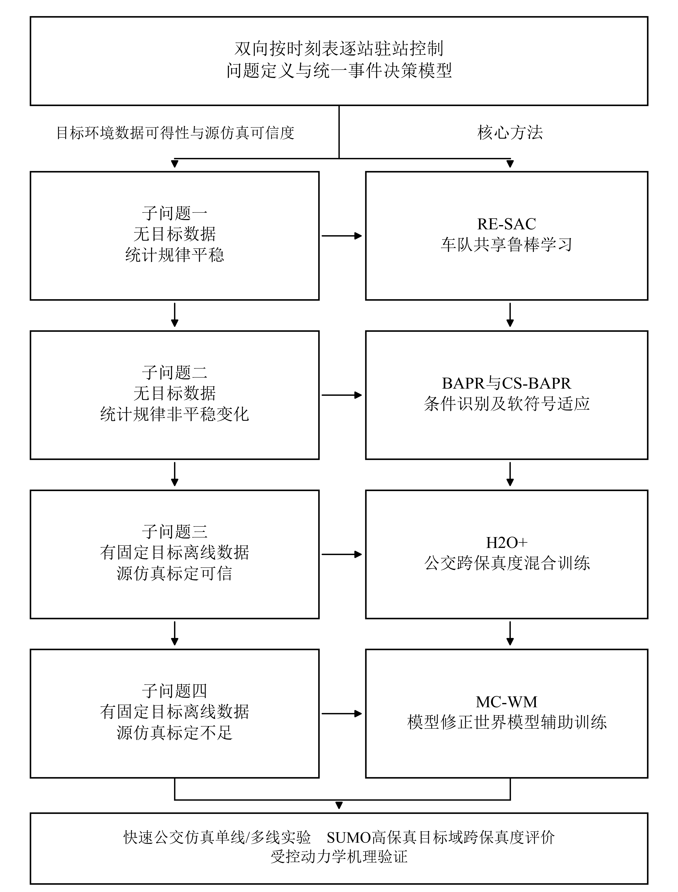 | 图片链接，1处；内容关联：无正文/单元格内容变更。位置指向修改前/最终稿；重复定界符按出现次序编号。 | /home/erzhu419/mine_code/Thesis/output/Gemini/word_assets_20261015/language_review_v2/markdown_figure_links.json | rule-3；图1-1 |
| F0002 | 第2章 公交控制与强化学习基础 &gt; 2.6 公交仿真平台与场景资料；修改前MD行464 → 新MD行550；图片链接；1处 | 【图2-1：多线路公交场景的SUMO路网与双向线路】 | 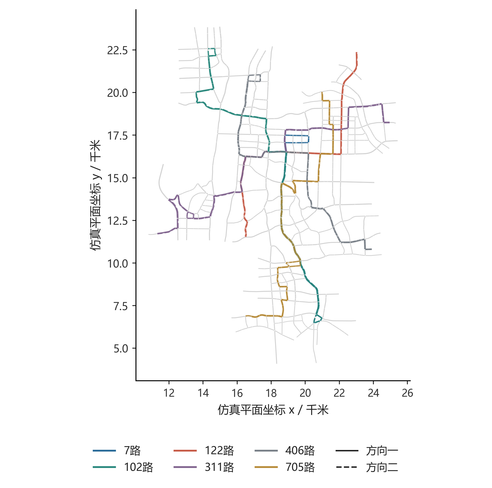 | 图片链接，1处；内容关联：无正文/单元格内容变更。位置指向修改前/最终稿；重复定界符按出现次序编号。 | /home/erzhu419/mine_code/Thesis/output/Gemini/word_assets_20261015/language_review_v2/markdown_figure_links.json | 图2-1 |
| F0003 | 第2章 公交控制与强化学习基础 &gt; 2.7 公交驻站的事件决策统一模型 &gt; 2.7.4 优化目标奖励与服务评价指标体系；修改前MD行537 → 新MD行623；TeX定界符格式；4处 | 1. \vert{} 2. \vert{} 3. \vert{} 4. \vert{} | 1. \vert  2. \vert  3. \vert  4. \vert  | TeX定界符格式，4处；内容关联：无正文/单元格内容变更。位置指向修改前/最终稿；重复定界符按出现次序编号。 | /home/erzhu419/mine_code/Thesis/output/Gemini/word_assets_20261015/language_review_v2/language_rules.json | rule-12 |
| F0004 | 第2章 公交控制与强化学习基础 &gt; 2.7 公交驻站的事件决策统一模型 &gt; 2.7.4 优化目标奖励与服务评价指标体系；修改前MD行539 → 新MD行625；TeX定界符格式；2处 | 1. \vert{} 2. \vert{} | 1. \vert  2. \vert  | TeX定界符格式，2处；内容关联：无正文/单元格内容变更。位置指向修改前/最终稿；重复定界符按出现次序编号。 | /home/erzhu419/mine_code/Thesis/output/Gemini/word_assets_20261015/language_review_v2/language_rules.json | rule-12 |
| F0005 | 第2章 公交控制与强化学习基础 &gt; 2.7 公交驻站的事件决策统一模型 &gt; 2.7.4 优化目标奖励与服务评价指标体系；修改前MD行541 → 新MD行627；TeX定界符格式；2处 | 1. \vert{} 2. \vert{} | 1. \vert  2. \vert  | TeX定界符格式，2处；内容关联：无正文/单元格内容变更。位置指向修改前/最终稿；重复定界符按出现次序编号。 | /home/erzhu419/mine_code/Thesis/output/Gemini/word_assets_20261015/language_review_v2/language_rules.json | rule-12 |
| F0006 | 第2章 公交控制与强化学习基础 &gt; 2.7 公交驻站的事件决策统一模型 &gt; 2.7.4 优化目标奖励与服务评价指标体系；修改前MD行549 → 新MD行635；TeX定界符格式；2处 | 1. \vert{} 2. \vert{} | 1. \vert  2. \vert  | TeX定界符格式，2处；内容关联：P0055。位置指向修改前/最终稿；重复定界符按出现次序编号。 | /home/erzhu419/mine_code/Thesis/output/Gemini/word_assets_20261015/language_review_v2/language_rules.json | ch1_3_034；rule-12 |
| F0007 | 第2章 公交控制与强化学习基础 &gt; 2.7 公交驻站的事件决策统一模型 &gt; 2.7.4 优化目标奖励与服务评价指标体系；修改前MD行553 → 新MD行639、641；TeX定界符格式；4处 | 1. \vert{} 2. \vert{} 3. \vert{} 4. \vert{} | 1. \vert  2. \vert  3. \vert  4. \vert  | TeX定界符格式，4处；内容关联：P0056。位置指向修改前/最终稿；重复定界符按出现次序编号。 | /home/erzhu419/mine_code/Thesis/output/Gemini/word_assets_20261015/language_review_v2/language_rules.json | ch1_3_035；rule-12；bold-cleanup |
| F0008 | 第3章 平稳随机环境下基于单智能体鲁棒强化学习的公交车队驻站控制 &gt; 3.1 问题描述；修改前MD行598 → 新MD行688；图片链接；1处 | 【图3-1位置：本章技术路线图——由平稳随机环境下双向按时刻表逐站驻站问题与单车经验失衡出发，一方面通过类别特征嵌入构建全车队经验共享表征，另一方面针对偶然随机状态扰动诱发的自举目标污染与认知样本稀疏诱发的未知动作高估两类价值估计失真机制，分别设计目标网络权重范数正则化项与集成分歧保守评价项（RE-SAC），并在快速公交仿真双向单线路与长沙多线路场景中开展系统验证与消融剖析。】 | 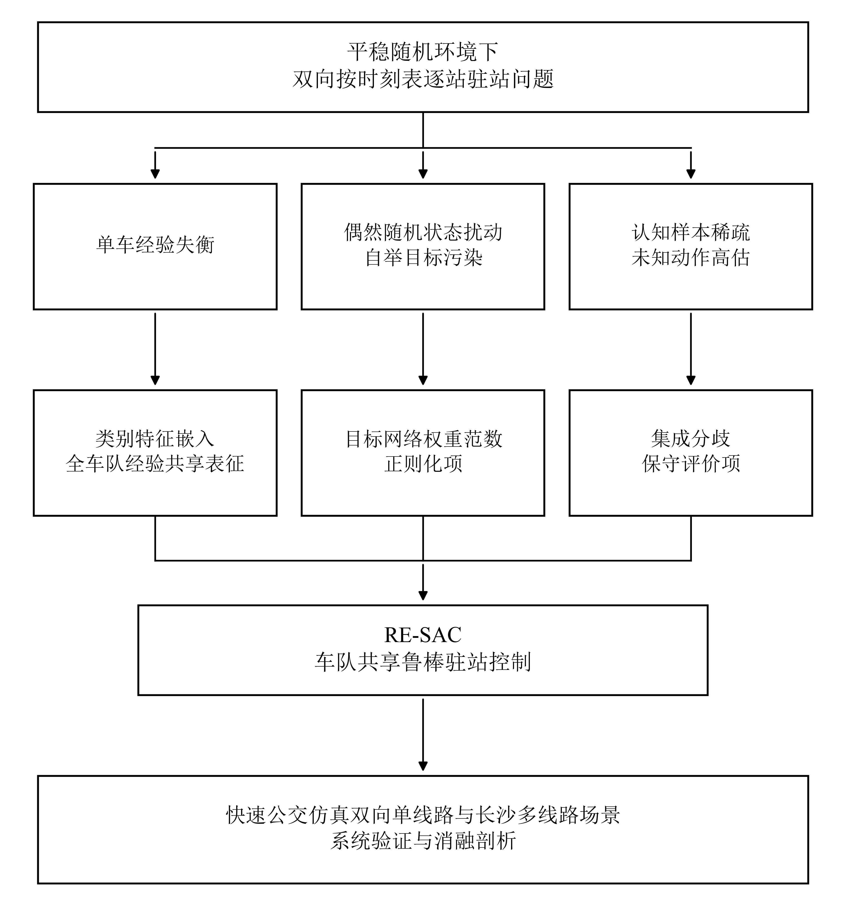 | 图片链接，1处；内容关联：无正文/单元格内容变更。位置指向修改前/最终稿；重复定界符按出现次序编号。 | /home/erzhu419/mine_code/Thesis/output/Gemini/word_assets_20261015/language_review_v2/markdown_figure_links.json | 图3-1 |
| F0009 | 第3章 平稳随机环境下基于单智能体鲁棒强化学习的公交车队驻站控制 &gt; 3.2 模型构建 &gt; 3.2.2 异步事件决策过程与经验回放机制；修改前MD行624 → 新MD行714；图片链接；1处 | 【图3-2：事件触发的公交运行过程控制闭环】 | 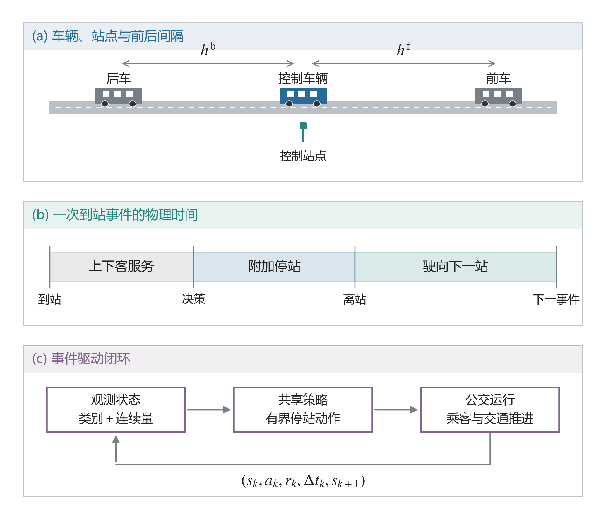 | 图片链接，1处；内容关联：无正文/单元格内容变更。位置指向修改前/最终稿；重复定界符按出现次序编号。 | /home/erzhu419/mine_code/Thesis/output/Gemini/word_assets_20261015/language_review_v2/markdown_figure_links.json | 图3-2 |
| F0010 | 第3章 平稳随机环境下基于单智能体鲁棒强化学习的公交车队驻站控制 &gt; 3.2 模型构建 &gt; 3.2.4 优化目标与奖励函数构造；修改前MD行690 → 新MD行780；图片链接；1处 | 【图3-3：计划间隔奖励与指数时距均衡奖励的响应曲面及截面】 | 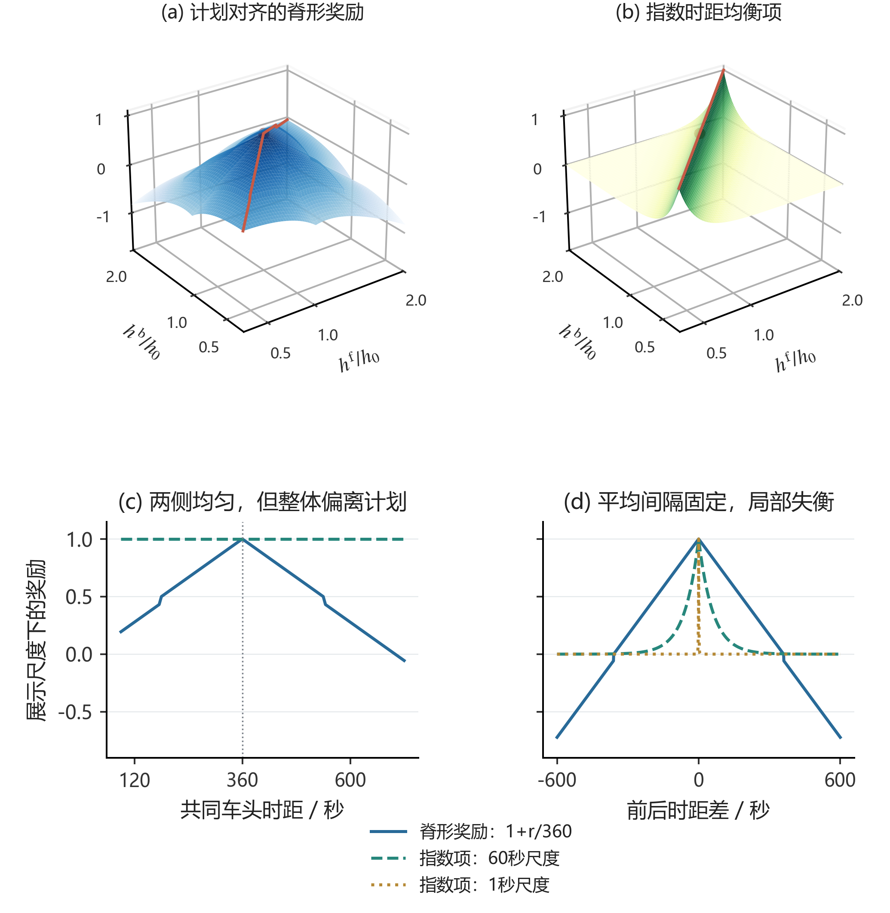 | 图片链接，1处；内容关联：无正文/单元格内容变更。位置指向修改前/最终稿；重复定界符按出现次序编号。 | /home/erzhu419/mine_code/Thesis/output/Gemini/word_assets_20261015/language_review_v2/markdown_figure_links.json | 图3-3 |
| F0011 | 第3章 平稳随机环境下基于单智能体鲁棒强化学习的公交车队驻站控制 &gt; 3.3 求解方法 &gt; 3.3.2 鲁棒保守策略优化；修改前MD行830 → 新MD行922；图片链接；1处 | 【图3-4：类别共享策略与RE-SAC集成价值学习结构】 | 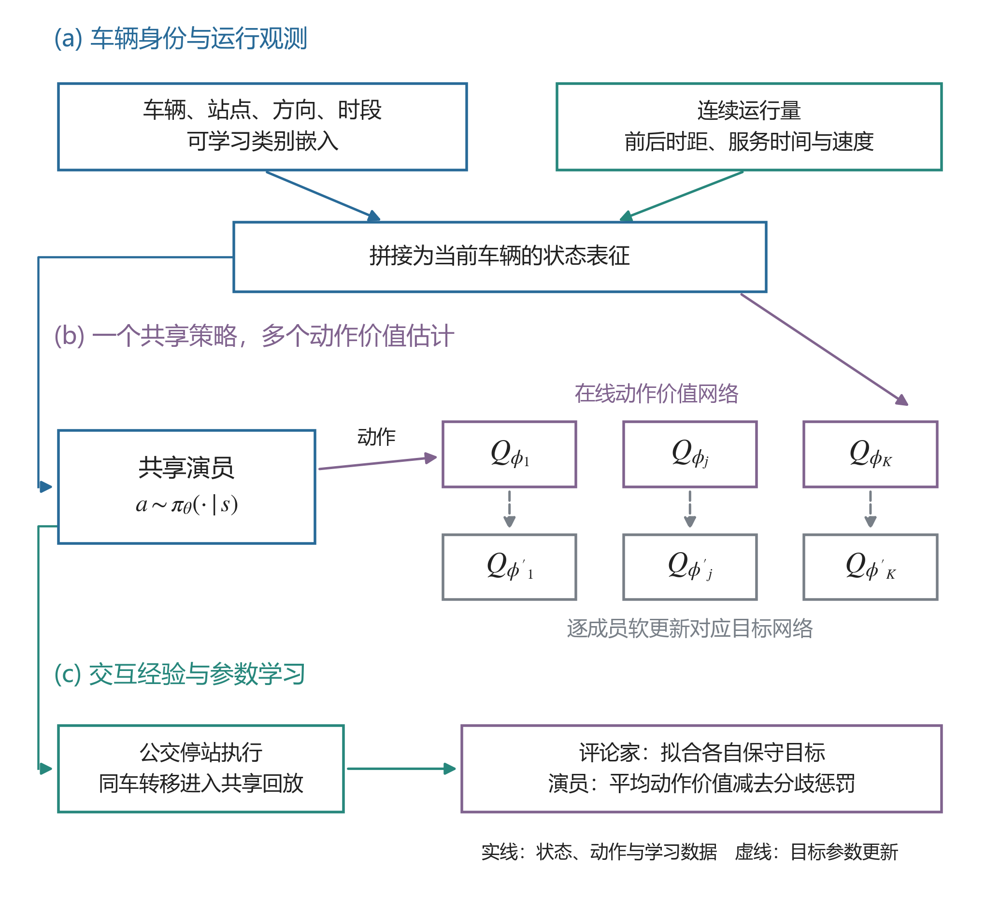 | 图片链接，1处；内容关联：无正文/单元格内容变更。位置指向修改前/最终稿；重复定界符按出现次序编号。 | /home/erzhu419/mine_code/Thesis/output/Gemini/word_assets_20261015/language_review_v2/markdown_figure_links.json | 图3-4 |
| F0012 | 第3章 平稳随机环境下基于单智能体鲁棒强化学习的公交车队驻站控制 &gt; 3.4 仿真实验与结果分析 &gt; 3.4.1 实验设计与场景输入特征；修改前MD行892 → 新MD行984；图片链接；1处 | 【图3-5：双向单线路实验的小时需求与路段速度输入】 | 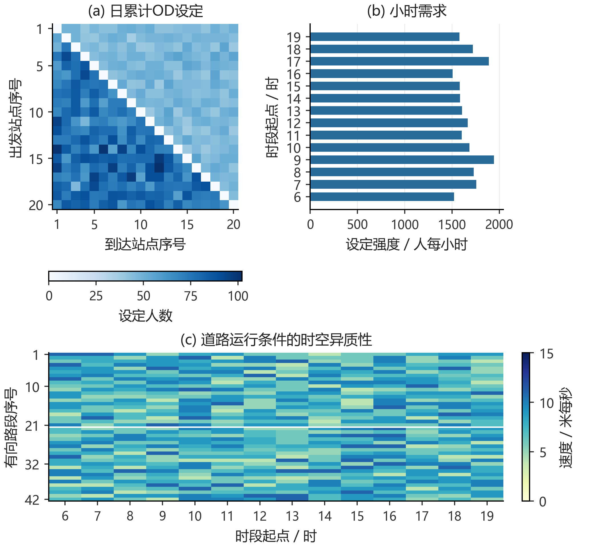 | 图片链接，1处；内容关联：无正文/单元格内容变更。位置指向修改前/最终稿；重复定界符按出现次序编号。 | /home/erzhu419/mine_code/Thesis/output/Gemini/word_assets_20261015/language_review_v2/markdown_figure_links.json | 图3-5 |
| F0013 | 第3章 平稳随机环境下基于单智能体鲁棒强化学习的公交车队驻站控制 &gt; 3.4 仿真实验与结果分析 &gt; 3.4.2 双向单线路服务水平对比分析；修改前MD行919 → 新MD行1011；图片链接；1处 | 【图3-6：RE-SAC集成规模及消融配置的公交回报】 | 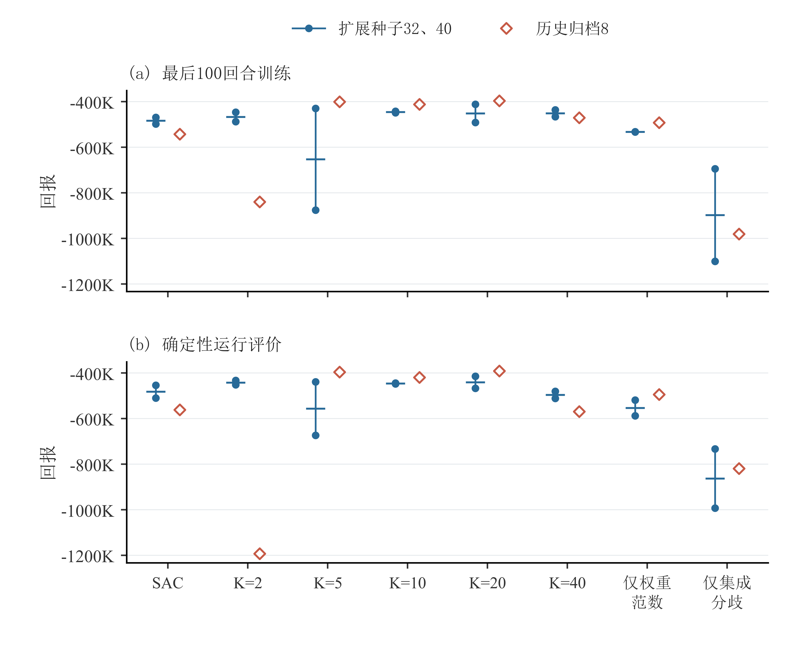 | 图片链接，1处；内容关联：无正文/单元格内容变更。位置指向修改前/最终稿；重复定界符按出现次序编号。 | /home/erzhu419/mine_code/Thesis/output/Gemini/word_assets_20261015/language_review_v2/markdown_figure_links.json | 图3-6 |
| F0014 | 第3章 平稳随机环境下基于单智能体鲁棒强化学习的公交车队驻站控制 &gt; 3.4 仿真实验与结果分析 &gt; 3.4.2 双向单线路服务水平对比分析；修改前MD行923 → 新MD行1015；图片链接；1处 | 【图3-7：集成规模与惩罚组合对公交策略学习过程的影响】 | 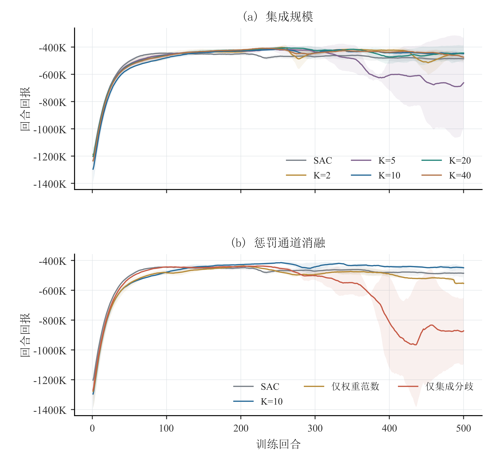 | 图片链接，1处；内容关联：无正文/单元格内容变更。位置指向修改前/最终稿；重复定界符按出现次序编号。 | /home/erzhu419/mine_code/Thesis/output/Gemini/word_assets_20261015/language_review_v2/markdown_figure_links.json | 图3-7 |
| F0015 | 第3章 平稳随机环境下基于单智能体鲁棒强化学习的公交车队驻站控制 &gt; 3.4 仿真实验与结果分析 &gt; 3.4.3 长期训练稳定性与熵温度演化分析；修改前MD行952 → 新MD行1044；图片链接；1处 | 【图3-8：固定温度对训练后期平均回报的配对影响】 | 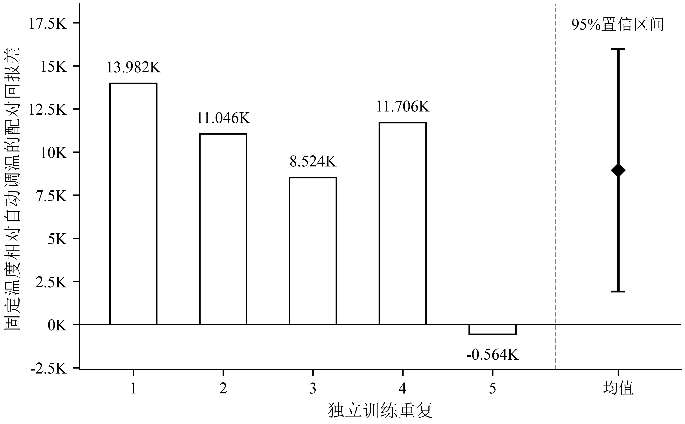 | 图片链接，1处；内容关联：无正文/单元格内容变更。位置指向修改前/最终稿；重复定界符按出现次序编号。 | /home/erzhu419/mine_code/Thesis/output/Gemini/word_assets_20261015/language_review_v2/markdown_figure_links.json | 图3-8 |
| F0016 | 第3章 平稳随机环境下基于单智能体鲁棒强化学习的公交车队驻站控制 &gt; 3.4 仿真实验与结果分析 &gt; 3.4.3 长期训练稳定性与熵温度演化分析；修改前MD行956 → 新MD行1048；图片链接；1处 | 【图3-9：熵温度与中后期策略回报的共同变化】 | 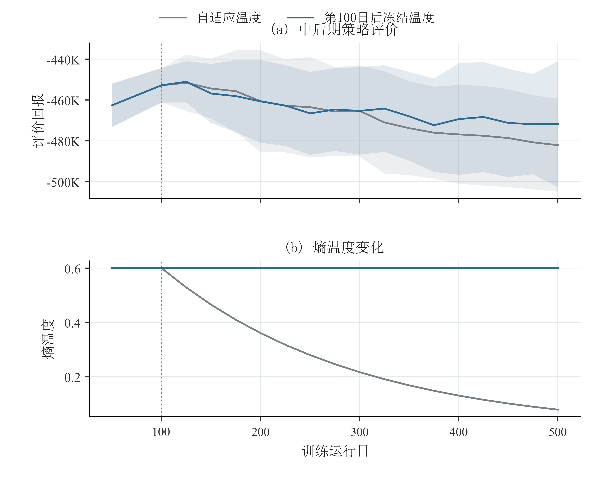 | 图片链接，1处；内容关联：无正文/单元格内容变更。位置指向修改前/最终稿；重复定界符按出现次序编号。 | /home/erzhu419/mine_code/Thesis/output/Gemini/word_assets_20261015/language_review_v2/markdown_figure_links.json | 图3-9 |
| F0017 | 第3章 平稳随机环境下基于单智能体鲁棒强化学习的公交车队驻站控制 &gt; 3.4 仿真实验与结果分析 &gt; 3.4.5 组成因素与超参数影响分析；修改前MD行1001 → 新MD行1093；图片链接；1处 | 【图3-10：相同RE-SAC训练设置下类别表示的奖励与乘客时间比较】 | 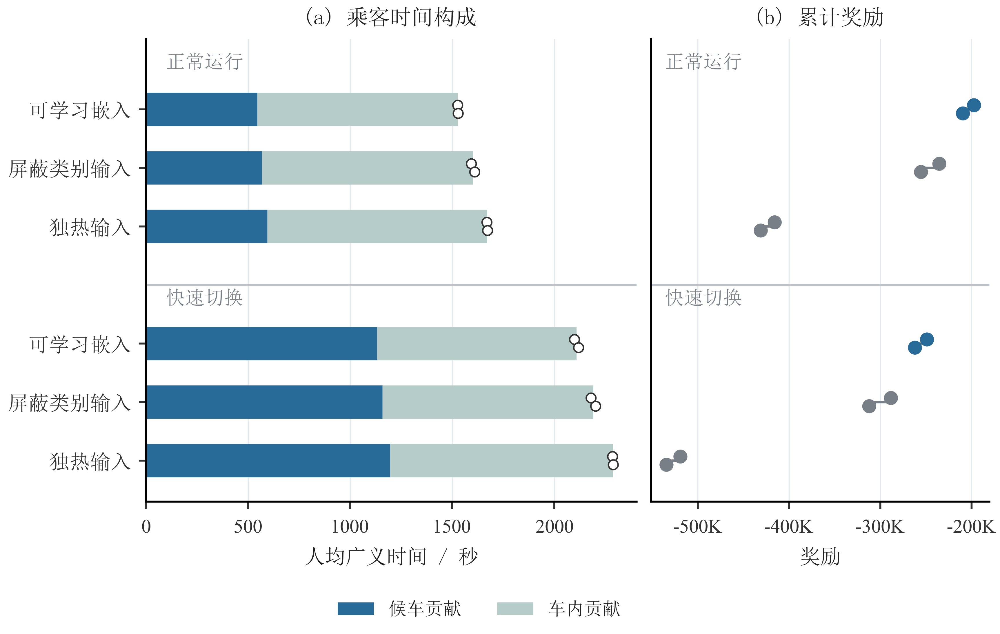 | 图片链接，1处；内容关联：无正文/单元格内容变更。位置指向修改前/最终稿；重复定界符按出现次序编号。 | /home/erzhu419/mine_code/Thesis/output/Gemini/word_assets_20261015/language_review_v2/markdown_figure_links.json | 图3-10 |
| F0018 | 第3章 平稳随机环境下基于单智能体鲁棒强化学习的公交车队驻站控制 &gt; 3.4 仿真实验与结果分析 &gt; 3.4.5 组成因素与超参数影响分析；修改前MD行1019 → 新MD行1111；图片链接；1处 | 【图3-11：三种运行条件下类别表示的五次重复训练结果】 | 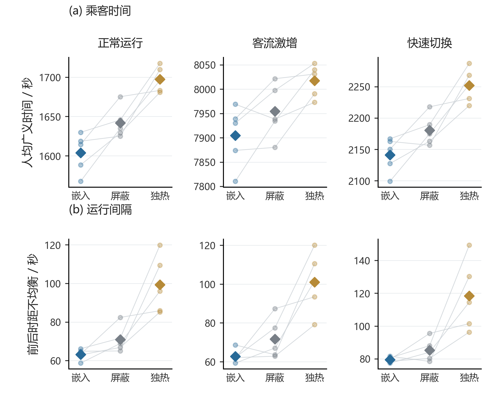 | 图片链接，1处；内容关联：无正文/单元格内容变更。位置指向修改前/最终稿；重复定界符按出现次序编号。 | /home/erzhu419/mine_code/Thesis/output/Gemini/word_assets_20261015/language_review_v2/markdown_figure_links.json | 图3-11 |
| F0019 | 第3章 平稳随机环境下基于单智能体鲁棒强化学习的公交车队驻站控制 &gt; 3.4 仿真实验与结果分析 &gt; 3.4.5 组成因素与超参数影响分析；修改前MD行1040 → 新MD行1132；图片链接；1处 | 【图3-12：奖励设计对前后车头时距不均衡度、驻站与乘客时间的影响】 | 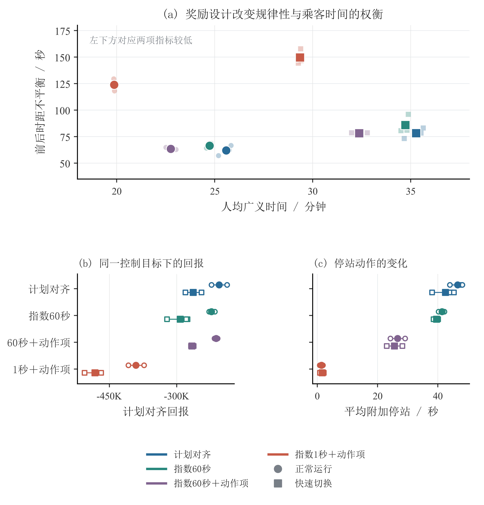 | 图片链接，1处；内容关联：无正文/单元格内容变更。位置指向修改前/最终稿；重复定界符按出现次序编号。 | /home/erzhu419/mine_code/Thesis/output/Gemini/word_assets_20261015/language_review_v2/markdown_figure_links.json | 图3-12 |
| F0020 | 第3章 平稳随机环境下基于单智能体鲁棒强化学习的公交车队驻站控制 &gt; 3.4 仿真实验与结果分析 &gt; 3.4.5 组成因素与超参数影响分析；修改前MD行1083 → 新MD行1179；图片链接；1处 | 【图3-13：策略与价值网络分歧项在不同运行条件下的平均作用】 | 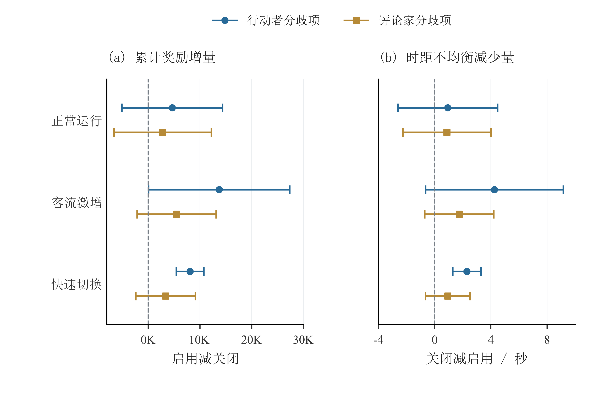 | 图片链接，1处；内容关联：无正文/单元格内容变更。位置指向修改前/最终稿；重复定界符按出现次序编号。 | /home/erzhu419/mine_code/Thesis/output/Gemini/word_assets_20261015/language_review_v2/markdown_figure_links.json | 图3-13 |
| F0021 | 第3章 平稳随机环境下基于单智能体鲁棒强化学习的公交车队驻站控制 &gt; 3.4 仿真实验与结果分析 &gt; 3.4.5 组成因素与超参数影响分析；修改前MD行1119 → 新MD行1215；图片链接；1处 | 【图3-14：集成规模的五次重复训练结果与计算代价】 | 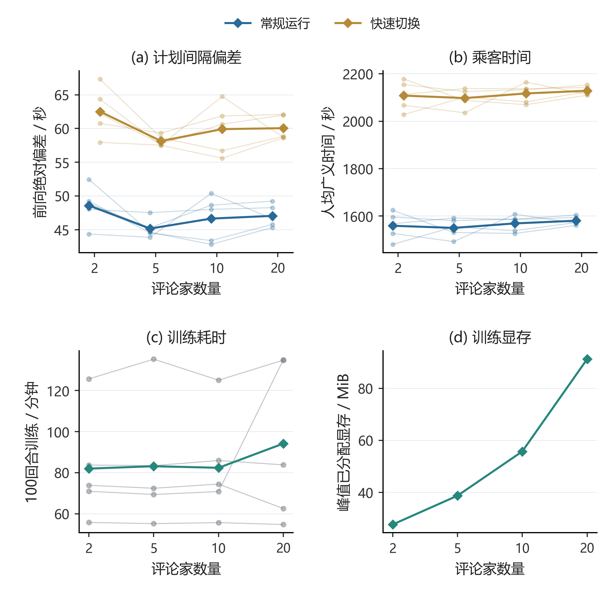 | 图片链接，1处；内容关联：无正文/单元格内容变更。位置指向修改前/最终稿；重复定界符按出现次序编号。 | /home/erzhu419/mine_code/Thesis/output/Gemini/word_assets_20261015/language_review_v2/markdown_figure_links.json | 图3-14 |
| F0022 | 第4章 非平稳环境下基于条件识别与因果符号约束的公交车队驻站控制 &gt; 4.1 问题描述；修改前MD行1185 → 新MD行1285；图片链接；1处 | 【图4-1位置：本章技术路线图——由非平稳环境下客流与路况统计规律时变问题出发，分解为“新旧经验混杂下的价值评价失准（子问题一）”与“极端冲击突破训练范围后的策略外推失真（子问题二）”两条主线：子问题一通过BAPR近期统计反馈与运行长度加权动态调节保守系数；子问题二结合六项训练稳定化设计、可学习基准动作加参考归零神经修正结构以及SINDy短期代价辨识与软符号雅可比导数约束（CS-BAPR）规范策略响应；最终在长沙多线路六类非平稳客流场景与受控动力学平台上开展系统验证。】 | 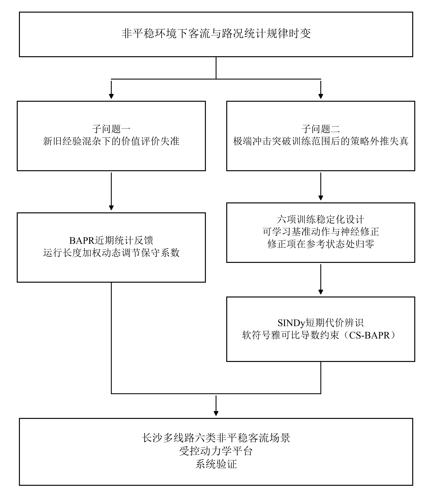 | 图片链接，1处；内容关联：无正文/单元格内容变更。位置指向修改前/最终稿；重复定界符按出现次序编号。 | /home/erzhu419/mine_code/Thesis/output/Gemini/word_assets_20261015/language_review_v2/markdown_figure_links.json | rule-5；图4-1 |
| F0023 | 第4章 非平稳环境下基于条件识别与因果符号约束的公交车队驻站控制 &gt; 4.3 求解方法 &gt; 4.3.1 训练稳定化设计与求解流程；修改前MD行1334 → 新MD行1434；图片链接；1处 | 【图4-2：CS-BAPR的策略结构与训练稳定化机制】 | 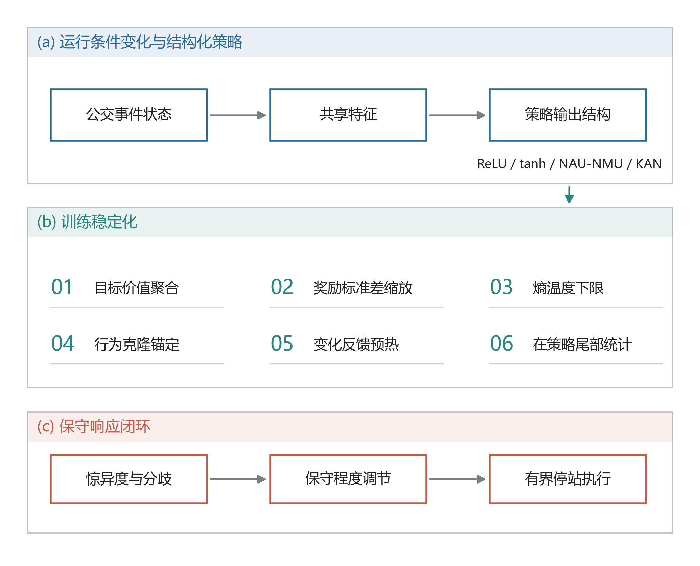 | 图片链接，1处；内容关联：无正文/单元格内容变更。位置指向修改前/最终稿；重复定界符按出现次序编号。 | /home/erzhu419/mine_code/Thesis/output/Gemini/word_assets_20261015/language_review_v2/markdown_figure_links.json | 图4-2 |
| F0024 | 第4章 非平稳环境下基于条件识别与因果符号约束的公交车队驻站控制 &gt; 4.4 仿真实验与结果分析 &gt; 4.4.2 固定需求放大强度下的控制表现分析；修改前MD行1433 → 新MD行1533；图片链接；1处 | 【图4-3：CS-BAPR各配置在训练分布内的回报均值与标准差】 | 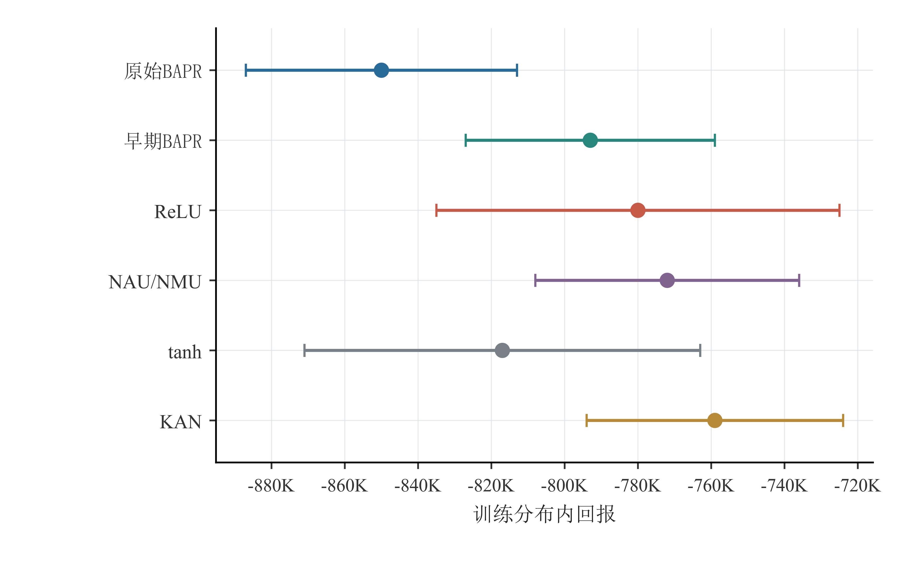 | 图片链接，1处；内容关联：无正文/单元格内容变更。位置指向修改前/最终稿；重复定界符按出现次序编号。 | /home/erzhu419/mine_code/Thesis/output/Gemini/word_assets_20261015/language_review_v2/markdown_figure_links.json | 图4-3 |
| F0025 | 第4章 非平稳环境下基于条件识别与因果符号约束的公交车队驻站控制 &gt; 4.4 仿真实验与结果分析 &gt; 4.4.3 回合内需求突变与反复变化下的控制表现分析；修改前MD行1474 → 新MD行1574；图片链接；1处 | 【图4-4：三种反复变化场景的需求强度时序】 | 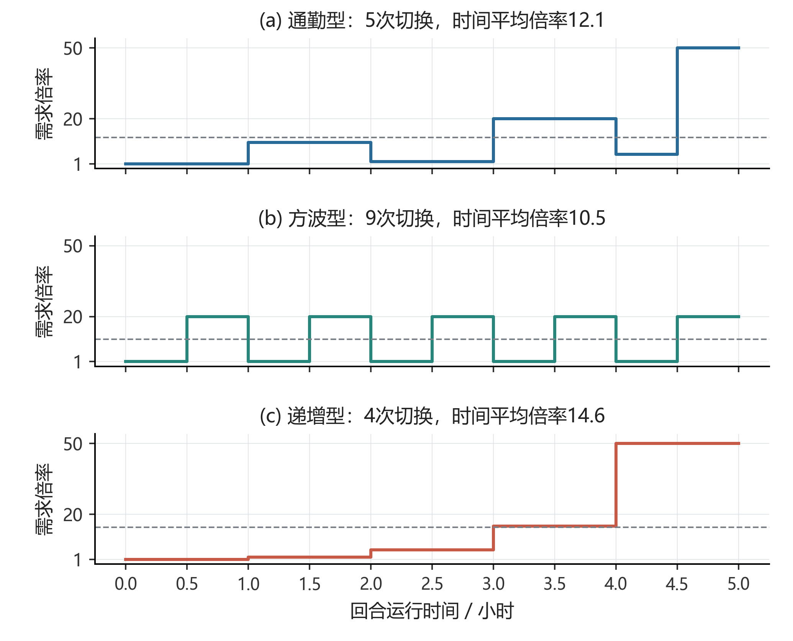 | 图片链接，1处；内容关联：无正文/单元格内容变更。位置指向修改前/最终稿；重复定界符按出现次序编号。 | /home/erzhu419/mine_code/Thesis/output/Gemini/word_assets_20261015/language_review_v2/markdown_figure_links.json | 图4-4 |
| F0026 | 第4章 非平稳环境下基于条件识别与因果符号约束的公交车队驻站控制 &gt; 4.4 仿真实验与结果分析 &gt; 4.4.3 回合内需求突变与反复变化下的控制表现分析；修改前MD行1489 → 新MD行1589；图片链接；1处 | 【图4-5：固定放大与突变需求下的策略结构比较】 | 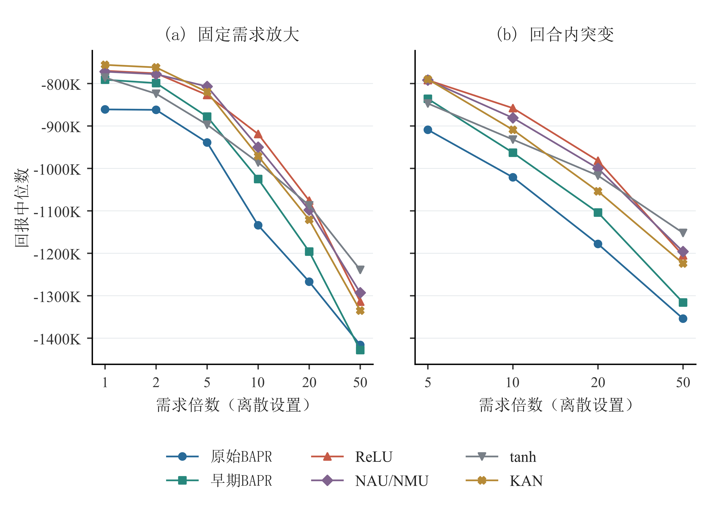 | 图片链接，1处；内容关联：无正文/单元格内容变更。位置指向修改前/最终稿；重复定界符按出现次序编号。 | /home/erzhu419/mine_code/Thesis/output/Gemini/word_assets_20261015/language_review_v2/markdown_figure_links.json | 图4-5 |
| F0027 | 第4章 非平稳环境下基于条件识别与因果符号约束的公交车队驻站控制 &gt; 4.4 仿真实验与结果分析 &gt; 4.4.3 回合内需求突变与反复变化下的控制表现分析；修改前MD行1493 → 新MD行1593；图片链接；1处 | 【图4-6：反复变化需求下CS-BAPR相对原始BAPR的收益分解】 | 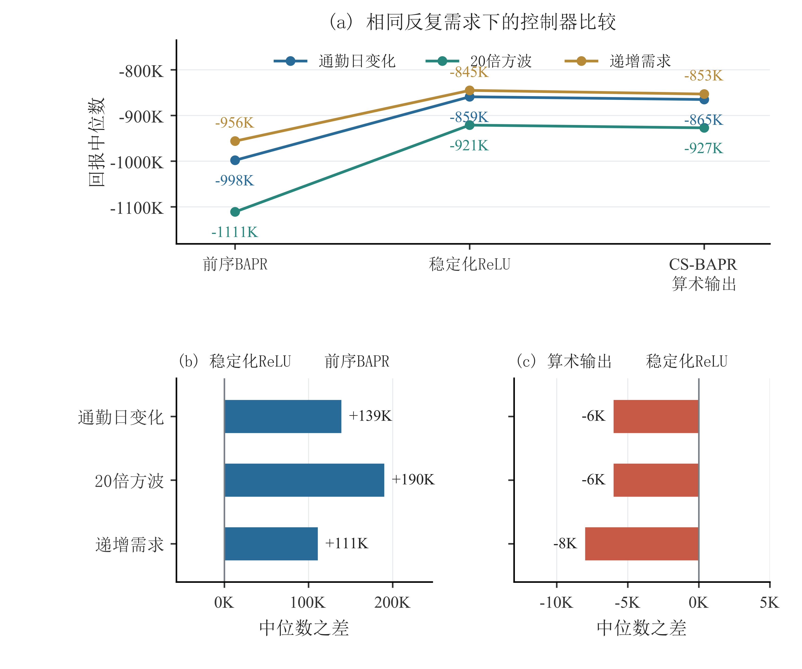 | 图片链接，1处；内容关联：无正文/单元格内容变更。位置指向修改前/最终稿；重复定界符按出现次序编号。 | /home/erzhu419/mine_code/Thesis/output/Gemini/word_assets_20261015/language_review_v2/markdown_figure_links.json | 图4-6 |
| F0028 | 第4章 非平稳环境下基于条件识别与因果符号约束的公交车队驻站控制 &gt; 4.4 仿真实验与结果分析 &gt; 4.4.3 回合内需求突变与反复变化下的控制表现分析；修改前MD行1497 → 新MD行1597；图片链接；1处 | 【图4-7：20倍需求条件下的低回报比例与最低回报尾部风险对比】 | 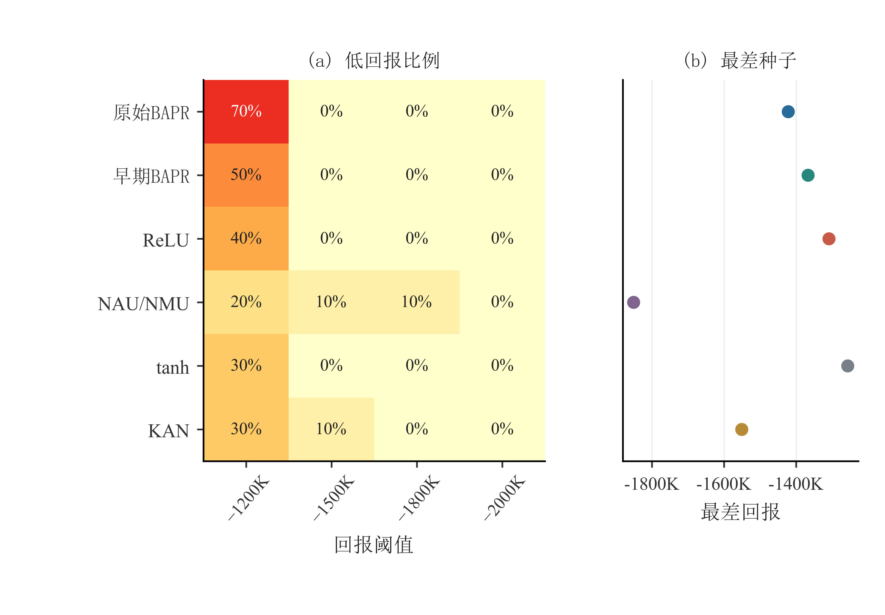 | 图片链接，1处；内容关联：无正文/单元格内容变更。位置指向修改前/最终稿；重复定界符按出现次序编号。 | /home/erzhu419/mine_code/Thesis/output/Gemini/word_assets_20261015/language_review_v2/markdown_figure_links.json | 图4-7 |
| F0029 | 第4章 非平稳环境下基于条件识别与因果符号约束的公交车队驻站控制 &gt; 4.4 仿真实验与结果分析 &gt; 4.4.4 非平稳乘客服务复评、脉冲响应与受控动力学补偿分析；修改前MD行1522 → 新MD行1622；图片链接；1处 | 【图4-8：BAPR相对RE-SAC的配对奖励差与乘客时间差】 | 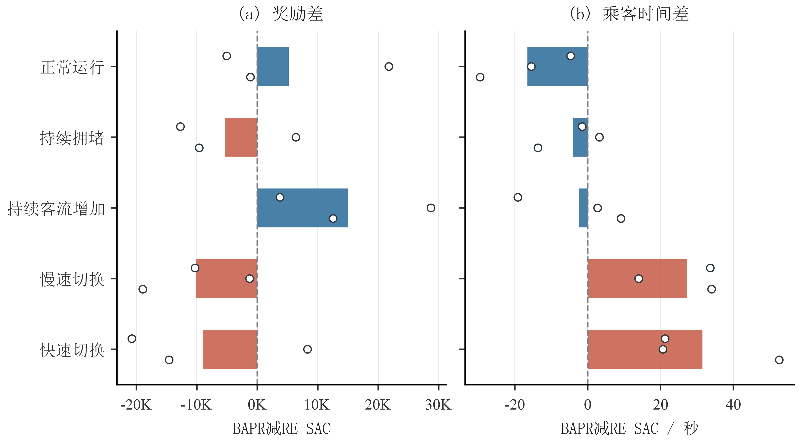 | 图片链接，1处；内容关联：无正文/单元格内容变更。位置指向修改前/最终稿；重复定界符按出现次序编号。 | /home/erzhu419/mine_code/Thesis/output/Gemini/word_assets_20261015/language_review_v2/markdown_figure_links.json | 图4-8 |
| F0030 | 第4章 非平稳环境下基于条件识别与因果符号约束的公交车队驻站控制 &gt; 4.4 仿真实验与结果分析 &gt; 4.4.4 非平稳乘客服务复评、脉冲响应与受控动力学补偿分析；修改前MD行1534 → 新MD行1634；图片链接；1处 | 【图4-9：五倍需求脉冲下的控制回报与同期队列响应】 | 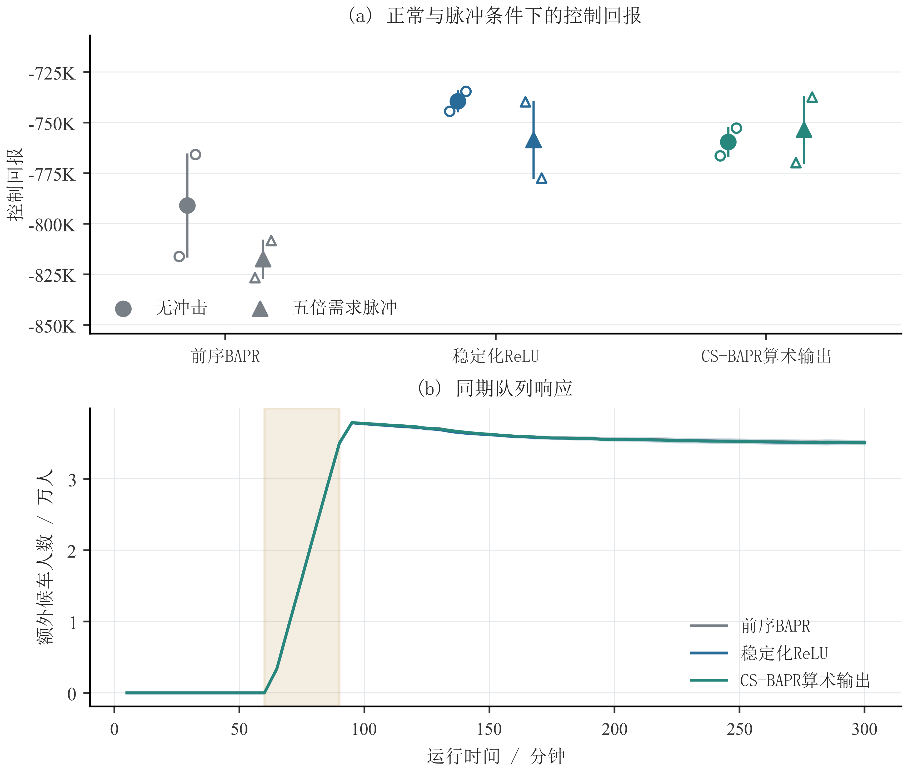 | 图片链接，1处；内容关联：无正文/单元格内容变更。位置指向修改前/最终稿；重复定界符按出现次序编号。 | /home/erzhu419/mine_code/Thesis/output/Gemini/word_assets_20261015/language_review_v2/markdown_figure_links.json | 图4-9 |
| F0031 | 第4章 非平稳环境下基于条件识别与因果符号约束的公交车队驻站控制 &gt; 4.4 仿真实验与结果分析 &gt; 4.4.4 非平稳乘客服务复评、脉冲响应与受控动力学补偿分析；修改前MD行1550 → 新MD行1650；图片链接；1处 | 【图4-10：等累计需求倍率的单次与重复冲击下稳定化算术输出与稳定化ReLU的控制回报增益（图中算术输出采用完整训练稳定化设计的NAU/NMU配置，未启用SINDy软符号约束）】 | 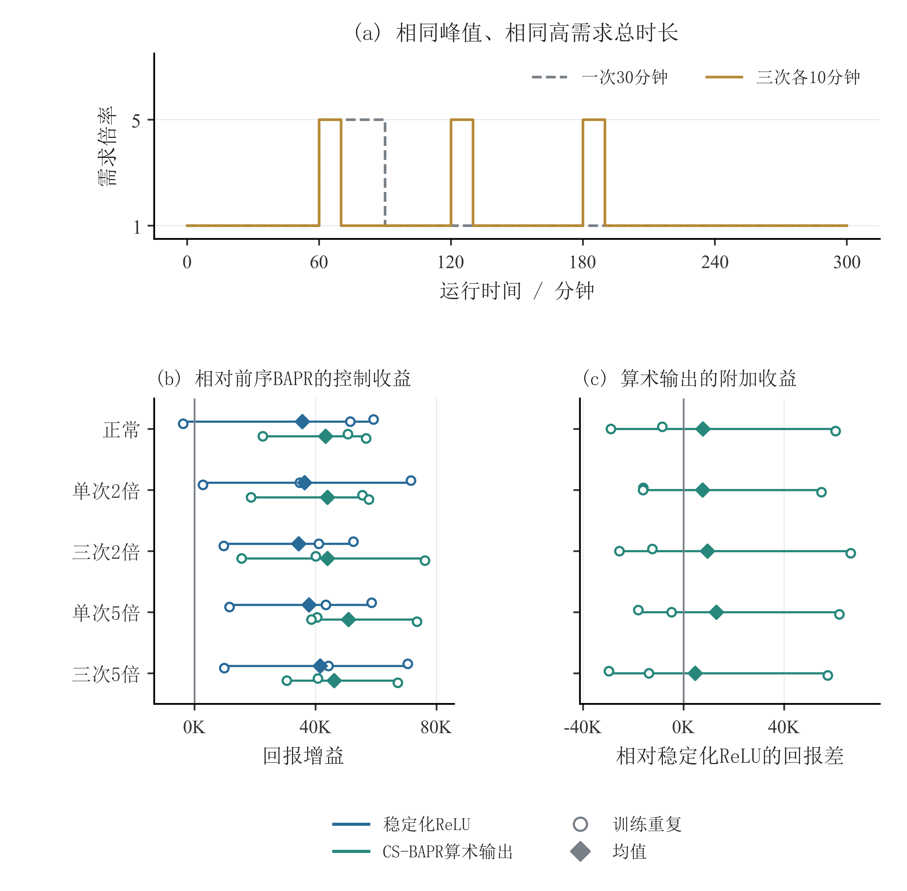 | 图片链接，1处；内容关联：无正文/单元格内容变更。位置指向修改前/最终稿；重复定界符按出现次序编号。 | /home/erzhu419/mine_code/Thesis/output/Gemini/word_assets_20261015/language_review_v2/markdown_figure_links.json | 图4-10 |
| F0032 | 第4章 非平稳环境下基于条件识别与因果符号约束的公交车队驻站控制 &gt; 4.4 仿真实验与结果分析 &gt; 4.4.4 非平稳乘客服务复评、脉冲响应与受控动力学补偿分析；修改前MD行1570 → 新MD行1670；图片链接；1处 | 【图4-11：结构化执行模式变化下BAPR与RE-SAC的配对结果及动作补偿作用】 | 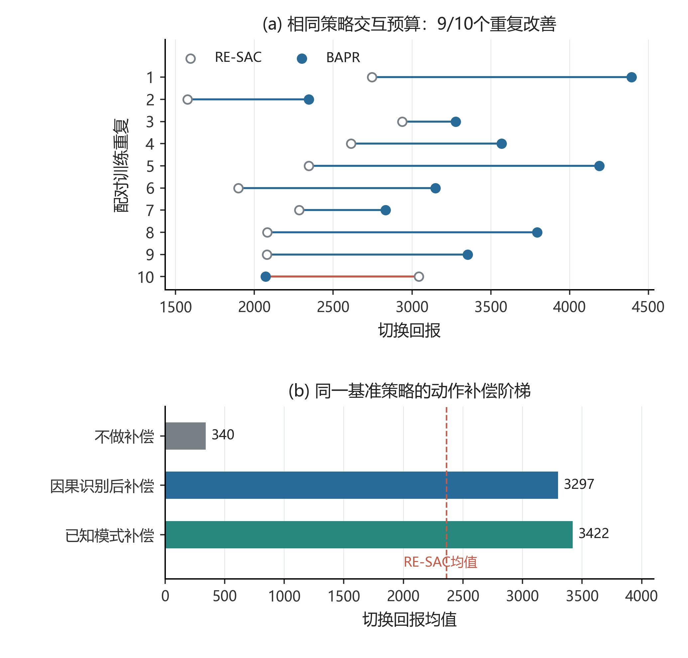 | 图片链接，1处；内容关联：无正文/单元格内容变更。位置指向修改前/最终稿；重复定界符按出现次序编号。 | /home/erzhu419/mine_code/Thesis/output/Gemini/word_assets_20261015/language_review_v2/markdown_figure_links.json | 图4-11 |
| F0033 | 第4章 非平稳环境下基于条件识别与因果符号约束的公交车队驻站控制 &gt; 4.5 本章小结；修改前MD行1642 → 新MD行1742；TeX定界符格式；4处 | 1. \Vert{} 2. \Vert{} 3. \Vert{} 4. \Vert{} | 1. \Vert  2. \Vert  3. \Vert  4. \Vert  | TeX定界符格式，4处；内容关联：无正文/单元格内容变更。位置指向修改前/最终稿；重复定界符按出现次序编号。 | /home/erzhu419/mine_code/Thesis/output/Gemini/word_assets_20261015/language_review_v2/language_rules.json | rule-13；bold-cleanup |
| F0034 | 第5章 跨保真运行环境下基于迁移强化学习的公交车队驻站控制 &gt; 5.1 问题描述；修改前MD行1678 → 新MD行1778；图片链接；1处 | 【图5-1位置：本章技术路线图——由“掌握目标域固定离线数据与经标定快速源仿真、但目标环境不允许大规模在线试错”的工程条件出发，剖析纯离线学习、目标域在线微调与源域在线训练三种单一模式的缺陷；建立双层仿真标定检验（自然运行检验＋多策略驻站响应检验），进而构建基于H2O+的公交跨保真混合训练方法（同时到站车组顺序条件状态表征＋IQL离线初始化与双域混合回放续训），最终在SUMO高保真目标环境中完成多维度对比验证与域分类器诊断。】 | 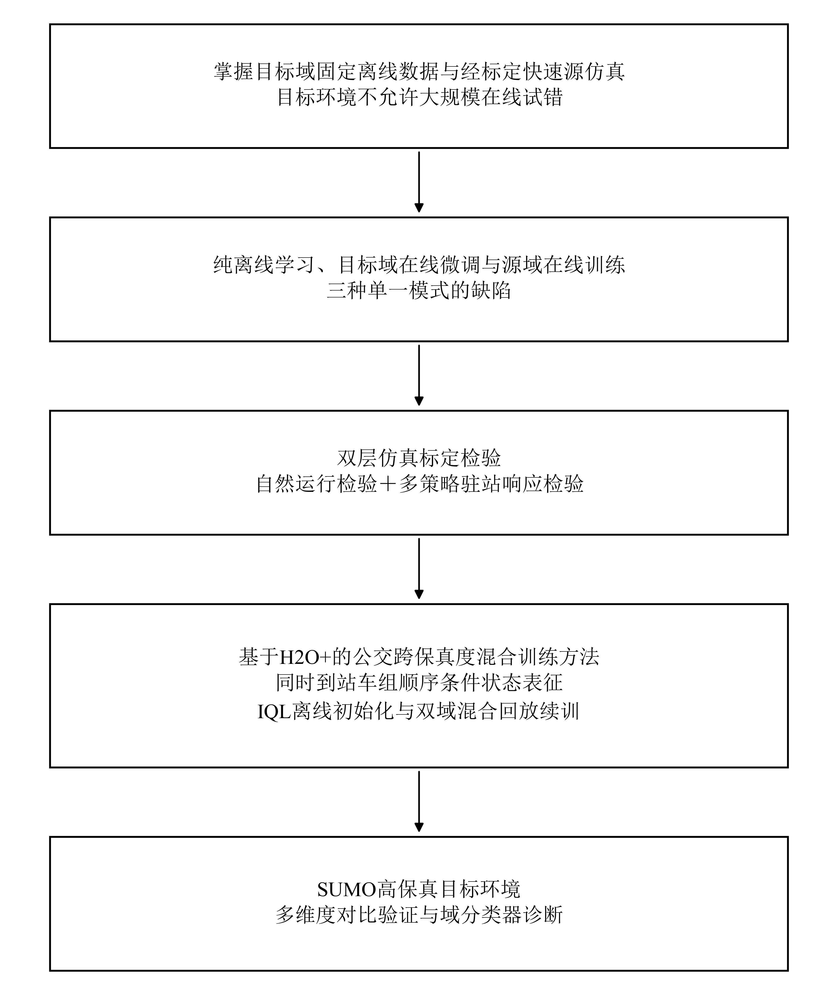 | 图片链接，1处；内容关联：无正文/单元格内容变更。位置指向修改前/最终稿；重复定界符按出现次序编号。 | /home/erzhu419/mine_code/Thesis/output/Gemini/word_assets_20261015/language_review_v2/markdown_figure_links.json | rule-3；图5-1 |
| F0035 | 第5章 跨保真运行环境下基于迁移强化学习的公交车队驻站控制 &gt; 5.2 模型构建 &gt; 5.2.1 基本条件与两项任务设置；修改前MD行1696 → 新MD行1796；图片链接；1处 | 【图5-2：本文跨保真实验与真实运营应用的数据分工】 | 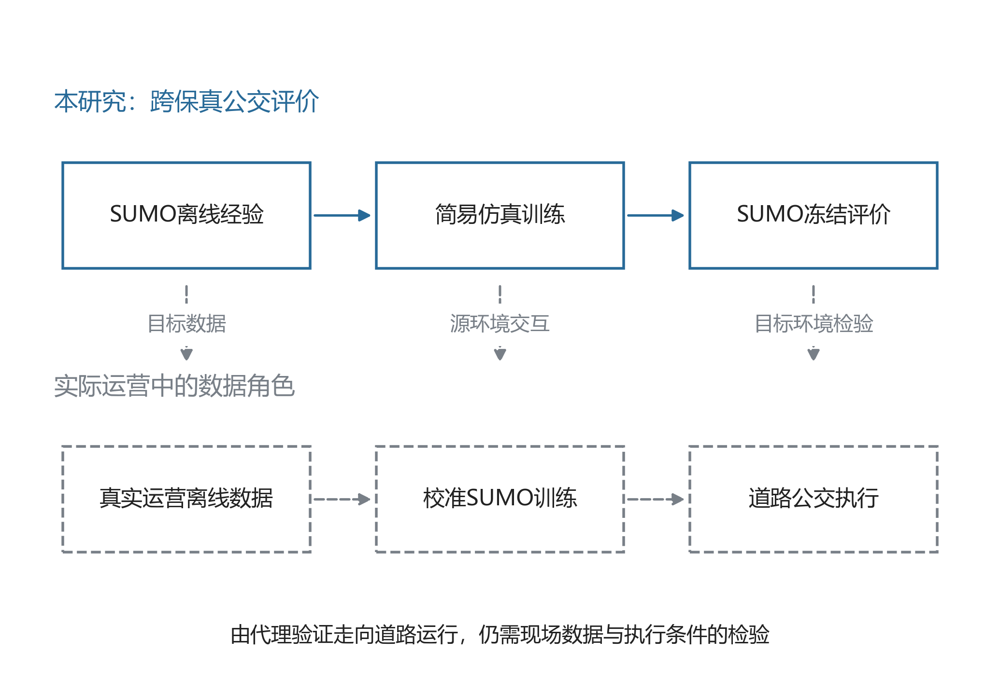 | 图片链接，1处；内容关联：无正文/单元格内容变更。位置指向修改前/最终稿；重复定界符按出现次序编号。 | /home/erzhu419/mine_code/Thesis/output/Gemini/word_assets_20261015/language_review_v2/markdown_figure_links.json | rule-3；图5-2 |
| F0036 | 第5章 跨保真运行环境下基于迁移强化学习的公交车队驻站控制 &gt; 5.2 模型构建 &gt; 5.2.1 基本条件与两项任务设置；修改前MD行1722 → 新MD行1822；图片链接；1处 | 【图5-3：同一长尾分布的有限样本估计与再次采样误差】 | 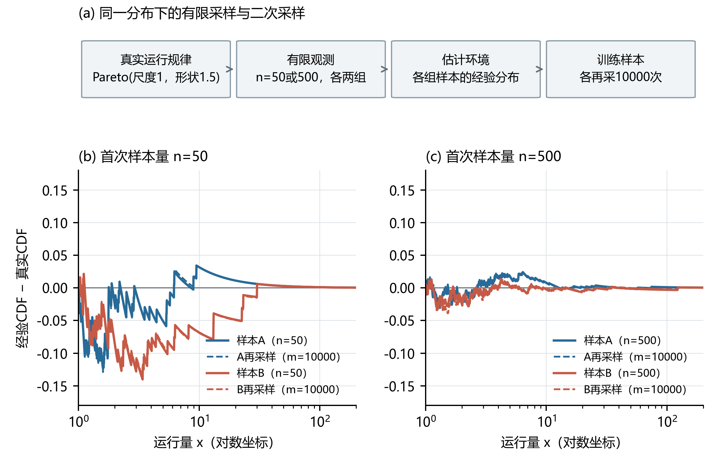 | 图片链接，1处；内容关联：无正文/单元格内容变更。位置指向修改前/最终稿；重复定界符按出现次序编号。 | /home/erzhu419/mine_code/Thesis/output/Gemini/word_assets_20261015/language_review_v2/markdown_figure_links.json | 图5-3 |
| F0037 | 第5章 跨保真运行环境下基于迁移强化学习的公交车队驻站控制 &gt; 5.3 求解方法 &gt; 5.3.3 基于H2O+的公交跨保真混合训练流程；修改前MD行1856 → 新MD行1956；图片链接；1处 | 【图5-4：公交H2O+的跨保真混合训练流程】 | 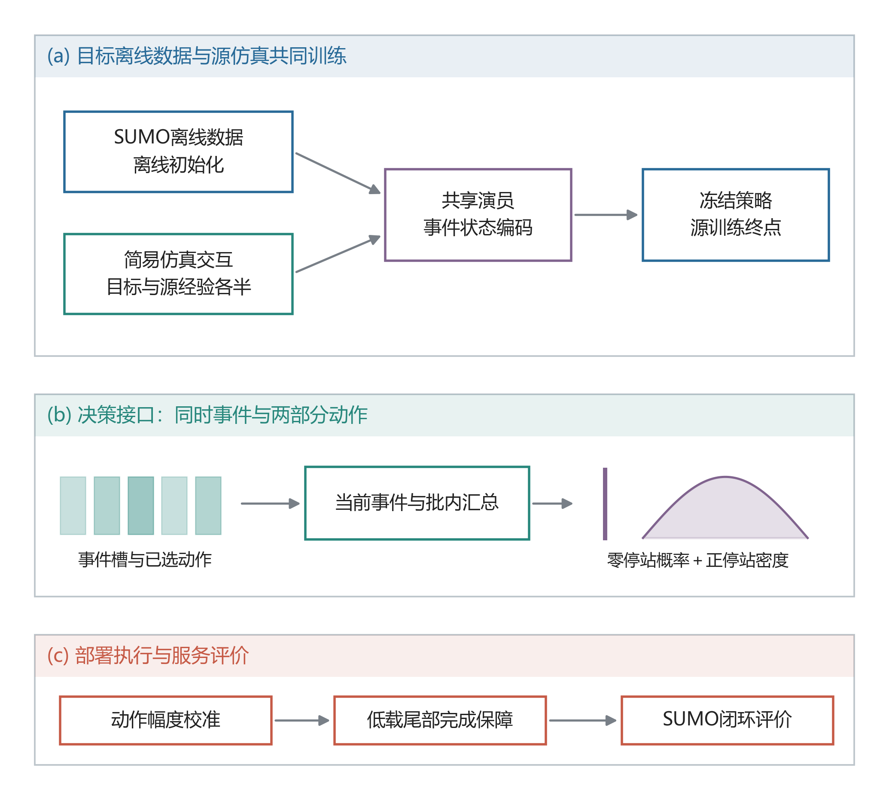 | 图片链接，1处；内容关联：无正文/单元格内容变更。位置指向修改前/最终稿；重复定界符按出现次序编号。 | /home/erzhu419/mine_code/Thesis/output/Gemini/word_assets_20261015/language_review_v2/markdown_figure_links.json | rule-3；图5-4 |
| F0038 | 第5章 跨保真运行环境下基于迁移强化学习的公交车队驻站控制 &gt; 5.4 仿真实验与结果分析 &gt; 5.4.1 源仿真标定与驻站响应一致性检验；修改前MD行1884 → 新MD行1984；图片链接；1处 | 【图5-5：不同线路方向的站间道路运行时间分布】 | 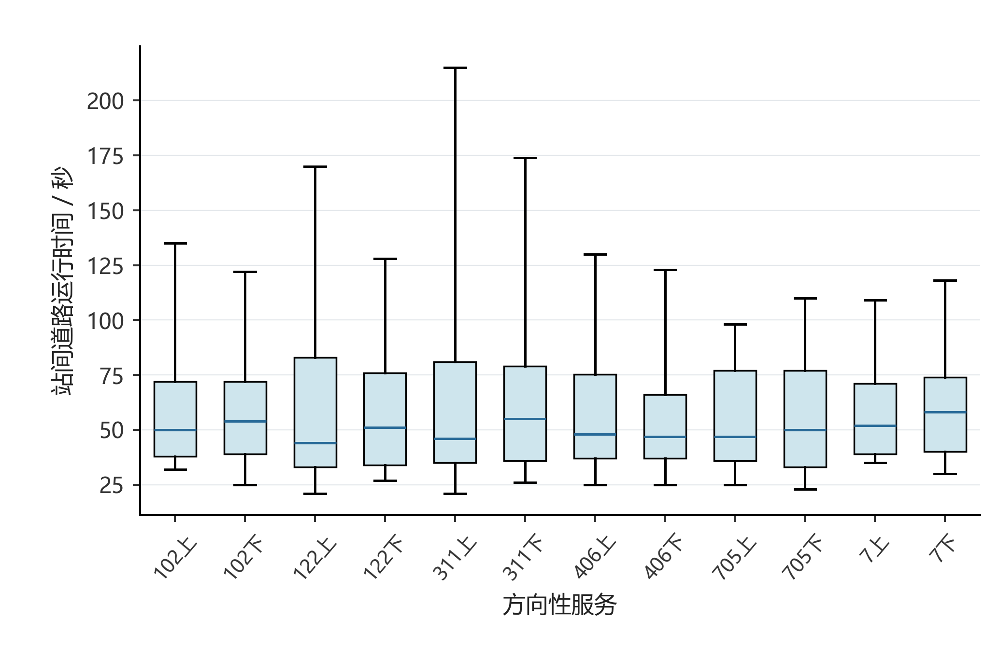 | 图片链接，1处；内容关联：无正文/单元格内容变更。位置指向修改前/最终稿；重复定界符按出现次序编号。 | /home/erzhu419/mine_code/Thesis/output/Gemini/word_assets_20261015/language_review_v2/markdown_figure_links.json | 图5-5 |
| F0039 | 第5章 跨保真运行环境下基于迁移强化学习的公交车队驻站控制 &gt; 5.4 仿真实验与结果分析 &gt; 5.4.1 源仿真标定与驻站响应一致性检验；修改前MD行1888 → 新MD行1988；图片链接；1处 | 【图5-6：无附加驻站条件下311路双向班次的到站时空图】 | 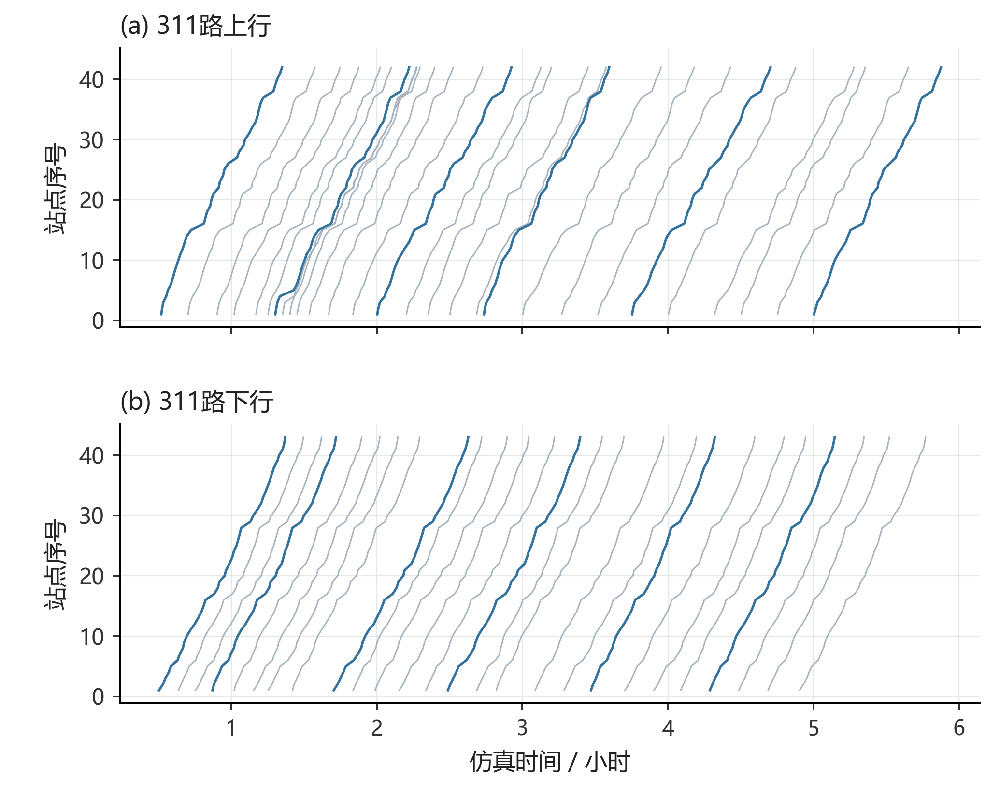 | 图片链接，1处；内容关联：无正文/单元格内容变更。位置指向修改前/最终稿；重复定界符按出现次序编号。 | /home/erzhu419/mine_code/Thesis/output/Gemini/word_assets_20261015/language_review_v2/markdown_figure_links.json | 图5-6 |
| F0040 | 第5章 跨保真运行环境下基于迁移强化学习的公交车队驻站控制 &gt; 5.4 仿真实验与结果分析 &gt; 5.4.1 源仿真标定与驻站响应一致性检验；修改前MD行1892 → 新MD行1992；图片链接；1处 | 【图5-7：未参与标定条件下源仿真与SUMO的自然运行差异】 | 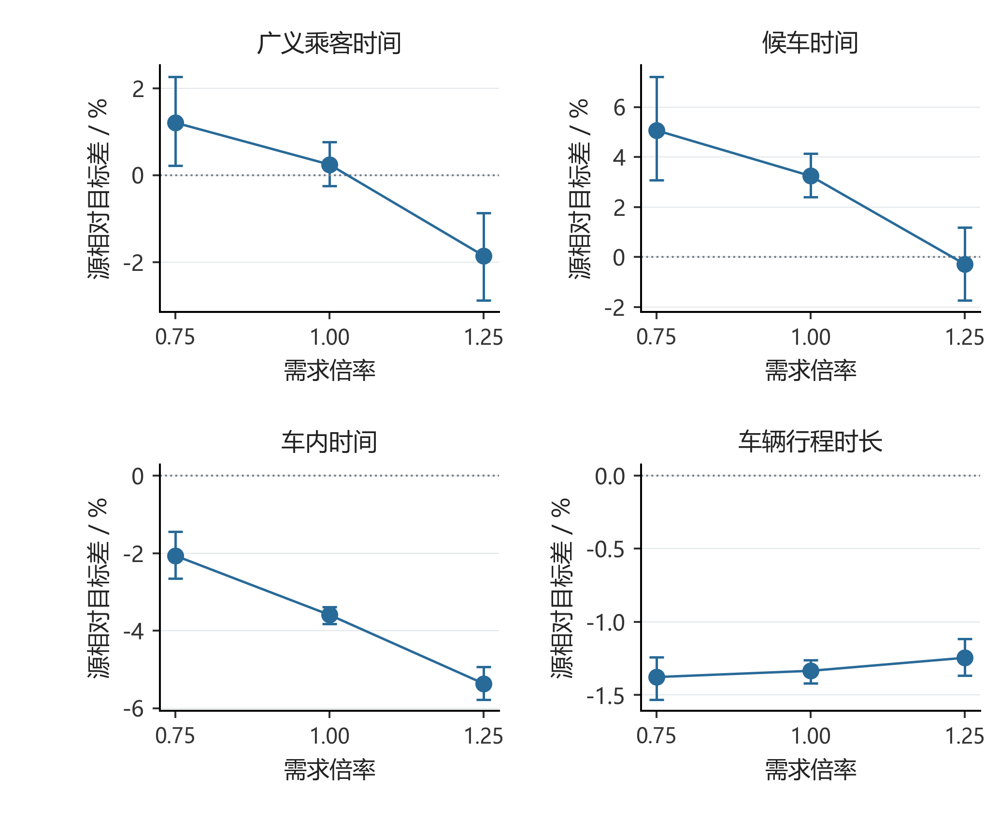 | 图片链接，1处；内容关联：无正文/单元格内容变更。位置指向修改前/最终稿；重复定界符按出现次序编号。 | /home/erzhu419/mine_code/Thesis/output/Gemini/word_assets_20261015/language_review_v2/markdown_figure_links.json | 图5-7 |
| F0041 | 第5章 跨保真运行环境下基于迁移强化学习的公交车队驻站控制 &gt; 5.4 仿真实验与结果分析 &gt; 5.4.1 源仿真标定与驻站响应一致性检验；修改前MD行1904 → 新MD行2004；图片链接；1处 | 【图5-8：七种驻站策略在不同需求水平下的源目标响应差】 | 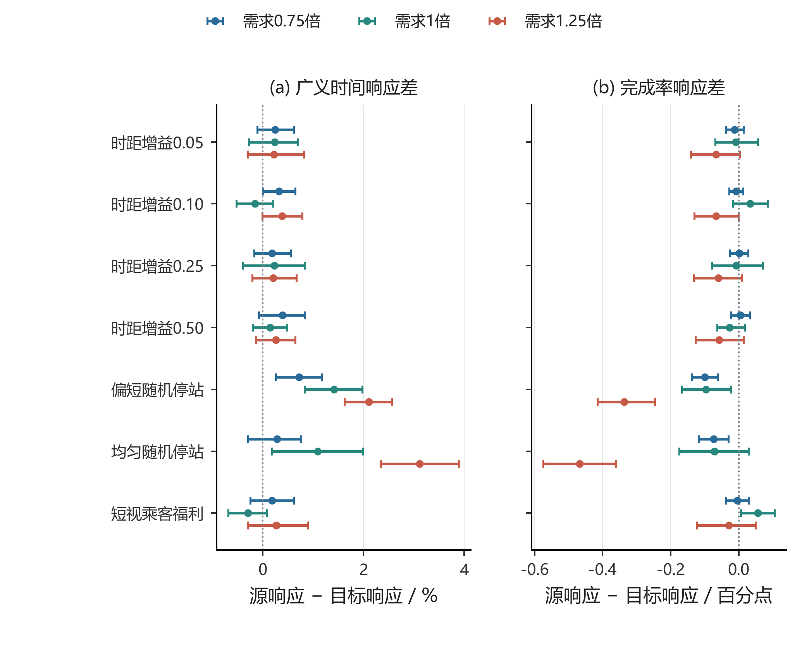 | 图片链接，1处；内容关联：无正文/单元格内容变更。位置指向修改前/最终稿；重复定界符按出现次序编号。 | /home/erzhu419/mine_code/Thesis/output/Gemini/word_assets_20261015/language_review_v2/markdown_figure_links.json | 图5-8 |
| F0042 | 第5章 跨保真运行环境下基于迁移强化学习的公交车队驻站控制 &gt; 5.4 仿真实验与结果分析 &gt; 5.4.2 纯离线学习与追加目标环境微调对比分析；修改前MD行1943 → 新MD行2043；图片链接；1处 | 【图5-9：在线学习与离线到在线微调的目标交互学习过程】 | 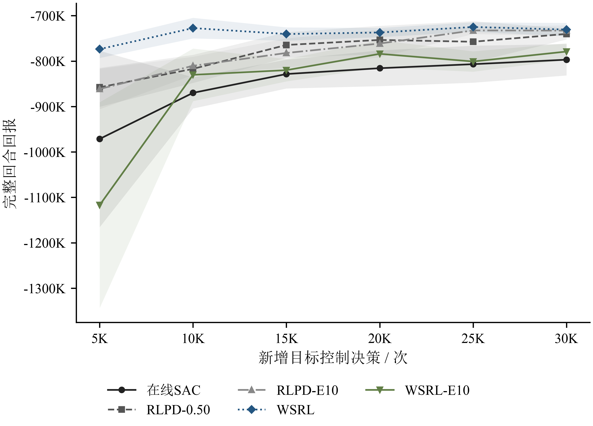 | 图片链接，1处；内容关联：无正文/单元格内容变更。位置指向修改前/最终稿；重复定界符按出现次序编号。 | /home/erzhu419/mine_code/Thesis/output/Gemini/word_assets_20261015/language_review_v2/markdown_figure_links.json | 图5-9 |
| F0043 | 第5章 跨保真运行环境下基于迁移强化学习的公交车队驻站控制 &gt; 5.4 仿真实验与结果分析 &gt; 5.4.2 纯离线学习与追加目标环境微调对比分析；修改前MD行1965 → 新MD行2066；图片链接；1处 | 【图5-10：固定离线数据学习与新增目标交互的运营结果对比】 | 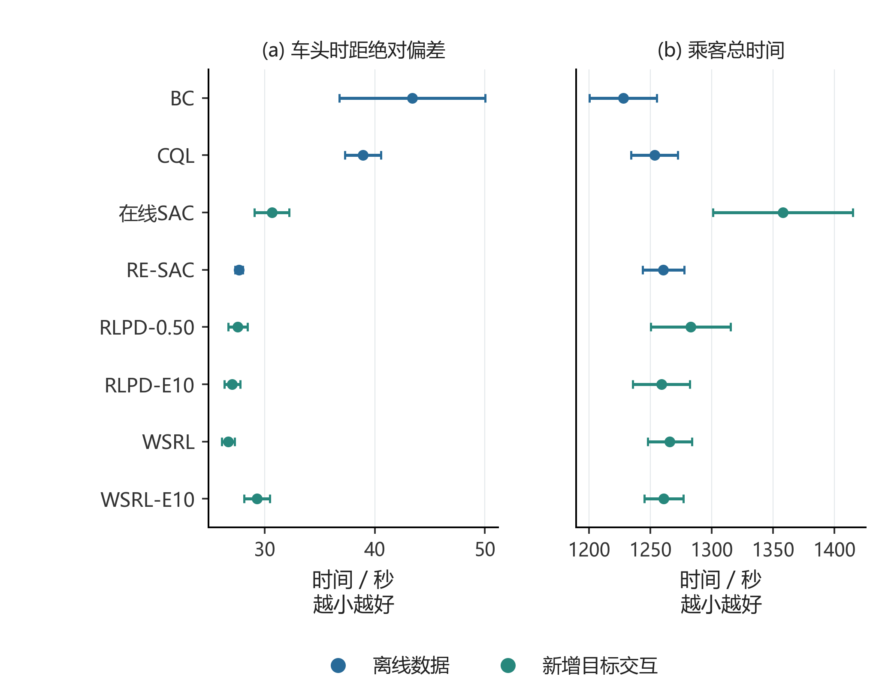 | 图片链接，1处；内容关联：无正文/单元格内容变更。位置指向修改前/最终稿；重复定界符按出现次序编号。 | /home/erzhu419/mine_code/Thesis/output/Gemini/word_assets_20261015/language_review_v2/markdown_figure_links.json | 图5-10 |
| F0044 | 第5章 跨保真运行环境下基于迁移强化学习的公交车队驻站控制 &gt; 5.4 仿真实验与结果分析 &gt; 5.4.2 纯离线学习与追加目标环境微调对比分析；修改前MD行1969 → 新MD行2070；图片链接；1处 | 【图5-11：学习控制与运营规则的间隔稳定性和乘客时间权衡】 | 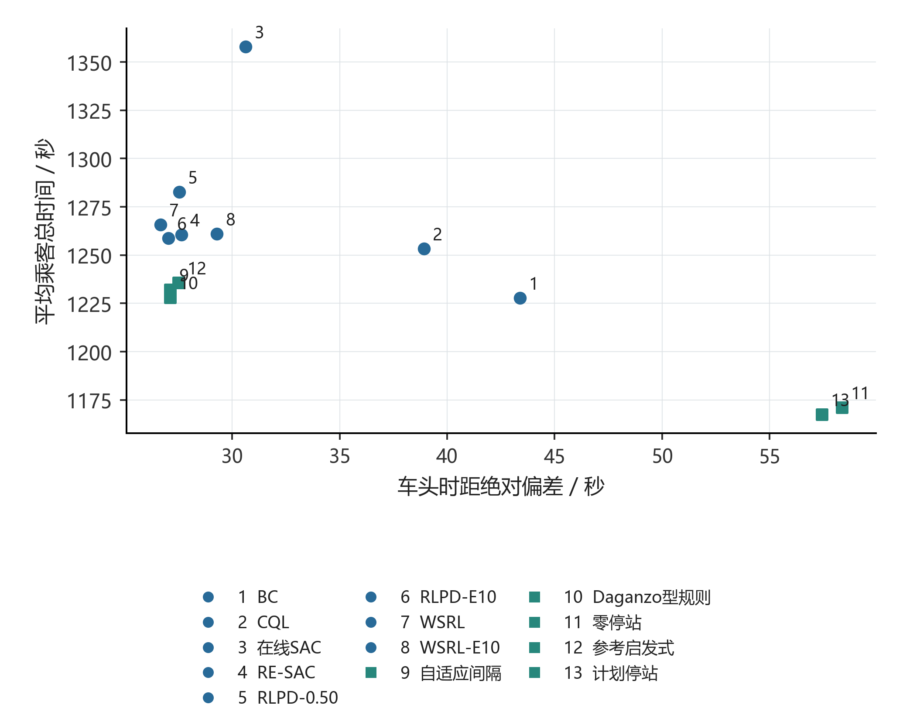 | 图片链接，1处；内容关联：无正文/单元格内容变更。位置指向修改前/最终稿；重复定界符按出现次序编号。 | /home/erzhu419/mine_code/Thesis/output/Gemini/word_assets_20261015/language_review_v2/markdown_figure_links.json | 图5-11 |
| F0045 | 第5章 跨保真运行环境下基于迁移强化学习的公交车队驻站控制 &gt; 5.4 仿真实验与结果分析 &gt; 5.4.2 纯离线学习与追加目标环境微调对比分析；修改前MD行1973 → 新MD行2074；图片链接；1处 | 【图5-12：离线回放比例与更新数据比的敏感性分析】 | 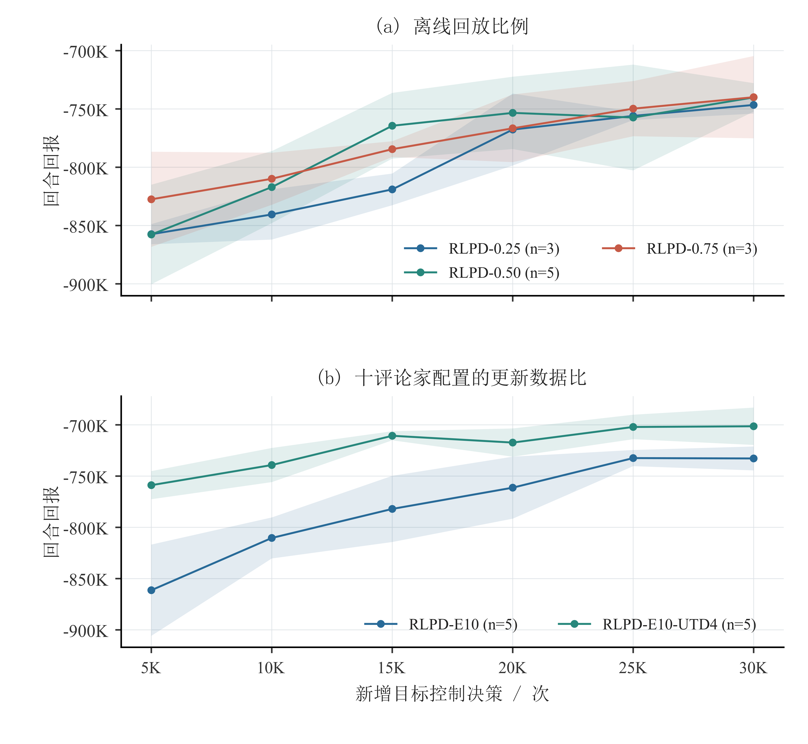 | 图片链接，1处；内容关联：无正文/单元格内容变更。位置指向修改前/最终稿；重复定界符按出现次序编号。 | /home/erzhu419/mine_code/Thesis/output/Gemini/word_assets_20261015/language_review_v2/markdown_figure_links.json | 图5-12 |
| F0046 | 第6章 分布偏移下基于世界模型的公交车队驻站控制 &gt; 6.1 问题描述；修改前MD行2082 → 新MD行2183；图片链接；1处 | 【图6-1位置：本章技术路线图——由“源仿真参数标定不足引发持续动力学偏移”问题出发，剖析纯数据混合/加权无法修正失准后继预测的局限；利用目标域固定离线数据构建“源预测残差修正模型”与“直接目标预测模型”两类候选，依据未参与拟合的验证集误差自动择优构建公交混合事件世界模型；结合局部预测误差与归一化对数置信度递推计算模型样本权重，生成一步转移数据辅助价值更新，最终在多档源标定偏差下的SUMO多线路场景与受控动力学平台中完成验证。】 | 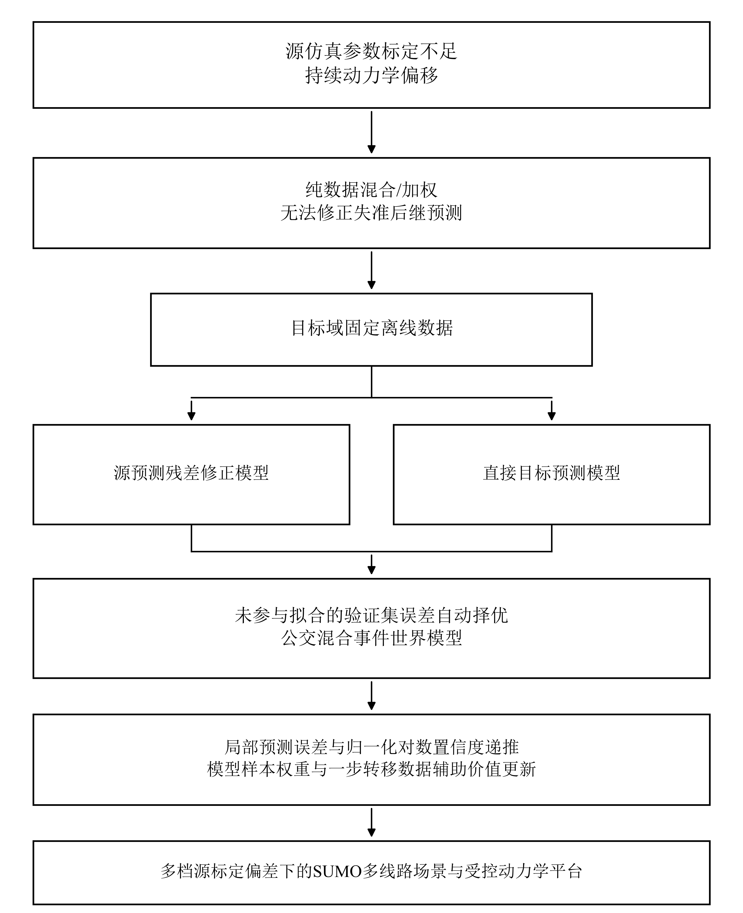 | 图片链接，1处；内容关联：无正文/单元格内容变更。位置指向修改前/最终稿；重复定界符按出现次序编号。 | /home/erzhu419/mine_code/Thesis/output/Gemini/word_assets_20261015/language_review_v2/markdown_figure_links.json | 图6-1 |
| F0047 | 第6章 分布偏移下基于世界模型的公交车队驻站控制 &gt; 6.3 求解方法 &gt; 6.3.3 公交混合事件模型与策略协同训练流程；修改前MD行2207 → 新MD行2308；图片链接；1处 | 【图6-2：基于验证误差的世界模型选择与策略更新流程】 | 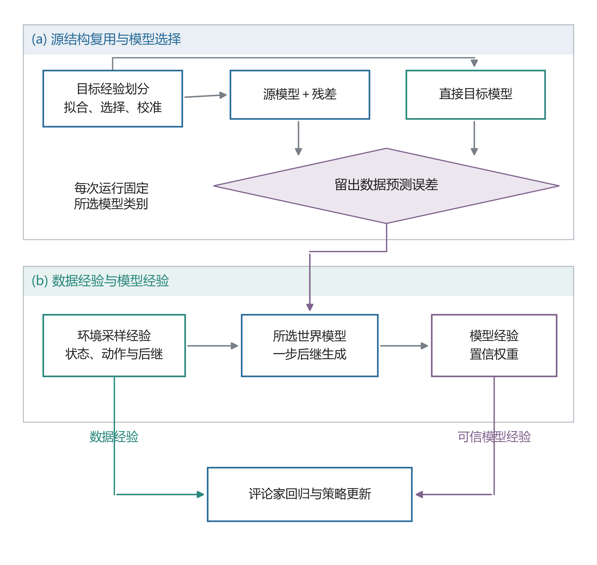 | 图片链接，1处；内容关联：无正文/单元格内容变更。位置指向修改前/最终稿；重复定界符按出现次序编号。 | /home/erzhu419/mine_code/Thesis/output/Gemini/word_assets_20261015/language_review_v2/markdown_figure_links.json | 图6-2 |
| F0048 | 第6章 分布偏移下基于世界模型的公交车队驻站控制 &gt; 6.4 仿真实验与结果分析 &gt; 6.4.1 受控动力学基准对照实验；修改前MD行2276 → 新MD行2377；图片链接；1处 | 【图6-3：受控动力学实验各方法的目标环境训练、验证与测试交互量】 | 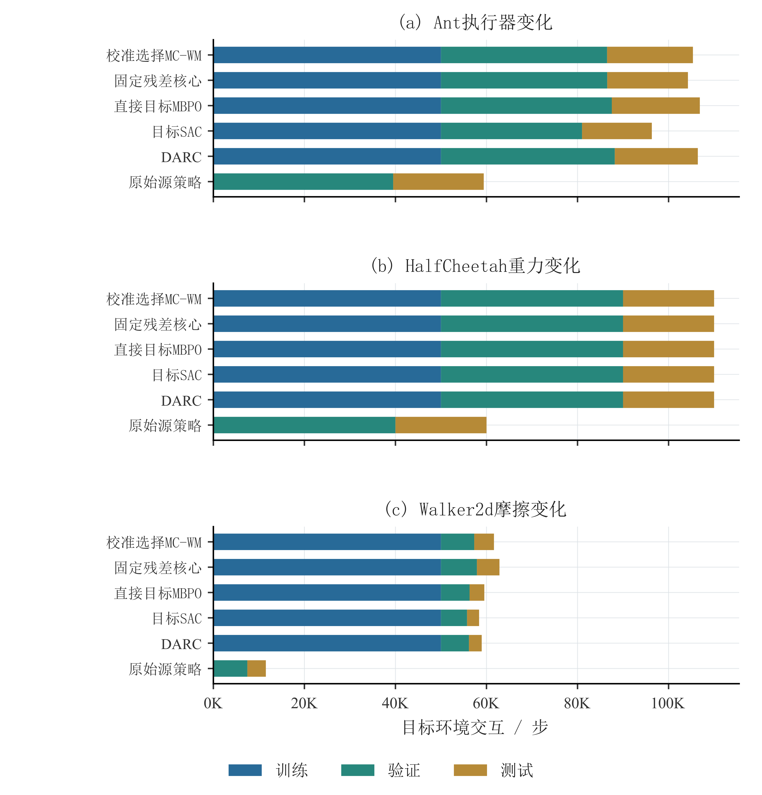 | 图片链接，1处；内容关联：无正文/单元格内容变更。位置指向修改前/最终稿；重复定界符按出现次序编号。 | /home/erzhu419/mine_code/Thesis/output/Gemini/word_assets_20261015/language_review_v2/markdown_figure_links.json | 图6-3 |
| F0049 | 第6章 分布偏移下基于世界模型的公交车队驻站控制 &gt; 6.4 仿真实验与结果分析 &gt; 6.4.1 受控动力学基准对照实验；修改前MD行2280 → 新MD行2381；图片链接；1处 | 【图6-4：受控动力学偏移下的独立测试回报与违例对比】 | 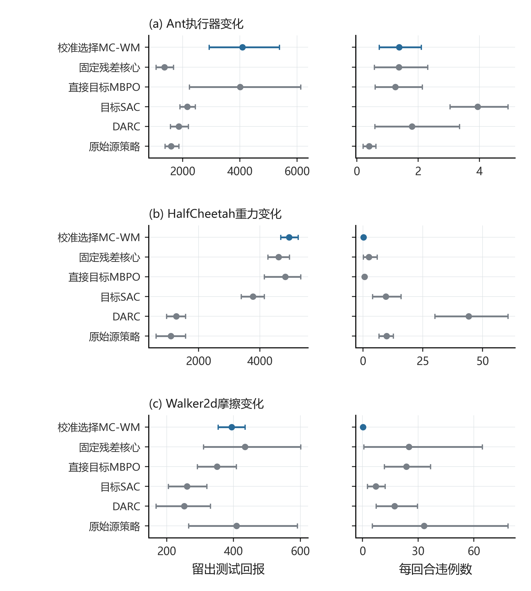 | 图片链接，1处；内容关联：无正文/单元格内容变更。位置指向修改前/最终稿；重复定界符按出现次序编号。 | /home/erzhu419/mine_code/Thesis/output/Gemini/word_assets_20261015/language_review_v2/markdown_figure_links.json | 图6-4 |
| F0050 | 第6章 分布偏移下基于世界模型的公交车队驻站控制 &gt; 6.4 仿真实验与结果分析 &gt; 6.4.1 受控动力学基准对照实验；修改前MD行2284 → 新MD行2385；图片链接；1处 | 【图6-5：受控动力学变化下各预定训练阶段的验证回报曲线】 | 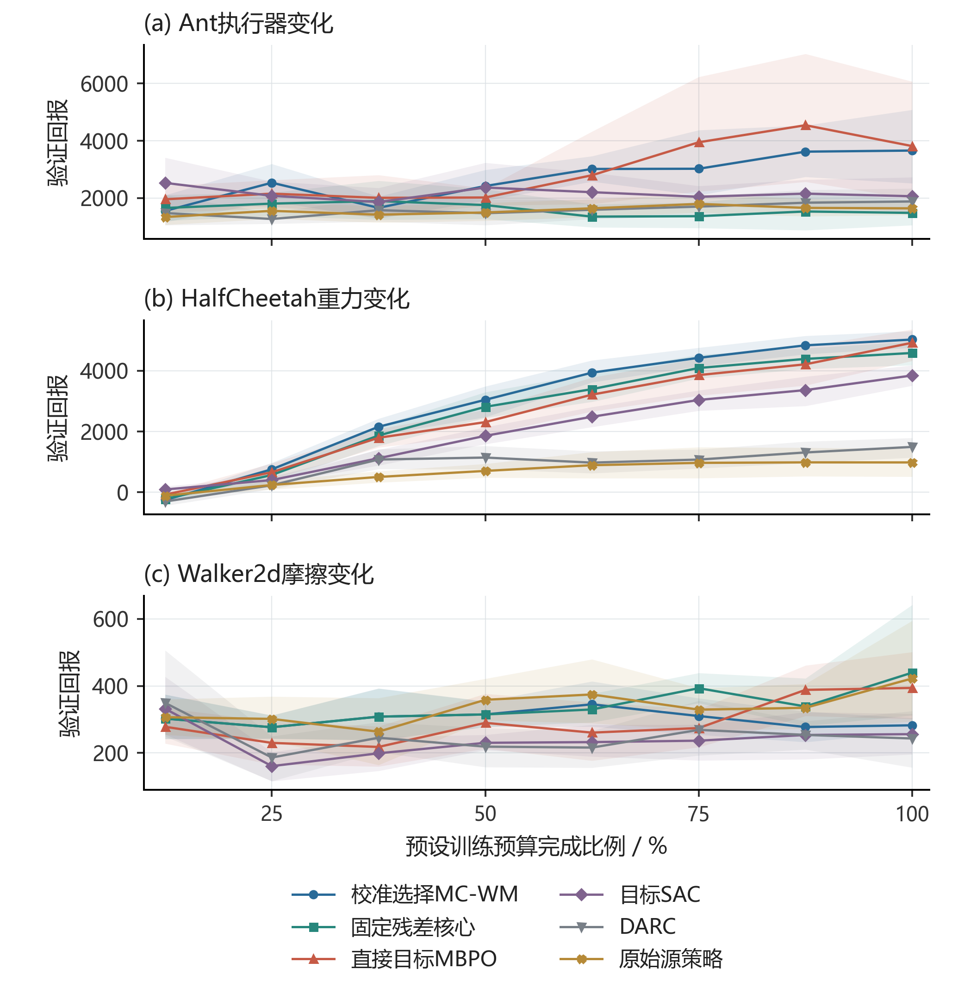 | 图片链接，1处；内容关联：无正文/单元格内容变更。位置指向修改前/最终稿；重复定界符按出现次序编号。 | /home/erzhu419/mine_code/Thesis/output/Gemini/word_assets_20261015/language_review_v2/markdown_figure_links.json | 图6-5 |
| F0051 | 第6章 分布偏移下基于世界模型的公交车队驻站控制 &gt; 6.4 仿真实验与结果分析 &gt; 6.4.1 受控动力学基准对照实验；修改前MD行2288 → 新MD行2389；图片链接；1处 | 【图6-6：模型适应过程中的验证违例次数变化曲线】 | 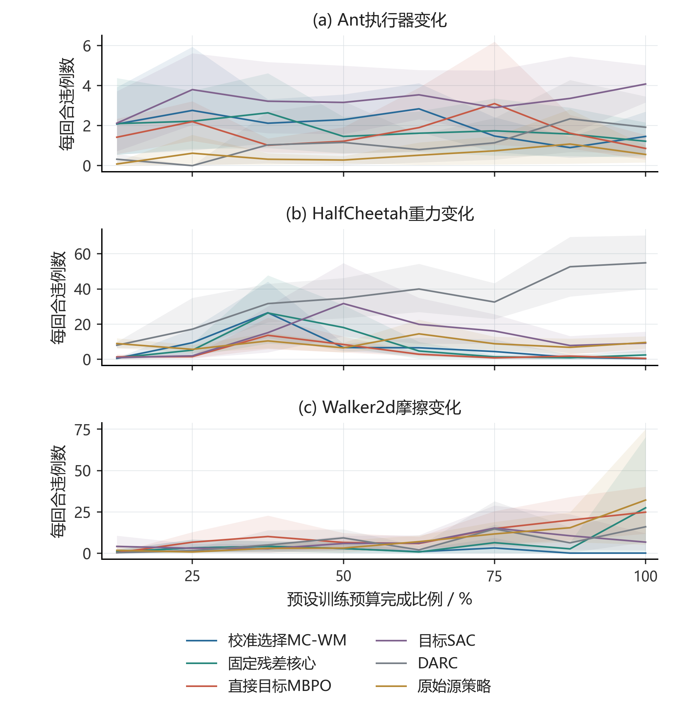 | 图片链接，1处；内容关联：无正文/单元格内容变更。位置指向修改前/最终稿；重复定界符按出现次序编号。 | /home/erzhu419/mine_code/Thesis/output/Gemini/word_assets_20261015/language_review_v2/markdown_figure_links.json | 图6-6 |
| F0052 | 第6章 分布偏移下基于世界模型的公交车队驻站控制 &gt; 6.4 仿真实验与结果分析 &gt; 6.4.2 模型选择与组成因素消融分析；修改前MD行2318 → 新MD行2421；图片链接；1处 | 【图6-7：自动模型选择相对另一候选模型的训练配对差】 | 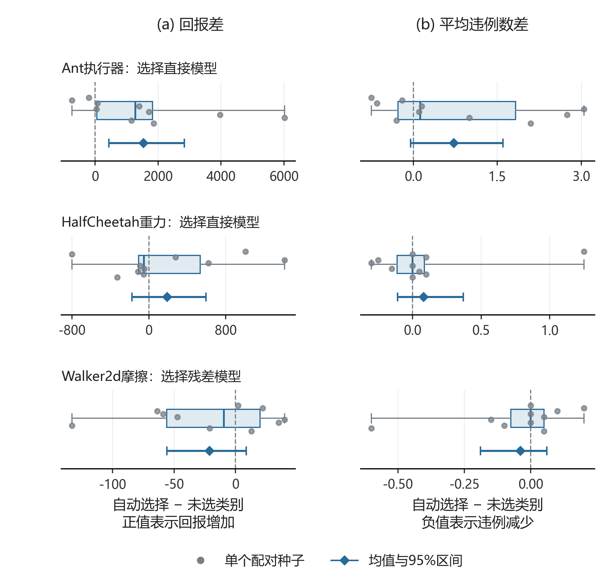 | 图片链接，1处；内容关联：无正文/单元格内容变更。位置指向修改前/最终稿；重复定界符按出现次序编号。 | /home/erzhu419/mine_code/Thesis/output/Gemini/word_assets_20261015/language_review_v2/markdown_figure_links.json | 图6-7 |
| F0053 | 第6章 分布偏移下基于世界模型的公交车队驻站控制 &gt; 6.4 仿真实验与结果分析 &gt; 6.4.2 模型选择与组成因素消融分析；修改前MD行2322 → 新MD行2425；图片链接；1处 | 【图6-8：模型选择对照中初始验证误差差异与控制结果的关系】 | 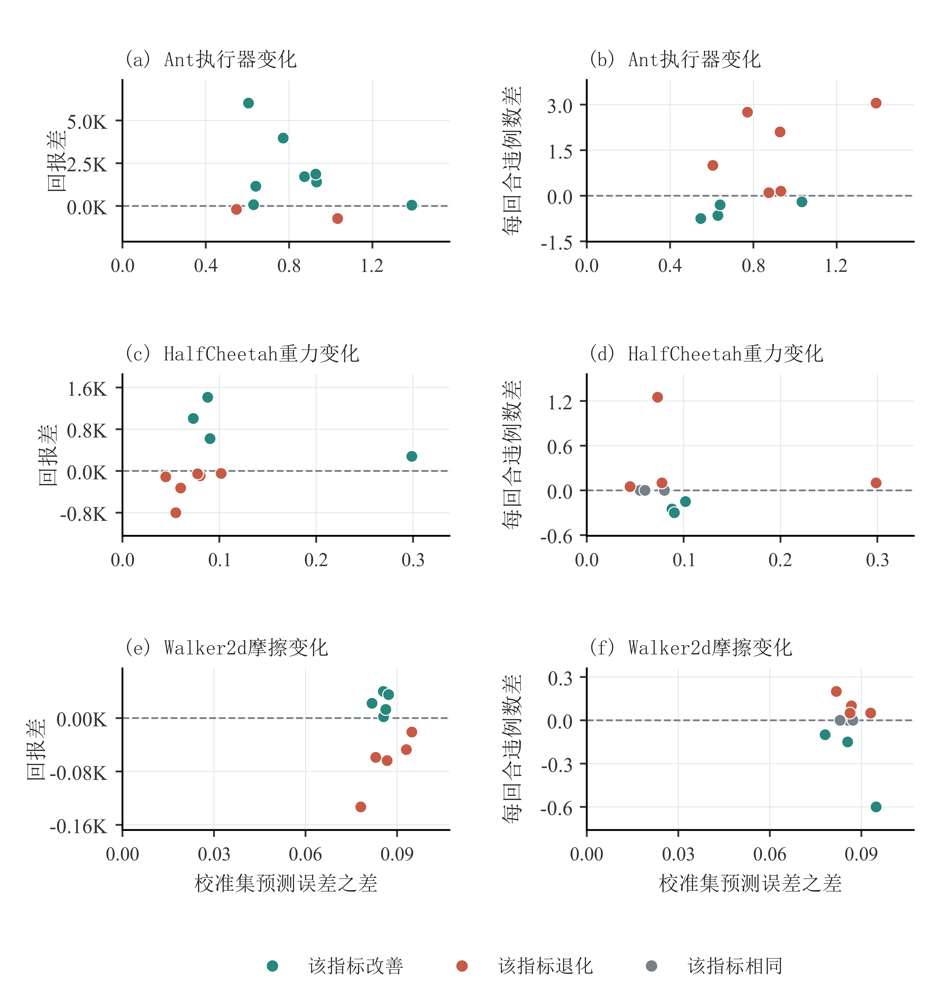 | 图片链接，1处；内容关联：无正文/单元格内容变更。位置指向修改前/最终稿；重复定界符按出现次序编号。 | /home/erzhu419/mine_code/Thesis/output/Gemini/word_assets_20261015/language_review_v2/markdown_figure_links.json | 图6-8 |
| F0054 | 第6章 分布偏移下基于世界模型的公交车队驻站控制 &gt; 6.4 仿真实验与结果分析 &gt; 6.4.2 模型选择与组成因素消融分析；修改前MD行2339 → 新MD行2442；图片链接；1处 | 【图6-9：稠密与稀疏残差模型的配对比较】 | 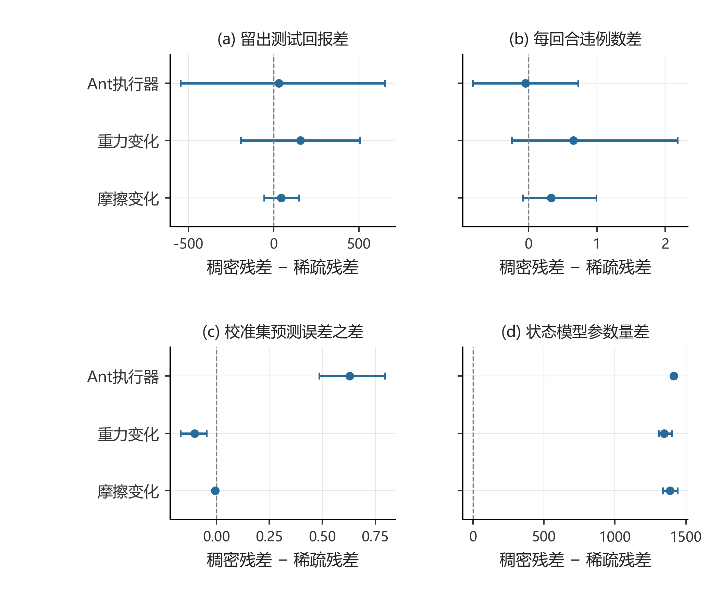 | 图片链接，1处；内容关联：无正文/单元格内容变更。位置指向修改前/最终稿；重复定界符按出现次序编号。 | /home/erzhu419/mine_code/Thesis/output/Gemini/word_assets_20261015/language_review_v2/markdown_figure_links.json | 图6-9 |
| F0055 | 第6章 分布偏移下基于世界模型的公交车队驻站控制 &gt; 6.4 仿真实验与结果分析 &gt; 6.4.3 公交跨保真任务中一次拟合与原始置信度递推控制效果分析；修改前MD行2384 → 新MD行2489；图片链接；1处 | 【图6-10：不同源标定条件下原递推MC-WM相对H2O+混合训练的配对服务变化】 | 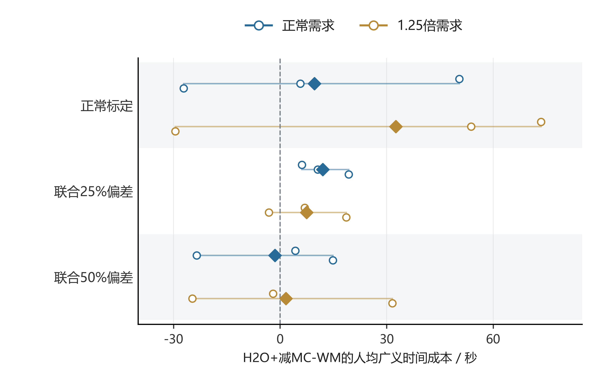 | 图片链接，1处；内容关联：无正文/单元格内容变更。位置指向修改前/最终稿；重复定界符按出现次序编号。 | /home/erzhu419/mine_code/Thesis/output/Gemini/word_assets_20261015/language_review_v2/markdown_figure_links.json | 图6-10 |
| F0056 | 第6章 分布偏移下基于世界模型的公交车队驻站控制 &gt; 6.4 仿真实验与结果分析 &gt; 6.4.3 公交跨保真任务中一次拟合与原始置信度递推控制效果分析；修改前MD行2398 → 新MD行2503；图片链接；1处 | 【图6-11：原递推MC-WM相对原混合损失及0.75系数无世界模型对照的配对成本差】 | 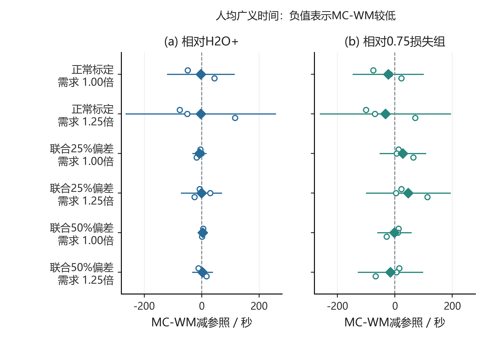 | 图片链接，1处；内容关联：无正文/单元格内容变更。位置指向修改前/最终稿；重复定界符按出现次序编号。 | /home/erzhu419/mine_code/Thesis/output/Gemini/word_assets_20261015/language_review_v2/markdown_figure_links.json | 图6-11 |
| F0057 | 第6章 分布偏移下基于世界模型的公交车队驻站控制 &gt; 6.4 仿真实验与结果分析 &gt; 6.4.4 模型样本权重衰减诊断与归一化置信度递推改进分析；修改前MD行2408 → 新MD行2513；图片链接；1处 | 【图6-12：公交模型预测误差、局部置信与加权梯度的训练变化诊断】 |  | 图片链接，1处；内容关联：无正文/单元格内容变更。位置指向修改前/最终稿；重复定界符按出现次序编号。 | /home/erzhu419/mine_code/Thesis/output/Gemini/word_assets_20261015/language_review_v2/markdown_figure_links.json | 图6-12 |
| F0058 | 第6章 分布偏移下基于世界模型的公交车队驻站控制 &gt; 6.4 仿真实验与结果分析 &gt; 6.4.4 模型样本权重衰减诊断与归一化置信度递推改进分析；修改前MD行2431 → 新MD行2536；图片链接；1处 | 【图6-13：不同源偏差下模型使用方式的配对服务变化】 |  | 图片链接，1处；内容关联：无正文/单元格内容变更。位置指向修改前/最终稿；重复定界符按出现次序编号。 | /home/erzhu419/mine_code/Thesis/output/Gemini/word_assets_20261015/language_review_v2/markdown_figure_links.json | 图6-13 |
| F0059 | 第6章 分布偏移下基于世界模型的公交车队驻站控制 &gt; 6.4 仿真实验与结果分析 &gt; 6.4.4 模型样本权重衰减诊断与归一化置信度递推改进分析；修改前MD行2435 → 新MD行2540；图片链接；1处 | 【图6-14：置信度递推尺度、模型权重与加权梯度的联系】 |  | 图片链接，1处；内容关联：无正文/单元格内容变更。位置指向修改前/最终稿；重复定界符按出现次序编号。 | /home/erzhu419/mine_code/Thesis/output/Gemini/word_assets_20261015/language_review_v2/markdown_figure_links.json | 图6-14 |
| F0060 | 第6章 分布偏移下基于世界模型的公交车队驻站控制 &gt; 6.4 仿真实验与结果分析 &gt; 6.4.4 模型样本权重衰减诊断与归一化置信度递推改进分析；修改前MD行2445 → 新MD行2550；图片链接；1处 | 【图6-15：统一执行设置下学习策略相对车头时距规则的逐日配对成本差】 |  | 图片链接，1处；内容关联：无正文/单元格内容变更。位置指向修改前/最终稿；重复定界符按出现次序编号。 | /home/erzhu419/mine_code/Thesis/output/Gemini/word_assets_20261015/language_review_v2/markdown_figure_links.json | language-ch4-7-L2445；图6-15 |
| F0061 | 第6章 分布偏移下基于世界模型的公交车队驻站控制 &gt; 6.4 仿真实验与结果分析 &gt; 6.4.5 独立初始化下的多线路公交服务水平对比（20种子主实验） &gt; （一）相对于无世界模型混合训练基线的主结果与完整控制器对比；修改前MD行2467 → 新MD行2572；图片链接；1处 | 【图6-16：三种源标定条件下世界模型配置的20次训练全部配对成本差】 |  | 图片链接，1处；内容关联：无正文/单元格内容变更。位置指向修改前/最终稿；重复定界符按出现次序编号。 | /home/erzhu419/mine_code/Thesis/output/Gemini/word_assets_20261015/language_review_v2/markdown_figure_links.json | 图6-16 |
| F0062 | 第6章 分布偏移下基于世界模型的公交车队驻站控制 &gt; 6.4 仿真实验与结果分析 &gt; 6.4.5 独立初始化下的多线路公交服务水平对比（20种子主实验） &gt; （二）相对于经典车头时距规则的对比与乘客时间构成分解；修改前MD行2481 → 新MD行2586；图片链接；1处 | 【图6-17：统一执行设置下混合训练基线与MC-WM相对两种车头时距规则的成本差】 |  | 图片链接，1处；内容关联：无正文/单元格内容变更。位置指向修改前/最终稿；重复定界符按出现次序编号。 | /home/erzhu419/mine_code/Thesis/output/Gemini/word_assets_20261015/language_review_v2/markdown_figure_links.json | language-ch4-7-L2481；图6-17 |
| F0063 | 第6章 分布偏移下基于世界模型的公交车队驻站控制 &gt; 6.4 仿真实验与结果分析 &gt; 6.4.5 独立初始化下的多线路公交服务水平对比（20种子主实验） &gt; （二）相对于经典车头时距规则的对比与乘客时间构成分解；修改前MD行2485 → 新MD行2590；图片链接；1处 | 【图6-18：模型系数0.25的MC-WM乘客时间构成分解】 |  | 图片链接，1处；内容关联：无正文/单元格内容变更。位置指向修改前/最终稿；重复定界符按出现次序编号。 | /home/erzhu419/mine_code/Thesis/output/Gemini/word_assets_20261015/language_review_v2/markdown_figure_links.json | 图6-18 |
| F0064 | 附录F 受控动力学任务模型与跨保真补充实验设置；修改前MD行2597 → 新MD行2702；TeX定界符格式；4处 | 1. \vert{} 2. \vert{} 3. \vert{} 4. \vert{} | 1. \vert  2. \vert  3. \vert  4. \vert  | TeX定界符格式，4处；内容关联：P0242。位置指向修改前/最终稿；重复定界符按出现次序编号。 | /home/erzhu419/mine_code/Thesis/output/Gemini/word_assets_20261015/language_review_v2/language_rules.json | language-ch4-7-L2597；rule-12 |
| F0065 | 摘要；修改前MD行21 → 新MD行21；加粗实际差异 | 1. **关键词** | 无加粗 | 加粗标记由1处变为0处，净减少1处；内容关联：无正文/单元格内容变更。按修改前/最终稿实际标记，不把显式编辑中的去粗体漏掉。 | /home/erzhu419/mine_code/Thesis/output/Gemini/word_assets_20261015/language_review_v2/修改前_重构论文.md；/home/erzhu419/mine_code/Thesis/output/Gemini/重构论文_语言修订_v2_20261015.md | bold-cleanup |
| F0066 | 第1章 绪论 &gt; 1.1 研究背景与意义；修改前MD行35 → 新MD行35；加粗实际差异 | 1. **双向发车、按时刻表排班运行的城市公交线路上，沿线每一个站点均可实施附加驻站的车队协同控制问题** 2. **决策频率发生量级跃升** 3. **控制动作沿线路呈强时空耦合** 4. **跨班次周转复用与车队经验结构性失衡** | 无加粗 | 加粗标记由4处变为0处，净减少4处；内容关联：P0009。按修改前/最终稿实际标记，不把显式编辑中的去粗体漏掉。 | /home/erzhu419/mine_code/Thesis/output/Gemini/word_assets_20261015/language_review_v2/修改前_重构论文.md；/home/erzhu419/mine_code/Thesis/output/Gemini/重构论文_语言修订_v2_20261015.md | ch1_3_006；bold-cleanup |
| F0067 | 第1章 绪论 &gt; 1.1 研究背景与意义；修改前MD行39 → 新MD行39；加粗实际差异 | 1. **控制位置** 2. **决策频率** 3. **动作耦合关系** 4. **与时刻表关系** 5. **状态信息需求** 6. **主流求解方法** | 无加粗 | 加粗标记由6处变为0处，净减少6处；内容关联：无正文/单元格内容变更。按修改前/最终稿实际标记，不把显式编辑中的去粗体漏掉。 | /home/erzhu419/mine_code/Thesis/output/Gemini/word_assets_20261015/language_review_v2/修改前_重构论文.md；/home/erzhu419/mine_code/Thesis/output/Gemini/重构论文_语言修订_v2_20261015.md | bold-cleanup |
| F0068 | 第1章 绪论 &gt; 1.1 研究背景与意义；修改前MD行53 → 新MD行53；加粗实际差异 | 1. **从仿真到现实（Sim-to-Real）的迁移可靠性** 2. **源环境（Source Environment）** 3. **目标环境（Target Environment）** 4. **分布偏移（Distribution Shift）** 5. **动力学偏移（Dynamics Shift）** | 无加粗 | 加粗标记由5处变为0处，净减少5处；内容关联：无正文/单元格内容变更。按修改前/最终稿实际标记，不把显式编辑中的去粗体漏掉。 | /home/erzhu419/mine_code/Thesis/output/Gemini/word_assets_20261015/language_review_v2/修改前_重构论文.md；/home/erzhu419/mine_code/Thesis/output/Gemini/重构论文_语言修订_v2_20261015.md | bold-cleanup |
| F0069 | 第1章 绪论 &gt; 1.1 研究背景与意义；修改前MD行55 → 新MD行55；加粗实际差异 | 1. **目标环境运行数据的可得性及源仿真模型的可信度** | 无加粗 | 加粗标记由1处变为0处，净减少1处；内容关联：无正文/单元格内容变更。按修改前/最终稿实际标记，不把显式编辑中的去粗体漏掉。 | /home/erzhu419/mine_code/Thesis/output/Gemini/word_assets_20261015/language_review_v2/修改前_重构论文.md；/home/erzhu419/mine_code/Thesis/output/Gemini/重构论文_语言修订_v2_20261015.md | bold-cleanup |
| F0070 | 第1章 绪论 &gt; 1.1 研究背景与意义；修改前MD行57 → 新MD行57；加粗实际差异 | 1. **无目标域训练数据、运行统计规律平稳但单次实现随机条件下的鲁棒驻站学习（第3章）** | 无加粗 | 加粗标记由1处变为0处，净减少1处；内容关联：P0011。按修改前/最终稿实际标记，不把显式编辑中的去粗体漏掉。 | /home/erzhu419/mine_code/Thesis/output/Gemini/word_assets_20261015/language_review_v2/修改前_重构论文.md；/home/erzhu419/mine_code/Thesis/output/Gemini/重构论文_语言修订_v2_20261015.md | ch1_3_008；bold-cleanup |
| F0071 | 第1章 绪论 &gt; 1.1 研究背景与意义；修改前MD行59 → 新MD行59；加粗实际差异 | 1. **无目标域训练数据、但客流与路况统计规律发生非平稳变化条件下的条件识别与策略适应（第4章）** | 无加粗 | 加粗标记由1处变为0处，净减少1处；内容关联：无正文/单元格内容变更。按修改前/最终稿实际标记，不把显式编辑中的去粗体漏掉。 | /home/erzhu419/mine_code/Thesis/output/Gemini/word_assets_20261015/language_review_v2/修改前_重构论文.md；/home/erzhu419/mine_code/Thesis/output/Gemini/重构论文_语言修订_v2_20261015.md | bold-cleanup |
| F0072 | 第1章 绪论 &gt; 1.1 研究背景与意义；修改前MD行61 → 新MD行61；加粗实际差异 | 1. **已获得目标域固定离线数据、且源仿真经标定与目标环境足够接近条件下的跨保真混合训练（第5章）** | 无加粗 | 加粗标记由1处变为0处，净减少1处；内容关联：P0012。按修改前/最终稿实际标记，不把显式编辑中的去粗体漏掉。 | /home/erzhu419/mine_code/Thesis/output/Gemini/word_assets_20261015/language_review_v2/修改前_重构论文.md；/home/erzhu419/mine_code/Thesis/output/Gemini/重构论文_语言修订_v2_20261015.md | rule-3；bold-cleanup |
| F0073 | 第1章 绪论 &gt; 1.1 研究背景与意义；修改前MD行63 → 新MD行63；加粗实际差异 | 1. **已获得目标域固定离线数据、但源仿真标定不足且存在持续动力学偏差条件下的世界模型修正（第6章）** | 无加粗 | 加粗标记由1处变为0处，净减少1处；内容关联：P0013。按修改前/最终稿实际标记，不把显式编辑中的去粗体漏掉。 | /home/erzhu419/mine_code/Thesis/output/Gemini/word_assets_20261015/language_review_v2/修改前_重构论文.md；/home/erzhu419/mine_code/Thesis/output/Gemini/重构论文_语言修订_v2_20261015.md | rule-3；bold-cleanup |
| F0074 | 第1章 绪论 &gt; 1.2 国内外研究综述 &gt; 1.2.1 公交驻站控制；修改前MD行75 → 新MD行81、83、85、87、89、91；加粗实际差异 | 1. **控制目标与服务评价** 2. **控制位置与控制点设置** 3. **驻站时长求解方法** | 无加粗 | 加粗标记由3处变为0处，净减少3处；内容关联：P0016。按修改前/最终稿实际标记，不把显式编辑中的去粗体漏掉。 | /home/erzhu419/mine_code/Thesis/output/Gemini/word_assets_20261015/language_review_v2/修改前_重构论文.md；/home/erzhu419/mine_code/Thesis/output/Gemini/重构论文_语言修订_v2_20261015.md | ch1_3_011；bold-cleanup |
| F0075 | 第1章 绪论 &gt; 1.2 国内外研究综述 &gt; 1.2.1 公交驻站控制；修改前MD行77 → 新MD行93、95、97、99；加粗实际差异 | 1. **控制目标与服务评价** | 无加粗 | 加粗标记由1处变为0处，净减少1处；内容关联：P0017。按修改前/最终稿实际标记，不把显式编辑中的去粗体漏掉。 | /home/erzhu419/mine_code/Thesis/output/Gemini/word_assets_20261015/language_review_v2/修改前_重构论文.md；/home/erzhu419/mine_code/Thesis/output/Gemini/重构论文_语言修订_v2_20261015.md | ch1_3_012；bold-cleanup |
| F0076 | 第1章 绪论 &gt; 1.2 国内外研究综述 &gt; 1.2.1 公交驻站控制；修改前MD行79 → 新MD行101、103、105、107；加粗实际差异 | 1. **控制位置与控制点设置** | 无加粗 | 加粗标记由1处变为0处，净减少1处；内容关联：P0018。按修改前/最终稿实际标记，不把显式编辑中的去粗体漏掉。 | /home/erzhu419/mine_code/Thesis/output/Gemini/word_assets_20261015/language_review_v2/修改前_重构论文.md；/home/erzhu419/mine_code/Thesis/output/Gemini/重构论文_语言修订_v2_20261015.md | ch1_3_013；bold-cleanup |
| F0077 | 第1章 绪论 &gt; 1.2 国内外研究综述 &gt; 1.2.1 公交驻站控制；修改前MD行81 → 新MD行109、111、113；加粗实际差异 | 1. **驻站时长求解方法** | 无加粗 | 加粗标记由1处变为0处，净减少1处；内容关联：P0019。按修改前/最终稿实际标记，不把显式编辑中的去粗体漏掉。 | /home/erzhu419/mine_code/Thesis/output/Gemini/word_assets_20261015/language_review_v2/修改前_重构论文.md；/home/erzhu419/mine_code/Thesis/output/Gemini/重构论文_语言修订_v2_20261015.md | ch1_3_014；bold-cleanup |
| F0078 | 第1章 绪论 &gt; 1.2 国内外研究综述 &gt; 1.2.2 强化学习控制；修改前MD行85 → 新MD行117；加粗实际差异 | 1. **经验共享与状态表示 $\rightarrow$ 价值估计可靠性修正 $\rightarrow$ 鲁棒与风险敏感评价 $\rightarrow$ 非平稳环境识别与符号约束适应** | 无加粗 | 加粗标记由1处变为0处，净减少1处；内容关联：P0020。按修改前/最终稿实际标记，不把显式编辑中的去粗体漏掉。 | /home/erzhu419/mine_code/Thesis/output/Gemini/word_assets_20261015/language_review_v2/修改前_重构论文.md；/home/erzhu419/mine_code/Thesis/output/Gemini/重构论文_语言修订_v2_20261015.md | ch1_3_015 |
| F0079 | 第1章 绪论 &gt; 1.2 国内外研究综述 &gt; 1.2.2 强化学习控制；修改前MD行89 → 新MD行125、127、129；加粗实际差异 | 1. **车辆到站事件的异步性（Asynchronicity）与车队经验的高效组织** | 无加粗 | 加粗标记由1处变为0处，净减少1处；内容关联：P0022。按修改前/最终稿实际标记，不把显式编辑中的去粗体漏掉。 | /home/erzhu419/mine_code/Thesis/output/Gemini/word_assets_20261015/language_review_v2/修改前_重构论文.md；/home/erzhu419/mine_code/Thesis/output/Gemini/重构论文_语言修订_v2_20261015.md | ch1_3_017；bold-cleanup |
| F0080 | 第1章 绪论 &gt; 1.2 国内外研究综述 &gt; 1.2.2 强化学习控制；修改前MD行93 → 新MD行137、139、141、143、145；加粗实际差异 | 1. **动作价值估计的可靠性与鲁棒风险评价** 2. **偶然不确定性（Aleatoric Uncertainty）** 3. **认知不确定性（Epistemic Uncertainty）** 4. **分布强化学习（Distributional RL）与风险敏感控制** 5. **价值网络集成（Value Ensemble）与保守评价** | 无加粗 | 加粗标记由5处变为0处，净减少5处；内容关联：P0024。按修改前/最终稿实际标记，不把显式编辑中的去粗体漏掉。 | /home/erzhu419/mine_code/Thesis/output/Gemini/word_assets_20261015/language_review_v2/修改前_重构论文.md；/home/erzhu419/mine_code/Thesis/output/Gemini/重构论文_语言修订_v2_20261015.md | ch1_3_019；bold-cleanup |
| F0081 | 第1章 绪论 &gt; 1.2 国内外研究综述 &gt; 1.2.2 强化学习控制；修改前MD行95 → 新MD行147、149、151、153；加粗实际差异 | 1. **非平稳强化学习（Non-Stationary RL）与在线条件识别** | 无加粗 | 加粗标记由1处变为0处，净减少1处；内容关联：P0025。按修改前/最终稿实际标记，不把显式编辑中的去粗体漏掉。 | /home/erzhu419/mine_code/Thesis/output/Gemini/word_assets_20261015/language_review_v2/修改前_重构论文.md；/home/erzhu419/mine_code/Thesis/output/Gemini/重构论文_语言修订_v2_20261015.md | ch1_3_020；bold-cleanup |
| F0082 | 第1章 绪论 &gt; 1.2 国内外研究综述 &gt; 1.2.3 仿真迁移；修改前MD行99 → 新MD行157；加粗实际差异 | 1. **纯离线强化学习** 2. **离线到在线微调与跨保真混合训练** 3. **世界模型辅助学习与模型修正** | 无加粗 | 加粗标记由3处变为0处，净减少3处；内容关联：P0026。按修改前/最终稿实际标记，不把显式编辑中的去粗体漏掉。 | /home/erzhu419/mine_code/Thesis/output/Gemini/word_assets_20261015/language_review_v2/修改前_重构论文.md；/home/erzhu419/mine_code/Thesis/output/Gemini/重构论文_语言修订_v2_20261015.md | ch1_3_021；rule-3 |
| F0083 | 第1章 绪论 &gt; 1.2 国内外研究综述 &gt; 1.2.3 仿真迁移；修改前MD行101 → 新MD行159、161、163、165、167；加粗实际差异 | 1. **策略约束与行为克隆方法** 2. **保守价值正则方法** 3. **样本内价值回归方法** | 无加粗 | 加粗标记由3处变为0处，净减少3处；内容关联：P0027。按修改前/最终稿实际标记，不把显式编辑中的去粗体漏掉。 | /home/erzhu419/mine_code/Thesis/output/Gemini/word_assets_20261015/language_review_v2/修改前_重构论文.md；/home/erzhu419/mine_code/Thesis/output/Gemini/重构论文_语言修订_v2_20261015.md | ch1_3_022；bold-cleanup |
| F0084 | 第1章 绪论 &gt; 1.2 国内外研究综述 &gt; 1.2.3 仿真迁移；修改前MD行103 → 新MD行169、171、173、175、177；加粗实际差异 | 1. **目标域固定离线数据＋低成本源仿真在线交互** | 无加粗 | 加粗标记由1处变为0处，净减少1处；内容关联：P0028。按修改前/最终稿实际标记，不把显式编辑中的去粗体漏掉。 | /home/erzhu419/mine_code/Thesis/output/Gemini/word_assets_20261015/language_review_v2/修改前_重构论文.md；/home/erzhu419/mine_code/Thesis/output/Gemini/重构论文_语言修订_v2_20261015.md | ch1_3_023；rule-3；bold-cleanup |
| F0085 | 第1章 绪论 &gt; 1.2 国内外研究综述 &gt; 1.2.3 仿真迁移；修改前MD行105 → 新MD行179、181、183、185、187、189；加粗实际差异 | 1. **世界模型（World Models）辅助学习与源预测模型修正** | 无加粗 | 加粗标记由1处变为0处，净减少1处；内容关联：P0029。按修改前/最终稿实际标记，不把显式编辑中的去粗体漏掉。 | /home/erzhu419/mine_code/Thesis/output/Gemini/word_assets_20261015/language_review_v2/修改前_重构论文.md；/home/erzhu419/mine_code/Thesis/output/Gemini/重构论文_语言修订_v2_20261015.md | ch1_3_024；rule-3；bold-cleanup |
| F0086 | 第1章 绪论 &gt; 1.2 国内外研究综述 &gt; 1.2.4 现有研究总结；修改前MD行109 → 新MD行193；加粗实际差异 | 1. **问题定义** 2. **方法适配** | 无加粗 | 加粗标记由2处变为0处，净减少2处；内容关联：无正文/单元格内容变更。按修改前/最终稿实际标记，不把显式编辑中的去粗体漏掉。 | /home/erzhu419/mine_code/Thesis/output/Gemini/word_assets_20261015/language_review_v2/修改前_重构论文.md；/home/erzhu419/mine_code/Thesis/output/Gemini/重构论文_语言修订_v2_20261015.md | bold-cleanup |
| F0087 | 第1章 绪论 &gt; 1.2 国内外研究综述 &gt; 1.2.4 现有研究总结；修改前MD行111 → 新MD行195；加粗实际差异 | 1. **在控制问题定义层面，双向发车、按时刻表排班、沿线每站均可附加驻站且车辆跨班次周转复用的车队控制形态尚未被系统覆盖** | 无加粗 | 加粗标记由1处变为0处，净减少1处；内容关联：无正文/单元格内容变更。按修改前/最终稿实际标记，不把显式编辑中的去粗体漏掉。 | /home/erzhu419/mine_code/Thesis/output/Gemini/word_assets_20261015/language_review_v2/修改前_重构论文.md；/home/erzhu419/mine_code/Thesis/output/Gemini/重构论文_语言修订_v2_20261015.md | bold-cleanup |
| F0088 | 第1章 绪论 &gt; 1.2 国内外研究综述 &gt; 1.2.4 现有研究总结；修改前MD行113 → 新MD行197；加粗实际差异 | 1. **在强化学习与仿真迁移方法层面，通用算法尚未与公交事件驱动机制及不同目标数据可得性条件形成闭环适配** | 无加粗 | 加粗标记由1处变为0处，净减少1处；内容关联：P0030。按修改前/最终稿实际标记，不把显式编辑中的去粗体漏掉。 | /home/erzhu419/mine_code/Thesis/output/Gemini/word_assets_20261015/language_review_v2/修改前_重构论文.md；/home/erzhu419/mine_code/Thesis/output/Gemini/重构论文_语言修订_v2_20261015.md | rule-3；bold-cleanup |
| F0089 | 第1章 绪论 &gt; 1.2 国内外研究综述 &gt; 1.2.4 现有研究总结；修改前MD行117 → 新MD行201；加粗实际差异 | 1. **纯离线强化学习** 2. **离线到在线微调** 3. **跨保真混合训练** 4. **域适应比率修正** 5. **在线模型辅助训练** 6. **离线模型辅助训练** | 无加粗 | 加粗标记由6处变为0处，净减少6处；内容关联：T0001。按修改前/最终稿实际标记，不把显式编辑中的去粗体漏掉。 | /home/erzhu419/mine_code/Thesis/output/Gemini/word_assets_20261015/language_review_v2/修改前_重构论文.md；/home/erzhu419/mine_code/Thesis/output/Gemini/重构论文_语言修订_v2_20261015.md | rule-3；bold-cleanup |
| F0090 | 第1章 绪论 &gt; 1.2 国内外研究综述 &gt; 1.2.4 现有研究总结；修改前MD行128 → 新MD行212；加粗实际差异 | 1. **未预先获得目标环境运行数据时，如何在客流与路况统计规律平稳、但单次运行结果随机的条件下，可靠地学习双向线路的车队逐站驻站策略？** | 无加粗 | 加粗标记由1处变为0处，净减少1处；内容关联：无正文/单元格内容变更。按修改前/最终稿实际标记，不把显式编辑中的去粗体漏掉。 | /home/erzhu419/mine_code/Thesis/output/Gemini/word_assets_20261015/language_review_v2/修改前_重构论文.md；/home/erzhu419/mine_code/Thesis/output/Gemini/重构论文_语言修订_v2_20261015.md | bold-cleanup |
| F0091 | 第1章 绪论 &gt; 1.2 国内外研究综述 &gt; 1.2.4 现有研究总结；修改前MD行131 → 新MD行215；加粗实际差异 | 1. **当外部客流与路况的统计规律发生非平稳改变时，如何在鲁棒学习基础上识别运行条件变化并引导驻站策略可靠适应？** | 无加粗 | 加粗标记由1处变为0处，净减少1处；内容关联：无正文/单元格内容变更。按修改前/最终稿实际标记，不把显式编辑中的去粗体漏掉。 | /home/erzhu419/mine_code/Thesis/output/Gemini/word_assets_20261015/language_review_v2/修改前_重构论文.md；/home/erzhu419/mine_code/Thesis/output/Gemini/重构论文_语言修订_v2_20261015.md | bold-cleanup |
| F0092 | 第1章 绪论 &gt; 1.2 国内外研究综述 &gt; 1.2.4 现有研究总结；修改前MD行134 → 新MD行218；加粗实际差异 | 1. **获得固定的目标环境离线运行数据后，如何在不增加目标环境在线试错的前提下，联合利用低成本源仿真持续改进逐站驻站策略？** | 无加粗 | 加粗标记由1处变为0处，净减少1处；内容关联：P0031。按修改前/最终稿实际标记，不把显式编辑中的去粗体漏掉。 | /home/erzhu419/mine_code/Thesis/output/Gemini/word_assets_20261015/language_review_v2/修改前_重构论文.md；/home/erzhu419/mine_code/Thesis/output/Gemini/重构论文_语言修订_v2_20261015.md | rule-3；bold-cleanup |
| F0093 | 第1章 绪论 &gt; 1.2 国内外研究综述 &gt; 1.2.4 现有研究总结；修改前MD行137 → 新MD行221；加粗实际差异 | 1. **当低成本源仿真参数标定不足、与目标环境存在显著动力学偏差时，如何利用目标域固定离线数据修正运行预测并辅助策略学习？** | 无加粗 | 加粗标记由1处变为0处，净减少1处；内容关联：无正文/单元格内容变更。按修改前/最终稿实际标记，不把显式编辑中的去粗体漏掉。 | /home/erzhu419/mine_code/Thesis/output/Gemini/word_assets_20261015/language_review_v2/修改前_重构论文.md；/home/erzhu419/mine_code/Thesis/output/Gemini/重构论文_语言修订_v2_20261015.md | bold-cleanup |
| F0094 | 第1章 绪论 &gt; 1.3 研究目标与内容；修改前MD行147 → 新MD行231、233；加粗实际差异 | 1. **平稳随机环境下的车队经验共享与鲁棒驻站控制研究（第3章）** | 无加粗 | 加粗标记由1处变为0处，净减少1处；内容关联：P0033。按修改前/最终稿实际标记，不把显式编辑中的去粗体漏掉。 | /home/erzhu419/mine_code/Thesis/output/Gemini/word_assets_20261015/language_review_v2/修改前_重构论文.md；/home/erzhu419/mine_code/Thesis/output/Gemini/重构论文_语言修订_v2_20261015.md | ch1_3_026；bold-cleanup |
| F0095 | 第1章 绪论 &gt; 1.3 研究目标与内容；修改前MD行149 → 新MD行235；加粗实际差异 | 1. **非平稳环境下的运行条件识别与因果符号驻站策略适应研究（第4章）** | 无加粗 | 加粗标记由1处变为0处，净减少1处；内容关联：P0034。按修改前/最终稿实际标记，不把显式编辑中的去粗体漏掉。 | /home/erzhu419/mine_code/Thesis/output/Gemini/word_assets_20261015/language_review_v2/修改前_重构论文.md；/home/erzhu419/mine_code/Thesis/output/Gemini/重构论文_语言修订_v2_20261015.md | rule-4；bold-cleanup |
| F0096 | 第1章 绪论 &gt; 1.3 研究目标与内容；修改前MD行151 → 新MD行237；加粗实际差异 | 1. **目标域固定离线数据辅助的跨保真公交驻站混合训练研究（第5章）** | 无加粗 | 加粗标记由1处变为0处，净减少1处；内容关联：P0035。按修改前/最终稿实际标记，不把显式编辑中的去粗体漏掉。 | /home/erzhu419/mine_code/Thesis/output/Gemini/word_assets_20261015/language_review_v2/修改前_重构论文.md；/home/erzhu419/mine_code/Thesis/output/Gemini/重构论文_语言修订_v2_20261015.md | rule-3；bold-cleanup |
| F0097 | 第1章 绪论 &gt; 1.3 研究目标与内容；修改前MD行153 → 新MD行239；加粗实际差异 | 1. **源仿真标定不足条件下的世界模型修正与辅助驻站训练研究（第6章）** | 无加粗 | 加粗标记由1处变为0处，净减少1处；内容关联：P0036。按修改前/最终稿实际标记，不把显式编辑中的去粗体漏掉。 | /home/erzhu419/mine_code/Thesis/output/Gemini/word_assets_20261015/language_review_v2/修改前_重构论文.md；/home/erzhu419/mine_code/Thesis/output/Gemini/重构论文_语言修订_v2_20261015.md | rule-3；bold-cleanup |
| F0098 | 第1章 绪论 &gt; 1.4 技术路线；修改前MD行161 → 新MD行247；加粗实际差异 | 1. **基础建模与平台构建层** | 无加粗 | 加粗标记由1处变为0处，净减少1处；内容关联：P0038。按修改前/最终稿实际标记，不把显式编辑中的去粗体漏掉。 | /home/erzhu419/mine_code/Thesis/output/Gemini/word_assets_20261015/language_review_v2/修改前_重构论文.md；/home/erzhu419/mine_code/Thesis/output/Gemini/重构论文_语言修订_v2_20261015.md | ch1_3_028 |
| F0099 | 第1章 绪论 &gt; 1.4 技术路线；修改前MD行163 → 新MD行249；加粗实际差异 | 1. **方法构建与递进突破层** | 无加粗 | 加粗标记由1处变为0处，净减少1处；内容关联：P0039。按修改前/最终稿实际标记，不把显式编辑中的去粗体漏掉。 | /home/erzhu419/mine_code/Thesis/output/Gemini/word_assets_20261015/language_review_v2/修改前_重构论文.md；/home/erzhu419/mine_code/Thesis/output/Gemini/重构论文_语言修订_v2_20261015.md | ch1_3_029 |
| F0100 | 第1章 绪论 &gt; 1.4 技术路线；修改前MD行165 → 新MD行251；加粗实际差异 | 1. **无目标域数据、运行统计规律平稳** | 无加粗 | 加粗标记由1处变为0处，净减少1处；内容关联：P0040。按修改前/最终稿实际标记，不把显式编辑中的去粗体漏掉。 | /home/erzhu419/mine_code/Thesis/output/Gemini/word_assets_20261015/language_review_v2/修改前_重构论文.md；/home/erzhu419/mine_code/Thesis/output/Gemini/重构论文_语言修订_v2_20261015.md | ch1_3_030；bold-cleanup |
| F0101 | 第1章 绪论 &gt; 1.4 技术路线；修改前MD行168 → 新MD行254；加粗实际差异 | 1. **无目标域数据、运行统计规律发生非平稳变化** | 无加粗 | 加粗标记由1处变为0处，净减少1处；内容关联：P0041。按修改前/最终稿实际标记，不把显式编辑中的去粗体漏掉。 | /home/erzhu419/mine_code/Thesis/output/Gemini/word_assets_20261015/language_review_v2/修改前_重构论文.md；/home/erzhu419/mine_code/Thesis/output/Gemini/重构论文_语言修订_v2_20261015.md | rule-4；bold-cleanup |
| F0102 | 第1章 绪论 &gt; 1.4 技术路线；修改前MD行171 → 新MD行257；加粗实际差异 | 1. **具备目标域固定离线数据、且源仿真经标定与目标环境足够接近** | 无加粗 | 加粗标记由1处变为0处，净减少1处；内容关联：P0042。按修改前/最终稿实际标记，不把显式编辑中的去粗体漏掉。 | /home/erzhu419/mine_code/Thesis/output/Gemini/word_assets_20261015/language_review_v2/修改前_重构论文.md；/home/erzhu419/mine_code/Thesis/output/Gemini/重构论文_语言修订_v2_20261015.md | rule-3；bold-cleanup |
| F0103 | 第1章 绪论 &gt; 1.4 技术路线；修改前MD行174 → 新MD行260；加粗实际差异 | 1. **具备目标域固定离线数据、但源仿真标定不足且存在持续偏差** | 无加粗 | 加粗标记由1处变为0处，净减少1处；内容关联：无正文/单元格内容变更。按修改前/最终稿实际标记，不把显式编辑中的去粗体漏掉。 | /home/erzhu419/mine_code/Thesis/output/Gemini/word_assets_20261015/language_review_v2/修改前_重构论文.md；/home/erzhu419/mine_code/Thesis/output/Gemini/重构论文_语言修订_v2_20261015.md | bold-cleanup |
| F0104 | 第1章 绪论 &gt; 1.4 技术路线；修改前MD行178 → 新MD行264；加粗实际差异 | 1. **实验验证与机理剖析层** | 无加粗 | 加粗标记由1处变为0处，净减少1处；内容关联：P0043。按修改前/最终稿实际标记，不把显式编辑中的去粗体漏掉。 | /home/erzhu419/mine_code/Thesis/output/Gemini/word_assets_20261015/language_review_v2/修改前_重构论文.md；/home/erzhu419/mine_code/Thesis/output/Gemini/重构论文_语言修订_v2_20261015.md | ch1_3_031 |
| F0105 | 第1章 绪论 &gt; 1.4 技术路线；修改前MD行186 → 新MD行272；加粗实际差异 | 1. **第3章** 2. **第4章** 3. **第5章** 4. **第6章** | 无加粗 | 加粗标记由4处变为0处，净减少4处；内容关联：T0004。按修改前/最终稿实际标记，不把显式编辑中的去粗体漏掉。 | /home/erzhu419/mine_code/Thesis/output/Gemini/word_assets_20261015/language_review_v2/修改前_重构论文.md；/home/erzhu419/mine_code/Thesis/output/Gemini/重构论文_语言修订_v2_20261015.md | ch1_3_032；rule-3；bold-cleanup |
| F0106 | 第2章 公交控制与强化学习基础 &gt; 2.1 传统公交在途控制；修改前MD行230 → 新MD行316；加粗实际差异 | 1. **车头时距（Headway）** | 无加粗 | 加粗标记由1处变为0处，净减少1处；内容关联：无正文/单元格内容变更。按修改前/最终稿实际标记，不把显式编辑中的去粗体漏掉。 | /home/erzhu419/mine_code/Thesis/output/Gemini/word_assets_20261015/language_review_v2/修改前_重构论文.md；/home/erzhu419/mine_code/Thesis/output/Gemini/重构论文_语言修订_v2_20261015.md | bold-cleanup |
| F0107 | 第2章 公交控制与强化学习基础 &gt; 2.1 传统公交在途控制；修改前MD行236 → 新MD行322；加粗实际差异 | 1. **附加驻站** 2. **跳站控制** 3. **车速调节** 4. **信号优先** 5. **限制上客** | 无加粗 | 加粗标记由5处变为0处，净减少5处；内容关联：无正文/单元格内容变更。按修改前/最终稿实际标记，不把显式编辑中的去粗体漏掉。 | /home/erzhu419/mine_code/Thesis/output/Gemini/word_assets_20261015/language_review_v2/修改前_重构论文.md；/home/erzhu419/mine_code/Thesis/output/Gemini/重构论文_语言修订_v2_20261015.md | bold-cleanup |
| F0108 | 第2章 公交控制与强化学习基础 &gt; 2.1 传统公交在途控制；修改前MD行244 → 新MD行330；加粗实际差异 | 1. **附加驻站时长** | 无加粗 | 加粗标记由1处变为0处，净减少1处；内容关联：无正文/单元格内容变更。按修改前/最终稿实际标记，不把显式编辑中的去粗体漏掉。 | /home/erzhu419/mine_code/Thesis/output/Gemini/word_assets_20261015/language_review_v2/修改前_重构论文.md；/home/erzhu419/mine_code/Thesis/output/Gemini/重构论文_语言修订_v2_20261015.md | bold-cleanup |
| F0109 | 第2章 公交控制与强化学习基础 &gt; 2.1 传统公交在途控制；修改前MD行246 → 新MD行332；加粗实际差异 | 1. **控制实施的空间位置直接决定了驻站控制的数学本质** 2. **双向发车、按时刻表排班线路上的沿线逐站驻站控制** | 无加粗 | 加粗标记由2处变为0处，净减少2处；内容关联：无正文/单元格内容变更。按修改前/最终稿实际标记，不把显式编辑中的去粗体漏掉。 | /home/erzhu419/mine_code/Thesis/output/Gemini/word_assets_20261015/language_review_v2/修改前_重构论文.md；/home/erzhu419/mine_code/Thesis/output/Gemini/重构论文_语言修订_v2_20261015.md | bold-cleanup |
| F0110 | 第2章 公交控制与强化学习基础 &gt; 2.1 传统公交在途控制；修改前MD行248 → 新MD行334；加粗实际差异 | 1. **基于时刻表的驻站控制（Schedule-Based Holding）** | 无加粗 | 加粗标记由1处变为0处，净减少1处；内容关联：无正文/单元格内容变更。按修改前/最终稿实际标记，不把显式编辑中的去粗体漏掉。 | /home/erzhu419/mine_code/Thesis/output/Gemini/word_assets_20261015/language_review_v2/修改前_重构论文.md；/home/erzhu419/mine_code/Thesis/output/Gemini/重构论文_语言修订_v2_20261015.md | bold-cleanup |
| F0111 | 第2章 公交控制与强化学习基础 &gt; 2.1 传统公交在途控制；修改前MD行254 → 新MD行340；加粗实际差异 | 1. **基于车头时距的驻站控制（Headway-Based Holding）** | 无加粗 | 加粗标记由1处变为0处，净减少1处；内容关联：无正文/单元格内容变更。按修改前/最终稿实际标记，不把显式编辑中的去粗体漏掉。 | /home/erzhu419/mine_code/Thesis/output/Gemini/word_assets_20261015/language_review_v2/修改前_重构论文.md；/home/erzhu419/mine_code/Thesis/output/Gemini/重构论文_语言修订_v2_20261015.md | bold-cleanup |
| F0112 | 第2章 公交控制与强化学习基础 &gt; 2.1 传统公交在途控制；修改前MD行260 → 新MD行346；加粗实际差异 | 1. **基于数学优化与滚动预测的驻站控制（Optimization-Based Holding）** | 无加粗 | 加粗标记由1处变为0处，净减少1处；内容关联：无正文/单元格内容变更。按修改前/最终稿实际标记，不把显式编辑中的去粗体漏掉。 | /home/erzhu419/mine_code/Thesis/output/Gemini/word_assets_20261015/language_review_v2/修改前_重构论文.md；/home/erzhu419/mine_code/Thesis/output/Gemini/重构论文_语言修订_v2_20261015.md | bold-cleanup |
| F0113 | 第2章 公交控制与强化学习基础 &gt; 2.2 强化学习的基本原理；修改前MD行290 → 新MD行376；加粗实际差异 | 1. **经验回放池（Experience Replay Buffer）$\mathcal{D}$** 2. **目标网络（Target Network）$Q_{\bar{\theta}}$** | 无加粗 | 加粗标记由2处变为0处，净减少2处；内容关联：无正文/单元格内容变更。按修改前/最终稿实际标记，不把显式编辑中的去粗体漏掉。 | /home/erzhu419/mine_code/Thesis/output/Gemini/word_assets_20261015/language_review_v2/修改前_重构论文.md；/home/erzhu419/mine_code/Thesis/output/Gemini/重构论文_语言修订_v2_20261015.md | bold-cleanup |
| F0114 | 第2章 公交控制与强化学习基础 &gt; 2.2 强化学习的基本原理；修改前MD行300 → 新MD行386；加粗实际差异 | 1. **价值高估偏差（Overestimation Bias）** 2. **截断双Q学习（Clipped Double Q-Learning）** 3. **目标策略平滑（Target Policy Smoothing）** 4. **延迟策略更新** | 无加粗 | 加粗标记由4处变为0处，净减少4处；内容关联：无正文/单元格内容变更。按修改前/最终稿实际标记，不把显式编辑中的去粗体漏掉。 | /home/erzhu419/mine_code/Thesis/output/Gemini/word_assets_20261015/language_review_v2/修改前_重构论文.md；/home/erzhu419/mine_code/Thesis/output/Gemini/重构论文_语言修订_v2_20261015.md | bold-cleanup |
| F0115 | 第2章 公交控制与强化学习基础 &gt; 2.2 强化学习的基本原理；修改前MD行314 → 新MD行400；加粗实际差异 | 1. **SAC算法** | 无加粗 | 加粗标记由1处变为0处，净减少1处；内容关联：无正文/单元格内容变更。按修改前/最终稿实际标记，不把显式编辑中的去粗体漏掉。 | /home/erzhu419/mine_code/Thesis/output/Gemini/word_assets_20261015/language_review_v2/修改前_重构论文.md；/home/erzhu419/mine_code/Thesis/output/Gemini/重构论文_语言修订_v2_20261015.md | bold-cleanup |
| F0116 | 第2章 公交控制与强化学习基础 &gt; 2.3 鲁棒强化学习与环境适应；修改前MD行336 → 新MD行422；加粗实际差异 | 1. **不确定性的物理来源** 2. **环境统计规律的平稳性** 3. **偶然不确定性（Aleatoric Uncertainty）** 4. **认知不确定性（Epistemic Uncertainty）** 5. **平稳环境（Stationary Environment）** 6. **非平稳环境（Non-Stationary Environment）** | 无加粗 | 加粗标记由6处变为0处，净减少6处；内容关联：无正文/单元格内容变更。按修改前/最终稿实际标记，不把显式编辑中的去粗体漏掉。 | /home/erzhu419/mine_code/Thesis/output/Gemini/word_assets_20261015/language_review_v2/修改前_重构论文.md；/home/erzhu419/mine_code/Thesis/output/Gemini/重构论文_语言修订_v2_20261015.md | bold-cleanup |
| F0117 | 第2章 公交控制与强化学习基础 &gt; 2.3 鲁棒强化学习与环境适应；修改前MD行362 → 新MD行448；加粗实际差异 | 1. **先按观测似然作贝叶斯后验修正、再按模式转移律作一步前向预测** | 无加粗 | 加粗标记由1处变为0处，净减少1处；内容关联：无正文/单元格内容变更。按修改前/最终稿实际标记，不把显式编辑中的去粗体漏掉。 | /home/erzhu419/mine_code/Thesis/output/Gemini/word_assets_20261015/language_review_v2/修改前_重构论文.md；/home/erzhu419/mine_code/Thesis/output/Gemini/重构论文_语言修订_v2_20261015.md | bold-cleanup |
| F0118 | 第2章 公交控制与强化学习基础 &gt; 2.3 鲁棒强化学习与环境适应；修改前MD行366 → 新MD行452；加粗实际差异 | 1. **跨任务元强化学习（Meta-RL）** 2. **在线系统辨识与隐状态适应** 3. **基于近期统计反馈的自适应保守训练调节（BAPR与CS-BAPR）** | 无加粗 | 加粗标记由3处变为0处，净减少3处；内容关联：无正文/单元格内容变更。按修改前/最终稿实际标记，不把显式编辑中的去粗体漏掉。 | /home/erzhu419/mine_code/Thesis/output/Gemini/word_assets_20261015/language_review_v2/修改前_重构论文.md；/home/erzhu419/mine_code/Thesis/output/Gemini/重构论文_语言修订_v2_20261015.md | bold-cleanup |
| F0119 | 第2章 公交控制与强化学习基础 &gt; 2.4 迁移强化学习；修改前MD行378 → 新MD行464；加粗实际差异 | 1. **访问分布差异** 2. **条件转移差异（即动力学偏移）** | 无加粗 | 加粗标记由2处变为0处，净减少2处；内容关联：无正文/单元格内容变更。按修改前/最终稿实际标记，不把显式编辑中的去粗体漏掉。 | /home/erzhu419/mine_code/Thesis/output/Gemini/word_assets_20261015/language_review_v2/修改前_重构论文.md；/home/erzhu419/mine_code/Thesis/output/Gemini/重构论文_语言修订_v2_20261015.md | bold-cleanup |
| F0120 | 第2章 公交控制与强化学习基础 &gt; 2.4 迁移强化学习；修改前MD行384 → 新MD行470；加粗实际差异 | 1. **条件转移概率比率** | 无加粗 | 加粗标记由1处变为0处，净减少1处；内容关联：无正文/单元格内容变更。按修改前/最终稿实际标记，不把显式编辑中的去粗体漏掉。 | /home/erzhu419/mine_code/Thesis/output/Gemini/word_assets_20261015/language_review_v2/修改前_重构论文.md；/home/erzhu419/mine_code/Thesis/output/Gemini/重构论文_语言修订_v2_20261015.md | bold-cleanup |
| F0121 | 第2章 公交控制与强化学习基础 &gt; 2.4 迁移强化学习；修改前MD行392 → 新MD行478；加粗实际差异 | 1. **纯离线强化学习（仅使用固定离线数据 $\mathcal{D}_{\mathrm{off}}$）** | 无加粗 | 加粗标记由1处变为0处，净减少1处；内容关联：无正文/单元格内容变更。按修改前/最终稿实际标记，不把显式编辑中的去粗体漏掉。 | /home/erzhu419/mine_code/Thesis/output/Gemini/word_assets_20261015/language_review_v2/修改前_重构论文.md；/home/erzhu419/mine_code/Thesis/output/Gemini/重构论文_语言修订_v2_20261015.md | bold-cleanup |
| F0122 | 第2章 公交控制与强化学习基础 &gt; 2.4 迁移强化学习；修改前MD行402 → 新MD行488；加粗实际差异 | 1. **离线到在线微调（固定离线数据 $\mathcal{D}_{\mathrm{off}}$ ＋ 追加目标环境在线交互 $\mathcal{D}_{\mathrm{tgt}}$）** | 无加粗 | 加粗标记由1处变为0处，净减少1处；内容关联：无正文/单元格内容变更。按修改前/最终稿实际标记，不把显式编辑中的去粗体漏掉。 | /home/erzhu419/mine_code/Thesis/output/Gemini/word_assets_20261015/language_review_v2/修改前_重构论文.md；/home/erzhu419/mine_code/Thesis/output/Gemini/重构论文_语言修订_v2_20261015.md | bold-cleanup |
| F0123 | 第2章 公交控制与强化学习基础 &gt; 2.4 迁移强化学习；修改前MD行404 → 新MD行490；加粗实际差异 | 1. **跨保真混合训练（目标域固定离线数据 $\mathcal{D}_{\mathrm{off}}$ ＋ 源仿真在线交互 $\mathcal{D}_{\mathrm{sim}}$）** | 无加粗 | 加粗标记由1处变为0处，净减少1处；内容关联：P0048。按修改前/最终稿实际标记，不把显式编辑中的去粗体漏掉。 | /home/erzhu419/mine_code/Thesis/output/Gemini/word_assets_20261015/language_review_v2/修改前_重构论文.md；/home/erzhu419/mine_code/Thesis/output/Gemini/重构论文_语言修订_v2_20261015.md | rule-3；bold-cleanup |
| F0124 | 第2章 公交控制与强化学习基础 &gt; 2.5 世界模型与模型辅助学习；修改前MD行418 → 新MD行504；加粗实际差异 | 1. **在线模型预测规划** | 无加粗 | 加粗标记由1处变为0处，净减少1处；内容关联：无正文/单元格内容变更。按修改前/最终稿实际标记，不把显式编辑中的去粗体漏掉。 | /home/erzhu419/mine_code/Thesis/output/Gemini/word_assets_20261015/language_review_v2/修改前_重构论文.md；/home/erzhu419/mine_code/Thesis/output/Gemini/重构论文_语言修订_v2_20261015.md | bold-cleanup |
| F0125 | 第2章 公交控制与强化学习基础 &gt; 2.5 世界模型与模型辅助学习；修改前MD行422 → 新MD行508；加粗实际差异 | 1. **从经验回放池中的真实状态出发仅执行短步分支展开（Short-Horizon Branched Rollouts）** | 无加粗 | 加粗标记由1处变为0处，净减少1处；内容关联：无正文/单元格内容变更。按修改前/最终稿实际标记，不把显式编辑中的去粗体漏掉。 | /home/erzhu419/mine_code/Thesis/output/Gemini/word_assets_20261015/language_review_v2/修改前_重构论文.md；/home/erzhu419/mine_code/Thesis/output/Gemini/重构论文_语言修订_v2_20261015.md | bold-cleanup |
| F0126 | 第2章 公交控制与强化学习基础 &gt; 2.5 世界模型与模型辅助学习；修改前MD行430 → 新MD行516；加粗实际差异 | 1. **残差世界模型学习（Residual World Model Learning）** | 无加粗 | 加粗标记由1处变为0处，净减少1处；内容关联：P0049。按修改前/最终稿实际标记，不把显式编辑中的去粗体漏掉。 | /home/erzhu419/mine_code/Thesis/output/Gemini/word_assets_20261015/language_review_v2/修改前_重构论文.md；/home/erzhu419/mine_code/Thesis/output/Gemini/重构论文_语言修订_v2_20261015.md | rule-3；bold-cleanup |
| F0127 | 第2章 公交控制与强化学习基础 &gt; 2.6 公交仿真平台与场景资料；修改前MD行446 → 新MD行532；加粗实际差异 | 1. **事件驱动的快速公交仿真（Fast Bus Simulation）** 2. **开源微观交通仿真软件SUMO** 3. **高保真代理（High-Fidelity Proxy）** | 无加粗 | 加粗标记由3处变为0处，净减少3处；内容关联：无正文/单元格内容变更。按修改前/最终稿实际标记，不把显式编辑中的去粗体漏掉。 | /home/erzhu419/mine_code/Thesis/output/Gemini/word_assets_20261015/language_review_v2/修改前_重构论文.md；/home/erzhu419/mine_code/Thesis/output/Gemini/重构论文_语言修订_v2_20261015.md | bold-cleanup |
| F0128 | 第2章 公交控制与强化学习基础 &gt; 2.6 公交仿真平台与场景资料；修改前MD行452 → 新MD行538；加粗实际差异 | 1. **道路网络拓扑** 2. **线路与站点信息** 3. **公交发车时刻表** 4. **交叉口信号配时** 5. **公交GPS与刷卡记录** 6. **社会交通流需求** 7. **公交客流OD与车辆参数** | 无加粗 | 加粗标记由7处变为0处，净减少7处；内容关联：无正文/单元格内容变更。按修改前/最终稿实际标记，不把显式编辑中的去粗体漏掉。 | /home/erzhu419/mine_code/Thesis/output/Gemini/word_assets_20261015/language_review_v2/修改前_重构论文.md；/home/erzhu419/mine_code/Thesis/output/Gemini/重构论文_语言修订_v2_20261015.md | bold-cleanup |
| F0129 | 第2章 公交控制与强化学习基础 &gt; 2.6 公交仿真平台与场景资料；修改前MD行462 → 新MD行548；加粗实际差异 | 1. **双向单线路机理验证场景** 2. **长沙多线路快速仿真与SUMO离线对比场景** 3. **长沙多线路跨保真混合训练与世界模型修正场景** | 无加粗 | 加粗标记由3处变为0处，净减少3处；内容关联：P0051。按修改前/最终稿实际标记，不把显式编辑中的去粗体漏掉。 | /home/erzhu419/mine_code/Thesis/output/Gemini/word_assets_20261015/language_review_v2/修改前_重构论文.md；/home/erzhu419/mine_code/Thesis/output/Gemini/重构论文_语言修订_v2_20261015.md | rule-3；bold-cleanup |
| F0130 | 第2章 公交控制与强化学习基础 &gt; 2.6 公交仿真平台与场景资料；修改前MD行472 → 新MD行558；加粗实际差异 | 1. **线路、站点与时刻表** 2. **路段行驶过程** 3. **社会车辆背景干扰** 4. **交叉口与信号控制** 5. **必要上下客服务** 6. **附加驻站期间上客处理** 7. **乘客换乘衔接** 8. **在本文中的计算定位** | 无加粗 | 加粗标记由8处变为0处，净减少8处；内容关联：T0008。按修改前/最终稿实际标记，不把显式编辑中的去粗体漏掉。 | /home/erzhu419/mine_code/Thesis/output/Gemini/word_assets_20261015/language_review_v2/修改前_重构论文.md；/home/erzhu419/mine_code/Thesis/output/Gemini/重构论文_语言修订_v2_20261015.md | rule-2；rule-3；bold-cleanup |
| F0131 | 第2章 公交控制与强化学习基础 &gt; 2.7 公交驻站的事件决策统一模型 &gt; 2.7.1 决策触发与状态转移方式；修改前MD行493 → 新MD行579；加粗实际差异 | 1. **完成必要的乘客上下车服务后** 2. **决策事件（Decision Event）** | 无加粗 | 加粗标记由2处变为0处，净减少2处；内容关联：无正文/单元格内容变更。按修改前/最终稿实际标记，不把显式编辑中的去粗体漏掉。 | /home/erzhu419/mine_code/Thesis/output/Gemini/word_assets_20261015/language_review_v2/修改前_重构论文.md；/home/erzhu419/mine_code/Thesis/output/Gemini/重构论文_语言修订_v2_20261015.md | bold-cleanup |
| F0132 | 第2章 公交控制与强化学习基础 &gt; 2.7 公交驻站的事件决策统一模型 &gt; 2.7.1 决策触发与状态转移方式；修改前MD行497 → 新MD行583；加粗实际差异 | 1. **同车相邻决策转移（用于第3章与第4章）** 2. **同一辆物理公交车** | 无加粗 | 加粗标记由2处变为0处，净减少2处；内容关联：无正文/单元格内容变更。按修改前/最终稿实际标记，不把显式编辑中的去粗体漏掉。 | /home/erzhu419/mine_code/Thesis/output/Gemini/word_assets_20261015/language_review_v2/修改前_重构论文.md；/home/erzhu419/mine_code/Thesis/output/Gemini/重构论文_语言修订_v2_20261015.md | bold-cleanup |
| F0133 | 第2章 公交控制与强化学习基础 &gt; 2.7 公交驻站的事件决策统一模型 &gt; 2.7.1 决策触发与状态转移方式；修改前MD行499 → 新MD行585；加粗实际差异 | 1. **全系统车组事件转移（用于第5章与第6章跨保真任务）** 2. **全系统全局决策时钟** 3. **同时到站车组（Simultaneous Decision Group）** | 无加粗 | 加粗标记由3处变为0处，净减少3处；内容关联：P0053。按修改前/最终稿实际标记，不把显式编辑中的去粗体漏掉。 | /home/erzhu419/mine_code/Thesis/output/Gemini/word_assets_20261015/language_review_v2/修改前_重构论文.md；/home/erzhu419/mine_code/Thesis/output/Gemini/重构论文_语言修订_v2_20261015.md | rule-3；bold-cleanup |
| F0134 | 第2章 公交控制与强化学习基础 &gt; 2.7 公交驻站的事件决策统一模型 &gt; 2.7.2 状态表征与多线路观测定义；修改前MD行503 → 新MD行589；加粗实际差异 | 1. **离散类别特征（Categorical Features）** 2. **连续运行观测（Continuous Observations）** | 无加粗 | 加粗标记由2处变为0处，净减少2处；内容关联：无正文/单元格内容变更。按修改前/最终稿实际标记，不把显式编辑中的去粗体漏掉。 | /home/erzhu419/mine_code/Thesis/output/Gemini/word_assets_20261015/language_review_v2/修改前_重构论文.md；/home/erzhu419/mine_code/Thesis/output/Gemini/重构论文_语言修订_v2_20261015.md | bold-cleanup |
| F0135 | 第2章 公交控制与强化学习基础 &gt; 2.7 公交驻站的事件决策统一模型 &gt; 2.7.2 状态表征与多线路观测定义；修改前MD行525 → 新MD行611；加粗实际差异 | 1. **单车事件状态与同时到站车组状态的对应关系** 2. **后向车头时距实时估计值 $\hat{h}_b$ 的因果获取规则** | 无加粗 | 加粗标记由2处变为0处，净减少2处；内容关联：P0054。按修改前/最终稿实际标记，不把显式编辑中的去粗体漏掉。 | /home/erzhu419/mine_code/Thesis/output/Gemini/word_assets_20261015/language_review_v2/修改前_重构论文.md；/home/erzhu419/mine_code/Thesis/output/Gemini/重构论文_语言修订_v2_20261015.md | rule-3；bold-cleanup |
| F0136 | 第2章 公交控制与强化学习基础 &gt; 2.7 公交驻站的事件决策统一模型 &gt; 2.7.3 控制动作定义；修改前MD行531 → 新MD行617；加粗实际差异 | 1. **附加驻站时长 $a \in [0, 60]$（单位：秒）** | 无加粗 | 加粗标记由1处变为0处，净减少1处；内容关联：无正文/单元格内容变更。按修改前/最终稿实际标记，不把显式编辑中的去粗体漏掉。 | /home/erzhu419/mine_code/Thesis/output/Gemini/word_assets_20261015/language_review_v2/修改前_重构论文.md；/home/erzhu419/mine_code/Thesis/output/Gemini/重构论文_语言修订_v2_20261015.md | bold-cleanup |
| F0137 | 第2章 公交控制与强化学习基础 &gt; 2.7 公交驻站的事件决策统一模型 &gt; 2.7.4 优化目标奖励与服务评价指标体系；修改前MD行535 → 新MD行621；加粗实际差异 | 1. **车头时距目标（Headway Objective）** 2. **乘客时间成本目标（Passenger Time Cost Objective）** | 无加粗 | 加粗标记由2处变为0处，净减少2处；内容关联：无正文/单元格内容变更。按修改前/最终稿实际标记，不把显式编辑中的去粗体漏掉。 | /home/erzhu419/mine_code/Thesis/output/Gemini/word_assets_20261015/language_review_v2/修改前_重构论文.md；/home/erzhu419/mine_code/Thesis/output/Gemini/重构论文_语言修订_v2_20261015.md | bold-cleanup |
| F0138 | 第2章 公交控制与强化学习基础 &gt; 2.7 公交驻站的事件决策统一模型 &gt; 2.7.4 优化目标奖励与服务评价指标体系；修改前MD行549 → 新MD行635；加粗实际差异 | 1. **（3）全系统服务评价指标体系** 2. **人均广义时间成本 $G$** | 1. **（3）全系统服务评价指标体系** | 加粗标记由2处变为1处，净减少1处；内容关联：P0055。按修改前/最终稿实际标记，不把显式编辑中的去粗体漏掉。 | /home/erzhu419/mine_code/Thesis/output/Gemini/word_assets_20261015/language_review_v2/修改前_重构论文.md；/home/erzhu419/mine_code/Thesis/output/Gemini/重构论文_语言修订_v2_20261015.md | ch1_3_034；rule-12 |
| F0139 | 第2章 公交控制与强化学习基础 &gt; 2.7 公交驻站的事件决策统一模型 &gt; 2.7.4 优化目标奖励与服务评价指标体系；修改前MD行553 → 新MD行639、641；加粗实际差异 | 1. **计划间隔偏差** 2. **前后车头时距不均衡度** 3. **串车比例** | 无加粗 | 加粗标记由3处变为0处，净减少3处；内容关联：P0056。按修改前/最终稿实际标记，不把显式编辑中的去粗体漏掉。 | /home/erzhu419/mine_code/Thesis/output/Gemini/word_assets_20261015/language_review_v2/修改前_重构论文.md；/home/erzhu419/mine_code/Thesis/output/Gemini/重构论文_语言修订_v2_20261015.md | ch1_3_035；rule-12；bold-cleanup |
| F0140 | 第2章 公交控制与强化学习基础 &gt; 2.7 公交驻站的事件决策统一模型 &gt; 2.7.5 策略与价值模型的通用网络结构；修改前MD行559 → 新MD行647；加粗实际差异 | 1. **最大熵演员评论家骨干（SAC Backbone）** | 无加粗 | 加粗标记由1处变为0处，净减少1处；内容关联：无正文/单元格内容变更。按修改前/最终稿实际标记，不把显式编辑中的去粗体漏掉。 | /home/erzhu419/mine_code/Thesis/output/Gemini/word_assets_20261015/language_review_v2/修改前_重构论文.md；/home/erzhu419/mine_code/Thesis/output/Gemini/重构论文_语言修订_v2_20261015.md | bold-cleanup |
| F0141 | 第2章 公交控制与强化学习基础 &gt; 2.7 公交驻站的事件决策统一模型 &gt; 2.7.5 策略与价值模型的通用网络结构；修改前MD行561 → 新MD行649；加粗实际差异 | 1. **可学习类别特征嵌入层（Categorical Feature Embedding）** | 无加粗 | 加粗标记由1处变为0处，净减少1处；内容关联：无正文/单元格内容变更。按修改前/最终稿实际标记，不把显式编辑中的去粗体漏掉。 | /home/erzhu419/mine_code/Thesis/output/Gemini/word_assets_20261015/language_review_v2/修改前_重构论文.md；/home/erzhu419/mine_code/Thesis/output/Gemini/重构论文_语言修订_v2_20261015.md | bold-cleanup |
| F0142 | 第2章 公交控制与强化学习基础 &gt; 2.7 公交驻站的事件决策统一模型 &gt; 2.7.5 策略与价值模型的通用网络结构；修改前MD行563 → 新MD行651；加粗实际差异 | 1. **集成动作价值评估层（Ensemble Critic）** | 无加粗 | 加粗标记由1处变为0处，净减少1处；内容关联：P0057。按修改前/最终稿实际标记，不把显式编辑中的去粗体漏掉。 | /home/erzhu419/mine_code/Thesis/output/Gemini/word_assets_20261015/language_review_v2/修改前_重构论文.md；/home/erzhu419/mine_code/Thesis/output/Gemini/重构论文_语言修订_v2_20261015.md | rule-3；rule-6；bold-cleanup |
| F0143 | 第3章 平稳随机环境下基于单智能体鲁棒强化学习的公交车队驻站控制 &gt; 3.1 问题描述；修改前MD行588 → 新MD行676；加粗实际差异 | 1. **车队个体经验失衡** 2. **动作价值估计失真** | 无加粗 | 加粗标记由2处变为0处，净减少2处；内容关联：P0061。按修改前/最终稿实际标记，不把显式编辑中的去粗体漏掉。 | /home/erzhu419/mine_code/Thesis/output/Gemini/word_assets_20261015/language_review_v2/修改前_重构论文.md；/home/erzhu419/mine_code/Thesis/output/Gemini/重构论文_语言修订_v2_20261015.md | ch1_3_039；bold-cleanup |
| F0144 | 第3章 平稳随机环境下基于单智能体鲁棒强化学习的公交车队驻站控制 &gt; 3.1 问题描述；修改前MD行590 → 新MD行678；加粗实际差异 | 1. **偶然不确定性（Aleatoric Uncertainty）** 2. **认知不确定性（Epistemic Uncertainty）** | 无加粗 | 加粗标记由2处变为0处，净减少2处；内容关联：无正文/单元格内容变更。按修改前/最终稿实际标记，不把显式编辑中的去粗体漏掉。 | /home/erzhu419/mine_code/Thesis/output/Gemini/word_assets_20261015/language_review_v2/修改前_重构论文.md；/home/erzhu419/mine_code/Thesis/output/Gemini/重构论文_语言修订_v2_20261015.md | bold-cleanup |
| F0145 | 第3章 平稳随机环境下基于单智能体鲁棒强化学习的公交车队驻站控制 &gt; 3.1 问题描述；修改前MD行592 → 新MD行680；加粗实际差异 | 1. **在环境内生随机波动（偶然不确定性）剧烈的运行区域，高敏感度的后继价值函数会将状态随机扰动放大为自举目标噪声与乐观偏差** | 无加粗 | 加粗标记由1处变为0处，净减少1处；内容关联：无正文/单元格内容变更。按修改前/最终稿实际标记，不把显式编辑中的去粗体漏掉。 | /home/erzhu419/mine_code/Thesis/output/Gemini/word_assets_20261015/language_review_v2/修改前_重构论文.md；/home/erzhu419/mine_code/Thesis/output/Gemini/重构论文_语言修订_v2_20261015.md | bold-cleanup |
| F0146 | 第3章 平稳随机环境下基于单智能体鲁棒强化学习的公交车队驻站控制 &gt; 3.1 问题描述；修改前MD行594 → 新MD行682；加粗实际差异 | 1. **在训练样本覆盖稀疏的边缘状态—动作区域（认知不确定性显著区域），模型知识匮乏极易引发对未知驻站动作的系统性高估（Overestimation）** | 无加粗 | 加粗标记由1处变为0处，净减少1处；内容关联：无正文/单元格内容变更。按修改前/最终稿实际标记，不把显式编辑中的去粗体漏掉。 | /home/erzhu419/mine_code/Thesis/output/Gemini/word_assets_20261015/language_review_v2/修改前_重构论文.md；/home/erzhu419/mine_code/Thesis/output/Gemini/重构论文_语言修订_v2_20261015.md | bold-cleanup |
| F0147 | 第3章 平稳随机环境下基于单智能体鲁棒强化学习的公交车队驻站控制 &gt; 3.1 问题描述；修改前MD行596 → 新MD行684、686；加粗实际差异 | 1. **目标网络权重范数正则化项** 2. **目标与在线价值集成分歧惩罚项** | 无加粗 | 加粗标记由2处变为0处，净减少2处；内容关联：P0062。按修改前/最终稿实际标记，不把显式编辑中的去粗体漏掉。 | /home/erzhu419/mine_code/Thesis/output/Gemini/word_assets_20261015/language_review_v2/修改前_重构论文.md；/home/erzhu419/mine_code/Thesis/output/Gemini/重构论文_语言修订_v2_20261015.md | ch1_3_040；bold-cleanup |
| F0148 | 第3章 平稳随机环境下基于单智能体鲁棒强化学习的公交车队驻站控制 &gt; 3.2 模型构建 &gt; 3.2.1 基本条件与场景设定；修改前MD行610 → 新MD行700；加粗实际差异 | 1. **双向单线路场景** 2. **多线路快速公交仿真场景** | 无加粗 | 加粗标记由2处变为0处，净减少2处；内容关联：无正文/单元格内容变更。按修改前/最终稿实际标记，不把显式编辑中的去粗体漏掉。 | /home/erzhu419/mine_code/Thesis/output/Gemini/word_assets_20261015/language_review_v2/修改前_重构论文.md；/home/erzhu419/mine_code/Thesis/output/Gemini/重构论文_语言修订_v2_20261015.md | bold-cleanup |
| F0149 | 第3章 平稳随机环境下基于单智能体鲁棒强化学习的公交车队驻站控制 &gt; 3.2 模型构建 &gt; 3.2.2 异步事件决策过程与经验回放机制；修改前MD行628 → 新MD行718；加粗实际差异 | 1. **按车暂存、延时配对** | 无加粗 | 加粗标记由1处变为0处，净减少1处；内容关联：无正文/单元格内容变更。按修改前/最终稿实际标记，不把显式编辑中的去粗体漏掉。 | /home/erzhu419/mine_code/Thesis/output/Gemini/word_assets_20261015/language_review_v2/修改前_重构论文.md；/home/erzhu419/mine_code/Thesis/output/Gemini/重构论文_语言修订_v2_20261015.md | bold-cleanup |
| F0150 | 第3章 平稳随机环境下基于单智能体鲁棒强化学习的公交车队驻站控制 &gt; 3.2 模型构建 &gt; 3.2.3 状态表示与类别特征嵌入；修改前MD行638 → 新MD行728；加粗实际差异 | 1. **类别变量（Categorical Variables）** | 无加粗 | 加粗标记由1处变为0处，净减少1处；内容关联：无正文/单元格内容变更。按修改前/最终稿实际标记，不把显式编辑中的去粗体漏掉。 | /home/erzhu419/mine_code/Thesis/output/Gemini/word_assets_20261015/language_review_v2/修改前_重构论文.md；/home/erzhu419/mine_code/Thesis/output/Gemini/重构论文_语言修订_v2_20261015.md | bold-cleanup |
| F0151 | 第3章 平稳随机环境下基于单智能体鲁棒强化学习的公交车队驻站控制 &gt; 3.2 模型构建 &gt; 3.2.4 优化目标与奖励函数构造；修改前MD行658 → 新MD行748；加粗实际差异 | 1. **计划间隔奖励** 2. **乘客时间奖励** | 无加粗 | 加粗标记由2处变为0处，净减少2处；内容关联：无正文/单元格内容变更。按修改前/最终稿实际标记，不把显式编辑中的去粗体漏掉。 | /home/erzhu419/mine_code/Thesis/output/Gemini/word_assets_20261015/language_review_v2/修改前_重构论文.md；/home/erzhu419/mine_code/Thesis/output/Gemini/重构论文_语言修订_v2_20261015.md | bold-cleanup |
| F0152 | 第3章 平稳随机环境下基于单智能体鲁棒强化学习的公交车队驻站控制 &gt; 3.2 模型构建 &gt; 3.2.4 优化目标与奖励函数构造；修改前MD行660 → 新MD行750；加粗实际差异 | 1. **双向单线路场景** | 无加粗 | 加粗标记由1处变为0处，净减少1处；内容关联：无正文/单元格内容变更。按修改前/最终稿实际标记，不把显式编辑中的去粗体漏掉。 | /home/erzhu419/mine_code/Thesis/output/Gemini/word_assets_20261015/language_review_v2/修改前_重构论文.md；/home/erzhu419/mine_code/Thesis/output/Gemini/重构论文_语言修订_v2_20261015.md | bold-cleanup |
| F0153 | 第3章 平稳随机环境下基于单智能体鲁棒强化学习的公交车队驻站控制 &gt; 3.2 模型构建 &gt; 3.2.4 优化目标与奖励函数构造；修改前MD行670 → 新MD行760；加粗实际差异 | 1. **长沙多线路场景** | 无加粗 | 加粗标记由1处变为0处，净减少1处；内容关联：无正文/单元格内容变更。按修改前/最终稿实际标记，不把显式编辑中的去粗体漏掉。 | /home/erzhu419/mine_code/Thesis/output/Gemini/word_assets_20261015/language_review_v2/修改前_重构论文.md；/home/erzhu419/mine_code/Thesis/output/Gemini/重构论文_语言修订_v2_20261015.md | bold-cleanup |
| F0154 | 第3章 平稳随机环境下基于单智能体鲁棒强化学习的公交车队驻站控制 &gt; 3.2 模型构建 &gt; 3.2.4 优化目标与奖励函数构造；修改前MD行694 → 新MD行784；加粗实际差异 | 1. **乘客时间奖励** | 无加粗 | 加粗标记由1处变为0处，净减少1处；内容关联：无正文/单元格内容变更。按修改前/最终稿实际标记，不把显式编辑中的去粗体漏掉。 | /home/erzhu419/mine_code/Thesis/output/Gemini/word_assets_20261015/language_review_v2/修改前_重构论文.md；/home/erzhu419/mine_code/Thesis/output/Gemini/重构论文_语言修订_v2_20261015.md | bold-cleanup |
| F0155 | 第3章 平稳随机环境下基于单智能体鲁棒强化学习的公交车队驻站控制 &gt; 3.2 模型构建 &gt; 3.2.5 共享策略与鲁棒价值模型（RE-SAC）；修改前MD行710 → 新MD行800；加粗实际差异 | 1. **RE-SAC引入两类具有明确物理与统计分工的正则化机制** | 无加粗 | 加粗标记由1处变为0处，净减少1处；内容关联：无正文/单元格内容变更。按修改前/最终稿实际标记，不把显式编辑中的去粗体漏掉。 | /home/erzhu419/mine_code/Thesis/output/Gemini/word_assets_20261015/language_review_v2/修改前_重构论文.md；/home/erzhu419/mine_code/Thesis/output/Gemini/重构论文_语言修订_v2_20261015.md | bold-cleanup |
| F0156 | 第3章 平稳随机环境下基于单智能体鲁棒强化学习的公交车队驻站控制 &gt; 3.2 模型构建 &gt; 3.2.5 共享策略与鲁棒价值模型（RE-SAC）；修改前MD行712 → 新MD行802；加粗实际差异 | 1. **针对环境固有偶然随机扰动的目标网络权重范数正则化项** | 无加粗 | 加粗标记由1处变为0处，净减少1处；内容关联：无正文/单元格内容变更。按修改前/最终稿实际标记，不把显式编辑中的去粗体漏掉。 | /home/erzhu419/mine_code/Thesis/output/Gemini/word_assets_20261015/language_review_v2/修改前_重构论文.md；/home/erzhu419/mine_code/Thesis/output/Gemini/重构论文_语言修订_v2_20261015.md | bold-cleanup |
| F0157 | 第3章 平稳随机环境下基于单智能体鲁棒强化学习的公交车队驻站控制 &gt; 3.2 模型构建 &gt; 3.2.5 共享策略与鲁棒价值模型（RE-SAC）；修改前MD行720 → 新MD行810；加粗实际差异 | 1. **针对有限样本认知不确定性的价值集成分歧惩罚机制** 2. **自举价值回归目标** 3. **当前价值网络回归损失** 4. **策略网络优化损失** | 无加粗 | 加粗标记由4处变为0处，净减少4处；内容关联：无正文/单元格内容变更。按修改前/最终稿实际标记，不把显式编辑中的去粗体漏掉。 | /home/erzhu419/mine_code/Thesis/output/Gemini/word_assets_20261015/language_review_v2/修改前_重构论文.md；/home/erzhu419/mine_code/Thesis/output/Gemini/重构论文_语言修订_v2_20261015.md | bold-cleanup |
| F0158 | 第3章 平稳随机环境下基于单智能体鲁棒强化学习的公交车队驻站控制 &gt; 3.2 模型构建 &gt; 3.2.5 共享策略与鲁棒价值模型（RE-SAC）；修改前MD行724 → 新MD行814；加粗实际差异 | 1. **第 $k$ 个在线价值网络 $Q_{\phi_k}$ 仅向其自身对应的第 $k$ 个目标价值网络 $\hat{Q}_{\phi'_k}$ 回归** | 无加粗 | 加粗标记由1处变为0处，净减少1处；内容关联：无正文/单元格内容变更。按修改前/最终稿实际标记，不把显式编辑中的去粗体漏掉。 | /home/erzhu419/mine_code/Thesis/output/Gemini/word_assets_20261015/language_review_v2/修改前_重构论文.md；/home/erzhu419/mine_code/Thesis/output/Gemini/重构论文_语言修订_v2_20261015.md | bold-cleanup |
| F0159 | 第3章 平稳随机环境下基于单智能体鲁棒强化学习的公交车队驻站控制 &gt; 3.2 模型构建 &gt; 3.2.6 局部车头时距与乘客成本解析分析；修改前MD行744 → 新MD行834；加粗实际差异 | 1. **局部车头时距均衡最优驻站时长** | 无加粗 | 加粗标记由1处变为0处，净减少1处；内容关联：无正文/单元格内容变更。按修改前/最终稿实际标记，不把显式编辑中的去粗体漏掉。 | /home/erzhu419/mine_code/Thesis/output/Gemini/word_assets_20261015/language_review_v2/修改前_重构论文.md；/home/erzhu419/mine_code/Thesis/output/Gemini/重构论文_语言修订_v2_20261015.md | bold-cleanup |
| F0160 | 第3章 平稳随机环境下基于单智能体鲁棒强化学习的公交车队驻站控制 &gt; 3.2 模型构建 &gt; 3.2.6 局部车头时距与乘客成本解析分析；修改前MD行754 → 新MD行844；加粗实际差异 | 1. **局部乘客广义时间总成本净变化量 $\Delta C(a)$** | 无加粗 | 加粗标记由1处变为0处，净减少1处；内容关联：无正文/单元格内容变更。按修改前/最终稿实际标记，不把显式编辑中的去粗体漏掉。 | /home/erzhu419/mine_code/Thesis/output/Gemini/word_assets_20261015/language_review_v2/修改前_重构论文.md；/home/erzhu419/mine_code/Thesis/output/Gemini/重构论文_语言修订_v2_20261015.md | bold-cleanup |
| F0161 | 第3章 平稳随机环境下基于单智能体鲁棒强化学习的公交车队驻站控制 &gt; 3.2 模型构建 &gt; 3.2.6 局部车头时距与乘客成本解析分析；修改前MD行758 → 新MD行848；加粗实际差异 | 1. **局部乘客广义时间成本最小化的最优驻站时长** | 无加粗 | 加粗标记由1处变为0处，净减少1处；内容关联：无正文/单元格内容变更。按修改前/最终稿实际标记，不把显式编辑中的去粗体漏掉。 | /home/erzhu419/mine_code/Thesis/output/Gemini/word_assets_20261015/language_review_v2/修改前_重构论文.md；/home/erzhu419/mine_code/Thesis/output/Gemini/重构论文_语言修订_v2_20261015.md | bold-cleanup |
| F0162 | 第3章 平稳随机环境下基于单智能体鲁棒强化学习的公交车队驻站控制 &gt; 3.2 模型构建 &gt; 3.2.6 局部车头时距与乘客成本解析分析；修改前MD行762 → 新MD行852；加粗实际差异 | 1. **临界驻站时长上界 $a_c$** | 无加粗 | 加粗标记由1处变为0处，净减少1处；内容关联：无正文/单元格内容变更。按修改前/最终稿实际标记，不把显式编辑中的去粗体漏掉。 | /home/erzhu419/mine_code/Thesis/output/Gemini/word_assets_20261015/language_review_v2/修改前_重构论文.md；/home/erzhu419/mine_code/Thesis/output/Gemini/重构论文_语言修订_v2_20261015.md | bold-cleanup |
| F0163 | 第3章 平稳随机环境下基于单智能体鲁棒强化学习的公交车队驻站控制 &gt; 3.3 求解方法 &gt; 3.3.1 鲁棒集成价值评价；修改前MD行796 → 新MD行886；加粗实际差异 | 1. **状态共同偏移不变性** | 无加粗 | 加粗标记由1处变为0处，净减少1处；内容关联：P0064。按修改前/最终稿实际标记，不把显式编辑中的去粗体漏掉。 | /home/erzhu419/mine_code/Thesis/output/Gemini/word_assets_20261015/language_review_v2/修改前_重构论文.md；/home/erzhu419/mine_code/Thesis/output/Gemini/重构论文_语言修订_v2_20261015.md | ch1_3_041 |
| F0164 | 第3章 平稳随机环境下基于单智能体鲁棒强化学习的公交车队驻站控制 &gt; 3.3 求解方法 &gt; 3.3.3 算子收缩性与动作价值误差分解理论分析；修改前MD行858 → 新MD行950；加粗实际差异 | 1. **Lean 4** 2. **采用冻结目标网络计算 $\kappa_k$ 与 $\Gamma_{\mathrm{epi}}$ 并阻断梯度流，并非单纯的工程实现细节，而是保障自举价值迭代具备收缩稳定性的结构性前提** | 无加粗 | 加粗标记由2处变为0处，净减少2处；内容关联：无正文/单元格内容变更。按修改前/最终稿实际标记，不把显式编辑中的去粗体漏掉。 | /home/erzhu419/mine_code/Thesis/output/Gemini/word_assets_20261015/language_review_v2/修改前_重构论文.md；/home/erzhu419/mine_code/Thesis/output/Gemini/重构论文_语言修订_v2_20261015.md | bold-cleanup |
| F0165 | 第3章 平稳随机环境下基于单智能体鲁棒强化学习的公交车队驻站控制 &gt; 3.3 求解方法 &gt; 3.3.3 算子收缩性与动作价值误差分解理论分析；修改前MD行864 → 新MD行956；加粗实际差异 | 1. **集成分歧之差** | 无加粗 | 加粗标记由1处变为0处，净减少1处；内容关联：无正文/单元格内容变更。按修改前/最终稿实际标记，不把显式编辑中的去粗体漏掉。 | /home/erzhu419/mine_code/Thesis/output/Gemini/word_assets_20261015/language_review_v2/修改前_重构论文.md；/home/erzhu419/mine_code/Thesis/output/Gemini/重构论文_语言修订_v2_20261015.md | bold-cleanup |
| F0166 | 第3章 平稳随机环境下基于单智能体鲁棒强化学习的公交车队驻站控制 &gt; 3.3 求解方法 &gt; 3.3.3 算子收缩性与动作价值误差分解理论分析；修改前MD行874 → 新MD行966；加粗实际差异 | 1. **状态共同偏移平方** 2. **动作相关相对误差方差** | 无加粗 | 加粗标记由2处变为0处，净减少2处；内容关联：无正文/单元格内容变更。按修改前/最终稿实际标记，不把显式编辑中的去粗体漏掉。 | /home/erzhu419/mine_code/Thesis/output/Gemini/word_assets_20261015/language_review_v2/修改前_重构论文.md；/home/erzhu419/mine_code/Thesis/output/Gemini/重构论文_语言修订_v2_20261015.md | bold-cleanup |
| F0167 | 第3章 平稳随机环境下基于单智能体鲁棒强化学习的公交车队驻站控制 &gt; 3.4 仿真实验与结果分析 &gt; 3.4.1 实验设计与场景输入特征；修改前MD行890 → 新MD行982；加粗实际差异 | 1. **双向单线路场景** | 无加粗 | 加粗标记由1处变为0处，净减少1处；内容关联：无正文/单元格内容变更。按修改前/最终稿实际标记，不把显式编辑中的去粗体漏掉。 | /home/erzhu419/mine_code/Thesis/output/Gemini/word_assets_20261015/language_review_v2/修改前_重构论文.md；/home/erzhu419/mine_code/Thesis/output/Gemini/重构论文_语言修订_v2_20261015.md | bold-cleanup |
| F0168 | 第3章 平稳随机环境下基于单智能体鲁棒强化学习的公交车队驻站控制 &gt; 3.4 仿真实验与结果分析 &gt; 3.4.1 实验设计与场景输入特征；修改前MD行896 → 新MD行988；加粗实际差异 | 1. **客流激增场景** 2. **运行模式快速切换场景** | 无加粗 | 加粗标记由2处变为0处，净减少2处；内容关联：无正文/单元格内容变更。按修改前/最终稿实际标记，不把显式编辑中的去粗体漏掉。 | /home/erzhu419/mine_code/Thesis/output/Gemini/word_assets_20261015/language_review_v2/修改前_重构论文.md；/home/erzhu419/mine_code/Thesis/output/Gemini/重构论文_语言修订_v2_20261015.md | bold-cleanup |
| F0169 | 第3章 平稳随机环境下基于单智能体鲁棒强化学习的公交车队驻站控制 &gt; 3.4 仿真实验与结果分析 &gt; 3.4.2 双向单线路服务水平对比分析；修改前MD行908 → 新MD行1000；加粗实际差异 | 1. **SAC** 2. **RE-SAC（$K = 2$）** 3. **RE-SAC（$K = 5$）** 4. **RE-SAC（$K = 10$）** 5. **RE-SAC（$K = 20$）** 6. **RE-SAC（$K = 40$）** 7. **仅保留权重范数惩罚** 8. **仅保留集成分歧惩罚** | 无加粗 | 加粗标记由8处变为0处，净减少8处；内容关联：无正文/单元格内容变更。按修改前/最终稿实际标记，不把显式编辑中的去粗体漏掉。 | /home/erzhu419/mine_code/Thesis/output/Gemini/word_assets_20261015/language_review_v2/修改前_重构论文.md；/home/erzhu419/mine_code/Thesis/output/Gemini/重构论文_语言修订_v2_20261015.md | bold-cleanup |
| F0170 | 第3章 平稳随机环境下基于单智能体鲁棒强化学习的公交车队驻站控制 &gt; 3.4 仿真实验与结果分析 &gt; 3.4.2 双向单线路服务水平对比分析；修改前MD行927 → 新MD行1019；加粗实际差异 | 1. **RE-SAC的两个正则化项（目标网络权重范数惩罚与集成分歧惩罚）相辅相成、缺一不可，直接验证了第3.1节关于两类价值估计失效的理论诊断** 2. **仅保留集成分歧惩罚** 3. **仅保留权重范数惩罚** | 无加粗 | 加粗标记由3处变为0处，净减少3处；内容关联：P0070。按修改前/最终稿实际标记，不把显式编辑中的去粗体漏掉。 | /home/erzhu419/mine_code/Thesis/output/Gemini/word_assets_20261015/language_review_v2/修改前_重构论文.md；/home/erzhu419/mine_code/Thesis/output/Gemini/重构论文_语言修订_v2_20261015.md | ch1_3_047 |
| F0171 | 第3章 平稳随机环境下基于单智能体鲁棒强化学习的公交车队驻站控制 &gt; 3.4 仿真实验与结果分析 &gt; 3.4.2 双向单线路服务水平对比分析；修改前MD行930 → 新MD行1022；加粗实际差异 | 1. **价值网络集成规模 $K$ 存在明显的边际收益递减与稳定性权衡** | 无加粗 | 加粗标记由1处变为0处，净减少1处；内容关联：无正文/单元格内容变更。按修改前/最终稿实际标记，不把显式编辑中的去粗体漏掉。 | /home/erzhu419/mine_code/Thesis/output/Gemini/word_assets_20261015/language_review_v2/修改前_重构论文.md；/home/erzhu419/mine_code/Thesis/output/Gemini/重构论文_语言修订_v2_20261015.md | bold-cleanup |
| F0172 | 第3章 平稳随机环境下基于单智能体鲁棒强化学习的公交车队驻站控制 &gt; 3.4 仿真实验与结果分析 &gt; 3.4.2 双向单线路服务水平对比分析；修改前MD行936 → 新MD行1028；加粗实际差异 | 1. **前后车头时距不均衡度 / 秒** 2. **串车事件比例 / %** 3. **平均乘客候车时间 / 分钟** 4. **平均乘客车内时间 / 分钟** 5. **平均乘客总旅行时间（1:1等权） / 分钟** | 无加粗 | 加粗标记由5处变为0处，净减少5处；内容关联：无正文/单元格内容变更。按修改前/最终稿实际标记，不把显式编辑中的去粗体漏掉。 | /home/erzhu419/mine_code/Thesis/output/Gemini/word_assets_20261015/language_review_v2/修改前_重构论文.md；/home/erzhu419/mine_code/Thesis/output/Gemini/重构论文_语言修订_v2_20261015.md | bold-cleanup |
| F0173 | 第3章 平稳随机环境下基于单智能体鲁棒强化学习的公交车队驻站控制 &gt; 3.4 仿真实验与结果分析 &gt; 3.4.3 长期训练稳定性与熵温度演化分析；修改前MD行948 → 新MD行1040；加粗实际差异 | 1. **参考区间** 2. **后期区间** 3. **边界动作比例** | 无加粗 | 加粗标记由3处变为0处，净减少3处；内容关联：无正文/单元格内容变更。按修改前/最终稿实际标记，不把显式编辑中的去粗体漏掉。 | /home/erzhu419/mine_code/Thesis/output/Gemini/word_assets_20261015/language_review_v2/修改前_重构论文.md；/home/erzhu419/mine_code/Thesis/output/Gemini/重构论文_语言修订_v2_20261015.md | bold-cleanup |
| F0174 | 第3章 平稳随机环境下基于单智能体鲁棒强化学习的公交车队驻站控制 &gt; 3.4 仿真实验与结果分析 &gt; 3.4.3 长期训练稳定性与熵温度演化分析；修改前MD行950 → 新MD行1042；加粗实际差异 | 1. **熵温度受控干预配对实验** | 无加粗 | 加粗标记由1处变为0处，净减少1处；内容关联：无正文/单元格内容变更。按修改前/最终稿实际标记，不把显式编辑中的去粗体漏掉。 | /home/erzhu419/mine_code/Thesis/output/Gemini/word_assets_20261015/language_review_v2/修改前_重构论文.md；/home/erzhu419/mine_code/Thesis/output/Gemini/重构论文_语言修订_v2_20261015.md | bold-cleanup |
| F0175 | 第3章 平稳随机环境下基于单智能体鲁棒强化学习的公交车队驻站控制 &gt; 3.4 仿真实验与结果分析 &gt; 3.4.4 动作价值估计误差与控制机理诊断；修改前MD行966 → 新MD行1058；加粗实际差异 | 1. **为何降低价值网络的常规均方回归误差并不必然改善驻站控制回报** 2. **为什么直接微调绝对Q值会损害泛化性** 3. **RE-SAC为何要引入集成成员去均值聚合与下置信界（LCB）保守评价** | 无加粗 | 加粗标记由3处变为0处，净减少3处；内容关联：无正文/单元格内容变更。按修改前/最终稿实际标记，不把显式编辑中的去粗体漏掉。 | /home/erzhu419/mine_code/Thesis/output/Gemini/word_assets_20261015/language_review_v2/修改前_重构论文.md；/home/erzhu419/mine_code/Thesis/output/Gemini/重构论文_语言修订_v2_20261015.md | bold-cleanup |
| F0176 | 第3章 平稳随机环境下基于单智能体鲁棒强化学习的公交车队驻站控制 &gt; 3.4 仿真实验与结果分析 &gt; 3.4.4 动作价值估计误差与控制机理诊断；修改前MD行968 → 新MD行1060；加粗实际差异 | 1. **第一组实验（改变后继价值聚合目标的影响）** 2. **$99.889\%$** 3. **$99.998\%$** | 无加粗 | 加粗标记由3处变为0处，净减少3处；内容关联：无正文/单元格内容变更。按修改前/最终稿实际标记，不把显式编辑中的去粗体漏掉。 | /home/erzhu419/mine_code/Thesis/output/Gemini/word_assets_20261015/language_review_v2/修改前_重构论文.md；/home/erzhu419/mine_code/Thesis/output/Gemini/重构论文_语言修订_v2_20261015.md | bold-cleanup |
| F0177 | 第3章 平稳随机环境下基于单智能体鲁棒强化学习的公交车队驻站控制 &gt; 3.4 仿真实验与结果分析 &gt; 3.4.4 动作价值估计误差与控制机理诊断；修改前MD行970 → 新MD行1062；加粗实际差异 | 1. **第二组实验（直接拟合动作价值差 vs 拟合绝对动作价值）** | 无加粗 | 加粗标记由1处变为0处，净减少1处；内容关联：无正文/单元格内容变更。按修改前/最终稿实际标记，不把显式编辑中的去粗体漏掉。 | /home/erzhu419/mine_code/Thesis/output/Gemini/word_assets_20261015/language_review_v2/修改前_重构论文.md；/home/erzhu419/mine_code/Thesis/output/Gemini/重构论文_语言修订_v2_20261015.md | bold-cleanup |
| F0178 | 第3章 平稳随机环境下基于单智能体鲁棒强化学习的公交车队驻站控制 &gt; 3.4 仿真实验与结果分析 &gt; 3.4.4 动作价值估计误差与控制机理诊断；修改前MD行972 → 新MD行1064；加粗实际差异 | 1. **第三组实验（动作选择时网络输出去均值后聚合）** | 无加粗 | 加粗标记由1处变为0处，净减少1处；内容关联：无正文/单元格内容变更。按修改前/最终稿实际标记，不把显式编辑中的去粗体漏掉。 | /home/erzhu419/mine_code/Thesis/output/Gemini/word_assets_20261015/language_review_v2/修改前_重构论文.md；/home/erzhu419/mine_code/Thesis/output/Gemini/重构论文_语言修订_v2_20261015.md | bold-cleanup |
| F0179 | 第3章 平稳随机环境下基于单智能体鲁棒强化学习的公交车队驻站控制 &gt; 3.4 仿真实验与结果分析 &gt; 3.4.4 动作价值估计误差与控制机理诊断；修改前MD行978 → 新MD行1070；加粗实际差异 | 1. **实验一：均值目标替代最小值目标** 2. **实验二：局部微调绝对价值 / 价值差** 3. **实验三：成员内部去均值后取最小聚合** | 无加粗 | 加粗标记由3处变为0处，净减少3处；内容关联：无正文/单元格内容变更。按修改前/最终稿实际标记，不把显式编辑中的去粗体漏掉。 | /home/erzhu419/mine_code/Thesis/output/Gemini/word_assets_20261015/language_review_v2/修改前_重构论文.md；/home/erzhu419/mine_code/Thesis/output/Gemini/重构论文_语言修订_v2_20261015.md | bold-cleanup |
| F0180 | 第3章 平稳随机环境下基于单智能体鲁棒强化学习的公交车队驻站控制 &gt; 3.4 仿真实验与结果分析 &gt; 3.4.5 组成因素与超参数影响分析；修改前MD行988 → 新MD行1080；加粗实际差异 | 1. **（1）类别特征表示方式的初步对比与五次重复验证（子实验一、二）** 2. **可学习嵌入组** 3. **屏蔽类别特征输入（置零嵌入）组** 4. **独热编码组** | 1. **（1）类别特征表示方式的初步对比与五次重复验证（子实验一、二）** | 加粗标记由4处变为1处，净减少3处；内容关联：无正文/单元格内容变更。按修改前/最终稿实际标记，不把显式编辑中的去粗体漏掉。 | /home/erzhu419/mine_code/Thesis/output/Gemini/word_assets_20261015/language_review_v2/修改前_重构论文.md；/home/erzhu419/mine_code/Thesis/output/Gemini/重构论文_语言修订_v2_20261015.md | bold-cleanup |
| F0181 | 第3章 平稳随机环境下基于单智能体鲁棒强化学习的公交车队驻站控制 &gt; 3.4 仿真实验与结果分析 &gt; 3.4.5 组成因素与超参数影响分析；修改前MD行992 → 新MD行1084；加粗实际差异 | 1. **基准需求（1.0倍需求）** 2. **基准需求（1.0倍需求）** 3. **基准需求（1.0倍需求）** 4. **运行模式快速切换场景** 5. **运行模式快速切换场景** 6. **运行模式快速切换场景** | 无加粗 | 加粗标记由6处变为0处，净减少6处；内容关联：无正文/单元格内容变更。按修改前/最终稿实际标记，不把显式编辑中的去粗体漏掉。 | /home/erzhu419/mine_code/Thesis/output/Gemini/word_assets_20261015/language_review_v2/修改前_重构论文.md；/home/erzhu419/mine_code/Thesis/output/Gemini/重构论文_语言修订_v2_20261015.md | bold-cleanup |
| F0182 | 第3章 平稳随机环境下基于单智能体鲁棒强化学习的公交车队驻站控制 &gt; 3.4 仿真实验与结果分析 &gt; 3.4.5 组成因素与超参数影响分析；修改前MD行1007 → 新MD行1099；加粗实际差异 | 1. **基准需求（1.0倍需求）** 2. **基准需求（1.0倍需求）** 3. **基准需求（1.0倍需求）** 4. **客流激增场景** 5. **客流激增场景** 6. **客流激增场景** 7. **运行模式快速切换** 8. **运行模式快速切换** 9. **运行模式快速切换** | 无加粗 | 加粗标记由9处变为0处，净减少9处；内容关联：无正文/单元格内容变更。按修改前/最终稿实际标记，不把显式编辑中的去粗体漏掉。 | /home/erzhu419/mine_code/Thesis/output/Gemini/word_assets_20261015/language_review_v2/修改前_重构论文.md；/home/erzhu419/mine_code/Thesis/output/Gemini/重构论文_语言修订_v2_20261015.md | bold-cleanup |
| F0183 | 第3章 平稳随机环境下基于单智能体鲁棒强化学习的公交车队驻站控制 &gt; 3.4 仿真实验与结果分析 &gt; 3.4.5 组成因素与超参数影响分析；修改前MD行1023 → 新MD行1115；加粗实际差异 | 1. **可学习类别嵌入在全部运行场景与全部评价指标上均一致取得最优表现** 2. **$5.51\%$** 3. **$1.41\%$** 4. **$4.91\%$** 5. **$36.28\%$** 6. **$37.74\%$** 7. **$32.79\%$** | 无加粗 | 加粗标记由7处变为0处，净减少7处；内容关联：无正文/单元格内容变更。按修改前/最终稿实际标记，不把显式编辑中的去粗体漏掉。 | /home/erzhu419/mine_code/Thesis/output/Gemini/word_assets_20261015/language_review_v2/修改前_重构论文.md；/home/erzhu419/mine_code/Thesis/output/Gemini/重构论文_语言修订_v2_20261015.md | bold-cleanup |
| F0184 | 第3章 平稳随机环境下基于单智能体鲁棒强化学习的公交车队驻站控制 &gt; 3.4 仿真实验与结果分析 &gt; 3.4.5 组成因素与超参数影响分析；修改前MD行1025 → 新MD行1117；加粗实际差异 | 1. **（2）训练奖励函数结构与尺度对比（子实验三、四）** 2. **本文计划间隔奖励** 3. **指数60秒尺度（无动作项）** 4. **指数60秒尺度＋动作抑制项** 5. **指数1秒尺度＋动作抑制项** | 1. **（2）训练奖励函数结构与尺度对比（子实验三、四）** | 加粗标记由5处变为1处，净减少4处；内容关联：无正文/单元格内容变更。按修改前/最终稿实际标记，不把显式编辑中的去粗体漏掉。 | /home/erzhu419/mine_code/Thesis/output/Gemini/word_assets_20261015/language_review_v2/修改前_重构论文.md；/home/erzhu419/mine_code/Thesis/output/Gemini/重构论文_语言修订_v2_20261015.md | bold-cleanup |
| F0185 | 第3章 平稳随机环境下基于单智能体鲁棒强化学习的公交车队驻站控制 &gt; 3.4 仿真实验与结果分析 &gt; 3.4.5 组成因素与超参数影响分析；修改前MD行1029 → 新MD行1121；加粗实际差异 | 1. **基准需求（1.0倍需求）** 2. **基准需求（1.0倍需求）** 3. **基准需求（1.0倍需求）** 4. **基准需求（1.0倍需求）** 5. **运行模式快速切换** 6. **运行模式快速切换** 7. **运行模式快速切换** 8. **运行模式快速切换** | 无加粗 | 加粗标记由8处变为0处，净减少8处；内容关联：无正文/单元格内容变更。按修改前/最终稿实际标记，不把显式编辑中的去粗体漏掉。 | /home/erzhu419/mine_code/Thesis/output/Gemini/word_assets_20261015/language_review_v2/修改前_重构论文.md；/home/erzhu419/mine_code/Thesis/output/Gemini/重构论文_语言修订_v2_20261015.md | bold-cleanup |
| F0186 | 第3章 平稳随机环境下基于单智能体鲁棒强化学习的公交车队驻站控制 &gt; 3.4 仿真实验与结果分析 &gt; 3.4.5 组成因素与超参数影响分析；修改前MD行1046 → 新MD行1138；加粗实际差异 | 1. **基准需求（1.0倍需求）** 2. **基准需求（1.0倍需求）** 3. **基准需求（1.0倍需求）** 4. **基准需求（1.0倍需求）** 5. **运行模式快速切换** 6. **运行模式快速切换** 7. **运行模式快速切换** 8. **运行模式快速切换** | 无加粗 | 加粗标记由8处变为0处，净减少8处；内容关联：无正文/单元格内容变更。按修改前/最终稿实际标记，不把显式编辑中的去粗体漏掉。 | /home/erzhu419/mine_code/Thesis/output/Gemini/word_assets_20261015/language_review_v2/修改前_重构论文.md；/home/erzhu419/mine_code/Thesis/output/Gemini/重构论文_语言修订_v2_20261015.md | bold-cleanup |
| F0187 | 第3章 平稳随机环境下基于单智能体鲁棒强化学习的公交车队驻站控制 &gt; 3.4 仿真实验与结果分析 &gt; 3.4.5 组成因素与超参数影响分析；修改前MD行1057 → 新MD行1149、1154、1156；加粗实际差异 | 1. **本文提出的计划间隔奖励在两种运行条件下均取得了最高的统一计划回报、最小的前向与后向计划间隔偏差以及最优的车头时距均衡性** 2. **指数衰减尺度 $\tau$ 的不当选取会导致策略彻底丧失调节功能** 3. **计划间隔跟踪与单程运行时长、乘客时间成本之间存在客观权衡** | 无加粗 | 加粗标记由3处变为0处，净减少3处；内容关联：P0072。按修改前/最终稿实际标记，不把显式编辑中的去粗体漏掉。 | /home/erzhu419/mine_code/Thesis/output/Gemini/word_assets_20261015/language_review_v2/修改前_重构论文.md；/home/erzhu419/mine_code/Thesis/output/Gemini/重构论文_语言修订_v2_20261015.md | ch1_3_049；bold-cleanup；final-review-02；final-review-03；final-review-04 |
| F0188 | 第3章 平稳随机环境下基于单智能体鲁棒强化学习的公交车队驻站控制 &gt; 3.4 仿真实验与结果分析 &gt; 3.4.5 组成因素与超参数影响分析；修改前MD行1068 → 新MD行1164；加粗实际差异 | 1. **基准需求（1.0倍需求）** 2. **基准需求（1.0倍需求）** 3. **基准需求（1.0倍需求）** 4. **基准需求（1.0倍需求）** 5. **客流激增场景** 6. **客流激增场景** 7. **客流激增场景** 8. **客流激增场景** 9. **运行模式快速切换** 10. **运行模式快速切换** 11. **运行模式快速切换** 12. **运行模式快速切换** | 无加粗 | 加粗标记由12处变为0处，净减少12处；内容关联：无正文/单元格内容变更。按修改前/最终稿实际标记，不把显式编辑中的去粗体漏掉。 | /home/erzhu419/mine_code/Thesis/output/Gemini/word_assets_20261015/language_review_v2/修改前_重构论文.md；/home/erzhu419/mine_code/Thesis/output/Gemini/重构论文_语言修订_v2_20261015.md | bold-cleanup |
| F0189 | 第3章 平稳随机环境下基于单智能体鲁棒强化学习的公交车队驻站控制 &gt; 3.4 仿真实验与结果分析 &gt; 3.4.5 组成因素与超参数影响分析；修改前MD行1087 → 新MD行1183；加粗实际差异 | 1. **策略损失中的LCB保守评价项（$\beta_{\mathrm{lcb}}\sigma_Q$）发挥了主导性的统计显著作用** | 无加粗 | 加粗标记由1处变为0处，净减少1处；内容关联：无正文/单元格内容变更。按修改前/最终稿实际标记，不把显式编辑中的去粗体漏掉。 | /home/erzhu419/mine_code/Thesis/output/Gemini/word_assets_20261015/language_review_v2/修改前_重构论文.md；/home/erzhu419/mine_code/Thesis/output/Gemini/重构论文_语言修订_v2_20261015.md | bold-cleanup |
| F0190 | 第3章 平稳随机环境下基于单智能体鲁棒强化学习的公交车队驻站控制 &gt; 3.4 仿真实验与结果分析 &gt; 3.4.5 组成因素与超参数影响分析；修改前MD行1089 → 新MD行1185；加粗实际差异 | 1. **计划车头时距** 2. **乘客广义时间成本** | 无加粗 | 加粗标记由2处变为0处，净减少2处；内容关联：无正文/单元格内容变更。按修改前/最终稿实际标记，不把显式编辑中的去粗体漏掉。 | /home/erzhu419/mine_code/Thesis/output/Gemini/word_assets_20261015/language_review_v2/修改前_重构论文.md；/home/erzhu419/mine_code/Thesis/output/Gemini/重构论文_语言修订_v2_20261015.md | bold-cleanup |
| F0191 | 第3章 平稳随机环境下基于单智能体鲁棒强化学习的公交车队驻站控制 &gt; 3.4 仿真实验与结果分析 &gt; 3.4.5 组成因素与超参数影响分析；修改前MD行1093 → 新MD行1189；加粗实际差异 | 1. **计划车头时距** 2. **计划车头时距** 3. **计划车头时距** 4. **乘客时间成本** 5. **$14.20$** 6. **$[-446.40,\ -0.99]$** 7. **乘客时间成本** 8. **$4.02$** 9. **$[-568.57,\ -64.58]$** 10. **乘客时间成本** 11. **$11.29$** 12. **$[-457.75,\ -19.79]$** | 无加粗 | 加粗标记由12处变为0处，净减少12处；内容关联：无正文/单元格内容变更。按修改前/最终稿实际标记，不把显式编辑中的去粗体漏掉。 | /home/erzhu419/mine_code/Thesis/output/Gemini/word_assets_20261015/language_review_v2/修改前_重构论文.md；/home/erzhu419/mine_code/Thesis/output/Gemini/重构论文_语言修订_v2_20261015.md | bold-cleanup |
| F0192 | 第3章 平稳随机环境下基于单智能体鲁棒强化学习的公交车队驻站控制 &gt; 3.4 仿真实验与结果分析 &gt; 3.4.5 组成因素与超参数影响分析；修改前MD行1102 → 新MD行1198；加粗实际差异 | 1. **$14.20\%$** 2. **$4.02\%$** 3. **$11.29\%$** | 无加粗 | 加粗标记由3处变为0处，净减少3处；内容关联：无正文/单元格内容变更。按修改前/最终稿实际标记，不把显式编辑中的去粗体漏掉。 | /home/erzhu419/mine_code/Thesis/output/Gemini/word_assets_20261015/language_review_v2/修改前_重构论文.md；/home/erzhu419/mine_code/Thesis/output/Gemini/重构论文_语言修订_v2_20261015.md | bold-cleanup |
| F0193 | 第3章 平稳随机环境下基于单智能体鲁棒强化学习的公交车队驻站控制 &gt; 3.4 仿真实验与结果分析 &gt; 3.4.5 组成因素与超参数影响分析；修改前MD行1108 → 新MD行1204；加粗实际差异 | 1. **基准需求（1.0倍需求）** 2. **基准需求（1.0倍需求）** 3. **$45.16$** 4. **$40.86$** 5. **$1549.74$** 6. **基准需求（1.0倍需求）** 7. **基准需求（1.0倍需求）** 8. **运行模式快速切换** 9. **运行模式快速切换** 10. **$58.14$** 11. **$52.85$** 12. **$2097.73$** 13. **运行模式快速切换** 14. **运行模式快速切换** | 无加粗 | 加粗标记由14处变为0处，净减少14处；内容关联：无正文/单元格内容变更。按修改前/最终稿实际标记，不把显式编辑中的去粗体漏掉。 | /home/erzhu419/mine_code/Thesis/output/Gemini/word_assets_20261015/language_review_v2/修改前_重构论文.md；/home/erzhu419/mine_code/Thesis/output/Gemini/重构论文_语言修订_v2_20261015.md | bold-cleanup |
| F0194 | 第3章 平稳随机环境下基于单智能体鲁棒强化学习的公交车队驻站控制 &gt; 3.4 仿真实验与结果分析 &gt; 3.4.6 长沙多线路场景验证；修改前MD行1127 → 新MD行1223；加粗实际差异 | 1. **车头时距目标** 2. **乘客时间成本目标** | 无加粗 | 加粗标记由2处变为0处，净减少2处；内容关联：无正文/单元格内容变更。按修改前/最终稿实际标记，不把显式编辑中的去粗体漏掉。 | /home/erzhu419/mine_code/Thesis/output/Gemini/word_assets_20261015/language_review_v2/修改前_重构论文.md；/home/erzhu419/mine_code/Thesis/output/Gemini/重构论文_语言修订_v2_20261015.md | bold-cleanup |
| F0195 | 第3章 平稳随机环境下基于单智能体鲁棒强化学习的公交车队驻站控制 &gt; 3.4 仿真实验与结果分析 &gt; 3.4.6 长沙多线路场景验证；修改前MD行1131 → 新MD行1227；加粗实际差异 | 1. **在车头时距训练目标下，完整RE-SAC显著优于标准SAC基线及两个单正则消融配置** 2. **$12.46$** 3. **$101.47$ 秒** 4. **$5.00$ 秒** 5. **$119.44$ 秒** 6. **$7.35$ 秒** | 无加粗 | 加粗标记由6处变为0处，净减少6处；内容关联：P0074。按修改前/最终稿实际标记，不把显式编辑中的去粗体漏掉。 | /home/erzhu419/mine_code/Thesis/output/Gemini/word_assets_20261015/language_review_v2/修改前_重构论文.md；/home/erzhu419/mine_code/Thesis/output/Gemini/重构论文_语言修订_v2_20261015.md | ch1_3_051；bold-cleanup |
| F0196 | 第3章 平稳随机环境下基于单智能体鲁棒强化学习的公交车队驻站控制 &gt; 3.4 仿真实验与结果分析 &gt; 3.4.6 长沙多线路场景验证；修改前MD行1133 → 新MD行1229；加粗实际差异 | 1. **在乘客时间成本训练目标下，采用固定保守系数的RE-SAC在复杂多线路及多档非平稳冲击汇总下尚未取得相对于SAC的平均成本优势** | 无加粗 | 加粗标记由1处变为0处，净减少1处；内容关联：P0075。按修改前/最终稿实际标记，不把显式编辑中的去粗体漏掉。 | /home/erzhu419/mine_code/Thesis/output/Gemini/word_assets_20261015/language_review_v2/修改前_重构论文.md；/home/erzhu419/mine_code/Thesis/output/Gemini/重构论文_语言修订_v2_20261015.md | ch1_3_052；bold-cleanup |
| F0197 | 第3章 平稳随机环境下基于单智能体鲁棒强化学习的公交车队驻站控制 &gt; 3.4 仿真实验与结果分析 &gt; 3.4.7 实验结果综合讨论与适用边界；修改前MD行1141 → 新MD行1237；加粗实际差异 | 1. **关于车队共享表征与RE-SAC的有效性及改进幅度（回应问题1与问题4）** | 无加粗 | 加粗标记由1处变为0处，净减少1处；内容关联：P0077。按修改前/最终稿实际标记，不把显式编辑中的去粗体漏掉。 | /home/erzhu419/mine_code/Thesis/output/Gemini/word_assets_20261015/language_review_v2/修改前_重构论文.md；/home/erzhu419/mine_code/Thesis/output/Gemini/重构论文_语言修订_v2_20261015.md | ch1_3_054；bold-cleanup |
| F0198 | 第3章 平稳随机环境下基于单智能体鲁棒强化学习的公交车队驻站控制 &gt; 3.4 仿真实验与结果分析 &gt; 3.4.7 实验结果综合讨论与适用边界；修改前MD行1143 → 新MD行1239；加粗实际差异 | 1. **关于长期训练退化与价值估计误差的作用机理（回应问题2）** | 无加粗 | 加粗标记由1处变为0处，净减少1处；内容关联：P0078。按修改前/最终稿实际标记，不把显式编辑中的去粗体漏掉。 | /home/erzhu419/mine_code/Thesis/output/Gemini/word_assets_20261015/language_review_v2/修改前_重构论文.md；/home/erzhu419/mine_code/Thesis/output/Gemini/重构论文_语言修订_v2_20261015.md | ch1_3_055；bold-cleanup |
| F0199 | 第3章 平稳随机环境下基于单智能体鲁棒强化学习的公交车队驻站控制 &gt; 3.4 仿真实验与结果分析 &gt; 3.4.7 实验结果综合讨论与适用边界；修改前MD行1145 → 新MD行1241、1243、1245；加粗实际差异 | 1. **关于奖励目标、集成规模与运力供给的工程边界（回应问题3）** | 无加粗 | 加粗标记由1处变为0处，净减少1处；内容关联：P0079。按修改前/最终稿实际标记，不把显式编辑中的去粗体漏掉。 | /home/erzhu419/mine_code/Thesis/output/Gemini/word_assets_20261015/language_review_v2/修改前_重构论文.md；/home/erzhu419/mine_code/Thesis/output/Gemini/重构论文_语言修订_v2_20261015.md | ch1_3_056；bold-cleanup |
| F0200 | 第3章 平稳随机环境下基于单智能体鲁棒强化学习的公交车队驻站控制 &gt; 3.5 本章小结；修改前MD行1153 → 新MD行1253；加粗实际差异 | 1. **可学习类别特征嵌入有效解决了双向时刻表排班下车队共享学习的异质状态表征难题** | 无加粗 | 加粗标记由1处变为0处，净减少1处；内容关联：无正文/单元格内容变更。按修改前/最终稿实际标记，不把显式编辑中的去粗体漏掉。 | /home/erzhu419/mine_code/Thesis/output/Gemini/word_assets_20261015/language_review_v2/修改前_重构论文.md；/home/erzhu419/mine_code/Thesis/output/Gemini/重构论文_语言修订_v2_20261015.md | bold-cleanup |
| F0201 | 第3章 平稳随机环境下基于单智能体鲁棒强化学习的公交车队驻站控制 &gt; 3.5 本章小结；修改前MD行1155 → 新MD行1255；加粗实际差异 | 1. **RE-SAC在车头时距目标下显著优于标准SAC，且目标权重范数正则与集成分歧惩罚两个正则化项缺一不可** | 无加粗 | 加粗标记由1处变为0处，净减少1处；内容关联：P0081。按修改前/最终稿实际标记，不把显式编辑中的去粗体漏掉。 | /home/erzhu419/mine_code/Thesis/output/Gemini/word_assets_20261015/language_review_v2/修改前_重构论文.md；/home/erzhu419/mine_code/Thesis/output/Gemini/重构论文_语言修订_v2_20261015.md | ch1_3_058；bold-cleanup |
| F0202 | 第3章 平稳随机环境下基于单智能体鲁棒强化学习的公交车队驻站控制 &gt; 3.5 本章小结；修改前MD行1157 → 新MD行1257；加粗实际差异 | 1. **揭示了长期训练退化的熵温度诱因与动作价值误差的正交分解规律，明确了驻站控制的工程边界** | 无加粗 | 加粗标记由1处变为0处，净减少1处；内容关联：无正文/单元格内容变更。按修改前/最终稿实际标记，不把显式编辑中的去粗体漏掉。 | /home/erzhu419/mine_code/Thesis/output/Gemini/word_assets_20261015/language_review_v2/修改前_重构论文.md；/home/erzhu419/mine_code/Thesis/output/Gemini/重构论文_语言修订_v2_20261015.md | bold-cleanup |
| F0203 | 第4章 非平稳环境下基于条件识别与因果符号约束的公交车队驻站控制 &gt; 4.1 问题描述；修改前MD行1172 → 新MD行1272；加粗实际差异 | 1. **检测识别窗口（Detection Delay）** | 无加粗 | 加粗标记由1处变为0处，净减少1处；内容关联：P0084。按修改前/最终稿实际标记，不把显式编辑中的去粗体漏掉。 | /home/erzhu419/mine_code/Thesis/output/Gemini/word_assets_20261015/language_review_v2/修改前_重构论文.md；/home/erzhu419/mine_code/Thesis/output/Gemini/重构论文_语言修订_v2_20261015.md | language-ch4-7-L1172；bold-cleanup |
| F0204 | 第4章 非平稳环境下基于条件识别与因果符号约束的公交车队驻站控制 &gt; 4.1 问题描述；修改前MD行1176 → 新MD行1276；加粗实际差异 | 1. **子问题一：运行统计规律分段跳变、新旧经验混杂下的价值评价可靠性问题** 2. **贝叶斯遗忘分段鲁棒方法（BAPR）** | 无加粗 | 加粗标记由2处变为0处，净减少2处；内容关联：无正文/单元格内容变更。按修改前/最终稿实际标记，不把显式编辑中的去粗体漏掉。 | /home/erzhu419/mine_code/Thesis/output/Gemini/word_assets_20261015/language_review_v2/修改前_重构论文.md；/home/erzhu419/mine_code/Thesis/output/Gemini/重构论文_语言修订_v2_20261015.md | bold-cleanup |
| F0205 | 第4章 非平稳环境下基于条件识别与因果符号约束的公交车队驻站控制 &gt; 4.1 问题描述；修改前MD行1179 → 新MD行1279；加粗实际差异 | 1. **子问题二：极端需求突变将运行状态推离常规训练范围后的策略动作外推可靠性问题** 2. **因果符号增强方法（CS-BAPR）** | 无加粗 | 加粗标记由2处变为0处，净减少2处；内容关联：无正文/单元格内容变更。按修改前/最终稿实际标记，不把显式编辑中的去粗体漏掉。 | /home/erzhu419/mine_code/Thesis/output/Gemini/word_assets_20261015/language_review_v2/修改前_重构论文.md；/home/erzhu419/mine_code/Thesis/output/Gemini/重构论文_语言修订_v2_20261015.md | bold-cleanup |
| F0206 | 第4章 非平稳环境下基于条件识别与因果符号约束的公交车队驻站控制 &gt; 4.1 问题描述；修改前MD行1183 → 新MD行1283；加粗实际差异 | 1. **历史经验在当前运行条件下是否仍然可信** 2. **当状态被推入未知区域时驻站动作应当如何平滑响应** | 无加粗 | 加粗标记由2处变为0处，净减少2处；内容关联：P0085。按修改前/最终稿实际标记，不把显式编辑中的去粗体漏掉。 | /home/erzhu419/mine_code/Thesis/output/Gemini/word_assets_20261015/language_review_v2/修改前_重构论文.md；/home/erzhu419/mine_code/Thesis/output/Gemini/重构论文_语言修订_v2_20261015.md | language-ch4-7-L1183 |
| F0207 | 第4章 非平稳环境下基于条件识别与因果符号约束的公交车队驻站控制 &gt; 4.2 模型构建 &gt; 4.2.1 非平稳运行条件与服务时间机理；修改前MD行1199 → 新MD行1299；加粗实际差异 | 1. **隐含运行模式变量（Latent Operating Mode）$z \in \mathcal{Z}$** | 无加粗 | 加粗标记由1处变为0处，净减少1处；内容关联：无正文/单元格内容变更。按修改前/最终稿实际标记，不把显式编辑中的去粗体漏掉。 | /home/erzhu419/mine_code/Thesis/output/Gemini/word_assets_20261015/language_review_v2/修改前_重构论文.md；/home/erzhu419/mine_code/Thesis/output/Gemini/重构论文_语言修订_v2_20261015.md | bold-cleanup |
| F0208 | 第4章 非平稳环境下基于条件识别与因果符号约束的公交车队驻站控制 &gt; 4.2 模型构建 &gt; 4.2.1 非平稳运行条件与服务时间机理；修改前MD行1209 → 新MD行1309；加粗实际差异 | 1. **客流需求倍率直接改变了车头时距与必要停站服务时间之间的耦合增益** | 无加粗 | 加粗标记由1处变为0处，净减少1处；内容关联：无正文/单元格内容变更。按修改前/最终稿实际标记，不把显式编辑中的去粗体漏掉。 | /home/erzhu419/mine_code/Thesis/output/Gemini/word_assets_20261015/language_review_v2/修改前_重构论文.md；/home/erzhu419/mine_code/Thesis/output/Gemini/重构论文_语言修订_v2_20261015.md | bold-cleanup |
| F0209 | 第4章 非平稳环境下基于条件识别与因果符号约束的公交车队驻站控制 &gt; 4.2 模型构建 &gt; 4.2.2 隐含运行模式识别与信念更新；修改前MD行1219 → 新MD行1319；加粗实际差异 | 1. **POMDP** | 无加粗 | 加粗标记由1处变为0处，净减少1处；内容关联：无正文/单元格内容变更。按修改前/最终稿实际标记，不把显式编辑中的去粗体漏掉。 | /home/erzhu419/mine_code/Thesis/output/Gemini/word_assets_20261015/language_review_v2/修改前_重构论文.md；/home/erzhu419/mine_code/Thesis/output/Gemini/重构论文_语言修订_v2_20261015.md | bold-cleanup |
| F0210 | 第4章 非平稳环境下基于条件识别与因果符号约束的公交车队驻站控制 &gt; 4.2 模型构建 &gt; 4.2.2 隐含运行模式识别与信念更新；修改前MD行1223 → 新MD行1323；加粗实际差异 | 1. **先利用新观测似然修正当前模式后验、再按模式转移律预测下一时刻模式先验** | 无加粗 | 加粗标记由1处变为0处，净减少1处；内容关联：无正文/单元格内容变更。按修改前/最终稿实际标记，不把显式编辑中的去粗体漏掉。 | /home/erzhu419/mine_code/Thesis/output/Gemini/word_assets_20261015/language_review_v2/修改前_重构论文.md；/home/erzhu419/mine_code/Thesis/output/Gemini/重构论文_语言修订_v2_20261015.md | bold-cleanup |
| F0211 | 第4章 非平稳环境下基于条件识别与因果符号约束的公交车队驻站控制 &gt; 4.2 模型构建 &gt; 4.2.3 近期统计反馈与软符号约束的策略价值模型；修改前MD行1239 → 新MD行1339；加粗实际差异 | 1. **车队共享驻站策略网络** 2. **动作价值网络集成** 3. **BAPR近期统计反馈置信调节器** 4. **CS-BAPR可学习基准动作修正与SINDy软符号导数约束模块** | 无加粗 | 加粗标记由4处变为0处，净减少4处；内容关联：P0087。按修改前/最终稿实际标记，不把显式编辑中的去粗体漏掉。 | /home/erzhu419/mine_code/Thesis/output/Gemini/word_assets_20261015/language_review_v2/修改前_重构论文.md；/home/erzhu419/mine_code/Thesis/output/Gemini/重构论文_语言修订_v2_20261015.md | language-ch4-7-L1239；rule-6；bold-cleanup；final-language-01；final-language-02 |
| F0212 | 第4章 非平稳环境下基于条件识别与因果符号约束的公交车队驻站控制 &gt; 4.2 模型构建 &gt; 4.2.3 近期统计反馈与软符号约束的策略价值模型 &gt; 1. BAPR近期统计反馈与动态保守权重模型；修改前MD行1245 → 新MD行1345；加粗实际差异 | 1. **近期窗口奖励均值的标准化偏差 $\chi_j^{(r)}$** | 无加粗 | 加粗标记由1处变为0处，净减少1处；内容关联：无正文/单元格内容变更。按修改前/最终稿实际标记，不把显式编辑中的去粗体漏掉。 | /home/erzhu419/mine_code/Thesis/output/Gemini/word_assets_20261015/language_review_v2/修改前_重构论文.md；/home/erzhu419/mine_code/Thesis/output/Gemini/重构论文_语言修订_v2_20261015.md | bold-cleanup |
| F0213 | 第4章 非平稳环境下基于条件识别与因果符号约束的公交车队驻站控制 &gt; 4.2 模型构建 &gt; 4.2.3 近期统计反馈与软符号约束的策略价值模型 &gt; 1. BAPR近期统计反馈与动态保守权重模型；修改前MD行1249 → 新MD行1349；加粗实际差异 | 1. **近期窗口价值集成分歧的单向相对增量 $\chi_j^{(q)}$** | 无加粗 | 加粗标记由1处变为0处，净减少1处；内容关联：无正文/单元格内容变更。按修改前/最终稿实际标记，不把显式编辑中的去粗体漏掉。 | /home/erzhu419/mine_code/Thesis/output/Gemini/word_assets_20261015/language_review_v2/修改前_重构论文.md；/home/erzhu419/mine_code/Thesis/output/Gemini/重构论文_语言修订_v2_20261015.md | bold-cleanup |
| F0214 | 第4章 非平稳环境下基于条件识别与因果符号约束的公交车队驻站控制 &gt; 4.2 模型构建 &gt; 4.2.3 近期统计反馈与软符号约束的策略价值模型 &gt; 1. BAPR近期统计反馈与动态保守权重模型；修改前MD行1253 → 新MD行1353；加粗实际差异 | 1. **当前在线价值网络与目标价值网络权重范数的平均绝对差之半 $\chi_j^{(w)}$** | 无加粗 | 加粗标记由1处变为0处，净减少1处；内容关联：无正文/单元格内容变更。按修改前/最终稿实际标记，不把显式编辑中的去粗体漏掉。 | /home/erzhu419/mine_code/Thesis/output/Gemini/word_assets_20261015/language_review_v2/修改前_重构论文.md；/home/erzhu419/mine_code/Thesis/output/Gemini/重构论文_语言修订_v2_20261015.md | bold-cleanup |
| F0215 | 第4章 非平稳环境下基于条件识别与因果符号约束的公交车队驻站控制 &gt; 4.2 模型构建 &gt; 4.2.3 近期统计反馈与软符号约束的策略价值模型 &gt; 2. CS-BAPR可学习基准动作与参考归零神经修正结构；修改前MD行1275 → 新MD行1375；加粗实际差异 | 1. **可学习全局基准动作＋参考状态归零神经修正** 2. **计划均衡参考输入 $x_{\mathrm{ref}}(x)$** | 无加粗 | 加粗标记由2处变为0处，净减少2处；内容关联：P0090。按修改前/最终稿实际标记，不把显式编辑中的去粗体漏掉。 | /home/erzhu419/mine_code/Thesis/output/Gemini/word_assets_20261015/language_review_v2/修改前_重构论文.md；/home/erzhu419/mine_code/Thesis/output/Gemini/重构论文_语言修订_v2_20261015.md | language-ch4-7-L1275；rule-4；bold-cleanup |
| F0216 | 第4章 非平稳环境下基于条件识别与因果符号约束的公交车队驻站控制 &gt; 4.2 模型构建 &gt; 4.2.3 近期统计反馈与软符号约束的策略价值模型 &gt; 3. SINDy短期符号代价辨识与软符号雅可比导数约束；修改前MD行1285 → 新MD行1385；加粗实际差异 | 1. **平滑符号参考动作映射 $\tilde{a}_{\mathrm{sym}}(x)$** | 无加粗 | 加粗标记由1处变为0处，净减少1处；内容关联：无正文/单元格内容变更。按修改前/最终稿实际标记，不把显式编辑中的去粗体漏掉。 | /home/erzhu419/mine_code/Thesis/output/Gemini/word_assets_20261015/language_review_v2/修改前_重构论文.md；/home/erzhu419/mine_code/Thesis/output/Gemini/重构论文_语言修订_v2_20261015.md | bold-cleanup |
| F0217 | 第4章 非平稳环境下基于条件识别与因果符号约束的公交车队驻站控制 &gt; 4.2 模型构建 &gt; 4.2.3 近期统计反馈与软符号约束的策略价值模型 &gt; 3. SINDy短期符号代价辨识与软符号雅可比导数约束；修改前MD行1289 → 新MD行1389；加粗实际差异 | 1. **驻站动作随连续运行状态变化的一阶导数（敏感度方向）参考** 2. **归一化雅可比导数误差损失 $\ell_{\mathrm{sym}}(x)$** | 无加粗 | 加粗标记由2处变为0处，净减少2处；内容关联：无正文/单元格内容变更。按修改前/最终稿实际标记，不把显式编辑中的去粗体漏掉。 | /home/erzhu419/mine_code/Thesis/output/Gemini/word_assets_20261015/language_review_v2/修改前_重构论文.md；/home/erzhu419/mine_code/Thesis/output/Gemini/重构论文_语言修订_v2_20261015.md | bold-cleanup |
| F0218 | 第4章 非平稳环境下基于条件识别与因果符号约束的公交车队驻站控制 &gt; 4.3 求解方法 &gt; 4.3.1 训练稳定化设计与求解流程；修改前MD行1307 → 新MD行1407；加粗实际差异 | 1. **六项训练稳定化设计** | 无加粗 | 加粗标记由1处变为0处，净减少1处；内容关联：无正文/单元格内容变更。按修改前/最终稿实际标记，不把显式编辑中的去粗体漏掉。 | /home/erzhu419/mine_code/Thesis/output/Gemini/word_assets_20261015/language_review_v2/修改前_重构论文.md；/home/erzhu419/mine_code/Thesis/output/Gemini/重构论文_语言修订_v2_20261015.md | bold-cleanup |
| F0219 | 第4章 非平稳环境下基于条件识别与因果符号约束的公交车队驻站控制 &gt; 4.3 求解方法 &gt; 4.3.1 训练稳定化设计与求解流程；修改前MD行1309 → 新MD行1409；加粗实际差异 | 1. **后继价值的目标集成最小值聚合** | 无加粗 | 加粗标记由1处变为0处，净减少1处；内容关联：无正文/单元格内容变更。按修改前/最终稿实际标记，不把显式编辑中的去粗体漏掉。 | /home/erzhu419/mine_code/Thesis/output/Gemini/word_assets_20261015/language_review_v2/修改前_重构论文.md；/home/erzhu419/mine_code/Thesis/output/Gemini/重构论文_语言修订_v2_20261015.md | bold-cleanup |
| F0220 | 第4章 非平稳环境下基于条件识别与因果符号约束的公交车队驻站控制 &gt; 4.3 求解方法 &gt; 4.3.1 训练稳定化设计与求解流程；修改前MD行1312 → 新MD行1412；加粗实际差异 | 1. **运行奖励的无偏零点标准差缩放** 2. **绝不减去奖励均值** | 无加粗 | 加粗标记由2处变为0处，净减少2处；内容关联：P0093。按修改前/最终稿实际标记，不把显式编辑中的去粗体漏掉。 | /home/erzhu419/mine_code/Thesis/output/Gemini/word_assets_20261015/language_review_v2/修改前_重构论文.md；/home/erzhu419/mine_code/Thesis/output/Gemini/重构论文_语言修订_v2_20261015.md | language-ch4-7-L1312；bold-cleanup |
| F0221 | 第4章 非平稳环境下基于条件识别与因果符号约束的公交车队驻站控制 &gt; 4.3 求解方法 &gt; 4.3.1 训练稳定化设计与求解流程；修改前MD行1318 → 新MD行1418；加粗实际差异 | 1. **自动熵温度下界锁定** 2. **按配置启停的行为克隆辅助正则** | 无加粗 | 加粗标记由2处变为0处，净减少2处；内容关联：P0094。按修改前/最终稿实际标记，不把显式编辑中的去粗体漏掉。 | /home/erzhu419/mine_code/Thesis/output/Gemini/word_assets_20261015/language_review_v2/修改前_重构论文.md；/home/erzhu419/mine_code/Thesis/output/Gemini/重构论文_语言修订_v2_20261015.md | language-ch4-7-L1319；bold-cleanup |
| F0222 | 第4章 非平稳环境下基于条件识别与因果符号约束的公交车队驻站控制 &gt; 4.3 求解方法 &gt; 4.3.1 训练稳定化设计与求解流程；修改前MD行1324 → 新MD行1424；加粗实际差异 | 1. **近期反馈的100步预热期与温和惩罚放大系数** 2. **256步同策略近期诊断窗口与单向分歧增量** | 无加粗 | 加粗标记由2处变为0处，净减少2处；内容关联：P0095。按修改前/最终稿实际标记，不把显式编辑中的去粗体漏掉。 | /home/erzhu419/mine_code/Thesis/output/Gemini/word_assets_20261015/language_review_v2/修改前_重构论文.md；/home/erzhu419/mine_code/Thesis/output/Gemini/重构论文_语言修订_v2_20261015.md | language-ch4-7-L1326；bold-cleanup |
| F0223 | 第4章 非平稳环境下基于条件识别与因果符号约束的公交车队驻站控制 &gt; 4.3 求解方法 &gt; 4.3.2 策略输出结构对照及其响应光滑性分析；修改前MD行1340 → 新MD行1440；加粗实际差异 | 1. **动作取值有界并不等同于动作对状态变化的响应平缓** 2. **完整复合策略映射 $H \circ G$** | 无加粗 | 加粗标记由2处变为0处，净减少2处；内容关联：无正文/单元格内容变更。按修改前/最终稿实际标记，不把显式编辑中的去粗体漏掉。 | /home/erzhu419/mine_code/Thesis/output/Gemini/word_assets_20261015/language_review_v2/修改前_重构论文.md；/home/erzhu419/mine_code/Thesis/output/Gemini/重构论文_语言修订_v2_20261015.md | bold-cleanup |
| F0224 | 第4章 非平稳环境下基于条件识别与因果符号约束的公交车队驻站控制 &gt; 4.3 求解方法 &gt; 4.3.2 策略输出结构对照及其响应光滑性分析；修改前MD行1352 → 新MD行1452；加粗实际差异 | 1. **标准ReLU配置** 2. **平滑tanh配置** 3. **可学习样条网络（KAN）配置** 4. **算术输出（NAU/NMU）配置** | 无加粗 | 加粗标记由4处变为0处，净减少4处；内容关联：无正文/单元格内容变更。按修改前/最终稿实际标记，不把显式编辑中的去粗体漏掉。 | /home/erzhu419/mine_code/Thesis/output/Gemini/word_assets_20261015/language_review_v2/修改前_重构论文.md；/home/erzhu419/mine_code/Thesis/output/Gemini/重构论文_语言修订_v2_20261015.md | bold-cleanup |
| F0225 | 第4章 非平稳环境下基于条件识别与因果符号约束的公交车队驻站控制 &gt; 4.3 求解方法 &gt; 4.3.3 动作外推误差界与冻结置信加权算子理论分析；修改前MD行1367 → 新MD行1467；加粗实际差异 | 1. **动作外推误差二阶泰勒上界** | 无加粗 | 加粗标记由1处变为0处，净减少1处；内容关联：无正文/单元格内容变更。按修改前/最终稿实际标记，不把显式编辑中的去粗体漏掉。 | /home/erzhu419/mine_code/Thesis/output/Gemini/word_assets_20261015/language_review_v2/修改前_重构论文.md；/home/erzhu419/mine_code/Thesis/output/Gemini/重构论文_语言修订_v2_20261015.md | bold-cleanup |
| F0226 | 第4章 非平稳环境下基于条件识别与因果符号约束的公交车队驻站控制 &gt; 4.3 求解方法 &gt; 4.3.3 动作外推误差界与冻结置信加权算子理论分析；修改前MD行1389 → 新MD行1489；加粗实际差异 | 1. **推论4.1（贝叶斯信念更新保持算子收缩性）** | 无加粗 | 加粗标记由1处变为0处，净减少1处；内容关联：无正文/单元格内容变更。按修改前/最终稿实际标记，不把显式编辑中的去粗体漏掉。 | /home/erzhu419/mine_code/Thesis/output/Gemini/word_assets_20261015/language_review_v2/修改前_重构论文.md；/home/erzhu419/mine_code/Thesis/output/Gemini/重构论文_语言修订_v2_20261015.md | bold-cleanup |
| F0227 | 第4章 非平稳环境下基于条件识别与因果符号约束的公交车队驻站控制 &gt; 4.4 仿真实验与结果分析 &gt; 4.4.1 实验设计与对比配置；修改前MD行1411 → 新MD行1511；加粗实际差异 | 1. **原始 BAPR** 2. **不采用** 3. **部分稳定化 BAPR** 4. **ReLU（完整稳定化）** 5. **稳定化算术输出（NAU/NMU）** 6. **tanh（平滑输出）** 7. **KAN（样条输出）** | 无加粗 | 加粗标记由7处变为0处，净减少7处；内容关联：无正文/单元格内容变更。按修改前/最终稿实际标记，不把显式编辑中的去粗体漏掉。 | /home/erzhu419/mine_code/Thesis/output/Gemini/word_assets_20261015/language_review_v2/修改前_重构论文.md；/home/erzhu419/mine_code/Thesis/output/Gemini/重构论文_语言修订_v2_20261015.md | bold-cleanup |
| F0228 | 第4章 非平稳环境下基于条件识别与因果符号约束的公交车队驻站控制 &gt; 4.4 仿真实验与结果分析 &gt; 4.4.1 实验设计与对比配置；修改前MD行1420 → 新MD行1520；加粗实际差异 | 1. **CS-BAPR（完整配置）** | 无加粗 | 加粗标记由1处变为0处，净减少1处；内容关联：P0100。按修改前/最终稿实际标记，不把显式编辑中的去粗体漏掉。 | /home/erzhu419/mine_code/Thesis/output/Gemini/word_assets_20261015/language_review_v2/修改前_重构论文.md；/home/erzhu419/mine_code/Thesis/output/Gemini/重构论文_语言修订_v2_20261015.md | language-ch4-7-L1420；bold-cleanup |
| F0229 | 第4章 非平稳环境下基于条件识别与因果符号约束的公交车队驻站控制 &gt; 4.4 仿真实验与结果分析 &gt; 4.4.2 固定需求放大强度下的控制表现分析；修改前MD行1428 → 新MD行1528；加粗实际差异 | 1. **平均累计回报 / 千** 2. **$-759$** 3. **样本标准差 / 千** | 无加粗 | 加粗标记由3处变为0处，净减少3处；内容关联：T0010。按修改前/最终稿实际标记，不把显式编辑中的去粗体漏掉。 | /home/erzhu419/mine_code/Thesis/output/Gemini/word_assets_20261015/language_review_v2/修改前_重构论文.md；/home/erzhu419/mine_code/Thesis/output/Gemini/重构论文_语言修订_v2_20261015.md | language-ch4-7-L1431；language-ch4-7-L1430；bold-cleanup |
| F0230 | 第4章 非平稳环境下基于条件识别与因果符号约束的公交车队驻站控制 &gt; 4.4 仿真实验与结果分析 &gt; 4.4.2 固定需求放大强度下的控制表现分析；修改前MD行1439 → 新MD行1539；加粗实际差异 | 1. **原始 BAPR** 2. **部分稳定化 BAPR** 3. **ReLU（完整稳定化）** 4. **$-919$** 5. **$-1076$** 6. **稳定化算术输出（NAU/NMU）** 7. **$-807$** 8. **tanh（平滑输出）** 9. **$-1239$** 10. **KAN（样条输出）** 11. **$-756$** 12. **$-762$** | 无加粗 | 加粗标记由12处变为0处，净减少12处；内容关联：无正文/单元格内容变更。按修改前/最终稿实际标记，不把显式编辑中的去粗体漏掉。 | /home/erzhu419/mine_code/Thesis/output/Gemini/word_assets_20261015/language_review_v2/修改前_重构论文.md；/home/erzhu419/mine_code/Thesis/output/Gemini/重构论文_语言修订_v2_20261015.md | bold-cleanup |
| F0231 | 第4章 非平稳环境下基于条件识别与因果符号约束的公交车队驻站控制 &gt; 4.4 仿真实验与结果分析 &gt; 4.4.2 固定需求放大强度下的控制表现分析；修改前MD行1448 → 新MD行1548；加粗实际差异 | 1. **第4.3.1节构建的六项训练稳定化设计是提升非平稳外推性能的首要决定性因素** 2. **$+215$ 千** 3. **$+191$ 千** 4. **$84$ 千至 $184$ 千** 5. **不同策略输出函数结构的优势区间随外推需求强度的变化而呈现明显的阶段性分化** | 无加粗 | 加粗标记由5处变为0处，净减少5处；内容关联：P0103。按修改前/最终稿实际标记，不把显式编辑中的去粗体漏掉。 | /home/erzhu419/mine_code/Thesis/output/Gemini/word_assets_20261015/language_review_v2/修改前_重构论文.md；/home/erzhu419/mine_code/Thesis/output/Gemini/重构论文_语言修订_v2_20261015.md | language-ch4-7-L1450；language-ch4-7-L1449；bold-cleanup |
| F0232 | 第4章 非平稳环境下基于条件识别与因果符号约束的公交车队驻站控制 &gt; 4.4 仿真实验与结果分析 &gt; 4.4.3 回合内需求突变与反复变化下的控制表现分析；修改前MD行1454 → 新MD行1554；加粗实际差异 | 1. **回合内单次阶跃突变实验** 2. **回合内多形态反复变化实验** 3. **通勤型序列（Commuter）** 4. **方波型序列（Square-Wave）** 5. **递增型序列（Incremental）** | 无加粗 | 加粗标记由5处变为0处，净减少5处；内容关联：无正文/单元格内容变更。按修改前/最终稿实际标记，不把显式编辑中的去粗体漏掉。 | /home/erzhu419/mine_code/Thesis/output/Gemini/word_assets_20261015/language_review_v2/修改前_重构论文.md；/home/erzhu419/mine_code/Thesis/output/Gemini/重构论文_语言修订_v2_20261015.md | bold-cleanup |
| F0233 | 第4章 非平稳环境下基于条件识别与因果符号约束的公交车队驻站控制 &gt; 4.4 仿真实验与结果分析 &gt; 4.4.3 回合内需求突变与反复变化下的控制表现分析；修改前MD行1461 → 新MD行1561；加粗实际差异 | 1. **$12.1$** 2. **$10.5$** 3. **$14.6$** | 无加粗 | 加粗标记由3处变为0处，净减少3处；内容关联：无正文/单元格内容变更。按修改前/最终稿实际标记，不把显式编辑中的去粗体漏掉。 | /home/erzhu419/mine_code/Thesis/output/Gemini/word_assets_20261015/language_review_v2/修改前_重构论文.md；/home/erzhu419/mine_code/Thesis/output/Gemini/重构论文_语言修订_v2_20261015.md | bold-cleanup |
| F0234 | 第4章 非平稳环境下基于条件识别与因果符号约束的公交车队驻站控制 &gt; 4.4 仿真实验与结果分析 &gt; 4.4.3 回合内需求突变与反复变化下的控制表现分析；修改前MD行1465 → 新MD行1565；加粗实际差异 | 1. **原始 BAPR** 2. **部分稳定化 BAPR** 3. **ReLU（完整稳定化）** 4. **$-858$** 5. **$-982$** 6. **稳定化算术输出（NAU/NMU）** 7. **tanh（平滑输出）** 8. **$-1152$** 9. **KAN（样条输出）** 10. **$-790$** | 无加粗 | 加粗标记由10处变为0处，净减少10处；内容关联：无正文/单元格内容变更。按修改前/最终稿实际标记，不把显式编辑中的去粗体漏掉。 | /home/erzhu419/mine_code/Thesis/output/Gemini/word_assets_20261015/language_review_v2/修改前_重构论文.md；/home/erzhu419/mine_code/Thesis/output/Gemini/重构论文_语言修订_v2_20261015.md | bold-cleanup |
| F0235 | 第4章 非平稳环境下基于条件识别与因果符号约束的公交车队驻站控制 &gt; 4.4 仿真实验与结果分析 &gt; 4.4.3 回合内需求突变与反复变化下的控制表现分析；修改前MD行1480 → 新MD行1580；加粗实际差异 | 1. **原始 BAPR** 2. **部分稳定化 BAPR** 3. **ReLU（完整稳定化）** 4. **$-859$** 5. **$-921$** 6. **$-845$** 7. **稳定化算术输出（NAU/NMU）** 8. **tanh（平滑输出）** 9. **KAN（样条输出）** | 无加粗 | 加粗标记由9处变为0处，净减少9处；内容关联：无正文/单元格内容变更。按修改前/最终稿实际标记，不把显式编辑中的去粗体漏掉。 | /home/erzhu419/mine_code/Thesis/output/Gemini/word_assets_20261015/language_review_v2/修改前_重构论文.md；/home/erzhu419/mine_code/Thesis/output/Gemini/重构论文_语言修订_v2_20261015.md | bold-cleanup |
| F0236 | 第4章 非平稳环境下基于条件识别与因果符号约束的公交车队驻站控制 &gt; 4.4 仿真实验与结果分析 &gt; 4.4.3 回合内需求突变与反复变化下的控制表现分析；修改前MD行1501 → 新MD行1601；加粗实际差异 | 1. **收益分解证实高强度反复冲击下的核心增益源于训练稳定化机制** 2. **$+139$ 千** 3. **$+190$ 千** 4. **$+111$ 千** 5. **$+133$ 千** 6. **$+184$ 千** 7. **$+103$ 千** 8. **客流冲击的时序结构（发生次序与持续时长）对系统破坏程度的影响甚至超过平均需求倍率** 9. **评价非平稳控制策略必须兼顾中位数表现与最差训练种子的尾部风险** | 无加粗 | 加粗标记由9处变为0处，净减少9处；内容关联：P0106。按修改前/最终稿实际标记，不把显式编辑中的去粗体漏掉。 | /home/erzhu419/mine_code/Thesis/output/Gemini/word_assets_20261015/language_review_v2/修改前_重构论文.md；/home/erzhu419/mine_code/Thesis/output/Gemini/重构论文_语言修订_v2_20261015.md | language-ch4-7-L1504；language-ch4-7-L1503；language-ch4-7-L1502；bold-cleanup |
| F0237 | 第4章 非平稳环境下基于条件识别与因果符号约束的公交车队驻站控制 &gt; 4.4 仿真实验与结果分析 &gt; 4.4.4 非平稳乘客服务复评、脉冲响应与受控动力学补偿分析；修改前MD行1514 → 新MD行1614；加粗实际差异 | 1. **基准需求（1.0倍需求）** 2. **持续道路拥堵** 3. **持续客流增加** 4. **模式慢速切换（7200s）** 5. **运行模式快速切换（1800s）** | 无加粗 | 加粗标记由5处变为0处，净减少5处；内容关联：无正文/单元格内容变更。按修改前/最终稿实际标记，不把显式编辑中的去粗体漏掉。 | /home/erzhu419/mine_code/Thesis/output/Gemini/word_assets_20261015/language_review_v2/修改前_重构论文.md；/home/erzhu419/mine_code/Thesis/output/Gemini/重构论文_语言修订_v2_20261015.md | bold-cleanup |
| F0238 | 第4章 非平稳环境下基于条件识别与因果符号约束的公交车队驻站控制 &gt; 4.4 仿真实验与结果分析 &gt; 4.4.4 非平稳乘客服务复评、脉冲响应与受控动力学补偿分析；修改前MD行1528 → 新MD行1628；加粗实际差异 | 1. **（2）有限时长需求脉冲与滞留队列恢复实验（子实验二）** 2. **额外滞留队列积压量 $\Delta N_{w,m,k}$** 3. **队列恢复容差阈值 $\varepsilon_{m,k}$** | 1. **（2）有限时长需求脉冲与滞留队列恢复实验（子实验二）** | 加粗标记由3处变为1处，净减少2处；内容关联：无正文/单元格内容变更。按修改前/最终稿实际标记，不把显式编辑中的去粗体漏掉。 | /home/erzhu419/mine_code/Thesis/output/Gemini/word_assets_20261015/language_review_v2/修改前_重构论文.md；/home/erzhu419/mine_code/Thesis/output/Gemini/重构论文_语言修订_v2_20261015.md | bold-cleanup |
| F0239 | 第4章 非平稳环境下基于条件识别与因果符号约束的公交车队驻站控制 &gt; 4.4 仿真实验与结果分析 &gt; 4.4.4 非平稳乘客服务复评、脉冲响应与受控动力学补偿分析；修改前MD行1540 → 新MD行1640；加粗实际差异 | 1. **原始 BAPR** 2. **ReLU（完整稳定化）** 3. **稳定化算术输出（NAU/NMU）** 4. **$-753.62$** | 无加粗 | 加粗标记由4处变为0处，净减少4处；内容关联：T0012。按修改前/最终稿实际标记，不把显式编辑中的去粗体漏掉。 | /home/erzhu419/mine_code/Thesis/output/Gemini/word_assets_20261015/language_review_v2/修改前_重构论文.md；/home/erzhu419/mine_code/Thesis/output/Gemini/重构论文_语言修订_v2_20261015.md | language-ch4-7-L1540；bold-cleanup |
| F0240 | 第4章 非平稳环境下基于条件识别与因果符号约束的公交车队驻站控制 &gt; 4.4 仿真实验与结果分析 &gt; 4.4.4 非平稳乘客服务复评、脉冲响应与受控动力学补偿分析；修改前MD行1546 → 新MD行1646；加粗实际差异 | 1. **在途驻站控制的物理运力边界** | 无加粗 | 加粗标记由1处变为0处，净减少1处；内容关联：P0109。按修改前/最终稿实际标记，不把显式编辑中的去粗体漏掉。 | /home/erzhu419/mine_code/Thesis/output/Gemini/word_assets_20261015/language_review_v2/修改前_重构论文.md；/home/erzhu419/mine_code/Thesis/output/Gemini/重构论文_语言修订_v2_20261015.md | language-ch4-7-L1546；bold-cleanup |
| F0241 | 第4章 非平稳环境下基于条件识别与因果符号约束的公交车队驻站控制 &gt; 4.4 仿真实验与结果分析 &gt; 4.4.4 非平稳乘客服务复评、脉冲响应与受控动力学补偿分析；修改前MD行1556 → 新MD行1656；加粗实际差异 | 1. **基准需求对照（1倍）** 2. **单次2倍脉冲（30分钟）** 3. **三次2倍脉冲（各10分钟）** 4. **单次5倍脉冲（30分钟）** 5. **三次5倍脉冲（各10分钟）** | 无加粗 | 加粗标记由5处变为0处，净减少5处；内容关联：T0014。按修改前/最终稿实际标记，不把显式编辑中的去粗体漏掉。 | /home/erzhu419/mine_code/Thesis/output/Gemini/word_assets_20261015/language_review_v2/修改前_重构论文.md；/home/erzhu419/mine_code/Thesis/output/Gemini/重构论文_语言修订_v2_20261015.md | language-ch4-7-L1556；bold-cleanup |
| F0242 | 第4章 非平稳环境下基于条件识别与因果符号约束的公交车队驻站控制 &gt; 4.4 仿真实验与结果分析 &gt; 4.4.4 非平稳乘客服务复评、脉冲响应与受控动力学补偿分析；修改前MD行1568 → 新MD行1668；加粗实际差异 | 1. **$3,297.1$** 2. **$2,360.2$** 3. **$+936.9$** 4. **机制类比证据** | 无加粗 | 加粗标记由4处变为0处，净减少4处；内容关联：P0112。按修改前/最终稿实际标记，不把显式编辑中的去粗体漏掉。 | /home/erzhu419/mine_code/Thesis/output/Gemini/word_assets_20261015/language_review_v2/修改前_重构论文.md；/home/erzhu419/mine_code/Thesis/output/Gemini/重构论文_语言修订_v2_20261015.md | language-ch4-7-L1568；bold-cleanup |
| F0243 | 第4章 非平稳环境下基于条件识别与因果符号约束的公交车队驻站控制 &gt; 4.4 仿真实验与结果分析 &gt; 4.4.5 CS-BAPR与RE-SAC直接对比及关键组件消融分析；修改前MD行1576 → 新MD行1676；加粗实际差异 | 1. **CS-BAPR（完整配置）** 2. **RE-SAC** | 无加粗 | 加粗标记由2处变为0处，净减少2处；内容关联：P0113。按修改前/最终稿实际标记，不把显式编辑中的去粗体漏掉。 | /home/erzhu419/mine_code/Thesis/output/Gemini/word_assets_20261015/language_review_v2/修改前_重构论文.md；/home/erzhu419/mine_code/Thesis/output/Gemini/重构论文_语言修订_v2_20261015.md | language-ch4-7-L1576；bold-cleanup |
| F0244 | 第4章 非平稳环境下基于条件识别与因果符号约束的公交车队驻站控制 &gt; 4.4 仿真实验与结果分析 &gt; 4.4.5 CS-BAPR与RE-SAC直接对比及关键组件消融分析；修改前MD行1582 → 新MD行1682；加粗实际差异 | 1. **基准需求（1.0倍需求）** 2. **$62.80$** 3. **$0.549$** 4. **单次5倍冲击** 5. **$67.36$** 6. **$0.440$** 7. **重复5倍冲击** 8. **$44.63$** 9. **$0.333$** 10. **持续5倍需求** 11. **$27.78$** 12. **$0.172$** 13. **持续10倍需求** 14. **$14.18$** 15. **$0.083$** 16. **短时50倍极端需求** 17. **$51.58$** 18. **$0.245$** | 无加粗 | 加粗标记由18处变为0处，净减少18处；内容关联：无正文/单元格内容变更。按修改前/最终稿实际标记，不把显式编辑中的去粗体漏掉。 | /home/erzhu419/mine_code/Thesis/output/Gemini/word_assets_20261015/language_review_v2/修改前_重构论文.md；/home/erzhu419/mine_code/Thesis/output/Gemini/重构论文_语言修订_v2_20261015.md | bold-cleanup |
| F0245 | 第4章 非平稳环境下基于条件识别与因果符号约束的公交车队驻站控制 &gt; 4.4 仿真实验与结果分析 &gt; 4.4.5 CS-BAPR与RE-SAC直接对比及关键组件消融分析；修改前MD行1598 → 新MD行1698；加粗实际差异 | 1. **稳定化算术输出（无BC，$\beta_{\mathrm{bc}}=0$）** 2. **$-770.77$** 3. **$-771.44$** 4. **$-771.37$** 5. **稳定化算术输出（有BC，$\beta_{\mathrm{bc}}=0.001$）** 6. **普通MLP（无BC，$\beta_{\mathrm{bc}}=0$）** 7. **普通MLP（有BC，$\beta_{\mathrm{bc}}=0.001$）** | 无加粗 | 加粗标记由7处变为0处，净减少7处；内容关联：无正文/单元格内容变更。按修改前/最终稿实际标记，不把显式编辑中的去粗体漏掉。 | /home/erzhu419/mine_code/Thesis/output/Gemini/word_assets_20261015/language_review_v2/修改前_重构论文.md；/home/erzhu419/mine_code/Thesis/output/Gemini/重构论文_语言修订_v2_20261015.md | bold-cleanup |
| F0246 | 第4章 非平稳环境下基于条件识别与因果符号约束的公交车队驻站控制 &gt; 4.4 仿真实验与结果分析 &gt; 4.4.5 CS-BAPR与RE-SAC直接对比及关键组件消融分析；修改前MD行1609 → 新MD行1709；加粗实际差异 | 1. **基准需求（1.0倍需求）** 2. **单次5倍冲击** 3. **重复5倍冲击** 4. **持续5倍需求** 5. **持续10倍需求** 6. **短时50倍需求** | 无加粗 | 加粗标记由6处变为0处，净减少6处；内容关联：无正文/单元格内容变更。按修改前/最终稿实际标记，不把显式编辑中的去粗体漏掉。 | /home/erzhu419/mine_code/Thesis/output/Gemini/word_assets_20261015/language_review_v2/修改前_重构论文.md；/home/erzhu419/mine_code/Thesis/output/Gemini/重构论文_语言修订_v2_20261015.md | bold-cleanup |
| F0247 | 第4章 非平稳环境下基于条件识别与因果符号约束的公交车队驻站控制 &gt; 4.4 仿真实验与结果分析 &gt; 4.4.5 CS-BAPR与RE-SAC直接对比及关键组件消融分析；修改前MD行1620 → 新MD行1720；加粗实际差异 | 1. **人均广义时间成本变化 / %** | 无加粗 | 加粗标记由1处变为0处，净减少1处；内容关联：无正文/单元格内容变更。按修改前/最终稿实际标记，不把显式编辑中的去粗体漏掉。 | /home/erzhu419/mine_code/Thesis/output/Gemini/word_assets_20261015/language_review_v2/修改前_重构论文.md；/home/erzhu419/mine_code/Thesis/output/Gemini/重构论文_语言修订_v2_20261015.md | bold-cleanup |
| F0248 | 第4章 非平稳环境下基于条件识别与因果符号约束的公交车队驻站控制 &gt; 4.4 仿真实验与结果分析 &gt; 4.4.5 CS-BAPR与RE-SAC直接对比及关键组件消融分析；修改前MD行1624 → 新MD行1724；加粗实际差异 | 1. **$58.82\%\sim 69.79\%$** 2. **$27.10\%\sim 36.55\%$** 3. **近期统计反馈、训练稳定化、参考归零基准动作结构与软符号导数约束的组合配置** | 无加粗 | 加粗标记由3处变为0处，净减少3处；内容关联：P0117。按修改前/最终稿实际标记，不把显式编辑中的去粗体漏掉。 | /home/erzhu419/mine_code/Thesis/output/Gemini/word_assets_20261015/language_review_v2/修改前_重构论文.md；/home/erzhu419/mine_code/Thesis/output/Gemini/重构论文_语言修订_v2_20261015.md | language-ch4-7-L1624；rule-5；rule-8；rule-14；bold-cleanup；final-language-05 |
| F0249 | 第4章 非平稳环境下基于条件识别与因果符号约束的公交车队驻站控制 &gt; 4.4 仿真实验与结果分析 &gt; 4.4.6 实验结果综合讨论与适用边界；修改前MD行1630 → 新MD行1730；加粗实际差异 | 1. **关于非平稳环境下的控制改进幅度与双子问题解决程度（回应问题1、问题2与问题4）** 2. **CS-BAPR（完整配置）** 3. **RE-SAC** 4. **$0.083\%$ 至 $0.549\%$** 5. **$7.35$ 至 $12.09$ 秒** 6. **$11.88$ 至 $20.08$ 秒** | 无加粗 | 加粗标记由6处变为0处，净减少6处；内容关联：P0119。按修改前/最终稿实际标记，不把显式编辑中的去粗体漏掉。 | /home/erzhu419/mine_code/Thesis/output/Gemini/word_assets_20261015/language_review_v2/修改前_重构论文.md；/home/erzhu419/mine_code/Thesis/output/Gemini/重构论文_语言修订_v2_20261015.md | language-ch4-7-L1630；bold-cleanup |
| F0250 | 第4章 非平稳环境下基于条件识别与因果符号约束的公交车队驻站控制 &gt; 4.4 仿真实验与结果分析 &gt; 4.4.6 实验结果综合讨论与适用边界；修改前MD行1632 → 新MD行1732；加粗实际差异 | 1. **关于组件归因与优化目标依赖的严谨边界（回应问题2与问题3）** | 无加粗 | 加粗标记由1处变为0处，净减少1处；内容关联：P0120。按修改前/最终稿实际标记，不把显式编辑中的去粗体漏掉。 | /home/erzhu419/mine_code/Thesis/output/Gemini/word_assets_20261015/language_review_v2/修改前_重构论文.md；/home/erzhu419/mine_code/Thesis/output/Gemini/重构论文_语言修订_v2_20261015.md | language-ch4-7-L1632；rule-7 |
| F0251 | 第4章 非平稳环境下基于条件识别与因果符号约束的公交车队驻站控制 &gt; 4.4 仿真实验与结果分析 &gt; 4.4.6 实验结果综合讨论与适用边界；修改前MD行1634 → 新MD行1734；加粗实际差异 | 1. **关于公交运力供给刚性约束与在线适应模式的物理边界（回应问题3与问题4）** | 无加粗 | 加粗标记由1处变为0处，净减少1处；内容关联：P0121。按修改前/最终稿实际标记，不把显式编辑中的去粗体漏掉。 | /home/erzhu419/mine_code/Thesis/output/Gemini/word_assets_20261015/language_review_v2/修改前_重构论文.md；/home/erzhu419/mine_code/Thesis/output/Gemini/重构论文_语言修订_v2_20261015.md | language-ch4-7-L1634 |
| F0252 | 第4章 非平稳环境下基于条件识别与因果符号约束的公交车队驻站控制 &gt; 4.5 本章小结；修改前MD行1642 → 新MD行1742；加粗实际差异 | 1. **揭示了非平稳环境下驻站控制的两类核心矛盾与理论边界** | 无加粗 | 加粗标记由1处变为0处，净减少1处；内容关联：无正文/单元格内容变更。按修改前/最终稿实际标记，不把显式编辑中的去粗体漏掉。 | /home/erzhu419/mine_code/Thesis/output/Gemini/word_assets_20261015/language_review_v2/修改前_重构论文.md；/home/erzhu419/mine_code/Thesis/output/Gemini/重构论文_语言修订_v2_20261015.md | rule-13；bold-cleanup |
| F0253 | 第4章 非平稳环境下基于条件识别与因果符号约束的公交车队驻站控制 &gt; 4.5 本章小结；修改前MD行1644 → 新MD行1744；加粗实际差异 | 1. **CS-BAPR（完整配置）在乘客广义时间成本目标下实现了相对于RE-SAC的全面服务提升** | 无加粗 | 加粗标记由1处变为0处，净减少1处；内容关联：P0123。按修改前/最终稿实际标记，不把显式编辑中的去粗体漏掉。 | /home/erzhu419/mine_code/Thesis/output/Gemini/word_assets_20261015/language_review_v2/修改前_重构论文.md；/home/erzhu419/mine_code/Thesis/output/Gemini/重构论文_语言修订_v2_20261015.md | language-ch4-7-L1644；bold-cleanup |
| F0254 | 第4章 非平稳环境下基于条件识别与因果符号约束的公交车队驻站控制 &gt; 4.5 本章小结；修改前MD行1646 → 新MD行1746；加粗实际差异 | 1. **厘清了训练稳定化、输出结构与运力供给的作用机理与工程边界** | 无加粗 | 加粗标记由1处变为0处，净减少1处；内容关联：P0124。按修改前/最终稿实际标记，不把显式编辑中的去粗体漏掉。 | /home/erzhu419/mine_code/Thesis/output/Gemini/word_assets_20261015/language_review_v2/修改前_重构论文.md；/home/erzhu419/mine_code/Thesis/output/Gemini/重构论文_语言修订_v2_20261015.md | language-ch4-7-L1646；bold-cleanup |
| F0255 | 第5章 跨保真运行环境下基于迁移强化学习的公交车队驻站控制 &gt; 5.1 问题描述；修改前MD行1662 → 新MD行1762；加粗实际差异 | 1. **第一种是仅使用目标域固定离线数据的纯离线强化学习（Offline RL）** | 无加粗 | 加粗标记由1处变为0处，净减少1处；内容关联：无正文/单元格内容变更。按修改前/最终稿实际标记，不把显式编辑中的去粗体漏掉。 | /home/erzhu419/mine_code/Thesis/output/Gemini/word_assets_20261015/language_review_v2/修改前_重构论文.md；/home/erzhu419/mine_code/Thesis/output/Gemini/重构论文_语言修订_v2_20261015.md | bold-cleanup |
| F0256 | 第5章 跨保真运行环境下基于迁移强化学习的公交车队驻站控制 &gt; 5.1 问题描述；修改前MD行1665 → 新MD行1765；加粗实际差异 | 1. **第二种是在目标环境中持续追加在线交互微调（Offline-to-Online Fine-Tuning in Target Domain）** | 无加粗 | 加粗标记由1处变为0处，净减少1处；内容关联：无正文/单元格内容变更。按修改前/最终稿实际标记，不把显式编辑中的去粗体漏掉。 | /home/erzhu419/mine_code/Thesis/output/Gemini/word_assets_20261015/language_review_v2/修改前_重构论文.md；/home/erzhu419/mine_code/Thesis/output/Gemini/重构论文_语言修订_v2_20261015.md | bold-cleanup |
| F0257 | 第5章 跨保真运行环境下基于迁移强化学习的公交车队驻站控制 &gt; 5.1 问题描述；修改前MD行1668 → 新MD行1768；加粗实际差异 | 1. **第三种是仅使用低成本源仿真开展从头在线训练（Pure Source-Domain Online RL）** | 无加粗 | 加粗标记由1处变为0处，净减少1处；内容关联：无正文/单元格内容变更。按修改前/最终稿实际标记，不把显式编辑中的去粗体漏掉。 | /home/erzhu419/mine_code/Thesis/output/Gemini/word_assets_20261015/language_review_v2/修改前_重构论文.md；/home/erzhu419/mine_code/Thesis/output/Gemini/重构论文_语言修订_v2_20261015.md | bold-cleanup |
| F0258 | 第5章 跨保真运行环境下基于迁移强化学习的公交车队驻站控制 &gt; 5.1 问题描述；修改前MD行1674 → 新MD行1774；加粗实际差异 | 1. **快速公交源仿真已经过系统的运行参数标定与驻站控制响应检验，在自然运行时间尺度与控制动作响应趋势上与目标环境（SUMO）保持在预设容差范围内** 2. **目标域固定离线数据IQL初始化＋快速源仿真在线探索采样＋双域样本等量混合回放更新** | 无加粗 | 加粗标记由2处变为0处，净减少2处；内容关联：P0127。按修改前/最终稿实际标记，不把显式编辑中的去粗体漏掉。 | /home/erzhu419/mine_code/Thesis/output/Gemini/word_assets_20261015/language_review_v2/修改前_重构论文.md；/home/erzhu419/mine_code/Thesis/output/Gemini/重构论文_语言修订_v2_20261015.md | rule-3；bold-cleanup |
| F0259 | 第5章 跨保真运行环境下基于迁移强化学习的公交车队驻站控制 &gt; 5.1 问题描述；修改前MD行1676 → 新MD行1776；加粗实际差异 | 1. **乘客广义时间成本** | 无加粗 | 加粗标记由1处变为0处，净减少1处；内容关联：P0128。按修改前/最终稿实际标记，不把显式编辑中的去粗体漏掉。 | /home/erzhu419/mine_code/Thesis/output/Gemini/word_assets_20261015/language_review_v2/修改前_重构论文.md；/home/erzhu419/mine_code/Thesis/output/Gemini/重构论文_语言修订_v2_20261015.md | rule-3；rule-10；bold-cleanup |
| F0260 | 第5章 跨保真运行环境下基于迁移强化学习的公交车队驻站控制 &gt; 5.2 模型构建 &gt; 5.2.1 基本条件与两项任务设置；修改前MD行1694 → 新MD行1794；加粗实际差异 | 1. **训练期新增探索经验的物理来源** | 无加粗 | 加粗标记由1处变为0处，净减少1处；内容关联：P0132。按修改前/最终稿实际标记，不把显式编辑中的去粗体漏掉。 | /home/erzhu419/mine_code/Thesis/output/Gemini/word_assets_20261015/language_review_v2/修改前_重构论文.md；/home/erzhu419/mine_code/Thesis/output/Gemini/重构论文_语言修订_v2_20261015.md | rule-3；bold-cleanup |
| F0261 | 第5章 跨保真运行环境下基于迁移强化学习的公交车队驻站控制 &gt; 5.2 模型构建 &gt; 5.2.1 基本条件与两项任务设置；修改前MD行1704 → 新MD行1804；加粗实际差异 | 1. **条件转移差异（动力学偏移）** | 无加粗 | 加粗标记由1处变为0处，净减少1处；内容关联：无正文/单元格内容变更。按修改前/最终稿实际标记，不把显式编辑中的去粗体漏掉。 | /home/erzhu419/mine_code/Thesis/output/Gemini/word_assets_20261015/language_review_v2/修改前_重构论文.md；/home/erzhu419/mine_code/Thesis/output/Gemini/重构论文_语言修订_v2_20261015.md | bold-cleanup |
| F0262 | 第5章 跨保真运行环境下基于迁移强化学习的公交车队驻站控制 &gt; 5.2 模型构建 &gt; 5.2.1 基本条件与两项任务设置；修改前MD行1708 → 新MD行1808；加粗实际差异 | 1. **路段车辆行驶** 2. **交叉口信号通行** 3. **社会车流混行干扰** 4. **站台上下客与驻站** 5. **乘客换乘行程衔接** | 无加粗 | 加粗标记由5处变为0处，净减少5处；内容关联：无正文/单元格内容变更。按修改前/最终稿实际标记，不把显式编辑中的去粗体漏掉。 | /home/erzhu419/mine_code/Thesis/output/Gemini/word_assets_20261015/language_review_v2/修改前_重构论文.md；/home/erzhu419/mine_code/Thesis/output/Gemini/重构论文_语言修订_v2_20261015.md | bold-cleanup |
| F0263 | 第5章 跨保真运行环境下基于迁移强化学习的公交车队驻站控制 &gt; 5.2 模型构建 &gt; 5.2.1 基本条件与两项任务设置；修改前MD行1716 → 新MD行1816；加粗实际差异 | 1. **有限历史样本对长尾运行分布的抽样偏差** | 无加粗 | 加粗标记由1处变为0处，净减少1处；内容关联：无正文/单元格内容变更。按修改前/最终稿实际标记，不把显式编辑中的去粗体漏掉。 | /home/erzhu419/mine_code/Thesis/output/Gemini/word_assets_20261015/language_review_v2/修改前_重构论文.md；/home/erzhu419/mine_code/Thesis/output/Gemini/重构论文_语言修订_v2_20261015.md | bold-cleanup |
| F0264 | 第5章 跨保真运行环境下基于迁移强化学习的公交车队驻站控制 &gt; 5.2 模型构建 &gt; 5.2.1 基本条件与两项任务设置；修改前MD行1720 → 新MD行1820；加粗实际差异 | 1. **由有限标定样本量 $n$ 决定的首次估计方差下界 $\frac{p(1-p)}{n}$ 永远无法通过增加源仿真交互次数 $m$ 而消除** | 无加粗 | 加粗标记由1处变为0处，净减少1处；内容关联：无正文/单元格内容变更。按修改前/最终稿实际标记，不把显式编辑中的去粗体漏掉。 | /home/erzhu419/mine_code/Thesis/output/Gemini/word_assets_20261015/language_review_v2/修改前_重构论文.md；/home/erzhu419/mine_code/Thesis/output/Gemini/重构论文_语言修订_v2_20261015.md | bold-cleanup |
| F0265 | 第5章 跨保真运行环境下基于迁移强化学习的公交车队驻站控制 &gt; 5.2 模型构建 &gt; 5.2.1 基本条件与两项任务设置；修改前MD行1728 → 新MD行1828；加粗实际差异 | 1. **任务一（多线路目标域纯离线学习与在线微调对比任务）** | 无加粗 | 加粗标记由1处变为0处，净减少1处；内容关联：无正文/单元格内容变更。按修改前/最终稿实际标记，不把显式编辑中的去粗体漏掉。 | /home/erzhu419/mine_code/Thesis/output/Gemini/word_assets_20261015/language_review_v2/修改前_重构论文.md；/home/erzhu419/mine_code/Thesis/output/Gemini/重构论文_语言修订_v2_20261015.md | bold-cleanup |
| F0266 | 第5章 跨保真运行环境下基于迁移强化学习的公交车队驻站控制 &gt; 5.2 模型构建 &gt; 5.2.1 基本条件与两项任务设置；修改前MD行1730 → 新MD行1830；加粗实际差异 | 1. **任务二（多线路跨保真混合训练任务）** 2. **全系统乘客广义时间成本** | 无加粗 | 加粗标记由2处变为0处，净减少2处；内容关联：P0135。按修改前/最终稿实际标记，不把显式编辑中的去粗体漏掉。 | /home/erzhu419/mine_code/Thesis/output/Gemini/word_assets_20261015/language_review_v2/修改前_重构论文.md；/home/erzhu419/mine_code/Thesis/output/Gemini/重构论文_语言修订_v2_20261015.md | rule-3；rule-10；bold-cleanup |
| F0267 | 第5章 跨保真运行环境下基于迁移强化学习的公交车队驻站控制 &gt; 5.2 模型构建 &gt; 5.2.2 同时到站车组状态编码与优化目标；修改前MD行1734 → 新MD行1834；加粗实际差异 | 1. **全系统车组事件转移** 2. **同时到站车组（Simultaneous Decision Group）** 3. **同时到站车组条件状态向量 $s_k$** | 无加粗 | 加粗标记由3处变为0处，净减少3处；内容关联：P0136。按修改前/最终稿实际标记，不把显式编辑中的去粗体漏掉。 | /home/erzhu419/mine_code/Thesis/output/Gemini/word_assets_20261015/language_review_v2/修改前_重构论文.md；/home/erzhu419/mine_code/Thesis/output/Gemini/重构论文_语言修订_v2_20261015.md | rule-3；bold-cleanup |
| F0268 | 第5章 跨保真运行环境下基于迁移强化学习的公交车队驻站控制 &gt; 5.2 模型构建 &gt; 5.2.2 同时到站车组状态编码与优化目标；修改前MD行1738 → 新MD行1838；加粗实际差异 | 1. **车辆局部特征 1** 2. **车辆局部特征 2** 3. **车辆局部特征 3、4** 4. **车辆局部特征 5、6** 5. **车辆局部特征 7** 6. **车辆局部特征 8** 7. **车辆局部特征 9** 8. **车辆局部特征 10** 9. **车辆局部特征 11、12** 10. **组内条件特征 13** 11. **系统全局特征 1～5** | 无加粗 | 加粗标记由11处变为0处，净减少11处；内容关联：无正文/单元格内容变更。按修改前/最终稿实际标记，不把显式编辑中的去粗体漏掉。 | /home/erzhu419/mine_code/Thesis/output/Gemini/word_assets_20261015/language_review_v2/修改前_重构论文.md；/home/erzhu419/mine_code/Thesis/output/Gemini/重构论文_语言修订_v2_20261015.md | bold-cleanup |
| F0269 | 第5章 跨保真运行环境下基于迁移强化学习的公交车队驻站控制 &gt; 5.2 模型构建 &gt; 5.2.2 同时到站车组状态编码与优化目标；修改前MD行1752 → 新MD行1852；加粗实际差异 | 1. **后向车头时距实时估计值 $\hat{h}_k^b$** | 无加粗 | 加粗标记由1处变为0处，净减少1处；内容关联：无正文/单元格内容变更。按修改前/最终稿实际标记，不把显式编辑中的去粗体漏掉。 | /home/erzhu419/mine_code/Thesis/output/Gemini/word_assets_20261015/language_review_v2/修改前_重构论文.md；/home/erzhu419/mine_code/Thesis/output/Gemini/重构论文_语言修订_v2_20261015.md | bold-cleanup |
| F0270 | 第5章 跨保真运行环境下基于迁移强化学习的公交车队驻站控制 &gt; 5.2 模型构建 &gt; 5.2.2 同时到站车组状态编码与优化目标；修改前MD行1768 → 新MD行1868；加粗实际差异 | 1. **沿全系统事件区间积分累加的乘客时间总成本（式(5-6)）与按全部已出发乘客逐人统计的广义时间总成本（第2.7.4节式(2-35)分子）在规定时域内精确相等** 2. **有限时域无折扣累积回报** | 无加粗 | 加粗标记由2处变为0处，净减少2处；内容关联：P0140。按修改前/最终稿实际标记，不把显式编辑中的去粗体漏掉。 | /home/erzhu419/mine_code/Thesis/output/Gemini/word_assets_20261015/language_review_v2/修改前_重构论文.md；/home/erzhu419/mine_code/Thesis/output/Gemini/重构论文_语言修订_v2_20261015.md | rule-3；rule-10；bold-cleanup |
| F0271 | 第5章 跨保真运行环境下基于迁移强化学习的公交车队驻站控制 &gt; 5.2 模型构建 &gt; 5.2.3 跨保真混合训练的策略与价值模型；修改前MD行1772 → 新MD行1872；加粗实际差异 | 1. **策略网络 $\pi_{\theta}(a\mid s)$** 2. **双动作价值网络 $Q_{\phi_1}(s,a), Q_{\phi_2}(s,a)$** 3. **离线状态价值网络 $V_{\nu}(s)$** | 无加粗 | 加粗标记由3处变为0处，净减少3处；内容关联：P0142。按修改前/最终稿实际标记，不把显式编辑中的去粗体漏掉。 | /home/erzhu419/mine_code/Thesis/output/Gemini/word_assets_20261015/language_review_v2/修改前_重构论文.md；/home/erzhu419/mine_code/Thesis/output/Gemini/重构论文_语言修订_v2_20261015.md | rule-3；bold-cleanup |
| F0272 | 第5章 跨保真运行环境下基于迁移强化学习的公交车队驻站控制 &gt; 5.2 模型构建 &gt; 5.2.3 跨保真混合训练的策略与价值模型；修改前MD行1784 → 新MD行1884；加粗实际差异 | 1. **第一阶段（基于目标域固定离线数据 $\mathcal{D}_{\mathrm{off}}$ 的IQL初始化）** | 无加粗 | 加粗标记由1处变为0处，净减少1处；内容关联：P0144。按修改前/最终稿实际标记，不把显式编辑中的去粗体漏掉。 | /home/erzhu419/mine_code/Thesis/output/Gemini/word_assets_20261015/language_review_v2/修改前_重构论文.md；/home/erzhu419/mine_code/Thesis/output/Gemini/重构论文_语言修订_v2_20261015.md | language-ch4-7-L1784；bold-cleanup |
| F0273 | 第5章 跨保真运行环境下基于迁移强化学习的公交车队驻站控制 &gt; 5.2 模型构建 &gt; 5.2.3 跨保真混合训练的策略与价值模型；修改前MD行1792 → 新MD行1892；加粗实际差异 | 1. **第二阶段（结合源仿真在线探索 $\mathcal{D}_{\mathrm{sim}}$ 的跨保真混合更新）** 2. **各抽取一半（50%对50%）样本** 3. **混合后继价值 $B_{\mathrm{mix}}(s')$** | 无加粗 | 加粗标记由3处变为0处，净减少3处；内容关联：P0145。按修改前/最终稿实际标记，不把显式编辑中的去粗体漏掉。 | /home/erzhu419/mine_code/Thesis/output/Gemini/word_assets_20261015/language_review_v2/修改前_重构论文.md；/home/erzhu419/mine_code/Thesis/output/Gemini/重构论文_语言修订_v2_20261015.md | rule-3；bold-cleanup |
| F0274 | 第5章 跨保真运行环境下基于迁移强化学习的公交车队驻站控制 &gt; 5.3 求解方法 &gt; 5.3.1 纯离线学习与目标环境在线微调方法；修改前MD行1820 → 新MD行1920；加粗实际差异 | 1. **行为克隆（BC）** | 无加粗 | 加粗标记由1处变为0处，净减少1处；内容关联：无正文/单元格内容变更。按修改前/最终稿实际标记，不把显式编辑中的去粗体漏掉。 | /home/erzhu419/mine_code/Thesis/output/Gemini/word_assets_20261015/language_review_v2/修改前_重构论文.md；/home/erzhu419/mine_code/Thesis/output/Gemini/重构论文_语言修订_v2_20261015.md | bold-cleanup |
| F0275 | 第5章 跨保真运行环境下基于迁移强化学习的公交车队驻站控制 &gt; 5.3 求解方法 &gt; 5.3.1 纯离线学习与目标环境在线微调方法；修改前MD行1822 → 新MD行1922；加粗实际差异 | 1. **保守Q学习（CQL）** | 无加粗 | 加粗标记由1处变为0处，净减少1处；内容关联：无正文/单元格内容变更。按修改前/最终稿实际标记，不把显式编辑中的去粗体漏掉。 | /home/erzhu419/mine_code/Thesis/output/Gemini/word_assets_20261015/language_review_v2/修改前_重构论文.md；/home/erzhu419/mine_code/Thesis/output/Gemini/重构论文_语言修订_v2_20261015.md | bold-cleanup |
| F0276 | 第5章 跨保真运行环境下基于迁移强化学习的公交车队驻站控制 &gt; 5.3 求解方法 &gt; 5.3.1 纯离线学习与目标环境在线微调方法；修改前MD行1824 → 新MD行1924；加粗实际差异 | 1. **离线RE-SAC（Offline RE-SAC）** | 无加粗 | 加粗标记由1处变为0处，净减少1处；内容关联：无正文/单元格内容变更。按修改前/最终稿实际标记，不把显式编辑中的去粗体漏掉。 | /home/erzhu419/mine_code/Thesis/output/Gemini/word_assets_20261015/language_review_v2/修改前_重构论文.md；/home/erzhu419/mine_code/Thesis/output/Gemini/重构论文_语言修订_v2_20261015.md | bold-cleanup |
| F0277 | 第5章 跨保真运行环境下基于迁移强化学习的公交车队驻站控制 &gt; 5.3 求解方法 &gt; 5.3.1 纯离线学习与目标环境在线微调方法；修改前MD行1832 → 新MD行1932；加粗实际差异 | 1. **从头在线SAC（Online SAC）** | 无加粗 | 加粗标记由1处变为0处，净减少1处；内容关联：无正文/单元格内容变更。按修改前/最终稿实际标记，不把显式编辑中的去粗体漏掉。 | /home/erzhu419/mine_code/Thesis/output/Gemini/word_assets_20261015/language_review_v2/修改前_重构论文.md；/home/erzhu419/mine_code/Thesis/output/Gemini/重构论文_语言修订_v2_20261015.md | bold-cleanup |
| F0278 | 第5章 跨保真运行环境下基于迁移强化学习的公交车队驻站控制 &gt; 5.3 求解方法 &gt; 5.3.1 纯离线学习与目标环境在线微调方法；修改前MD行1834 → 新MD行1934；加粗实际差异 | 1. **预热强化学习（Warm-Start RL，WSRL）** 2. **WSRL-E10** | 无加粗 | 加粗标记由2处变为0处，净减少2处；内容关联：无正文/单元格内容变更。按修改前/最终稿实际标记，不把显式编辑中的去粗体漏掉。 | /home/erzhu419/mine_code/Thesis/output/Gemini/word_assets_20261015/language_review_v2/修改前_重构论文.md；/home/erzhu419/mine_code/Thesis/output/Gemini/重构论文_语言修订_v2_20261015.md | bold-cleanup |
| F0279 | 第5章 跨保真运行环境下基于迁移强化学习的公交车队驻站控制 &gt; 5.3 求解方法 &gt; 5.3.1 纯离线学习与目标环境在线微调方法；修改前MD行1836 → 新MD行1936；加粗实际差异 | 1. **利用先验数据的强化学习（RL with Prior Data，RLPD）** 2. **RLPD-0.50** 3. **RLPD-E10** | 无加粗 | 加粗标记由3处变为0处，净减少3处；内容关联：无正文/单元格内容变更。按修改前/最终稿实际标记，不把显式编辑中的去粗体漏掉。 | /home/erzhu419/mine_code/Thesis/output/Gemini/word_assets_20261015/language_review_v2/修改前_重构论文.md；/home/erzhu419/mine_code/Thesis/output/Gemini/重构论文_语言修订_v2_20261015.md | bold-cleanup |
| F0280 | 第5章 跨保真运行环境下基于迁移强化学习的公交车队驻站控制 &gt; 5.3 求解方法 &gt; 5.3.2 无需训练的运营参照规则；修改前MD行1844 → 新MD行1944；加粗实际差异 | 1. **无附加驻站基线（No-Holding Baseline）** 2. **前向车头时距参照规则（Headway Reference Rule）** 3. **时刻表驻站规则（Schedule-Based Rule）** 4. **Daganzo式车头时距规则（Forward Proportional Rule）** | 无加粗 | 加粗标记由4处变为0处，净减少4处；内容关联：P0148。按修改前/最终稿实际标记，不把显式编辑中的去粗体漏掉。 | /home/erzhu419/mine_code/Thesis/output/Gemini/word_assets_20261015/language_review_v2/修改前_重构论文.md；/home/erzhu419/mine_code/Thesis/output/Gemini/重构论文_语言修订_v2_20261015.md | rule-3；bold-cleanup |
| F0281 | 第5章 跨保真运行环境下基于迁移强化学习的公交车队驻站控制 &gt; 5.3 求解方法 &gt; 5.3.2 无需训练的运营参照规则；修改前MD行1848 → 新MD行1948；加粗实际差异 | 1. **双向自适应间隔规则（Adaptive Bidirectional Headway Rule）** | 无加粗 | 加粗标记由1处变为0处，净减少1处；内容关联：无正文/单元格内容变更。按修改前/最终稿实际标记，不把显式编辑中的去粗体漏掉。 | /home/erzhu419/mine_code/Thesis/output/Gemini/word_assets_20261015/language_review_v2/修改前_重构论文.md；/home/erzhu419/mine_code/Thesis/output/Gemini/重构论文_语言修订_v2_20261015.md | bold-cleanup |
| F0282 | 第5章 跨保真运行环境下基于迁移强化学习的公交车队驻站控制 &gt; 5.3 求解方法 &gt; 5.3.3 基于H2O+的公交跨保真混合训练流程；修改前MD行1854 → 新MD行1954；加粗实际差异 | 1. **IQL离线初始化** 2. **源仿真在线预热** 3. **双域混合回放续训** | 无加粗 | 加粗标记由3处变为0处，净减少3处；内容关联：P0150。按修改前/最终稿实际标记，不把显式编辑中的去粗体漏掉。 | /home/erzhu419/mine_code/Thesis/output/Gemini/word_assets_20261015/language_review_v2/修改前_重构论文.md；/home/erzhu419/mine_code/Thesis/output/Gemini/重构论文_语言修订_v2_20261015.md | rule-3；bold-cleanup |
| F0283 | 第5章 跨保真运行环境下基于迁移强化学习的公交车队驻站控制 &gt; 5.3 求解方法 &gt; 5.3.3 基于H2O+的公交跨保真混合训练流程；修改前MD行1860 → 新MD行1960；加粗实际差异 | 1. **阶段一：基于固定目标域数据的IQL离线初始化** | 无加粗 | 加粗标记由1处变为0处，净减少1处；内容关联：无正文/单元格内容变更。按修改前/最终稿实际标记，不把显式编辑中的去粗体漏掉。 | /home/erzhu419/mine_code/Thesis/output/Gemini/word_assets_20261015/language_review_v2/修改前_重构论文.md；/home/erzhu419/mine_code/Thesis/output/Gemini/重构论文_语言修订_v2_20261015.md | bold-cleanup |
| F0284 | 第5章 跨保真运行环境下基于迁移强化学习的公交车队驻站控制 &gt; 5.3 求解方法 &gt; 5.3.3 基于H2O+的公交跨保真混合训练流程；修改前MD行1862 → 新MD行1962；加粗实际差异 | 1. **阶段二：快速源仿真在线预热与评论家校准** | 无加粗 | 加粗标记由1处变为0处，净减少1处；内容关联：无正文/单元格内容变更。按修改前/最终稿实际标记，不把显式编辑中的去粗体漏掉。 | /home/erzhu419/mine_code/Thesis/output/Gemini/word_assets_20261015/language_review_v2/修改前_重构论文.md；/home/erzhu419/mine_code/Thesis/output/Gemini/重构论文_语言修订_v2_20261015.md | bold-cleanup |
| F0285 | 第5章 跨保真运行环境下基于迁移强化学习的公交车队驻站控制 &gt; 5.3 求解方法 &gt; 5.3.3 基于H2O+的公交跨保真混合训练流程；修改前MD行1864 → 新MD行1964；加粗实际差异 | 1. **阶段三：双域混合回放与策略协同续训** | 无加粗 | 加粗标记由1处变为0处，净减少1处；内容关联：无正文/单元格内容变更。按修改前/最终稿实际标记，不把显式编辑中的去粗体漏掉。 | /home/erzhu419/mine_code/Thesis/output/Gemini/word_assets_20261015/language_review_v2/修改前_重构论文.md；/home/erzhu419/mine_code/Thesis/output/Gemini/重构论文_语言修订_v2_20261015.md | bold-cleanup |
| F0286 | 第5章 跨保真运行环境下基于迁移强化学习的公交车队驻站控制 &gt; 5.4 仿真实验与结果分析 &gt; 5.4.1 源仿真标定与驻站响应一致性检验；修改前MD行1878 → 新MD行1978；加粗实际差异 | 1. **自然运行一致性检验** 2. **多策略驻站控制响应一致性检验** 3. **特定状态分组下的固定附加驻站检验** | 无加粗 | 加粗标记由3处变为0处，净减少3处；内容关联：P0154。按修改前/最终稿实际标记，不把显式编辑中的去粗体漏掉。 | /home/erzhu419/mine_code/Thesis/output/Gemini/word_assets_20261015/language_review_v2/修改前_重构论文.md；/home/erzhu419/mine_code/Thesis/output/Gemini/重构论文_语言修订_v2_20261015.md | rule-3；bold-cleanup |
| F0287 | 第5章 跨保真运行环境下基于迁移强化学习的公交车队驻站控制 &gt; 5.4 仿真实验与结果分析 &gt; 5.4.1 源仿真标定与驻站响应一致性检验；修改前MD行1880 → 新MD行1980；加粗实际差异 | 1. **未参与标定的后5个独立SUMO场景组** 2. **自然运行相对差异 $g_M$** | 无加粗 | 加粗标记由2处变为0处，净减少2处；内容关联：无正文/单元格内容变更。按修改前/最终稿实际标记，不把显式编辑中的去粗体漏掉。 | /home/erzhu419/mine_code/Thesis/output/Gemini/word_assets_20261015/language_review_v2/修改前_重构论文.md；/home/erzhu419/mine_code/Thesis/output/Gemini/重构论文_语言修订_v2_20261015.md | bold-cleanup |
| F0288 | 第5章 跨保真运行环境下基于迁移强化学习的公交车队驻站控制 &gt; 5.4 仿真实验与结果分析 &gt; 5.4.1 源仿真标定与驻站响应一致性检验；修改前MD行1896 → 新MD行1996；加粗实际差异 | 1. **人均广义时间成本相对差 $g_{G}$ 依次仅为 $+1.21\%$、$+0.25\%$ 和 $-1.85\%$** | 无加粗 | 加粗标记由1处变为0处，净减少1处；内容关联：无正文/单元格内容变更。按修改前/最终稿实际标记，不把显式编辑中的去粗体漏掉。 | /home/erzhu419/mine_code/Thesis/output/Gemini/word_assets_20261015/language_review_v2/修改前_重构论文.md；/home/erzhu419/mine_code/Thesis/output/Gemini/重构论文_语言修订_v2_20261015.md | bold-cleanup |
| F0289 | 第5章 跨保真运行环境下基于迁移强化学习的公交车队驻站控制 &gt; 5.4 仿真实验与结果分析 &gt; 5.4.1 源仿真标定与驻站响应一致性检验；修改前MD行1898 → 新MD行1998；加粗实际差异 | 1. **控制响应量 $\Delta M_{\iota}(\pi)$** 2. **归一化控制响应差 $e_M(\pi)$** | 无加粗 | 加粗标记由2处变为0处，净减少2处；内容关联：无正文/单元格内容变更。按修改前/最终稿实际标记，不把显式编辑中的去粗体漏掉。 | /home/erzhu419/mine_code/Thesis/output/Gemini/word_assets_20261015/language_review_v2/修改前_重构论文.md；/home/erzhu419/mine_code/Thesis/output/Gemini/重构论文_语言修订_v2_20261015.md | bold-cleanup |
| F0290 | 第5章 跨保真运行环境下基于迁移强化学习的公交车队驻站控制 &gt; 5.4 仿真实验与结果分析 &gt; 5.4.1 源仿真标定与驻站响应一致性检验；修改前MD行1902 → 新MD行2002；加粗实际差异 | 1. **21个策略—需求组合** 2. **人均广义时间成本归一化响应差 $3.90\%$** | 无加粗 | 加粗标记由2处变为0处，净减少2处；内容关联：无正文/单元格内容变更。按修改前/最终稿实际标记，不把显式编辑中的去粗体漏掉。 | /home/erzhu419/mine_code/Thesis/output/Gemini/word_assets_20261015/language_review_v2/修改前_重构论文.md；/home/erzhu419/mine_code/Thesis/output/Gemini/重构论文_语言修订_v2_20261015.md | bold-cleanup |
| F0291 | 第5章 跨保真运行环境下基于迁移强化学习的公交车队驻站控制 &gt; 5.4 仿真实验与结果分析 &gt; 5.4.1 源仿真标定与驻站响应一致性检验；修改前MD行1912 → 新MD行2012；加粗实际差异 | 1. **全部受控状态** 2. **全部受控状态** 3. **全部受控状态** 4. **载客率 $\le 25\%$ 且无在途后车** 5. **载客率 $\le 25\%$ 且无在途后车** 6. **载客率 $\le 25\%$ 且无在途后车** 7. **晚时段状态（$t \ge 20,000\text{ s}$）** 8. **晚时段状态（$t \ge 20,000\text{ s}$）** 9. **晚时段状态（$t \ge 20,000\text{ s}$）** | 无加粗 | 加粗标记由9处变为0处，净减少9处；内容关联：无正文/单元格内容变更。按修改前/最终稿实际标记，不把显式编辑中的去粗体漏掉。 | /home/erzhu419/mine_code/Thesis/output/Gemini/word_assets_20261015/language_review_v2/修改前_重构论文.md；/home/erzhu419/mine_code/Thesis/output/Gemini/重构论文_语言修订_v2_20261015.md | bold-cleanup |
| F0292 | 第5章 跨保真运行环境下基于迁移强化学习的公交车队驻站控制 &gt; 5.4 仿真实验与结果分析 &gt; 5.4.2 纯离线学习与追加目标环境微调对比分析；修改前MD行1928 → 新MD行2028；加粗实际差异 | 1. **事后最佳检查点策略（选定检查点）** 2. **末期检查点策略（最终检查点）** | 无加粗 | 加粗标记由2处变为0处，净减少2处；内容关联：无正文/单元格内容变更。按修改前/最终稿实际标记，不把显式编辑中的去粗体漏掉。 | /home/erzhu419/mine_code/Thesis/output/Gemini/word_assets_20261015/language_review_v2/修改前_重构论文.md；/home/erzhu419/mine_code/Thesis/output/Gemini/重构论文_语言修订_v2_20261015.md | bold-cleanup |
| F0293 | 第5章 跨保真运行环境下基于迁移强化学习的公交车队驻站控制 &gt; 5.4 仿真实验与结果分析 &gt; 5.4.2 纯离线学习与追加目标环境微调对比分析；修改前MD行1932 → 新MD行2032；加粗实际差异 | 1. **BC（行为克隆）** 2. **CQL（保守Q学习）** 3. **离线 RE-SAC（本文）** 4. **$-727,432 \pm 5,256$** 5. **$-735,626 \pm 12,414$** 6. **在线 SAC（从头在线训练）** 7. **WSRL（预热在线微调）** 8. **$-710,544 \pm 17,162$** 9. **$-730,584 \pm 14,758$** 10. **RLPD-0.50（混合回放微调）** 11. **WSRL-E10（10网络预热微调）** 12. **RLPD-E10（10网络高更新比微调）** | 无加粗 | 加粗标记由12处变为0处，净减少12处；内容关联：无正文/单元格内容变更。按修改前/最终稿实际标记，不把显式编辑中的去粗体漏掉。 | /home/erzhu419/mine_code/Thesis/output/Gemini/word_assets_20261015/language_review_v2/修改前_重构论文.md；/home/erzhu419/mine_code/Thesis/output/Gemini/重构论文_语言修订_v2_20261015.md | bold-cleanup |
| F0294 | 第5章 跨保真运行环境下基于迁移强化学习的公交车队驻站控制 &gt; 5.4 仿真实验与结果分析 &gt; 5.4.2 纯离线学习与追加目标环境微调对比分析；修改前MD行1949 → 新MD行2049；加粗实际差异 | 1. **BC（纯离线）** 2. **CQL（纯离线）** 3. **离线 RE-SAC（纯离线）** 4. **$0.011 \pm 0.001$** 5. **在线 SAC（目标域在线）** 6. **$296 \pm 7$** 7. **WSRL（离线到在线微调）** 8. **$27 \pm 1$** 9. **RLPD-0.50（离线到在线微调）** 10. **WSRL-E10（离线到在线微调）** 11. **RLPD-E10（离线到在线微调）** 12. **$27 \pm 1$** 13. **无附加驻站基线（专项对比串车与总时间）** 14. **时刻表驻站规则（专项对比串车与总时间）** 15. **$1167 \pm 11$** 16. **前向比例 / 自适应间隔规则（专项对比串车与总时间）** | 无加粗 | 加粗标记由16处变为0处，净减少16处；内容关联：T0016。按修改前/最终稿实际标记，不把显式编辑中的去粗体漏掉。 | /home/erzhu419/mine_code/Thesis/output/Gemini/word_assets_20261015/language_review_v2/修改前_重构论文.md；/home/erzhu419/mine_code/Thesis/output/Gemini/重构论文_语言修订_v2_20261015.md | data-table_5_5 |
| F0295 | 第5章 跨保真运行环境下基于迁移强化学习的公交车队驻站控制 &gt; 5.4 仿真实验与结果分析 &gt; 5.4.2 纯离线学习与追加目标环境微调对比分析；修改前MD行1977 → 新MD行2078；加粗实际差异 | 1. **目标域固定离线数据本身已蕴含丰富的有效驻站模式，本文离线RE-SAC在纯离线方法中表现最优** 2. **离线RE-SAC** 3. **$-727,432 \pm 5,256$** 4. **在线SAC** 5. **追加目标环境在线交互微调可带来进一步的边际回报提升，但其幅度受检查点选择与更新数据比影响** 6. **车头时距塑形奖励的提升与乘客总旅行时间的缩短之间再次呈现出尖锐权衡，直接驱动任务二转向以全部已出发乘客的广义时间成本为优化目标** 7. **SUMO高保真环境的在线交互计算代价极其高昂，凸显了跨保真混合训练的工程紧迫性** 8. **$37.3$ 至 $42.1$ 分钟** | 无加粗 | 加粗标记由8处变为0处，净减少8处；内容关联：P0157。按修改前/最终稿实际标记，不把显式编辑中的去粗体漏掉。 | /home/erzhu419/mine_code/Thesis/output/Gemini/word_assets_20261015/language_review_v2/修改前_重构论文.md；/home/erzhu419/mine_code/Thesis/output/Gemini/重构论文_语言修订_v2_20261015.md | 5.4.2第三项结论，WSRL与传统规则比较句；5.4.2第三项结论，BC首句；rule-3；rule-10；bold-cleanup；final-review-05；final-review-06；final-review-07；final-review-08；final-review-09；final-review-10；final-review-11；final-review-12；final-review-13 |
| F0296 | 第5章 跨保真运行环境下基于迁移强化学习的公交车队驻站控制 &gt; 5.4 仿真实验与结果分析 &gt; 5.4.3 跨保真长周期控制基准核验与域分类器泛化诊断；修改前MD行1987 → 新MD行2088；加粗实际差异 | 1. **高保真目标环境闭环执行完整性** | 无加粗 | 加粗标记由1处变为0处，净减少1处；内容关联：无正文/单元格内容变更。按修改前/最终稿实际标记，不把显式编辑中的去粗体漏掉。 | /home/erzhu419/mine_code/Thesis/output/Gemini/word_assets_20261015/language_review_v2/修改前_重构论文.md；/home/erzhu419/mine_code/Thesis/output/Gemini/重构论文_语言修订_v2_20261015.md | bold-cleanup |
| F0297 | 第5章 跨保真运行环境下基于迁移强化学习的公交车队驻站控制 &gt; 5.4 仿真实验与结果分析 &gt; 5.4.3 跨保真长周期控制基准核验与域分类器泛化诊断；修改前MD行1989 → 新MD行2090；加粗实际差异 | 1. **条件转移比率域分类器的验证集泛化诊断** | 无加粗 | 加粗标记由1处变为0处，净减少1处；内容关联：P0160。按修改前/最终稿实际标记，不把显式编辑中的去粗体漏掉。 | /home/erzhu419/mine_code/Thesis/output/Gemini/word_assets_20261015/language_review_v2/修改前_重构论文.md；/home/erzhu419/mine_code/Thesis/output/Gemini/重构论文_语言修订_v2_20261015.md | language-ch4-7-L1989；rule-3；bold-cleanup |
| F0298 | 第5章 跨保真运行环境下基于迁移强化学习的公交车队驻站控制 &gt; 5.4 仿真实验与结果分析 &gt; 5.4.3 跨保真长周期控制基准核验与域分类器泛化诊断；修改前MD行1991 → 新MD行2092；加粗实际差异 | 1. **长周期跨保真控制器的目标域服务基准表现** | 无加粗 | 加粗标记由1处变为0处，净减少1处；内容关联：P0161。按修改前/最终稿实际标记，不把显式编辑中的去粗体漏掉。 | /home/erzhu419/mine_code/Thesis/output/Gemini/word_assets_20261015/language_review_v2/修改前_重构论文.md；/home/erzhu419/mine_code/Thesis/output/Gemini/重构论文_语言修订_v2_20261015.md | language-ch4-7-L1991；rule-3；rule-18；bold-cleanup |
| F0299 | 第5章 跨保真运行环境下基于迁移强化学习的公交车队驻站控制 &gt; 5.4 仿真实验与结果分析 &gt; 5.4.4 相同更新预算下跨保真混合训练与纯离线/纯源训练对比；修改前MD行1995 → 新MD行2096；加粗实际差异 | 1. **源域SAC（Source-Only SAC）** 2. **纯离线IQL（Offline IQL）** 3. **跨保真混合训练（Hybrid H2O+）** 4. **$16,144$ 次策略网络更新** 5. **$17,680$ 次动作价值网络更新** | 无加粗 | 加粗标记由5处变为0处，净减少5处；内容关联：P0163。按修改前/最终稿实际标记，不把显式编辑中的去粗体漏掉。 | /home/erzhu419/mine_code/Thesis/output/Gemini/word_assets_20261015/language_review_v2/修改前_重构论文.md；/home/erzhu419/mine_code/Thesis/output/Gemini/重构论文_语言修订_v2_20261015.md | rule-3；bold-cleanup |
| F0300 | 第5章 跨保真运行环境下基于迁移强化学习的公交车队驻站控制 &gt; 5.4 仿真实验与结果分析 &gt; 5.4.4 相同更新预算下跨保真混合训练与纯离线/纯源训练对比；修改前MD行1999 → 新MD行2100；加粗实际差异 | 1. **纯离线 IQL** 2. **源域 SAC** 3. **跨保真混合训练** | 无加粗 | 加粗标记由3处变为0处，净减少3处；内容关联：T0075。按修改前/最终稿实际标记，不把显式编辑中的去粗体漏掉。 | /home/erzhu419/mine_code/Thesis/output/Gemini/word_assets_20261015/language_review_v2/修改前_重构论文.md；/home/erzhu419/mine_code/Thesis/output/Gemini/重构论文_语言修订_v2_20261015.md | rule-3；bold-cleanup |
| F0301 | 第5章 跨保真运行环境下基于迁移强化学习的公交车队驻站控制 &gt; 5.4 仿真实验与结果分析 &gt; 5.4.4 相同更新预算下跨保真混合训练与纯离线/纯源训练对比；修改前MD行2005 → 新MD行2106；加粗实际差异 | 1. **基准需求（1.0倍需求）** 2. **1.25倍高需求** | 无加粗 | 加粗标记由2处变为0处，净减少2处；内容关联：P0164。按修改前/最终稿实际标记，不把显式编辑中的去粗体漏掉。 | /home/erzhu419/mine_code/Thesis/output/Gemini/word_assets_20261015/language_review_v2/修改前_重构论文.md；/home/erzhu419/mine_code/Thesis/output/Gemini/重构论文_语言修订_v2_20261015.md | rule-3；bold-cleanup |
| F0302 | 第5章 跨保真运行环境下基于迁移强化学习的公交车队驻站控制 &gt; 5.4 仿真实验与结果分析 &gt; 5.4.4 相同更新预算下跨保真混合训练与纯离线/纯源训练对比；修改前MD行2009 → 新MD行2110；加粗实际差异 | 1. **基准需求（1.0倍需求）** 2. **纯离线 IQL 减 跨保真混合训练** 3. **$+16.66$** 4. **5 / 5 次训练全部改善** 5. **$[+10.87,\ +22.45]$（显著改善）** 6. **1.25倍高需求** 7. **纯离线 IQL 减 跨保真混合训练** 8. **$+19.75$** 9. **5 / 5 次训练全部改善** 10. **$[+11.27,\ +28.24]$（显著改善）** | 无加粗 | 加粗标记由10处变为0处，净减少10处；内容关联：T0076。按修改前/最终稿实际标记，不把显式编辑中的去粗体漏掉。 | /home/erzhu419/mine_code/Thesis/output/Gemini/word_assets_20261015/language_review_v2/修改前_重构论文.md；/home/erzhu419/mine_code/Thesis/output/Gemini/重构论文_语言修订_v2_20261015.md | rule-3；bold-cleanup |
| F0303 | 第5章 跨保真运行环境下基于迁移强化学习的公交车队驻站控制 &gt; 5.4 仿真实验与结果分析 &gt; 5.4.4 相同更新预算下跨保真混合训练与纯离线/纯源训练对比；修改前MD行2016 → 新MD行2117；加粗实际差异 | 1. **跨保真混合训练显著且一致地优于纯离线IQL训练，有效攻克了固定离线数据动作覆盖不足的瓶颈** 2. **$16.66$ 秒** 3. **$19.75$ 秒** 4. **$[10.87,\ 22.45]$ 秒** 5. **$[11.27,\ 28.24]$ 秒** | 无加粗 | 加粗标记由5处变为0处，净减少5处；内容关联：P0167。按修改前/最终稿实际标记，不把显式编辑中的去粗体漏掉。 | /home/erzhu419/mine_code/Thesis/output/Gemini/word_assets_20261015/language_review_v2/修改前_重构论文.md；/home/erzhu419/mine_code/Thesis/output/Gemini/重构论文_语言修订_v2_20261015.md | rule-3；bold-cleanup |
| F0304 | 第5章 跨保真运行环境下基于迁移强化学习的公交车队驻站控制 &gt; 5.4 仿真实验与结果分析 &gt; 5.4.4 相同更新预算下跨保真混合训练与纯离线/纯源训练对比；修改前MD行2019 → 新MD行2120；加粗实际差异 | 1. **在源仿真已经过充分标定的前提下，跨保真混合训练与源域SAC的渐近性能接近，固定目标域数据的优势主要体现在样本效率与初始化稳定性** | 无加粗 | 加粗标记由1处变为0处，净减少1处；内容关联：P0168。按修改前/最终稿实际标记，不把显式编辑中的去粗体漏掉。 | /home/erzhu419/mine_code/Thesis/output/Gemini/word_assets_20261015/language_review_v2/修改前_重构论文.md；/home/erzhu419/mine_code/Thesis/output/Gemini/重构论文_语言修订_v2_20261015.md | rule-3；rule-18；bold-cleanup |
| F0305 | 第5章 跨保真运行环境下基于迁移强化学习的公交车队驻站控制 &gt; 5.4 仿真实验与结果分析 &gt; 5.4.5 目标域评价计算开销与新轨迹分类权重分析；修改前MD行2027 → 新MD行2128；加粗实际差异 | 1. **源仿真标定检验、方案开发筛选与最终测试验证仍需投入可观的SUMO高保真完整回合仿真** 2. **$200$ 小时** 3. **$1,400$ 小时** | 无加粗 | 加粗标记由3处变为0处，净减少3处；内容关联：P0170。按修改前/最终稿实际标记，不把显式编辑中的去粗体漏掉。 | /home/erzhu419/mine_code/Thesis/output/Gemini/word_assets_20261015/language_review_v2/修改前_重构论文.md；/home/erzhu419/mine_code/Thesis/output/Gemini/重构论文_语言修订_v2_20261015.md | rule-3；bold-cleanup |
| F0306 | 第5章 跨保真运行环境下基于迁移强化学习的公交车队驻站控制 &gt; 5.4 仿真实验与结果分析 &gt; 5.4.5 目标域评价计算开销与新轨迹分类权重分析；修改前MD行2033 → 新MD行2134；加粗实际差异 | 1. **五次训练平均 AUC** 2. **五次训练平均 Brier 分数** 3. **源样本权重均值与边界占比** | 无加粗 | 加粗标记由3处变为0处，净减少3处；内容关联：无正文/单元格内容变更。按修改前/最终稿实际标记，不把显式编辑中的去粗体漏掉。 | /home/erzhu419/mine_code/Thesis/output/Gemini/word_assets_20261015/language_review_v2/修改前_重构论文.md；/home/erzhu419/mine_code/Thesis/output/Gemini/重构论文_语言修订_v2_20261015.md | bold-cleanup |
| F0307 | 第5章 跨保真运行环境下基于迁移强化学习的公交车队驻站控制 &gt; 5.4 仿真实验与结果分析 &gt; 5.4.6 实验结果综合讨论与适用边界；修改前MD行2045 → 新MD行2146；加粗实际差异 | 1. **关于固定目标域数据的支撑能力与直接追加目标域交互的代价（回应任务一）** | 无加粗 | 加粗标记由1处变为0处，净减少1处；内容关联：P0173。按修改前/最终稿实际标记，不把显式编辑中的去粗体漏掉。 | /home/erzhu419/mine_code/Thesis/output/Gemini/word_assets_20261015/language_review_v2/修改前_重构论文.md；/home/erzhu419/mine_code/Thesis/output/Gemini/重构论文_语言修订_v2_20261015.md | language-ch4-7-L2045 |
| F0308 | 第5章 跨保真运行环境下基于迁移强化学习的公交车队驻站控制 &gt; 5.4 仿真实验与结果分析 &gt; 5.4.6 实验结果综合讨论与适用边界；修改前MD行2047 → 新MD行2148；加粗实际差异 | 1. **关于源仿真标定可信度与跨保真混合训练的核心增益（回应任务二）** 2. **$16.66$ 秒** 3. **$19.75$ 秒** | 无加粗 | 加粗标记由3处变为0处，净减少3处；内容关联：P0174。按修改前/最终稿实际标记，不把显式编辑中的去粗体漏掉。 | /home/erzhu419/mine_code/Thesis/output/Gemini/word_assets_20261015/language_review_v2/修改前_重构论文.md；/home/erzhu419/mine_code/Thesis/output/Gemini/重构论文_语言修订_v2_20261015.md | language-ch4-7-L2047；rule-3；bold-cleanup |
| F0309 | 第5章 跨保真运行环境下基于迁移强化学习的公交车队驻站控制 &gt; 5.4 仿真实验与结果分析 &gt; 5.4.6 实验结果综合讨论与适用边界；修改前MD行2049 → 新MD行2150；加粗实际差异 | 1. **关于方案归因、分类器权重与源仿真标定偏差的适用边界（引出第6章问题）** 2. **只能调整源仿真已有转移数据在价值损失中的权重占比，而无法直接修改源仿真已经生成的失准后继状态 $s'$ 与区间成本 $r$** | 无加粗 | 加粗标记由2处变为0处，净减少2处；内容关联：P0175。按修改前/最终稿实际标记，不把显式编辑中的去粗体漏掉。 | /home/erzhu419/mine_code/Thesis/output/Gemini/word_assets_20261015/language_review_v2/修改前_重构论文.md；/home/erzhu419/mine_code/Thesis/output/Gemini/重构论文_语言修订_v2_20261015.md | language-ch4-7-L2049；rule-3；bold-cleanup |
| F0310 | 第5章 跨保真运行环境下基于迁移强化学习的公交车队驻站控制 &gt; 5.5 本章小结；修改前MD行2057 → 新MD行2158；加粗实际差异 | 1. **完成了快速公交源仿真与SUMO目标环境的双层标定检验，确立了跨保真训练的仿真可信度基础** | 无加粗 | 加粗标记由1处变为0处，净减少1处；内容关联：P0177。按修改前/最终稿实际标记，不把显式编辑中的去粗体漏掉。 | /home/erzhu419/mine_code/Thesis/output/Gemini/word_assets_20261015/language_review_v2/修改前_重构论文.md；/home/erzhu419/mine_code/Thesis/output/Gemini/重构论文_语言修订_v2_20261015.md | rule-3；bold-cleanup |
| F0311 | 第5章 跨保真运行环境下基于迁移强化学习的公交车队驻站控制 &gt; 5.5 本章小结；修改前MD行2059 → 新MD行2160；加粗实际差异 | 1. **构建了面向多线路同时到站车组的顺序条件状态表征与全系统乘客时间成本等价模型** | 无加粗 | 加粗标记由1处变为0处，净减少1处；内容关联：P0178。按修改前/最终稿实际标记，不把显式编辑中的去粗体漏掉。 | /home/erzhu419/mine_code/Thesis/output/Gemini/word_assets_20261015/language_review_v2/修改前_重构论文.md；/home/erzhu419/mine_code/Thesis/output/Gemini/重构论文_语言修订_v2_20261015.md | rule-10；bold-cleanup |
| F0312 | 第5章 跨保真运行环境下基于迁移强化学习的公交车队驻站控制 &gt; 5.5 本章小结；修改前MD行2061 → 新MD行2162；加粗实际差异 | 1. **证实了跨保真混合训练在不增加目标环境试错的前提下显著优于纯离线学习** 2. **$16.66$ 秒** 3. **$19.75$ 秒** | 无加粗 | 加粗标记由3处变为0处，净减少3处；内容关联：P0179。按修改前/最终稿实际标记，不把显式编辑中的去粗体漏掉。 | /home/erzhu419/mine_code/Thesis/output/Gemini/word_assets_20261015/language_review_v2/修改前_重构论文.md；/home/erzhu419/mine_code/Thesis/output/Gemini/重构论文_语言修订_v2_20261015.md | rule-3；bold-cleanup |
| F0313 | 第6章 分布偏移下基于世界模型的公交车队驻站控制 &gt; 6.1 问题描述；修改前MD行2076 → 新MD行2177；加粗实际差异 | 1. **仿真模型对驻站动作后果的预测本身** | 无加粗 | 加粗标记由1处变为0处，净减少1处；内容关联：无正文/单元格内容变更。按修改前/最终稿实际标记，不把显式编辑中的去粗体漏掉。 | /home/erzhu419/mine_code/Thesis/output/Gemini/word_assets_20261015/language_review_v2/修改前_重构论文.md；/home/erzhu419/mine_code/Thesis/output/Gemini/重构论文_语言修订_v2_20261015.md | bold-cleanup |
| F0314 | 第6章 分布偏移下基于世界模型的公交车队驻站控制 &gt; 6.1 问题描述；修改前MD行2078 → 新MD行2179；加粗实际差异 | 1. **在不重新标定源仿真的前提下，能否利用已有的目标域固定离线数据直接修正对驻站动作后续运行后果的预测？** | 无加粗 | 加粗标记由1处变为0处，净减少1处；内容关联：无正文/单元格内容变更。按修改前/最终稿实际标记，不把显式编辑中的去粗体漏掉。 | /home/erzhu419/mine_code/Thesis/output/Gemini/word_assets_20261015/language_review_v2/修改前_重构论文.md；/home/erzhu419/mine_code/Thesis/output/Gemini/重构论文_语言修订_v2_20261015.md | bold-cleanup |
| F0315 | 第6章 分布偏移下基于世界模型的公交车队驻站控制 &gt; 6.2 模型构建 &gt; 6.2.1 基本条件与标定偏差形式化；修改前MD行2096 → 新MD行2197；加粗实际差异 | 1. **源仿真参数标定不足（Insufficient Source Calibration）** 2. **道路行驶速度参数** 3. **客流OD需求强度参数** 4. **交叉口延误参数** 5. **必要上下客服务时间参数** | 无加粗 | 加粗标记由5处变为0处，净减少5处；内容关联：P0185。按修改前/最终稿实际标记，不把显式编辑中的去粗体漏掉。 | /home/erzhu419/mine_code/Thesis/output/Gemini/word_assets_20261015/language_review_v2/修改前_重构论文.md；/home/erzhu419/mine_code/Thesis/output/Gemini/重构论文_语言修订_v2_20261015.md | rule-3；bold-cleanup |
| F0316 | 第6章 分布偏移下基于世界模型的公交车队驻站控制 &gt; 6.2 模型构建 &gt; 6.2.1 基本条件与标定偏差形式化；修改前MD行2100 → 新MD行2201；加粗实际差异 | 1. **四类参数联合偏差设置** | 无加粗 | 加粗标记由1处变为0处，净减少1处；内容关联：P0186。按修改前/最终稿实际标记，不把显式编辑中的去粗体漏掉。 | /home/erzhu419/mine_code/Thesis/output/Gemini/word_assets_20261015/language_review_v2/修改前_重构论文.md；/home/erzhu419/mine_code/Thesis/output/Gemini/重构论文_语言修订_v2_20261015.md | language-ch4-7-L2100；bold-cleanup |
| F0317 | 第6章 分布偏移下基于世界模型的公交车队驻站控制 &gt; 6.2 模型构建 &gt; 6.2.2 公交混合事件世界模型的预测关系；修改前MD行2112 → 新MD行2213；加粗实际差异 | 1. **公交混合事件世界模型（Bus Hybrid-Event World Model）** 2. **待决策车辆数量** 3. **线路类别与站点位置类别** 4. **连续运行状态量** 5. **前车与在途后随车辆存在标记** 6. **物理时间间隔 $\Delta t$** 7. **乘客广义时间总成本 $C$** | 无加粗 | 加粗标记由7处变为0处，净减少7处；内容关联：无正文/单元格内容变更。按修改前/最终稿实际标记，不把显式编辑中的去粗体漏掉。 | /home/erzhu419/mine_code/Thesis/output/Gemini/word_assets_20261015/language_review_v2/修改前_重构论文.md；/home/erzhu419/mine_code/Thesis/output/Gemini/重构论文_语言修订_v2_20261015.md | bold-cleanup |
| F0318 | 第6章 分布偏移下基于世界模型的公交车队驻站控制 &gt; 6.2 模型构建 &gt; 6.2.2 公交混合事件世界模型的预测关系；修改前MD行2116 → 新MD行2217；加粗实际差异 | 1. **同一车组内部顺序决策** 2. **跨物理时刻的事件转移** | 无加粗 | 加粗标记由2处变为0处，净减少2处；内容关联：P0188。按修改前/最终稿实际标记，不把显式编辑中的去粗体漏掉。 | /home/erzhu419/mine_code/Thesis/output/Gemini/word_assets_20261015/language_review_v2/修改前_重构论文.md；/home/erzhu419/mine_code/Thesis/output/Gemini/重构论文_语言修订_v2_20261015.md | bold-cleanup；final-language-10 |
| F0319 | 第6章 分布偏移下基于世界模型的公交车队驻站控制 &gt; 6.2 模型构建 &gt; 6.2.2 公交混合事件世界模型的预测关系；修改前MD行2124 → 新MD行2225；加粗实际差异 | 1. **参数拟合集** 2. **提前停止验证集** 3. **模型选择验证集** | 无加粗 | 加粗标记由3处变为0处，净减少3处；内容关联：无正文/单元格内容变更。按修改前/最终稿实际标记，不把显式编辑中的去粗体漏掉。 | /home/erzhu419/mine_code/Thesis/output/Gemini/word_assets_20261015/language_review_v2/修改前_重构论文.md；/home/erzhu419/mine_code/Thesis/output/Gemini/重构论文_语言修订_v2_20261015.md | bold-cleanup |
| F0320 | 第6章 分布偏移下基于世界模型的公交车队驻站控制 &gt; 6.2 模型构建 &gt; 6.2.3 模型修正与策略价值协同模型；修改前MD行2128 → 新MD行2229；加粗实际差异 | 1. **冻结源预测器** 2. **候选目标世界模型（残差模型或直接目标模型）** 3. **对数置信度评价器 $Q_{\xi}^{\Delta}$** | 无加粗 | 加粗标记由3处变为0处，净减少3处；内容关联：P0189。按修改前/最终稿实际标记，不把显式编辑中的去粗体漏掉。 | /home/erzhu419/mine_code/Thesis/output/Gemini/word_assets_20261015/language_review_v2/修改前_重构论文.md；/home/erzhu419/mine_code/Thesis/output/Gemini/重构论文_语言修订_v2_20261015.md | rule-3；bold-cleanup |
| F0321 | 第6章 分布偏移下基于世界模型的公交车队驻站控制 &gt; 6.2 模型构建 &gt; 6.2.3 模型修正与策略价值协同模型；修改前MD行2132 → 新MD行2233；加粗实际差异 | 1. **共享策略网络 $\pi_{\theta}$** 2. **部署期唯一保留模块** 3. **离线状态价值网络 $V_{\nu}$** 4. **双动作价值网络 $Q_{\phi_1}, Q_{\phi_2}$** 5. **冻结源世界模型 $\hat{y}_{\mathrm{sim}}$** 6. **候选目标世界模型（残差 / 直接）** 7. **对数置信度评价器 $Q_{\xi}^{\Delta}$** | 无加粗 | 加粗标记由7处变为0处，净减少7处；内容关联：无正文/单元格内容变更。按修改前/最终稿实际标记，不把显式编辑中的去粗体漏掉。 | /home/erzhu419/mine_code/Thesis/output/Gemini/word_assets_20261015/language_review_v2/修改前_重构论文.md；/home/erzhu419/mine_code/Thesis/output/Gemini/重构论文_语言修订_v2_20261015.md | bold-cleanup |
| F0322 | 第6章 分布偏移下基于世界模型的公交车队驻站控制 &gt; 6.2 模型构建 &gt; 6.2.3 模型修正与策略价值协同模型；修改前MD行2141 → 新MD行2242；加粗实际差异 | 1. **残差世界模型** 2. **直接目标世界模型** | 无加粗 | 加粗标记由2处变为0处，净减少2处；内容关联：无正文/单元格内容变更。按修改前/最终稿实际标记，不把显式编辑中的去粗体漏掉。 | /home/erzhu419/mine_code/Thesis/output/Gemini/word_assets_20261015/language_review_v2/修改前_重构论文.md；/home/erzhu419/mine_code/Thesis/output/Gemini/重构论文_语言修订_v2_20261015.md | bold-cleanup |
| F0323 | 第6章 分布偏移下基于世界模型的公交车队驻站控制 &gt; 6.2 模型构建 &gt; 6.2.3 模型修正与策略价值协同模型；修改前MD行2147 → 新MD行2248；加粗实际差异 | 1. **局部预测可靠性评分** 2. **对数置信度贝尔曼递推** | 无加粗 | 加粗标记由2处变为0处，净减少2处；内容关联：无正文/单元格内容变更。按修改前/最终稿实际标记，不把显式编辑中的去粗体漏掉。 | /home/erzhu419/mine_code/Thesis/output/Gemini/word_assets_20261015/language_review_v2/修改前_重构论文.md；/home/erzhu419/mine_code/Thesis/output/Gemini/重构论文_语言修订_v2_20261015.md | bold-cleanup |
| F0324 | 第6章 分布偏移下基于世界模型的公交车队驻站控制 &gt; 6.2 模型构建 &gt; 6.2.3 模型修正与策略价值协同模型；修改前MD行2151 → 新MD行2252；加粗实际差异 | 1. **原始对数置信度递推目标 $q_i$** 2. **模型样本置信权重 $w_i^{\Delta}$** | 无加粗 | 加粗标记由2处变为0处，净减少2处；内容关联：无正文/单元格内容变更。按修改前/最终稿实际标记，不把显式编辑中的去粗体漏掉。 | /home/erzhu419/mine_code/Thesis/output/Gemini/word_assets_20261015/language_review_v2/修改前_重构论文.md；/home/erzhu419/mine_code/Thesis/output/Gemini/重构论文_语言修订_v2_20261015.md | bold-cleanup |
| F0325 | 第6章 分布偏移下基于世界模型的公交车队驻站控制 &gt; 6.2 模型构建 &gt; 6.2.3 模型修正与策略价值协同模型；修改前MD行2157 → 新MD行2258；加粗实际差异 | 1. **归一化对数置信度递推目标 $q_i^{\mathrm{norm}}$** | 无加粗 | 加粗标记由1处变为0处，净减少1处；内容关联：无正文/单元格内容变更。按修改前/最终稿实际标记，不把显式编辑中的去粗体漏掉。 | /home/erzhu419/mine_code/Thesis/output/Gemini/word_assets_20261015/language_review_v2/修改前_重构论文.md；/home/erzhu419/mine_code/Thesis/output/Gemini/重构论文_语言修订_v2_20261015.md | bold-cleanup |
| F0326 | 第6章 分布偏移下基于世界模型的公交车队驻站控制 &gt; 6.3 求解方法 &gt; 6.3.1 预测方案自动选择机制；修改前MD行2181 → 新MD行2282；加粗实际差异 | 1. **标准化均方根预测误差 $R_m$** | 无加粗 | 加粗标记由1处变为0处，净减少1处；内容关联：无正文/单元格内容变更。按修改前/最终稿实际标记，不把显式编辑中的去粗体漏掉。 | /home/erzhu419/mine_code/Thesis/output/Gemini/word_assets_20261015/language_review_v2/修改前_重构论文.md；/home/erzhu419/mine_code/Thesis/output/Gemini/重构论文_语言修订_v2_20261015.md | bold-cleanup |
| F0327 | 第6章 分布偏移下基于世界模型的公交车队驻站控制 &gt; 6.3 求解方法 &gt; 6.3.2 局部与递推置信度评价更新；修改前MD行2201 → 新MD行2302；加粗实际差异 | 1. **一步短展开（1-Step Rollout）** | 无加粗 | 加粗标记由1处变为0处，净减少1处；内容关联：无正文/单元格内容变更。按修改前/最终稿实际标记，不把显式编辑中的去粗体漏掉。 | /home/erzhu419/mine_code/Thesis/output/Gemini/word_assets_20261015/language_review_v2/修改前_重构论文.md；/home/erzhu419/mine_code/Thesis/output/Gemini/重构论文_语言修订_v2_20261015.md | bold-cleanup |
| F0328 | 第6章 分布偏移下基于世界模型的公交车队驻站控制 &gt; 6.3 求解方法 &gt; 6.3.3 公交混合事件模型与策略协同训练流程；修改前MD行2213 → 新MD行2314；加粗实际差异 | 1. **一次拟合方案（Single-Stage Fitting）** | 无加粗 | 加粗标记由1处变为0处，净减少1处；内容关联：无正文/单元格内容变更。按修改前/最终稿实际标记，不把显式编辑中的去粗体漏掉。 | /home/erzhu419/mine_code/Thesis/output/Gemini/word_assets_20261015/language_review_v2/修改前_重构论文.md；/home/erzhu419/mine_code/Thesis/output/Gemini/重构论文_语言修订_v2_20261015.md | bold-cleanup |
| F0329 | 第6章 分布偏移下基于世界模型的公交车队驻站控制 &gt; 6.3 求解方法 &gt; 6.3.3 公交混合事件模型与策略协同训练流程；修改前MD行2216 → 新MD行2317；加粗实际差异 | 1. **分阶段拟合方案（Phased Refitting，主方案）** 2. **绝不追加任何目标环境（SUMO）在线交互数据** | 无加粗 | 加粗标记由2处变为0处，净减少2处；内容关联：P0193。按修改前/最终稿实际标记，不把显式编辑中的去粗体漏掉。 | /home/erzhu419/mine_code/Thesis/output/Gemini/word_assets_20261015/language_review_v2/修改前_重构论文.md；/home/erzhu419/mine_code/Thesis/output/Gemini/重构论文_语言修订_v2_20261015.md | language-ch4-7-L2216；bold-cleanup |
| F0330 | 第6章 分布偏移下基于世界模型的公交车队驻站控制 &gt; 6.3 求解方法 &gt; 6.3.4 模型误差传播与置信度递推尺度理论分析；修改前MD行2248 → 新MD行2349；加粗实际差异 | 1. **不动点权重尺度关系** 2. **稳态不动点样本权重 $w^{\star}_{\mathrm{orig}}$ 与 $w^{\star}_{\mathrm{norm}}$** | 无加粗 | 加粗标记由2处变为0处，净减少2处；内容关联：无正文/单元格内容变更。按修改前/最终稿实际标记，不把显式编辑中的去粗体漏掉。 | /home/erzhu419/mine_code/Thesis/output/Gemini/word_assets_20261015/language_review_v2/修改前_重构论文.md；/home/erzhu419/mine_code/Thesis/output/Gemini/重构论文_语言修订_v2_20261015.md | bold-cleanup |
| F0331 | 第6章 分布偏移下基于世界模型的公交车队驻站控制 &gt; 6.4 仿真实验与结果分析；修改前MD行2258 → 新MD行2359；加粗实际差异 | 1. **受控动力学实验** 2. **多线路公交跨保真实验** 3. **机制验证实验** 4. **核心应用证据** | 无加粗 | 加粗标记由4处变为0处，净减少4处；内容关联：P0196。按修改前/最终稿实际标记，不把显式编辑中的去粗体漏掉。 | /home/erzhu419/mine_code/Thesis/output/Gemini/word_assets_20261015/language_review_v2/修改前_重构论文.md；/home/erzhu419/mine_code/Thesis/output/Gemini/重构论文_语言修订_v2_20261015.md | language-ch4-7-L2258 |
| F0332 | 第6章 分布偏移下基于世界模型的公交车队驻站控制 &gt; 6.4 仿真实验与结果分析 &gt; 6.4.1 受控动力学基准对照实验；修改前MD行2264 → 新MD行2365；加粗实际差异 | 1. **执行器输出能力（执行器偏移任务）** 2. **重力加速度（重力偏移任务）** 3. **接触摩擦系数（摩擦偏移任务）** | 无加粗 | 加粗标记由3处变为0处，净减少3处；内容关联：P0198。按修改前/最终稿实际标记，不把显式编辑中的去粗体漏掉。 | /home/erzhu419/mine_code/Thesis/output/Gemini/word_assets_20261015/language_review_v2/修改前_重构论文.md；/home/erzhu419/mine_code/Thesis/output/Gemini/重构论文_语言修订_v2_20261015.md | language-ch4-7-L2264；bold-cleanup |
| F0333 | 第6章 分布偏移下基于世界模型的公交车队驻站控制 &gt; 6.4 仿真实验与结果分析 &gt; 6.4.1 受控动力学基准对照实验；修改前MD行2268 → 新MD行2369；加粗实际差异 | 1. **执行器偏移任务** 2. **重力偏移任务** 3. **摩擦偏移任务** | 无加粗 | 加粗标记由3处变为0处，净减少3处；内容关联：无正文/单元格内容变更。按修改前/最终稿实际标记，不把显式编辑中的去粗体漏掉。 | /home/erzhu419/mine_code/Thesis/output/Gemini/word_assets_20261015/language_review_v2/修改前_重构论文.md；/home/erzhu419/mine_code/Thesis/output/Gemini/重构论文_语言修订_v2_20261015.md | bold-cleanup |
| F0334 | 第6章 分布偏移下基于世界模型的公交车队驻站控制 &gt; 6.4 仿真实验与结果分析 &gt; 6.4.1 受控动力学基准对照实验；修改前MD行2274 → 新MD行2375；加粗实际差异 | 1. **MC-WM** 2. **固定残差方法（Fixed Residual）** 3. **直接目标MBPO** 4. **仅目标数据SAC（Target-Only SAC）** 5. **仅源仿真SAC（Source-Only SAC）** 6. **DARC** | 无加粗 | 加粗标记由6处变为0处，净减少6处；内容关联：无正文/单元格内容变更。按修改前/最终稿实际标记，不把显式编辑中的去粗体漏掉。 | /home/erzhu419/mine_code/Thesis/output/Gemini/word_assets_20261015/language_review_v2/修改前_重构论文.md；/home/erzhu419/mine_code/Thesis/output/Gemini/重构论文_语言修订_v2_20261015.md | bold-cleanup |
| F0335 | 第6章 分布偏移下基于世界模型的公交车队驻站控制 &gt; 6.4 仿真实验与结果分析 &gt; 6.4.1 受控动力学基准对照实验；修改前MD行2296 → 新MD行2397、2405；加粗实际差异 | 1. **相对 仅目标数据 SAC** 2. **$+1925.7$** 3. **$-2.56$** 4. **$+1184.5$** 5. **$-9.32$** 6. **$+133.4$** 7. **$-6.85$** 8. **相对 DARC（分类器修正）** 9. **$+2222.7$** 10. **$+3686.2$** 11. **$+142.1$** 12. **相对 直接目标 MBPO** 13. **$-23.29$** 14. **相对 固定残差方法** 15. **$+2723.2$** 16. **$-24.67$** 17. **相对 仅源仿真 SAC** | 无加粗 | 加粗标记由17处变为0处，净减少17处；内容关联：T0078。按修改前/最终稿实际标记，不把显式编辑中的去粗体漏掉。 | /home/erzhu419/mine_code/Thesis/output/Gemini/word_assets_20261015/language_review_v2/修改前_重构论文.md；/home/erzhu419/mine_code/Thesis/output/Gemini/重构论文_语言修订_v2_20261015.md | data-table_6_3 |
| F0336 | 第6章 分布偏移下基于世界模型的公交车队驻站控制 &gt; 6.4 仿真实验与结果分析 &gt; 6.4.1 受控动力学基准对照实验；修改前MD行2304 → 新MD行2407；加粗实际差异 | 1. **相对于仅使用目标数据的无模型SAC，MC-WM在全部三个任务中均实现了控制回报的提升与运行违例的显著下降** 2. **$+1,925.7$** 3. **$+1,184.5$** 4. **$+133.4$** 5. **$2.56$ 次** 6. **$9.32$ 次** 7. **$6.85$ 次** 8. **DARC** 9. **$+2,222.7$** 10. **$+3,686.2$** 11. **$+142.1$** 12. **固定残差方法** 13. **$+2,723.2$** 14. **$24.67$ 次** 15. **直接目标MBPO** | 无加粗 | 加粗标记由15处变为0处，净减少15处；内容关联：P0200。按修改前/最终稿实际标记，不把显式编辑中的去粗体漏掉。 | /home/erzhu419/mine_code/Thesis/output/Gemini/word_assets_20261015/language_review_v2/修改前_重构论文.md；/home/erzhu419/mine_code/Thesis/output/Gemini/重构论文_语言修订_v2_20261015.md | bold-cleanup；rule-32；rule-33 |
| F0337 | 第6章 分布偏移下基于世界模型的公交车队驻站控制 &gt; 6.4 仿真实验与结果分析 &gt; 6.4.2 模型选择与组成因素消融分析；修改前MD行2308 → 新MD行2411；加粗实际差异 | 1. **强制采用残差模型** 2. **强制采用直接目标模型** | 无加粗 | 加粗标记由2处变为0处，净减少2处；内容关联：无正文/单元格内容变更。按修改前/最终稿实际标记，不把显式编辑中的去粗体漏掉。 | /home/erzhu419/mine_code/Thesis/output/Gemini/word_assets_20261015/language_review_v2/修改前_重构论文.md；/home/erzhu419/mine_code/Thesis/output/Gemini/重构论文_语言修订_v2_20261015.md | bold-cleanup |
| F0338 | 第6章 分布偏移下基于世界模型的公交车队驻站控制 &gt; 6.4 仿真实验与结果分析 &gt; 6.4.2 模型选择与组成因素消融分析；修改前MD行2312 → 新MD行2415；加粗实际差异 | 1. **执行器偏移任务** 2. **直接模型** 3. **$+1529.9$** 4. **重力偏移任务** 5. **直接模型** 6. **摩擦偏移任务** 7. **残差模型** | 无加粗 | 加粗标记由7处变为0处，净减少7处；内容关联：无正文/单元格内容变更。按修改前/最终稿实际标记，不把显式编辑中的去粗体漏掉。 | /home/erzhu419/mine_code/Thesis/output/Gemini/word_assets_20261015/language_review_v2/修改前_重构论文.md；/home/erzhu419/mine_code/Thesis/output/Gemini/重构论文_语言修订_v2_20261015.md | bold-cleanup |
| F0339 | 第6章 分布偏移下基于世界模型的公交车队驻站控制 &gt; 6.4 仿真实验与结果分析 &gt; 6.4.2 模型选择与组成因素消融分析；修改前MD行2326 → 新MD行2429；加粗实际差异 | 1. **验证集误差准则成功识别出了源预测模型严重失效的场景，避免了强行保留错误源关系导致的性能崩塌** 2. **$+1,529.9$** 3. **初始一步验证集预测误差优势并不能保证每次独立训练均取得最终控制回报优势** | 无加粗 | 加粗标记由3处变为0处，净减少3处；内容关联：P0201。按修改前/最终稿实际标记，不把显式编辑中的去粗体漏掉。 | /home/erzhu419/mine_code/Thesis/output/Gemini/word_assets_20261015/language_review_v2/修改前_重构论文.md；/home/erzhu419/mine_code/Thesis/output/Gemini/重构论文_语言修订_v2_20261015.md | language-ch4-7-L2328；language-ch4-7-L2327；language-ch4-7-L2326；bold-cleanup |
| F0340 | 第6章 分布偏移下基于世界模型的公交车队驻站控制 &gt; 6.4 仿真实验与结果分析 &gt; 6.4.2 模型选择与组成因素消融分析；修改前MD行2332 → 新MD行2435；加粗实际差异 | 1. **组件消融结果** | 无加粗 | 加粗标记由1处变为0处，净减少1处；内容关联：无正文/单元格内容变更。按修改前/最终稿实际标记，不把显式编辑中的去粗体漏掉。 | /home/erzhu419/mine_code/Thesis/output/Gemini/word_assets_20261015/language_review_v2/修改前_重构论文.md；/home/erzhu419/mine_code/Thesis/output/Gemini/重构论文_语言修订_v2_20261015.md | bold-cleanup |
| F0341 | 第6章 分布偏移下基于世界模型的公交车队驻站控制 &gt; 6.4 仿真实验与结果分析 &gt; 6.4.2 模型选择与组成因素消融分析；修改前MD行2335 → 新MD行2438；加粗实际差异 | 1. **SINDy稀疏残差与双层64单元ReLU稠密残差对比** | 无加粗 | 加粗标记由1处变为0处，净减少1处；内容关联：无正文/单元格内容变更。按修改前/最终稿实际标记，不把显式编辑中的去粗体漏掉。 | /home/erzhu419/mine_code/Thesis/output/Gemini/word_assets_20261015/language_review_v2/修改前_重构论文.md；/home/erzhu419/mine_code/Thesis/output/Gemini/重构论文_语言修订_v2_20261015.md | bold-cleanup |
| F0342 | 第6章 分布偏移下基于世界模型的公交车队驻站控制 &gt; 6.4 仿真实验与结果分析 &gt; 6.4.3 公交跨保真任务中一次拟合与原始置信度递推控制效果分析；修改前MD行2345 → 新MD行2448；加粗实际差异 | 1. **长沙市6条双向线路（389个计划班次、24,000秒时域、目标域固定离线数据集 $\mathcal{D}_{\mathrm{off}}$ 含 $3,284,718$ 条SUMO转移数据）的公交跨保真控制任务** | 无加粗 | 加粗标记由1处变为0处，净减少1处；内容关联：P0203。按修改前/最终稿实际标记，不把显式编辑中的去粗体漏掉。 | /home/erzhu419/mine_code/Thesis/output/Gemini/word_assets_20261015/language_review_v2/修改前_重构论文.md；/home/erzhu419/mine_code/Thesis/output/Gemini/重构论文_语言修订_v2_20261015.md | rule-3；bold-cleanup |
| F0343 | 第6章 分布偏移下基于世界模型的公交车队驻站控制 &gt; 6.4 仿真实验与结果分析 &gt; 6.4.3 公交跨保真任务中一次拟合与原始置信度递推控制效果分析；修改前MD行2347 → 新MD行2450；加粗实际差异 | 1. **一次拟合更新次数匹配对比** 2. **分阶段拟合与原始置信度递推对比** 3. **模型样本权重衰减诊断与归一化置信度递推验证** 4. **20次独立初始化的大规模服务水平对比** 5. **正常标定源仿真** 6. **联合25%偏差** 7. **联合50%偏差** 8. **联合75%偏差** | 无加粗 | 加粗标记由8处变为0处，净减少8处；内容关联：无正文/单元格内容变更。按修改前/最终稿实际标记，不把显式编辑中的去粗体漏掉。 | /home/erzhu419/mine_code/Thesis/output/Gemini/word_assets_20261015/language_review_v2/修改前_重构论文.md；/home/erzhu419/mine_code/Thesis/output/Gemini/重构论文_语言修订_v2_20261015.md | bold-cleanup |
| F0344 | 第6章 分布偏移下基于世界模型的公交车队驻站控制 &gt; 6.4 仿真实验与结果分析 &gt; 6.4.3 公交跨保真任务中一次拟合与原始置信度递推控制效果分析；修改前MD行2351 → 新MD行2454；加粗实际差异 | 1. **一次拟合对比（6.4.3节）** 2. **原递推分阶段对比（6.4.3节）** 3. **原始置信度递推式(6-6)** 4. **衰减诊断与归一化验证（6.4.4节）** 5. **归一化递推式(6-8)** 6. **主服务水平对比（6.4.5节）** 7. **$20$ 个** 8. **归一化置信度递推式(6-8)** 9. **$4,800$ 回合** | 无加粗 | 加粗标记由9处变为0处，净减少9处；内容关联：无正文/单元格内容变更。按修改前/最终稿实际标记，不把显式编辑中的去粗体漏掉。 | /home/erzhu419/mine_code/Thesis/output/Gemini/word_assets_20261015/language_review_v2/修改前_重构论文.md；/home/erzhu419/mine_code/Thesis/output/Gemini/重构论文_语言修订_v2_20261015.md | bold-cleanup |
| F0345 | 第6章 分布偏移下基于世界模型的公交车队驻站控制 &gt; 6.4 仿真实验与结果分析 &gt; 6.4.3 公交跨保真任务中一次拟合与原始置信度递推控制效果分析；修改前MD行2358 → 新MD行2461；加粗实际差异 | 1. **一次拟合方案对比** | 无加粗 | 加粗标记由1处变为0处，净减少1处；内容关联：P0205。按修改前/最终稿实际标记，不把显式编辑中的去粗体漏掉。 | /home/erzhu419/mine_code/Thesis/output/Gemini/word_assets_20261015/language_review_v2/修改前_重构论文.md；/home/erzhu419/mine_code/Thesis/output/Gemini/重构论文_语言修订_v2_20261015.md | language-ch4-7-L2358；rule-3；bold-cleanup |
| F0346 | 第6章 分布偏移下基于世界模型的公交车队驻站控制 &gt; 6.4 仿真实验与结果分析 &gt; 6.4.3 公交跨保真任务中一次拟合与原始置信度递推控制效果分析；修改前MD行2362 → 新MD行2465、2472；加粗实际差异 | 1. **无世界模型混合训练基线** 2. **MC-WM（一次拟合·自动选择）** 3. **MC-WM（一次拟合·固定直接模型）** 4. **MC-WM（一次拟合·固定残差模型）** | 无加粗 | 加粗标记由4处变为0处，净减少4处；内容关联：T0094。按修改前/最终稿实际标记，不把显式编辑中的去粗体漏掉。 | /home/erzhu419/mine_code/Thesis/output/Gemini/word_assets_20261015/language_review_v2/修改前_重构论文.md；/home/erzhu419/mine_code/Thesis/output/Gemini/重构论文_语言修订_v2_20261015.md | data-table_6_6 |
| F0347 | 第6章 分布偏移下基于世界模型的公交车队驻站控制 &gt; 6.4 仿真实验与结果分析 &gt; 6.4.3 公交跨保真任务中一次拟合与原始置信度递推控制效果分析；修改前MD行2371 → 新MD行2476；加粗实际差异 | 1. **分阶段重拟合方案（采用式(6-6)原始置信度递推）** | 无加粗 | 加粗标记由1处变为0处，净减少1处；内容关联：无正文/单元格内容变更。按修改前/最终稿实际标记，不把显式编辑中的去粗体漏掉。 | /home/erzhu419/mine_code/Thesis/output/Gemini/word_assets_20261015/language_review_v2/修改前_重构论文.md；/home/erzhu419/mine_code/Thesis/output/Gemini/重构论文_语言修订_v2_20261015.md | bold-cleanup |
| F0348 | 第6章 分布偏移下基于世界模型的公交车队驻站控制 &gt; 6.4 仿真实验与结果分析 &gt; 6.4.3 公交跨保真任务中一次拟合与原始置信度递推控制效果分析；修改前MD行2375 → 新MD行2480；加粗实际差异 | 1. **正常标定源仿真** 2. **正常标定源仿真** 3. **$-32.60$** 4. **$1.06\%$** 5. **联合25%源偏差** 6. **$-12.02$** 7. **$3\ /\ 3$ 次改善** 8. **联合25%源偏差** 9. **联合50%源偏差** 10. **联合50%源偏差** | 无加粗 | 加粗标记由10处变为0处，净减少10处；内容关联：无正文/单元格内容变更。按修改前/最终稿实际标记，不把显式编辑中的去粗体漏掉。 | /home/erzhu419/mine_code/Thesis/output/Gemini/word_assets_20261015/language_review_v2/修改前_重构论文.md；/home/erzhu419/mine_code/Thesis/output/Gemini/重构论文_语言修订_v2_20261015.md | bold-cleanup |
| F0349 | 第6章 分布偏移下基于世界模型的公交车队驻站控制 &gt; 6.4 仿真实验与结果分析 &gt; 6.4.3 公交跨保真任务中一次拟合与原始置信度递推控制效果分析；修改前MD行2390 → 新MD行2495；加粗实际差异 | 1. **正常标定源仿真** 2. **联合25%源偏差** 3. **联合50%源偏差** | 无加粗 | 加粗标记由3处变为0处，净减少3处；内容关联：无正文/单元格内容变更。按修改前/最终稿实际标记，不把显式编辑中的去粗体漏掉。 | /home/erzhu419/mine_code/Thesis/output/Gemini/word_assets_20261015/language_review_v2/修改前_重构论文.md；/home/erzhu419/mine_code/Thesis/output/Gemini/重构论文_语言修订_v2_20261015.md | bold-cleanup |
| F0350 | 第6章 分布偏移下基于世界模型的公交车队驻站控制 &gt; 6.4 仿真实验与结果分析 &gt; 6.4.3 公交跨保真任务中一次拟合与原始置信度递推控制效果分析；修改前MD行2402 → 新MD行2507；加粗实际差异 | 1. **当源仿真偏差进一步扩大至最需要模型修正的联合50%偏差时，模型辅助的收益非但没有增大，反而彻底消失（变化仅 $+1.43$ 秒与 $-1.65$ 秒，不足 $0.1\%$）** | 无加粗 | 加粗标记由1处变为0处，净减少1处；内容关联：P0208。按修改前/最终稿实际标记，不把显式编辑中的去粗体漏掉。 | /home/erzhu419/mine_code/Thesis/output/Gemini/word_assets_20261015/language_review_v2/修改前_重构论文.md；/home/erzhu419/mine_code/Thesis/output/Gemini/重构论文_语言修订_v2_20261015.md | bold-cleanup；final-language-07 |
| F0351 | 第6章 分布偏移下基于世界模型的公交车队驻站控制 &gt; 6.4 仿真实验与结果分析 &gt; 6.4.4 模型样本权重衰减诊断与归一化置信度递推改进分析；修改前MD行2406 → 新MD行2511；加粗实际差异 | 1. **加权梯度范数比** 2. **梯度余弦相似度** | 无加粗 | 加粗标记由2处变为0处，净减少2处；内容关联：无正文/单元格内容变更。按修改前/最终稿实际标记，不把显式编辑中的去粗体漏掉。 | /home/erzhu419/mine_code/Thesis/output/Gemini/word_assets_20261015/language_review_v2/修改前_重构论文.md；/home/erzhu419/mine_code/Thesis/output/Gemini/重构论文_语言修订_v2_20261015.md | bold-cleanup |
| F0352 | 第6章 分布偏移下基于世界模型的公交车队驻站控制 &gt; 6.4 仿真实验与结果分析 &gt; 6.4.4 模型样本权重衰减诊断与归一化置信度递推改进分析；修改前MD行2414 → 新MD行2519；加粗实际差异 | 1. **世界模型本身的预测质量全程稳定，并未发生模型退化** 2. **$0.48$ 至 $0.49$** | 无加粗 | 加粗标记由2处变为0处，净减少2处；内容关联：无正文/单元格内容变更。按修改前/最终稿实际标记，不把显式编辑中的去粗体漏掉。 | /home/erzhu419/mine_code/Thesis/output/Gemini/word_assets_20261015/language_review_v2/修改前_重构论文.md；/home/erzhu419/mine_code/Thesis/output/Gemini/重构论文_语言修订_v2_20261015.md | bold-cleanup |
| F0353 | 第6章 分布偏移下基于世界模型的公交车队驻站控制 &gt; 6.4 仿真实验与结果分析 &gt; 6.4.4 模型样本权重衰减诊断与归一化置信度递推改进分析；修改前MD行2416 → 新MD行2521；加粗实际差异 | 1. **症结在于原始对数置信度递推式(6-6)将模型样本权重压低了三个数量级，导致模型梯度在训练中后期趋近于零** 2. **$0.00134\sim 0.00163$** 3. **$0.001$ 量级** 4. **$0.0091\%\sim 0.0845\%$** 5. **$0.0293\%\sim 0.0382\%$** | 无加粗 | 加粗标记由5处变为0处，净减少5处；内容关联：P0209。按修改前/最终稿实际标记，不把显式编辑中的去粗体漏掉。 | /home/erzhu419/mine_code/Thesis/output/Gemini/word_assets_20261015/language_review_v2/修改前_重构论文.md；/home/erzhu419/mine_code/Thesis/output/Gemini/重构论文_语言修订_v2_20261015.md | bold-cleanup；final-language-08 |
| F0354 | 第6章 分布偏移下基于世界模型的公交车队驻站控制 &gt; 6.4 仿真实验与结果分析 &gt; 6.4.4 模型样本权重衰减诊断与归一化置信度递推改进分析；修改前MD行2418 → 新MD行2523；加粗实际差异 | 1. **归一化对数置信度递推（Normalized Confidence Recursion）** 2. **联合50%偏差** 3. **联合75%偏差** 4. **H2O+混合训练基线** 5. **混合损失系数0.75的无世界模型对照** 6. **原递推MC-WM** 7. **归一化置信度MC-WM（本文主方法）** 8. **全部模型样本权重固定为0.5的对照** 9. **归一化MC-WM＋源转移数据价值目标替换（第6.3.3节末定义的k-NN覆盖替换）** | 无加粗 | 加粗标记由9处变为0处，净减少9处；内容关联：无正文/单元格内容变更。按修改前/最终稿实际标记，不把显式编辑中的去粗体漏掉。 | /home/erzhu419/mine_code/Thesis/output/Gemini/word_assets_20261015/language_review_v2/修改前_重构论文.md；/home/erzhu419/mine_code/Thesis/output/Gemini/重构论文_语言修订_v2_20261015.md | bold-cleanup |
| F0355 | 第6章 分布偏移下基于世界模型的公交车队驻站控制 &gt; 6.4 仿真实验与结果分析 &gt; 6.4.4 模型样本权重衰减诊断与归一化置信度递推改进分析；修改前MD行2422 → 新MD行2527；加粗实际差异 | 1. **归一化置信度 MC-WM 相对 H2O+ 成本变化** 2. **$-2.37\%$** 3. **$-3.69\%$** 4. **$-88.59\text{ s}$（$-3.86\%$）** 5. **$-164.16\text{ s}$（$-5.18\%$）** 6. **$-52.24\text{ s}$（$-2.29\%$）** 7. **$-105.01\text{ s}$（$-3.35\%$）** 8. **归一化置信度 MC-WM 两种子各自变化方向** 9. **固定0.5权重对照 减 归一化MC-WM 成本差** 10. **源样本目标替换 减 归一化MC-WM 成本差** | 无加粗 | 加粗标记由10处变为0处，净减少10处；内容关联：无正文/单元格内容变更。按修改前/最终稿实际标记，不把显式编辑中的去粗体漏掉。 | /home/erzhu419/mine_code/Thesis/output/Gemini/word_assets_20261015/language_review_v2/修改前_重构论文.md；/home/erzhu419/mine_code/Thesis/output/Gemini/重构论文_语言修订_v2_20261015.md | bold-cleanup |
| F0356 | 第6章 分布偏移下基于世界模型的公交车队驻站控制 &gt; 6.4 仿真实验与结果分析 &gt; 6.4.4 模型样本权重衰减诊断与归一化置信度递推改进分析；修改前MD行2439 → 新MD行2544；加粗实际差异 | 1. **发现权重衰减 $\rightarrow$ 归一化尺度修正 $\rightarrow$ 梯度强度恢复 $\rightarrow$ 服务全面改善** 2. **$0.0014\sim 0.0015$** 3. **$0.486\sim 0.494$** 4. **$0.029\%\sim 0.038\%$** 5. **$4.39\%\sim 14.00\%$** 6. **归一化置信度MC-WM在2个训练种子、3种源条件与2档目标需求构成的12个测试组合中，人均广义时间成本一致低于H2O+混合训练、原递推MC-WM、0.75缩放损失对照及纯离线IQL** 7. **$3.86\%$** 8. **$88.59$ 秒** 9. **$5.18\%$** 10. **$164.16$ 秒** 11. **$2.29\%$** 12. **$3.35\%$** 13. **双向自适应间隔规则** 14. **归一化MC-WM在全部6类条件、12个种子条件均值以及展开后的全部60个“策略—评价日”配对中，人均广义时间成本均低于双向自适应间隔规则** | 无加粗 | 加粗标记由14处变为0处，净减少14处；内容关联：P0210。按修改前/最终稿实际标记，不把显式编辑中的去粗体漏掉。 | /home/erzhu419/mine_code/Thesis/output/Gemini/word_assets_20261015/language_review_v2/修改前_重构论文.md；/home/erzhu419/mine_code/Thesis/output/Gemini/重构论文_语言修订_v2_20261015.md | language-ch4-7-L2439；bold-cleanup |
| F0357 | 第6章 分布偏移下基于世界模型的公交车队驻站控制 &gt; 6.4 仿真实验与结果分析 &gt; 6.4.5 独立初始化下的多线路公交服务水平对比（20种子主实验）；修改前MD行2451 → 新MD行2556；加粗实际差异 | 1. **$20$ 个全新的独立训练随机种子** 2. **正常标定** 3. **联合50%源偏差** 4. **联合75%源偏差** 5. **无世界模型混合训练基线** 6. **MC-WM主配置（归一化置信度，模型损失系数 $0.25$）** 7. **MC-WM高系数配置（模型损失系数 $0.30$）** 8. **按源偏差在线识别自适应调节模型损失系数的MC-WM配置** 9. **$4,800$ 个24,000秒完整SUMO评价回合** | 无加粗 | 加粗标记由9处变为0处，净减少9处；内容关联：无正文/单元格内容变更。按修改前/最终稿实际标记，不把显式编辑中的去粗体漏掉。 | /home/erzhu419/mine_code/Thesis/output/Gemini/word_assets_20261015/language_review_v2/修改前_重构论文.md；/home/erzhu419/mine_code/Thesis/output/Gemini/重构论文_语言修订_v2_20261015.md | bold-cleanup |
| F0358 | 第6章 分布偏移下基于世界模型的公交车队驻站控制 &gt; 6.4 仿真实验与结果分析 &gt; 6.4.5 独立初始化下的多线路公交服务水平对比（20种子主实验） &gt; （一）相对于无世界模型混合训练基线的主结果与完整控制器对比；修改前MD行2459 → 新MD行2564；加粗实际差异 | 1. **正常标定源仿真** 2. **$-51.14\text{ s}$（$-1.91\%$）** 3. **$16\ /\ 20$ 次改善（95% CI $&lt;0$）** 4. **$-57.67\text{ s}$（95% CI $&lt;0$）** 5. **$-65.37\text{ s}$（95% CI $&lt;0$）** 6. **联合50%源偏差** 7. **$-69.93\text{ s}$（$-2.61\%$）** 8. **$19\ /\ 20$ 次改善（95% CI $&lt;0$）** 9. **$-70.67\text{ s}$（95% CI $&lt;0$）** 10. **$-78.37\text{ s}$（95% CI $&lt;0$）** 11. **联合75%源偏差** 12. **$-87.05\text{ s}$（$-3.23\%$）** 13. **$19\ /\ 20$ 次改善（95% CI $&lt;0$）** 14. **$-76.26\text{ s}$（95% CI $&lt;0$）** 15. **$-83.96\text{ s}$（95% CI $&lt;0$）** | 无加粗 | 加粗标记由15处变为0处，净减少15处；内容关联：无正文/单元格内容变更。按修改前/最终稿实际标记，不把显式编辑中的去粗体漏掉。 | /home/erzhu419/mine_code/Thesis/output/Gemini/word_assets_20261015/language_review_v2/修改前_重构论文.md；/home/erzhu419/mine_code/Thesis/output/Gemini/重构论文_语言修订_v2_20261015.md | bold-cleanup |
| F0359 | 第6章 分布偏移下基于世界模型的公交车队驻站控制 &gt; 6.4 仿真实验与结果分析 &gt; 6.4.5 独立初始化下的多线路公交服务水平对比（20种子主实验） &gt; （一）相对于无世界模型混合训练基线的主结果与完整控制器对比；修改前MD行2473 → 新MD行2578；加粗实际差异 | 1. **MC-WM在全部三种源标定条件下均显著降低了目标域人均广义时间成本，且模型修正带来的净服务收益随源仿真标定偏差的增大而单调递增** 2. **$51.14$ 秒（降幅 $1.91\%$，20次训练中16次改善）** 3. **$69.93$ 秒（降幅 $2.61\%$，20次训练中19次改善）** 4. **$87.05$ 秒（降幅 $3.23\%$，20次训练中19次改善）** | 无加粗 | 加粗标记由4处变为0处，净减少4处；内容关联：无正文/单元格内容变更。按修改前/最终稿实际标记，不把显式编辑中的去粗体漏掉。 | /home/erzhu419/mine_code/Thesis/output/Gemini/word_assets_20261015/language_review_v2/修改前_重构论文.md；/home/erzhu419/mine_code/Thesis/output/Gemini/重构论文_语言修订_v2_20261015.md | bold-cleanup |
| F0360 | 第6章 分布偏移下基于世界模型的公交车队驻站控制 &gt; 6.4 仿真实验与结果分析 &gt; 6.4.5 独立初始化下的多线路公交服务水平对比（20种子主实验） &gt; （一）相对于无世界模型混合训练基线的主结果与完整控制器对比；修改前MD行2475 → 新MD行2580；加粗实际差异 | 1. **独立源经验序列下的补充对比** 2. **$23.02$ 秒** 3. **$40.25$ 秒** | 无加粗 | 加粗标记由3处变为0处，净减少3处；内容关联：P0212。按修改前/最终稿实际标记，不把显式编辑中的去粗体漏掉。 | /home/erzhu419/mine_code/Thesis/output/Gemini/word_assets_20261015/language_review_v2/修改前_重构论文.md；/home/erzhu419/mine_code/Thesis/output/Gemini/重构论文_语言修订_v2_20261015.md | rule-18；bold-cleanup |
| F0361 | 第6章 分布偏移下基于世界模型的公交车队驻站控制 &gt; 6.4 仿真实验与结果分析 &gt; 6.4.5 独立初始化下的多线路公交服务水平对比（20种子主实验） &gt; （二）相对于经典车头时距规则的对比与乘客时间构成分解；修改前MD行2479 → 新MD行2584；加粗实际差异 | 1. **Daganzo式车头时距规则** 2. **双向自适应间隔规则** 3. **MC-WM主配置在三种源条件下相对于Daganzo规则的人均广义时间成本分别平均减少 $57.67$ 秒、$70.67$ 秒和 $76.26$ 秒（三个95%配对置信区间全部严格为负）** 4. **$65.37$ 秒、$78.37$ 秒和 $83.96$ 秒** | 无加粗 | 加粗标记由4处变为0处，净减少4处；内容关联：无正文/单元格内容变更。按修改前/最终稿实际标记，不把显式编辑中的去粗体漏掉。 | /home/erzhu419/mine_code/Thesis/output/Gemini/word_assets_20261015/language_review_v2/修改前_重构论文.md；/home/erzhu419/mine_code/Thesis/output/Gemini/重构论文_语言修订_v2_20261015.md | bold-cleanup |
| F0362 | 第6章 分布偏移下基于世界模型的公交车队驻站控制 &gt; 6.4 仿真实验与结果分析 &gt; 6.4.5 独立初始化下的多线路公交服务水平对比（20种子主实验） &gt; （二）相对于经典车头时距规则的对比与乘客时间构成分解；修改前MD行2489 → 新MD行2594；加粗实际差异 | 1. **$26.74$ 秒** 2. **$36.98$ 秒** 3. **$44.19$ 秒** 4. **$2.34$ 秒** 5. **$4.03$ 秒** 6. **$1.34$ 秒** 7. **$51.14$ 秒** 8. **$69.93$ 秒** 9. **$87.05$ 秒** | 无加粗 | 加粗标记由9处变为0处，净减少9处；内容关联：P0214。按修改前/最终稿实际标记，不把显式编辑中的去粗体漏掉。 | /home/erzhu419/mine_code/Thesis/output/Gemini/word_assets_20261015/language_review_v2/修改前_重构论文.md；/home/erzhu419/mine_code/Thesis/output/Gemini/重构论文_语言修订_v2_20261015.md | rule-10；bold-cleanup |
| F0363 | 第6章 分布偏移下基于世界模型的公交车队驻站控制 &gt; 6.4 仿真实验与结果分析 &gt; 6.4.5 独立初始化下的多线路公交服务水平对比（20种子主实验） &gt; （三）计算耗时统计与模型系数扩展实验；修改前MD行2493 → 新MD行2598；加粗实际差异 | 1. **$62.02$ 分钟** 2. **$103.07$ 分钟** 3. **$106.40$ 分钟** 4. **$103.64$ 分钟** 5. **$41.05$ 分钟（增幅约 $66.2\%$）** 6. **$1.66$ 倍** 7. **$69\%$** 8. **$31\%$** | 无加粗 | 加粗标记由8处变为0处，净减少8处；内容关联：无正文/单元格内容变更。按修改前/最终稿实际标记，不把显式编辑中的去粗体漏掉。 | /home/erzhu419/mine_code/Thesis/output/Gemini/word_assets_20261015/language_review_v2/修改前_重构论文.md；/home/erzhu419/mine_code/Thesis/output/Gemini/重构论文_语言修订_v2_20261015.md | bold-cleanup |
| F0364 | 第6章 分布偏移下基于世界模型的公交车队驻站控制 &gt; 6.4 仿真实验与结果分析 &gt; 6.4.5 独立初始化下的多线路公交服务水平对比（20种子主实验） &gt; （三）计算耗时统计与模型系数扩展实验；修改前MD行2497 → 新MD行2602；加粗实际差异 | 1. **开发集选定策略展示** | 无加粗 | 加粗标记由1处变为0处，净减少1处；内容关联：无正文/单元格内容变更。按修改前/最终稿实际标记，不把显式编辑中的去粗体漏掉。 | /home/erzhu419/mine_code/Thesis/output/Gemini/word_assets_20261015/language_review_v2/修改前_重构论文.md；/home/erzhu419/mine_code/Thesis/output/Gemini/重构论文_语言修订_v2_20261015.md | bold-cleanup |
| F0365 | 第6章 分布偏移下基于世界模型的公交车队驻站控制 &gt; 6.4 仿真实验与结果分析 &gt; 6.4.5 独立初始化下的多线路公交服务水平对比（20种子主实验） &gt; （三）计算耗时统计与模型系数扩展实验；修改前MD行2500 → 新MD行2605；加粗实际差异 | 1. **按源偏差在线识别调节模型损失系数及迟滞/梯度探测扩展** | 无加粗 | 加粗标记由1处变为0处，净减少1处；内容关联：P0215。按修改前/最终稿实际标记，不把显式编辑中的去粗体漏掉。 | /home/erzhu419/mine_code/Thesis/output/Gemini/word_assets_20261015/language_review_v2/修改前_重构论文.md；/home/erzhu419/mine_code/Thesis/output/Gemini/重构论文_语言修订_v2_20261015.md | language-ch4-7-L2500；bold-cleanup |
| F0366 | 第6章 分布偏移下基于世界模型的公交车队驻站控制 &gt; 6.4 仿真实验与结果分析 &gt; 6.4.5 独立初始化下的多线路公交服务水平对比（20种子主实验） &gt; （三）计算耗时统计与模型系数扩展实验；修改前MD行2503 → 新MD行2608；加粗实际差异 | 1. **车头时距奖励目标补充实验** | 无加粗 | 加粗标记由1处变为0处，净减少1处；内容关联：P0216。按修改前/最终稿实际标记，不把显式编辑中的去粗体漏掉。 | /home/erzhu419/mine_code/Thesis/output/Gemini/word_assets_20261015/language_review_v2/修改前_重构论文.md；/home/erzhu419/mine_code/Thesis/output/Gemini/重构论文_语言修订_v2_20261015.md | language-ch4-7-L2503；bold-cleanup |
| F0367 | 第6章 分布偏移下基于世界模型的公交车队驻站控制 &gt; 6.4 仿真实验与结果分析 &gt; 6.4.6 实验结果综合讨论与两章分工边界；修改前MD行2511 → 新MD行2616；加粗实际差异 | 1. **关于受控动力学机制验证与模型自动选择的意义（回应问题1与问题2）** | 无加粗 | 加粗标记由1处变为0处，净减少1处；内容关联：P0218。按修改前/最终稿实际标记，不把显式编辑中的去粗体漏掉。 | /home/erzhu419/mine_code/Thesis/output/Gemini/word_assets_20261015/language_review_v2/修改前_重构论文.md；/home/erzhu419/mine_code/Thesis/output/Gemini/重构论文_语言修订_v2_20261015.md | language-ch4-7-L2511 |
| F0368 | 第6章 分布偏移下基于世界模型的公交车队驻站控制 &gt; 6.4 仿真实验与结果分析 &gt; 6.4.6 实验结果综合讨论与两章分工边界；修改前MD行2513 → 新MD行2618；加粗实际差异 | 1. **关于公交世界模型样本权重衰减症结的攻克与主实验改进幅度（回应问题3与问题4）** 2. **归一化对数置信度递推** 3. **$51.14$ 秒、$69.93$ 秒和 $87.05$ 秒** 4. **$57.67$ 秒、$70.67$ 秒和 $76.26$ 秒** | 无加粗 | 加粗标记由4处变为0处，净减少4处；内容关联：P0219。按修改前/最终稿实际标记，不把显式编辑中的去粗体漏掉。 | /home/erzhu419/mine_code/Thesis/output/Gemini/word_assets_20261015/language_review_v2/修改前_重构论文.md；/home/erzhu419/mine_code/Thesis/output/Gemini/重构论文_语言修订_v2_20261015.md | language-ch4-7-L2513；rule-3；bold-cleanup |
| F0369 | 第6章 分布偏移下基于世界模型的公交车队驻站控制 &gt; 6.4 仿真实验与结果分析 &gt; 6.4.6 实验结果综合讨论与两章分工边界；修改前MD行2515 → 新MD行2620；加粗实际差异 | 1. **关于第5章跨保真混合训练与第6章MC-WM世界模型修正的分工演进关系** 2. **当源仿真标定充分可信时，第5章的跨保真混合训练是计算性价比更高的默认选择** 3. **源仿真标定可达时以第5章跨保真混合训练为基础默认方案，源仿真标定不足或发生条件漂移时以第6章MC-WM世界模型修正增强跨保真训练** | 无加粗 | 加粗标记由3处变为0处，净减少3处；内容关联：P0220。按修改前/最终稿实际标记，不把显式编辑中的去粗体漏掉。 | /home/erzhu419/mine_code/Thesis/output/Gemini/word_assets_20261015/language_review_v2/修改前_重构论文.md；/home/erzhu419/mine_code/Thesis/output/Gemini/重构论文_语言修订_v2_20261015.md | language-ch4-7-L2515；rule-3；bold-cleanup；final-language-09 |
| F0370 | 第6章 分布偏移下基于世界模型的公交车队驻站控制 &gt; 6.5 本章小结；修改前MD行2523 → 新MD行2628；加粗实际差异 | 1. **建立了基于独立验证集误差的残差修正与直接目标建模自适应择优机制** | 无加粗 | 加粗标记由1处变为0处，净减少1处；内容关联：P0222。按修改前/最终稿实际标记，不把显式编辑中的去粗体漏掉。 | /home/erzhu419/mine_code/Thesis/output/Gemini/word_assets_20261015/language_review_v2/修改前_重构论文.md；/home/erzhu419/mine_code/Thesis/output/Gemini/重构论文_语言修订_v2_20261015.md | language-ch4-7-L2523；bold-cleanup |
| F0371 | 第6章 分布偏移下基于世界模型的公交车队驻站控制 &gt; 6.5 本章小结；修改前MD行2525 → 新MD行2630；加粗实际差异 | 1. **构建了面向多线路异步车组事件的公交混合事件世界模型** | 无加粗 | 加粗标记由1处变为0处，净减少1处；内容关联：P0223。按修改前/最终稿实际标记，不把显式编辑中的去粗体漏掉。 | /home/erzhu419/mine_code/Thesis/output/Gemini/word_assets_20261015/language_review_v2/修改前_重构论文.md；/home/erzhu419/mine_code/Thesis/output/Gemini/重构论文_语言修订_v2_20261015.md | bold-cleanup；final-language-11 |
| F0372 | 第6章 分布偏移下基于世界模型的公交车队驻站控制 &gt; 6.5 本章小结；修改前MD行2527 → 新MD行2632；加粗实际差异 | 1. **诊断揭示了长时域置信度递推的样本权重幂次衰减症结，并通过归一化对数置信度递推予以解决** | 无加粗 | 加粗标记由1处变为0处，净减少1处；内容关联：无正文/单元格内容变更。按修改前/最终稿实际标记，不把显式编辑中的去粗体漏掉。 | /home/erzhu419/mine_code/Thesis/output/Gemini/word_assets_20261015/language_review_v2/修改前_重构论文.md；/home/erzhu419/mine_code/Thesis/output/Gemini/重构论文_语言修订_v2_20261015.md | bold-cleanup |
| F0373 | 第6章 分布偏移下基于世界模型的公交车队驻站控制 &gt; 6.5 本章小结；修改前MD行2529 → 新MD行2634；加粗实际差异 | 1. **大规模独立初始化实验证实，MC-WM显著降低了目标域乘客广义时间成本，且收益随源标定偏差增大而递增** 2. **$51.14$ 秒、$69.93$ 秒和 $87.05$ 秒** 3. **$57.67$ 秒、$70.67$ 秒和 $76.26$ 秒** | 无加粗 | 加粗标记由3处变为0处，净减少3处；内容关联：P0224。按修改前/最终稿实际标记，不把显式编辑中的去粗体漏掉。 | /home/erzhu419/mine_code/Thesis/output/Gemini/word_assets_20261015/language_review_v2/修改前_重构论文.md；/home/erzhu419/mine_code/Thesis/output/Gemini/重构论文_语言修订_v2_20261015.md | language-ch4-7-L2529；bold-cleanup |
| F0374 | 第6章 分布偏移下基于世界模型的公交车队驻站控制 &gt; 6.5 本章小结；修改前MD行2531 → 新MD行2636；加粗实际差异 | 1. **明确了世界模型辅助训练的计算代价与工程部署边界** | 无加粗 | 加粗标记由1处变为0处，净减少1处；内容关联：无正文/单元格内容变更。按修改前/最终稿实际标记，不把显式编辑中的去粗体漏掉。 | /home/erzhu419/mine_code/Thesis/output/Gemini/word_assets_20261015/language_review_v2/修改前_重构论文.md；/home/erzhu419/mine_code/Thesis/output/Gemini/重构论文_语言修订_v2_20261015.md | bold-cleanup |
| F0375 | 第7章 总结与展望 &gt; 7.1 研究总结；修改前MD行2543 → 新MD行2648；加粗实际差异 | 1. **目标环境运行数据的可得性及源仿真模型的可信度** | 无加粗 | 加粗标记由1处变为0处，净减少1处；内容关联：P0226。按修改前/最终稿实际标记，不把显式编辑中的去粗体漏掉。 | /home/erzhu419/mine_code/Thesis/output/Gemini/word_assets_20261015/language_review_v2/修改前_重构论文.md；/home/erzhu419/mine_code/Thesis/output/Gemini/重构论文_语言修订_v2_20261015.md | rule-3；bold-cleanup |
| F0376 | 第7章 总结与展望 &gt; 7.1 研究总结；修改前MD行2545 → 新MD行2650；加粗实际差异 | 1. **在未获得目标域训练数据、客流与路况统计规律平稳但单次运行结果随机的条件下，通过可学习类别特征嵌入组织全车队经验共享学习，并结合两个正则化项修正动作价值评价，能够显著改善双向逐站驻站的车头时距控制效果** | 无加粗 | 加粗标记由1处变为0处，净减少1处；内容关联：P0227。按修改前/最终稿实际标记，不把显式编辑中的去粗体漏掉。 | /home/erzhu419/mine_code/Thesis/output/Gemini/word_assets_20261015/language_review_v2/修改前_重构论文.md；/home/erzhu419/mine_code/Thesis/output/Gemini/重构论文_语言修订_v2_20261015.md | language-ch4-7-L2545；bold-cleanup |
| F0377 | 第7章 总结与展望 &gt; 7.1 研究总结；修改前MD行2547 → 新MD行2652；加粗实际差异 | 1. **在未获得目标域训练数据、且客流与路况统计规律随时间发生非平稳变化的条件下，依据近期奖励偏差与价值集成分歧动态调节训练保守程度，并引入软符号导数约束引导策略对状态变化的响应，能够在乘客时间成本目标下实现平均服务水平与间隔规律性的协同改善** | 无加粗 | 加粗标记由1处变为0处，净减少1处；内容关联：P0228。按修改前/最终稿实际标记，不把显式编辑中的去粗体漏掉。 | /home/erzhu419/mine_code/Thesis/output/Gemini/word_assets_20261015/language_review_v2/修改前_重构论文.md；/home/erzhu419/mine_code/Thesis/output/Gemini/重构论文_语言修订_v2_20261015.md | language-ch4-7-L2547；rule-15；bold-cleanup |
| F0378 | 第7章 总结与展望 &gt; 7.1 研究总结；修改前MD行2549 → 新MD行2654；加粗实际差异 | 1. **在已获得目标环境固定历史离线数据、且快速源仿真经参数标定与目标环境足够接近的条件下，利用目标域固定离线数据完成策略与价值的离线初始化、再转入低成本源仿真中开展双域混合回放续训，能够在不增加目标环境在线试错的前提下显著优于纯离线学习** | 无加粗 | 加粗标记由1处变为0处，净减少1处；内容关联：P0229。按修改前/最终稿实际标记，不把显式编辑中的去粗体漏掉。 | /home/erzhu419/mine_code/Thesis/output/Gemini/word_assets_20261015/language_review_v2/修改前_重构论文.md；/home/erzhu419/mine_code/Thesis/output/Gemini/重构论文_语言修订_v2_20261015.md | language-ch4-7-L2549；rule-3；bold-cleanup |
| F0379 | 第7章 总结与展望 &gt; 7.1 研究总结；修改前MD行2551 → 新MD行2656；加粗实际差异 | 1. **在已获得目标域固定离线数据、但源仿真参数标定不足且存在持续动力学偏差的条件下，依据未参与拟合的验证集误差在源预测残差修正与直接目标建模之间自动择优，并通过归一化对数置信度递推保持一步模型样本的有效训练权重，能够显著缓解源标定失配的影响，且服务改善收益随源标定偏差的增大而单调递增** | 无加粗 | 加粗标记由1处变为0处，净减少1处；内容关联：P0230。按修改前/最终稿实际标记，不把显式编辑中的去粗体漏掉。 | /home/erzhu419/mine_code/Thesis/output/Gemini/word_assets_20261015/language_review_v2/修改前_重构论文.md；/home/erzhu419/mine_code/Thesis/output/Gemini/重构论文_语言修订_v2_20261015.md | language-ch4-7-L2551；rule-3；bold-cleanup |
| F0380 | 第7章 总结与展望 &gt; 7.2 主要创新；修改前MD行2559 → 新MD行2664；加粗实际差异 | 1. **提出了面向双向逐站驻站控制的车队经验共享表征与鲁棒集成软演员评论家方法（RE-SAC）** | 无加粗 | 加粗标记由1处变为0处，净减少1处；内容关联：P0231。按修改前/最终稿实际标记，不把显式编辑中的去粗体漏掉。 | /home/erzhu419/mine_code/Thesis/output/Gemini/word_assets_20261015/language_review_v2/修改前_重构论文.md；/home/erzhu419/mine_code/Thesis/output/Gemini/重构论文_语言修订_v2_20261015.md | language-ch4-7-L2559；bold-cleanup |
| F0381 | 第7章 总结与展望 &gt; 7.2 主要创新；修改前MD行2561 → 新MD行2666；加粗实际差异 | 1. **提出了面向非平稳运行环境的近期统计反馈调节（BAPR）与因果符号增强驻站适应方法（CS-BAPR）** | 无加粗 | 加粗标记由1处变为0处，净减少1处；内容关联：P0232。按修改前/最终稿实际标记，不把显式编辑中的去粗体漏掉。 | /home/erzhu419/mine_code/Thesis/output/Gemini/word_assets_20261015/language_review_v2/修改前_重构论文.md；/home/erzhu419/mine_code/Thesis/output/Gemini/重构论文_语言修订_v2_20261015.md | language-ch4-7-L2561；rule-4；bold-cleanup |
| F0382 | 第7章 总结与展望 &gt; 7.2 主要创新；修改前MD行2563 → 新MD行2668；加粗实际差异 | 1. **建立了面向多线路同时到站车组事件的公交跨保真混合训练方法** | 无加粗 | 加粗标记由1处变为0处，净减少1处；内容关联：P0233。按修改前/最终稿实际标记，不把显式编辑中的去粗体漏掉。 | /home/erzhu419/mine_code/Thesis/output/Gemini/word_assets_20261015/language_review_v2/修改前_重构论文.md；/home/erzhu419/mine_code/Thesis/output/Gemini/重构论文_语言修订_v2_20261015.md | language-ch4-7-L2563；rule-3；bold-cleanup |
| F0383 | 第7章 总结与展望 &gt; 7.2 主要创新；修改前MD行2565 → 新MD行2670；加粗实际差异 | 1. **提出了面向源仿真标定不足条件下的模型修正世界模型辅助训练方法（MC-WM）** | 无加粗 | 加粗标记由1处变为0处，净减少1处；内容关联：P0234。按修改前/最终稿实际标记，不把显式编辑中的去粗体漏掉。 | /home/erzhu419/mine_code/Thesis/output/Gemini/word_assets_20261015/language_review_v2/修改前_重构论文.md；/home/erzhu419/mine_code/Thesis/output/Gemini/重构论文_语言修订_v2_20261015.md | rule-3；bold-cleanup |
| F0384 | 第7章 总结与展望 &gt; 7.3 研究展望；修改前MD行2573 → 新MD行2678；加粗实际差异 | 1. **真实公交运营数据接入与现场分阶段受控实车试验** 2. **限定线路与限定平峰时段的现场受控小范围实车试验** | 无加粗 | 加粗标记由2处变为0处，净减少2处；内容关联：P0235。按修改前/最终稿实际标记，不把显式编辑中的去粗体漏掉。 | /home/erzhu419/mine_code/Thesis/output/Gemini/word_assets_20261015/language_review_v2/修改前_重构论文.md；/home/erzhu419/mine_code/Thesis/output/Gemini/重构论文_语言修订_v2_20261015.md | rule-3；bold-cleanup |
| F0385 | 第7章 总结与展望 &gt; 7.3 研究展望；修改前MD行2575 → 新MD行2680；加粗实际差异 | 1. **多线路共线站台泊位级线网协调与司乘执行不确定性鲁棒建模** 2. **多条线路公交车在共享港湾式或直线式站台内的物理泊位容量限制、进站排队溢出干扰以及跨线路精准换乘衔接时刻窗约束** | 无加粗 | 加粗标记由2处变为0处，净减少2处；内容关联：P0236。按修改前/最终稿实际标记，不把显式编辑中的去粗体漏掉。 | /home/erzhu419/mine_code/Thesis/output/Gemini/word_assets_20261015/language_review_v2/修改前_重构论文.md；/home/erzhu419/mine_code/Thesis/output/Gemini/重构论文_语言修订_v2_20261015.md | language-ch4-7-L2575；bold-cleanup |
| F0386 | 第7章 总结与展望 &gt; 7.3 研究展望；修改前MD行2577 → 新MD行2682；加粗实际差异 | 1. **大语言模型（LLM）辅助的非结构化运行条件先验识别与混合建模** 2. **非结构化文本信息** | 无加粗 | 加粗标记由2处变为0处，净减少2处；内容关联：P0237。按修改前/最终稿实际标记，不把显式编辑中的去粗体漏掉。 | /home/erzhu419/mine_code/Thesis/output/Gemini/word_assets_20261015/language_review_v2/修改前_重构论文.md；/home/erzhu419/mine_code/Thesis/output/Gemini/重构论文_语言修订_v2_20261015.md | language-ch4-7-L2577；bold-cleanup |
| F0387 | Word 表6-3；数据行1：相对 仅目标数据 SAC；第2列：执行器偏移任务回报差 [95% CI] | +1925.7 [+715.6,+3322.3] | +1925.7 [+715.6, +3322.3] | Word独有格式：均值、置信区间下界和上界分三行，以Times New Roman 10.5磅普通数字显示；数学负号为Unicode减号。表6-3/6-6采用13磅最小行距。数值不变，不计为新增数据修改。 | /home/erzhu419/mine_code/Thesis/output/Gemini/重构论文_语言修订_v2_20261015.docx |  |
| F0388 | Word 表6-3；数据行1：相对 仅目标数据 SAC；第3列：执行器偏移任务违例差 [95% CI] | -2.56 [-3.74,-1.45] | −2.56 [−3.74, −1.45] | Word独有格式：均值、置信区间下界和上界分三行，以Times New Roman 10.5磅普通数字显示；数学负号为Unicode减号。表6-3/6-6采用13磅最小行距。数值不变，不计为新增数据修改。 | /home/erzhu419/mine_code/Thesis/output/Gemini/重构论文_语言修订_v2_20261015.docx |  |
| F0389 | Word 表6-3；数据行1：相对 仅目标数据 SAC；第4列：重力偏移任务回报差 [95% CI] | +1184.5 [+724.5,+1752.7] | +1184.5 [+724.5, +1752.7] | Word独有格式：均值、置信区间下界和上界分三行，以Times New Roman 10.5磅普通数字显示；数学负号为Unicode减号。表6-3/6-6采用13磅最小行距。数值不变，不计为新增数据修改。 | /home/erzhu419/mine_code/Thesis/output/Gemini/重构论文_语言修订_v2_20261015.docx |  |
| F0390 | Word 表6-3；数据行1：相对 仅目标数据 SAC；第5列：重力偏移任务违例差 [95% CI] | -9.32 [-15.79,-3.71] | −9.32 [−15.79, −3.71] | Word独有格式：均值、置信区间下界和上界分三行，以Times New Roman 10.5磅普通数字显示；数学负号为Unicode减号。表6-3/6-6采用13磅最小行距。数值不变，不计为新增数据修改。 | /home/erzhu419/mine_code/Thesis/output/Gemini/重构论文_语言修订_v2_20261015.docx |  |
| F0391 | Word 表6-3；数据行1：相对 仅目标数据 SAC；第6列：摩擦偏移任务回报差 [95% CI] | +133.4 [+67.6,+197.9] | +133.4 [+67.6, +197.9] | Word独有格式：均值、置信区间下界和上界分三行，以Times New Roman 10.5磅普通数字显示；数学负号为Unicode减号。表6-3/6-6采用13磅最小行距。数值不变，不计为新增数据修改。 | /home/erzhu419/mine_code/Thesis/output/Gemini/重构论文_语言修订_v2_20261015.docx |  |
| F0392 | Word 表6-3；数据行1：相对 仅目标数据 SAC；第7列：摩擦偏移任务违例差 [95% CI] | -6.85 [-11.84,-2.25] | −6.85 [−11.84, −2.25] | Word独有格式：均值、置信区间下界和上界分三行，以Times New Roman 10.5磅普通数字显示；数学负号为Unicode减号。表6-3/6-6采用13磅最小行距。数值不变，不计为新增数据修改。 | /home/erzhu419/mine_code/Thesis/output/Gemini/重构论文_语言修订_v2_20261015.docx |  |
| F0393 | Word 表6-3；数据行2：相对 DARC（分类器修正）；第2列：执行器偏移任务回报差 [95% CI] | +2222.7 [+931.7,+3603.4] | +2222.7 [+931.7, +3603.4] | Word独有格式：均值、置信区间下界和上界分三行，以Times New Roman 10.5磅普通数字显示；数学负号为Unicode减号。表6-3/6-6采用13磅最小行距。数值不变，不计为新增数据修改。 | /home/erzhu419/mine_code/Thesis/output/Gemini/重构论文_语言修订_v2_20261015.docx |  |
| F0394 | Word 表6-3；数据行2：相对 DARC（分类器修正）；第3列：执行器偏移任务违例差 [95% CI] | -0.42 [-1.49,+0.54] | −0.42 [−1.49, +0.54] | Word独有格式：均值、置信区间下界和上界分三行，以Times New Roman 10.5磅普通数字显示；数学负号为Unicode减号。表6-3/6-6采用13磅最小行距。数值不变，不计为新增数据修改。 | /home/erzhu419/mine_code/Thesis/output/Gemini/重构论文_语言修订_v2_20261015.docx |  |
| F0395 | Word 表6-3；数据行2：相对 DARC（分类器修正）；第4列：重力偏移任务回报差 [95% CI] | +3686.2 [+3181.7,+4179.9] | +3686.2 [+3181.7, +4179.9] | Word独有格式：均值、置信区间下界和上界分三行，以Times New Roman 10.5磅普通数字显示；数学负号为Unicode减号。表6-3/6-6采用13磅最小行距。数值不变，不计为新增数据修改。 | /home/erzhu419/mine_code/Thesis/output/Gemini/重构论文_语言修订_v2_20261015.docx |  |
| F0396 | Word 表6-3；数据行2：相对 DARC（分类器修正）；第5列：重力偏移任务违例差 [95% CI] | −44.03 [−60.12,−29.74] | −44.03 [−60.12, −29.74] | Word独有格式：均值、置信区间下界和上界分三行，以Times New Roman 10.5磅普通数字显示；数学负号为Unicode减号。表6-3/6-6采用13磅最小行距。数值不变，不计为新增数据修改。 | /home/erzhu419/mine_code/Thesis/output/Gemini/重构论文_语言修订_v2_20261015.docx |  |
| F0397 | Word 表6-3；数据行2：相对 DARC（分类器修正）；第6列：摩擦偏移任务回报差 [95% CI] | +142.1 [+55.9,+224.7] | +142.1 [+55.9, +224.7] | Word独有格式：均值、置信区间下界和上界分三行，以Times New Roman 10.5磅普通数字显示；数学负号为Unicode减号。表6-3/6-6采用13磅最小行距。数值不变，不计为新增数据修改。 | /home/erzhu419/mine_code/Thesis/output/Gemini/重构论文_语言修订_v2_20261015.docx |  |
| F0398 | Word 表6-3；数据行2：相对 DARC（分类器修正）；第7列：摩擦偏移任务违例差 [95% CI] | −16.95 [−29.19,−7.20] | −16.95 [−29.19, −7.20] | Word独有格式：均值、置信区间下界和上界分三行，以Times New Roman 10.5磅普通数字显示；数学负号为Unicode减号。表6-3/6-6采用13磅最小行距。数值不变，不计为新增数据修改。 | /home/erzhu419/mine_code/Thesis/output/Gemini/重构论文_语言修订_v2_20261015.docx |  |
| F0399 | Word 表6-3；数据行3：相对 直接目标 MBPO；第2列：执行器偏移任务回报差 [95% CI] | +73.4 [-1947.6,+1569.0] | +73.4 [−1947.6, +1569.0] | Word独有格式：均值、置信区间下界和上界分三行，以Times New Roman 10.5磅普通数字显示；数学负号为Unicode减号。表6-3/6-6采用13磅最小行距。数值不变，不计为新增数据修改。 | /home/erzhu419/mine_code/Thesis/output/Gemini/重构论文_语言修订_v2_20261015.docx |  |
| F0400 | Word 表6-3；数据行3：相对 直接目标 MBPO；第3列：执行器偏移任务违例差 [95% CI] | +0.13 [−1.02,+1.04] | +0.13 [−1.02, +1.04] | Word独有格式：均值、置信区间下界和上界分三行，以Times New Roman 10.5磅普通数字显示；数学负号为Unicode减号。表6-3/6-6采用13磅最小行距。数值不变，不计为新增数据修改。 | /home/erzhu419/mine_code/Thesis/output/Gemini/重构论文_语言修订_v2_20261015.docx |  |
| F0401 | Word 表6-3；数据行3：相对 直接目标 MBPO；第4列：重力偏移任务回报差 [95% CI] | +127.3 [-398.3,+731.5] | +127.3 [−398.3, +731.5] | Word独有格式：均值、置信区间下界和上界分三行，以Times New Roman 10.5磅普通数字显示；数学负号为Unicode减号。表6-3/6-6采用13磅最小行距。数值不变，不计为新增数据修改。 | /home/erzhu419/mine_code/Thesis/output/Gemini/重构论文_语言修订_v2_20261015.docx |  |
| F0402 | Word 表6-3；数据行3：相对 直接目标 MBPO；第5列：重力偏移任务违例差 [95% CI] | −0.45 [−1.06,+0.12] | −0.45 [−1.06, +0.12] | Word独有格式：均值、置信区间下界和上界分三行，以Times New Roman 10.5磅普通数字显示；数学负号为Unicode减号。表6-3/6-6采用13磅最小行距。数值不变，不计为新增数据修改。 | /home/erzhu419/mine_code/Thesis/output/Gemini/重构论文_语言修订_v2_20261015.docx |  |
| F0403 | Word 表6-3；数据行3：相对 直接目标 MBPO；第6列：摩擦偏移任务回报差 [95% CI] | +43.9 [-32.2,+120.4] | +43.9 [−32.2, +120.4] | Word独有格式：均值、置信区间下界和上界分三行，以Times New Roman 10.5磅普通数字显示；数学负号为Unicode减号。表6-3/6-6采用13磅最小行距。数值不变，不计为新增数据修改。 | /home/erzhu419/mine_code/Thesis/output/Gemini/重构论文_语言修订_v2_20261015.docx |  |
| F0404 | Word 表6-3；数据行3：相对 直接目标 MBPO；第7列：摩擦偏移任务违例差 [95% CI] | -23.29 [-36.18,-11.21] | −23.29 [−36.18, −11.21] | Word独有格式：均值、置信区间下界和上界分三行，以Times New Roman 10.5磅普通数字显示；数学负号为Unicode减号。表6-3/6-6采用13磅最小行距。数值不变，不计为新增数据修改。 | /home/erzhu419/mine_code/Thesis/output/Gemini/重构论文_语言修订_v2_20261015.docx |  |
| F0405 | Word 表6-3；数据行4：相对 固定残差方法；第2列：执行器偏移任务回报差 [95% CI] | +2723.2 [+1502.9,+4056.3] | +2723.2 [+1502.9, +4056.3] | Word独有格式：均值、置信区间下界和上界分三行，以Times New Roman 10.5磅普通数字显示；数学负号为Unicode减号。表6-3/6-6采用13磅最小行距。数值不变，不计为新增数据修改。 | /home/erzhu419/mine_code/Thesis/output/Gemini/重构论文_语言修订_v2_20261015.docx |  |
| F0406 | Word 表6-3；数据行4：相对 固定残差方法；第3列：执行器偏移任务违例差 [95% CI] | +0.01 [−1.09,+1.10] | +0.01 [−1.09, +1.10] | Word独有格式：均值、置信区间下界和上界分三行，以Times New Roman 10.5磅普通数字显示；数学负号为Unicode减号。表6-3/6-6采用13磅最小行距。数值不变，不计为新增数据修改。 | /home/erzhu419/mine_code/Thesis/output/Gemini/重构论文_语言修订_v2_20261015.docx |  |
| F0407 | Word 表6-3；数据行4：相对 固定残差方法；第4列：重力偏移任务回报差 [95% CI] | +344.9 [−130.4,+805.4] | +344.9 [−130.4, +805.4] | Word独有格式：均值、置信区间下界和上界分三行，以Times New Roman 10.5磅普通数字显示；数学负号为Unicode减号。表6-3/6-6采用13磅最小行距。数值不变，不计为新增数据修改。 | /home/erzhu419/mine_code/Thesis/output/Gemini/重构论文_语言修订_v2_20261015.docx |  |
| F0408 | Word 表6-3；数据行4：相对 固定残差方法；第5列：重力偏移任务违例差 [95% CI] | −2.29 [−5.84,+0.01] | −2.29 [−5.84, +0.01] | Word独有格式：均值、置信区间下界和上界分三行，以Times New Roman 10.5磅普通数字显示；数学负号为Unicode减号。表6-3/6-6采用13磅最小行距。数值不变，不计为新增数据修改。 | /home/erzhu419/mine_code/Thesis/output/Gemini/重构论文_语言修订_v2_20261015.docx |  |
| F0409 | Word 表6-3；数据行4：相对 固定残差方法；第6列：摩擦偏移任务回报差 [95% CI] | −39.8 [−194.8,+78.8] | −39.8 [−194.8, +78.8] | Word独有格式：均值、置信区间下界和上界分三行，以Times New Roman 10.5磅普通数字显示；数学负号为Unicode减号。表6-3/6-6采用13磅最小行距。数值不变，不计为新增数据修改。 | /home/erzhu419/mine_code/Thesis/output/Gemini/重构论文_语言修订_v2_20261015.docx |  |
| F0410 | Word 表6-3；数据行4：相对 固定残差方法；第7列：摩擦偏移任务违例差 [95% CI] | -24.67 [-64.28,-0.53] | −24.67 [−64.28, −0.53] | Word独有格式：均值、置信区间下界和上界分三行，以Times New Roman 10.5磅普通数字显示；数学负号为Unicode减号。表6-3/6-6采用13磅最小行距。数值不变，不计为新增数据修改。 | /home/erzhu419/mine_code/Thesis/output/Gemini/重构论文_语言修订_v2_20261015.docx |  |
| F0411 | Word 表6-3；数据行5：相对 仅源仿真 SAC；第2列：执行器偏移任务回报差 [95% CI] | +2496.3 [+1245.7,+3894.1] | +2496.3 [+1245.7, +3894.1] | Word独有格式：均值、置信区间下界和上界分三行，以Times New Roman 10.5磅普通数字显示；数学负号为Unicode减号。表6-3/6-6采用13磅最小行距。数值不变，不计为新增数据修改。 | /home/erzhu419/mine_code/Thesis/output/Gemini/重构论文_语言修订_v2_20261015.docx |  |
| F0412 | Word 表6-3；数据行5：相对 仅源仿真 SAC；第3列：执行器偏移任务违例差 [95% CI] | +0.98 [+0.38,+1.62] | +0.98 [+0.38, +1.62] | Word独有格式：均值、置信区间下界和上界分三行，以Times New Roman 10.5磅普通数字显示；数学负号为Unicode减号。表6-3/6-6采用13磅最小行距。数值不变，不计为新增数据修改。 | /home/erzhu419/mine_code/Thesis/output/Gemini/重构论文_语言修订_v2_20261015.docx |  |
| F0413 | Word 表6-3；数据行5：相对 仅源仿真 SAC；第4列：重力偏移任务回报差 [95% CI] | +3866.0 [+3396.7,+4348.4] | +3866.0 [+3396.7, +4348.4] | Word独有格式：均值、置信区间下界和上界分三行，以Times New Roman 10.5磅普通数字显示；数学负号为Unicode减号。表6-3/6-6采用13磅最小行距。数值不变，不计为新增数据修改。 | /home/erzhu419/mine_code/Thesis/output/Gemini/重构论文_语言修订_v2_20261015.docx |  |
| F0414 | Word 表6-3；数据行5：相对 仅源仿真 SAC；第5列：重力偏移任务违例差 [95% CI] | −9.66 [−12.56,−6.42] | −9.66 [−12.56, −6.42] | Word独有格式：均值、置信区间下界和上界分三行，以Times New Roman 10.5磅普通数字显示；数学负号为Unicode减号。表6-3/6-6采用13磅最小行距。数值不变，不计为新增数据修改。 | /home/erzhu419/mine_code/Thesis/output/Gemini/重构论文_语言修订_v2_20261015.docx |  |
| F0415 | Word 表6-3；数据行5：相对 仅源仿真 SAC；第6列：摩擦偏移任务回报差 [95% CI] | −14.3 [−188.4,+142.1] | −14.3 [−188.4, +142.1] | Word独有格式：均值、置信区间下界和上界分三行，以Times New Roman 10.5磅普通数字显示；数学负号为Unicode减号。表6-3/6-6采用13磅最小行距。数值不变，不计为新增数据修改。 | /home/erzhu419/mine_code/Thesis/output/Gemini/重构论文_语言修订_v2_20261015.docx |  |
| F0416 | Word 表6-3；数据行5：相对 仅源仿真 SAC；第7列：摩擦偏移任务违例差 [95% CI] | −32.81 [−77.94,−4.82] | −32.81 [−77.94, −4.82] | Word独有格式：均值、置信区间下界和上界分三行，以Times New Roman 10.5磅普通数字显示；数学负号为Unicode减号。表6-3/6-6采用13磅最小行距。数值不变，不计为新增数据修改。 | /home/erzhu419/mine_code/Thesis/output/Gemini/重构论文_语言修订_v2_20261015.docx |  |
| F0417 | Word 表6-4；数据行1：执行器偏移任务；第5列：自动选择 减 未选候选：平均测试回报差 [95% CI] | +1529.9 [+426.9, +2833.1] | +1529.9 [+426.9, +2833.1] | Word独有格式：均值、置信区间下界和上界分三行，以Times New Roman 10.5磅普通数字显示；数学负号为Unicode减号。表6-3/6-6采用13磅最小行距。数值不变，不计为新增数据修改。 | /home/erzhu419/mine_code/Thesis/output/Gemini/重构论文_语言修订_v2_20261015.docx |  |
| F0418 | Word 表6-4；数据行2：重力偏移任务；第5列：自动选择 减 未选候选：平均测试回报差 [95% CI] | +188.0 [-178.7, +591.7] | +188.0 [−178.7, +591.7] | Word独有格式：均值、置信区间下界和上界分三行，以Times New Roman 10.5磅普通数字显示；数学负号为Unicode减号。表6-3/6-6采用13磅最小行距。数值不变，不计为新增数据修改。 | /home/erzhu419/mine_code/Thesis/output/Gemini/重构论文_语言修订_v2_20261015.docx |  |
| F0419 | Word 表6-4；数据行3：摩擦偏移任务；第5列：自动选择 减 未选候选：平均测试回报差 [95% CI] | -21.2 [-56.0, +8.7] | −21.2 [−56.0, +8.7] | Word独有格式：均值、置信区间下界和上界分三行，以Times New Roman 10.5磅普通数字显示；数学负号为Unicode减号。表6-3/6-6采用13磅最小行距。数值不变，不计为新增数据修改。 | /home/erzhu419/mine_code/Thesis/output/Gemini/重构论文_语言修订_v2_20261015.docx |  |
| F0420 | Word 表6-6；数据行2：MC-WM（一次拟合·自动选择）；第2列：基准需求（1.0倍需求）成本相对基线变化 / 秒 [95% CI] | -0.04 [−4.77,+4.70] | −0.04 [−4.77, +4.70] | Word独有格式：均值、置信区间下界和上界分三行，以Times New Roman 10.5磅普通数字显示；数学负号为Unicode减号。表6-3/6-6采用13磅最小行距。数值不变，不计为新增数据修改。 | /home/erzhu419/mine_code/Thesis/output/Gemini/重构论文_语言修订_v2_20261015.docx |  |
| F0421 | Word 表6-6；数据行2：MC-WM（一次拟合·自动选择）；第3列：1.25倍高需求成本相对基线变化 / 秒 [95% CI] | -3.74 [−9.51,+2.03] | −3.74 [−9.51, +2.03] | Word独有格式：均值、置信区间下界和上界分三行，以Times New Roman 10.5磅普通数字显示；数学负号为Unicode减号。表6-3/6-6采用13磅最小行距。数值不变，不计为新增数据修改。 | /home/erzhu419/mine_code/Thesis/output/Gemini/重构论文_语言修订_v2_20261015.docx |  |
| F0422 | Word 表6-6；数据行3：MC-WM（一次拟合·固定直接模型）；第2列：基准需求（1.0倍需求）成本相对基线变化 / 秒 [95% CI] | -12.83 [−45.00,+19.33] | −12.83 [−45.00, +19.33] | Word独有格式：均值、置信区间下界和上界分三行，以Times New Roman 10.5磅普通数字显示；数学负号为Unicode减号。表6-3/6-6采用13磅最小行距。数值不变，不计为新增数据修改。 | /home/erzhu419/mine_code/Thesis/output/Gemini/重构论文_语言修订_v2_20261015.docx |  |
| F0423 | Word 表6-6；数据行3：MC-WM（一次拟合·固定直接模型）；第3列：1.25倍高需求成本相对基线变化 / 秒 [95% CI] | -22.26 [−76.89,+32.37] | −22.26 [−76.89, +32.37] | Word独有格式：均值、置信区间下界和上界分三行，以Times New Roman 10.5磅普通数字显示；数学负号为Unicode减号。表6-3/6-6采用13磅最小行距。数值不变，不计为新增数据修改。 | /home/erzhu419/mine_code/Thesis/output/Gemini/重构论文_语言修订_v2_20261015.docx |  |
| F0424 | Word 表6-6；数据行4：MC-WM（一次拟合·固定残差模型）；第2列：基准需求（1.0倍需求）成本相对基线变化 / 秒 [95% CI] | +0.30 [−4.61,+5.21] | +0.30 [−4.61, +5.21] | Word独有格式：均值、置信区间下界和上界分三行，以Times New Roman 10.5磅普通数字显示；数学负号为Unicode减号。表6-3/6-6采用13磅最小行距。数值不变，不计为新增数据修改。 | /home/erzhu419/mine_code/Thesis/output/Gemini/重构论文_语言修订_v2_20261015.docx |  |
| F0425 | Word 表6-6；数据行4：MC-WM（一次拟合·固定残差模型）；第3列：1.25倍高需求成本相对基线变化 / 秒 [95% CI] | −4.22 [−9.87,+1.43] | −4.22 [−9.87, +1.43] | Word独有格式：均值、置信区间下界和上界分三行，以Times New Roman 10.5磅普通数字显示；数学负号为Unicode减号。表6-3/6-6采用13磅最小行距。数值不变，不计为新增数据修改。 | /home/erzhu419/mine_code/Thesis/output/Gemini/重构论文_语言修订_v2_20261015.docx |  |

## 图标签

| 编号 | 位置 | 原文 | 修改后 | 原因 | 证据或适用文件 | 编辑记录索引 |
| --- | --- | --- | --- | --- | --- | --- |
| G0001 | 图1-1 | 公交跨保真混合训练 | 公交跨保真度混合训练 | 图中文字与正文术语一致 | /home/erzhu419/mine_code/Thesis/output/Gemini/word_assets_20261015/language_review_v2/figures/fig1_1_research_route.svg；/home/erzhu419/mine_code/Thesis/output/Gemini/word_assets_20261015/language_review_v2/figures/fig1_1_research_route.png |  |
| G0002 | 图1-1 | 快速公交仿真单线/多线实验　SUMO高保真目标域跨保真评价 | 快速公交仿真单线/多线实验　SUMO高保真目标域跨保真度评价 | 图中文字与正文术语一致 | /home/erzhu419/mine_code/Thesis/output/Gemini/word_assets_20261015/language_review_v2/figures/fig1_1_research_route.svg；/home/erzhu419/mine_code/Thesis/output/Gemini/word_assets_20261015/language_review_v2/figures/fig1_1_research_route.png |  |
| G0003 | 图4-1 | 可学习基准动作加参考归零神经修正结构 | 可学习基准动作与神经修正 修正项在参考状态处归零 | 图中文字与正文术语一致 | /home/erzhu419/mine_code/Thesis/output/Gemini/word_assets_20261015/language_review_v2/figures/fig4_1_chapter_route.svg；/home/erzhu419/mine_code/Thesis/output/Gemini/word_assets_20261015/language_review_v2/figures/fig4_1_chapter_route.png |  |
| G0004 | 图5-1 | 基于H2O+的公交跨保真混合训练方法 | 基于H2O+的公交跨保真度混合训练方法 | 图中文字与正文术语一致 | /home/erzhu419/mine_code/Thesis/output/Gemini/word_assets_20261015/language_review_v2/figures/fig5_1_chapter_route.svg；/home/erzhu419/mine_code/Thesis/output/Gemini/word_assets_20261015/language_review_v2/figures/fig5_1_chapter_route.png |  |

## Word独有

| 编号 | 位置 | 原文 | 修改后 | 原因 | 证据或适用文件 | 编辑记录索引 |
| --- | --- | --- | --- | --- | --- | --- |
| W0001 | 附录F F.2, 原Word body[2149] / 新Word body[2201] | 图F-2同时展示人均广义时间成本、行程完成率及方法间的配对差异。统计先在每个训练种子内等权平均十五个测试情形，再汇总五个种子。人均广义时间成本由评价时域内全部已出发乘客的两倍累计候车时间与累计车内时间之和除以其人数得到；未完成行程者已经发生的时间仍计入成本，行程完成率单独报告。 | 图F-2同时展示人均广义时间成本、行程完成率及方法间的配对差异。统计先在每个训练种子内等权平均十五个测试情形，再汇总五个种子。人均广义时间成本由评价时域内全部已进入系统的乘客的两倍累计候车时间与累计车内时间之和除以其人数得到；未完成行程者已经发生的时间仍计入成本，行程完成率单独报告。 | 统一乘客统计对象，明确包括评价时域内已进入系统且尚未完成行程的乘客。 | /home/erzhu419/mine_code/Thesis/output/Gemini/重构论文_语言修订_v2_20261015.docx |  |
| W0002 | 主要符号说明表：0-based行16，列1 | 已出发及已完成行程的乘客数 | 已进入系统及已完成行程的乘客数 | 符号释义与正文的乘客统计口径一致。 | /home/erzhu419/mine_code/Thesis/output/Gemini/重构论文_语言修订_v2_20261015.docx |  |
| W0003 | word/header7.xml | 中南大学博士学位论文第5章 跨保真运行环境下基于迁移强化学习的公交车队驻站控制 | 中南大学博士学位论文第5章 基于跨保真度迁移强化学习的公交车队驻站控制 | 页眉与修订后的第5章题名及跨保真度术语一致。 | /home/erzhu419/mine_code/Thesis/output/Gemini/重构论文_语言修订_v2_20261015.docx |  |
| W0004 | word/header17.xml | 中南大学博士学位论文附录G 受控动力学任务模型与跨保真补充实验设置 | 中南大学博士学位论文附录G 受控动力学任务模型与跨保真度补充实验设置 | 附录G页眉与正文的跨保真度术语一致。 | /home/erzhu419/mine_code/Thesis/output/Gemini/重构论文_语言修订_v2_20261015.docx |  |
| W0005 | 英文摘要末段 | robust value learning with two regularization terms | robust value learning with weight-norm and ensemble-disagreement regularization | 与中文已明确的权重范数及集成分歧正则机制一致。 | /home/erzhu419/mine_code/Thesis/output/Gemini/重构论文_语言修订_v2_20261015.docx |  |

## 文件路径

| 编号 | 位置 | 原文 | 修改后 | 原因 | 证据或适用文件 | 编辑记录索引 |
| --- | --- | --- | --- | --- | --- | --- |
| A0001 | 修改前Markdown | 原件保留 | /home/erzhu419/mine_code/Thesis/output/Gemini/word_assets_20261015/language_review_v2/修改前_重构论文.md | 修改前Markdown | 存在；565602字节 |  |
| A0002 | 修改前Word | 原件保留 | /home/erzhu419/mine_code/Thesis/output/Gemini/word_assets_20261015/language_review_v2/修改前_重构论文_通篇校核_20261015.docx | 修改前Word | 存在；19759502字节 |  |
| A0003 | 本轮依据附件保留件 |  | /home/erzhu419/mine_code/Thesis/output/Gemini/word_assets_20261015/language_review_v2/修改前_Gemini_problem_v2.md | 本轮依据附件保留件 | 存在；33478字节 |  |
| A0004 | 新版Markdown |  | /home/erzhu419/mine_code/Thesis/output/Gemini/重构论文_语言修订_v2_20261015.md | 新版Markdown | 存在；552660字节 |  |
| A0005 | 新版Word |  | /home/erzhu419/mine_code/Thesis/output/Gemini/重构论文_语言修订_v2_20261015.docx | 新版Word | 存在；19777675字节 |  |
| A0006 | 原主Markdown | 原件保留 | /home/erzhu419/mine_code/Thesis/output/Gemini/重构论文.md | 原主Markdown | 存在；565602字节 |  |
| A0007 | 原主Word | 原件保留 | /home/erzhu419/mine_code/Thesis/output/Gemini/重构论文_通篇校核_20261015.docx | 原主Word | 存在；19759502字节 |  |
| A0008 | 图1-1 | 原图未覆盖 | /home/erzhu419/mine_code/Thesis/output/Gemini/word_assets_20261015/language_review_v2/figures/fig1_1_research_route.svg | 图1-1修订图SVG | /home/erzhu419/mine_code/Thesis/output/Gemini/word_assets_20261015/language_review_v2/figure_language_updates.json |  |
| A0009 | 图1-1 | 原图未覆盖 | /home/erzhu419/mine_code/Thesis/output/Gemini/word_assets_20261015/language_review_v2/figures/fig1_1_research_route.png | 图1-1修订图PNG | /home/erzhu419/mine_code/Thesis/output/Gemini/word_assets_20261015/language_review_v2/figure_language_updates.json |  |
| A0010 | 图4-1 | 原图未覆盖 | /home/erzhu419/mine_code/Thesis/output/Gemini/word_assets_20261015/language_review_v2/figures/fig4_1_chapter_route.svg | 图4-1修订图SVG | /home/erzhu419/mine_code/Thesis/output/Gemini/word_assets_20261015/language_review_v2/figure_language_updates.json |  |
| A0011 | 图4-1 | 原图未覆盖 | /home/erzhu419/mine_code/Thesis/output/Gemini/word_assets_20261015/language_review_v2/figures/fig4_1_chapter_route.png | 图4-1修订图PNG | /home/erzhu419/mine_code/Thesis/output/Gemini/word_assets_20261015/language_review_v2/figure_language_updates.json |  |
| A0012 | 图5-1 | 原图未覆盖 | /home/erzhu419/mine_code/Thesis/output/Gemini/word_assets_20261015/language_review_v2/figures/fig5_1_chapter_route.svg | 图5-1修订图SVG | /home/erzhu419/mine_code/Thesis/output/Gemini/word_assets_20261015/language_review_v2/figure_language_updates.json |  |
| A0013 | 图5-1 | 原图未覆盖 | /home/erzhu419/mine_code/Thesis/output/Gemini/word_assets_20261015/language_review_v2/figures/fig5_1_chapter_route.png | 图5-1修订图PNG | /home/erzhu419/mine_code/Thesis/output/Gemini/word_assets_20261015/language_review_v2/figure_language_updates.json |  |
| A0014 | 图1-1 | 原图保留 | /home/erzhu419/mine_code/Thesis/output/Gemini/word_assets_20261015/fig1_1_research_route.png | 图1-1修改前.PNG | /home/erzhu419/mine_code/Thesis/output/Gemini/word_assets_20261015/figure_map_final.json |  |
| A0015 | 图1-1 | 原图保留 | /home/erzhu419/mine_code/Thesis/output/Gemini/word_assets_20261015/fig1_1_research_route.svg | 图1-1修改前.SVG | /home/erzhu419/mine_code/Thesis/output/Gemini/word_assets_20261015/figure_map_final.json |  |
| A0016 | 图4-1 | 原图保留 | /home/erzhu419/mine_code/Thesis/output/Gemini/word_assets_20261015/fig4_1_chapter_route.png | 图4-1修改前.PNG | /home/erzhu419/mine_code/Thesis/output/Gemini/word_assets_20261015/figure_map_final.json |  |
| A0017 | 图4-1 | 原图保留 | /home/erzhu419/mine_code/Thesis/output/Gemini/word_assets_20261015/fig4_1_chapter_route.svg | 图4-1修改前.SVG | /home/erzhu419/mine_code/Thesis/output/Gemini/word_assets_20261015/figure_map_final.json |  |
| A0018 | 图5-1 | 原图保留 | /home/erzhu419/mine_code/Thesis/output/Gemini/word_assets_20261015/fig5_1_chapter_route.png | 图5-1修改前.PNG | /home/erzhu419/mine_code/Thesis/output/Gemini/word_assets_20261015/figure_map_final.json |  |
| A0019 | 图5-1 | 原图保留 | /home/erzhu419/mine_code/Thesis/output/Gemini/word_assets_20261015/fig5_1_chapter_route.svg | 图5-1修改前.SVG | /home/erzhu419/mine_code/Thesis/output/Gemini/word_assets_20261015/figure_map_final.json |  |
| A0020 | D:/Paper/Thesis/Gemini/重构论文_语言修订_v2_20261015.md |  | /mnt/d/Paper/Thesis/Gemini/重构论文_语言修订_v2_20261015.md | Windows交付副本；Markdown仅把57张图的路径改为语言修订_v2_配图/图X-Y.png，正文相同。 | /mnt/d/Paper/Thesis/Gemini/重构论文_语言修订_v2_20261015.md |  |
| A0021 | D:/Paper/Thesis/Gemini/重构论文_语言修订_v2_20261015.docx |  | /mnt/d/Paper/Thesis/Gemini/重构论文_语言修订_v2_20261015.docx | Windows交付副本；Markdown仅把57张图的路径改为语言修订_v2_配图/图X-Y.png，正文相同。 | /mnt/d/Paper/Thesis/Gemini/重构论文_语言修订_v2_20261015.docx |  |
| A0022 | 便携配图 |  | /mnt/d/Paper/Thesis/Gemini/语言修订_v2_配图 | Windows便携配图目录，含57张PNG。 | /mnt/d/Paper/Thesis/Gemini/语言修订_v2_配图 |  |

