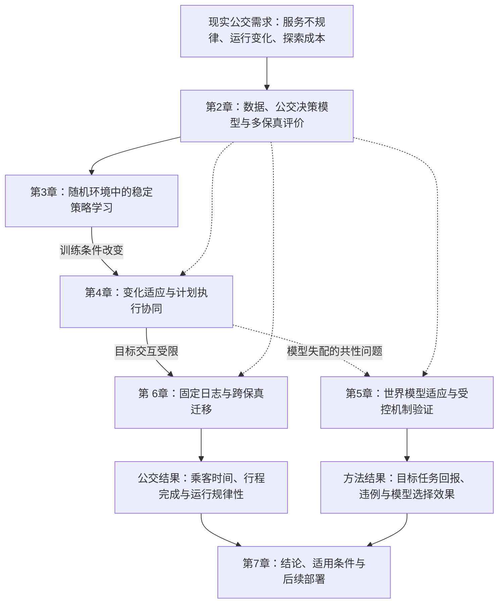

# 从仿真到现实的公交在途控制优化

博士学位论文脉络规划，2026-09-27。

本稿围绕已确定的学位论文题目，结合两篇中南大学博士论文范例及当前研究成果，确定总问题、章节关系、成果取舍和材料安排。各项目的详细实验盘点保留在[研究成果评估](/home/erzhu419/mine_code/Thesis/research_plan_cv_revised.md)中；本稿作为后续章节写作的主提纲。

本轮写作依据已完成的论文和实验组织内容。第 2 章详细提纲、环境对应图及第 3—6 章研究内容初稿见[章节写作稿](/home/erzhu419/mine_code/Thesis/第2章详细提纲与第3至6章研究内容初稿.md)。

最终交付已确定为 **Word，公式使用原生可编辑格式**。当前合稿包含七章正文、中英文摘要、44条参考文献及数学附录A至E，覆盖RE-SAC、当前与早期BAPR、CS-BAPR及MC-WM的支撑推导。BAMOR、BAPR-HRO等外扩证明保留在独立写作材料中，不再用来扩充本论文附录。原论文和证明源码保持不变。正文已接入41幅中文图，本轮重点补充公交物理机制、主要数学推导及既有H2O+结果的服务代价分析。当前内容合并在[Word阶段稿](/home/erzhu419/mine_code/Thesis/output/博士论文_正文与数学附录_阶段稿.docx)，具体见[写作进度](/home/erzhu419/mine_code/Thesis/manuscript/写作进度.md)。

**环境设定已按你的原始规划确定：自建简易公交仿真作为源环境 sim，复杂的 SUMO 公交仿真作为目标环境，并承担 real 的高保真代理角色。论文围绕这两个环境之间的迁移组织。**

## 一、总体判断：从公交控制问题出发，以迁移后的运营效果收束

**采用七章结构：绪论、共同基础、四个研究章节、结论与展望。四个研究章节依次回答“如何学好、如何适应变化、如何校正模型失配、如何在有限目标数据下实现公交跨保真迁移”。最后一个研究章回到公交服务结果。**

贯穿全文的总问题是：

> 面对公交系统的异步运行、客流与路况变化，以及仿真模型与目标运营环境之间的差异，如何利用仿真和有限目标数据形成有效的在途控制策略，并将学习效果落实为乘客服务改善？

论文的研究对象始终是公交运行中的实时调控。站点停站控制是各项研究最稳定的共同动作，滚动发车计划作为与在途控制耦合的上层运行条件。评价最终落到乘客等待时间、车内时间、行程完成情况和运行规律性。

研究历史提供问题来源，论文结构体现论证顺序。你的真实研究历程仍然成立：类别特征解决公交状态表达，RE-SAC 处理随机环境中的学习问题，BAPR 与 CS-BAPR 追问变化条件下的适应，离线学习和 TransitDuet 补充实际运营需求，H2O+ 将问题推进到跨保真迁移，MC-WM 进一步研究目标模型的修正与选择。

整理为博士论文后，这些成果组成四个环节：

**公交主线：简易仿真中的稳定学习 → 运行条件变化下的适应 → 从简易仿真向 SUMO 迁移。模型失配作为共性方法问题，由独立的世界模型章节展开。**

第3、4章研究公交策略的基础能力，第5章研究模型适应机制，第6章以已有H2O+实验检验高保真目标环境中的乘客服务。章节顺序体现论证需要，而不是把研究时间顺序或全部算法串成一个系统。

## 二、两篇范例对结构的启示

### 2.1 同专业范例：统一平台支撑四个递进研究问题

刘鹏杰的论文，封面题名为《不确定环境下多线路公交信号协同优先方法研究》，采用七章结构：第 1 章绪论，第 2 章数据处理与仿真控制平台，第 3—6 章分别研究单交叉口、干线、路网和区域边界，第 7 章结论与展望。

其递进关系不仅体现在空间尺度上。第 5 章以动态鲁棒时刻表组织第 3、4 章的信号优先方法，第 6 章进一步处理区域拥堵。共同的数据和平台集中在第 2 章，各研究章围绕问题、建模、求解、实验与小结展开。研究内容与技术路线见印刷页 21—23，研究总结与创新见 169—173。

对你的论文，最值得采用的是三点：

1. **共同基础提前集中。** 公交数据、事件机制、状态动作和评价指标在第 2 章交代，后续各章聚焦新增问题。
2. **每章都落到公交运行。** 理论和算法服务于明确的交通问题，章节结束时回答对车辆运行和乘客服务有什么影响。
3. **章与章有必要的承接。** 前章解决一类困难，后章处理前章条件被放宽之后出现的新困难。

范例中数据、仿真输入和控制验证之间有具体处理链。对应到你的设定，第 2 章应重点交代简易仿真与 SUMO 的建模关系：哪些过程共用，哪些过程简化，哪些差异实际影响停站决策。

### 2.2 同学院范例：共性方法最终回到工程对象

高天宇的《轻质混杂 TPMS 结构力学行为及形性调控机理》同样采用七章结构：绪论之后，第 2—5 章研究连续模型、静态加载、局部冲击和吸隔声，第 6 章回到列车部件应用，第 7 章总结。其绪论另设“科学问题的提出”；总结中将五项主要工作凝练为四项创新点。

对你的启示是：**研究章节数不必与创新点数、已有论文数一一对应，方法研究与工程问题之间需要清楚的联系。** 本论文由 H2O+ 的 SUMO 实验承担公交跨保真验证，MC-WM 的受控动力学实验进一步分析模型失配下的适应机制。

两篇范例共同支持“围绕统一对象组织递进问题”的写法。七章是本次建议，不是附件规定的强制章数。

## 三、题目中的三个核心概念

### 3.1 公交在途控制

主要对象是已投入运营车辆在服务过程中的停站与运行调节。本文统一将 holding 称为“附加停站控制”，与完成上下客所需的基础停站时间区分。

TransitDuet 的滚动发车计划进入第 4 章，承担“运行条件变化时，如何协调服务目标与在途执行”的问题；其中发车决策和在途动作分别定义。速度控制仅在确实具有该动作及有效证据的实验中讨论。

### 3.2 从仿真到现实

本论文采用两个环境：

- **源环境 sim：自建简易公交仿真。** 用于大量低成本交互、机制分析与策略训练。
- **目标环境：SUMO 公交仿真。** 保留更细的交通与公交交互过程，在 H2O+ 中提供固定目标日志和最终闭环评价，作为现实系统的高保真代理。

论文的直接公交迁移任务是：**利用 SUMO 离线数据，在简易仿真中训练，再回到 SUMO 检验控制效果。** 对应的实际应用设想是利用真实运营离线数据，在 SUMO 中训练，再将策略用于实际公交系统。两者具有相同的“目标域数据＋源环境交互→目标域评价”信息结构，形成本文的跨保真代理验证设计。

两环境之间的关系依据已有 H2O+ 建模和验证说明：它们共用线路、时刻表、容量、乘客行程、状态动作及奖励定义；简易环境以标定的路段运行时间和停站机制代替微观道路过程。已有零停站及非零干预比较提供了两环境响应的直接材料。

### 3.3 控制优化

全文以乘客服务为主要解释对象，车头时距与学习回报提供中间机制和训练信息。等待时间减少、车内时间增加、完成率变化可能同时发生，应保留各分项结果，再解释总目标下的取舍。

建议统一使用：源环境、目标环境、附加停站时间、计划发车时刻、实际发车时刻、目标域数据预算、乘客行程完成率、直接目标模型、残差模型、校准模型选择。各章采用的折扣回报、乘客统计分母和控制周期则按实际实验定义。

### 3.4 训练与验证的信息关系

H2O+ 的实际流程是 SUMO 离线日志初始化、简易仿真续训、冻结控制器后在独立 SUMO 场景评价。策略训练期间不在线查询 SUMO 转移。开发阶段的 SUMO 评价承担方案设计，最终确认场景与开发场景分离。

offline-sumo 分别比较零新增交互的离线方法与使用 SUMO 在线交互的方法。MC-WM 则在受控动力学任务中使用初始目标数据和目标在线交互。各章分别保留其数据用量、训练预算、验证与测试访问方式。

## 四、四个递进问题

### 问题一：仿真中的公交策略如何学得稳定、学得有效？

公交车辆异步到站，线路、站点和班次不同，运行经验不均衡，客流和路况又具有随机性。首先需要解决策略如何表达系统、如何共享经验，以及价值估计如何影响控制。

对应第 3 章，以 Categorical Feature 和 RE-SAC 为基础。得到的是源仿真中的有效控制能力。

### 问题二：运行条件改变后，原有策略如何继续发挥作用？

常规训练工况不能覆盖客流激增、路段运行时间变化和持续的运行模式改变。变化还可能使原计划车头时距不再合适，需要同时考虑控制规则和上层运行目标。

对应第 4 章，以 CS-BAPR 和 TransitDuet 的公交研究为主，早期 BAPR 提供适应思想来源。得到的是对变化条件的处理方法及适用范围。

### 问题三：源模型失配时，如何利用目标数据决定保留什么、修正什么？

跨保真混合学习仍受动力学模型误差制约。源模型可能保留可用结构，也可能使残差学习承担过大的修正负担。此时应比较残差修正与直接目标建模，并判断模型选择是否改变闭环控制结果。

对应第 5 章，以 MC-WM 已完成的方法和受控动力学实验为基础，分析模型选择及其控制后果。与第 6 章的联系是从公交迁移所暴露的模型失配问题，进一步研究通用的模型适应机制。

### 问题四：目标环境交互有限时，如何利用日志和仿真完成迁移？

现实部署的探索成本是研究动机。offline-sumo 研究固定日志与额外 SUMO 交互的作用；H2O+ 进一步将训练交互放到简易仿真，仅使用固定目标日志提供 SUMO 信息。

对应第 6 章，整合 offline-sumo 与 H2O+。得到的是预算明确的迁移流程，以及面向乘客完整服务的评价和执行机制。

## 五、建议目录与章节任务

### 第 1 章 绪论

1.1 研究背景与意义：公交串车、服务不规律与实时调控需求。

1.2 国内外研究现状：公交在途控制；学习型控制与随机性处理；运行变化下的适应；离线学习、仿真迁移与模型校正。

1.3 现有研究不足与科学问题：按照上述四个问题收束综述。

1.4 主要研究内容与章节关系。

1.5 技术路线。

**本章任务：** 解释为什么“在一个仿真器中优化公交回报”还不足以回答实际运营问题，并说明后续四章如何逐步缩小这个差距。

### 第 2 章 公交在途控制建模与多保真仿真评价基础

2.1 公交运行过程与控制需求：异步事件、上下客、串车传播和停站影响。

2.2 数据来源与场景构建：线路、站点、时刻表、交通流、客流与运行记录。

2.3 在途控制决策模型：可观测状态、类别与连续特征、可执行动作、目标与约束。

2.4 简易仿真与 SUMO 的多保真关系：共用输入、简化过程、控制接口、事件时间及半马尔可夫表示。

2.5 两环境的运行与控制差异：输入一致性、运行统计、相同动作响应与直接迁移表现。

2.6 实验评价方法：乘客时间、完成率、车头时距、训练与交互预算、独立运行日。

2.7 本章小结。

**主要材料：** Categorical Feature 的问题建模，offline-sumo 与 H2O+ 的数据、动作和平台描述。

**本章任务：** 建立后续研究共享的问题语言，明确数据怎样进入仿真、动作怎样影响公交、结果怎样评价。各平台的不同版本、动作空间和乘客统计对象保留在各自实验定义中。

**建议核心图表：** 公交事件与控制过程图；简易仿真与 SUMO 的模型及数据关系图；两环境建模差异表；同一控制策略的运行响应对比。

### 第 3 章 随机运行环境下公交在途控制的稳定策略学习

3.1 异步公交运行中的共享学习问题。

3.2 类别与连续状态融合的共享策略。

3.3 鲁棒集成价值学习与策略优化。

3.4 价值估计与训练稳定性分析：正则、集成、熵温度和后期退化。

3.5 价值误差的决策影响：绝对偏移、动作相对误差和控制结果。

3.6 公交控制实验与运营效果分析。

3.7 本章小结。

**主要材料：** Categorical Feature、RE-SAC，以及已经形成独立结果的训练和价值诊断。

**本章中心论点：** 稳定的公交控制学习需要同时处理异构状态表达和随机价值学习，算法内部数值改善最终通过控制结果检验。

章节先建立基准方法，再用已完成的补充实验解释其有效机制与局限。已有训练记录中每次排错的过程归入研究档案，正文围绕能回答科学问题的干预和比较组织。

**承接下一章：** 本章研究的有效策略依赖训练运行条件。客流与路况发生持续变化后，策略需要进一步适应。

### 第 4 章 运行条件变化下公交在途控制的适应与协同

4.1 问题提出。

4.2 从随机扰动到运行模式适应。

4.3 需求变化下的稳定策略学习。

4.4 CS-BAPR公交实验。

4.5 滚动发车计划与在途控制协同。

4.6 TransitDuet协同控制实验。

4.7 讨论与局限。

4.8 本章小结。

**主要材料：** CS-BAPR、TransitDuet；早期 BAPR 作为方法演化来源。FreqDuet 可提供有限篇幅的补充分析。

**本章中心论点：** 运行条件变化既可能要求调整执行策略，也可能要求重新制定执行目标。CS-BAPR 回答前者，TransitDuet 回答后者，两类方法分别给出公交证据。

这一章具有两条明确的分析线：固定计划下研究策略对需求变化的响应；允许滚动计划时研究计划与在途执行的协同。两组实验分别控制变量、分别报告结果。

**承接后续研究：** 策略适应之外，跨环境学习还面临动力学失配和目标交互成本。第5章展开前一问题的方法研究，第6章在公交场景中研究固定日志和源仿真的使用。

### 第 5 章 仿真模型失配下的世界模型适应方法

5.1 问题提出。

5.2 源目标模型与校准选择。

5.3 残差模型构建与可信样本使用。

5.4 模型误差与价值误差的数学联系。

5.5 受控动力学偏移实验。

5.6 模型选择与组件作用。

5.7 讨论与适用范围。

5.8 本章小结。

**主要材料：** MC-WM 当前方法、三个受控动力学偏移任务的确认结果和模型选择配对实验。

**本章中心论点：** 源知识的使用方式应由目标数据决定，在保留源结构和直接学习目标动力学之间作出选择，并通过目标任务的闭环结果判断该选择的价值。

当前 MC-WM 采用“残差模型与直接模型比较、校准数据确定模型族、可信一步样本参与学习”的结构。第 5.5 节整理已有主比较，第 5.6 节整理模型选择配对结果，讨论其对源模型复用的意义。公交联系体现在研究问题和方法解释层面，实验结果保留原任务名称与统计口径。

### 第 6 章 有限交互条件下公交在途控制的跨保真迁移

6.1 从固定日志学习到跨保真训练。

6.2 多线路公交的固定日志学习。

6.3 固定日志与新增目标交互的实验结果。

6.4 面向跨保真训练的公交H2O+方法。

6.5 停站幅度校准与行程完成保障。

6.6 高保真目标环境的独立确认。

6.7 讨论与局限。

6.8 本章小结。

**主要材料：** offline-sumo、H2O+ 当前版本。

**本章中心论点：** 日志、仿真交互和目标交互具有不同成本与作用，迁移策略的价值应同时由服务结果和所消耗的信息预算决定。

offline-sumo 提供“固定日志及额外交互能带来什么”的比较；H2O+ 提供跨保真流程，以及对末班服务和未完成行程的具体处理。当前 H2O+ 的独立比较中，完成保障规则相对同一直接父策略使广义乘客时间降低 3.71%，完成率增加约 0.466 个百分点。这是执行机制的具体结果，可以自然衔接本章的服务目标。

**收束全文：** 本章以乘客时间、完成率和运行规律性解释跨保真控制的实际收益与代价，作为最后一个研究章。新增分解显示，候车节省与车内代价并存，大间隔事件比例有所增加，不能把总目标改善写成全部运行指标同步改善。

### 第 7 章 结论与展望

7.1 研究总结：按第 3—6 章四个问题分别回答。

7.2 主要创新：由最终成立的方法和证据凝练。

7.3 局限与研究展望：更广运行条件、实际执行和目标模型持续更新。

参考文献、必要附录、攻读学位期间主要研究成果及致谢按学校规范组织。附录主要承担证明细节、额外实验和协议定义。

## 六、现有成果如何进入这本论文

| 成果 | 建议位置 | 在总论证中的作用 |
| --- | --- | --- |
| Categorical Feature | 第 2、3 章 | 公交事件建模、类别状态与共享策略起点 |
| RE-SAC | 第 3 章主体 | 随机环境中的稳定学习及价值误差分析 |
| 早期 BAPR | 第 4 章研究来源与适应建模 | 从固定条件学习走向非平稳适应 |
| 当前 BAPR | 第 4 章简要机制讨论，详细实验留在相关论文 | 已知动作变换下的结构化适应 |
| CS-BAPR | 第 4 章主体 | 极端强度变化下的稳定化与外推 |
| TransitDuet | 第 4 章协同部分 | 运行目标与在途执行的联合调整 |
| offline-sumo | 第 2 章平台、第 6 章主体 | 固定日志、交互预算和乘客评价 |
| H2O+ | 第 6 章主体 | 跨保真流程与行程完成保障 |
| MC-WM | 第 5 章方法主体 | 模型失配下的修正、选择与验证 |
| 公交 FreqDuet | 第 4 章补充材料 | 信息分配与服务代价分析 |
| 通用 Freq-HRL、BAMOR | 相关成果与后续研究储备 | 重规划时机、多目标策略选择 |
| CFCMT、BAPR-HRO | 相关成果清单及必要的方法讨论 | 动作相对效果、扰动决策的外扩 |
| MEIS、Assumption Agent、Hegel Machine | 相关成果清单与独立研究方向 | 模型假设与自主研究 |

选择依据是对“公交在途控制从仿真走向现实”的直接贡献。已有论文可以在一章中形成互补论证，同一篇论文的基础建模与主要结果也可以分属不同章节。

## 七、技术路线与章节关系

这是研究问题的递进关系。第 6 章承担公交跨保真验证，第 5 章承担模型失配的机制研究；各章使用已经完成的相应实验。

环境与数据路线如下：

全篇叙述可以保持下面的自然转折：

> 公交系统中的异步事件和随机运行首先要求建立有效的学习控制方法，运行条件变化进一步要求策略和运行目标具备适应能力。跨环境学习还需要处理模型失配与目标交互成本：前者通过受控任务研究模型复用条件，后者回到公交场景，以固定目标日志与低成本仿真形成策略，并由高保真目标环境中的乘客服务结果完成验证。

## 八、四组候选创新的凝练方向

创新点围绕“交通问题、方法机制、成立证据”组织，目前作为写作方向保留。

**第一组：异步随机公交运行中的状态表征与稳定策略学习。** 结合类别身份与连续运行状态构建共享策略，研究鲁棒集成价值学习，并通过训练干预与动作比较分析稳定性和控制收益。对应第 3 章。

**第二组：运行变化下的公交策略适应与计划执行协同。** 对需求强度外推研究训练稳定化和架构适用性，对运行目标调整研究滚动时刻表与停站控制的双层协同。对应第 4 章，最终可依证据将适应与协同分别凝练。

**第三组：模型失配下的目标模型选择与策略适应。** 用独立目标数据比较残差修正和直接建模，控制模型生成样本的使用，并通过受控动力学实验检验模型选择的控制效果。对应第 5 章。

**第四组：有限目标交互下的公交跨保真学习与完整服务评价。** 明确固定日志、仿真交互和目标交互的作用，通过包含未完成行程的服务核算及具体停站规则，研究迁移策略的实际运营意义。对应第 6 章。

现有成果最清楚的交通价值是把学习机制与运行后果联系起来。最终创新点由章节结论反推；形式化证明作为相应方法的理论支撑，说明数学对象与成立假设。

## 九、现有材料与写作顺序

### 9.1 可以直接开始组织的内容

第 2 章的公交建模与仿真框架，第 3 章的类别状态与 RE-SAC，第 4 章的 CS-BAPR 和 TransitDuet，第 6 章的离线基准及 H2O+，已经有较明确的论文和实验材料。当前工作以统一概念、挑选证据和建立章节衔接为主。

第5章采用MC-WM已完成的方法与通用机制实验，围绕模型选择组织论证；第6章以H2O+独立确认为公交迁移的主要证据，并补入已完成的世界模型公交闭环、数据预算与转移偏差比较。共同初始化比较包含16个回合，预算与失配比较包含60个回合；后者为单训练种子的条件性补充，不能写成世界模型普遍优于H2O+或无需精细标定。

### 9.2 现有材料的组织重点

**第一项：整理简易仿真与 SUMO 的对应关系。** 以已有 H2O+ 论文为基础，整理共用输入、状态动作、时间推进、路段运行和乘客转移过程；引用已完成的零停站与七类非零干预验证，形成第 2 章的平台说明。

**第二项：分别组织公交结果与通用方法结果。** 第 6 章整合现有离线学习及 H2O+ 的公交证据，第 5 章整合 MC-WM 的模型适应证据；用共同科学问题建立衔接。

结果图沿用已有数据、曲线、统计区间及比较对象；新增方法示意图服务于章节论证。中文图件在Thesis目录独立生成，不改各论文项目。46幅图的来源与统计口径见[图件说明](/home/erzhu419/mine_code/Thesis/manuscript/figures/README.md)。本轮使用本地输入与小型测试汇总，未从服务器拉取数据。

### 9.3 建议写作顺序

本次修订已将文件路径、程序声明及核验过程移出论文正文，数学附录按定义、命题与推导独立展开；方法图重新设计，结果图按章节论证需要扩充。后续若确实缺少关键论证，可在保留原论文和已完成实验的基础上另行安排补充实验。本轮新增图均来自既有本地结果，不需要重新训练。

正文已纳入时距传播、乘客时间积分、固定算子收缩、策略复合误差及模型价值误差等推导，并补入源目标运行过程、留出校准、干预响应和乘客代价分解。第三、四章进一步补入停站单向作用、载客时间权衡、需求变化时序、计划与实际发车关系及逐种子服务收益；TransitDuet的计划偏移处理与上层运行惩罚也已写成完整数学表述。下一步完善绪论中的研究比较与创新表述，按已经形成的公交机理分析统一各章衔接，而非继续以增加页数为目标。

早期[章节写作稿](/home/erzhu419/mine_code/Thesis/第2章详细提纲与第3至6章研究内容初稿.md)保留作研究过程材料，章节顺序以本规划和当前正文为准。当前合稿采用七章正文、46幅图和附录A至E；附录F至H的源稿保留但不装入论文。正式封面、成果清单及完整校级规范仍待补齐。

## 十、局限与尚待确定的事项

**现实代理的证据范围。** 本论文以 SUMO 代理现实目标环境，直接证据属于简易仿真到微观交通仿真的跨保真迁移。当前题目保留，摘要与实验设置明确该验证载体。SUMO 闭环收益支持高保真目标环境中的效果，现场服务改善属于后续验证范围。

**两层迁移的关系。** “SUMO 离线数据＋简易仿真训练→SUMO 评价”与“真实离线数据＋SUMO 训练→现实应用”共享信息结构，前者为后者提供可行性依据。源目标差异、数据覆盖、观测条件和执行约束在两层中仍可能不同，因此这一对应关系属于方法上的类比支持，而不是现实有效性的逻辑蕴含。

**第 5 章的实验对象。** MC-WM 当前确认结果来自受控 MuJoCo 偏移，并使用目标域在线交互。它支持模型适应机制及其适用范围，与 H2O+ 的固定目标日志、源环境在线训练协议分别成立。

**方法版本与适用范围。** 当前 BAPR 是持久执行器模式下的策略重参数化，CS-BAPR 继承的是早期贝叶斯适应框架。当前 BAPR 的动作极性补偿结果不能直接解释客流变化。MC-WM 当前主线是校准模型选择，早期“LLM＋残差贝尔曼”属于研发来源。

**机制效果的归属。** RE-SAC 的权重正则与环境随机性估计需要区分；CS-BAPR 的外推界依赖完整映射的条件；H2O+ 当前确认的是完成保障规则的增量。第 4 章中的 CS-BAPR 与 TransitDuet 分别提供证据，其联合收益尚未验证。

**跨项目可比性。** offline-sumo 的 holding-only 数据、H2O+ 的半马尔可夫数据和早期走廊实验具有不同控制接口与统计口径。已有结果按原任务分别报告。乘客完成行程段与全部已出发乘客的分母也分别定义。

**源目标差异的归因。** H2O+ 的两环境具有共同任务定义，但训练数据采集与最终评价的 SUMO 版本不同，开发中的服务规则也经历调整。正式独立比较识别的是冻结候选与直接父策略之间的效应。

## 十一、学校要求对当前规划的影响

两份通知的正文要求基本一致：2025 年文件落款为 2025 年 2 月 27 日，另一份《附件1：关于做好学位论文格式规范检测的有关事项》落款为 **2026 年 3 月 31 日**。本次以较新附件作为格式检测流程的依据。

其中明确写出的要求是：

- 检测依据为《中南大学研究生学位论文撰写规范》（2022 版）。
- 申请查重前、提交最终版前，分别完成对应环节的格式检测。
- 暂定合格差错率为全文总字数的万分之二，即每万字不超过 2 个错误；提醒项不计入差错率。
- 最终版需保证扉页、原创性声明和授权页的签名、日期、公开属性完整，并按通知要求将扫描 PDF 合并到指定位置。
- 检测系统接受 doc、docx、pdf；通知注明检测报告最多保留 4 天。

这两份材料是**检测流程通知及操作指南**，不是完整排版细则。它们没有提供足以确认全部字号、页边距、行距、参考文献样式或论文字数下限的内容。后续制作正文模板时，还需取得所引用的 2022 版《撰写规范》或学院正式模板。

两篇毕业论文可用于参考目录层级、章节组织及前后置部分。当前阶段先确定论证结构；正式排版时以规范为准。全篇页数和研究章数由内容需要决定，本稿不将范例体量作为毕业硬性指标。

## 十二、可用于与导师讨论的研究内容概述

本论文面向公交在途控制的仿真到现实迁移，研究异步随机运行、运行条件变化、仿真模型失配和目标交互受限四类问题。首先，以类别信息与连续状态融合构建共享策略，研究稳定价值学习及其控制效果。其次，针对需求变化研究策略外推与训练稳定化，并通过滚动发车计划和停站执行的协同调整运行目标。进一步，通过受控动力学实验研究残差修正与直接目标建模之间的校准选择，分析源模型复用的条件。最后回到公交场景，以自建简易仿真为源环境、SUMO为高保真目标环境，利用目标离线日志与源仿真训练形成公交控制策略，并从候车时间、车内时间、行程完成及运行规律性解释迁移收益与代价。

## 材料索引

- [同专业博士论文 PDF](</home/erzhu419/mine_code/Thesis/不确定环境下多线路公交信号优先在途协同控制方法研究 - 提交(1).pdf>)：目录印刷页 VI—IX，研究内容 21—23，数据与平台 24—48，总结与创新 169—173。
- [同学院博士论文 DOCX](</home/erzhu419/mine_code/Thesis/中南大学博士学位论文_gty_20250527-最新-用于封装答辩打印 - mathtype——此为最终但是待改进页眉.docx>)：摘要、目录、第 1.5 节、第 6 章引言、第 7.1—7.3 节。
- [2026 年格式检测通知](</home/erzhu419/mine_code/Thesis/附件1：关于做好学位论文格式规范检测的有关事项.docx>)；[2025 年格式检测通知](</home/erzhu419/mine_code/Thesis/关于做好2025年学位论文格式规范检测的有关事项.docx>)。
- [成果评估与各项目来源](/home/erzhu419/mine_code/Thesis/research_plan_cv_revised.md)：保留全部工作的现有结果及版本说明。
- [offline-sumo 当前正文](/home/erzhu419/mine_code/offline-sumo/paper/main.tex)：平台数据、动作定义和外部标定条件。
- [H2O+ 当前讨论](/home/erzhu419/mine_code/sumo-rl/H2Oplus/paper/sections/6_discussion.tex)：完成保障效应及跨保真证据范围。
- [MC-WM 当前方法](/home/erzhu419/mine_code/MC-WM/paper/sections/method.tex)：残差与直接模型、校准选择和模型样本使用。
