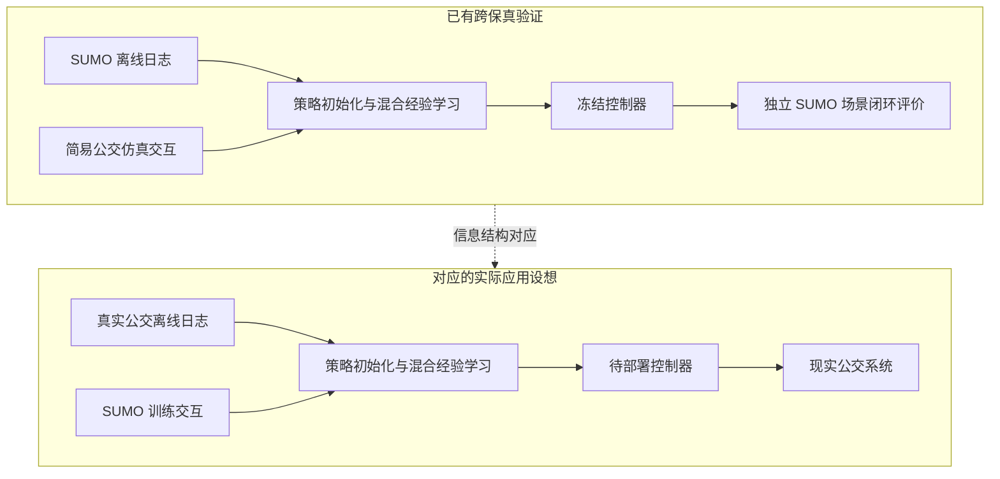
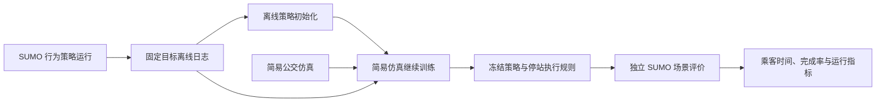

# 第 2 章详细提纲与第 3—6 章研究内容初稿

论文题目：**从仿真到现实的公交在途控制优化**。

整理日期：2026-09-27。材料范围为现有论文正文、已完成实验和已有图表。本稿包括第 2 章三级提纲、可展开的正文段落、环境对应图、统一术语，以及第 3—6 章研究内容初稿。

## 一、全篇的迁移逻辑

### 1.1 研究动机与代理验证

现实公交系统中的控制策略学习受到交互成本的限制。运行日志能够提供车辆、客流及既有控制行为的信息，仿真环境则能够提供可反复进行的策略训练。本文据此研究一种利用目标环境离线数据与源仿真交互学习目标控制策略的路径。

为实现这一研究设计，本文以自建简易公交仿真承担低成本源环境，以 SUMO 微观交通仿真承担高保真目标环境。两环境保留相同的公交服务对象与控制任务，通过不同的交通和事件演化机制形成模型差异。策略首先利用 SUMO 离线数据初始化，随后在简易仿真中继续训练，最终回到独立 SUMO 场景进行闭环评价。

这一设计对应于“真实运营离线数据支持 SUMO 中的策略训练，再将策略应用于现实系统”的研究设想。两者共享目标日志与源环境交互相结合的信息结构。现有研究在可重复的公交跨保真环境中检验该学习路径，并以目标环境中的乘客服务结果评价其效果。

### 1.2 两层对应关系

| 环节 | 本论文已有公交跨保真研究 | 对应的实际应用设想 |
| --- | --- | --- |
| 离线数据来源 | SUMO 运行记录 | 实际公交运营记录 |
| 可交互训练环境 | 自建简易公交仿真 | SUMO 公交仿真 |
| 训练中的动力学差异 | 简易模型与微观交通模型的差异 | 微观交通模型与现实运行的差异 |
| 控制策略评价载体 | 独立 SUMO 场景 | 实际公交系统 |
| 共同研究问题 | 目标日志如何支持源仿真训练后的目标控制 | 同左 |

**图 2-1 目标离线数据与源仿真交互的对应关系**

图中上半部分对应已完成的公交研究，下半部分表示应用设想。SUMO 在两个层次中承担不同角色：在代理验证中是目标环境，在实际应用设想中是训练环境。

## 二、第 2 章详细提纲与正文基础

# 第 2 章 公交在途控制建模与多保真仿真评价基础

### 本章引言

公交在途控制通过调整车辆服务过程中的运行行为，改善车头时距分布与乘客出行体验。其决策过程具有车辆异步到站、运行状态异构、客流随时间变化以及局部控制影响沿线路传播等特点。为了研究控制策略从简化仿真向复杂目标环境的迁移，需要首先明确公交运行过程、可观测信息、可执行动作及服务评价方式，并建立源环境与目标环境之间的对应关系。

本章首先介绍公交运行对象与在途控制需求，说明已有走廊和多线路研究所采用的数据与场景；其次，建立包含事件时间、状态表征和停站动作的决策描述，并梳理简易公交仿真与 SUMO 的共同建模要素及差异；最后，结合已有平台验证和实验设置，说明乘客服务指标及不同数据、交互条件下的评价方法，为后续稳定策略学习、运行变化适应、跨保真迁移和世界模型研究提供共同基础。

### 2.1 公交运行过程与在途控制需求

#### 2.1.1 线路、班次与车辆的运行组织

研究对象包括公交线路的方向性服务、依次经过的站点、计划发车班次和执行服务的车辆。班次描述一次计划运行任务，车辆描述实际执行任务的运力资源，二者在不同场景中分别记录。系统运行过程包括发车、路段行驶、到站、乘客上下车、附加停站与离站等事件。

多线路 SUMO 场景以 12 条方向性服务和每回合 389 个计划车辆行程描述运行规模；TransitDuet 使用单条双向线路与滚动发车计划研究上下层协同。[M1—M3]

#### 2.1.2 客流与路况扰动下的串车传播

公交运行时间与乘客上下车时间共同影响相邻车辆之间的间隔。车辆延误会改变其到站前累积的乘客数量，进而影响停站服务时间，使运行偏差向后续站点传播。前后车辆之间的客流和服务时间差异又会改变车头时距，形成局部延误与线路服务不规律之间的反馈。

本节以公交运行事件解释控制需求，将前向、后向车头时距，候车人数、车内人数以及计划间隔作为后续建模的主要运行量。

#### 2.1.3 附加停站控制与滚动计划的作用

附加停站控制是在完成必要上下客服务的基础上，主动延后车辆离站的实时调控行为。适当停站能够改变相邻车辆间隔及后续乘客分配，同时也会增加车内乘客停留时间，因此需要综合评价运行规律性与乘客时间。

滚动计划决定后续班次的计划发车时刻，并向在途车辆提供相应的服务间隔目标。本文在基础控制部分研究给定计划下的停站决策，在协同部分研究计划更新与在途执行之间的耦合。

**本节材料位置：** Categorical Feature 的问题背景，TransitDuet 的公交系统与上下层决策定义，offline-sumo 的串车及停站问题描述。

### 2.2 数据来源与实验场景

#### 2.2.1 场景输入及其作用

已有多线路平台的场景输入包括道路拓扑、线路及站点序列、发车时刻表、信号配时、车辆参数、社会交通输入和乘客起讫点需求。道路与信号数据规定车辆运行条件，线路和时刻表定义公交服务供给，乘客需求定义服务对象，容量及上下客参数影响停站过程。

本节按“输入数据、运行过程、控制观测、服务结果”说明各类数据的作用，平台介绍采用论文已有的场景描述和路网图。[M1、M2]

#### 2.2.2 走廊环境与多线路 SUMO 环境

走廊研究侧重异步车辆控制、随机运行、需求变化与计划执行；多线路 SUMO 研究侧重固定日志学习、交通交互及目标域闭环评价。二者分别支撑相应研究问题。

| 场景或数据 | 已有论文中的规模与用途 |
| --- | --- |
| offline-sumo 多线路场景 | 12 条线路服务，389 个计划运行班次，353 个唯一物理站点，459 个线路—站点条目，18,000 秒运行时域 |
| offline-sumo 日志 | 3,374,285 条执行停站动作的转移，用于离线学习及离线到在线比较 |
| H2O+ 多线路场景 | 12 条方向性服务，389 个计划车辆行程，24,000 秒运行时域 |
| H2O+ 日志 | 3,284,718 条按事件顺序记录的转移，来自 240 个完整回合、8 类行为策略和 30 个外生环境单元 |
| TransitDuet 走廊场景 | 单条双向线路、每日 264 个计划行程，研究滚动发车与离散停站协同 |

上述数字分别来自当前对应论文。[M1—M3]

#### 2.2.3 行为策略与离线经验

H2O+ 的离线数据包含零停站、随机停站、计划调整车头时距规则及短视乘客福利规则等八类行为策略，覆盖十个环境块和三个需求水平。每个回合按时间顺序记录状态、实际执行动作、奖励、后继状态、持续时间与终止信息。

offline-sumo 采用停站动作日志，并保留上一时刻动作特征。它与 H2O+ 分别形成两套数据：前者用于比较固定日志和额外目标交互的价值，后者用于研究目标日志与简易仿真交互的组合。[M1、M2]

### 2.3 公交在途控制的事件决策模型

#### 2.3.1 异步事件与状态转移

设控制事件序号为 $k$，事件对应物理时刻为 $t_k$，策略根据当前可用信息 $s_k$ 选择动作 $a_k$，环境随后产生后继状态 $s_{k+1}$。相邻控制事件之间的时间长度为

$$
\Delta t_k=t_{k+1}-t_k.
$$

事件由车辆运行触发，不同车辆与站点之间的决策间隔可以不同。H2O+ 因此将公交控制表示为有限时域半马尔可夫决策过程，用联合转移核描述后继状态和持续时间：

$$
P(s_{k+1},\Delta t_k\mid s_k,a_k).
$$

同一物理时刻存在多个可控到站事件时，H2O+ 按线路与车辆标识确定顺序，逐个产生动作，收齐该批动作后推进环境。批内中间转移的持续时间为零，批末转移承担到下一批事件的物理时间及系统成本。[M2]

#### 2.3.2 类别特征、连续状态与共享策略

公交状态由车辆、线路、站点位置、时段和方向等类别信息，以及车头时距、候车量、车内人数、停站信息和运行速度等连续信息组成。类别表征将不同运行对象纳入共享策略，连续状态描述当前控制需求。

不同研究使用适合自身任务的输入组织方式。offline-sumo 将 15 个原始观测量与上一停站动作组成输入，站点位置类别表示线路内序号。H2O+ 则对同一时刻的事件批进行结构化编码：最多包含 16 个事件槽位，原始打包状态为 245 维，规范化状态为 229 维；掩码区分有效事件，已选动作提供批内执行上下文。[M1、M2]

#### 2.3.3 动作物理含义与控制边界

在 H2O+ 中，策略输出 $a_k\in[-1,1]$，对应附加停站时间为

$$
\tau_k=\frac{a_k+1}{2}\tau_{\max},\qquad \tau_{\max}=60\ \mathrm{s}.
$$

$a_k=-1$ 对应精确零停站，其余动作对应正停站时长。offline-sumo 同样采用最大 60 秒的连续停站动作，速度命令固定为 1.0。TransitDuet 的下层动作集合为 $\{0,3,6,9,12,15,20,30\}$ 秒，上层选择下一班次的计划车头时距调整。[M1—M3]

#### 2.3.4 学习目标与乘客服务目标

offline-sumo 使用车头时距偏差及对称性构成训练奖励，并另行统计乘客与服务结果。H2O+ 采用广义乘客时间作为即时成本。设系统候车人数和车内人数分别为 $N_{\mathrm w}(t)$、$N_{\mathrm v}(t)$，其事件成本为

$$
C_k=2\int_{t_k}^{t_k+\Delta t_k}N_{\mathrm w}(u)\,\mathrm du
+\int_{t_k}^{t_k+\Delta t_k}N_{\mathrm v}(u)\,\mathrm du,
\qquad r_k=-C_k.
$$

两项权重分别为 2 和 1，成本单位为广义乘客秒。相邻事件按实际经过的时间累计成本，同批次零持续时间转移的成本为零。H2O+ 使用有限时域、无折扣目标，非终止转移的延续因子为 1，终止时为 0。[M2]

### 2.4 简易仿真与 SUMO 的对应关系

#### 2.4.1 两环境共享的公交任务

在 H2O+ 的跨保真设置中，两环境共享线路及站点序列、时刻表、车辆容量、乘客行程、状态、动作与奖励定义。共享任务使相同的控制输出具有相同的物理含义，也使目标环境中的结果能够评价源环境训练所得的策略。[M2]

#### 2.4.2 两环境的运行演化差异

SUMO 通过微观道路模型描述车辆运行与交通交互。简易公交仿真采用标定的路段运行时间和停站上下客机制进行事件推进。乘客换乘按实际运行过程释放：第一段行程先进入系统，后续乘车段在前一段实际下车后进入可用状态。

在共同任务定义下，两环境的差异表示为转移及持续时间分布的差异：

$$
P_{\mathrm{sim}}(s',\Delta t\mid s,a)
\quad\text{与}\quad
P_{\mathrm{tgt}}(s',\Delta t\mid s,a).
$$

| 建模要素 | 简易公交仿真 | SUMO 目标环境 |
| --- | --- | --- |
| 公交线路、站点、时刻表与容量 | 共用输入 | 共用输入 |
| 控制状态、停站动作、乘客成本 | 共用任务定义 | 共用任务定义 |
| 路段运行 | 标定的路段运行时间 | 微观道路与交通交互 |
| 乘客服务 | 事件驱动上下客、按实际下车释放换乘段 | 目标公交与乘客运行过程 |
| H2O+ 中的用途 | 交互采样与继续训练 | 离线数据采集、开发评价与独立最终评价 |

#### 2.4.3 目标离线数据与源交互经验的结合

目标离线经验表示为

$$
\mathcal D_{\mathrm{off}}=
\{(s_i,a_i,r_i,s'_i,\Gamma_i,\Delta t_i,z_i)\}_{i=1}^{N},
$$

其中 $z_i$ 为终止标记，$\Gamma_i$ 为延续因子。H2O+ 先以目标日志完成隐式 Q 学习初始化，再在简易仿真中采集交互经验，将固定目标经验与源交互经验用于继续学习。当前正式策略完成 50,000 次离线初始化更新，并训练至 25,000 个源仿真决策事件端点。最终控制器由冻结策略和确定性停站变换组成。[M2、M4]

**图 2-2 现有公交跨保真学习与评价流程**

### 2.5 两环境的已有一致性与控制响应结果

#### 2.5.1 共同输入与零停站运行比较

H2O+ 已在 30 个配对场景中比较简易仿真与 SUMO 的零停站运行结果。广义乘客时间、等待时间、车内时间、完成率及已完成车辆行程时长的自助法区间均满足当时设定的接受阈值。各指标最大点差依次为 4.61%、8.75%、1.66%、0.43 个百分点和 1.04%。[M5]

#### 2.5.2 非零控制下的响应比较

同一组场景还与七类非零干预交叉，比较停站控制引起的乘客时间、完成率、平均停站与车辆行程时长变化。论文报告的区间端点均处于相应接受阈值内。这组已有结果说明平台验证同时考虑了自然运行和动作响应，可作为简易环境承担策略训练的依据。[M5]

#### 2.5.3 平台比较与策略结果的联系

本章用上述材料说明训练环境的构建基础。第 5 章进一步采用独立 SUMO 场景报告冻结控制器的闭环结果，形成从平台描述、训练流程到目标域评价的完整论证。

### 2.6 实验评价指标与数据使用口径

#### 2.6.1 乘客时间与行程完成

乘客服务评价包含等待、车内停留及总出行时间。H2O+ 的主要评价量采用整个时域内的广义乘客时间，除以已出发乘客数 $N_{\mathrm{dep}}$：

$$
G=\frac{2\int_0^T N_{\mathrm w}(u)\,\mathrm du+
\int_0^T N_{\mathrm v}(u)\,\mathrm du}{N_{\mathrm{dep}}}.
$$

行程完成率定义为

$$
R_{\mathrm{cmp}}=\frac{N_{\mathrm{cmp}}}{N_{\mathrm{dep}}}.
$$

在时域终点仍未完成行程的乘客，其已经产生的候车与车内时间计入 $G$。评价量还包括首次可控事件之前的乘客时间，训练回报则从可控事件开始累计。offline-sumo 的乘客时间表以已完成乘客行程段为统计对象。[M1、M2]

#### 2.6.2 运行规律性与计划执行

车头时距偏差、变异系数和串车指标描述服务规律性；附加停站时间描述控制代价；TransitDuet 进一步记录计划发车时刻、实际发车时刻、发车延误和车队资源使用。它们用于解释乘客时间变化及计划执行情况。[M1、M3]

#### 2.6.3 不同研究的信息预算

| 研究 | 已有训练数据及交互条件 | 评价对象 |
| --- | --- | --- |
| offline-sumo 离线方法 | 固定 SUMO 日志，零新增训练交互 | 共同的完整 SUMO 回合 |
| offline-sumo 在线及离线到在线方法 | 30,000 次 SUMO 在线决策；是否使用先验日志按方法区分 | 同一套完整 SUMO 回合 |
| H2O+ | 固定 SUMO 日志，简易仿真训练至 25,000 个决策事件，训练期零目标在线转移 | 开发结束后冻结控制器，在十个新环境块的 SUMO 场景中确认 |
| MC-WM | 10,000 条初始目标转移、40,000 次目标在线交互；候选另用 50,000 条源转移 | 三个受控动力学目标任务，验证与最终测试分别统计 |

MC-WM 的目标验证会参与检查点选择，因此训练、验证与最终测试访问分别列示。该方法的数据预算保留在第 6 章原任务内。[M1、M4、M5、M6]

#### 2.6.4 训练随机性与环境随机性

offline-sumo 的学习方法先在每个训练种子内汇总十个 SUMO 场景，再跨训练种子报告结果；确定性公交规则按十个环境种子计算不确定性。H2O+ 的正式比较以十个新环境块为独立单位，每块先汇总训练种子与需求水平。现有论文中的样本单位在相应章节沿用。[M1、M5]

### 2.7 本章小结

本章围绕公交在途控制建立了运行对象、事件决策和服务评价的共同描述，梳理了已有走廊环境与多线路 SUMO 环境的场景输入和离线数据。在跨保真研究中，简易公交仿真与 SUMO 共享公交服务及控制任务，通过不同的运行演化机制形成源目标差异。目标离线日志与源仿真交互相结合的学习流程，使策略能够在低成本环境中训练，并在独立高保真场景中评价。上述建模和评价基础支撑后续随机环境中的策略学习、运行变化下的适应与协同、公交跨保真迁移，以及模型失配条件下的世界模型研究。

## 三、统一术语与符号

| 术语或符号 | 本稿中的含义 |
| --- | --- |
| 附加停站控制（holding） | 正常上下客服务之外的主动停站调控 |
| 班次／车辆行程 | 一次计划服务任务 |
| 物理车辆 | 执行运行任务的车辆资源 |
| $k,t_k,\Delta t_k$ | 控制事件序号、物理时刻与转移持续时间 |
| $s_k,a_k,\tau_k$ | 控制状态、策略动作与物理停站时长 |
| $\mathcal M_{\mathrm{sim}},\mathcal M_{\mathrm{tgt}}$ | 源环境与目标环境；在公交跨保真研究中分别为简易仿真和 SUMO |
| $\mathcal D_{\mathrm{off}}$ | 固定目标离线经验 |
| $N_{\mathrm w},N_{\mathrm v}$ | 系统候车人数与车内人数 |
| $N_{\mathrm{dep}},N_{\mathrm{cmp}}$ | 已出发乘客数与已完成行程乘客数 |
| $G,R_{\mathrm{cmp}}$ | 广义乘客时间与行程完成率 |
| 直接目标模型／残差模型 | 直接拟合目标动力学／在源模型上学习修正的两类模型 |

本表统一中文表述和叙述符号。具体章节中的网络维数、奖励参数和实验时域采用相应论文原定义。

## 四、第 3—6 章研究内容初稿

### 第 3 章：随机运行环境下公交在途控制的稳定策略学习

针对公交车辆异步到站、运行对象异构及客流与路况随机变化引起的策略学习困难，本章研究类别状态表征与鲁棒集成价值学习相结合的公交在途控制方法。首先，将车辆、站点、方向和时段等类别信息与车头时距、载客和运行状态等连续信息共同组织为策略输入，通过共享策略利用不同运行对象的控制经验。其次，结合鲁棒正则与价值集成开展策略优化，分析随机环境下的训练表现。进一步，利用已完成的温度干预、固定策略价值校准及配对动作比较，区分价值绝对偏移、动作相对误差与控制收益之间的关系。最后，结合公交运行结果说明方法的效果及稳定性特征，为运行条件变化下的策略适应提供基础。

**本章已有支撑：** Categorical Feature、RE-SAC 原论文及已完成的补充诊断。

### 第 4 章：运行条件变化下公交在途控制的适应与协同

针对客流强度超出训练范围、运行条件发生持续变化及原计划服务间隔与实时需求不匹配等问题，本章从执行策略适应和运行目标调整两个方面开展研究。首先，结合早期 BAPR 的适应思想与 CS-BAPR 的公交实验，研究训练稳定化及不同策略结构在需求放大、突发变化和振荡条件下的响应，并通过条件外推分析解释其适用范围。其次，研究滚动发车计划与附加停站控制的双层协同，上层调整后续班次的计划发车时刻，下层根据计划目标执行实时停站决策，通过运行反馈连接两个决策层级。最后，结合已有极端需求实验和 TransitDuet 独立评估，分析运行规律性、乘客等待、车内停留及计划执行之间的关系，说明面对环境变化时调整控制规则与调整运行目标各自的作用。

**本章已有支撑：** CS-BAPR、TransitDuet；BAPR 作为方法来源与结构化适应讨论，公交 FreqDuet 按需要作为补充。

### 第 5 章：有限交互条件下公交在途控制的跨保真迁移

针对目标环境中大量在线探索难以承担的问题，本章研究固定运行日志与低成本仿真交互相结合的公交策略学习方法。首先，基于已有多线路 SUMO 日志，比较离线学习、在线学习和离线到在线学习在不同信息预算下的运行效果，分析训练回报与乘客服务指标之间的关系。其次，以 SUMO 为高保真目标环境，以自建简易仿真为交互训练环境，利用目标离线数据初始化控制策略，并在简易环境中继续学习，构成目标日志支持下的跨保真训练流程。进一步，采用按物理时间累计的广义乘客成本和行程完成率评价服务效果，并通过已有完成保障规则处理低载尾班服务情形。最后，在独立 SUMO 场景中评价冻结控制器，分析其乘客时间与完成情况。该研究为“目标离线数据与源仿真训练相结合”的公交控制路径提供跨保真实验证据。

**本章已有支撑：** offline-sumo 当前基准及 H2O+ 当前跨保真研究。H2O+ 正式候选相对直接父策略的广义乘客时间降低 3.71%，完成率提高约 0.466 个百分点，效应对应完成保障规则。[M5]

### 第 6 章：仿真模型失配下的世界模型适应方法

公交跨保真学习表明，源仿真中的运行演化与目标环境之间的差异是策略迁移需要处理的重要因素。围绕这一问题，本章进一步研究目标数据支持下的世界模型适应方法。首先，分别构建保留源模型结构的残差模型与直接拟合目标动力学的模型，并利用独立校准数据选择模型类别。其次，结合置信权重和有效性条件使用一步模型样本，支持目标策略更新。随后，在已有三个受控动力学偏移任务中，比较校准选择、固定残差、直接目标建模和目标策略学习的回报与违例情况，并通过配对模型选择实验分析所选模型的控制价值。最后，讨论源结构何时值得保留、何时需要直接学习目标动力学，以及这些结果对公交仿真模型复用的启示。[M6、M7]

**本章已有支撑：** MC-WM 当前方法、十种子确认结果及模型选择配对实验。

## 五、现有图表的使用安排

第 2 章可直接使用 H2O+ 的路网图、两环境共有要素和已有平台响应结果；图 2-1、图 2-2 为本稿的中文结构示意。后续各研究章使用对应论文的架构图、训练曲线与结果图。

| 图表材料 | 学位论文用途 | 当前来源 |
| --- | --- | --- |
| 多线路公交路网图 | 第 2 章场景说明 | H2O+ 的 `paper/figures/network_topology.pdf` |
| 两环境零停站与非零干预比较 | 第 2.5 节平台说明 | H2O+ 实验正文中的已完成结果 |
| 完整回合训练曲线 | 第 5 章预算与效果比较 | offline-sumo 的 `figure2_full_episode_learning_curves.pdf` |
| 乘客服务权衡图 | 第 5 章运营效果解释 | offline-sumo 的 `figure3_operational_tradeoffs.pdf` |
| 双层控制架构图 | 第 4 章计划执行协同 | TransitDuet 当前方法正文 |
| 世界模型适应流程图 | 第 6 章方法说明 | MC-WM 当前方法正文 |

中文适配范围为图题、图例、坐标轴、注释与中文字体。算法缩写、数据、曲线、区间和比较对象保持原定义，中文版图输出到学位论文材料目录。本轮交付为章节文字与结构图源码，已有项目文件保持原状。

## 六、论证范围

**跨保真验证与实际应用。** 两层研究共享信息结构，已有 SUMO 结果提供方法可行性的证据。不同层次仍可能具有不同的动力学失配、数据覆盖、观测误差和执行约束，因此从简易仿真到 SUMO 的有效性不能直接推出从 SUMO 到现实的效果必然成立。本文的完成结论落在已实际评价的目标环境。

**公交方法与通用机制研究。** 第 5 章的 H2O+ 使用固定目标日志与源环境训练，第 6 章的 MC-WM 使用受控动力学任务及目标在线交互。后者为模型失配问题提供方法与机制证据，两章保留各自训练协议及实验结论。

**结果解释。** H2O+ 的正式效应归属于完成保障规则；密度比校正保留为诊断结果。MC-WM 相对直接目标 MBPO 的回报差异未在三个任务中分辨，已有结果支持条件模型选择。不同公交论文中的完成乘客行程段、全部已出发乘客与 shaped return 分别报告。

## 材料来源

- **M1：** [offline-sumo 当前正文](/home/erzhu419/mine_code/offline-sumo/paper/main.tex)，场景、离线数据、动作定义、预算及评价协议。
- **M2：** [H2O+ 问题建模](/home/erzhu419/mine_code/sumo-rl/H2Oplus/paper/sections/3_problem.tex)，事件序列、状态动作、乘客时间、源目标关系与数据。
- **M3：** [TransitDuet 问题建模](/home/erzhu419/mine_code/TransitDuet/paper/sections/3_problem.tex)，双向线路、滚动计划、下层动作和运营指标。
- **M4：** [H2O+ 方法](/home/erzhu419/mine_code/sumo-rl/H2Oplus/paper/sections/4_method.tex)，离线初始化、简易仿真续训及停站执行规则。
- **M5：** [H2O+ 实验](/home/erzhu419/mine_code/sumo-rl/H2Oplus/paper/sections/5_experiments.tex)，已有平台比较与独立目标域确认。
- **M6：** [MC-WM 实验协议](/home/erzhu419/mine_code/MC-WM/paper/sections/experiments.tex)，受控任务、训练预算、验证及最终测试。
- **M7：** [MC-WM 方法](/home/erzhu419/mine_code/MC-WM/paper/sections/method.tex)与[结果](/home/erzhu419/mine_code/MC-WM/paper/sections/results.tex)，模型选择、一步样本及控制比较。
- **M8：** [现有成果盘点及其原始来源](/home/erzhu419/mine_code/Thesis/research_plan_cv_revised.md)，Categorical Feature、RE-SAC、BAPR、CS-BAPR 与补充研究。
